## About this lecture {.smaller}

A cell is not a bag of soup. Three kinds of protein filaments give it a shape, move things inside it and let it crawl. This lecture opens the cytoskeleton block with the overview and then the first system: **actin filaments**.

After this lecture you can:

- compare **actin filaments, microtubules and intermediate filaments**;
- explain how actin **polymerises**: G- and F-actin, ATP hydrolysis, the **barbed (+)** and **pointed (−)** ends, the **critical concentration** and **treadmilling**;
- describe how **nucleators** (Arp2/3, formins) and **actin-binding proteins** (profilin, cofilin, capping protein, cross-linkers) control where and when filaments grow;
- explain how **lamellipodia, filopodia, stress fibres and the cortex** are built, how **Rho, Rac and Cdc42** switch them on, and how a cell **crawls**;
- choose a **method** to see actin or block it (phalloidin, live imaging, drugs).

**ELO 6** (cytoskeleton and motility).

::: notes
This is the first of three lectures on the cytoskeleton. The word means "cell skeleton", but a better picture is a set of roads and scaffolds that are built and torn down all the time. Three kinds of filaments make up the cytoskeleton: actin filaments, microtubules and intermediate filaments. Today we compare all three on one slide and then spend the rest of the lecture on actin. Actin is the filament that gives a cell its shape at the surface and lets it crawl. The key idea is that actin filaments are not fixed structures: subunits join and leave all the time, and the cell controls this with a small set of proteins and switches. Once you understand one filament, you can understand a crawling cell, a cancer cell invading tissue and a bacterium that hijacks the machinery. The next lecture covers microtubules and motor proteins; the one after covers myosin, muscle and intermediate filaments. This lecture covers ELO 6.
:::

## The question: how does a cell crawl? {.smaller}

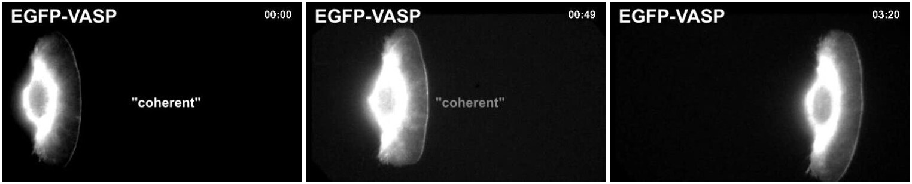{width="92%" fig-align="center"}

*A fish keratocyte crawling on glass (time in min:s; the cell is about 40 µm wide). Its front edge is labelled with a fluorescent actin-binding protein (EGFP-VASP).*

- A fish skin cell (keratocyte) crawls about **10–20 µm per minute**, about its own length every minute, and keeps its fan shape. White blood cells chasing bacteria are about as fast.
- It has no legs, no cilia and no flagellum. The front edge is a thin sheet, about **0.2 µm** thick. **What pushes it, and how does the cell steer?**

::: notes
These are frames from a movie of a keratocyte, a skin cell from a fish, crawling on a glass surface. A fluorescent protein marks the front edge, where actin grows. In about three minutes the top cell crosses most of the picture. Fish keratocytes are a favourite model because they move fast and steadily and keep the same fan shape for a long time. Many cells in your body crawl: white blood cells crawl out of blood vessels towards an infection, fibroblasts crawl into a wound to close it, and nerve cells send growth cones along paths in the developing brain. Cancer cells crawl too, which is how a tumour spreads. A crawling cell has no legs and no flagellum. The front of the keratocyte is a very thin sheet, the lamellipodium, only a fraction of a micrometre thick, and this sheet advances steadily. By the end of the lecture you will see that the front is pushed by actin filaments growing against the membrane, that adhesions grip the surface, and that the motor protein myosin pulls the rear forward. We will build this up from a single filament.
:::

## Three filament systems {.smaller}

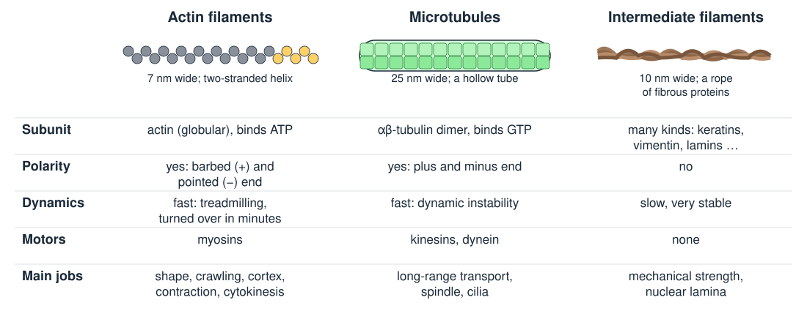{width="80%" fig-align="center"}

:::: {.columns}
::: {.column width="70%"}
- **Actin** and **microtubules** are polar, dynamic and carry **motor proteins**. **Intermediate filaments** are non-polar ropes that resist pulling.
- All three are built from **many small subunits** held by **non-covalent** bonds: quick to build, quick to take apart.
:::
::: {.column width="30%"}
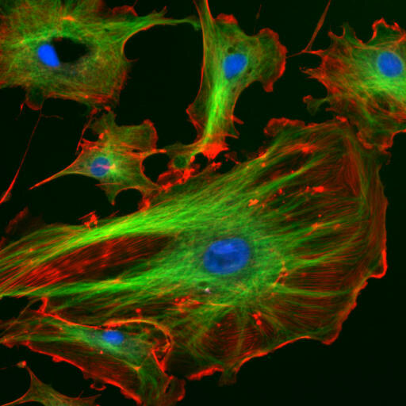{height="150px" fig-align="center"}
:::
::::

::: notes
Here is the whole cytoskeleton on one slide. Actin filaments are the thinnest, about seven nanometres wide, made of the globular protein actin, which binds ATP. Microtubules are hollow tubes, 25 nanometres wide, made of tubulin dimers that bind GTP. Intermediate filaments are about ten nanometres wide and built from long fibrous proteins that twist together like a rope; there are many kinds, such as keratins in skin and lamins in the nucleus. Actin filaments and microtubules have two different ends, so they are polar, and motor proteins walk along them in one direction: myosins on actin, kinesins and dynein on microtubules. Both are highly dynamic. Intermediate filaments have no polarity, no motors, and are much more stable; their job is mechanical strength. All three are polymers of small subunits held together by weak, non-covalent bonds, so the cell can build and dismantle them in seconds to minutes. The picture shows cultured cells stained for actin in red, microtubules in green and DNA in blue. Microtubules come in the next lecture; intermediate filaments in the one after.
:::

## G-actin and F-actin: a polar filament that splits ATP {.smaller}

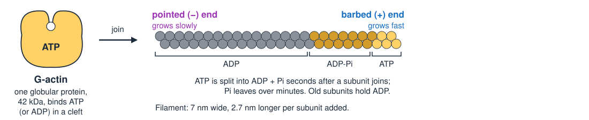{width="90%" fig-align="center"}

:::: {.columns}
::: {.column width="58%"}
- **G-actin** (globular) joins head-to-tail to form **F-actin** (filament), a two-stranded helix. One of the most abundant proteins in a cell.
- All subunits point the same way: the filament has a fast-growing **barbed (+) end** and a slow **pointed (−) end**.
- Soon after joining, each subunit **hydrolyses its ATP**. A young filament end carries an **ATP cap**; old parts hold **ADP**.
:::
::: {.column width="42%"}
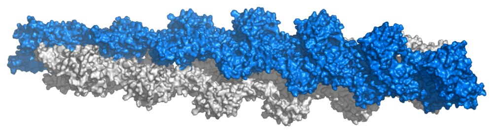{width="100%"}

*Atomic model of an actin filament, 13 subunits; one strand blue, the other white.*
:::
::::

::: notes
Actin is a 42-kilodalton globular protein, called G-actin when it is free. It has a deep cleft that holds one ATP or ADP molecule. G-actin subunits join head-to-tail to form a filament, F-actin, which looks like two strands twisted around each other. Because every subunit faces the same way, the two ends of the filament are different. The names barbed end and pointed end come from old electron micrographs: when myosin heads are bound along a filament, they look like arrowheads, and the barbed end is the feathered end of the arrow. Subunits join the barbed end much faster, so it is also called the plus end. Here is the important chemistry. Free actin binds ATP. A few seconds after a subunit has joined a filament, it hydrolyses its ATP to ADP and phosphate, and the phosphate leaves slowly, over minutes. ADP-actin binds its neighbours less tightly. So a growing filament has a fresh ATP region near the barbed end, and the older part is ADP-actin. This difference between young and old actin is how the cell knows which filaments to take apart.
:::

## The two ends have different critical concentrations {.smaller}

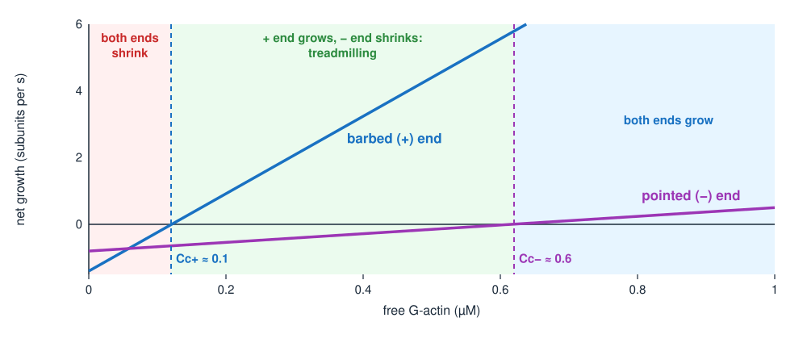{width="66%" fig-align="center"}

- At each end, subunits **join** at a rate proportional to [G-actin] and **leave** at a constant rate. Where the two balance is the **critical concentration (Cc)**.
- Below Cc an end shrinks; above it the end grows. Because of ATP hydrolysis, **Cc is lower at the barbed end** (about 0.1 µM) than at the pointed end (about 0.6 µM).

::: notes
Think of each filament end as a place where two reactions happen. Free actin joins with a rate equal to an on-rate constant times the G-actin concentration, and subunits leave with a constant off-rate. The net growth is the difference, a straight line against concentration. Where the line crosses zero, joining and leaving balance; that concentration is called the critical concentration. Below it, the end shrinks; above it, the end grows. You know this logic from chemical equilibrium: the critical concentration is like a dissociation constant. If the filament were made of ATP-actin only, both ends would have the same critical concentration, because the subunit is the same at both ends. But the barbed end usually carries ATP-actin and the pointed end old ADP-actin, which leaves more easily. Measured in the test tube, the critical concentration is about 0.1 micromolar at the barbed end and about 0.6 at the pointed end. That gives three zones. Below 0.1, both ends shrink. Above 0.6, both grow. In between, the barbed end grows while the pointed end shrinks. That middle zone is the topic of the next slide.
:::

## Treadmilling {.smaller}

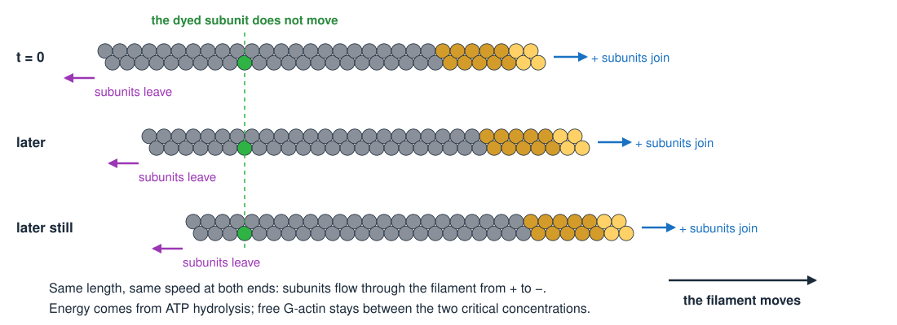{width="84%" fig-align="center"}

- Between the two critical concentrations, subunits **join the + end and leave the − end** at the same rate: the filament keeps its length and **moves forward**, while each subunit stays in place.
- This needs a constant supply of energy: **ATP hydrolysis**. **Try it:** [Demo: actin treadmilling](questions.qmd#explore)

::: notes
At one particular concentration between the two critical concentrations, about 0.2 micromolar in the test tube, the barbed end gains exactly as many subunits per second as the pointed end loses. The filament keeps the same length, but it moves through space, like the track of a tank or a treadmill. Look at the green subunit. It was labelled with a dye, and it stays at the same place while the filament moves past it to the right. Each subunit joins at the plus end, ages as it moves towards the minus end, and leaves from there, to be recharged with ATP and used again. This is a steady state, not equilibrium: it runs only because ATP is hydrolysed in the filament. A real lamellipodium works like this, but as a whole network rather than one filament, and much faster, because helper proteins speed up both joining at the front and loss at the back. In the demo you can move the concentration slider and watch a single filament grow, treadmill or shrink, and see the dyed subunits stand still.
:::

## Starting a filament: nucleators {.smaller}

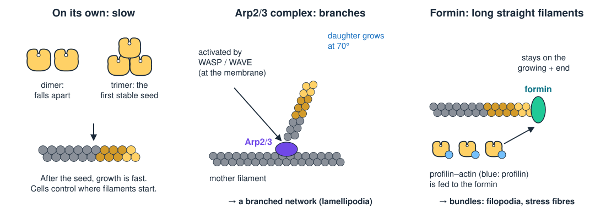{width="90%" fig-align="center"}

- Making a new filament from scratch is **slow**: a pair of actin molecules falls apart before a third one arrives. So the cell decides **where** filaments start.
- **Arp2/3 complex** binds the side of an existing filament and starts a **branch at 70°**. It is switched on by **WASP/WAVE** proteins at the membrane.
- **Formins** ride on the growing barbed end and make **long, unbranched** filaments.

::: notes
Once a filament exists, it grows fast. The hard part is starting one. Two actin molecules stick together only weakly and usually separate again before a third arrives; a trimer is the first stable seed. This step is so slow that a cell can keep a high concentration of free actin without filaments forming at random. Instead, the cell uses nucleators, which it places where it wants new filaments. The first is the Arp2/3 complex. Arp stands for actin-related protein: Arp2 and Arp3 look like actin and act as the first two subunits of a new filament. The complex sits on the side of an existing filament, the mother, and starts a daughter filament at an angle of about seventy degrees. Repeated branching makes a tree-like network. Arp2/3 is inactive until proteins of the WASP and WAVE family switch it on, and these sit at the plasma membrane. The second kind of nucleator is the formins. A formin forms a ring around the barbed end and stays attached while subunits are added, while it feeds in actin bound to profilin. Formins make long straight filaments, which cross-linkers gather into bundles.
:::

## Actin-binding proteins run the cycle {.smaller}

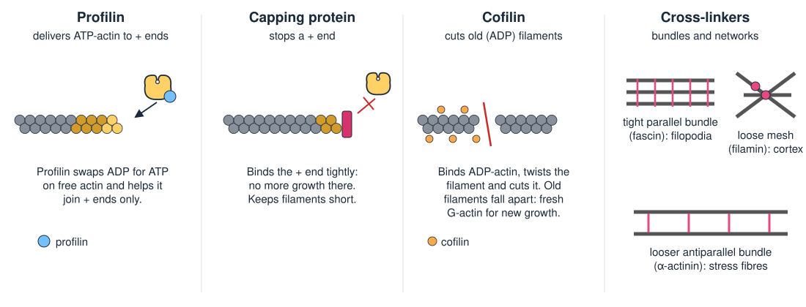{width="92%" fig-align="center"}

- In a cell, free actin is **tens of µM**, far above both critical concentrations. Yet filaments do not grow everywhere: **profilin** lets actin join only free + ends, and **capping protein** blocks most + ends.
- **Cofilin** takes old ADP filaments apart, so monomers come back for new growth.

::: notes
The test-tube rules hold in the cell, but a set of actin-binding proteins changes the speeds. Profilin binds free actin. It helps actin swap its ADP for ATP, and the profilin–actin complex can join a free barbed end but not a pointed end, and it does not start new filaments. Capping protein binds barbed ends very tightly and stops growth there, so filaments stay short and only new, uncapped ends grow. Cofilin binds the sides of old, ADP-containing filaments, twists them and cuts them. Cutting makes new ends and speeds up disassembly, which returns subunits to the pool. So the ATP clock in the filament marks old actin for destruction. Finally, cross-linking proteins hold filaments together. Fascin packs them into tight parallel bundles, as in filopodia. Alpha-actinin makes looser bundles with room for myosin, as in stress fibres. Filamin joins filaments at wide angles into a mesh, as in the cortex. A cell contains a high concentration of unpolymerised actin, tens of micromolar, mostly bound to profilin and to another small protein, thymosin. That pool is ready to grow fast wherever the cell uncaps or creates new barbed ends.
:::

## Four actin structures in one cell {.smaller}

:::: {.columns}
::: {.column width="64%"}
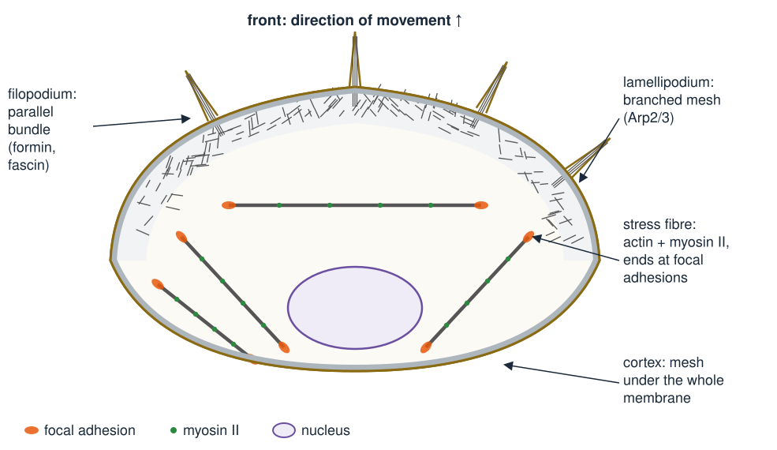{width="100%"}
:::
::: {.column width="36%"}
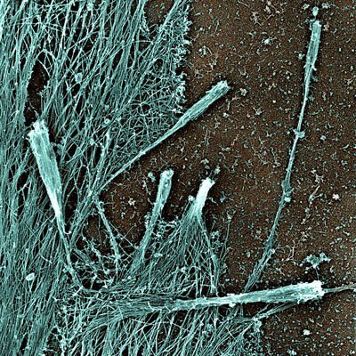{width="88%"}

*Electron micrograph of a cell edge: the lamellipodium's dense mesh (left) and filopodia filled with bundles of parallel filaments.*

- **Lamellipodium**, **filopodium**, **stress fibre**, **cortex**: the same actin, different helper proteins.
:::
::::

::: notes
With these building blocks a cell makes four main actin structures. At the front of a crawling cell is the lamellipodium, a thin sheet filled with a branched mesh made by Arp2/3; it pushes the leading edge. Filopodia are thin finger-like spikes that stick out from the edge. They contain a tight parallel bundle of long filaments made by formins and held together by fascin, with all barbed ends at the tip; filopodia explore the surroundings, like antennae. Stress fibres are thick bundles that cross the cell. They contain actin, the motor myosin II and alpha-actinin, and they end in focal adhesions, where the cell grips the surface. They can contract. Finally, the cortex is a thin mesh just under the whole plasma membrane. It gives the surface its stiffness and shape, and it is the layer that cuts the cell in two at cytokinesis. The electron micrograph on the right shows the real thing at the edge of a cultured cell: the dense mesh of the lamellipodium and the long bundles of filopodia growing out of it.
:::

## Rho, Rac and Cdc42: switches for actin {.smaller}

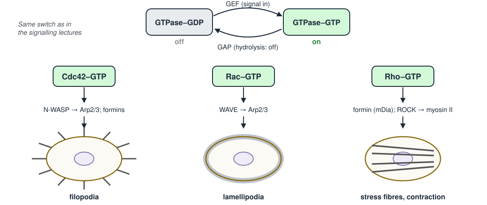{width="76%" fig-align="center"}

- Small **GTPases of the Rho family** are **on** with GTP and **off** with GDP. Signals turn them on through **GEFs**; **GAPs** turn them off.
- **Cdc42 → filopodia**, **Rac → lamellipodia**, **Rho → stress fibres** and contraction (via myosin II). How do we know: injecting active forms into resting fibroblasts made each structure within minutes.

::: notes
How does a cell decide where to build a lamellipodium or a stress fibre? The decision is made by three small GTPases of the Rho family: Cdc42, Rac and Rho. They work like the Ras switch you meet in the signalling lectures. Bound to GDP, they are off. A guanine nucleotide exchange factor, a GEF, activated by a signal from a receptor, swaps GDP for GTP and turns them on. A GTPase-activating protein, a GAP, helps them hydrolyse the GTP and turns them off. Each active GTPase switches on its own set of actin regulators. Cdc42 activates N-WASP, which activates Arp2/3, and formins: the result is filopodia. Rac activates the WAVE complex and Arp2/3: lamellipodia. Rho activates a formin called mDia, which makes long filaments, and a kinase called ROCK, which activates myosin II: stress fibres and contraction. This was found in a classic set of experiments around 1992 to 1995. Researchers starved fibroblasts so they had few actin structures, then microinjected active forms of each GTPase and stained the actin. Each GTPase produced its own structure within minutes. This is a simplified picture; in real cells the three also affect each other.
:::

## The crawling cycle: protrude, adhere, contract {.smaller}

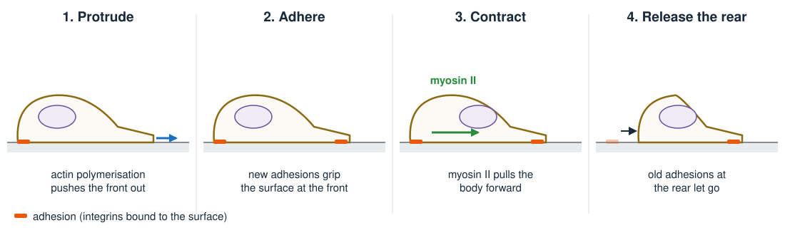{width="90%" fig-align="center"}

- At the **front**, active **Rac** builds a lamellipodium that pushes the membrane forward; new **adhesions** (integrins) grip the surface.
- At the **rear**, **Rho** activates **myosin II**, which pulls the cell body forward, and old adhesions let go. *(Myosin is the topic of the lecture on myosin and the mechanical cell.)*

::: notes
Now put the parts together. Cell crawling is a cycle of four steps that run at the same time in different parts of the cell. First, protrusion: at the front, Rac is active, and a lamellipodium pushes the membrane forward. Second, adhesion: the new front forms adhesions, where transmembrane proteins called integrins bind to proteins of the surface or the extracellular matrix, and link inside to the actin filaments. Third, contraction: myosin II, activated by Rho at the back and in the middle of the cell, pulls on actin filaments and drags the cell body forward. Fourth, release: adhesions at the rear come loose, so the rear can follow. The front and the rear must be different, so the cell is polarised: Rac and Cdc42 dominate at the front and Rho at the rear. If adhesion is too weak, the cell slips; if it is too strong, it cannot let go at the rear. That is why the fastest cells have medium adhesion. We look closer at the pushing step next, and at myosin in a later lecture.
:::

## How the lamellipodium pushes {.smaller}

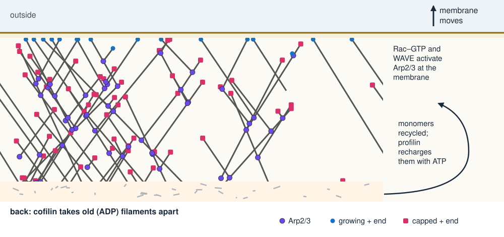{width="72%" fig-align="center"}

- **Front**: Rac and WAVE switch on Arp2/3 at the membrane; new branches start there. Their **+ ends grow against the membrane** and push it, a few nanometres at a time.
- **Capping protein** stops ends that fall behind, so actin goes to the ends at the front. **Back**: **cofilin** takes the old network apart; **profilin** returns the monomers to the front.

::: notes
Let us zoom into the lamellipodium. This picture is a snapshot from the model in the demo, drawn to scale: one micrometre of edge. At the membrane, Rac and the WAVE complex activate Arp2/3, so new branches start right behind the membrane. Their barbed ends grow towards the membrane. A single growing filament can push only with a small force; the membrane fluctuates a little, and each time a gap opens, another subunit slips in. Many filaments together push the whole edge forward. Filaments that point the wrong way, or fall behind, are capped by capping protein and stop. That is useful: by limiting the number of growing ends, the cell sends its actin to the ends that do the work. Behind the front, the network ages: its ATP is hydrolysed, cofilin binds and cuts the old filaments, and subunits are released. Profilin recharges them with ATP and they diffuse forward to be used again. So the whole lamellipodium treadmills, much like the single filament, but much faster. In the demo you can change the amounts of Arp2/3, capping protein and cofilin and measure how fast the edge moves.
:::

## How do we know? Seeing actin {.smaller}

:::: {.columns}
::: {.column width="44%"}
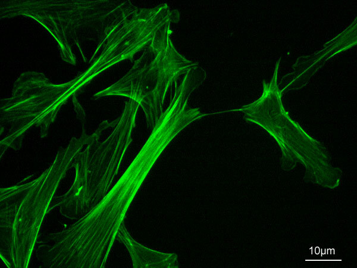{width="100%"}

*Mouse fibroblasts stained with fluorescent phalloidin: stress fibres and edges. Scale bar 10 µm.*
:::
::: {.column width="56%"}
- **Phalloidin**, a toxin from the death cap mushroom, binds **only F-actin**. With a fluorescent dye attached, it stains filaments in **fixed** cells (it does not enter living cells).
- **Live imaging**: express **GFP-actin** or **Lifeact-GFP** (a small actin-binding peptide) and film the cell.
- **Speckle microscopy**: very little labelled actin makes single **speckles** in the network. Speckles stay put or flow backwards while the edge moves forward: the network treadmills.
- **FRAP** (bleach and watch recovery, the membrane lecture) shows actin turns over in **seconds to minutes**.
:::
::::

::: notes
How do we see actin? The standard method for fixed cells is phalloidin. It comes from the death cap mushroom, Amanita phalloides, and it binds tightly between subunits of actin filaments, but not to free actin. Coupled to a fluorescent dye, it stains all filaments in a fixed and permeabilised cell, as in this picture of mouse fibroblasts, where the bright lines are stress fibres. Phalloidin does not cross the membrane of a living cell, and it would freeze the filaments if it did. For living cells we express a fluorescent actin-binding probe. GFP-actin is built into filaments; Lifeact is a short peptide of seventeen amino acids that binds filaments and is fused to GFP. Watching live cells shows how fast actin structures change. A clever trick is speckle microscopy: if only a tiny fraction of the actin carries a dye, the network looks speckled, and each speckle marks a group of subunits. In a lamellipodium the speckles do not move forward with the edge; they stay still or flow backwards and disappear further back. That is direct evidence that the network grows at the front and is taken apart at the back. FRAP, from the membrane lecture, gives the turnover time.
:::

## How do we know? Drugs as tools {.smaller}

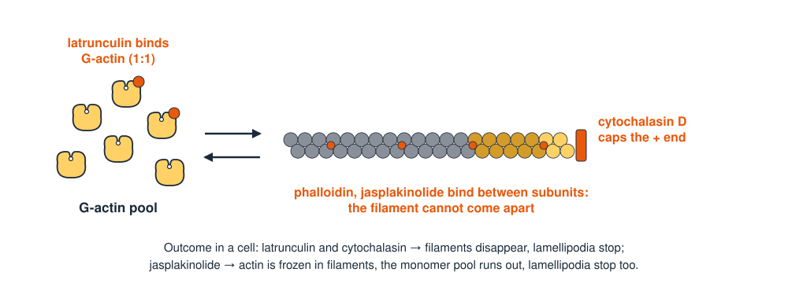{width="78%" fig-align="center"}

| Drug (source) | Target | Effect on filaments |
|---|---|---|
| **Latrunculin** (sponge) | binds **G-actin** | no new growth; filaments fall apart |
| **Cytochalasin D** (fungus) | caps **+ ends** | no growth at + ends |
| **Jasplakinolide** (sponge), **phalloidin** | binds **F-actin** | filaments cannot come apart |

::: notes
A powerful way to test whether a process needs actin is to block actin with a drug and see if the process stops. Several natural toxins act on actin, each at a different step. Latrunculin, from a Red Sea sponge, binds free G-actin one to one, so the free concentration falls below the critical concentration. Filaments stop growing and are taken apart. Cytochalasin D, from a fungus, binds barbed ends and blocks growth there, like capping protein. Jasplakinolide, from another sponge, and phalloidin stabilise filaments so they cannot come apart; jasplakinolide enters living cells, phalloidin does not. A surprise: both destroying and freezing actin stop a lamellipodium. Freezing works because the network can no longer be recycled, so the monomer pool runs out. This tells us that the turnover itself, not just the presence of filaments, is needed. In experiments, a lamellipodium stops within a minute of adding latrunculin or cytochalasin. Good experiments use a low dose, short times and a washout, because these drugs act on every actin structure in the cell. The demo lets you add latrunculin, cytochalasin and phalloidin to a single filament.
:::

## Why it matters: cancer spreads by crawling {.smaller}

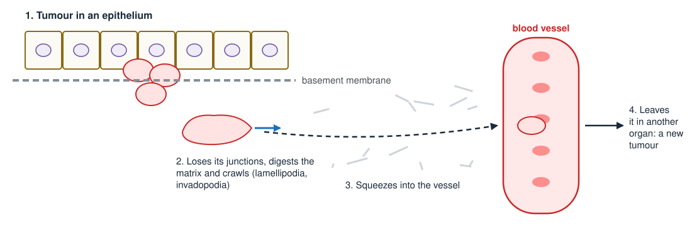{width="84%" fig-align="center"}

- Most cancer deaths are caused by **metastasis**: cells leave the primary tumour, **invade** the tissue, enter a vessel and grow elsewhere.
- Invading cells use the actin machinery of this lecture: **lamellipodia**, **invadopodia** (actin-rich protrusions that digest the matrix), **Rho/ROCK and myosin** to squeeze through gaps. Many tumours make more Rac, Cdc42 or their activators.
- Blocking migration in patients has been **hard**: actin is everywhere, and cells switch between crawling modes. Rho-kinase (ROCK) inhibitors are used for glaucoma; as anti-metastasis drugs they are still experimental.

::: notes
A primary tumour in a well-defined place can often be removed by surgery. The real danger is metastasis, when cells spread and form new tumours in other organs; most cancer deaths are caused by it. Metastasis starts with cell migration. A cancer cell in an epithelium loosens its junctions to its neighbours, crosses the basement membrane, crawls through the connective tissue, squeezes into a blood or lymph vessel, and later squeezes out somewhere else. Every step uses the actin machinery from this lecture. Invasive cells form lamellipodia and invadopodia, small actin-rich protrusions driven by Arp2/3 and cortactin that deliver enzymes to digest the matrix. They also use Rho, ROCK and myosin II to push their nucleus through narrow gaps. Many tumours make too much of Rac, Cdc42 or the proteins that turn them on. Drugs against migration have been disappointing so far. Actin is needed in every cell, including the heart, so a general actin drug is too toxic, and cancer cells can switch between a lamellipodium-based and a contraction-based way of moving. ROCK inhibitors such as netarsudil are approved for glaucoma, but not for cancer. You meet tumour biology in the disease course, and drug development in the course on clinical trials.
:::

## Why it matters: *Listeria* hijacks the lamellipodium machine {.smaller}

:::: {.columns}
::: {.column width="70%"}
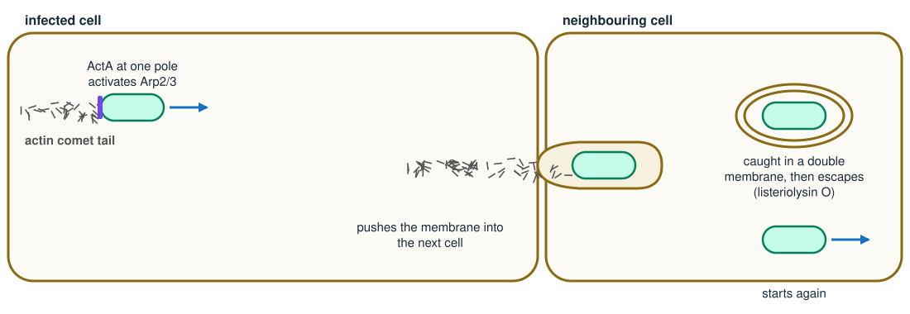{width="100%"}
:::
::: {.column width="30%"}
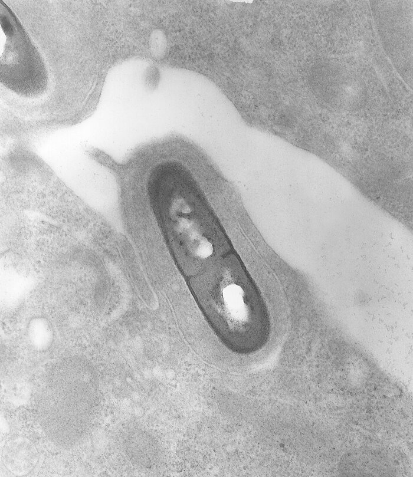{height="235px" fig-align="center"}

*Listeria monocytogenes in infected tissue (electron micrograph).*
:::
::::

- The food-borne bacterium *Listeria* makes **ActA** at one end. ActA acts like **WASP**: it switches on host **Arp2/3**, and a **comet tail** of branched actin pushes the bacterium through the cytosol at **several µm per minute**.
- It pushes into the **next cell** without leaving the cytosol, so it **escapes antibodies**. It is dangerous in pregnancy and for the immunocompromised.

::: notes
Our last example shows how good a machine the lamellipodium is: a bacterium steals it. Listeria monocytogenes causes listeriosis, a food-borne infection that can cross the placenta and the blood–brain barrier. It is dangerous in pregnancy, for newborns, old people and people with a weak immune system. After entering a cell, Listeria breaks out of its vacuole into the cytosol. It makes a surface protein called ActA at one pole only. ActA mimics the cell's own WASP proteins and switches on Arp2/3. The bacterium then sits at the front of its own little lamellipodium: a comet tail of branched actin forms behind it and pushes it through the cytosol at roughly the speed of a crawling cell. In the tail, the filaments stay still while the bacterium moves; it is treadmilling again. When the bacterium hits the plasma membrane, it pushes out a finger that is taken up by the neighbouring cell. Listeria then escapes from the double-membrane vacuole and starts again. It spreads from cell to cell without ever being outside, where antibodies could reach it. Famously, Listeria movement was rebuilt in a test tube with a handful of pure proteins: actin, Arp2/3, cofilin and capping protein, with ATP; profilin made it faster. Capping protein was essential. More in the course on microbial pathogenesis.
:::

## Summary {.smaller}

1. The cytoskeleton has three filament systems: **actin** (7 nm, ATP, polar, myosins), **microtubules** (25 nm, GTP, polar, kinesin and dynein) and **intermediate filaments** (10 nm, non-polar, strength).
2. **G-actin** polymerises into polar **F-actin** and then **hydrolyses ATP**. The **barbed (+) end** has a lower **critical concentration** than the **pointed (−) end**; between the two, filaments **treadmill**.
3. The cell controls actin with **nucleators** (**Arp2/3**: branches; **formins**: long filaments) and **actin-binding proteins** (**profilin**, **capping protein**, **cofilin**, **cross-linkers**), switched by **Cdc42, Rac and Rho**.
4. **Lamellipodia, filopodia, stress fibres and the cortex** are built from the same actin. A cell **crawls** by protruding, adhering, contracting (myosin II) and releasing its rear.
5. **Methods**: phalloidin staining, live imaging, speckles and FRAP, and **drugs** (latrunculin, cytochalasin, jasplakinolide). **Metastasis** and ***Listeria*** depend on this machinery.

*Read more (optional): Alberts et al., Molecular Biology of the Cell, 7th ed., ch. 16.*

[Image credits](../credits.qmd#actin){style="font-size:0.7em"}

::: notes
Five take-home points. First, the cytoskeleton has three filament systems with different subunits, widths and jobs; actin and microtubules are polar and dynamic and carry motors, intermediate filaments give strength. Second, actin polymerisation follows simple rules: subunits join and leave at each end, ATP is hydrolysed after joining, and the two ends have different critical concentrations, which allows treadmilling. Third, the cell decides where and when filaments grow with nucleators, actin-binding proteins and the Rho-family switches. Fourth, the same actin builds four structures, and crawling is a cycle of protrusion, adhesion, contraction and release. Fifth, you can see actin with phalloidin and live probes, and block it with drugs that act at specific steps, and the same machinery drives cancer cell invasion and the spread of Listeria. Next lecture: microtubules and motor proteins.
:::
