## About this lecture {.smaller}

Every day, tens of billions of your cells kill themselves, on purpose and without fuss. Today: **apoptosis**, the cell's built-in program for a clean death, and how the decision to start it is made.

After this lecture you can:

- explain **why** cells die by apoptosis (development, damage, immunity) and **what it looks like**;
- describe **caspases**: initiators and executioners, and the cleavage cascade;
- explain the **intrinsic pathway**: the **BCL-2 family**, **MOMP**, cytochrome c, the apoptosome and caspase-9, and the brakes (**IAPs**, SMAC);
- explain the **extrinsic pathway**: death receptors, FADD, caspase-8, and the link through **tBID**;
- describe how dead cells are **cleared** ("find me", "eat me") and how we **measure** apoptosis (annexin V/PI, TUNEL, western blots);
- explain how **venetoclax**, a BCL-2 inhibitor, treats leukaemia.

::: notes
This lecture is about a cell that decides to die. That sounds strange: why would evolution keep a program for suicide? We will see that apoptosis is as important as cell division. It shapes the body during development, removes damaged cells that could become cancer, and lets the immune system kill infected cells without damaging the tissue around them. We first look at what an apoptotic cell looks like. Then we meet the machines: caspases, which are proteases that take the cell apart, and the BCL-2 protein family, which decides at the mitochondria whether the caspases are switched on. There are two routes in, the intrinsic pathway from inside the cell and the extrinsic pathway from death receptors on the surface. We finish with how the body removes the dead cells, how we measure apoptosis in the lab, and a drug, venetoclax, that kills leukaemia cells by blocking BCL-2. Other forms of regulated cell death, such as necroptosis and ferroptosis, come in the next lecture. This lecture covers ELO 8.
:::

## The question: why would a cell kill itself? {.smaller}

:::: {.columns}
::: {.column width="38%"}
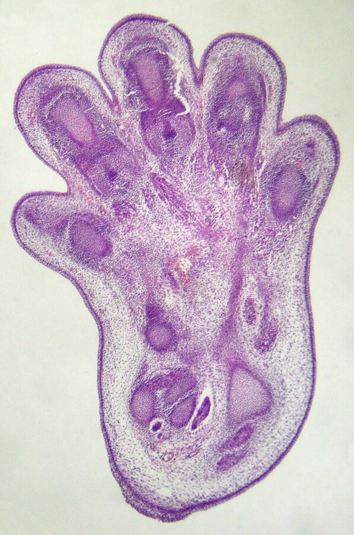{height="470px" fig-align="center"}

*Foot of a mouse embryo (day 15.5), stained section. The tissue between the digits is being removed.*
:::
::: {.column width="62%"}
- Your hands started as **paddles**. The fingers appeared because the cells **between** them died.
- In an adult, **tens of billions of cells die every day**, mostly in blood, gut and skin, and as many new cells are made.
- They die **quietly**: no inflammation, no scar. Neighbours eat them within an hour or two.
- Too **little** death: cancer, autoimmunity. Too **much**: neurodegeneration, damage after a stroke or heart attack.

**How does a cell decide to die, and how does it do it so cleanly?**
:::
::::

::: notes
Look at the picture. This is a thin section through the foot of a mouse embryo at day 15.5 of development, stained with dyes. The dark purple shapes are the cartilage models of the toe bones. At an earlier stage the foot is a flat paddle, and the toes are separated because the cells between them die on schedule. In ducks fewer of these cells die, and the webbing stays. Cell death is not rare. In an adult human, tens of billions of cells die every day, about as many as are made by cell division, mostly in the bone marrow, the gut lining and the skin. Yet you never notice: the dying cells are eaten by neighbours or by macrophages, usually within an hour or two, and there is no inflammation. Getting this balance right matters for health. If cells that should die survive, the result can be cancer or autoimmune disease. If too many cells die, the result can be neurodegeneration or extra damage after a stroke. Today's question: how does a cell make the decision, and how does it carry it out so neatly?
:::

## Three reasons to die {.smaller}

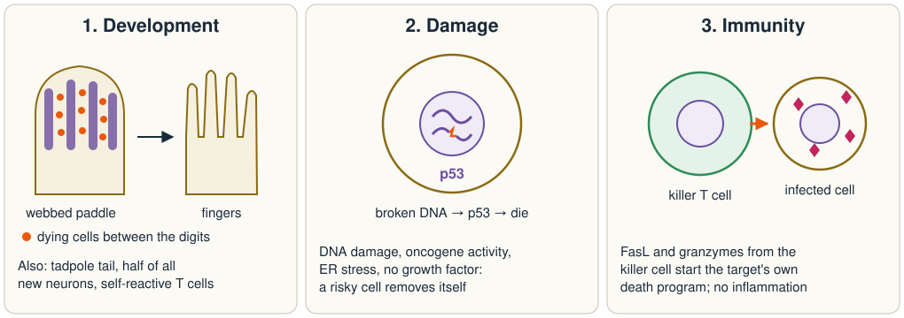{width="94%" fig-align="center"}

- **Development**: sculpt organs; remove cells that are not needed or not wired correctly (about half of the neurons made in development die); remove T cells that would attack the body.
- **Damage**: a cell with broken DNA or other serious stress removes itself before it can become dangerous. **p53** (the cell-cycle control lecture) is a key trigger.
- **Immunity**: killer T cells and NK cells **tell** an infected or cancer cell to run its own program.

::: notes
Biologists group the reasons for cell death into three. First, development. Tissues are sculpted by death, like the fingers, or the tadpole tail that disappears when the frog forms. The nervous system makes about twice as many neurons as it keeps; the neurons that fail to get enough survival signals from their targets die. In the thymus, young T cells that would react against the body's own proteins are removed by apoptosis. Second, damage. A cell with broken DNA, too much oncogene activity or an overloaded endoplasmic reticulum is a risk to the body. You met p53 in the cell-cycle control lecture: when DNA is damaged, p53 first stops the cell cycle, but if the damage is too great it switches on genes that make the cell die. This is why p53 is the most often mutated gene in cancer. Third, immunity. A killer T cell or a natural killer cell does not shred its target. It sends signals that make the target cell start its own apoptosis program. The common thread: the body removes a cell without harming its neighbours.
:::

## What apoptosis looks like {.smaller}

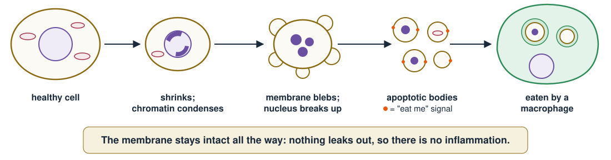{width="82%" fig-align="center"}

:::: {.columns}
::: {.column width="52%"}
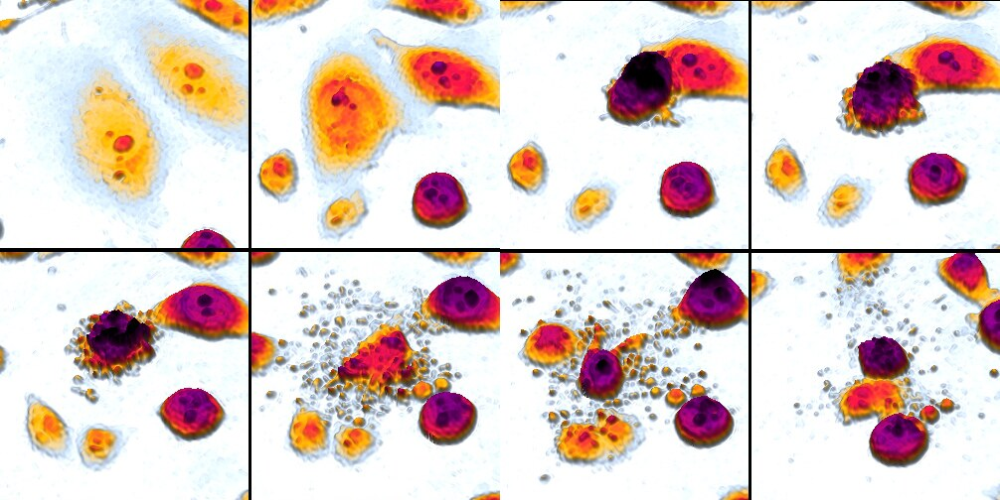{height="215px" fig-align="center"}

*Time-lapse frames of a prostate cancer cell dying after an anticancer drug (holographic microscopy; colour = cell thickness). Read left to right, top row first.*
:::
::: {.column width="48%"}
- The cell **shrinks**, the chromatin **condenses**, the membrane **blebs**.
- It falls apart into membrane-wrapped **apoptotic bodies**.
- Phagocytes eat them: **no leak, no inflammation**. (Death by **necrosis**, when a cell swells and bursts, is in the next lecture.)
:::
::::

::: notes
The word apoptosis comes from Greek, for leaves falling off a tree. It was coined in 1972 by Kerr, Wyllie and Currie, who saw the same series of shape changes in many tissues. The cell detaches from its neighbours and shrinks. The chromatin condenses into dense masses against the nuclear envelope, and then the nucleus breaks into pieces. The plasma membrane bulges out in blebs that form and retract, which you can see in time-lapse movies. Finally the cell breaks into small membrane-wrapped packages called apoptotic bodies. The frames below come from such a movie of a prostate cancer cell line treated with etoposide, a drug that damages DNA. The colour shows how thick each cell is. You can see the cell round up, bleb, and break into many small pieces. The key point is that the membrane stays intact the whole time. Nothing from inside the cell leaks out, so the immune system is not alarmed. In the next lecture you will compare this with necrosis, where a cell swells and bursts and causes inflammation.
:::

## Caspases: the executioners {.smaller}

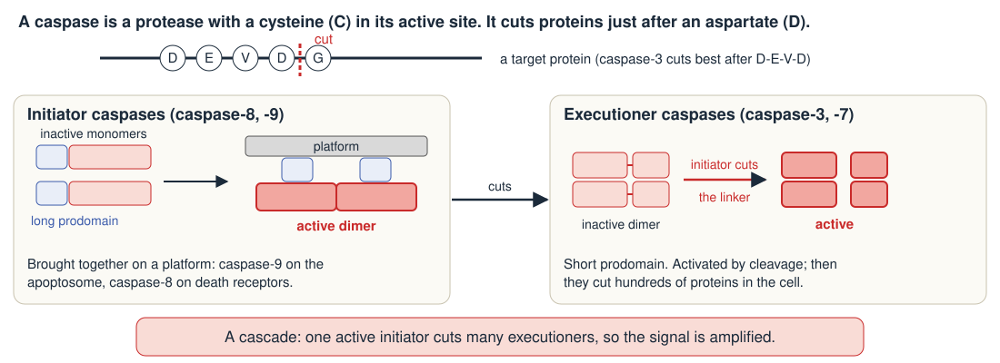{width="88%" fig-align="center"}

- Made as inactive **procaspases**, ready in every cell: death needs **no new proteins**.
- **Initiators** (caspase-8, -9) are switched on by being **brought together**; **executioners** (caspase-3, -7) by being **cut** by an initiator.

::: notes
The work of apoptosis is done by a family of proteases called caspases. The name tells you what they are: cysteine proteases that cut after aspartate. Each has a cysteine in its active site, and it cuts a target protein just after an aspartate residue, in a short recognition sequence; caspase-3, for example, prefers D-E-V-D. Every cell already contains the caspases as inactive precursors, the procaspases, so a cell can die within an hour without making any new protein. There are two kinds. Initiator caspases, caspase-8 and caspase-9, have a long prodomain that binds adaptor proteins. They float around as inactive monomers. When an adaptor platform assembles, it pulls several of them together; they form dimers and become active. This is called induced proximity. Executioner caspases, caspase-3 and caspase-7, are already dimers, but a linker blocks their active site. An active initiator cuts this linker, and the executioner becomes active. One initiator can cut many executioners, so the signal is amplified, like the kinase cascades in the signalling lectures. Once enough executioners are active, the process is hard to stop.
:::

## What the caspases cut {.smaller}

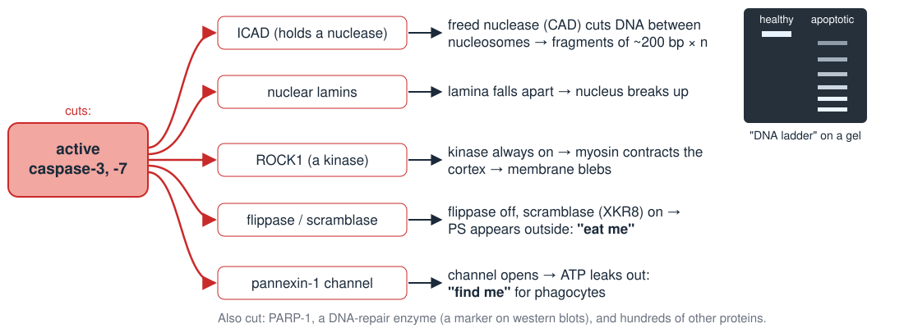{width="94%" fig-align="center"}

Each shape change on the previous slide is caused by **one cut** in a specific protein.

::: notes
Executioner caspases cut several hundred different proteins, and each cut explains part of the picture you saw. One target is ICAD, an inhibitor that holds a DNA-cutting enzyme, CAD, in check. When ICAD is cut, CAD enters the nucleus and cuts the DNA in the linker regions between nucleosomes. The fragments are about 200 base pairs long, or multiples of this, and on an agarose gel they form a ladder; this DNA ladder was one of the first lab tests for apoptosis. Cutting the nuclear lamins, the protein mesh under the nuclear envelope, lets the nucleus fall apart. Cutting the kinase ROCK1 removes its inhibitory tail, so it stays active and makes myosin contract the actin cortex, which pushes out the blebs. Caspases cut and switch off the flippase that keeps phosphatidylserine on the inside, and they activate the scramblase XKR8. You met these enzymes in the membrane-structure lecture. Phosphatidylserine appears on the outside, and this is the main "eat me" signal. Finally, caspases open pannexin channels, so ATP leaks out and attracts phagocytes. PARP-1, a DNA-repair enzyme, is also cut; we will use it on a western blot.
:::

## The intrinsic pathway starts at the mitochondria {.smaller}

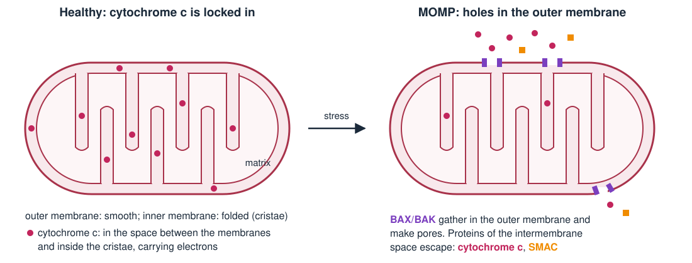{width="88%" fig-align="center"}

- **Cytochrome c** carries electrons in the space between the two mitochondrial membranes (the mitochondria lecture).
- Stress makes **BAX** and **BAK** punch holes in the **outer** membrane: **MOMP** (mitochondrial outer membrane permeabilisation). Within about 5 minutes, cytochrome c leaves **all** mitochondria of the cell.

::: notes
Most apoptosis in our bodies goes through the mitochondria, and this route is called the intrinsic pathway because it starts from signals inside the cell. Here is what you need to know about mitochondria for today. A mitochondrion has two membranes. The inner one is folded into cristae and carries the electron transport chain. Between the two membranes is the intermembrane space. Cytochrome c is a small, water-soluble protein that lives in this space and carries electrons from complex III to complex IV. It cannot cross the outer membrane, so in a healthy cell it never reaches the cytosol. When a cell commits to death, two proteins called BAX and BAK collect in the outer membrane and form pores. This is mitochondrial outer membrane permeabilisation, MOMP. Cytochrome c and other proteins of the intermembrane space, such as SMAC, escape into the cytosol. Experiments that follow fluorescent cytochrome c in single living cells show that once release starts, all mitochondria in the cell release within about five minutes. In practice MOMP is the point of no return: even if caspases are blocked, the cell usually dies because its mitochondria fail.
:::

## The BCL-2 family decides {.smaller}

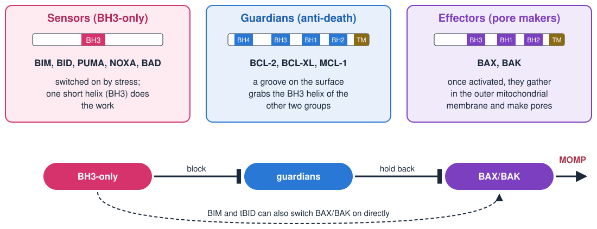{width="90%" fig-align="center"}

All three groups share **BH** (BCL-2 homology) regions. The **BH3 helix** of one protein fits into the **groove** of a guardian, like a key into a lock.

::: notes
Whether BAX and BAK make pores is decided by a family of proteins named after its first member, BCL-2. The family has three groups. The effectors, BAX and BAK, are the pore makers. The guardians, BCL-2, BCL-XL and MCL-1, prevent death. The sensors are the BH3-only proteins, such as BIM, BID, PUMA, NOXA and BAD. They are made or activated when the cell is stressed. All family members share short regions called BCL-2 homology regions, BH1 to BH4. The key interaction is simple. A guardian has a groove on its surface, and the BH3 helix of another family member fits into this groove. So guardians bind and hold back activated BAX and BAK. BH3-only proteins put their own BH3 helix into the groove and so block the guardians. Some BH3-only proteins, notably BIM and tBID, can also activate BAX and BAK directly. The result is a chain of inhibition: sensors block guardians, guardians block effectors. Hold on to this picture; the drug at the end of the lecture is an artificial BH3 helix.
:::

## A balance with a threshold {.smaller}

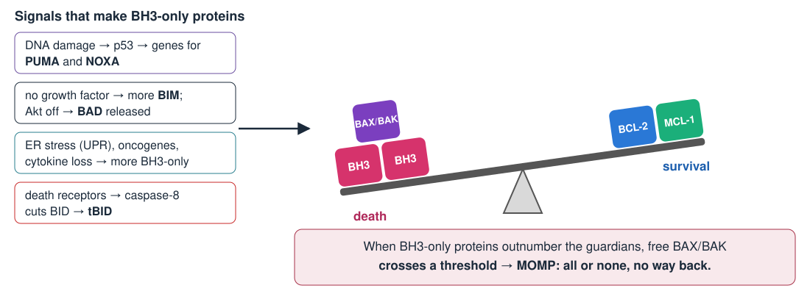{width="84%" fig-align="center"}

- The cell **adds up** its signals in one number: is there BAX/BAK that no guardian holds?
- Below the threshold: nothing happens. Above: **MOMP**, all or none. Cells differ, so in a population some die and some survive. **Try it:** [Demo: BCL-2 balance](questions.qmd#explore).

::: notes
Think of the BCL-2 family as a balance. On one side are BH3-only proteins and activated BAX and BAK; on the other side the guardians. Many different stresses feed into the BH3-only side. DNA damage activates p53, which switches on the genes for PUMA and NOXA. Loss of growth factors raises BIM, and when the survival kinase Akt, which you met in the kinase lecture, is switched off, BAD is released to act. ER stress, oncogene activity and loss of cytokines also raise BH3-only proteins. Death receptors make tBID, as we will see shortly. As long as the guardians can hold all of these, nothing happens. But once the pro-death side wins, free BAX and BAK accumulate, and above a threshold they make pores. This is an all-or-none decision for each cell: there is no half-way MOMP. Because cells differ in how much of each protein they make, the same treatment kills some cells in a dish and not others, and kills them at different times. The demo lets you move the balance yourself and watch a population of cells respond. This picture is simplified: different BH3-only proteins prefer different guardians.
:::

## Cytochrome c builds the apoptosome {.smaller}

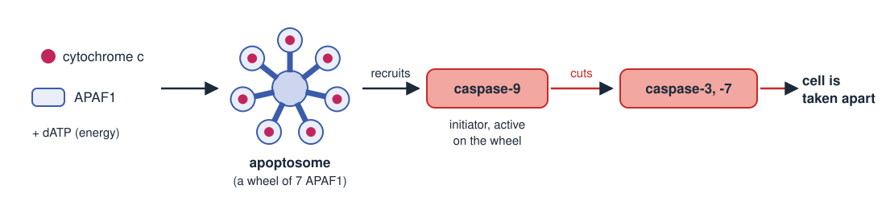{width="86%" fig-align="center"}

:::: {.columns}
::: {.column width="44%"}
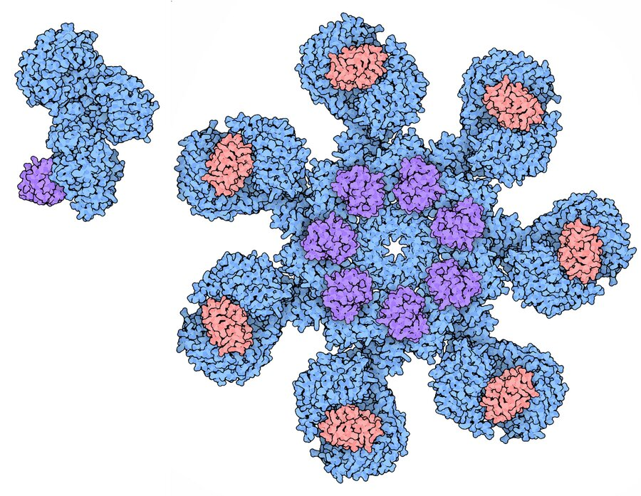{height="300px" fig-align="center"}
:::
::: {.column width="56%"}
- In the cytosol, cytochrome c binds **APAF1**. With dATP, seven APAF1 assemble into a **wheel**: the **apoptosome**.
- The hub gathers **caspase-9** (the platform of the caspase slide); active caspase-9 cuts caspase-3 and -7.

*Left: one APAF1, folded shut. Right: the apoptosome, with cytochrome c (pink-red) on each arm and the CARD domains (purple) in the centre, where caspase-9 binds.*
:::
::::

::: notes
What does cytochrome c do once it is in the cytosol? It binds a large protein called APAF1, which stands for apoptotic protease activating factor 1. On its own APAF1 is folded shut, as in the drawing on the left. Binding cytochrome c, together with exchange of its bound nucleotide for dATP or ATP, opens it up, and seven APAF1 molecules assemble into a wheel-shaped complex of about one megadalton: the apoptosome. The drawing on the right, by David Goodsell, is based on cryo-electron microscopy structures. The cytochrome c molecules, in pink-red, sit on the outer arms, and the CARD domains of APAF1 form a ring in the centre. Procaspase-9 has its own CARD domain, so it is recruited to the hub. Several caspase-9 molecules are brought close together and become active. This is the platform idea from the caspase slide. Active caspase-9 then cuts and activates the executioners, caspase-3 and caspase-7, and the cell is taken apart. Note the logic: a protein that normally carries electrons becomes a death signal simply by being in the wrong compartment.
:::

## Brakes on the caspases: IAPs and SMAC {.smaller}

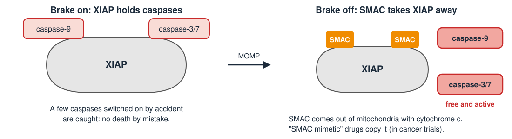{width="90%" fig-align="center"}

- **IAPs** (inhibitors of apoptosis, e.g. **XIAP**) bind active caspase-9, -3 and -7: a safety catch against accidental activation.
- **SMAC** leaves the mitochondria together with cytochrome c and pulls XIAP off: once MOMP has happened, the brake is released.

::: notes
A protease cascade that destroys the cell is dangerous, so cells add a safety catch. The inhibitor of apoptosis proteins, IAPs, bind caspases. The best studied is XIAP, which binds and blocks caspase-9, caspase-3 and caspase-7. If a small number of caspases become active by accident, XIAP catches them and the cell survives. But during real apoptosis the brake must come off. This is done by a second protein from the mitochondrial intermembrane space, called SMAC, or DIABLO. SMAC escapes during MOMP together with cytochrome c. Its first four amino acids fit into the same pockets of XIAP that hold the caspases, so SMAC pulls XIAP away and the caspases are free. So MOMP does two things at once: it builds the accelerator, the apoptosome, and it releases the brake. Some cancer cells make a lot of IAPs to survive. Drug companies have made small molecules that copy the end of SMAC, called SMAC mimetics, and these are being tested in cancer trials.
:::

## The extrinsic pathway: death receptors {.smaller}

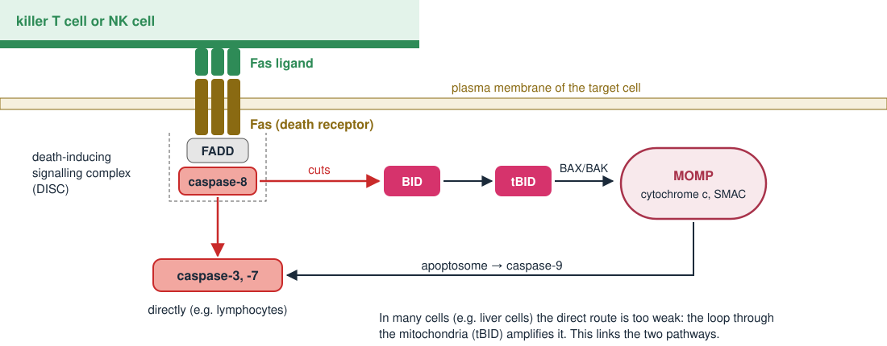{width="84%" fig-align="center"}

- **Death receptors** (Fas, TNF receptor 1, TRAIL receptors) bind their ligand, gather the adaptor **FADD**, and FADD gathers **caspase-8**: a second platform.
- Caspase-8 cuts **caspase-3/7** directly, and cuts **BID** to **tBID**, which switches on BAX/BAK: the two pathways **meet** at the mitochondria.

::: notes
The second route starts outside the cell, so it is called the extrinsic pathway. Some cells of the immune system, such as killer T cells and natural killer cells, carry Fas ligand on their surface. When it binds Fas, a death receptor on the target cell, the receptors cluster in groups of three. Inside the cell, each receptor has a death domain, which binds the adaptor protein FADD. FADD in turn binds procaspase-8 through another domain, the death effector domain. Together they form the death-inducing signalling complex, DISC. This is the second platform: procaspase-8 molecules are brought close together and become active. In some cells, such as lymphocytes, active caspase-8 is enough to cut caspase-3 and caspase-7 directly. In many others, such as liver cells, the direct route is too weak, partly because XIAP holds the executioners. Here caspase-8 also cuts a BH3-only protein, BID. Its truncated form, tBID, moves to the mitochondria and activates BAX and BAK. MOMP then releases cytochrome c and SMAC and amplifies the signal. So the two pathways are linked. Cells can also block the DISC with a protein called FLIP.
:::

## Clearing the dead: "find me" and "eat me" {.smaller}

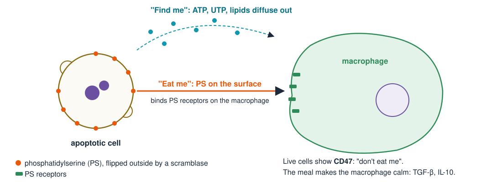{width="90%" fig-align="center"}

- **Find me**: ATP and UTP (from caspase-opened pannexin channels) and lipids attract phagocytes.
- **Eat me**: **phosphatidylserine** on the outer leaflet (the scramblase from the membrane-structure lecture). Eating apoptotic cells is called **efferocytosis**.

::: notes
The last step of apoptosis happens in another cell. A dying cell sends out "find me" signals: caspases open pannexin-1 channels in its plasma membrane, so ATP and UTP leak out, and lipids such as lysophosphatidylcholine are released. These molecules diffuse and attract macrophages and other phagocytes. When a phagocyte arrives, it must recognise the dying cell. The main "eat me" signal is phosphatidylserine. In the membrane-structure lecture you learned that flippases keep this negatively charged lipid in the inner leaflet. In apoptosis, caspases switch the flippase off and a scramblase on, so phosphatidylserine appears on the outside. Phagocytes have receptors that bind it, either directly or through bridging proteins in the blood. Healthy cells, by contrast, carry "don't eat me" signals such as CD47. The process of eating apoptotic cells is called efferocytosis. It does more than remove debris: macrophages that have eaten apoptotic cells release anti-inflammatory signals such as TGF-beta and interleukin-10. If clearance fails, dying cells eventually burst, their contents leak, and this is linked to autoimmune diseases such as lupus. You meet these cells again in immunology.
:::

## How do we know? Annexin V and PI by flow cytometry {.smaller}

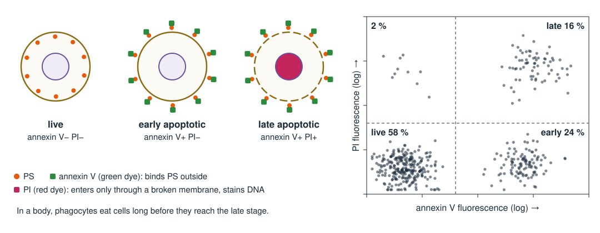{width="92%" fig-align="center"}

- **Annexin V** binds phosphatidylserine (needs Ca²⁺). **Propidium iodide (PI)** stains DNA, but only gets in through a broken membrane.
- Thousands of cells per second (flow cytometry, the cell-methods lecture): **live**, **early apoptotic**, **late apoptotic** in one plot. *Simulated data.*

::: notes
How do we count apoptotic cells? The most common method uses the eat-me signal. Annexin V is a protein that binds phosphatidylserine tightly when calcium is present. Coupled to a green fluorescent dye, it labels cells that show phosphatidylserine on the outside. Propidium iodide, PI, is a red dye that binds DNA, but it cannot cross an intact membrane. Cells are stained with both and run through a flow cytometer, which you met in the cell-methods lecture. Each dot in the plot is one cell. Live cells are negative for both, in the lower left. Early apoptotic cells have exposed phosphatidylserine but an intact membrane, so they are annexin V positive and PI negative, lower right. Late apoptotic cells have also lost membrane integrity: both positive, upper right. In a culture dish there are no phagocytes, so apoptotic cells eventually break open; this is called secondary necrosis. Cells that are PI positive but annexin V negative, upper left, are usually cells killed by direct membrane damage. Note one limitation: annexin V/PI tells you that cells die, and roughly when, but not by which pathway. For that you need caspase assays and inhibitors.
:::

## How do we know? DNA breaks and cut caspases {.smaller}

:::: {.columns}
::: {.column width="50%"}
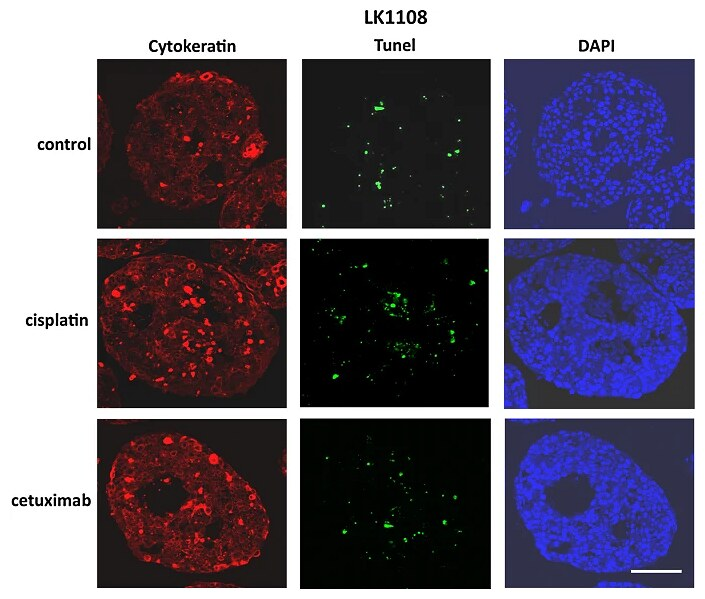{height="380px" fig-align="center"}

*TUNEL (green) in 3D balls of cancer cells, 7 days after two anticancer drugs. Red: cytokeratin; blue: all nuclei (DAPI). Scale bar 100 µm.*
:::
::: {.column width="50%"}
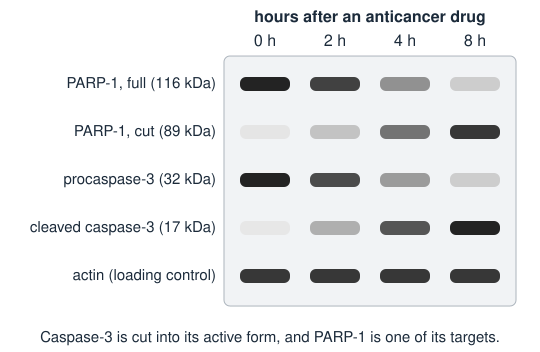{width="100%"}

- **TUNEL**: an enzyme adds labelled nucleotides to DNA **ends**, made by CAD. Works on **tissue sections**.
- **Western blot**: the **cleaved** caspase-3 and PARP-1 bands appear. **Live imaging**: reporters show when single cells release cytochrome c or activate caspases.
:::
::::

::: notes
Three more methods are used every day. TUNEL stands for terminal deoxynucleotidyl transferase dUTP nick end labelling. The enzyme terminal transferase adds nucleotides to free 3' ends of DNA. If the nucleotides carry a fluorescent label, every nucleus with many DNA breaks, the work of the nuclease CAD, lights up. The big advantage is that it works on fixed tissue sections. The picture shows balls of head-and-neck cancer cells grown in 3D; after treatment with cisplatin or cetuximab more nuclei are TUNEL positive, shown in green. Second, western blots, from the cell-methods lecture. An antibody against caspase-3 shows the full-length procaspase disappearing and the small cleaved fragment appearing. Antibodies against PARP-1 show the full-length protein, 116 kilodaltons, being cut to an 89-kilodalton fragment. The blot here is a sketch of a typical result. Third, live imaging: cells that express fluorescent cytochrome c or a fluorescent caspase sensor are filmed, so you can see when each cell crosses the threshold. These single-cell films showed that release is all or none and that the timing varies between cells.
:::

## How do we know? A worm found the genes {.smaller}

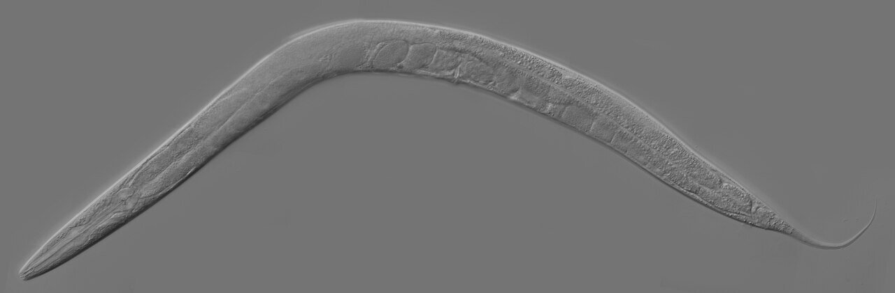{width="52%" fig-align="center"}

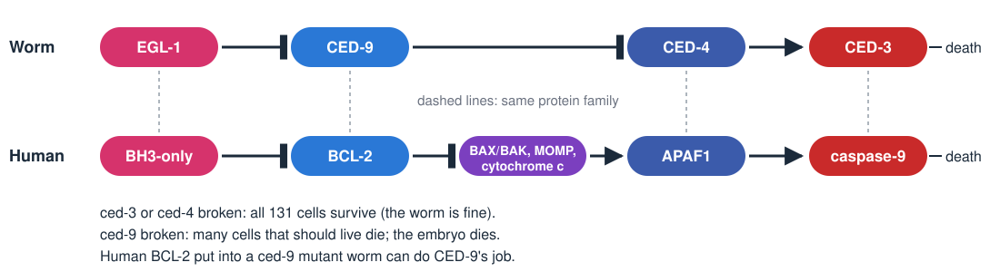{width="84%" fig-align="center"}

In the worm *C. elegans*, exactly **131 of 1090** cells die during development. Mutant screens found the death genes (Nobel Prize 2002).

::: notes
Much of what we know about apoptosis came from a millimetre-long worm, Caenorhabditis elegans. Its development is so regular that every cell division is known, and in every hermaphrodite worm exactly 131 of the 1090 cells that are made die, always the same ones. Robert Horvitz and colleagues searched for mutant worms in which these deaths did not happen or happened wrongly. They found ced-3 and ced-4, where ced stands for cell death abnormal. Without either gene, all 131 cells survive. They found ced-9, whose loss makes many cells die that should live, and egl-1, which triggers death in specific cells. Then came the surprise: the worm genes have human counterparts. CED-3 is a caspase, CED-4 is like APAF1, CED-9 is like BCL-2, and EGL-1 is a BH3-only protein. Human BCL-2 can even replace CED-9 in a mutant worm. The human pathway has an extra step through the mitochondria, but the logic is the same. Sydney Brenner, Robert Horvitz and John Sulston shared the Nobel Prize in 2002. The picture shows an adult worm in a light microscope.
:::

## Why it matters: venetoclax in leukaemia {.smaller}

:::: {.columns}
::: {.column width="36%"}
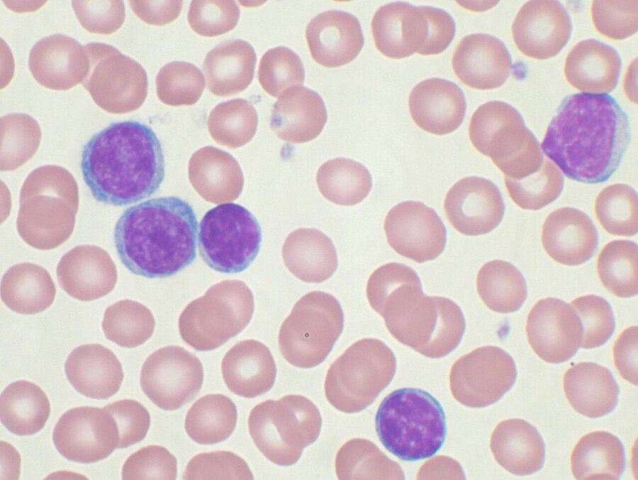{width="100%"}

*Blood smear in chronic lymphocytic leukaemia (CLL): many small lymphocytes with dark nuclei.*
:::
::: {.column width="64%"}
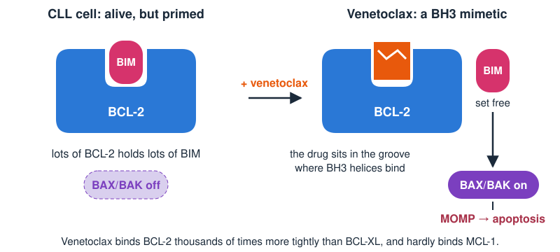{width="100%"}
:::
::::

- **CLL** cells make far too much **BCL-2**. They live too long, and pile up in blood, marrow and lymph nodes.
- **Venetoclax** is a **BH3 mimetic**: it fits the BH3 groove of BCL-2 (as on the BCL-2 family slide). Approved in **2016**.

::: notes
Chronic lymphocytic leukaemia, CLL, is the most common leukaemia in adults in Europe. Mature B lymphocytes accumulate in the blood, bone marrow and lymph nodes, as in the smear on the left. The CLL cells do not divide unusually fast; they fail to die. Almost all of them make very high levels of BCL-2, often because a deletion on chromosome 13 removes two microRNAs that normally keep BCL-2 low. BCL-2 itself was discovered in another blood cancer, follicular lymphoma, where a chromosome translocation puts it under a strong immunoglobulin promoter; it was the first cancer gene shown to work by blocking death rather than by driving division. Here is the key insight. A CLL cell is not just protected; it is primed. Its BCL-2 is busy holding a lot of BIM. Venetoclax is a small molecule designed to fit exactly into the BH3 groove of BCL-2, where BIM binds. It is called a BH3 mimetic. It displaces BIM, BIM activates BAX and BAK, and the cell undergoes MOMP within hours. Venetoclax was approved in 2016 and is now used in CLL and, with other drugs, in acute myeloid leukaemia.
:::

## Why it matters: using venetoclax safely, and resistance {.smaller}

:::: {.columns}
::: {.column width="48%"}
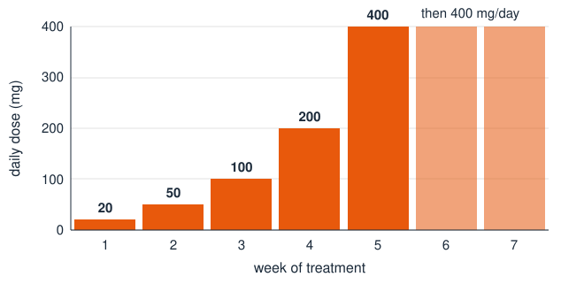{width="100%"}

*The dose is raised step by step over 5 weeks.*
:::
::: {.column width="52%"}
- **Too much death at once**: millions of leukaemia cells die within hours and release K⁺, phosphate and nucleic acids (→ uric acid): **tumour lysis syndrome** can damage the kidneys. Hence the **ramp-up**.
- **Selectivity**: an earlier drug (navitoclax) also blocked **BCL-XL**, which **platelets** need to survive. Venetoclax spares BCL-XL.
- **Resistance**: cells that rely on **MCL-1**, or with a BCL-2 mutation that blocks the drug's fit.
:::
::::

::: notes
Venetoclax shows how knowing the mechanism helps to use a drug safely. Because CLL cells are primed, the first doses can kill a large number of them within hours. Their contents flood the blood: potassium, phosphate, and nucleic acids that are broken down to uric acid. This is tumour lysis syndrome, which can damage the kidneys and disturb the heart rhythm. Patients therefore start with 20 milligrams a day and the dose is raised every week until it reaches 400 milligrams, with fluids and blood tests. Second, selectivity matters. An earlier BH3 mimetic, navitoclax, blocked both BCL-2 and BCL-XL. Platelets, which have no nucleus, depend on BCL-XL to survive, so navitoclax lowered platelet counts. Venetoclax was designed to bind BCL-2 thousands of times better than BCL-XL. Third, resistance. Leukaemia cells that make more MCL-1, which venetoclax does not bind, survive; so do cells with mutations in the BCL-2 groove, such as G101V, which lower the drug's binding. Try the MCL-1 preset in the demo. The design of such trials returns in Kliniska prövningar och läkemedelsutveckling, and CLL in Sjukdomslära.
:::

## Summary {.smaller}

1. **Apoptosis** is a clean, programmed death: the cell shrinks, blebs and breaks into apoptotic bodies that are eaten **without inflammation**. It serves **development**, removes **damaged** cells and is used by the **immune system**.
2. **Caspases** do the work: **initiators** (8, 9) are activated on platforms, **executioners** (3, 7) are cut by initiators and cut hundreds of proteins (DNA ladder, blebs, PS outside).
3. **Intrinsic pathway**: BH3-only sensors block the guardians (**BCL-2**, MCL-1), free **BAX/BAK** cross a threshold → **MOMP** → cytochrome c → **apoptosome** → caspase-9; SMAC removes the **IAP** brake.
4. **Extrinsic pathway**: death receptors → FADD → **caspase-8** → caspase-3/7, and **tBID** links it to the mitochondria. Dead cells say **"find me"** (ATP) and **"eat me"** (phosphatidylserine).
5. We measure apoptosis with **annexin V/PI**, **TUNEL**, **cleaved caspase-3/PARP** and live imaging. **Venetoclax**, a BH3 mimetic, kills BCL-2-dependent leukaemia cells.

*Read more (optional): Alberts et al., Molecular Biology of the Cell, 7th ed., ch. 18.*

[Image credits](../credits.qmd#apoptosis){style="font-size:0.7em"}

::: notes
Five take-home points. First, apoptosis is a tidy form of cell death with a typical look: shrinking, condensed chromatin, blebs, apoptotic bodies, and rapid eating by phagocytes, so there is no inflammation. It shapes the body in development, removes damaged cells and is the immune system's way to kill infected cells. Second, caspases are proteases made as inactive precursors. Initiators are switched on by being brought together on a platform, executioners by being cut, and the executioners cut hundreds of proteins, which explains the shape changes. Third, the intrinsic pathway is decided by the BCL-2 family at the mitochondria: when BH3-only proteins outweigh the guardians, free BAX and BAK make pores, cytochrome c leaves, and the apoptosome activates caspase-9; SMAC releases the IAP brake. Fourth, the extrinsic pathway goes from death receptors through FADD to caspase-8, and tBID connects it to the mitochondria; the dead cells are found and eaten through ATP and phosphatidylserine. Fifth, you should be able to choose a method to detect apoptosis, and to explain how venetoclax works. In the next lecture we meet the other ways a cell can die.
:::
