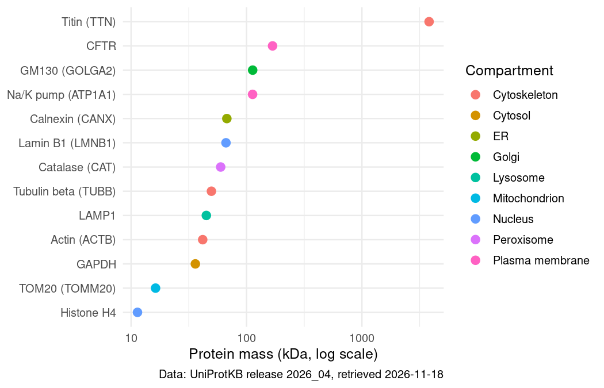

```{=html}
<style>
  /* Long URLs and code (queries, R calls) wrap on narrow screens. */
  main a, main p code, main li code { overflow-wrap: anywhere; }
  main p code, main li code { white-space: pre-wrap; }
</style>
```

## Today

You look up where proteins live, using the same kind of evidence as in the lectures:
an annotated database entry (**UniProt**), real immunofluorescence images (**Human
Protein Atlas**), and a cell-line register (**Cellosaurus**). Then you write your
first **R Markdown report**: it fetches protein sizes from UniProt and plots them.

**Builds on:** [A tour of the cell](../cell-tour/lec.qmd) (organelles, scale, HeLa),
[Seeing cells: microscopy](../microscopy/lec.qmd) (immunofluorescence) and
[Taking cells apart and perturbing them](../cell-methods/lec.qmd) (marker proteins, cell lines, single-cell
omics). **ELO 1, 5.**

**Time:** Part A about 1.5 h, Part B about 1.5–2 h.

## Before you start

1. **Download the report template:**
   [bioinfo-protein-atlas.Rmd](bioinfo-protein-atlas.Rmd){download="bioinfo-protein-atlas.Rmd"}.
   Put it in a new, empty folder (for example `cellbio-bioinfo/`).
2. **Check R.** In R, run:

   ```r
   packageVersion("rmarkdown")   # an error means: install.packages("rmarkdown")
   packageVersion("ggplot2")     # an error means: install.packages("ggplot2")
   ```

   Knitting also needs **Pandoc**. RStudio includes it. If you work from the
   command line, check with `rmarkdown::pandoc_available()` (should be `TRUE`).
3. **No logins** are needed for any of today's websites.
4. Keep a notes file or the template open: you fill a small table during Part A.

::: {.callout-tip title="Three kinds of names for one protein"}
Databases name the same thing in different ways. Learn to tell them apart today;
every later bioinformatics day uses all three.

- **Gene symbol** (HGNC), e.g. `CANX`: names the human gene; short and readable,
  but genes are sometimes renamed.
- **UniProt accession**, e.g. `P27824`: names the protein entry; stable, so use it
  to cite a protein.
- **Ensembl gene ID**, e.g. `ENSG00000127022`: names the gene in the genome
  sequence; stable (a version number such as `.17` may be added; leave it out).

Gene and protein names differ too: the Golgi marker **GM130** in the lecture is the
gene **GOLGA2**; TOM20 is **TOMM20**.
:::

## Part A: in the browser

Write what you find in the table at the top of your `.Rmd` template (section
"Part A"). The answers to the tasks are further down; try first.

### A1. UniProt: a protein entry

[UniProt](https://www.uniprot.org) collects what is known about each protein.
Its **reviewed** part (Swiss-Prot) is curated by experts who read the papers; the
**unreviewed** part (TrEMBL) is mostly computed from genome sequences.

1. Go to <https://www.uniprot.org>. Type `CANX human` in the search box (the menu
   next to it should say **UniProtKB**) and press **Search**. Note how many results
   there are.
2. In the filters on the left, under **Status**, click **Reviewed (Swiss-Prot)**.
   How many are left? Most results are not calnexin at all: they are proteins whose
   entry *mentions* calnexin, and calnexin from other species.
3. Open the entry with accession **P27824** (entry name `CALX_HUMAN`). Direct link:
   <https://www.uniprot.org/uniprotkb/P27824/entry>.
4. In the header, find the **accession**, the **length** ("Amino acids"), the
   **annotation score** and **protein existence**.
5. Click **Subcellular Location** in the menu on the left. Read the "UniProt
   Annotation" part: where is calnexin, and how does it sit in the membrane
   (topology)?
6. Each statement has an **evidence tag** next to it, such as "1 Publication",
   "By similarity" or "Sequence analysis". Click or hover over one: UniProt shows the
   evidence code (ECO number) and its source. Find one location that is backed by an
   experiment and one that is only inferred.
7. Click **Function** and read the first paragraph: what does calnexin do in the ER?

### A2. Human Protein Atlas: the protein in a real cell

The [Human Protein Atlas](https://www.proteinatlas.org) (HPA) stains thousands of
proteins with antibodies in cultured human cells and images them by confocal
immunofluorescence: the method from the
[microscopy lecture](../microscopy/lec.qmd#/labelling-a-protein-in-fixed-cells-immunofluorescence).

1. Go to <https://www.proteinatlas.org>, type `CANX` in the search box and open the
   gene. The gene summary page shows the **Ensembl ID** and the UniProt accession.
   (Direct link: <https://www.proteinatlas.org/ENSG00000127022-CANX>.)
2. In the row of section names at the top of the gene page, click **SUBCELLULAR**.
3. Read the summary: **Main location**, **Reliability score** and the antibody
   names. The reliability score (Enhanced > Supported > Approved > Uncertain) says
   how well the staining agrees with other evidence, for example a second antibody
   or the UniProt annotation.
4. Look at the images. The **protein of interest is green**; the reference stains
   are the nucleus (blue), microtubules (red) and the ER (yellow). Click an image to
   enlarge it, and use the buttons above it to switch channels on and off. Which
   cell lines were used?
5. Compare with the [map of the animal cell](../cell-tour/lec.qmd#/a-map-of-the-animal-cell)
   from the first lecture: does calnexin look like the ER in the cartoon (a network
   around the nucleus, continuous with the nuclear envelope)?

### A3. Organelle markers

[Marker proteins](../cell-methods/lec.qmd#/density-gradients-and-marker-proteins)
identify organelles in fractionation and microscopy. Repeat A1 (accession and
UniProt location only) and A2 (HPA main location and reliability) for:

- **TOMM20** (TOM20), **GOLGA2** (GM130), **LMNB1** (lamin B1), **CAT** (catalase),
  **LAMP1**.

Tip: in UniProt, search `TOMM20 human` and filter Reviewed, or use the gene search
`gene:TOMM20 AND organism_id:9606`. In HPA, the search box takes the gene symbol.

Look at each image for a moment. Mitochondria, Golgi and nuclear envelope have
shapes you know from the [HeLa cell explorer](../cell-tour/explore.qmd). Not every
protein has every kind of data: if a section is missing or empty, write that down.
It is a result too.

### A4. HPA single-cell: which cells make the protein?

The Subcellular section shows *where in a cell* a protein is. The **Single cell**
section shows *which cell types* make its mRNA, measured by
[single-cell RNA sequencing](../cell-methods/lec.qmd#/single-cell-omics-a-census-of-cells)
of many human tissues.

1. In HPA, search `INS` (insulin), open the gene and click **SINGLE CELL** in the
   section row.
2. Read the **single cell type specificity** and the bar chart of all cell types
   (nCPM, normalised counts per million). Which cell type stands out, and by how much?
3. Do the same for **CANX**. What is the difference in the pattern, and why does it
   make sense for an ER chaperone?

### A5. Cellosaurus: is the culture what you think it is?

Every cell line has an entry in [Cellosaurus](https://www.cellosaurus.org), with a
stable accession (`CVCL_…`) that papers use to say exactly which cells they used.

1. Open HeLa: <https://www.cellosaurus.org/CVCL_0030>.
2. Find: **species of origin**, **disease**, **sex of cell**, **age at sampling**, and
   the **Virology** or **Transformant** comment (which virus?).
3. In **Comments**, find the "Miscellaneous" line about contamination. Then scroll
   to the **STR profile**: this DNA fingerprint is how a lab checks its HeLa really
   is HeLa (lecture: [is the culture what you think it is?](../cell-methods/lec.qmd#/is-the-culture-what-you-think-it-is)).
4. Open HEp-2: <https://www.cellosaurus.org/CVCL_1906>. Read the **Problematic cell
   line** comment. What was HEp-2 thought to be, and what is it?

## R Markdown in five minutes

An **R Markdown** file (`.Rmd`) is a plain text file that mixes **text** and **R
code**. **Knitting** runs all the code from top to bottom and writes one HTML file
with your text, code, tables and plots. Instead of copying numbers by hand into a
spreadsheet and a document, the report *is* the analysis: anyone can re-run it and
get the same result, and if the data change, the numbers in your text change with
them. Every later bioinformatics day uses this format.

The parts of the template:

- **YAML header** between the two `---` lines at the top: title, author, date and
  output format. Put your name in `author:`.
- **Text** in Markdown: `# Heading`, `**bold**`, `*italic*`, lists with `-`,
  tables with `|`.
- **Code chunks** start with ```` ```{r chunk-name} ```` and end with ```` ``` ````.
  Options go after the name, for example `fig.width = 7`.
- **Inline R** in text: a backtick, `r`, a space, an R expression and a backtick.
  Writing `` `r 2 + 2` `` in your text gives **4** in the HTML.

**How to knit:**

- In **RStudio**: open the file and click **Knit** (or Ctrl/Cmd+Shift+K).
- From the **command line**, in the folder with the file:

  ```bash
  Rscript -e 'rmarkdown::render("bioinfo-protein-atlas.Rmd")'
  ```

  Then open `bioinfo-protein-atlas.html` in a browser.

::: {.callout-important title="Knitting starts from an empty R session"}
Objects you made in the R console **do not exist** while knitting. If the report
needs an object, a chunk in the report must create it. "object 'x' not found" in
the HTML almost always means this.
:::

## Part B: in R Markdown

### B1. Knit the template untouched

Open `bioinfo-protein-atlas.Rmd` and knit it before you change anything. You get
an HTML report with a hidden setup chunk, the Part A table, a table of 13 proteins
and red **Error** messages where your code is still missing ("object 'proteins' not
found"). That is expected: the setup chunk sets `error = TRUE`, so the report knits
even when a chunk fails. Look at the HTML and find each part of the `.Rmd` in it.
Put your name in the YAML header and knit again.

### B2. Fetch the data from UniProt (your chunk 1)

UniProt has a **REST API**: an address that returns data instead of a web page.
[This address](https://rest.uniprot.org/uniprotkb/accessions?accessions=P27824,Q15388&fields=accession,gene_primary,length,mass&format=tsv)
returns the length and mass of two proteins as a tab-separated table (TSV). Open it
in your browser to see what R will get. The address has three pieces:

```text
base:        https://rest.uniprot.org/uniprotkb/accessions?accessions=
accessions:  P27824,Q15388,...        (separated by commas, no spaces)
fields:      &fields=accession,gene_primary,protein_name,length,mass&format=tsv
```

In the chunk `uniprot-fetch`:

1. Make the comma-separated accessions from the `markers` table with
   `paste(markers$accession, collapse = ",")`.
2. Glue the three pieces together with `paste0()` into `uniprot_url`.
3. Read it: `proteins <- read.delim(uniprot_url)`. `read.delim()` reads a
   tab-separated table from a file **or a web address**.
4. Print `head(proteins)` and knit. The next (given) chunk saves a dated copy in a
   `data/` folder, records the UniProt release and adds `mass_kda`.

Look at the column names R made: `Gene.Names..primary.` R replaces spaces and
brackets in column names with dots. The mass is in **daltons** (Da).

### B3. Largest and smallest (your chunk 2)

In the chunk `largest-smallest`, find the heaviest and the lightest protein:
`which.max(proteins$Mass)` gives the **row number** of the largest value, so
`proteins[which.max(proteins$Mass), ]` is that row. Store the two rows as `largest`
and `smallest`, and `ratio <- largest$Mass / smallest$Mass`.

### B4. Plot on a log scale (your chunk 3)

In the chunk `mass-plot`, make a dot plot with `ggplot2`:

- `aes(x = mass_kda, y = label, colour = compartment)` and `geom_point()`;
- `scale_x_log10()` for a logarithmic x axis;
- `labs()` with an x-axis label **with its unit** and a `caption` naming the source,
  for example `paste("Data: UniProtKB release", uniprot_release)`.

Try the plot **without** `scale_x_log10()` first and look at it. Then add it.
Optional: `y = reorder(label, mass_kda)` sorts the rows by mass.

### B5. Write the result

Under "What the plot shows", write two or three sentences: which protein is largest
and smallest, how many times heavier, and why the log axis was needed. Put at least
one number in with inline R, for example the ratio as `` `r round(ratio)` ``.
Knit, read your HTML, and fill in the date you used the websites in the "Data"
section.

::: {.callout-warning title="If UniProt is down"}
In the setup chunk, change `use_snapshot <- FALSE` to `use_snapshot <- TRUE` and
knit again. Your chunk 1 is then skipped and the report reads the course's saved
copy of the same query (made on 2026-11-18, UniProt release 2026_04). It downloads
the copy from this site; you can also save
[the snapshot](data/uniprot-proteins-2026-11-18.csv){download="uniprot-proteins-2026-11-18.csv"}
into a `data/` folder next to your `.Rmd`.
:::

## Tasks

**T1.** `[ELO 1]` *Identifiers and evidence.* Give the gene symbol, UniProt
accession and Ensembl gene ID of human calnexin. Where in the cell is it according
to UniProt, how does it sit in the membrane, and what kind of evidence supports the
location?

::: {.callout-note collapse="true" title="Answer (checked 2026-11-18)"}
Gene **CANX**, UniProt **P27824** (entry name CALX_HUMAN, reviewed, 592 amino acids),
Ensembl **ENSG00000127022**. Location: **endoplasmic reticulum membrane**,
**single-pass type I** membrane protein: one transmembrane helix, with the large
N-terminal part (after the signal peptide) in the ER lumen and a short C-terminal
tail in the cytosol. The ER location carries the tag "1 Publication" (ECO:0000269,
experimental evidence from a paper); the topology is "Sequence analysis"
(ECO:0000255, predicted from the sequence). UniProt also lists mitochondrion membrane
"By similarity" (inferred from the mouse protein) and melanosome membrane. So one
entry mixes measured and inferred statements, and the evidence tag tells you which is
which. The search `CANX human` gave about 430 results, about 110 of them reviewed;
calnexin is only one of them (exact numbers change with every release).
:::

**T2.** `[ELO 1, 5]` *Markers.* Which organelle does each of TOMM20, GOLGA2, LMNB1
and LAMP1 mark? Give the HPA main location and reliability score where there is
one, and say how the images fit the organelle's shape.

::: {.callout-note collapse="true" title="Answer (checked 2026-11-18, HPA 26.0)"}
- **CANX** (for comparison): UniProt ER membrane; HPA **Endoplasmic reticulum**,
  Enhanced. A fine network through the cytoplasm, densest around the nucleus,
  overlapping the yellow ER stain (cell lines A-431, U-251MG, U2OS).
- **TOMM20** marks **mitochondria**: UniProt mitochondrion outer membrane; HPA
  **Mitochondria**, Enhanced. Short threads and tubes throughout the cytoplasm.
- **GOLGA2** (GM130) marks the **Golgi**: UniProt cis-Golgi network membrane
  (peripheral, on the cytoplasmic side); HPA **Golgi apparatus**, Enhanced. One
  compact bright patch next to the nucleus.
- **LMNB1** (lamin B1) marks the **nuclear envelope**: UniProt nucleus lamina; HPA
  **Nuclear membrane**, Supported. A sharp ring at the edge of the nucleus.
- **LAMP1** marks **lysosomes**: UniProt lysosome membrane (also late endosomes and
  plasma membrane); HPA: **no immunofluorescence data**.

LAMP1 is a standard lysosome marker in the lab, but HPA had no subcellular
(immunofluorescence) data for it on the check date. Use the
UniProt annotation instead, or look at a related lysosomal protein in HPA. If HPA has
added LAMP1 since, expect "Lysosomes" or "Vesicles". The lesson: no single database
covers every protein, and an empty section is not evidence that a protein is absent.
:::

**T3.** `[ELO 1, 5]` **[VG]** *When databases disagree.* Catalase is the classic
peroxisome marker (cell-methods lecture). What do UniProt and HPA say about where it
is? Suggest why they might differ, and how you would decide.

::: {.callout-note collapse="true" title="Answer (checked 2026-11-18, UniProt 2026_04, HPA 26.0)"}
UniProt: **peroxisome matrix**, from experiments (two publications). HPA: main
location **"Vesicles"**, reliability **Supported**. Peroxisomes are 0.1–1 µm, close to
the resolution limit of a light microscope (about 0.2 µm), so in an
immunofluorescence image they appear as many small round dots, which look the same
as small vesicles or endosomes. HPA's category "Vesicles" is a deliberately coarse
class for such dots. The image alone cannot tell which kind of dot it is. To decide:
co-stain with a known peroxisome marker (for example the membrane protein ABCD3,
which HPA annotates "Peroxisomes", reliability Enhanced) and check that the dots
overlap; or fractionate cells and show catalase in the peroxisome fraction (the
density gradient from the cell-methods lecture), as the original biochemistry did.
If HPA now says "Peroxisomes", the annotation has been improved since the check
date: the reasoning is the same.
:::

**T4.** `[ELO 1]` *Single cells.* What does the HPA single-cell section show for INS,
and how does it differ from CANX?

::: {.callout-note collapse="true" title="Answer (checked 2026-11-18, HPA 26.0)"}
INS is **cell type enriched** in **pancreatic islet cells** (the endocrine cells of
the pancreas; insulin comes from the β cells among them), at tens of thousands of
nCPM (85 601 on the check date), and is essentially absent in every other cell type.
It is an extreme example of a cell-type-specific gene. CANX is "detected in many" cell
types with low cell type specificity: every cell that makes membrane or secreted
proteins needs the ER folding machinery, so an ER chaperone is a typical
**housekeeping** protein. That is also why such proteins make good organelle markers
in any cell line.
:::

**T5.** `[ELO 1]` *Cell lines.* HeLa in Cellosaurus: species, disease, virus. What
does Cellosaurus say about HeLa and contamination, and what is HEp-2?

::: {.callout-note collapse="true" title="Answer (checked 2026-11-18)"}
HeLa (CVCL_0030): ***Homo sapiens***, female, 30 years 6 months at sampling;
disease **human papillomavirus-related endocervical adenocarcinoma** (a cervical
cancer); transformed by **HPV18**, whose DNA is integrated at several sites in the
genome (one near the *MYC* gene at 8q24). Comment: "HeLa is the most frequent
contributor to cell lines contamination". **HEp-2** (CVCL_1906) was thought to come
from a laryngeal carcinoma of a 56-year-old man, but is flagged as a **problematic,
contaminated** line: it is a HeLa derivative. Results "in laryngeal cancer cells"
from HEp-2 are therefore about cervical cancer cells. The STR profile in Cellosaurus
is the reference a lab compares its own cells with.
:::

**T6.** `[ELO 1]` *(R report)* Which is the largest and which the smallest protein in
your table, and how many times heavier is the largest? Why does the plot need a log
axis?

::: {.callout-note collapse="true" title="Answer (checked 2026-11-18, UniProt 2026_04)"}
Largest: **titin** (TTN, Q8WZ42), **34 350** amino acids, **3 816 kDa** (3.8 MDa), the
largest known human protein; it spans half a sarcomere in muscle. Smallest: **histone
H4**, 103 amino acids, **11.4 kDa**. Ratio about **340×**. Without titin the range is
11–168 kDa (CFTR is next), and the typical protein is 40–120 kDa (about 110 Da per
amino acid). On a linear axis titin sits alone at the right and all other proteins
are squeezed together near zero; on a log axis each step of the grid is a factor of
10, so all of them are readable.

Your plot should look roughly like this:

{width="85%" fig-alt="Dot plot of the masses of 13 human proteins on a logarithmic axis from 10 to about 4000 kDa. Histone H4 is lightest at 11 kDa, TOM20 16 kDa, most others between 36 and 168 kDa, and titin alone at 3816 kDa."}

Histone H4 is also a useful lesson in identifiers: one protein sequence, made from
14 different genes (`H4C1`, `H4C2`, …), which is why its gene column in your table is
so long.
:::

## Hand-in (optional)

Hand in the knitted **HTML** (not the `.Rmd`). Before you do, check: your name is in
the header, there are **no red error messages**, the Part A table is filled, the plot
has axis labels with units and a caption, the text has at least one inline R value,
and the Data section has the dates.

## Sources and licences

- **UniProt** — The UniProt Consortium, *UniProt: the Universal Protein Knowledgebase*,
  Nucleic Acids Research (latest database issue). <https://www.uniprot.org>, data
  CC BY 4.0. The snapshot `data/uniprot-proteins-2026-11-18.csv` is UniProtKB release
  2026_04, retrieved 2026-11-18.
- **Human Protein Atlas** — version 26.0, <https://www.proteinatlas.org>, CC BY 4.0.
  Subcellular section: Thul et al., *Science* 2017, 356:eaal3321. Single cell section:
  Karlsson et al., *Science Advances* 2021, 7:eabh2169.
- **Cellosaurus** — Bairoch A., *J Biomol Tech* 2018, 29:25–38.
  <https://www.cellosaurus.org>, CC BY 4.0.
