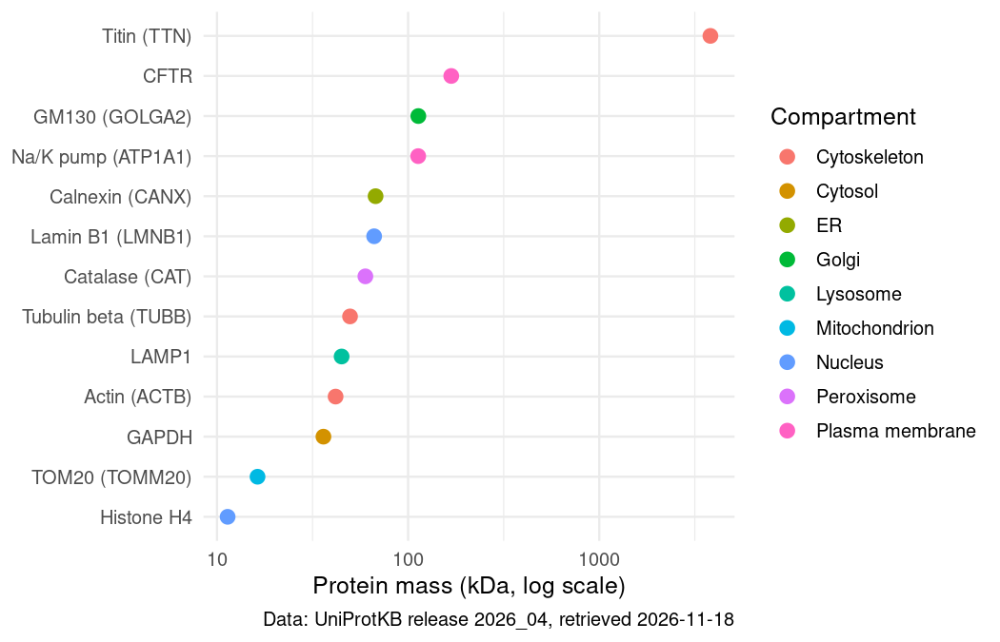

[Module overview](index.qmd) · [Browser activities](browser.qmd) · [R Markdown report](report.qmd) · [Check your answers](questions.qmd)

## Tasks

**T1.** `[ELO 1]` *Identifiers and evidence.* Give the gene symbol, UniProt
accession and Ensembl gene ID of human calnexin. Where in the cell is it according
to UniProt, how does it sit in the membrane, and what kind of evidence supports the
location?

::: {.callout-note collapse="true" title="Answer (checked 2026-11-18)"}
Gene **CANX**, UniProt **P27824** (entry name CALX_HUMAN, reviewed, 592 amino acids),
Ensembl **ENSG00000127022**. Location: **endoplasmic reticulum membrane**,
**single-pass type I** membrane protein: one transmembrane helix, with the large
N-terminal part (after the signal peptide) in the ER lumen and a short C-terminal
tail in the cytosol. The ER location carries the tag "1 Publication" (ECO:0000269,
experimental evidence from a paper); the topology is "Sequence analysis"
(ECO:0000255, predicted from the sequence). UniProt also lists mitochondrion membrane
"By similarity" (inferred from the mouse protein) and melanosome membrane. So one
entry mixes measured and inferred statements, and the evidence tag tells you which is
which. The search `CANX human` gave about 430 results, about 110 of them reviewed;
calnexin is only one of them (exact numbers change with every release).
:::

**T2.** `[ELO 1, 5]` *Markers.* Which organelle does each of TOMM20, GOLGA2, LMNB1
and LAMP1 mark? Give the HPA main location and reliability score where there is
one, and say how the images fit the organelle's shape.

::: {.callout-note collapse="true" title="Answer (checked 2026-11-18, HPA 26.0)"}
- **CANX** (for comparison): UniProt ER membrane; HPA **Endoplasmic reticulum**,
  Enhanced. A fine network through the cytoplasm, densest around the nucleus,
  overlapping the yellow ER stain (cell lines A-431, U-251MG, U2OS).
- **TOMM20** marks **mitochondria**: UniProt mitochondrion outer membrane; HPA
  **Mitochondria**, Enhanced. Short threads and tubes throughout the cytoplasm.
- **GOLGA2** (GM130) marks the **Golgi**: UniProt cis-Golgi network membrane
  (peripheral, on the cytoplasmic side); HPA **Golgi apparatus**, Enhanced. One
  compact bright patch next to the nucleus.
- **LMNB1** (lamin B1) marks the **nuclear envelope**: UniProt nucleus lamina; HPA
  **Nuclear membrane**, Supported. A sharp ring at the edge of the nucleus.
- **LAMP1** marks **lysosomes**: UniProt lysosome membrane (also late endosomes and
  plasma membrane); HPA: **no immunofluorescence data**.

LAMP1 is a standard lysosome marker in the lab, but HPA had no subcellular
(immunofluorescence) data for it on the check date. Use the
UniProt annotation instead, or look at a related lysosomal protein in HPA. If HPA has
added LAMP1 since, expect "Lysosomes" or "Vesicles". The lesson: no single database
covers every protein, and an empty section is not evidence that a protein is absent.
:::

**T3.** `[ELO 1, 5]` **[VG]** *When databases disagree.* Catalase is the classic
peroxisome marker (cell-methods lecture). What do UniProt and HPA say about where it
is? Suggest why they might differ, and how you would decide.

::: {.callout-note collapse="true" title="Answer (checked 2026-11-18, UniProt 2026_04, HPA 26.0)"}
UniProt: **peroxisome matrix**, from experiments (two publications). HPA: main
location **"Vesicles"**, reliability **Supported**. Peroxisomes are 0.1–1 µm, close to
the resolution limit of a light microscope (about 0.2 µm), so in an
immunofluorescence image they appear as many small round dots, which look the same
as small vesicles or endosomes. HPA's category "Vesicles" is a deliberately coarse
class for such dots. The image alone cannot tell which kind of dot it is. To decide:
co-stain with a known peroxisome marker (for example the membrane protein ABCD3,
which HPA annotates "Peroxisomes", reliability Enhanced) and check that the dots
overlap; or fractionate cells and show catalase in the peroxisome fraction (the
density gradient from the cell-methods lecture), as the original biochemistry did.
If HPA now says "Peroxisomes", the annotation has been improved since the check
date: the reasoning is the same.
:::

**T4.** `[ELO 1]` *Single cells.* What does the HPA single-cell section show for INS,
and how does it differ from CANX?

::: {.callout-note collapse="true" title="Answer (checked 2026-11-18, HPA 26.0)"}
INS is **cell type enriched** in **pancreatic islet cells** (the endocrine cells of
the pancreas; insulin comes from the β cells among them), at tens of thousands of
nCPM (85 601 on the check date), and is essentially absent in every other cell type.
It is an extreme example of a cell-type-specific gene. CANX is "detected in many" cell
types with low cell type specificity: every cell that makes membrane or secreted
proteins needs the ER folding machinery, so an ER chaperone is a typical
**housekeeping** protein. That is also why such proteins make good organelle markers
in any cell line.
:::

**T5.** `[ELO 1]` *Cell lines.* HeLa in Cellosaurus: species, disease, virus. What
does Cellosaurus say about HeLa and contamination, and what is HEp-2?

::: {.callout-note collapse="true" title="Answer (checked 2026-11-18)"}
HeLa (CVCL_0030): ***Homo sapiens***, female, 30 years 6 months at sampling;
disease **human papillomavirus-related endocervical adenocarcinoma** (a cervical
cancer); transformed by **HPV18**, whose DNA is integrated at several sites in the
genome (one near the *MYC* gene at 8q24). Comment: "HeLa is the most frequent
contributor to cell lines contamination". **HEp-2** (CVCL_1906) was thought to come
from a laryngeal carcinoma of a 56-year-old man, but is flagged as a **problematic,
contaminated** line: it is a HeLa derivative. Results "in laryngeal cancer cells"
from HEp-2 are therefore about cervical cancer cells. The STR profile in Cellosaurus
is the reference a lab compares its own cells with.
:::

**T6.** `[ELO 1]` *(R report)* Which is the largest and which the smallest protein in
your table, and how many times heavier is the largest? Why does the plot need a log
axis?

::: {.callout-note collapse="true" title="Answer (checked 2026-11-18, UniProt 2026_04)"}
Largest: **titin** (TTN, Q8WZ42), **34 350** amino acids, **3 816 kDa** (3.8 MDa), the
largest known human protein; it spans half a sarcomere in muscle. Smallest: **histone
H4**, 103 amino acids, **11.4 kDa**. Ratio about **340×**. Without titin the range is
11–168 kDa (CFTR is next), and the typical protein is 40–120 kDa (about 110 Da per
amino acid). On a linear axis titin sits alone at the right and all other proteins
are squeezed together near zero; on a log axis each step of the grid is a factor of
10, so all of them are readable.

Your plot should look roughly like this:

{width="85%" fig-alt="Dot plot of the masses of 13 human proteins on a logarithmic axis from 10 to about 4000 kDa. Histone H4 is lightest at 11 kDa, TOM20 16 kDa, most others between 36 and 168 kDa, and titin alone at 3816 kDa."}

Histone H4 is also a useful lesson in identifiers: one protein sequence, made from
14 different genes (`H4C1`, `H4C2`, …), which is why its gene column in your table is
so long.
:::

[Sources and licences](index.qmd#sources-and-licences)
