## About this lecture {.smaller}

Cancer is not one disease of one organ. It is what happens when **one cell breaks the rules** that this course has described: when to divide, when to stop, when to die, where to stay. Today we put the course together and look at cancer as **cell biology going wrong**.

After this lecture you can:

- map the **hallmarks of cancer** onto the cell biology of this course: signalling, cell-cycle control, cell death, the cytoskeleton, metabolism;
- explain the difference between **oncogenes** (gain of function, one hit) and **tumour suppressors** (loss of function, two hits);
- explain why cancer needs **many mutations**, how **genome instability** speeds this up, and how **clonal evolution** makes every tumour a mixture of different cells;
- describe **invasion and metastasis** (EMT, basement membrane, the metastatic cascade) and the role of the **tumour microenvironment**;
- explain why **targeted drugs** stop working, why **combinations** help, and how **checkpoint immunotherapy** releases the immune system.

::: notes
This is a synthesis lecture. Almost every lecture in this course has ended with a slide on cancer: a kinase inhibitor, a drug that freezes microtubules, a pump that throws out chemotherapy, a BCL-2 blocker. Today we turn this around. Instead of starting from the cell biology and ending with cancer, we start from cancer and ask which piece of cell biology is broken. You will see that a cancer cell has not invented anything new. It uses the normal machinery of the cell, but with the brakes removed and the accelerators stuck. We cover four things: first, the hallmarks of cancer as a map of the course; second, the two kinds of cancer gene and how we know the difference; third, cancer as evolution inside the body, which explains both heterogeneity and drug resistance; and fourth, how cancer cells invade and spread. We end with two kinds of modern therapy. This lecture is about the cell level. The diseases themselves, their diagnosis and clinical treatment come in the course on disease mechanisms, Sjukdomslära.
:::

## The question: why does cancer take decades, and why does it come back? {.smaller}

:::: {.columns}
::: {.column width="45%"}
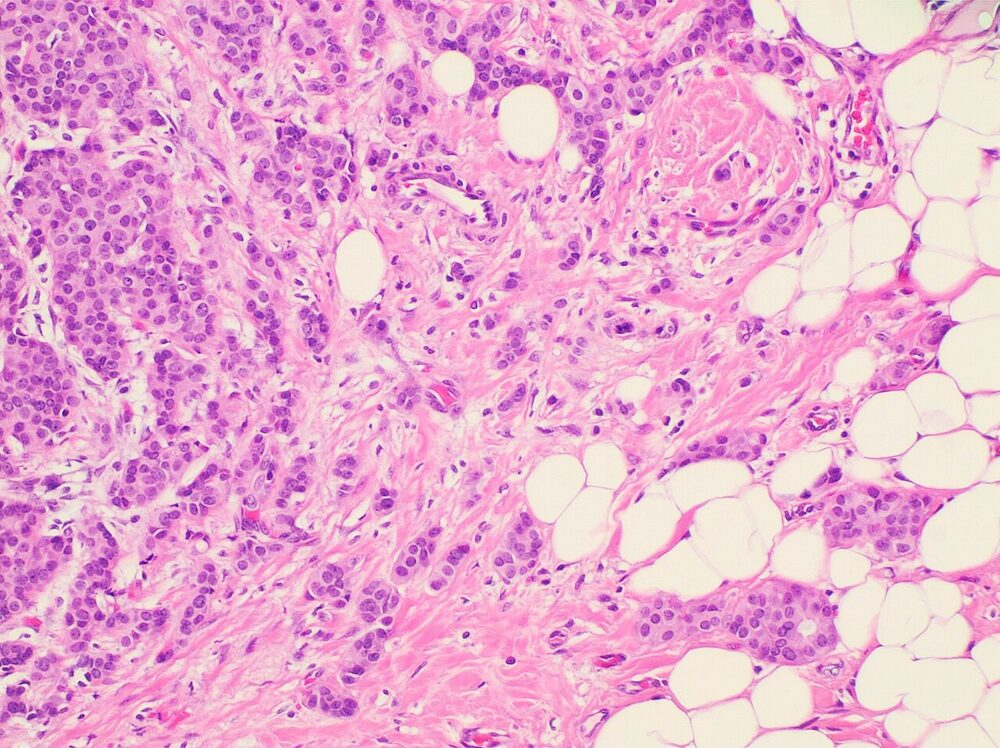{width="100%"}

*Breast cancer (invasive ductal carcinoma), H&E stain: nests of tumour cells (purple) growing through fibrous tissue (pink) and fat (white).*
:::
::: {.column width="55%"}
- Each tumour starts from **one cell**: all its cells share the same founding mutations.
- Yet one mutation is not enough. Most cancers appear after **age 50**, and the risk rises steeply with age.
- A targeted drug can make a tumour **shrink within weeks**, and then it **grows back**, now resistant.
- Most cancer deaths are caused not by the first tumour but by **metastases** in other organs.

**What has to go wrong in a cell, and why is a tumour so hard to kill?**
:::
::::

::: notes
Look at the micrograph. This is a breast cancer stained with haematoxylin and eosin, the standard stain of pathology: nuclei are purple, protein-rich tissue is pink, and fat cells look empty because the fat is dissolved during processing. Normal breast tissue has neat ducts lined by two layers of cells. Here the tumour cells form irregular nests that have broken out of the ducts and grow through the connective tissue and fat. Three observations frame this lecture. First, a tumour is a clone. When the DNA of all its cells is sequenced, they share a set of founding mutations, so they descend from one cell. Second, cancer is a disease of age. If one mutation were enough, risk would be the same at every age. Instead, it rises steeply, roughly with the fourth to sixth power of age, which tells us that several independent steps are needed. Third, tumours change. A drug that works at first often fails after months, and cells that spread to other organs, not the original tumour, kill most patients. We need cell biology and evolution to explain all three.
:::

## The hallmarks of cancer: a map of this course {.smaller}

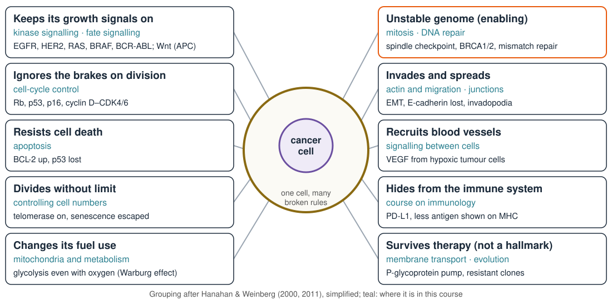{width="80%" fig-align="center"}

- A cancer cell has gained a set of **capabilities** that normal cells keep under control. Each one is a broken piece of the cell biology you have learned (**teal**: where).
- **Genome instability** is not a hallmark itself: it is what **enables** the cell to collect the others quickly.

::: notes
In 2000, Douglas Hanahan and Robert Weinberg proposed that all cancers, whatever the organ, share a small set of acquired capabilities, which they called the hallmarks of cancer. In 2011 they added changes in metabolism and escape from the immune system, and they named genome instability and inflammation as enabling characteristics: features that do not themselves make a cell cancerous, but that make it easier to acquire the hallmarks. This figure is our own grouping, simplified, and placed on the map of this course. Growth signals stuck on: the kinase signalling and fate signalling lectures. Brakes on division removed: the cell-cycle control lecture. Escape from apoptosis: the apoptosis lecture. Unlimited division: the lecture on controlling cell numbers, with telomeres and senescence. Invasion: the actin lecture. Altered metabolism: the mitochondria. The immune system: the immunology course. The last box, survival under therapy, is not one of the hallmarks, but it is the reason we must understand all the others. Keep this map in mind: each of the next slides zooms in on one box.
:::

## Two kinds of cancer gene {.smaller}

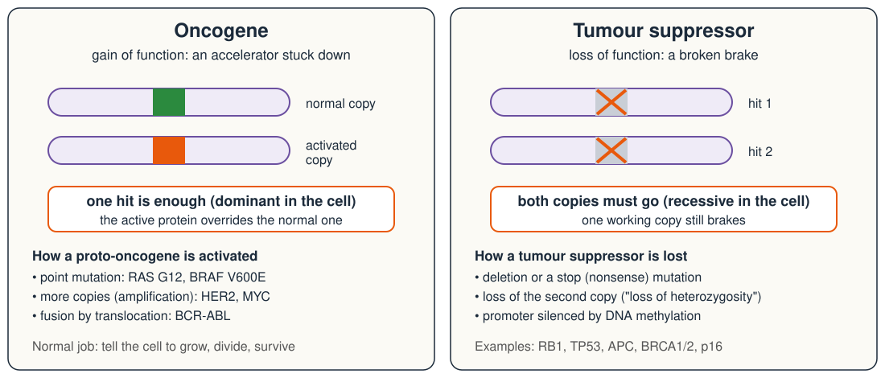{width="80%" fig-align="center"}

- **Oncogenes** come from normal genes (**proto-oncogenes**) that make cells grow. A **gain of function** in **one copy** is enough.
- **Tumour suppressors** normally stop growth or repair damage. Both copies must be lost: **two hits**.

::: notes
Cancer genes come in two kinds, and the difference matters for how they are inherited, how they are found and how they are treated. Think of a car. An oncogene is an accelerator that is stuck down. Its normal version, the proto-oncogene, codes for a protein that tells the cell to grow or divide, such as a growth factor receptor or RAS. A mutation that makes the protein more active, or more abundant, is enough in one of the two copies, because the overactive protein simply overrides the normal one. Oncogenes are activated in three main ways: a point mutation that locks the protein in its active form, as in RAS or BRAF; amplification, many extra copies of the gene, as for HER2 in breast cancer; or a translocation that fuses two genes, as in BCR-ABL. A tumour suppressor is a brake. Its normal job is to stop the cycle, repair DNA or trigger death. Losing one copy usually does little, because the other copy still works. Both must be lost: by deletion, a stop mutation, or by silencing the promoter with DNA methylation. Drugs can block an overactive oncogene protein; it is much harder to restore a missing brake.
:::

## How do we know? Retinoblastoma and the two-hit idea {.smaller}

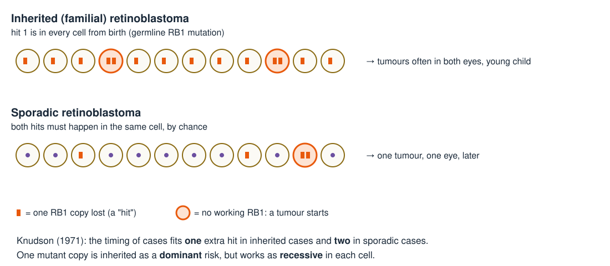{width="76%" fig-align="center"}

- Retinoblastoma is a rare eye tumour of young children. In **inherited** cases tumours are often in **both eyes** and appear **earlier**.
- Alfred **Knudson** (1971): only **one more hit** is needed when one is inherited. The gene, **RB1**, was cloned in 1986; its protein Rb is the cell-cycle gate of the next slides.

::: notes
How do we know that tumour suppressors need two hits? The classic evidence is a statistical argument about a rare childhood cancer of the retina. Alfred Knudson compared children with inherited retinoblastoma, who often have a parent with the disease, and children with sporadic retinoblastoma. Inherited cases usually had several tumours, often in both eyes, and were diagnosed early. Sporadic cases had one tumour in one eye and were diagnosed later. Knudson showed that the timing fitted a simple model: in inherited cases every retinal cell already carries one mutant copy from the fertilised egg, so a single additional somatic mutation in any of millions of retinal cells is enough, and that happens often. In sporadic cases, both copies must be lost by chance in the same cell, which is rare. When the gene, RB1, was found fifteen years later, tumour cells from both kinds of patients had lost both copies, as predicted. Note the apparent paradox: the risk is inherited as a dominant trait in families, but at the level of the cell the gene is recessive. The same pattern holds for BRCA1 and BRCA2 in inherited breast and ovarian cancer, and for APC in familial polyposis.
:::

## Growth signals stuck on {.smaller}

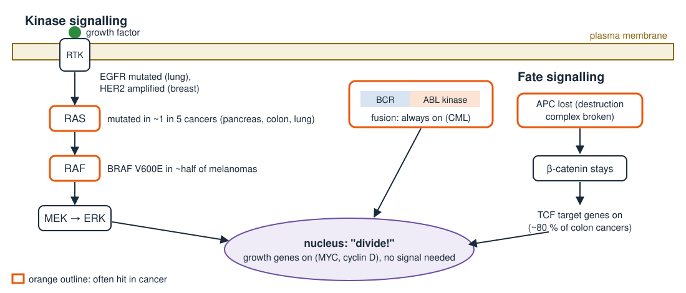{width="76%" fig-align="center"}

- Normal cells divide only when a **neighbour sends a signal**. Cancer cells make the signal themselves, or switch on a protein **below** the receptor (the kinase signalling and fate signalling lectures).
- One stuck kinase can be a weak point: **imatinib** (BCR-ABL), **vemurafenib** (BRAF V600E) and **EGFR inhibitors** made cancers shrink.

::: notes
The first hallmark is independence from growth signals. In a tissue, a cell divides only when other cells tell it to, by releasing growth factors that bind receptor tyrosine kinases. You followed this path in the kinase signalling lecture: receptor, the small GTPase RAS, the kinases RAF, MEK and ERK, and finally transcription factors that switch on genes such as MYC and cyclin D. Cancer cells break this chain at many points. The receptor can be mutated so that it signals without its ligand, as EGFR in some lung cancers, or the gene can be amplified so that the cell has far too many receptors, as HER2 in breast cancer. RAS can be locked in its GTP-bound active state; this is found in about one cancer in five. BRAF V600E is active without RAS. In chronic myeloid leukaemia, a chromosome translocation makes the BCR-ABL fusion kinase, which is always on. The fate signalling lecture added Wnt: when APC is lost, beta-catenin is no longer destroyed and drives the same growth genes. When a tumour depends on one stuck protein, a drug against it can be dramatic, as you saw with imatinib and vemurafenib. We come back to why such drugs stop working.
:::

## Brakes removed: Rb and p53 {.smaller}

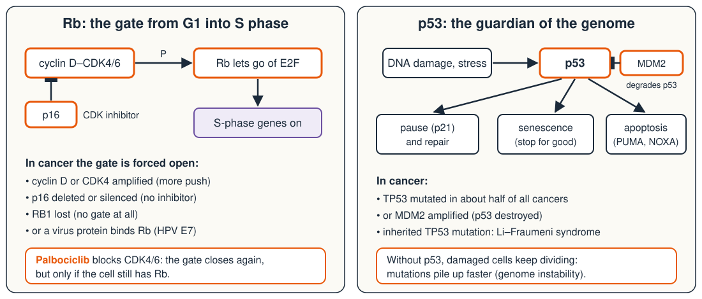{width="78%" fig-align="center"}

- The **Rb pathway** is broken in most cancers, in one way or another. **p53** is the most often mutated gene in human cancer (the cell-cycle control lecture).
- **CDK4/6 inhibitors** (palbociclib) restore the gate in breast cancers that still have Rb.

::: notes
Growth signals push the cell forward; the cell-cycle control system decides whether it actually goes. The key gate is between G1 and S phase. Rb holds the transcription factor E2F. When cyclin D with CDK4 or CDK6 phosphorylates Rb, E2F is released and switches on the genes for DNA replication. The CDK inhibitor p16 holds this step back. Look at how many ways a cancer can force the gate open: more cyclin D or CDK4, loss of p16, loss of Rb itself, or, in cervical cancer, a viral protein from human papillomavirus that binds Rb. Almost every cancer has one of these changes, and usually only one, because one is enough. On the right is p53, often called the guardian of the genome. DNA damage and other stress stabilise p53, which normally is destroyed quickly by MDM2. p53 then switches on p21 to pause the cycle for repair, or drives the cell into permanent arrest, senescence, or into apoptosis. Without p53, a damaged cell keeps dividing, so mutations accumulate. TP53 is mutated in about half of all human cancers. Palbociclib and related drugs block CDK4 and 6 and are used in hormone-receptor-positive breast cancer; they only work if Rb is still there.
:::

## No death, no limit: BCL-2 and telomerase {.smaller}

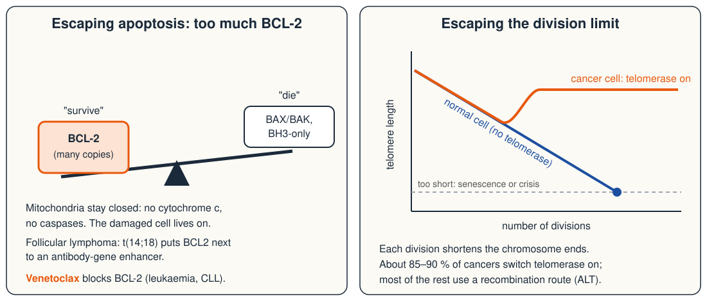{width="78%" fig-align="center"}

- A cell with damaged DNA or no growth signal normally **dies by apoptosis**. More **BCL-2** keeps the mitochondria closed (the apoptosis lecture).
- Normal cells stop after a limited number of divisions: telomeres shorten and trigger **senescence**. Cancer cells **turn telomerase back on** (the lecture on controlling cell numbers).

::: notes
Even a cell that divides too much would not form a tumour if its errors made it die. Cells with damaged DNA, with oncogenes that push too hard, or that have lost contact with their matrix normally kill themselves by apoptosis. In the apoptosis lecture you saw that the decision is made at the outer membrane of the mitochondria: BAX and BAK, triggered by BH3-only proteins, make pores, cytochrome c escapes and caspases start. BCL-2 blocks this. In follicular lymphoma, a translocation between chromosomes 14 and 18 puts the BCL2 gene next to a strong enhancer of an antibody gene, so B cells make far too much BCL-2 and do not die. Venetoclax, a BH3 mimetic, blocks BCL-2 and is used in chronic lymphocytic leukaemia. The second limit is the number of divisions. Each round of replication leaves the chromosome ends, the telomeres, a little shorter. When they are too short the cell senses DNA damage and stops for good, or, if p53 is missing, chromosomes fuse and break in a crisis. Most cancer cells switch on telomerase, the enzyme that rebuilds telomeres, and so escape this counting mechanism.
:::

## Genome instability: a faster route to many hits {.smaller}

:::: {.columns}
::: {.column width="58%"}
- Normal cells copy DNA with about **one error per 10⁹ bases** per division, and repair most damage. With so few errors, collecting **5–10 driver mutations** in one cell line would be very rare.
- Cancer cells often lose **DNA repair** (mismatch repair, **BRCA1/2** for double-strand breaks) or **p53**: point mutations pile up faster.
- Or they lose **chromosome control**: extra centrosomes make **multipolar spindles**, and a weak **spindle checkpoint** lets chromosomes be lost or gained (**aneuploidy**; the mitosis lecture).
- Most solid tumours have **abnormal chromosome numbers**; the karyotype differs from cell to cell.
:::
::: {.column width="42%"}
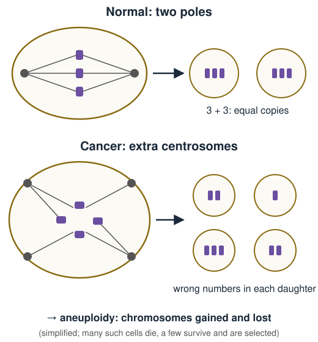{height="470px" fig-align="center"}
:::
::::

::: notes
If every cell needs several driver mutations, and a normal cell makes very few errors, how does any cell ever collect them? Part of the answer is time and numbers: we have trillions of cells and decades. The other part is genome instability. Many cancers lose a repair system early. In about fifteen percent of colorectal cancers, mismatch repair is lost, and the mutation rate rises a hundred to a thousand times. In inherited breast and ovarian cancer with BRCA1 or BRCA2 mutations, double-strand breaks are repaired by error-prone routes. Losing p53 removes the checkpoint that would stop or kill a damaged cell. A second kind of instability affects whole chromosomes. The figure compares a normal two-pole spindle with a spindle that has extra centrosomes: such a spindle can pull chromosomes towards more than two poles, so the daughters get wrong numbers of chromosomes. A weak spindle assembly checkpoint lets cells enter anaphase before all chromosomes are attached. The result is aneuploidy, found in most solid tumours: whole chromosomes or arms gained and lost, which changes the dose of hundreds of genes at once. Genome instability is a double-edged sword for the tumour: it speeds evolution, but it also makes cells vulnerable, which PARP inhibitors exploit in BRCA-mutant cancers.
:::

## Many hits over many years {.smaller}

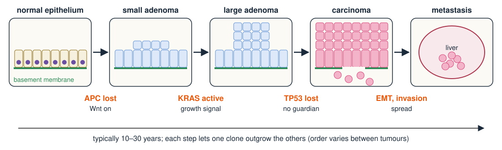{width="80%" fig-align="center"}

:::: {.columns}
::: {.column width="62%"}
- Colorectal cancer often starts with **APC** loss (a small polyp), then **KRAS** activation, then **TP53** loss. Each step gives one cell an advantage, and its descendants take over.
- This is why most cancers appear late in life, and why **screening** can find and remove **adenomas** before they become cancer.
:::
::: {.column width="38%"}
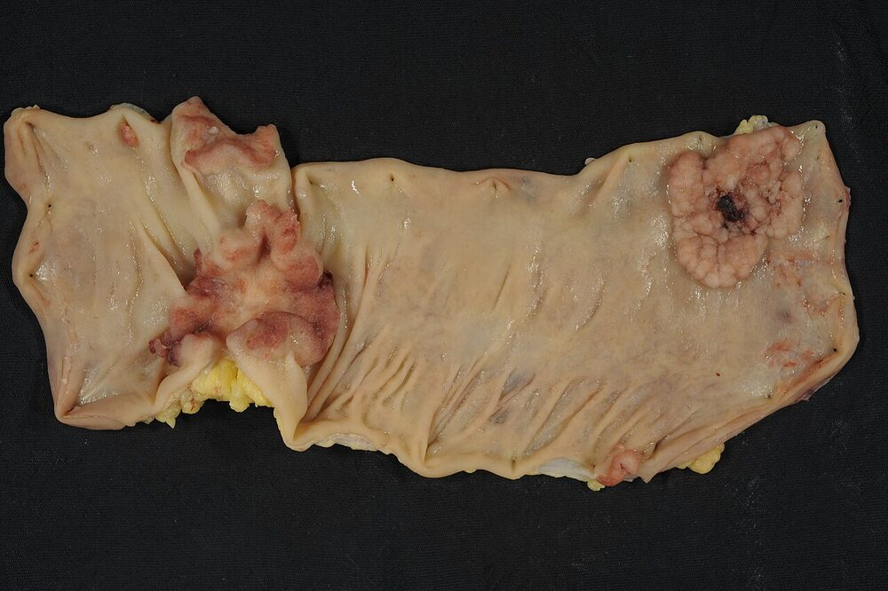{height="170px" fig-align="center"}

*Opened colon: carcinoma (left) and a benign villous adenoma (right).*
:::
::::

::: notes
The clearest example of step-by-step progression is colorectal cancer, worked out by Bert Vogelstein and colleagues in the late 1980s by comparing the mutations in tissue at different stages. In a normal crypt, Wnt signalling is high only at the bottom, where stem cells divide. When a stem cell loses both copies of APC, beta-catenin stays on everywhere, and the crypt grows into a small benign polyp, an adenoma. A cell in the adenoma that gains an activating KRAS mutation grows faster, and the adenoma grows larger. Loss of TP53 then removes the guardian, and further changes let the cells break through the basement membrane: now it is a carcinoma, which can spread. The photograph shows a surgical specimen with both stages in one piece of colon: a raised, cauliflower-like benign adenoma on the right, and a carcinoma with an ulcerated centre on the left. The order of the mutations varies, and the timeline is long, typically ten to thirty years. That long window is why colonoscopy screening works: removing adenomas prevents cancer.
:::

## Cancer is evolution inside the body {.smaller}

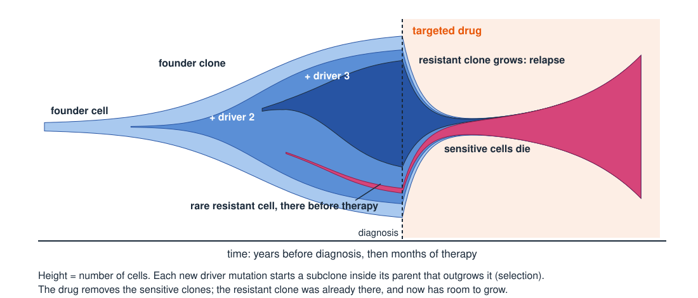{width="76%" fig-align="center"}

- **Variation** (new mutations) + **selection** (the fittest cells outgrow the others) = **clonal evolution**. The tumour becomes a **mixture of subclones**: **heterogeneity**.
- Therapy is a new **selection pressure**: rare resistant cells survive and take over. **Try it:** [Demo: clonal evolution under therapy](questions.qmd#explore).

::: notes
Peter Nowell described cancer as an evolutionary process in 1976, and today we can watch it in the DNA. Evolution needs two things: variation and selection. Variation comes from mutations, more of them in a genetically unstable cell. Selection comes from the tissue: space, nutrients, oxygen, immune cells. A cell with a driver mutation divides a bit more or dies a bit less, so over many generations its descendants outnumber the others. Inside that subclone, another cell gains another driver and starts its own subclone. This kind of plot, called a fish plot, shows it: the height is the number of cells, and each colour is a clone nested inside the clone it came from. By the time of diagnosis, a tumour of a billion cells is a mixture of related but different subclones. Some carry mutations that happen to make them resistant to a drug, before the drug has ever been given. When therapy starts, the sensitive clones die and the tumour shrinks, but the resistant cells now have space and grow back. This is natural selection, just as for antibiotic resistance in bacteria. In the demo you can treat a simulated tumour and compare one drug, two drugs and intermittent therapy.
:::

## How do we know? Sequencing many pieces of one tumour {.smaller}

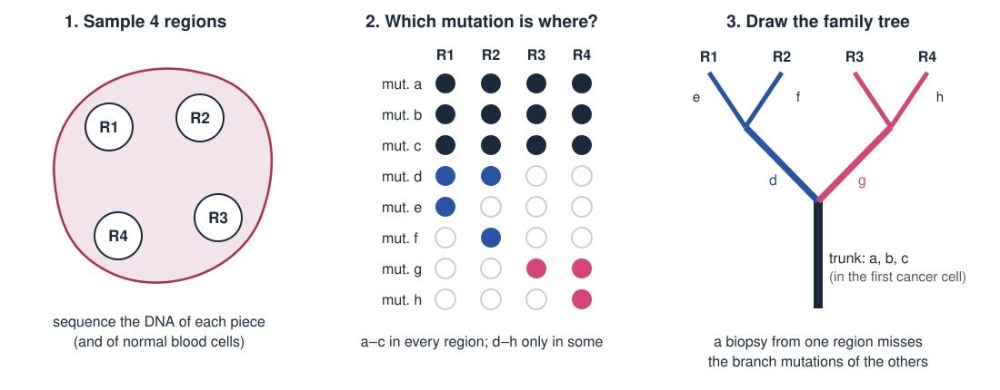{width="82%" fig-align="center"}

- **Multi-region sequencing**: in kidney cancers (Gerlinger et al., 2012), about **two-thirds** of the mutations were **not found in every region**.
- Mutations in all regions form the **trunk** (early, in the first cancer cell); the others are **branches**. A single biopsy sees only one branch.

::: notes
How do we know that tumours are mixtures, and what their family tree looks like? Sequencing a single biopsy gives an average. The trick is to sample several regions of the same tumour, and also normal cells from the same patient, such as blood, so that inherited variants can be removed. Each somatic mutation is then marked as present or absent in each region. In this cartoon, mutations a, b and c are found everywhere: they were in the founding cell and form the trunk of the tree. Mutation d is found only in regions 1 and 2, so it arose later in the cell that gave rise to that part of the tumour; e and f are private to single regions. In a landmark study of kidney cancers published in 2012, about two-thirds of the mutations were not present in every region, and some regions carried different mutations in the same gene. The same logic applies over time: sequencing a tumour before treatment and at relapse shows which branch survived. Today, tumour DNA fragments in the blood, liquid biopsies, are used to follow such clones. For drug development this is important: the best targets are trunk mutations, present in every cancer cell.
:::

## Invasion: breaking out of the epithelium {.smaller}

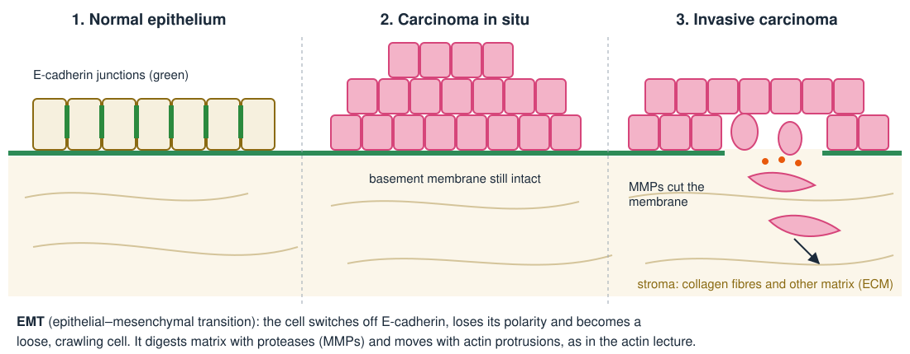{width="80%" fig-align="center"}

- Most cancers are **carcinomas**: they start in an epithelium. While cells stay above the **basement membrane** (carcinoma *in situ*), surgery cures.
- **Invasion** needs new behaviour: loose junctions, protrusions, **proteases** that cut the matrix.

::: notes
About 80 to 90 percent of human cancers are carcinomas, tumours of epithelial cells. In the actin lecture you met the crawling cell, and in the membrane lectures the tight and adherens junctions that hold an epithelium together. An epithelium sits on a thin sheet of specialised extracellular matrix, the basement membrane, made mostly of type four collagen and laminin. Below it lies the stroma, the connective tissue with fibroblasts, collagen fibres, vessels and immune cells. In carcinoma in situ, the cells grow too much and lose their orderly layering, but they all stay above the basement membrane. They cannot reach vessels, and removing them cures the patient. Invasion starts when cells cross this membrane. Many invading cells go through a programme called the epithelial–mesenchymal transition, or EMT, borrowed from embryonic development. Transcription factors such as Snail and Twist switch off E-cadherin, so the cell lets go of its neighbours; it loses its apical-basal polarity and switches on proteins of mesenchymal cells, such as vimentin. It digests the matrix with matrix metalloproteases and crawls with actin protrusions and myosin contraction. EMT is often partial and reversible.
:::

## Metastasis: a long and wasteful journey {.smaller}

:::: {.columns}
::: {.column width="72%"}
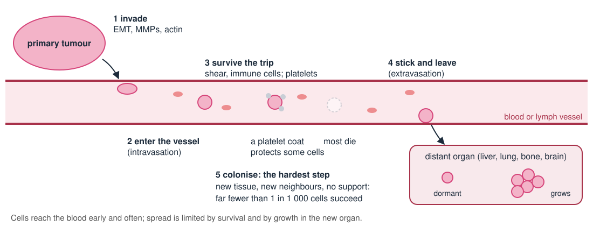{width="100%"}
:::
::: {.column width="28%"}
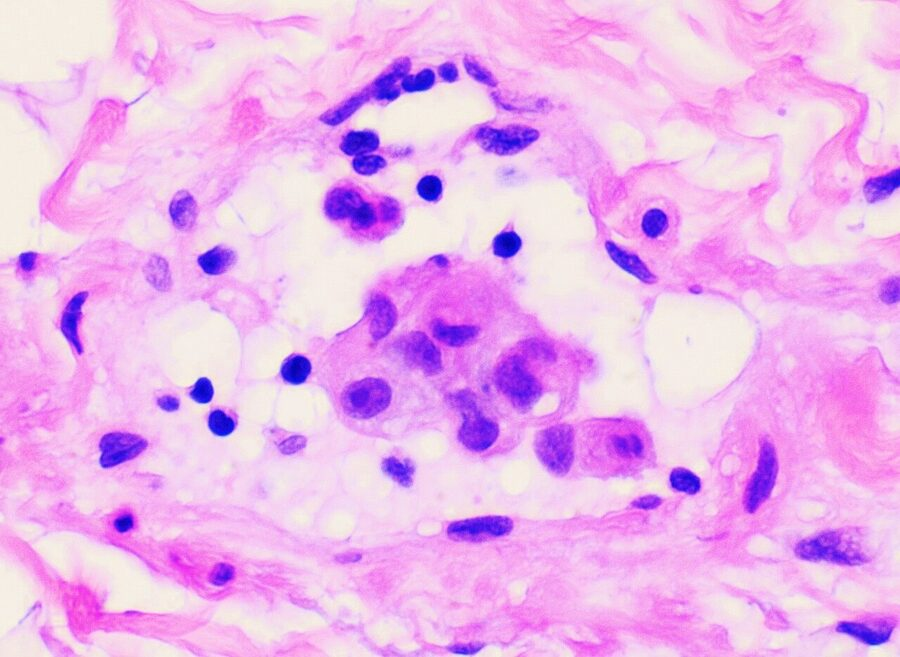{width="100%"}

*Breast cancer cells (centre) inside a lymph vessel, H&E.*
:::
::::

- Most cancer deaths are caused by **metastases**. Tumours shed many cells into the blood, but very few succeed: the **last step**, growing in a new organ, is the hardest.
- **Seed and soil**: cells grow best where the tissue suits them; breast cancer often goes to bone, colon cancer to liver.

::: notes
Metastasis is a series of steps, and a cell must succeed in all of them. It must invade, as on the previous slide. It must squeeze through the wall of a small blood or lymph vessel; the micrograph shows a group of breast cancer cells with large nuclei floating inside a lymph channel. In the blood it must survive shear forces, immune cells and the lack of a matrix to hold on to; epithelial cells that lose their anchorage normally die by a form of apoptosis called anoikis. Some are protected by a coat of platelets. It must then stick in a small vessel of another organ and crawl out. Finally, it must grow in a tissue with different neighbours, signals and matrix. Experiments in animals and counts of circulating tumour cells in patients show that a large tumour releases huge numbers of cells, but only a tiny fraction form metastases. Many arrive and stay dormant for years before they grow, which is why cancer can return long after surgery. Stephen Paget proposed in 1889 that the seed, the cancer cell, needs the right soil; which organs receive metastases depends both on blood flow and on that match. Metastasis biology is a major subject in Sjukdomslära.
:::

## A tumour is a tissue: vessels, fuel and neighbours {.smaller}

:::: {.columns}
::: {.column width="58%"}
- **Blood vessels**: a tumour larger than about **1–2 mm** needs its own supply. Hypoxic cells release **VEGF**; vessels grow in, leaky and disordered (bevacizumab blocks VEGF).
- **Fuel**: many cancer cells take up much more **glucose** and run **glycolysis even with oxygen** (the Warburg effect). It gives building blocks for new cells. **FDG-PET** scans find tumours by their glucose uptake.
- **Neighbours**: **fibroblasts** make stiff matrix, **macrophages** can help growth and invasion, and **T cells** may attack, unless the tumour switches them off.
- **Chronic inflammation** (hepatitis, *H. pylori*) promotes cancer.
:::
::: {.column width="42%"}
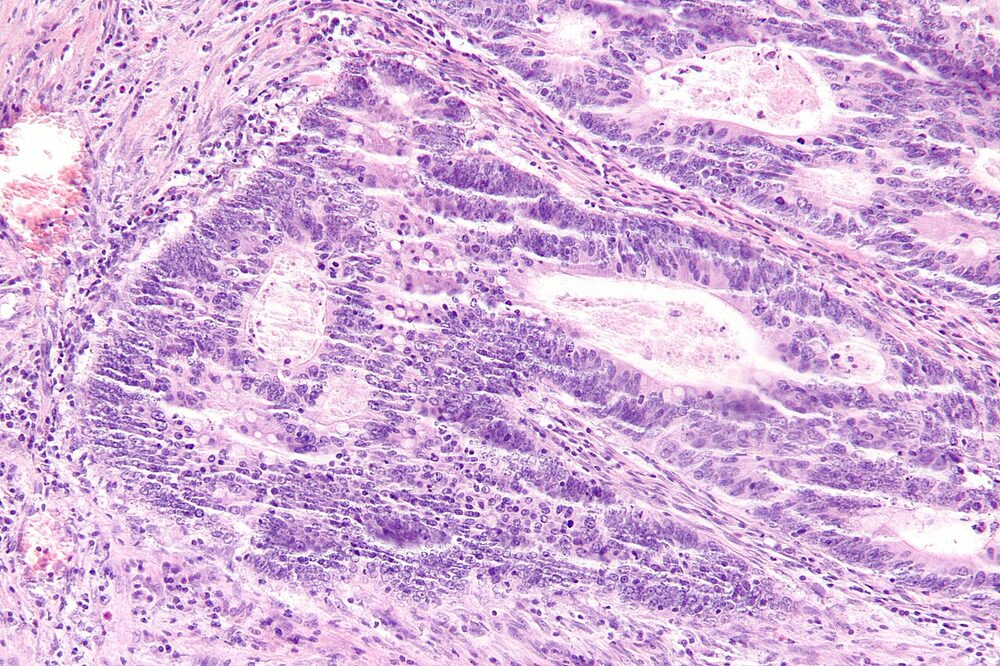{width="100%"}

*Colorectal carcinoma, H&E: small dark lymphocytes (T cells) between the tumour cells. Patients with many such cells often do better.*
:::
::::

::: notes
So far we have looked at the cancer cell, but a tumour is a tissue, and the other cells in it matter. A small cluster of cells can live on oxygen and nutrients that diffuse from nearby vessels, but diffusion works only over a short distance, about a tenth of a millimetre. A tumour that grows beyond one or two millimetres needs new vessels. Cells far from vessels become hypoxic, and the hypoxia-sensing transcription factor HIF makes them release VEGF, which makes the endothelial cells of nearby vessels sprout towards the tumour. The new vessels are leaky and disordered, which makes drug delivery uneven. Cancer cells also change their metabolism. Otto Warburg noticed a hundred years ago that tumours turn glucose into lactate even when oxygen is present. This fast, wasteful glycolysis supplies building blocks for membranes and nucleotides. It also lets doctors find tumours: in a PET scan, a radioactive glucose analogue, fluorodeoxyglucose, accumulates where glucose uptake is high. Finally, the stroma: fibroblasts, macrophages and lymphocytes. In this micrograph, the small dark round cells between the tumour glands are lymphocytes. Their presence is a good sign: the immune system has recognised the tumour. Why does it not win?
:::

## Why it matters: targeted therapy and resistance {.smaller}

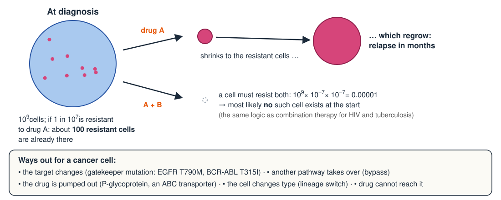{width="78%" fig-align="center"}

- Any one drug **selects** for resistant cells that were there before. **Two drugs** with different targets need a cell with **two** rare mutations.
- Resistance can also be **non-genetic**: P-glycoprotein pumps (the membrane transport lecture) and changes of cell state. More in Kliniska prövningar och läkemedelsutveckling.

::: notes
Now we can explain the relapse from the beginning of the lecture. A tumour at diagnosis has around a billion cells. Suppose a particular resistance mutation, such as a gatekeeper mutation in the drug's target, is present in one cell in ten million. Then about a hundred resistant cells are already in the tumour before the first dose. The drug kills everything else, the tumour shrinks dramatically, and those hundred cells grow back. This is the Goldie–Coldman argument from 1979, and it is the same logic used for HIV and tuberculosis, where single drugs failed and combinations succeeded. With two drugs that act on different targets, a cell must carry two independent resistance mutations; the chance of that is the product of the two small numbers, and in most tumours no such cell exists at the start. In practice, combinations are limited by side effects, and some resistance is not caused by mutations in the target: another pathway can take over, the ABC transporter P-glycoprotein can pump many drugs out, or cells can change into a different cell type. Antimitotic drugs such as taxanes, from the microtubule lecture, meet the same problem. You meet the design of combination trials in the course on clinical trials and drug development.
:::

## Why it matters: checkpoint immunotherapy {.smaller}

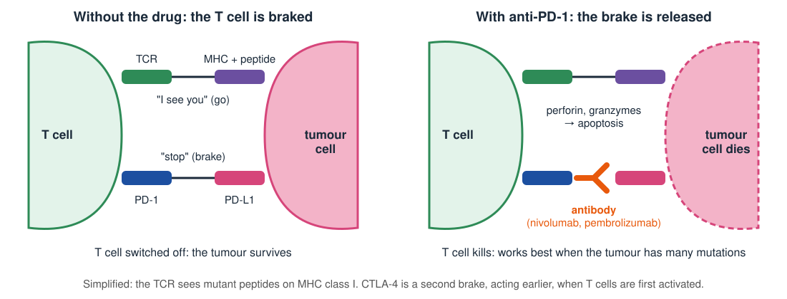{width="78%" fig-align="center"}

- T cells can recognise **mutant peptides** on tumour cells. Tumours protect themselves with **PD-L1**, which binds the **PD-1** brake on T cells.
- **Antibodies against PD-1, PD-L1 or CTLA-4** release the brake. Some patients with metastatic melanoma or lung cancer stay in remission for years. Nobel Prize 2018 (Allison, Honjo). More in the immunology course (Immunologi).

::: notes
The second big change in cancer treatment does not target the cancer cell at all. Mutant proteins in cancer cells are broken down by the proteasome, and some of the peptides are shown on MHC class one molecules at the cell surface, as for any protein. A cytotoxic T cell whose receptor recognises such a peptide can kill the cell by inducing apoptosis. But T cells have brakes, called immune checkpoints, that normally prevent damage to healthy tissue. PD-1 is one of them. Many tumours, and cells around them, make its ligand PD-L1, so T cells that reach the tumour are switched off. An antibody against PD-1, such as nivolumab or pembrolizumab, or against PD-L1, blocks this interaction and lets the T cells work. Antibodies against CTLA-4, a brake that acts earlier, when T cells are first activated in lymph nodes, work in a similar way. James Allison and Tasuku Honjo shared the Nobel Prize in 2018 for this. These drugs work best in tumours with many mutations, such as melanoma, lung cancer from smoking, and tumours without mismatch repair, because more mutations make more foreign peptides. Side effects are autoimmune reactions, which shows that the brakes are there for a reason. You meet T cells properly in the immunology course.
:::

## Summary {.smaller}

1. Cancer is **one cell's descendants breaking the rules** of the cell: the **hallmarks** (growth signals on, brakes off, no death, no division limit, invasion, new vessels, altered metabolism, immune escape) each map onto a part of this course.
2. **Oncogenes** gain function and act in **one copy** (RAS, BRAF, HER2, BCR-ABL); **tumour suppressors** lose function and need **two hits** (RB1, TP53, APC, BRCA), as shown by retinoblastoma.
3. Cancer needs **several hits over years**; **genome instability** (lost repair, p53, chromosome missegregation) speeds this up. **Clonal evolution** makes each tumour a **heterogeneous** mixture of subclones, seen by **multi-region sequencing**.
4. **Invasion and metastasis** need **EMT**, matrix-cutting proteases and migration through the **basement membrane**, then survival in blood and growth in a new organ. The **microenvironment** (vessels, stroma, immune cells) shapes the tumour.
5. Targeted drugs **select resistant clones**; **combinations** reduce this. **Checkpoint antibodies** (PD-1, CTLA-4) release T cells against the tumour.

*Read more (optional): Alberts et al., Molecular Biology of the Cell, 7th ed., ch. 20.*

[Image credits](../credits.qmd#cancer){style="font-size:0.7em"}

::: notes
Five take-home points. First, cancer is not a foreign invader but our own cells, descended from one cell that broke the rules the rest of this course described. The hallmarks give a checklist, and each item is a piece of normal cell biology gone wrong. Second, the two kinds of cancer gene behave differently: oncogenes are overactive versions of growth genes and act in one copy; tumour suppressors are lost brakes and need both copies lost, as Knudson's two-hit idea for retinoblastoma predicted. Third, a single mutation is not enough. Several drivers, collected over years, are needed, and genome instability speeds this up. Because the cells compete and are selected, a tumour evolves and becomes a family tree of related but different subclones. Fourth, the deadly step is spread. Cells leave the epithelium by EMT and proteases, survive the journey, and must grow in a new organ; the tumour also builds its own tissue of vessels and stroma, and must hide from immune cells. Fifth, these ideas explain why targeted drugs fail, why combinations help, and how checkpoint antibodies work. The next lecture extends the same way of thinking to other diseases: misfolding, trafficking, channels and mitochondria.
:::
