## About this lecture {.smaller}

A cell must copy all of its DNA **exactly once**, and then split it into two cells **exactly once**, in the right order, and only when the body needs more cells. Today: the **control system** that makes these decisions, and what happens when it breaks.

After this lecture you can:

- name the **phases** of the cell cycle and say what happens in each;
- explain how **cyclins and CDKs** drive the cycle, and how CDKs are switched off (**CDK inhibitors**, inhibitory phosphates, **SCF** and **APC/C**);
- explain the **G1/S decision**: **Rb and E2F**, positive feedback and the **restriction point**;
- describe the **checkpoints**, in particular the **DNA-damage checkpoint** with **p53 and p21**;
- explain how **yeast mutants**, **DNA-content flow cytometry** and **FUCCI** reveal the cycle, and how **CDK4/6 inhibitors** treat breast cancer.

**ELO 7** (cell cycle and division).

::: notes
This lecture opens the block on cell cycle and cell death. From genetics you know what mitosis and meiosis look like: chromosomes condense, line up and are pulled apart. Today we ask a different question: who decides when this happens? A dividing cell must do two big jobs, copy the genome and then split it, and it must do them in the right order, each exactly once per cycle, and only when the body asks for more cells. The machinery that makes these decisions is called the cell-cycle control system. It is built from a small set of enzymes, the cyclin-dependent kinases, and from proteins that switch them on and off, including two ubiquitin ligases you have already met in the protein-degradation lecture. We will look at the decision to divide, at the checkpoints that stop the cycle when something is wrong, and at the experiments that found all this. The mechanics of mitosis come in the next lecture, and the signals that control how many cells a tissue has come after that. We end with a breast-cancer drug that acts on the control system. The lecture covers ELO 7.
:::

## The question: how does a cell know where it is in its cycle? {.smaller}

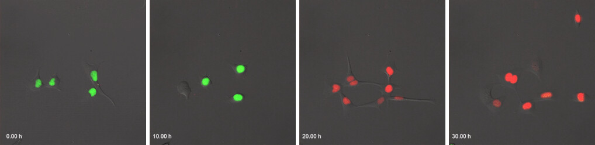{width="88%" fig-align="center"}

*Living cells with FUCCI reporters, time-lapse frames 10 h apart (far-red reporters shown in false colour): green nuclei are in S, G2 or M; after division, the daughters turn red (G1).*

- A human cell must copy **6 billion base pairs** once, never twice, then give **one copy to each daughter**. Copying twice, or dividing with broken DNA, gives **wrong chromosome numbers** and **mutations**.
- The colours always change in the same order: green → division → red → (yellow) → green. Most cells in your body are **not dividing** at all.
- **What drives the cycle forward, what stops it, and what tells a cell to start?**

::: notes
Look at the pictures. These are frames from a time-lapse movie of living cells that carry two fluorescent reporter proteins, a system called FUCCI that we come back to later. Green nuclei are copying their DNA or getting ready to divide; red nuclei are in the first gap phase. In the first frame four cells are green. Over the next twenty hours they divide, and the daughters appear red. Each nucleus changes colour in the same order, again and again: red, briefly yellow, green, then the cell divides and the two daughters start again. So the cell always knows where it is. That is remarkable when you think of the job: about six billion base pairs in a human diploid cell must be copied once, completely, and never twice, and then split equally. A cell that re-copies part of its genome, or divides before the copy is finished or repaired, gets the wrong number of chromosomes and many mutations: the starting point of cancer. And the decision to divide at all must come from the body: in an adult, most cells sit quietly out of the cycle, while cells in the gut lining, skin and bone marrow divide all the time. Today we find the clock, the brakes and the start button.
:::

## The four phases of the cell cycle {.smaller}

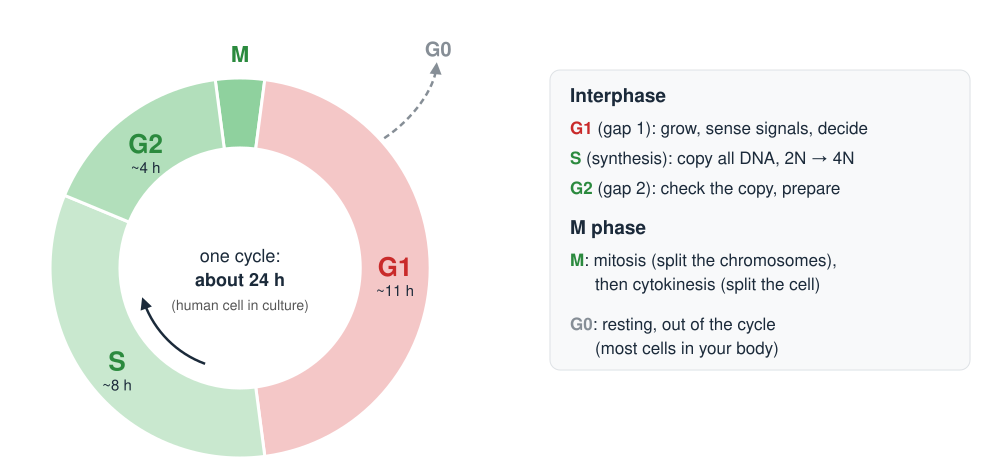{width="80%" fig-align="center"}

- **Interphase** (G1, S, G2) takes almost all the time; **M phase** (mitosis and cytokinesis) about an hour.
- DNA content per cell: **2N** in G1, rising during S, **4N** in G2 and M. We will measure this.
- G1 is the **most variable** phase: cells that divide slowly mostly have a long G1, or leave the cycle into **G0**.

::: notes
Here are the phases you need. M phase is what you see in a microscope: mitosis, the separation of the chromosomes, followed by cytokinesis, the split of the cytoplasm. Everything else is interphase. The cell spends the first gap phase, G1, growing and reading signals from outside; this is where it decides whether to divide. In S phase, S for synthesis, it replicates its DNA, so the DNA content goes from two copies of each chromosome set, which we call 2N, to 4N. In the second gap, G2, it checks that the copy is complete and prepares for mitosis. For a typical human cell line in culture the whole cycle takes about a day: G1 about eleven hours, S about eight, G2 about four, M about one. These numbers vary between cell types, and nearly all of the variation is in G1. Cells that stop dividing usually leave from G1 into a resting state called G0. Most cells in your body, such as neurons, liver cells and muscle cells, are in G0. Some can return to the cycle when needed, for example liver cells after an injury.
:::

## How do we know? Yeast mutants that stop at one point {.smaller}

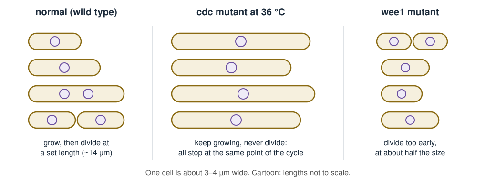{width="64%" fig-align="center"}

:::: {.columns}
::: {.column width="74%"}
- **Hartwell** (budding yeast, 1970s): temperature-sensitive **cdc** (cell division cycle) mutants. At the high temperature **every cell stops at the same stage**: each gene controls one step. He also coined the word **checkpoint**.
- **Nurse** (fission yeast): **cdc2** is the master kinase. Too little activity: long cells that never divide. **wee1** mutants divide too early, small. The **human** gene (**CDK1**) can replace yeast cdc2: the system is **conserved**.
:::
::: {.column width="26%"}
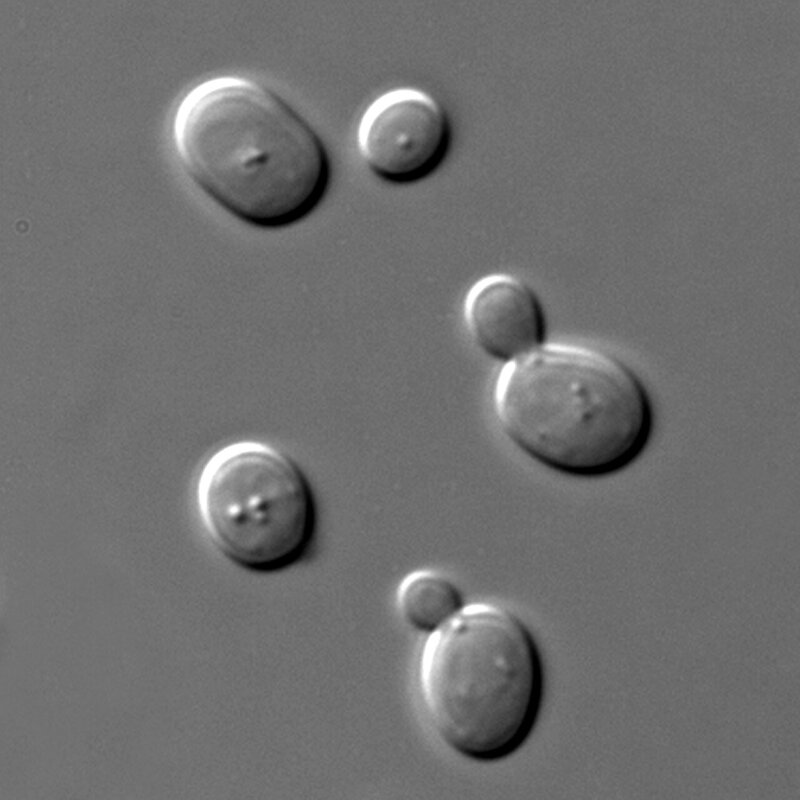{height="150px" fig-align="center"}

*Budding yeast (DIC). Bud size tells the stage: no bud in G1, a small bud in S, a large bud in G2/M.*
:::
::::

::: notes
How did anyone find the parts of a control system that runs inside every cell? Through genetics in yeast, a single-celled fungus with the same core machinery as our cells, as you saw in the cell-tour lecture. In the 1970s Lee Hartwell looked for budding-yeast mutants that could not complete the cycle. Because a cell that cannot divide cannot grow into a colony, he used temperature-sensitive mutants: they grow normally at 25 degrees, but at 36 degrees the mutant protein fails. The key observation: after the temperature shift, all cells of one mutant strain stop at the same stage, which you can read from the bud size. Each cdc gene therefore controls one step. Paul Nurse used fission yeast, which grows as a rod and divides in the middle. Mutants lacking cdc2 activity kept growing into long cells; mutants in wee1 divided too early at a small size, hence the Scottish word wee. In 1987 his lab showed that a human gene could replace yeast cdc2. That gene is CDK1. Hartwell, Nurse and Tim Hunt shared the Nobel Prize in 2001.
:::

## Cyclins come and go; CDKs stay {.smaller}

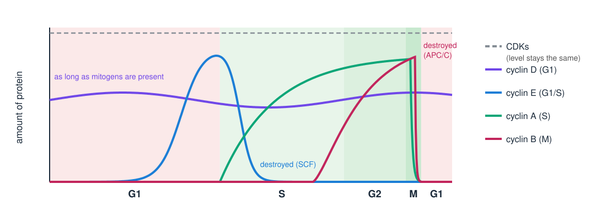{width="92%" fig-align="center"}

- A **CDK** (cyclin-dependent kinase) is a protein kinase that is **inactive alone**. It works only when bound to a **cyclin**. CDK levels stay **constant**; cyclin levels **rise and fall**.
- Each phase has its own pair: **cyclin D–CDK4/6** (G1), **cyclin E–CDK2** (G1/S), **cyclin A–CDK2** (S), **cyclin B–CDK1** (M).
- **Hunt** (1982): in sea urchin eggs, a protein that is made and then **destroyed at every division**. He named it **cyclin**.

::: notes
The engine of the cycle is a family of protein kinases. Remember from the protein-lifecycle lecture that a kinase adds phosphate to serine or threonine side chains, and that this switches proteins on or off within seconds. The cell-cycle kinases are called cyclin-dependent kinases, CDKs, because alone they have no activity: they need a partner protein, a cyclin. The amount of CDK protein in the cell stays the same throughout the cycle. What changes is the cyclins. Each cyclin is made at one stage and destroyed at another, so each CDK–cyclin pair is active in its own window, and each pair phosphorylates its own set of targets. In human cells, cyclin D with CDK4 or CDK6 acts in G1 and follows growth signals. Cyclin E with CDK2 starts S phase. Cyclin A works in S and G2. Cyclin B with CDK1 drives mitosis. Tim Hunt found the first cyclin in 1982 in fertilised sea urchin eggs, which divide every half hour: one protein built up and then vanished at every division. The plot is schematic, not measured data.
:::

## Switching a CDK on and off {.smaller}

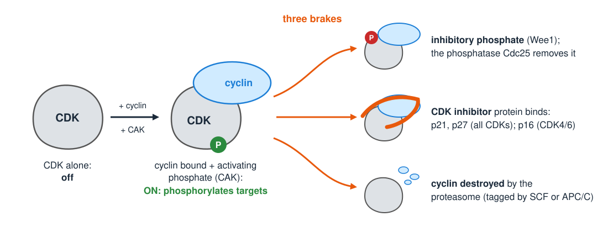{width="76%" fig-align="center"}

:::: {.columns}
::: {.column width="70%"}
- **On**: cyclin binds, and the kinase **CAK** adds an **activating phosphate**.
- **Off**: **Wee1** adds an **inhibitory phosphate** (removed by the phosphatase **Cdc25**); a **CDK inhibitor protein (CKI)** binds; or the **cyclin is destroyed**.
:::
::: {.column width="30%"}
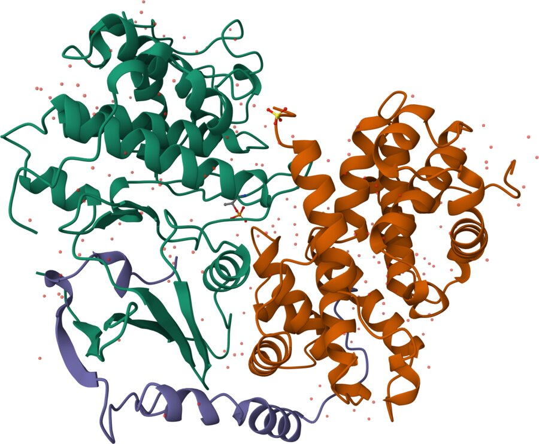{height="130px" fig-align="center"}

*CDK2 (green), cyclin A (brown), p27 (blue); PDB 1JSU.*
:::
::::

::: notes
A CDK needs more than its cyclin. Binding the cyclin moves a loop out of the active site, and a second kinase, called CDK-activating kinase or CAK, adds a phosphate to that loop; now the CDK is fully active. The cell has three kinds of brakes. First, the kinase Wee1 adds a phosphate at a different place, near the ATP site, which blocks activity even with the cyclin bound. The phosphatase Cdc25 removes it. This is the wee1 gene from the yeast slide: without Wee1, CDK1 becomes active too early and the cells divide small. Second, CDK inhibitor proteins, CKIs, bind the complex. The structure on the right shows p27 lying across both CDK2 and cyclin A, blocking the active site and the substrate-binding groove. p21 and p27 inhibit several CDKs; p16 blocks CDK4 and CDK6 specifically. Third, the cyclin can be destroyed. All three brakes come back today: Wee1 at the G2/M checkpoint, p21 after DNA damage, p16 in cancer, and cyclin destruction on the next slide.
:::

## Destruction moves the cycle forward: SCF and APC/C {.smaller}

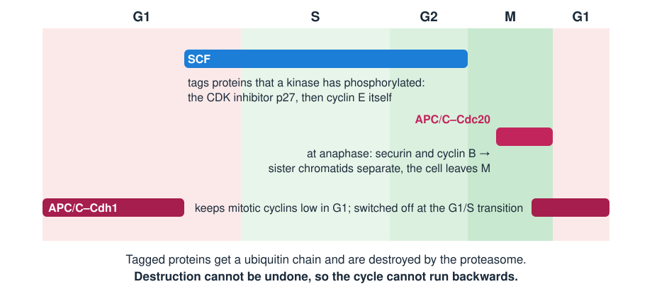{width="76%" fig-align="center"}

- Two **E3 ubiquitin ligases** (the protein-lifecycle lecture) tag cell-cycle proteins for the **proteasome**.
- **SCF** acts on proteins that a kinase has **phosphorylated**: the CKI **p27** (so S phase can start), then **cyclin E**.
- **APC/C**: with **Cdc20** it triggers **anaphase** (securin, cyclin B); with **Cdh1** it keeps cyclins low through **G1**.

::: notes
The cycle moves forward by building proteins up and then tearing them down. Destruction is done by the ubiquitin–proteasome system that you met in the protein-lifecycle lecture: an E3 ligase recognises a protein, adds a chain of ubiquitin, and the proteasome breaks the protein down. Two E3 ligases run the cell cycle. SCF is active all the time, but it only recognises proteins that carry a phosphate in the right place. In late G1, CDKs phosphorylate the inhibitor p27, SCF destroys it, and CDK2 is released. Later, cyclin E phosphorylates itself and is destroyed in the same way. The second ligase, the anaphase-promoting complex or cyclosome, APC/C, is switched on by two different partner proteins. With Cdc20, at the metaphase-to-anaphase transition, it destroys securin, which frees the enzyme that cuts the glue between sister chromatids, and it destroys cyclin B, so the cell can leave mitosis; the mitosis lecture covers that step in detail. With Cdh1, it stays active through G1, so that mitotic cyclins cannot build up too early. Because destruction cannot be reversed, the cycle has a direction.
:::

## All or none, and only once {.smaller}

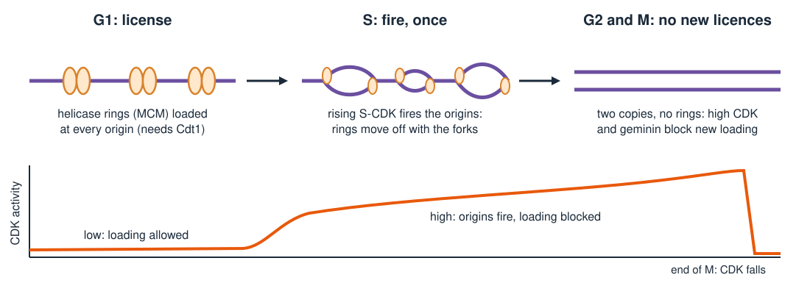{width="80%" fig-align="center"}

- **Licensing**: in G1 (CDK low), helicase rings are loaded on every **replication origin**. In S, rising CDK activity **fires** them and **blocks reloading** until the end of M. So each origin fires **once per cycle**.
- **Switches**: CDK1 activates its own activator (Cdc25) and inhibits its inhibitor (Wee1): **positive feedback** makes entry into M fast and all-or-none.
- **Cell fusion** (1970): fuse an S-phase cell with a G1 cell → the G1 nucleus starts copying. Fuse with a G2 cell → the G2 nucleus does **not** copy again.

::: notes
Two design features make the cycle reliable. The first answers our question of copying DNA exactly once. Replication starts at tens of thousands of origins. In G1, when CDK activity is low, each origin is licensed: a pair of helicase rings, the MCM complex, is loaded around the DNA with the help of a protein called Cdt1. When CDK activity rises at the start of S, the loaded origins fire and the rings move away with the replication forks. High CDK activity, together with a protein called geminin that binds Cdt1, prevents new rings from being loaded. Only when CDK activity falls at the end of mitosis can origins be licensed again. A classic cell-fusion experiment from 1970 showed this: an S-phase cell fused to a G1 cell made the G1 nucleus start replication, but a G2 nucleus could not replicate again. The second feature is positive feedback. Active CDK1 phosphorylates Cdc25, making it more active, and phosphorylates Wee1, making it less active. A little CDK1 activity therefore quickly becomes full activity: the cell enters mitosis all at once, never halfway. You met positive feedback as the basis of all-or-none decisions in the signalling lectures.
:::

## The decision to divide: Rb and E2F {.smaller}

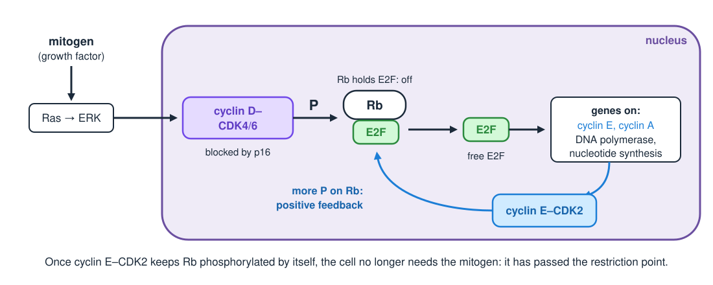{width="88%" fig-align="center"}

- **Mitogens** (growth factors) → Ras–ERK (the kinase-cascade lecture) → **cyclin D** is made.
- Unphosphorylated **Rb** holds the transcription factor **E2F**. CDK4/6 phosphorylates Rb → **E2F is released** → genes for **cyclin E** and DNA replication turn on.
- **Cyclin E–CDK2** phosphorylates more Rb: **positive feedback**. The switch flips to ON and stays there.

::: notes
Now the most important decision: whether to divide at all. In the kinase-cascade lecture you followed a growth-factor signal from a receptor tyrosine kinase through Ras and ERK into the nucleus, where it switched on early genes and then cyclin D. Cyclin D is short-lived, so its level reports the mitogen signal as long as the signal lasts. Cyclin D binds CDK4 or CDK6 and phosphorylates the retinoblastoma protein, Rb. Unphosphorylated Rb binds the transcription factor E2F and keeps E2F's target genes silent. When Rb carries enough phosphates, it lets go. Free E2F turns on genes needed for S phase: cyclin E and cyclin A, DNA polymerase, enzymes that make nucleotides. Now the key step: cyclin E with CDK2 also phosphorylates Rb. So E2F makes cyclin E, and cyclin E frees more E2F. This positive feedback loop turns a gradual rise of mitogen signal into a sharp, all-or-none switch. The name Rb comes from retinoblastoma, an eye cancer of children: losing both copies of the RB1 gene removes this brake.
:::

## The restriction point: commitment {.smaller}

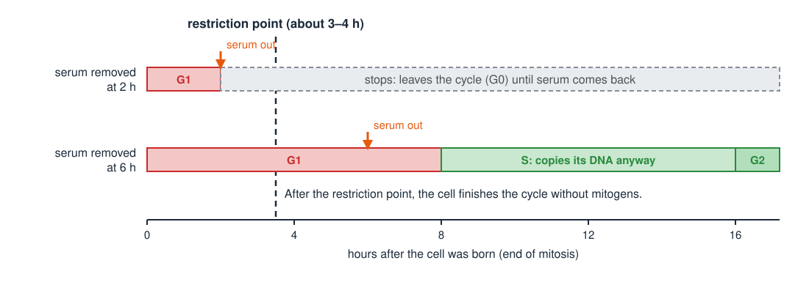{width="84%" fig-align="center"}

- **Before** the restriction point, a cell needs mitogens all the time; without them it returns to **G0**.
- **After** it, the Rb–E2F loop runs by itself: the cell **completes the cycle** even if mitogens disappear.
- Found by removing serum at different times (**Pardee**, 1974); time-lapse of single cells (**Zetterberg and Larsson**, Karolinska Institute, 1985).

::: notes
The positive feedback explains a classic observation. Fibroblasts in a dish need serum, which contains growth factors, to divide. Arthur Pardee showed in 1974 that cells need serum only during part of G1: after a certain point they go on to S phase and divide even if the serum is removed. He called this the restriction point. In 1985 Anders Zetterberg and Olle Larsson at the Karolinska Institute filmed single cells and removed serum for a short time at different moments after mitosis. Cells in the first three to four hours after division were thrown out of the cycle and needed many hours to come back. Cells later in G1 were not affected at all. In molecular terms, the restriction point is the moment when cyclin E–CDK2 and E2F keep Rb phosphorylated without help from cyclin D. Before it, the decision can be reversed; after it, the cell is committed. In the demo you can see this switch: remove mitogens and watch which cells still enter S phase. Most cancer cells no longer obey the restriction point, as we will see at the end.
:::

## Checkpoints: brakes at three transitions {.smaller}

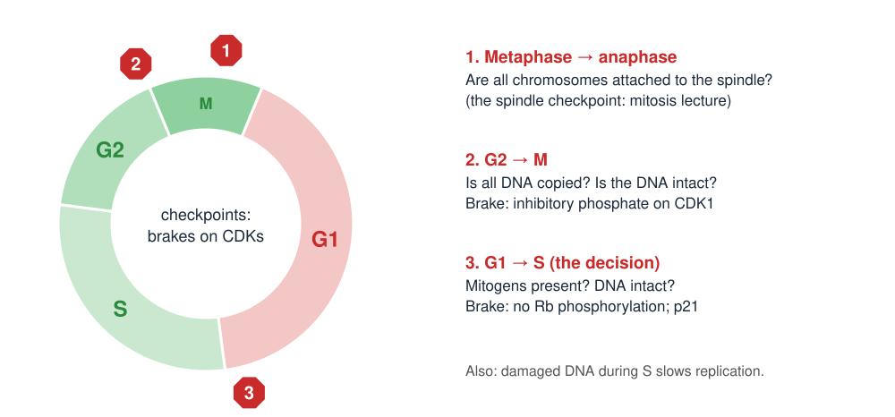{width="76%" fig-align="center"}

- A **checkpoint** stops the cycle until a condition is met, by **blocking CDK activity** or the **APC/C**.
- Checkpoints are **not** needed to run the cycle; they are needed to run it **safely**. Yeast without them divide normally, until something goes wrong.

::: notes
A control system needs more than an engine and a start button: it needs brakes that act when something is wrong. These are the checkpoints. There are three main ones. The decision point in late G1 asks whether conditions are right: are mitogens there, is the cell big enough, is the DNA intact? The G2-to-M checkpoint asks whether all DNA has been copied and whether it is undamaged. The metaphase-to-anaphase checkpoint, also called the spindle assembly checkpoint, asks whether every chromosome is attached to the spindle; it blocks the APC/C, and you will meet it in detail in the mitosis lecture. Each checkpoint works by blocking the next CDK or the APC/C. Hartwell found the first checkpoint gene in yeast: mutants without it did not stop after radiation, divided with broken chromosomes and died. Under normal conditions they grew fine. That is the key idea: checkpoints are safety devices, and losing them is not lethal right away but lets mistakes accumulate. That is why they are so often lost in cancer.
:::

## DNA damage: p53 and p21 stop the cycle {.smaller}

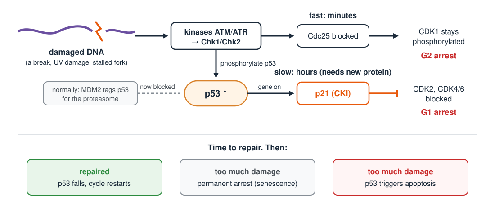{width="78%" fig-align="center"}

- Damaged DNA activates the kinases **ATM/ATR** and **Chk1/Chk2**.
- **Fast**: Cdc25 is blocked, CDK1 keeps its inhibitory phosphate → **G2 arrest** (works **without** p53).
- **Slow**: **p53** escapes its E3 ligase **MDM2**, accumulates and switches on **p21**, a CKI → **G1 arrest**. Too much damage: **senescence** or **apoptosis**.

::: notes
Here is the best-understood checkpoint. Damage to DNA, such as a double-strand break from radiation or a stalled replication fork, is sensed by two large kinases, ATM and ATR. They activate two smaller kinases, Chk1 and Chk2. There are two routes to stop the cycle. The fast route acts within minutes: Chk1 and Chk2 phosphorylate Cdc25, which is then inactive or destroyed. CDK1 keeps its inhibitory phosphate from Wee1, and the cell cannot enter mitosis. The slow route needs new protein. The transcription factor p53 is normally made all the time and destroyed within about twenty minutes: the E3 ligase MDM2 tags it for the proteasome. After damage, p53 is phosphorylated, MDM2 can no longer bind it, and p53 accumulates within an hour. It switches on many genes, among them p21, the CDK inhibitor from earlier, which blocks CDK2 and CDK4/6 and holds the cell in G1. If repair succeeds, p53 falls and the cycle restarts. If damage is too severe, p53 drives permanent arrest, senescence, or cell suicide, apoptosis, which you meet in the next lectures. p53 has been called the guardian of the genome.
:::

## How do we know? DNA content by flow cytometry {.smaller}

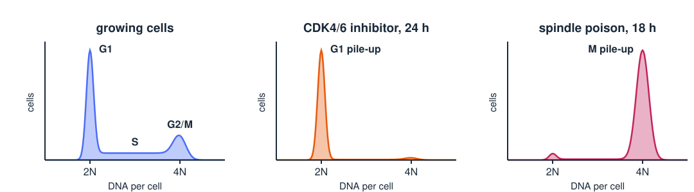{width="84%" fig-align="center"}

- Stain fixed cells with a **DNA dye** (propidium iodide, DAPI) and measure **thousands of cells** in a flow cytometer (the cell-methods lecture). Fluorescence ∝ DNA content.
- Peaks at **2N (G1)** and **4N (G2/M)**, with S-phase cells in between. A drug that stops cells **piles them up** at one place: this is how arrest points are mapped.
- To tell G2 from M, or to mark S precisely, add a second stain (e.g. a mitosis marker, or **EdU** taken up during S).

::: notes
How do you find out where in the cycle a drug or a mutation stops cells? The most common method is flow cytometry of DNA content, which you met in the cell-methods lecture. Cells are fixed, treated with RNase, and stained with a dye that binds DNA in proportion to its amount, such as propidium iodide or DAPI. The flow cytometer measures the fluorescence of each cell as it passes the laser, thousands of cells per second. A histogram shows a tall peak at 2N for G1 cells, a smaller peak at twice that brightness for G2 and mitotic cells, and a low plateau in between for cells in S phase. Now treat the cells with a drug. A CDK4/6 inhibitor makes the G1 peak grow and empties S and G2: the cells pile up before the restriction point. A spindle poison does the opposite: cells pile up at 4N because they cannot leave mitosis. DNA content alone cannot separate G2 from M, because both have 4N; for that a second stain is added, for example an antibody against a mitosis-specific phosphorylated histone. EdU, a thymidine analogue taken up only during replication, marks S-phase cells.
:::

## How do we know? FUCCI shows the cycle in living cells {.smaller}

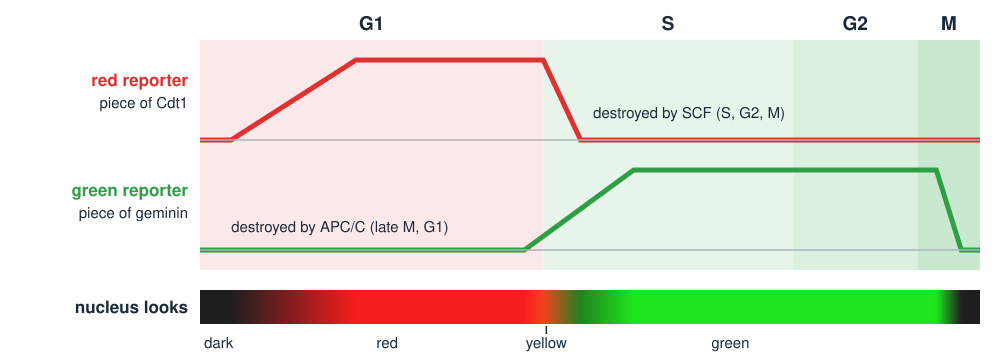{width="72%" fig-align="center"}

- Two fluorescent proteins fused to **degradation signals** from cell-cycle proteins: a piece of **Cdt1** (red; destroyed by **SCF** in S, G2, M) and a piece of **geminin** (green; destroyed by **APC/C** in late M and G1).
- The control system **reads itself out**: no fixing, the **same cell** followed for days. Developed by Miyawaki's lab (2008). **Try it:** [the cell-cycle clock](questions.qmd#explore).

::: notes
Flow cytometry gives a snapshot of a population of dead, fixed cells. To follow one living cell through several cycles we need a reporter. The FUCCI system, short for fluorescent ubiquitination-based cell cycle indicator, was developed by Atsushi Miyawaki's lab in 2008 and uses the destruction machinery from this lecture. The red reporter is a red fluorescent protein fused to a fragment of Cdt1, the licensing protein. That fragment carries a degradation signal recognised by SCF-type ligases from the start of S phase, so the red signal is present only in G1. The green reporter is a green fluorescent protein fused to a fragment of geminin, which carries a signal for the APC/C. APC/C is active from late mitosis through G1, so the green signal appears only once the APC/C switches off at the G1/S transition, and stays in S, G2 and M. At the G1/S border both are present for a short time, and the nucleus looks yellow. The demo uses exactly these rules: you can add drugs and watch the colours, and the DNA histogram, change.
:::

## Why it matters: CDK4/6 inhibitors in breast cancer {.smaller}

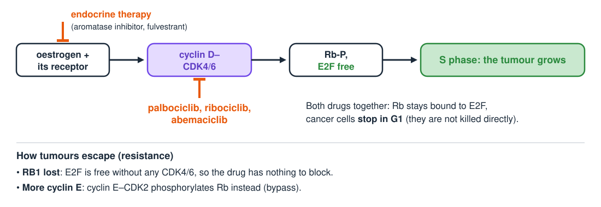{width="84%" fig-align="center"}

:::: {.columns}
::: {.column width="76%"}
- About **70 %** of breast cancers are **oestrogen-receptor positive** and depend on **cyclin D1–CDK4/6** (tamoxifen and the oestrogen receptor: the fate-signalling lecture).
- **Palbociclib** (approved 2015), ribociclib, abemaciclib + endocrine therapy: in advanced disease, time until the cancer grows again went from **about 15 to about 25 months**. Main side effect: fewer **neutrophils** (their precursors also need CDK4/6), reversible.
:::
::: {.column width="24%"}
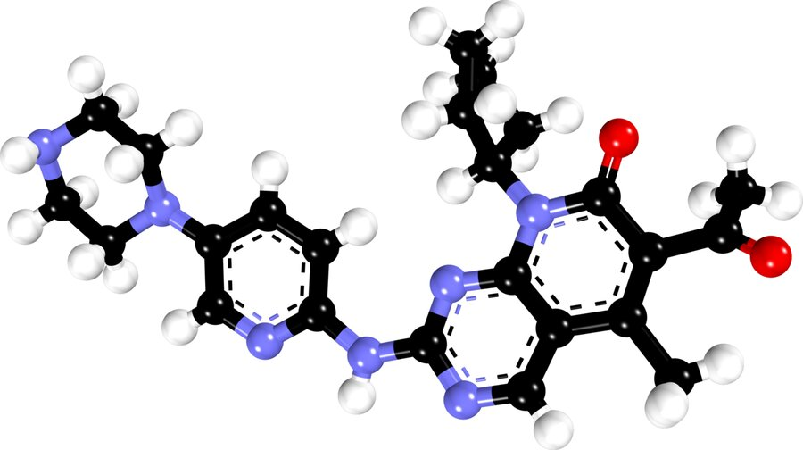{height="120px" fig-align="center"}

*Palbociclib (C black, N blue, O red, H white); it fills the ATP pocket of CDK4/6.*
:::
::::

::: notes
Back to the Rb–E2F switch. In oestrogen-receptor-positive breast cancer, which is about seventy percent of all breast cancers, the receptor switches on the cyclin D1 gene, and the cancer cells depend on cyclin D1 with CDK4 and CDK6 to pass the restriction point. In some tumours the cyclin D1 gene is even amplified. Palbociclib is a small molecule that sits in the ATP pocket of CDK4 and CDK6 and is selective for them over other CDKs. It was approved in 2015, followed by ribociclib and abemaciclib. Given together with endocrine therapy, which removes the oestrogen signal, it keeps Rb unphosphorylated, so the cancer cells stop in G1. In the PALOMA-2 trial in advanced disease, the median time before the cancer grew again rose from about fifteen to about twenty-five months. The drug stops cells rather than killing them, so its main side effect is also a pause: precursors of neutrophils in the bone marrow need CDK4/6 too, and their numbers fall, but recover when the drug is paused. You will meet trial design in Kliniska prövningar och läkemedelsutveckling.
:::

## Why it matters: cancers break the brakes {.smaller}

:::: {.columns}
::: {.column width="62%"}
| Control | How cancers break it |
|---|---|
| **Rb pathway** (G1/S) | **p16** deleted; **cyclin D1** amplified; **RB1** lost; HPV protein **E7** binds Rb |
| **p53 pathway** (DNA damage) | **TP53** mutated in about **half** of all cancers; **MDM2** amplified; HPV protein **E6** destroys p53 |

- Almost every cancer has a defect in **both** pathways: the restriction point is ignored, and damaged DNA is copied and divided.
- This decides which drugs work: a tumour **without Rb** does not respond to a CDK4/6 inhibitor. More in the cancer lecture and in **Sjukdomslära**.
:::
::: {.column width="38%"}
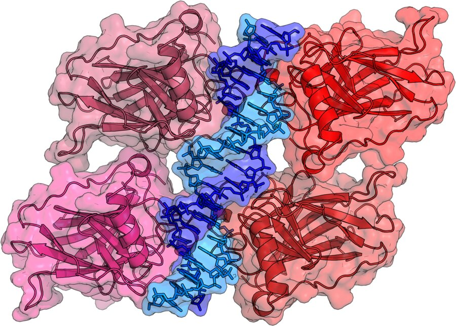{width="100%"}

*Four p53 DNA-binding domains (red, pink) on their DNA site (blue) (PDB 3KMD). Most cancer mutations hit this domain.*
:::
::::

::: notes
The two control circuits of this lecture are the two most commonly broken circuits in human cancer. In the Rb pathway, cancers delete the gene for the CDK4/6 inhibitor p16, amplify the cyclin D1 gene, or lose RB1 itself. Human papillomavirus, which causes cervical cancer, makes a protein called E7 that binds Rb and releases E2F. Remember HeLa cells from the cell-tour lecture: this is one of the two brakes that HPV removes. The other is p53. The TP53 gene is mutated in about half of all human cancers, more than any other gene; most mutations change single amino acids in the DNA-binding domain shown on the right, so p53 can no longer bind its target genes. Other tumours amplify MDM2, or, with HPV, make the protein E6, which tags p53 for destruction. A cell without these brakes ignores the restriction point and keeps dividing with damaged DNA, so mutations pile up. Knowing which brake is broken guides treatment: a tumour that has lost Rb has nothing for a CDK4/6 inhibitor to protect, and does not respond. The cancer lecture and Sjukdomslära take this further.
:::

## Summary {.smaller}

1. The cycle has four phases: **G1** (decide), **S** (copy DNA, 2N → 4N), **G2** (check), **M** (divide); non-dividing cells rest in **G0**.
2. **CDKs** are active only with a **cyclin**; cyclins rise and fall in each cycle. CDKs are switched off by **inhibitory phosphates** (Wee1/Cdc25), **CDK inhibitors** (p21, p27, p16) and **cyclin destruction** by **SCF** and **APC/C**, which makes the cycle one-way.
3. **Licensing** lets each origin fire **once** per cycle; **positive feedback** makes transitions all-or-none.
4. **Mitogens → cyclin D–CDK4/6 → Rb phosphorylated → E2F free → cyclin E**: past the **restriction point** the cell is committed. **Checkpoints** stop the cycle; after **DNA damage**, **p53** induces **p21**.
5. **Yeast cdc mutants**, **DNA-content flow cytometry** and **FUCCI** reveal the cycle; **CDK4/6 inhibitors** (palbociclib) stop ER-positive breast cancer cells in G1, and cancers often break the **Rb** and **p53** brakes.

*Read more (optional): Alberts et al., Molecular Biology of the Cell, 7th ed., ch. 17.*

[Image credits](../credits.qmd#cell-cycle-control){style="font-size:0.7em"}

::: notes
Five points to take home. First, the phases: G1 is where the cell decides, S is where it copies its DNA from 2N to 4N, G2 is where it checks, and M is where it divides; cells that stop dividing rest in G0. Second, the engine is a set of cyclin-dependent kinases, active only with their cyclin partners, whose levels rise and fall. CDKs are switched off by inhibitory phosphates, by CDK inhibitor proteins and by destruction of the cyclin by the SCF and APC/C ubiquitin ligases; because destruction cannot be undone, the cycle runs one way. Third, licensing in G1 ensures that each origin fires only once, and positive feedback makes each transition sharp. Fourth, the decision to divide runs through Rb and E2F, with a restriction point after which the cell no longer needs mitogens; checkpoints, including the p53–p21 response to DNA damage, stop the cycle when something is wrong. Fifth, the methods and the medicine: yeast genetics, flow cytometry, FUCCI, and CDK4/6 inhibitors in breast cancer. Next lecture: the mechanics of mitosis and cytokinesis.
:::
