## About this lecture

Microscopy tells you **where** things are. This lecture is about the other half of cell biology: **what** things are, **how many** cells have them, and **what happens if you change them**.

After this lecture you can:

- Say what **cell culture** gives you (primary cells, cell lines, organoids) and what it cannot tell you.
- Explain how **fractionation** separates organelles, and how **marker proteins** show what is in each fraction.
- Explain how **antibodies** are used to detect and pull out one protein (western blot, immunoprecipitation).
- Read a **flow cytometry** dot plot and explain how cells are sorted.
- Choose a **perturbation** (inhibitor, RNAi, CRISPR, overexpression) and the right **controls** to test whether a protein is *needed* for a process.

::: notes
In the microscopy lecture we looked at cells. Looking tells you where a protein is, but it does not tell you what the protein does. To answer that question, cell biologists do three kinds of things. They grow cells outside the body, so they have material to work with. They take cells apart, to find out which molecules belong to which compartment. And they change cells on purpose, by removing or adding a protein, and watch what happens. This lecture goes through these three steps. You have met some of the tools before: protein purification, SDS-PAGE and PCR from biochemistry. Here we use them on whole cells. Several of these methods also come back in the laboratory part of the course, so this lecture is also your preparation for the labs. At the end we see how the same methods are used to find new drugs and to make a living cancer therapy.
:::

## The question: one protein, four questions {.smaller}

:::: {.columns}
::: {.column width="52%"}
You have found a new protein, **X**. Immunofluorescence shows it in the cytoplasm.

To understand it, you need four more answers:

1. **Which compartment** is it really in? *(fractionation)*
2. **How much** is there, and does the amount change? *(western blot)*
3. **Which cells** in a mixed population have it? *(flow cytometry)*
4. **Is it needed** for anything? *(perturbation)*

And for all of these you need **cells to work on**. *(cell culture)*
:::
::: {.column width="48%"}
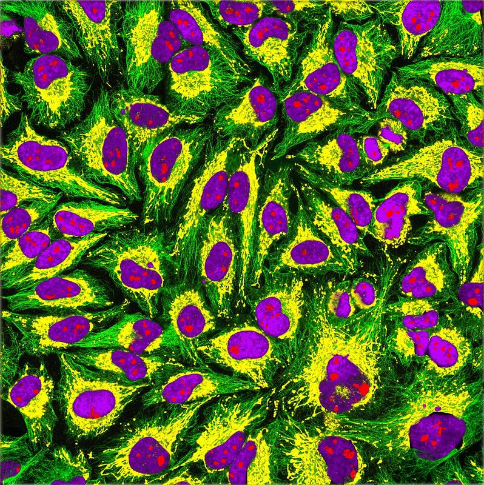{width="95%" fig-align="center"}

[HeLa cells stained with antibodies: microtubules, mitochondria (HSP60), nucleoli (fibrillarin) and DNA.]{style="font-size:0.7em"}
:::
::::

::: notes
Here is a typical situation. Someone has made an antibody against a new protein, X, and the image shows it somewhere in the cytoplasm. That is a start, but a fluorescence image has limits. Two compartments can look the same at two hundred nanometres resolution, so you cannot be sure which one X is in. An image is also hard to quantify: is there more X after a treatment, or is the staining just brighter? An image shows a few cells; you may want to know the fraction of cells in a whole blood sample that carry X. And above all, seeing X tells you nothing about what X does. Each of these questions has its own standard method, and those methods are the topic of this lecture. Keep protein X in mind; we come back to it in a worked example near the end.
:::

## Cell culture: primary cells and cell lines {.smaller}

:::: {.columns}
::: {.column width="50%"}
- Cells are grown in a **sterile** dish or flask, in a medium with salts, glucose, amino acids and growth factors, at 37 °C.
- **Primary cells** come straight from a tissue. They behave like the tissue, but divide only a limited number of times.
- **Cell lines** divide without limit (they are *immortal*), usually because they come from a tumour or carry an immortalising gene. HeLa, from the tour of the cell, is the classic example.
- Trade-off: cell lines are **easy and reproducible**; primary cells are **closer to the body**.
:::
::: {.column width="50%"}
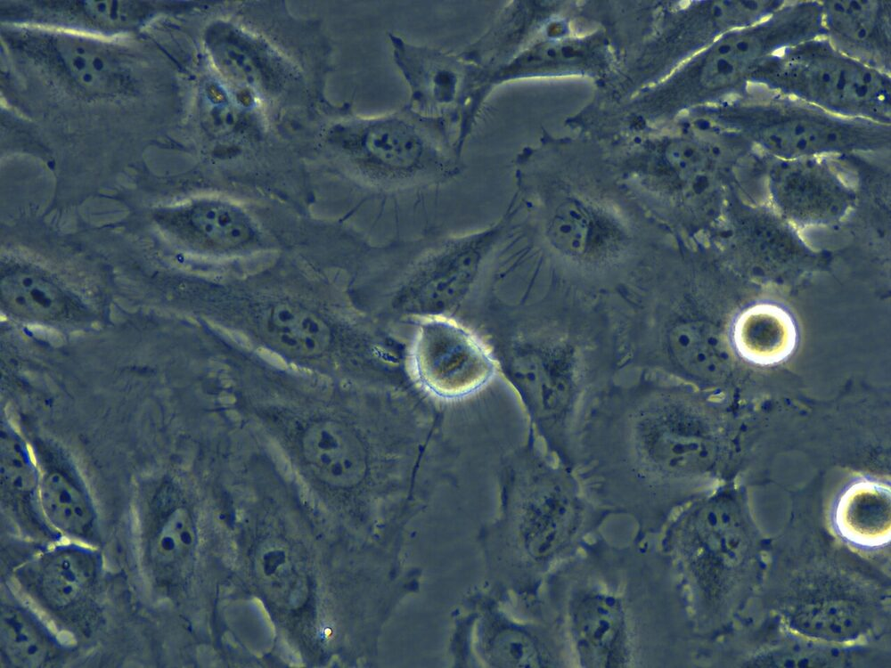{height="250px" fig-align="center"}

[Living HeLa cells in a culture flask (phase contrast).]{style="font-size:0.7em"}

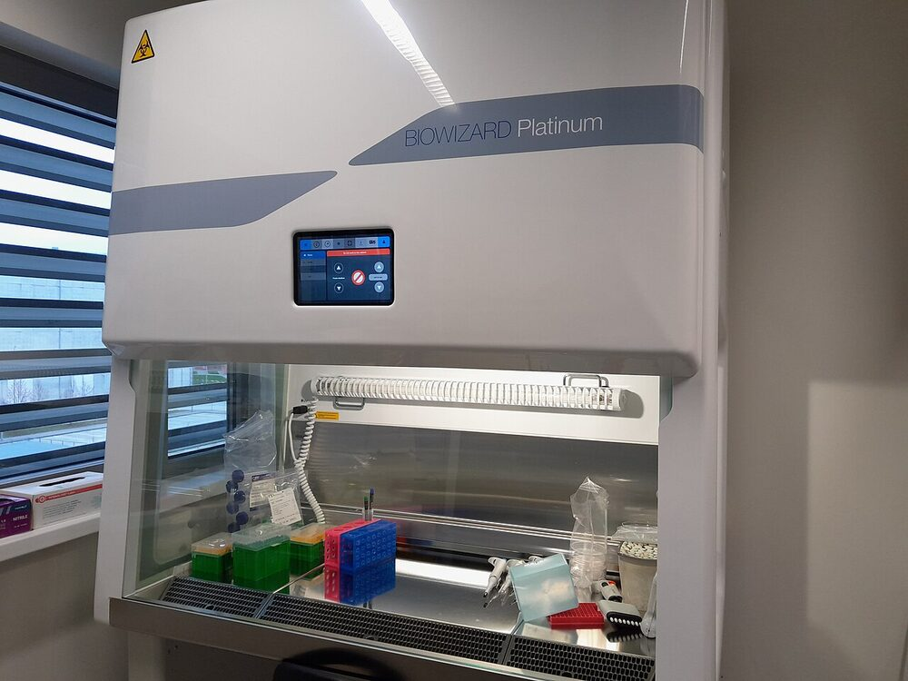{height="210px" fig-align="center"}

[A sterile bench (biosafety cabinet) for cell culture work.]{style="font-size:0.7em"}
:::
::::

::: notes
Cell culture means growing cells outside the body. The cells sit in a plastic dish or flask, covered by a liquid medium that gives them what the blood would: salts, glucose, amino acids, vitamins and growth factors, usually from serum. They are kept at body temperature in an incubator. All work is done on a sterile bench, because bacteria and fungi grow much faster than human cells. There are two main kinds of cultured cells. Primary cells are taken directly from a tissue, for example skin fibroblasts or blood cells. They are close to the real tissue but stop dividing after a limited number of divisions, so you must keep getting new ones. Cell lines have become immortal, either because they come from a tumour, like HeLa, or because an immortalising gene was added. They are cheap, grow fast and every lab can use the same line, which makes results comparable. The price is that a cell line has adapted to life on plastic and is often genetically abnormal.
:::

## Stem cells, 3D culture and organoids {.smaller}

:::: {.columns}
::: {.column width="50%"}
- Cells on flat plastic lose much of their normal shape and behaviour.
- **3D culture**: cells grow in a soft gel that mimics the extracellular matrix.
- **Organoids**: stem cells in a gel organise themselves into a small, simple version of an organ, with several cell types in roughly the right places.
- Made from adult stem cells (e.g. gut) or from **induced pluripotent stem cells (iPS cells)**, which can be made from a patient's skin or blood.
- Use: study a **patient's own cells**, and test drugs on them.
:::
::: {.column width="50%"}
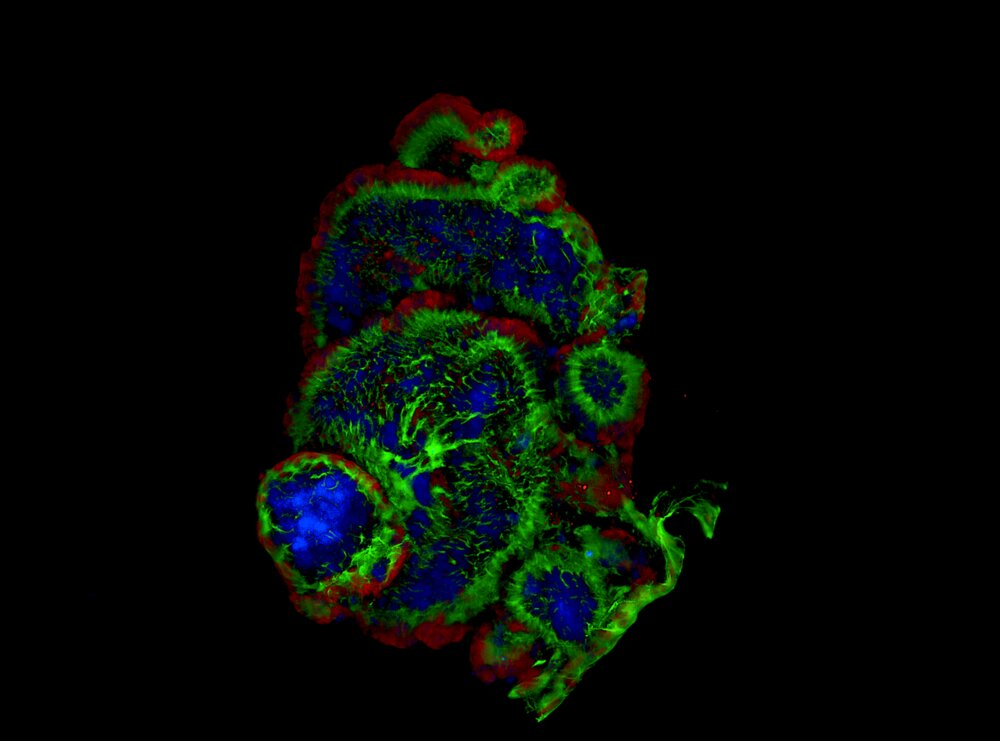{width="85%" fig-align="center"}

[A small-intestine organoid. Green: E-cadherin at cell–cell contacts; red: the signalling protein AKT; blue: nuclei.]{style="font-size:0.7em"}
:::
::::

::: notes
A cell spread flat on hard plastic is not in its natural situation. In a tissue, cells touch neighbours on all sides, sit on a soft extracellular matrix, and have a top and a bottom. One way closer to the body is 3D culture in a soft gel. Organoids take this a step further. If you put intestinal stem cells into such a gel with the right growth factors, they divide and organise themselves into a small hollow structure with crypts and villus-like regions and several cell types, like a tiny gut. Organoids can also be made from induced pluripotent stem cells, which are made by reprogramming ordinary adult cells, such as skin cells, back to a stem-cell state. This means you can grow organoids from a particular patient. A well-known use is cystic fibrosis: gut organoids from a patient swell when the chloride channel works, so you can test which drug works for that patient's mutation. You will meet that channel in the ion channels lecture.
:::

## Is the culture what you think it is? {.smaller}

Two classic problems, both easy to miss:

| Problem | Why it matters | How labs check |
|---|---|---|
| **Wrong cells** (misidentified cell line) | Hundreds of published "cell lines" turned out to be another line, often HeLa. Results are then about the wrong tissue. | **DNA fingerprint** (STR profile) compared with a reference database |
| **Hidden bacteria** (*Mycoplasma*) | Tiny bacteria without a cell wall. Not visible in the microscope, not killed by common antibiotics; they change the cells' metabolism and gene expression. | Regular **PCR test** of the culture |

**Lesson:** a result from cultured cells is only as good as the cells. Good laboratory practice includes checking them.

::: notes
Two problems have caused a lot of wrong results in cell biology, and both are invisible. The first is the wrong cells. Because HeLa grows so well, a few HeLa cells carried over into another culture can take it over within weeks. Many lines that were thought to come from, for example, breast or prostate tissue were later shown to be HeLa or another line. Today journals often ask for proof of identity, a DNA fingerprint based on short tandem repeats, which is compared with the database for that line. The second problem is Mycoplasma, a group of very small bacteria without a cell wall. Because they lack a wall, the usual penicillin-type antibiotics do not kill them, and because they are so small, the culture still looks clear. Yet they change how the cells behave. Labs therefore test their cultures regularly, usually with PCR. The general lesson fits the lab part of this course: you must be able to trust your material before you can trust your result.
:::

## Taking cells apart: homogenisation and centrifugation {.smaller}

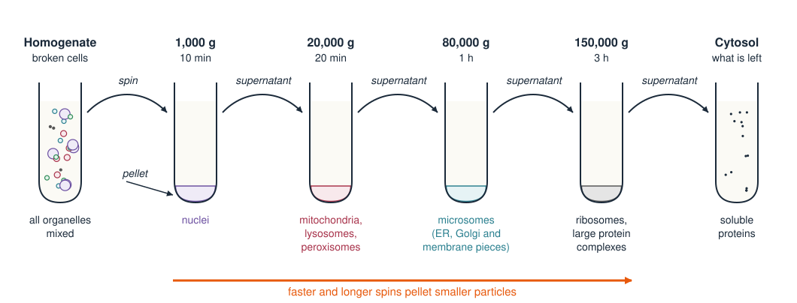{width="92%" fig-align="center"}

- First break the cells **gently** (homogenisation), so organelles stay intact.
- Then spin at **increasing speed and time**. Large, dense particles pellet first; small ones need stronger force.

::: notes
To find out which compartment a protein belongs to, you can take the cell apart and separate its organelles. First the cells are broken open gently, for example by pushing them through a narrow gap, in a buffer that keeps the organelles intact. This is called homogenisation, and the result is a homogenate. Then comes differential centrifugation. A short, slow spin pellets the biggest and heaviest particles: nuclei and unbroken cells. The liquid on top, the supernatant, is spun again, faster and longer. Now mitochondria, lysosomes and peroxisomes form a pellet. A still stronger spin pellets small membrane pieces called microsomes, which are mostly bits of ER and Golgi that closed into little vesicles. After the strongest spin, what stays in the supernatant is the cytosol with its soluble proteins. The g-values and times in the figure are typical numbers; every lab adjusts them. This approach earned Albert Claude, Christian de Duve and George Palade a Nobel Prize in 1974; de Duve found lysosomes and peroxisomes this way.
:::

## Density gradients and marker proteins {.smaller}

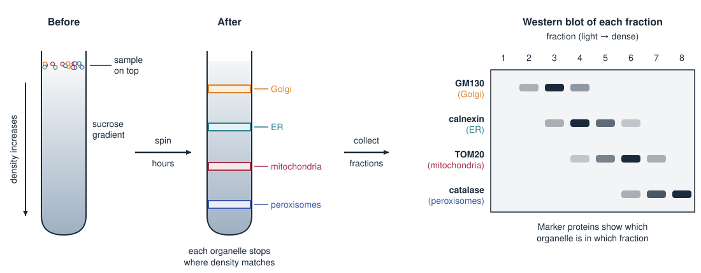{width="82%" fig-align="center"}

:::: {.columns}
::: {.column width="78%"}
- Differential spins give **mixtures**. For better separation, spin through a **gradient** (e.g. sucrose): each organelle stops where its density matches.
- Which fraction holds which organelle? Use **marker proteins** known to sit in one organelle only. If protein X runs with the ER marker, X is probably in the ER.
:::
::: {.column width="22%"}
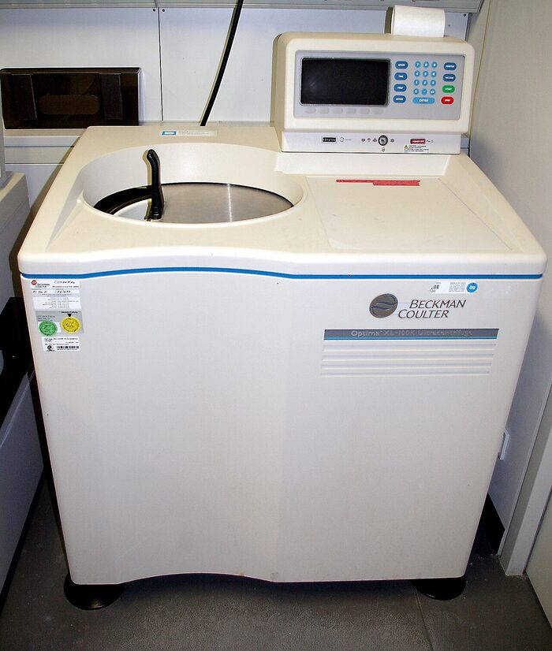{height="150px" fig-align="center"}
:::
::::

::: notes
Differential centrifugation is quick but crude: each pellet is a mixture. A cleaner separation uses a density gradient. A tube is filled with a sugar solution that is light at the top and dense at the bottom. The homogenate goes on top, and during a long spin in an ultracentrifuge each organelle moves down until it reaches the layer that has the same density as itself, and stops there. Afterwards the tube is emptied in small fractions from top to bottom. But the fractions are not labelled, so how do you know what is in each one? You run each fraction on a western blot, which comes in two slides, and stain for marker proteins: proteins that are known to live in only one organelle. In the figure, GM130 marks the Golgi, calnexin the ER, TOM20 mitochondria and catalase peroxisomes. Then you stain for your protein X. If X appears in the same fractions as calnexin, it is probably an ER protein. Real gradients overlap more than this clean figure shows.
:::

## Antibodies as tools {.smaller}

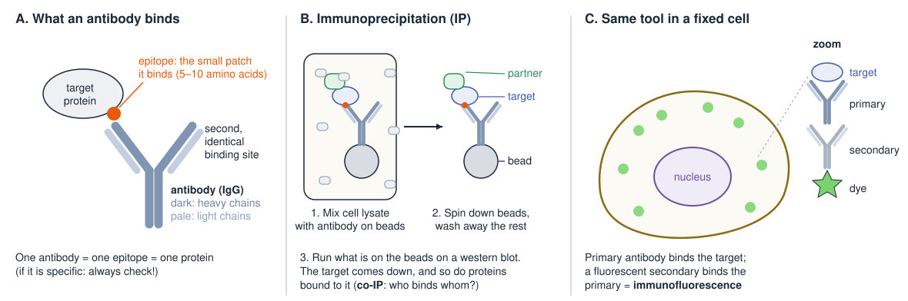{width="88%" fig-align="center"}

- An antibody binds one small patch, the **epitope**, on one protein. That makes it a tag-free "probe" for a protein.
- **Immunoprecipitation (IP)**: antibody on beads pulls the target, *and the proteins bound to it*, out of a cell lysate.
- The same antibody, with a fluorophore, gives the **immunofluorescence** images from the microscopy lecture.

::: notes
Antibodies are the most used tool in cell biology, because they recognise one protein among thousands. An antibody of the IgG type has two identical binding sites, each of which fits a small patch on the target, the epitope, typically five to ten amino acids or a small surface. In immunofluorescence, which you saw in the microscopy lecture, the antibody carries a fluorophore so you can see where the target is. In immunoprecipitation, the antibody is attached to small beads. You mix the beads with a cell lysate, the target binds, you spin the beads down and wash away everything else. What remains is the target protein together with any proteins that were bound to it. That is how you find the partners of a protein. Everything depends on the antibody being specific. A bad antibody also binds other proteins, and then every result is wrong. A good control is to use cells where the target gene has been knocked out: the signal should disappear.
:::

## Western blot: which protein, how much {.smaller}

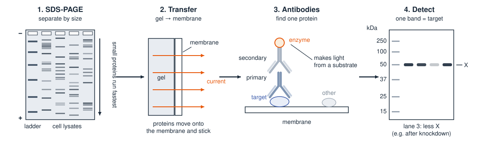{width="92%" fig-align="center"}

:::: {.columns}
::: {.column width="72%"}
- *Recap:* SDS-PAGE separates proteins by size. Proteins are then **transferred** to a membrane, and **one** protein is found with an antibody.
- Band **position** = size (check it!). Band **strength** = amount, compared between lanes.
- Always include a **loading control** (a protein that should not change).
:::
::: {.column width="28%"}
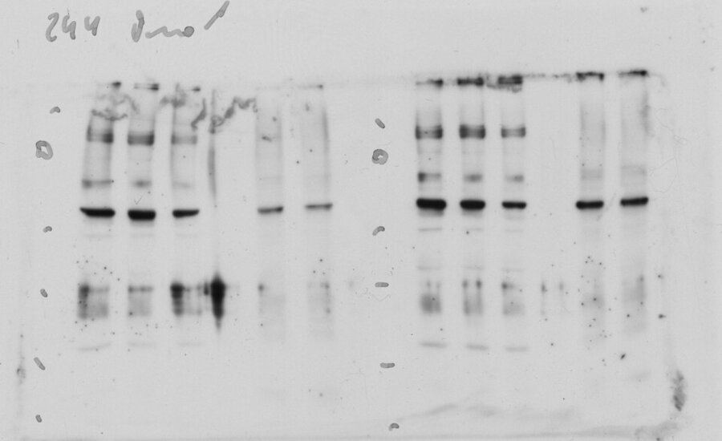{height="170px" fig-align="center"}
:::
::::

::: notes
You know SDS-PAGE from biochemistry: proteins are coated with a negative detergent and pulled through a gel by an electric field, so small proteins move fastest. A western blot adds two steps. First the separated proteins are moved from the gel onto a thin membrane by a second electric current, where they stick. Then the membrane is incubated with a primary antibody against your protein, and a secondary antibody that binds the first one and carries an enzyme. The enzyme turns a substrate into light, and you see a band. The position of the band tells you the size, which is a good check that the antibody found the right protein. The strength of the band tells you roughly how much protein there is, compared between lanes. In lane three of the figure there is less protein X, for example after the gene was knocked down. To compare lanes fairly you also stain a loading control, a protein such as actin or tubulin whose amount should be the same everywhere, to show that the same amount of material was loaded.
:::

## Flow cytometry: measuring thousands of single cells {.smaller}

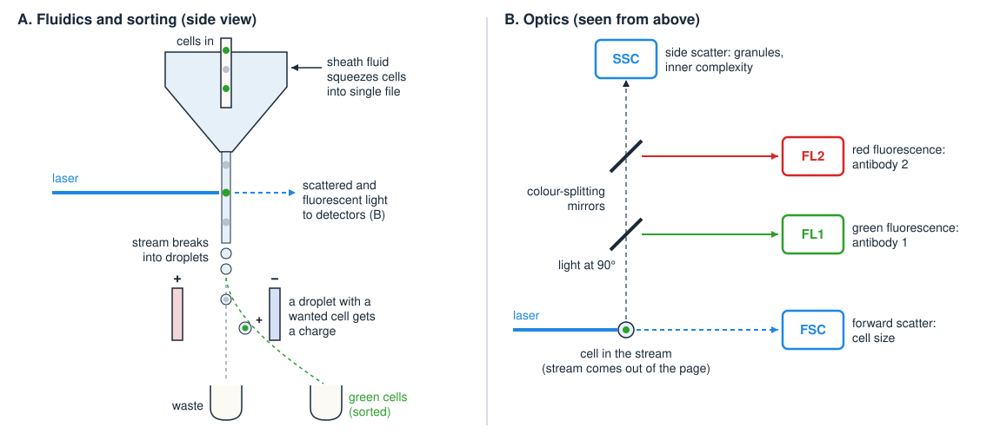{width="76%" fig-align="center"}

:::: {.columns}
::: {.column width="78%"}
- Cells pass a laser **one at a time**, thousands per second. **Scatter** gives size (forward) and granularity (side); **fluorescence** tells which labelled molecules each cell carries.
- **FACS** (cell sorting): droplets with a wanted cell get a charge and are deflected into a tube.
:::
::: {.column width="22%"}
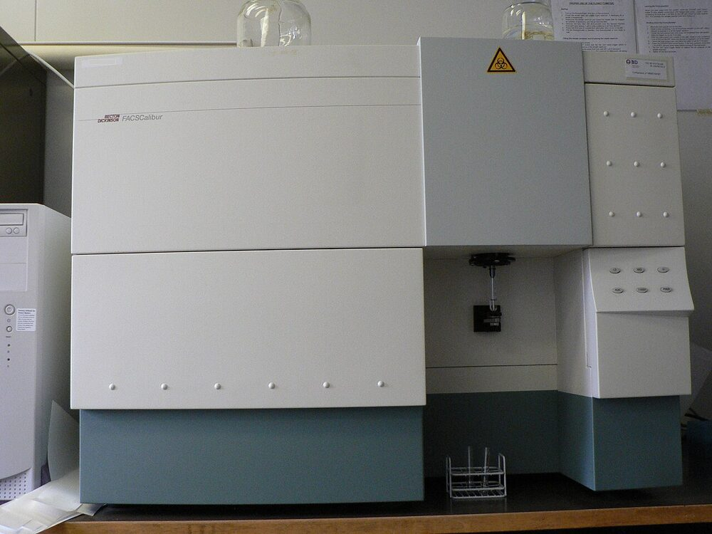{height="130px" fig-align="center"}
:::
::::

::: notes
A western blot measures the average of millions of cells ground up together. Often you want to know about single cells instead: what fraction of the cells carry protein X, and do they carry a lot or a little? Flow cytometry does this. Cells, labelled with fluorescent antibodies, are made into a suspension and pushed through a narrow stream, squeezed by sheath fluid so that they pass a laser one by one. For each cell, detectors record how much light is scattered forwards, which tells about size, how much is scattered sideways, which tells about internal granularity, and how much fluorescence comes out in each colour. A modern machine measures tens of thousands of cells per second and a dozen or more colours. A cell sorter, called FACS for fluorescence-activated cell sorting, goes one step further: the stream breaks into droplets, a droplet that contains a wanted cell gets an electric charge, and electric plates steer it into a collection tube. So you can collect, for example, only the cells that carry X, and keep them alive.
:::

## Reading a dot plot: gating {.smaller}

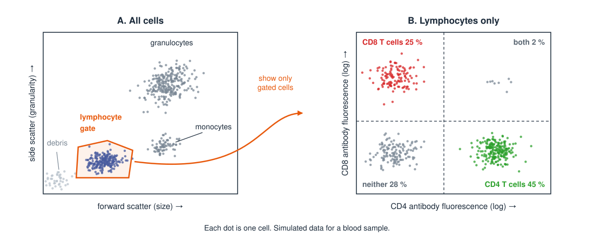{width="90%" fig-align="center"}

- Each **dot is one cell**. First **gate** on scatter to keep the cells you want (here lymphocytes) and drop debris.
- Then plot two fluorescent markers: four quadrants, four kinds of cell. Report the **percentage** in each. **Try it:** [the gating game](questions.qmd#explore).

::: notes
The results of flow cytometry are shown as dot plots, where every dot is one cell. Analysis is done in steps called gating. In panel A, forward scatter is plotted against side scatter for a blood sample. Small, smooth lymphocytes form one cloud, granulocytes with many granules sit higher, and monocytes between. Debris and dead cells sit in the low corner. We draw a gate, a boundary, around the lymphocytes, and from now on look only at those cells. In panel B the same lymphocytes are plotted by two fluorescent antibodies: one against CD4 and one against CD8, two surface proteins that mark two kinds of T cell. The plot falls into four quadrants. Cells with only CD4 are helper T cells, cells with only CD8 are cytotoxic T cells, cells with neither are mostly B cells and NK cells here, and very few have both. The result is reported as percentages. In HIV infection, for instance, the CD4 percentage falls over time, and this is how it is measured in the clinic. These data are simulated, but typical.
:::

## Changing cells on purpose: four tools {.smaller}

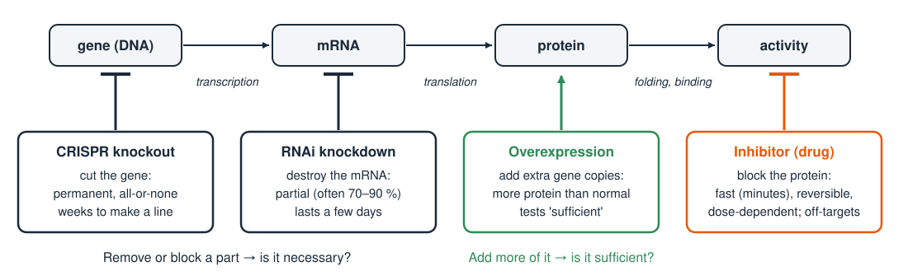{width="92%" fig-align="center"}

Each tool acts at a different step from gene to activity, and each has its own **speed, strength and pitfalls**.

::: notes
So far we have described cells. Now we change them. You can interfere at each step from gene to working protein, and the figure arranges the four common tools along that path. CRISPR knockout cuts the gene itself, so the cell can never make the protein again; it is all-or-none and permanent, but it takes weeks to make a cell line, and a cell may adapt to the loss over that time. RNA interference destroys the messenger RNA with a short matching RNA; the protein drops, usually not to zero, for a few days. Overexpression adds extra copies of the gene, so the cell makes more protein than normal; this tests whether the protein is sufficient to cause an effect. Finally, small-molecule inhibitors, which are drugs, block the protein directly. They act within minutes, can be washed out, and you can vary the dose, but most inhibitors also hit other proteins, called off-targets. Because each tool has different weaknesses, a strong conclusion usually uses two different tools that give the same answer.
:::

## CRISPR–Cas9: knocking out a gene {.smaller}

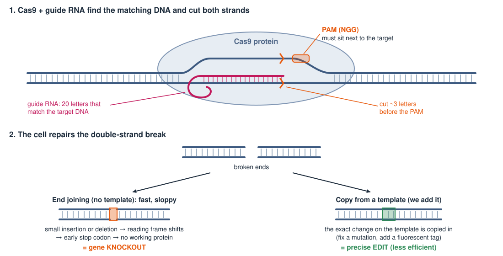{width="74%" fig-align="center"}

- Cas9 cuts DNA where a **guide RNA** matches. The quick repair often adds or removes a few letters: the **reading frame shifts**, and no working protein is made.
- A bacterial defence against viruses, turned into a tool by **Emmanuelle Charpentier** (partly at Umeå University) and **Jennifer Doudna**: Nobel Prize in Chemistry 2020.

::: notes
CRISPR-Cas9 comes from bacteria, where it is an immune system against viruses: the bacterium stores short pieces of viral DNA and uses them to guide the Cas9 enzyme to cut the virus. Researchers turned this into a tool. Cas9 is given a guide RNA whose sequence matches the gene you want to target, and it cuts both DNA strands at that place. The cell cannot leave a broken chromosome, so it repairs it, usually by simply joining the ends again. This repair is fast but sloppy: it often adds or deletes a few base pairs. If the change is not a multiple of three, the reading frame shifts, the ribosome soon meets a stop codon, and no working protein is made. That is a knockout. You know reading frames and stop codons from molecular biology, so you can see why this works. Emmanuelle Charpentier did part of her key work on CRISPR at Umeå University, and she and Jennifer Doudna received the 2020 Nobel Prize in Chemistry. CRISPR is now also used in medicine, which you may meet in later courses.
:::

## How do we know? Necessary, sufficient, and controls {.smaller}

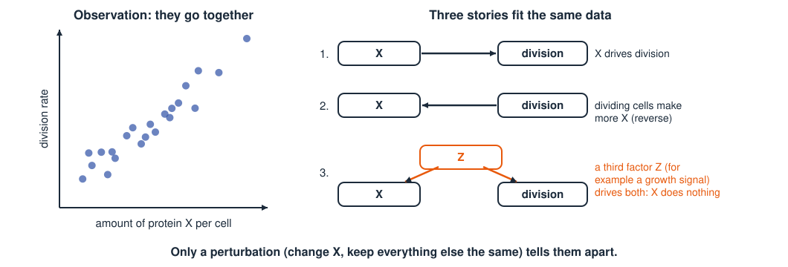{width="78%" fig-align="center"}

- **Necessary**: remove X → the process stops *(knockout, knockdown, inhibitor)*. **Sufficient**: add X → the process starts or increases *(overexpression)*.
- **Controls**: a non-targeting guide or RNA; **rescue** (put back X and the effect disappears); a second, independent tool.

::: notes
This slide is the logic behind every experiment in this lecture. Imagine you observe that cells with more protein X divide faster. Three stories fit this observation. X may drive division. Dividing cells may simply make more X, so the arrow goes the other way. Or a third factor, such as a growth signal, may raise both, and X does nothing at all. Observation alone cannot tell these apart. You must change X and keep everything else the same. If removing X stops division, X is necessary. If adding X causes division, X is sufficient. Many proteins are necessary but not sufficient. Controls make the result believable. A control guide RNA or RNA that targets nothing shows that the treatment itself does no harm. A rescue experiment, where you put back a version of X that the tool cannot hit, should bring the process back; if it does, the effect really came from losing X and not from an off-target. And a second tool that acts in a different way, giving the same result, makes the conclusion much stronger.
:::

## Worked example: is protein X needed for cell division? {.smaller}

| Step | Choice | Why |
|---|---|---|
| Cells | A human cell line that divides well (e.g. HeLa or RPE1) | Easy to grow, many divisions to measure |
| Perturbation 1 | **RNAi** against X, and a non-targeting control RNA | Fast; partial loss is fine for a first test |
| Check | **Western blot** for X, with a loading control | Did X actually go down? |
| Readout | Count cells over 4 days; **flow cytometry** of DNA content (cell-cycle phase) | Do cells divide less? Where do they stop? |
| Perturbation 2 | **CRISPR** knockout, plus a **rescue** with X put back | Independent tool; rules out off-targets |
| Location | Fractionation or immunofluorescence | Where does X act? |

**Conclusion only if** both tools agree and the rescue works.

::: notes
Let us put the methods together on protein X. Suppose we want to know whether X is needed for cell division. We pick a human cell line that divides well. As a first, quick test we use RNA interference against X, side by side with a control RNA that targets nothing. Before we look at the cells we check with a western blot that X really went down, with a loading control in every lane; a perturbation that did not work tells you nothing. The readout is the number of cells over a few days, and flow cytometry of DNA content, which tells us in which phase of the cell cycle the cells get stuck; you will understand that readout fully in the cell-cycle lectures. If division slows, we confirm with a second tool, a CRISPR knockout, and do a rescue by adding back X. Finally we ask where X is, by fractionation or imaging. Only when the independent tools agree and the rescue works do we write that X is needed for division. This is the kind of reasoning the VG exam questions ask for.
:::

## Single-cell omics: a census of cells {.smaller}

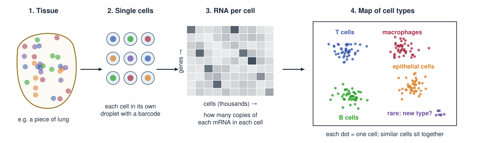{width="92%" fig-align="center"}

- Each cell is put in its own droplet with a **barcode**; all its mRNAs are sequenced and counted.
- Cells with similar mRNA sit together on a map: **cell types**, and sometimes **new** ones.
- **Cell atlases** (e.g. the Human Cell Atlas) aim to map every cell type in the body.

::: notes
Flow cytometry measures a dozen proteins per cell. Single-cell RNA sequencing goes much wider: it measures thousands of messenger RNAs in each of thousands of cells. A tissue is broken into single cells, and each cell is captured in a tiny droplet together with a bead that carries a unique DNA barcode. Inside the droplet, the cell's mRNAs are copied and tagged with that barcode, so after sequencing every read can be traced back to its cell. The result is a large table of cells by genes. A computer then places cells with similar expression close together on a map, and groups of cells appear: T cells, B cells, macrophages, epithelial cells, and sometimes a small group that nobody had described before. International projects such as the Human Cell Atlas use this to make a reference map of all cell types in the human body. One cell type found this way was the ionocyte in the airways, a rare cell with very high levels of the cystic fibrosis channel CFTR. For this course, the main idea is enough: the same principle as flow cytometry, many single cells, but measuring the whole transcriptome.
:::

## Why it matters: finding drugs in cultured cells {.smaller}

:::: {.columns}
::: {.column width="52%"}
- **High-content screening**: thousands of compounds, each in its own well with cultured cells; an automated microscope images every well.
- A computer scores each well: did cells stop dividing, die, change shape, move a protein?
- Example: **monastrol** was found in such a screen for compounds that block mitosis. It inhibits the motor protein kinesin-5, which builds the mitotic spindle.
- Hits from screens are the first step of drug development, long before animals or patients.
:::
::: {.column width="48%"}
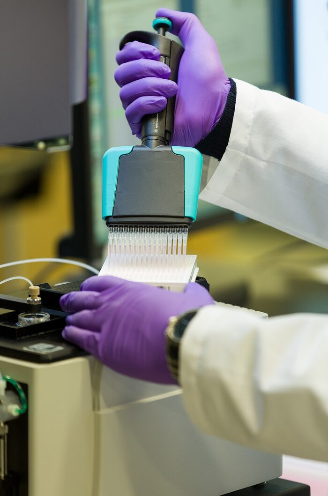{height="480px" fig-align="center"}

[Preparing a 384-well plate for a high-throughput screen.]{style="font-size:0.7em"}
:::
::::

::: notes
Everything in this lecture comes together in drug discovery. In a high-content screen, cultured cells are grown in plates with 384 or more small wells. Each well gets a different compound from a library of many thousands. After a day or two, the cells are fixed and stained, and an automated microscope takes images of every well. Software then measures many features per cell: number of cells, nucleus size, cell shape, where a fluorescent protein sits. Compounds that cause the change you are looking for are called hits. A classic example is monastrol. In a screen for compounds that arrest cells in mitosis, researchers found a small molecule that gave cells a single round spindle instead of the normal two-poled one. It turned out to inhibit kinesin-5, a motor protein that pushes the spindle poles apart; you will meet motor proteins in the cytoskeleton lectures. Kinesin-5 inhibitors were later tested as cancer drugs. A hit like this is only the first step; the later programme course on clinical trials and drug development covers the long road from hit to medicine.
:::

## Why it matters: CAR-T cells, a living drug {.smaller}

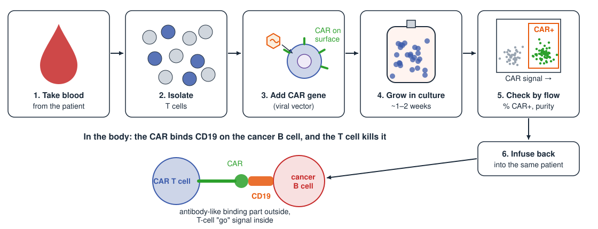{width="92%" fig-align="center"}

- A patient's own **T cells** are given a new receptor, a **CAR**, that recognises a protein on cancer cells (here CD19 on B-cell leukaemia).
- Every step uses this lecture: **cell culture** to grow them, **flow cytometry** to check them.

::: notes
The second example is a therapy that is itself a cultured cell. CAR-T therapy treats some leukaemias and lymphomas that come from B cells. Blood is taken from the patient and the T cells are isolated. A gene for a chimeric antigen receptor, a CAR, is added. The outside part of the CAR comes from an antibody and binds CD19, a protein on the surface of B cells; the inside part gives the T cell its "go" signal. The modified T cells are grown in culture for one to two weeks until there are enough of them. Before they are given back, they are checked by flow cytometry: what percentage carry the CAR, and are they the right kind of cells? Then they are infused into the same patient, where they find and kill the cancer B cells. So cell culture, antibodies and flow cytometry, three methods from this lecture, are part of making the medicine. You will learn how T cells recognise and kill their targets in the later immunology course.
:::

## Summary {.smaller}

1. **Cell culture** gives material to work on: cell lines are easy and reproducible, primary cells and organoids are closer to the body. Check identity and contamination.
2. **Fractionation** (differential and density-gradient centrifugation) separates organelles; **marker proteins** show what is in each fraction.
3. **Antibodies** find one protein: western blot (size and amount), immunoprecipitation (partners), immunofluorescence (location).
4. **Flow cytometry** measures many single cells; gating picks populations; FACS sorts them.
5. **Perturbations** (inhibitor, RNAi, CRISPR, overexpression) test whether a protein is **necessary** or **sufficient**; controls and a second tool make the conclusion strong.

*Read more (optional): Alberts et al., Molecular Biology of the Cell, 7th ed., ch. 8.*

[Image credits](../credits.qmd#cell-methods){style="font-size:0.7em"}

::: notes
To sum up. Cell culture is the basis: cell lines for convenience, primary cells and organoids for realism, and always a check that your cells are what you think. Fractionation separates organelles by size and density, and marker proteins tell you which fraction is which. Antibodies are the most used tool: in a western blot they report size and amount, in immunoprecipitation they pull out a protein and its partners, and in immunofluorescence they show where it is. Flow cytometry turns this into single-cell numbers, and a sorter can collect living cells of one kind. Finally, to learn what a protein does you must change it, with an inhibitor, RNA interference, CRISPR or overexpression, and think carefully about necessary versus sufficient and about controls. These methods return in every later lecture, in the "How do we know?" slides, and in the lab part of the course.
:::
