## About this lecture {.smaller}

The cell-cycle control system decides *how* a cell divides. Today: *whether* it divides at all. A body keeps the right number of cells in every organ for decades, and loses that control in cancer.

After this lecture you can:

- explain how **mitogens**, **growth factors** and **survival factors** set cell numbers, and how a mitogen signal reaches the **restriction point**;
- explain the difference between **cell growth** (mass, controlled by **mTOR**) and **cell division**;
- explain **contact inhibition** and what transformed cells do differently;
- explain **replicative senescence** and the **Hayflick limit** with **telomere** shortening and **telomerase**, and name other triggers of senescence;
- describe in outline how **stem cells** renew tissues and how **cell lines** escape the limits;
- explain why **growth-factor receptors**, **telomerase** and **senescent cells** are drug targets.

**ELO 7** (cell cycle and control of cell numbers), with disease examples for **ELO 9**.

::: notes
This lecture moves from the single cell to the population. In the lecture on the cell-cycle control system you saw the engine: cyclins, CDKs, Rb and E2F, and checkpoints that stop the cycle when something is wrong. Today we ask what tells that engine to start, and what stops it for good. We will look at three kinds of signal from outside: mitogens, which make a cell divide; growth factors, which make it bigger; and survival factors, which keep it alive. We will see that cells stop dividing when they touch their neighbours, and that normal human cells can only divide a limited number of times before they enter a permanent arrest called senescence. The reason is the ends of the chromosomes, the telomeres. Then we look briefly at stem cells and at how cancer cells and cell lines escape every one of these limits. The last slides show three medical applications. The lecture covers ELO 7, and the disease examples belong to ELO 9.
:::

## The question: how does a body count its cells? {.smaller}

:::: {.columns}
::: {.column width="42%"}
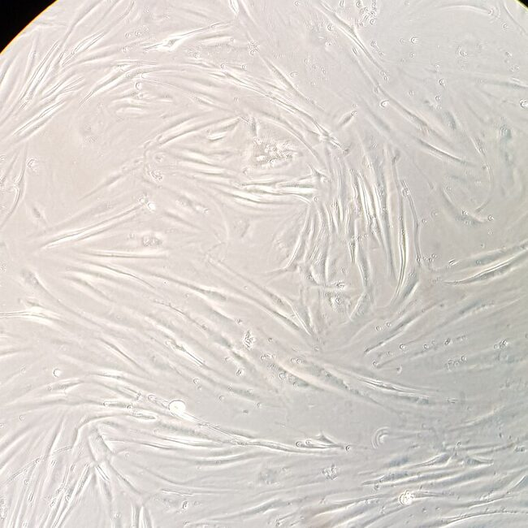{height="400px" fig-align="center"}

*Human skin fibroblasts in a culture dish, close to confluence (phase contrast).*
:::
::: {.column width="58%"}
- An adult has about **30 million million (3 × 10¹³)** cells and replaces about **4 million cells every second**, yet organs keep their size.
- Remove two thirds of a rat liver: the rest **regrows to the original size** within about two weeks, and then stops.
- Skin cells put in a dish **divide until they cover the bottom**, then stop. Split them into new dishes and they divide again, but only **about 50 times**. Then they stop for good.

**What tells a cell to divide, and what makes it stop?**
:::
::::

::: notes
Your body has roughly thirty million million cells, and every second it replaces millions of them, mostly blood cells and cells lining the gut. Still, your liver, kidneys and skin stay the same size year after year. The liver shows this best: if surgeons remove two thirds of a rat liver, the remaining cells start dividing, the liver grows back to its original size, and then the cells stop. So cells must sense how many of them there are. The same is seen in a culture dish. The picture shows fibroblasts, the cells of connective tissue, taken from a skin biopsy. Given nutrients and serum, they divide until they cover the bottom of the dish in a single layer, and then stop. If you loosen them with an enzyme and split them into new dishes, they divide again. But after about fifty doublings in total, they stop for good, even with fresh medium and plenty of space. This lecture explains both stops: the reversible one and the permanent one.
:::

## Three kinds of signal: divide, grow, survive {.smaller}

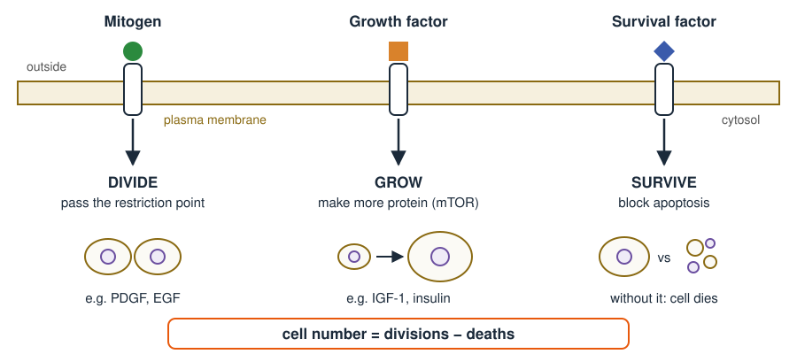{width="80%" fig-align="center"}

- **Mitogens** make a cell pass the restriction point and divide. **Growth factors** make it build more protein and grow. **Survival factors** block apoptosis.
- Each is a **local, limited supply** from neighbouring cells; cells compete for it. Many real factors (PDGF, IGF-1) do more than one job.
- Without survival signals, most cells **kill themselves** (the apoptosis lecture): cell number is set by births *and* deaths.

::: notes
Animal cells do not divide on their own initiative. They need permission from other cells, given as extracellular signal proteins. We sort them by their effect. Mitogens, such as platelet-derived growth factor and epidermal growth factor, stimulate cell division: they push the cell past the decision point in G1 that we call the restriction point. Growth factors, such as insulin-like growth factor 1, stimulate cell growth, meaning the building of protein and other macromolecules, so the cell gets bigger. Survival factors suppress apoptosis, the built-in suicide program. The names overlap: in practice many factors do two or all three jobs, and the word growth factor is often used for all of them. An important point is that these signals are scarce and local. Cells compete for them, so a tissue with too many cells has too little signal per cell. And a cell that gets no survival signal dies. In developing nerves about half the neurons die this way. So the number of cells in a tissue is set by the balance of division and death, and you will see the death side in the apoptosis lecture.
:::

## Recap: from mitogen to the restriction point {.smaller}

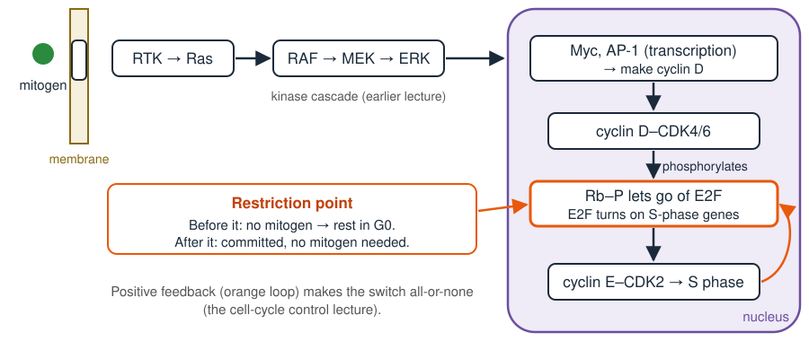{width="80%" fig-align="center"}

- A mitogen activates an **RTK → Ras → ERK** (the kinase cascades lecture). In the nucleus, ERK turns on **Myc** and other genes, and the cell makes **cyclin D**.
- **Cyclin D–CDK4/6** phosphorylates **Rb**, Rb releases **E2F**, E2F turns on S-phase genes. Past this point the cell no longer needs the mitogen.

::: notes
This slide connects two earlier lectures. From the kinase cascades lecture: a mitogen binds a receptor tyrosine kinase, the receptor activates Ras, and Ras starts the RAF, MEK, ERK cascade. Active ERK enters the nucleus and switches on early genes, including the transcription factors Myc and AP-1, and these switch on the gene for cyclin D. From the cell-cycle control lecture: cyclin D binds CDK4 or CDK6, and this kinase phosphorylates the retinoblastoma protein, Rb. Phosphorylated Rb releases E2F, and E2F turns on the genes the cell needs for S phase, including cyclin E. Cyclin E with CDK2 phosphorylates Rb further, which releases more E2F: a positive feedback loop. Because of this loop, the decision is all or none, and once it is made, removing the mitogen no longer stops the cell from replicating its DNA. This is the restriction point, in late G1. Before it, a cell without mitogen leaves the cycle and rests in a state called G0. Most cells in your body are in G0 right now.
:::

## How do we know? Serum, not plasma, makes cells divide {.smaller}

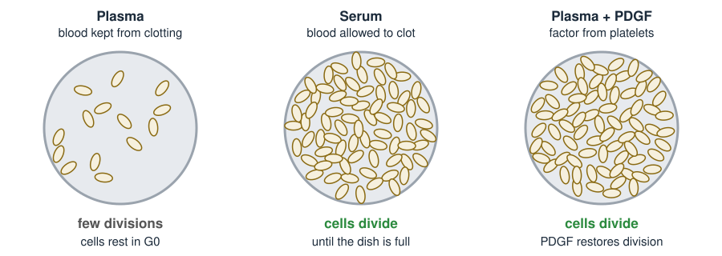{width="74%" fig-align="center"}

- Fibroblasts divide in **serum** (blood allowed to clot) but hardly in **plasma** (blood that did not clot). Clotting **platelets release** a mitogen, later purified as **PDGF** (1974–79).
- **Serum starvation**: remove serum and cells stop in **G0**; add it back and they enter S phase about **12–16 h** later, all at the same time. Remove it again a few hours before S phase: the cells **go on** anyway. That point is the **restriction point**.

::: notes
Cell culture taught us most of what we know about mitogens. Since the early days, cells were grown in medium with serum, the yellow liquid left after blood has clotted. In 1974 two groups noticed a strange result: fibroblasts divided in serum but hardly at all in plasma, which is the same liquid taken from blood prevented from clotting. The difference is what platelets release when blood clots. The factor they release was purified and named platelet-derived growth factor, PDGF. It makes sense physiologically: at a wound, blood clots, platelets release PDGF, and nearby fibroblasts and smooth muscle cells divide to repair the damage. The same experiment gives a simple tool. If you remove serum, cells finish their current cycle and stop in G0. Add serum back and all of them start together, which synchronises the culture. Arthur Pardee used this to show that cells need the mitogen only until a point in late G1. If serum is removed after that point, the cells still enter S phase. That point is the restriction point.
:::

## Growth is not division: mTOR controls cell size {.smaller}

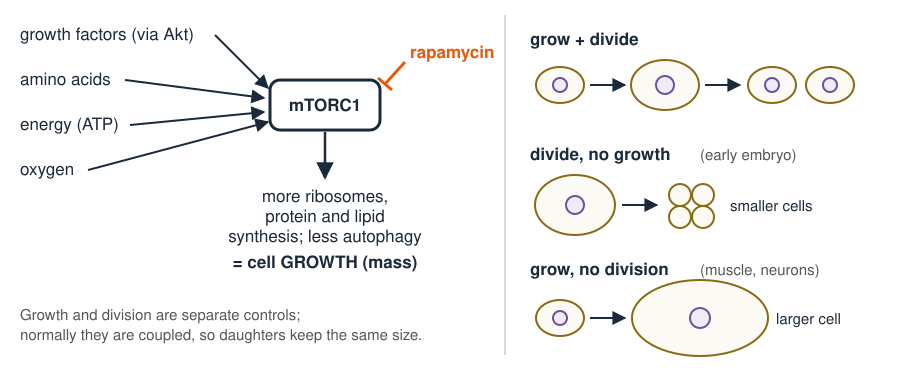{width="82%" fig-align="center"}

- **mTORC1** (the kinase cascades lecture) adds up growth factors, amino acids and energy, and switches on **protein synthesis**. The drug **rapamycin** blocks it: cells grow less and are smaller.
- Normally a cell **doubles its mass** before it divides. Growth and division are controlled separately and then coupled.

::: notes
A cell that divides without growing gets smaller each time. That actually happens in the early embryo, where a large egg is cut into many small cells. A cell that grows without dividing gets bigger, as in muscle fibres and neurons, which grow for years. Most dividing cells do both, and they couple them, so that daughter cells keep the same size. Growth is controlled mainly by the kinase complex mTORC1, which you met in the kinase cascades lecture at the end of the PI3K–Akt pathway. mTORC1 works like a gate with several locks: it is fully active only when growth factors signal through Akt, amino acids are available, energy is high and there is enough oxygen. Active mTORC1 increases the making of ribosomes and proteins and lipids, and it switches off autophagy. The drug rapamycin, from a soil bacterium found on Easter Island, inhibits mTORC1. Cells treated with rapamycin grow more slowly and are smaller. Rapamycin and related drugs are used to prevent transplant rejection, where they stop immune cells from growing and dividing, and in some cancers.
:::

## Contact inhibition: cells stop when they touch {.smaller}

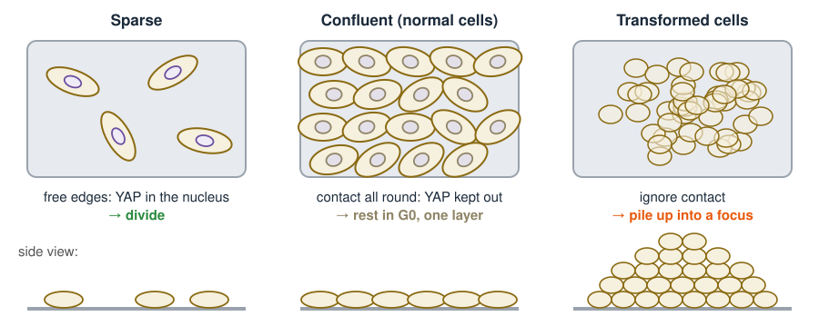{width="82%" fig-align="center"}

- Normal cells divide until they form **one confluent layer**, then rest in **G0**. Cell contacts (through **cadherins**) and crowding keep the growth regulator **YAP** out of the nucleus (the **Hippo** pathway), and less growth factor is left per cell.
- **Transformed** cells (for example with an active **RAS** oncogene) ignore contact and **pile up** into a visible **focus**: the classic test for an oncogene.

::: notes
In a dish, normal fibroblasts or epithelial cells divide until they touch each other on all sides and then stop. This is called contact inhibition of proliferation, and it explains the reversible stop at confluence. The cells are not damaged: if you scrape a stripe of cells away, the cells at the edge of the scratch divide and fill the gap, then stop again. Two things contribute. First, cell contacts, for example through cadherins, and the cell's own spreading and shape are sensed by a pathway called Hippo. When cells are crowded and round, Hippo kinases phosphorylate the transcription co-activator YAP and keep it in the cytosol; when cells are sparse and spread out, YAP enters the nucleus and turns on growth genes. Second, more cells share the same growth factors. We keep the details light; tissue organisation comes in the course on organs and tissues. Transformed cells, for example cells with an active RAS oncogene, lose contact inhibition. They keep dividing and pile up into dense clumps called foci. Counting foci after putting tumour DNA into cells was how the first human oncogene, mutant RAS, was found.
:::

## Replicative senescence: the Hayflick limit {.smaller}

:::: {.columns}
::: {.column width="56%"}
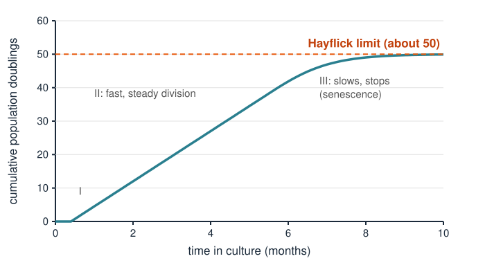{width="100%"}
:::
::: {.column width="44%"}
- **Hayflick and Moorhead (1961)**: human fetal fibroblasts divide about **40–60 times** in culture, then stop for good. This is **replicative senescence**.
- It counts **divisions, not time**: frozen cells, thawed years later, "remember" how many doublings they have left.
- Cells from people with a fast-ageing disease (Werner syndrome) have **fewer** doublings left. Mouse cells behave differently (long telomeres, telomerase on).
- **Try it:** [growth, senescence and telomeres](questions.qmd#explore).
:::
::::

::: notes
For the first half of the twentieth century, people believed that cells in culture could live forever if you treated them well. In 1961 Leonard Hayflick and Paul Moorhead showed that this was wrong for normal human cells. Fetal lung fibroblasts grew well for months, were split again and again, and then slowed down and stopped after about forty to sixty population doublings. A population doubling means the number of cells has doubled once. The graph shows the typical culture: a short phase one when the culture is started, a long phase two of steady division, and phase three when division slows and stops. The cells do not die. They stay alive for months as large, flat cells that never divide again. This is replicative senescence, and the number is called the Hayflick limit. Hayflick froze cells at different doublings and thawed them later: they continued from where they had stopped, so the cells count divisions, not days. Earlier reports of immortal cultures turned out to be contaminated with cancer cells. You can watch a culture reach its limit in the demo.
:::

## What a senescent cell looks like {.smaller}

:::: {.columns}
::: {.column width="34%"}
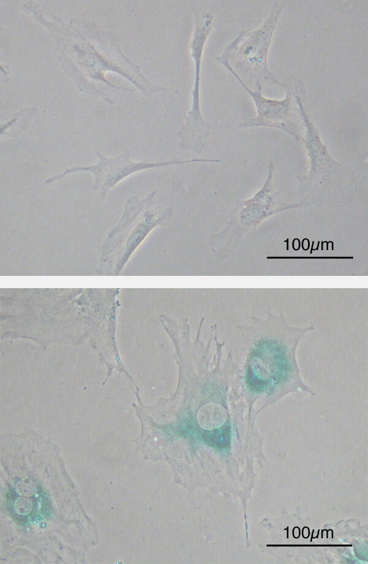{height="470px" fig-align="center"}

[Mouse fibroblasts stained for SA-β-gal. Top: early passage. Bottom: senescent (blue). Scale 100 µm.]{style="font-size:0.7em"}
:::
::: {.column width="66%"}
- **Permanent** arrest in G1: no mitogen can restart it. Not the same as resting in G0.
- **Large and flat**, often with one big nucleus; full of lysosomes.
- **Markers** used in labs: **SA-β-gal** (senescence-associated β-galactosidase, blue stain at pH 6), high **p16** and **p21** (CDK inhibitors), no proliferation marker (**Ki-67**).
- Still **alive and active**: resists apoptosis, and secretes signals.
- No marker is perfect: labs combine several.
:::
::::

::: notes
How do you recognise a senescent cell? Under the microscope it is much larger and flatter than a young cell of the same type, as in the lower image. The most used stain is for senescence-associated beta-galactosidase. This lysosomal enzyme is present in all cells, but senescent cells have so many lysosomes that its activity can be detected at pH 6, where normal cells show almost nothing. The product of the reaction is blue. Senescent cells also contain high levels of the CDK inhibitors p16 and p21, which you met in the cell-cycle control lecture, and they lack markers of dividing cells such as Ki-67. Note the difference from quiescence. A quiescent cell in G0 can re-enter the cycle when it gets mitogens or space. A senescent cell cannot, even with fresh serum and an empty dish. But it is not dead: it is metabolically very active, it resists apoptosis, and it secretes many proteins. The cells in the picture are mouse cells, which become senescent in culture mainly from oxygen stress rather than short telomeres, but they look the same. None of the markers is perfect on its own, so research papers combine several, and this matters when people try to find senescent cells in old tissues.
:::

## Why chromosomes get shorter: the end-replication problem {.smaller}

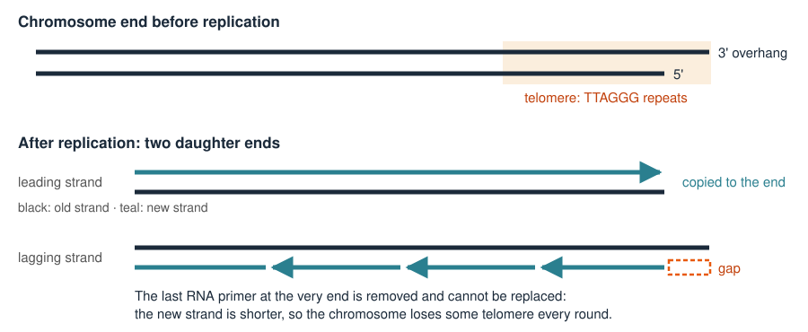{width="80%" fig-align="center"}

- DNA polymerase needs a **primer** and works only **5′ → 3′**. On the lagging strand, the last RNA primer at the very end leaves a **gap**.
- So every replication **loses some DNA at the ends**. Human chromosome ends are **telomeres**: thousands of **TTAGGG** repeats, about **10–15 kb** at birth. Dividing body cells lose about **50–200 bp per division**.

::: notes
Why should a cell count its divisions? The answer lies in a weakness of DNA replication that you know from the molecular biology course. DNA polymerase cannot start a new strand; it extends a short RNA primer, and only in the five-prime to three-prime direction. On the leading strand this is no problem. On the lagging strand, the DNA is made as short Okazaki fragments, each starting from its own primer. At the very end of a linear chromosome, the last primer sits at or near the tip. When it is removed, there is nothing upstream to extend, so a short stretch of the new strand is never made. In addition, enzymes trim the ends to make a single-stranded three-prime overhang. The net effect is that each daughter chromosome is a little shorter than its parent. Bacteria escape this with circular chromosomes. Our chromosomes have telomeres at their ends: long runs of the six-base repeat TTAGGG, about ten to fifteen thousand bases in a newborn. Telomeres contain no genes, so losing fifty to two hundred bases per division costs nothing at first. They are a buffer, but a finite one.
:::

## Telomeres protect the ends, until they are too short {.smaller}

:::: {.columns}
::: {.column width="40%"}
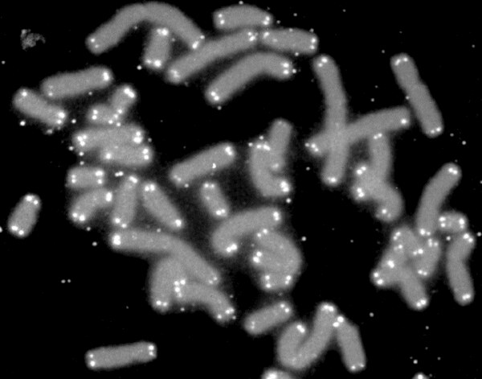{width="100%"}

[Human chromosomes (grey); telomeres stained by FISH (white dots at the ends).]{style="font-size:0.7em"}
:::
::: {.column width="60%"}
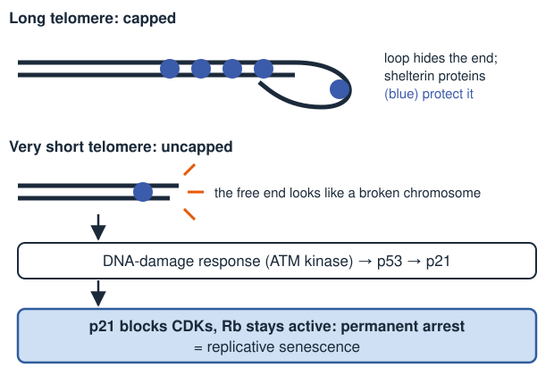{width="100%"}
:::
::::

- A protein cap (**shelterin**) and a loop hide the end. A **very short** telomere loses its cap and looks like a **broken chromosome**: the **p53–p21** brake stops the cell for good.

::: notes
Telomeres are not bare DNA. A complex of six proteins, called shelterin, binds the repeats, and the single-stranded overhang tucks back into the double-stranded part to form a loop. The image on the left shows human chromosomes with their telomeres made visible by fluorescence in situ hybridisation, FISH: a labelled probe of TTAGGG repeats binds to every chromosome end. This capping solves a dangerous problem: a cell has a sensitive alarm for broken DNA, and a free chromosome end looks exactly like a break. With a long telomere and its shelterin cap, the alarm stays silent. When repeated divisions have made one or a few telomeres very short, there is not enough room for the cap. The exposed end activates the DNA-damage response: the kinase ATM, then p53, then the CDK inhibitor p21. p21 blocks the CDKs, Rb stays unphosphorylated and E2F stays off. This is the same DNA-damage checkpoint you met in the cell-cycle control lecture, but here the damage cannot be repaired, so the arrest is permanent. It is the shortest telomeres, not the average, that trigger senescence.
:::

## Telomerase adds the repeats back {.smaller}

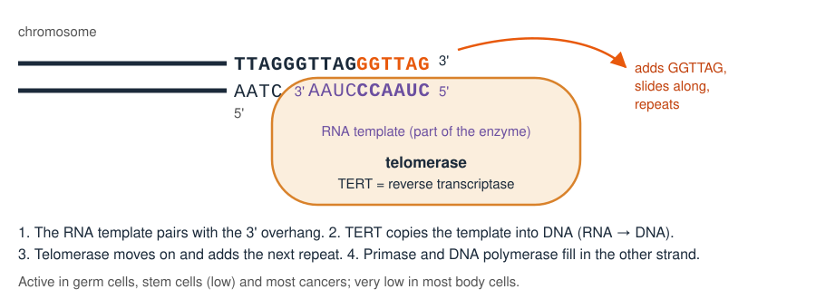{width="84%" fig-align="center"}

- **Telomerase** = a reverse transcriptase (**TERT**) carrying its own **RNA template**. It extends the 3′ end by new TTAGGG repeats. Found in ciliates by **Greider and Blackburn** (1985); Nobel Prize 2009 with Szostak.
- Active in **germ cells** and early embryos, low in **stem cells**, **off in most body cells**, **on in about 85–90 % of cancers**.

::: notes
Some cells cannot afford a limit: germ cells must pass on full-length chromosomes generation after generation. They use telomerase. Telomerase is an enzyme made of a protein and an RNA. The protein, TERT, is a reverse transcriptase: it makes DNA from an RNA template, like the enzyme of HIV. The template is part of the enzyme's own RNA. A short stretch of the template pairs with the end of the three-prime overhang. TERT then copies the rest of the template, adding the bases GGTTAG. The enzyme moves along and repeats, adding many TTAGGG units. Afterwards, primase and DNA polymerase fill in the complementary strand. Carol Greider and Elizabeth Blackburn discovered the enzyme in the single-celled ciliate Tetrahymena, which has tens of thousands of tiny chromosomes and therefore many ends. They shared the 2009 Nobel Prize with Jack Szostak. In humans, telomerase is active in germ cells and the early embryo, present at a low level in some stem cells and activated immune cells, and practically absent from most body cells, such as fibroblasts. That is why fibroblasts count down. About eighty-five to ninety percent of cancers switch it back on.
:::

## How do we know? Add telomerase, remove the limit {.smaller}

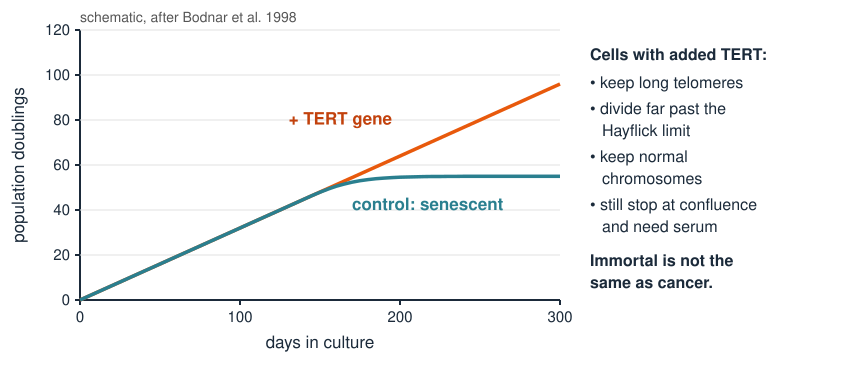{width="80%" fig-align="center"}

- **Bodnar et al. 1998**: human cells given the **TERT** gene kept long telomeres and divided far beyond their limit; control cells became senescent. Shortening telomeres is **the cause**, not just a marker.
- The immortal cells still showed **contact inhibition**, needed **serum** and did not form tumours.

::: notes
In the 1990s, telomere shortening and senescence went together, but correlation is not cause. Maybe both were caused by something else. The test, published in 1998 by Andrea Bodnar and colleagues, was to add the missing enzyme. Telomerase RNA is present in most cells, but the protein TERT is not. The team put the TERT gene into normal human retinal cells and skin fibroblasts. The cells with TERT made active telomerase, their telomeres grew longer instead of shorter, and they continued dividing long after their control cultures had become senescent; later work showed that they could divide indefinitely. The control experiment matters: cells given the same vector without TERT became senescent as usual. So telomere shortening is sufficient to set the limit, and telomerase is sufficient to remove it, at least in these cells. Equally important, the immortal cells kept normal chromosomes, still stopped at confluence, still needed serum and did not form tumours in mice. Immortality and transformation are two separate steps. Cell lines made this way, called hTERT lines, are now widely used as normal-like cells in research.
:::

## Senescence is also a stress response {.smaller}

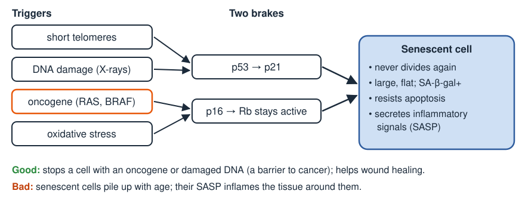{width="68%" fig-align="center"}

:::: {.columns}
::: {.column width="64%"}
- An **oncogene** in a normal cell triggers **oncogene-induced senescence**: a barrier to cancer.
- **SASP**: senescent cells secrete inflammatory signals that recruit immune cells and help repair, but in old tissues cause harm.
:::
::: {.column width="36%"}
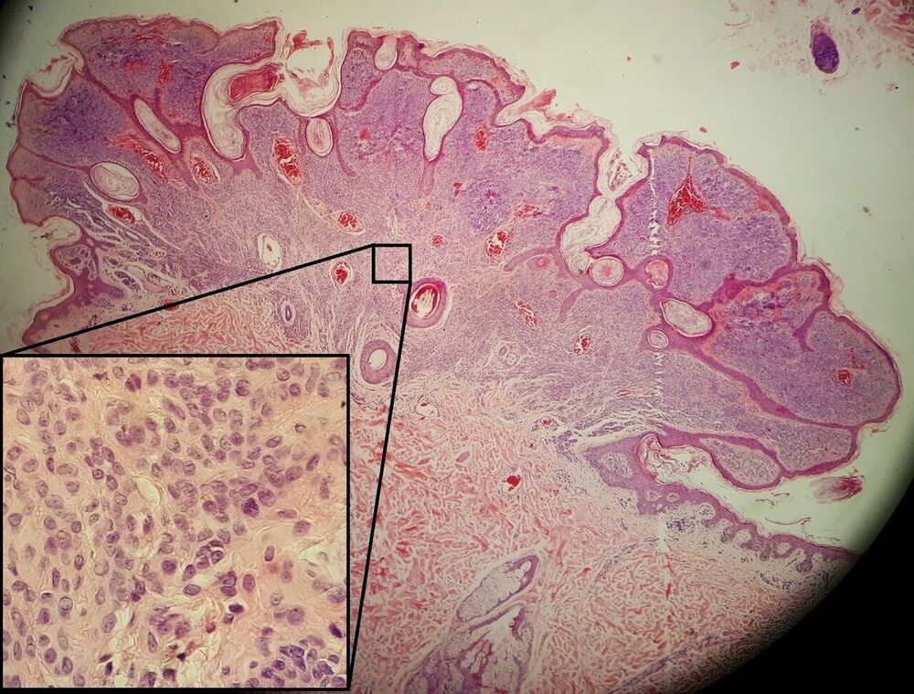{height="150px" fig-align="center"}

[A benign mole (melanocytic nevus). Inset: nests of melanocytes. Many moles carry **BRAF V600E**, yet stop growing.]{style="font-size:0.7em"}
:::
::::

::: notes
Short telomeres are not the only trigger. Any strong, lasting stress can put a cell into senescence: DNA damage from radiation or chemotherapy, oxidative stress, and, surprisingly, oncogenes. In 1997 Manuel Serrano and colleagues put an active RAS oncogene into normal human fibroblasts, expecting them to become cancer cells. Instead they became senescent. The oncogene drives the cell into S phase too hard, replication goes wrong, and the DNA-damage response and the CDK inhibitor p16 stop the cell. This is called oncogene-induced senescence, and it is one reason why one mutation is rarely enough for cancer. A real example sits on your skin. Moles are benign clusters of pigment cells, and many carry the same BRAF V600E mutation found in melanoma, which you met in the kinase cascades lecture. Yet most moles grow for a while and then stop for life, with features of senescence; this interpretation is still debated in detail. Senescent cells also secrete a mix of cytokines and proteases called the senescence-associated secretory phenotype, SASP. In wound healing this is useful; when senescent cells accumulate with age, it drives chronic inflammation.
:::

## Stem cells renew tissues (in brief) {.smaller}

:::: {.columns}
::: {.column width="46%"}
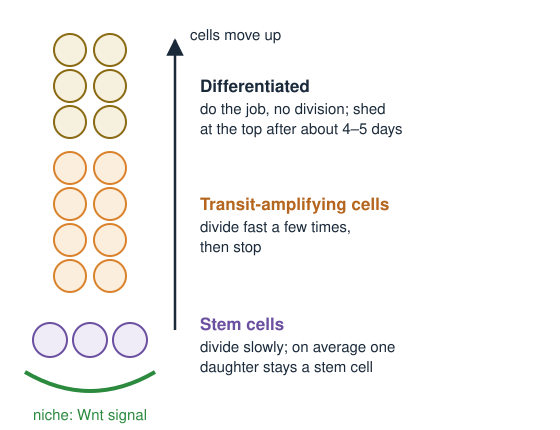{width="100%"}
:::
::: {.column width="54%"}
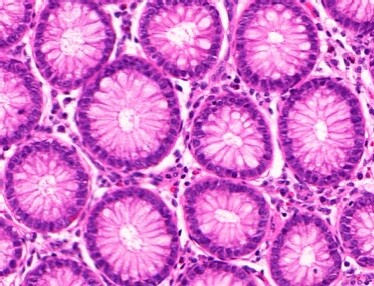{height="230px" fig-align="center"}

[Normal colon, crypts cut across (H&E). Stem cells sit at the bottom of each crypt.]{style="font-size:0.7em"}

- **Self-renewal**: on average one daughter stays a stem cell, the other differentiates. **Transit-amplifying** cells make the numbers.
- The **niche** (Wnt in gut crypts; the fate signalling lecture) keeps stem cells as stem cells.
- Renewal times: gut lining **3–5 days**, epidermis **about a month**, red blood cells **120 days**; most neurons **never**.
:::
::::

::: notes
In the body, cell numbers are kept up by stem cells. A stem cell can divide to make another stem cell, called self-renewal, and cells that go on to differentiate. The gut lining is the fastest example. At the bottom of each crypt sit about a dozen stem cells, kept in that state by Wnt and other signals from neighbouring cells, their niche. You met Wnt in the fate signalling lecture. Their daughters become transit-amplifying cells, which divide fast a few times while moving up the crypt, and then stop dividing and differentiate into absorptive and secretory cells. After about four to five days they reach the top and are shed into the gut. So the whole lining is replaced every few days, and cell number is a flow: birth at the bottom, death at the top. The skin works in a similar way, more slowly. Tissues such as the liver have no dedicated stem cells but can make mature cells divide again after damage, while most neurons and heart muscle cells are never replaced. Tissues and stem-cell physiology come back in detail in the course on organs and tissues, so we keep this brief.
:::

## How cell lines escape the limits {.smaller}

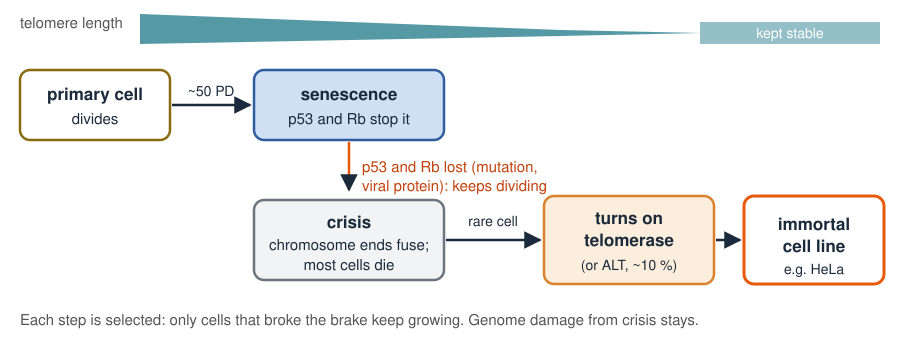{width="78%" fig-align="center"}

:::: {.columns}
::: {.column width="70%"}
- Losing **p53 and Rb** lets cells pass senescence, but telomeres keep shrinking until **crisis**. Only a cell that turns on **telomerase** (or **ALT**, copying between telomeres) becomes **immortal**.
- **HeLa** (1951): the virus **HPV18** makes **E6**, which destroys **p53**, and **E7**, which blocks **Rb**; telomerase is on.
:::
::: {.column width="30%"}
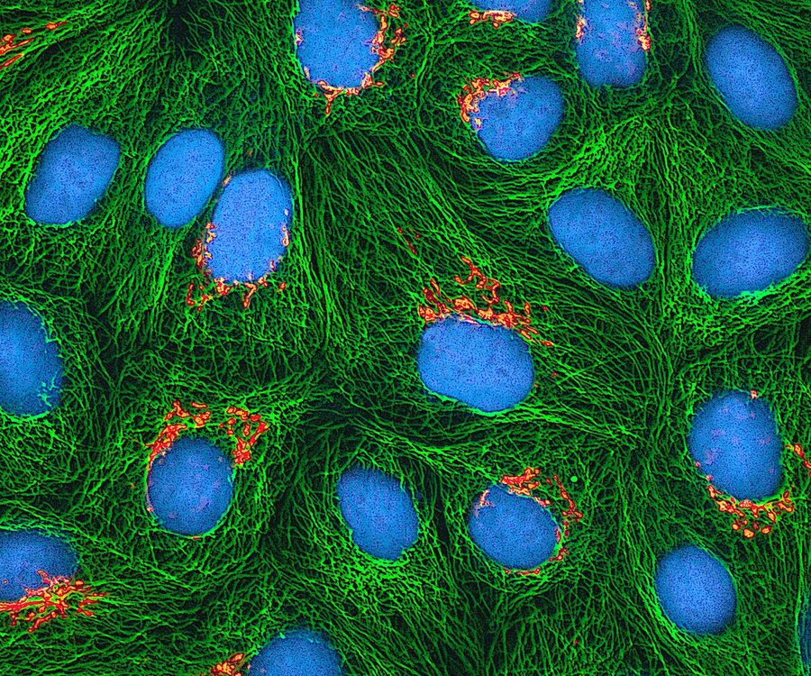{height="150px" fig-align="center"}

[HeLa cells: microtubules (green), Golgi (orange), DNA (cyan).]{style="font-size:0.7em"}
:::
::::

::: notes
Now we can see how a normal cell becomes an immortal cell line, or a cancer cell. Senescence depends on two brakes, p53 with p21, and p16 with Rb. If both are lost, by mutation or by a viral protein, the cell ignores short telomeres and keeps dividing. But that is not the end: telomeres continue to shrink, chromosome ends lose their caps, ends fuse to each other, and chromosomes break at the next mitosis. This stage is called crisis, and most cells die. Very rarely, roughly one cell in ten million, a cell turns on telomerase, or uses a recombination mechanism called alternative lengthening of telomeres, ALT. That cell stabilises its telomeres and founds an immortal line, but it carries the chromosome damage of crisis with it. HeLa, from the tour of the cell and the methods lecture, came from the cervical cancer of Henrietta Lacks in 1951. Her tumour was caused by human papillomavirus 18. The viral protein E6 sends p53 to the proteasome, E7 binds Rb and releases E2F, and E6 also helps switch on telomerase. HeLa cells have divided in labs for over seventy years.
:::

## Why it matters: growth-factor receptors as cancer drug targets {.smaller}

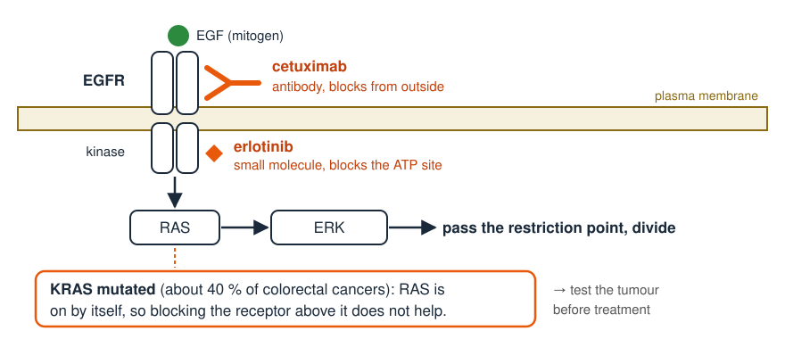{width="76%" fig-align="center"}

- A cancer cell that makes its own mitogen signal, through an **amplified** or **mutated receptor**, divides without asking. Blocking the receptor puts the brake back, **if** the receptor is the cause.
- **Cetuximab** (anti-EGFR antibody) helps in colorectal cancer only when **RAS is not mutated**: a mutation below the receptor makes the drug useless. More in **Sjukdomslära** and drug development.

::: notes
Go back to the recap slide on the mitogen pathway. A normal cell divides only when its neighbours provide a mitogen. Many cancer cells have found a way around this: they make too much receptor, as in HER2-amplified breast cancer from the kinase cascades lecture, they carry a receptor that is switched on by mutation, or they make their own mitogen. Blocking the receptor can then stop the cancer cells. There are two kinds of drug. Antibodies, such as cetuximab against EGFR, bind the outside of the receptor and stop the ligand from activating it. Small molecules, such as erlotinib, enter the cell and block the ATP site of the kinase. The figure also shows why the position in the pathway matters. In about four in ten colorectal cancers, KRAS itself is mutated. Then RAS is active without any signal from the receptor, and blocking the receptor upstream has no effect. Large trials showed exactly this, so today the tumour is tested for RAS mutations before an anti-EGFR antibody is given. This logic, find the broken step and hit it or below it, returns in the courses on disease mechanisms and on clinical trials.
:::

## Why it matters: telomerase and senescent cells as targets {.smaller}

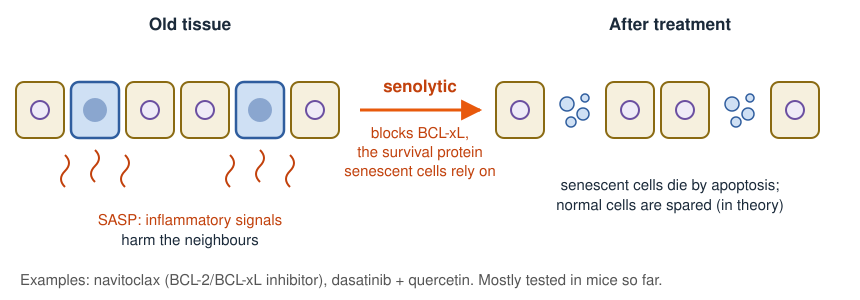{width="72%" fig-align="center"}

:::: {.columns}
::: {.column width="50%"}
- **Telomerase in cancer**: **TERT promoter mutations** are common in melanoma and glioblastoma. **Imetelstat**, an oligonucleotide that blocks the template, was approved in 2024 for a bone-marrow cancer (myelodysplastic syndrome); main side effect: low blood counts.
- **Too little telomerase**: inherited mutations (**dyskeratosis congenita**) give bone-marrow failure.
:::
::: {.column width="50%"}
- **Senolytics** kill senescent cells, for example by blocking **BCL-xL** (the apoptosis lecture). Removing senescent cells made **mice** live longer and healthier.
- **Caveats**: in humans only small trials, no proven benefit yet; senescence also **protects** against cancer and helps wound healing; navitoclax **lowers platelets**.
:::
::::

::: notes
Two last applications, with honest caveats. First, telomerase. Most cancers need it, and about eighty-five to ninety percent have it on, often through mutations in the promoter of the TERT gene, which are among the most common mutations in melanoma, glioblastoma and bladder cancer. Imetelstat is a modified oligonucleotide that binds the RNA template of telomerase. It was approved in the USA in 2024 for myelodysplastic syndrome, a bone-marrow cancer. Because telomeres take many divisions to shorten, telomerase inhibitors act slowly, and normal blood stem cells also need some telomerase, so blood counts fall. The opposite problem exists: people born with defective telomerase have short telomeres, and their fastest-renewing tissues fail, especially bone marrow. Second, senescent cells. In mice, genetically removing senescent cells delayed age-related diseases and extended lifespan. Drugs that do this are called senolytics. Senescent cells survive by relying on anti-apoptotic proteins such as BCL-xL, so blocking them, with navitoclax or with dasatinib plus quercetin, kills senescent cells first. But human trials are small and early, and one larger trial in knee arthritis failed. Senescence also protects us, and navitoclax lowers platelets. Mice are not people.
:::

## Summary {.smaller}

1. Cell number = **divisions − deaths**. Cells divide only with **mitogens** (which act up to the **restriction point**: Ras–ERK → cyclin D–CDK4/6 → Rb–P → E2F), grow with **growth factors** (**mTORC1**), and survive with **survival factors**.
2. **Contact inhibition** stops normal cells reversibly at confluence (G0); **transformed** cells pile up.
3. Normal human cells stop permanently after **about 50 doublings** (**Hayflick limit**, **replicative senescence**): **telomeres** shorten at each division until an uncapped end triggers **p53–p21**. **Telomerase** prevents this.
4. Senescence is also a **stress response** (DNA damage, **oncogenes**): a barrier to cancer, but senescent cells secrete inflammatory **SASP**. **Stem cells** in niches renew tissues.
5. **Cell lines and cancers** escape by losing **p53/Rb** and switching on **telomerase**. Drugs target **growth-factor receptors**, **telomerase** and, experimentally, **senescent cells**.

*Read more (optional): Alberts et al., Molecular Biology of the Cell, 7th ed., ch. 17 and 22.*

[Image credits](../credits.qmd#cell-numbers){style="font-size:0.7em"}

::: notes
Five take-home points. First, cell numbers come from a balance: cells divide only when mitogens push them past the restriction point, they grow under mTOR control, and they die unless survival factors protect them. Second, contact inhibition is a reversible stop: crowded normal cells rest in G0, while transformed cells keep dividing and pile up. Third, normal human cells have a limited number of divisions. Each division shortens the telomeres, because DNA polymerase cannot finish the end of a linear chromosome, and when a telomere is too short to be capped, it is read as DNA damage and p53 and p21 stop the cell for good. Telomerase, active in germ cells and most cancers, adds the repeats back. Fourth, senescence also follows stress and oncogene activation. It is a barrier against cancer, but senescent cells secrete inflammatory signals, which may contribute to ageing. In tissues, stem cells in their niches supply new cells. Fifth, cancers and cell lines escape by losing the p53 and Rb brakes and turning on telomerase, which makes these pathways drug targets. Next: the other side of the balance, apoptosis.
:::
