## About this lecture

This is the first lecture of the course. It gives you a **map of the cell** that every later lecture uses.

After this lecture you can:

- **Name the main compartments** of an animal cell and say in one sentence what each one does.
- Explain **topology**: which spaces are on the *cytosol side* of a membrane and which are on the *lumen side*.
- Give the **size and number** of the things inside a cell (ions, proteins, ribosomes, organelles, cells) to within a factor of ten.
- Choose a **model system** (yeast, a cell line such as HeLa, an organoid) for a question, and say what it cannot tell you.

::: notes
Welcome to Cell Biology. This first lecture is a guided tour. We will not go deep into any one organelle today; every organelle you see here gets its own lecture later. The aim is a mental map that you can hang the rest of the course on. Keep three ideas in mind. First, the cell is divided into compartments by membranes, and the chemistry inside each compartment is different. Second, every membrane has two sides, and knowing which side is which, the topology, explains a lot of later material on protein sorting and vesicle traffic. Third, sizes and numbers matter: a protein is about five nanometres, a cell is about fifteen micrometres, and a cell holds billions of protein molecules. At the end we look at how we study cells, using model systems, and at HeLa cells: the most used human cells in research, and a story about consent that every biomedical scientist should know. This lecture belongs to ELO 1 and is the first step towards ELO 5.
:::

## The course map: from molecules to cells

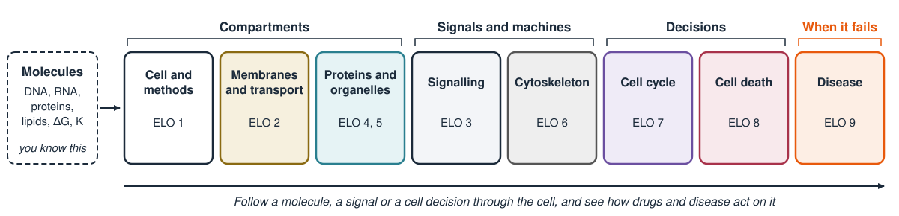{width="100%" fig-align="center"}

You already think in **molecules**: DNA, proteins, enzymes, ΔG. This course moves you **one level up**: to **compartments** (where things are), **machines** (what moves and signals) and **decisions** (divide, move or die), and to **disease** when these go wrong.

::: notes
Here is the whole course on one slide. On the left is what you bring from biochemistry, molecular biology and chemistry: molecules, reactions, equilibria and the central dogma. We will not teach these again. The course moves you up one level of organisation. The first blocks are about compartments: what a cell is made of and how we study it, then membranes and transport, then how proteins are made, folded and sent to the right organelle. The middle blocks are about signals and machines: how a cell senses its surroundings and how the cytoskeleton gives it shape and movement. Then come decisions: when to divide and when to die. The last block is disease, seen as cell biology going wrong. Each block is one or more expected learning outcomes, ELOs, and the ELO numbers on the tiles are the same numbers as on the exam. Every lecture also ends with a drug or a disease, so you see why the mechanism matters for medicine and drug development.
:::

## How the exam works

| | |
|---|---|
| **Written exam** | one section for **each ELO 1–9** |
| **To pass** | at least **60 %** correct in **every** section; **all nine ELOs must be passed** |
| **VG** | each section has one VG question; VG on at least 5 of the 9 |
| **Partly passed?** | if you pass at least 6 ELOs, you can take an oral exam on the others, or retake the full exam |

::: notes
The written exam is built in a way that shapes how you should study. There is one section for each of the nine theory outcomes, and you must pass every section on its own, with at least sixty per cent correct. A very good result in signalling cannot make up for a weak result in cell death. Each section also has one harder question that is marked G or VG; to get VG on the exam you need VG on at least five of these nine. The VG questions ask you to predict, compare, explain an unexpected result or design an experiment, so the study questions include that kind of question for every lecture. If you pass at least six ELOs but not all nine, you do not need to redo everything: you can take an oral exam on the ELOs you missed. The exact rules are in the course plan and on Canvas. That is all the administration for today.
:::

## The question: how does one small drop do everything at once? {.smaller}

:::: {.columns}
::: {.column width="52%"}
A cultured animal cell holds about **2 picolitres** of water, and in it:

- **billions** of protein molecules, many thousands of different kinds,
- enzymes that make fats **next to** enzymes that burn them,
- enzymes that digest proteins at **pH 5**, in a cell whose cytosol is **pH 7.2**,
- DNA that must be copied **once** per division and never digested.

**How does the cell keep incompatible chemistry apart, and still get every molecule to the place where it is needed?**
:::
::: {.column width="48%"}
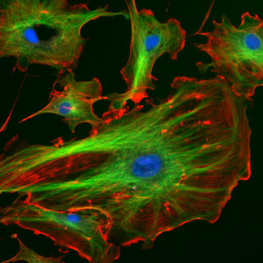{width="92%" fig-align="center"}

[Cultured endothelial cells. Blue: nucleus (DNA). Green: microtubules. Red: actin filaments.]{style="font-size:0.7em"}
:::
::::

::: notes
Look at the image. These are cultured cells from a cow blood vessel, stained with three fluorescent dyes: blue for DNA in the nucleus, green for microtubules and red for actin filaments. Even with only three stains you can see order: the nucleus sits in the middle, microtubules spread out from near the nucleus, and actin lines the cell edge. Now the puzzle. Each cell is a tiny volume, about two picolitres, but inside it there are billions of protein molecules doing thousands of reactions at once. Some of these reactions would destroy each other if they were mixed. Digestive enzymes that work best at pH 5 would attack the cell's own proteins. Fat synthesis and fat breakdown would cancel each other out. DNA must be kept safe and copied exactly once per cycle. The answer, which the rest of this lecture develops, has three parts: compartments separated by membranes, transport routes between the compartments, and a cytoskeleton that organises space. Keep this question in mind; we come back to it in the summary.
:::

## Recap: prokaryote and eukaryote {.smaller}

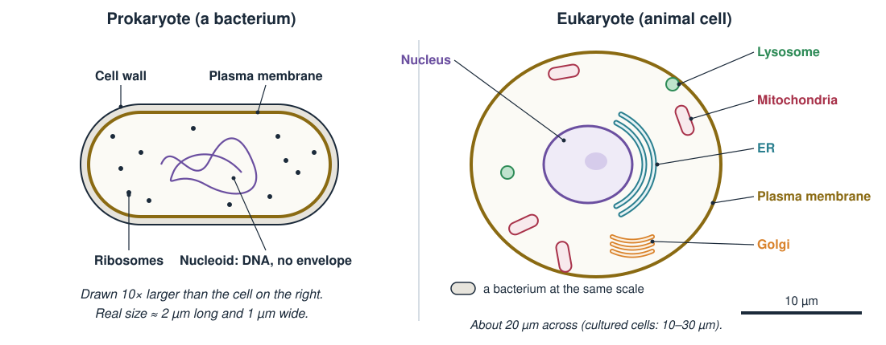{width="78%" fig-align="center"}

| | Prokaryote (bacterium) | Eukaryote (animal cell) |
|---|---|---|
| DNA | in the cytosol (nucleoid) | inside a **nucleus** with a double membrane |
| Internal membranes | almost none | **many**: ER, Golgi, endosomes, lysosomes, mitochondria, ... |
| Typical volume | ~1 µm³ | ~1000–4000 µm³ (**about 1000× larger**) |

::: notes
This is a recap of what you met in microbiology. A bacterium such as E. coli is about two micrometres long. It has a plasma membrane, usually a cell wall, ribosomes and its DNA in a region called the nucleoid, but no membrane around the DNA and almost no internal membranes. A eukaryotic cell is about a thousand times larger in volume. That is the key point on this slide: a bigger cell has a problem. Its surface is small compared with its volume, and molecules must travel further. Eukaryotes solve this with internal membranes, which add a large membrane area for reactions and divide the volume into compartments with different chemistry. Notice the mitochondria on the right: they are about the size of a bacterium. That is not a coincidence. Mitochondria come from a bacterium that was taken up by an ancestral cell, and they still have their own DNA and ribosomes. We come back to this in the mitochondria lecture.
:::

## A map of the animal cell

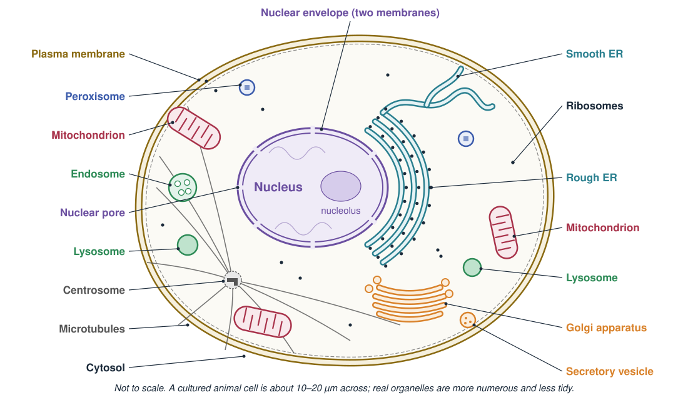{width="88%" fig-align="center"}

::: notes
This is the map we use in the whole course, and the colours are fixed: every later lecture uses the same colour for the same organelle. Purple is the nucleus, teal the endoplasmic reticulum, orange the Golgi apparatus, red the mitochondria, green the endosomes and lysosomes, blue the peroxisomes, grey the cytoskeleton, and brown the plasma membrane. Start in the centre. The nucleus holds the DNA, surrounded by the nuclear envelope, which is two membranes with pores through them. The outer nuclear membrane continues into the endoplasmic reticulum, the ER. The rough ER has ribosomes on its surface and makes membrane proteins and proteins for secretion; the smooth ER makes lipids and stores calcium. Proteins go from the ER to the Golgi, which modifies and sorts them, and then on to the plasma membrane in secretory vesicles, or to lysosomes. Material taken in from outside goes to endosomes and then to lysosomes for digestion. Mitochondria make most of the ATP. The centrosome organises the microtubules. Everything else, the fluid between the organelles, is the cytosol. The picture is a simplification: a real cell has hundreds of mitochondria and a much larger ER.
:::

## Explore a real HeLa cell {.smaller}

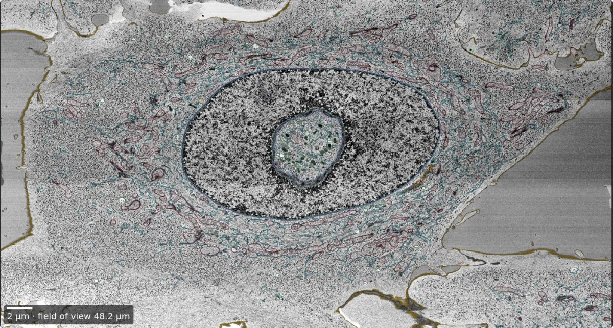{width="80%" fig-align="center"}

One slice through a real HeLa cell (electron microscopy, 48 × 26 µm), with the organelles outlined in the same colours as the map. **[Open the cell explorer](explore.qmd)**: zoom in, tap an organelle to read what it is, then try **Find the organelle**.

::: notes
The map on the previous slide is a cartoon. This is one slice through a real HeLa cell, imaged with a focused-ion-beam scanning electron microscope by the OpenOrganelle project at Janelia; the coloured outlines come from their machine-learning segmentation, checked by us. Point out the purple nucleus with its dark chromatin, the red mitochondria scattered all around it, the teal ER everywhere, and the brown plasma membrane at the edges. Note the scale: the whole slice is about 48 micrometres wide, and there are about a hundred mitochondria in this one plane alone. Note also the strange patch of cytoplasm in the middle of the nucleus: a deep fold of the nucleus, cut across, which is a good reminder that a single section can mislead. Ask students to open the explorer after the lecture, zoom in on a mitochondrion and the Golgi, and play the "Find the organelle" quiz; we will come back to how this image was made in the microscopy lecture.
:::

## What each compartment does {.smaller}

| Compartment | Main job | Share of cell volume* | More in |
|---|---|---|---|
| **Cytosol** | protein synthesis, most metabolism, signalling | ~50 % | throughout |
| **Nucleus** | stores and reads DNA; makes ribosomes (nucleolus) | ~5–10 % | protein sorting; cell cycle |
| **ER** | makes membrane and secreted proteins, lipids; stores Ca²⁺ | ~10–15 % | the ER |
| **Golgi apparatus** | adds sugars, sorts proteins | ~2–5 % | Golgi and secretion |
| **Endosomes, lysosomes** | sort what was taken in; digest at pH ~5 | ~1–2 % | endocytosis and lysosomes |
| **Mitochondria** | ATP by oxidative phosphorylation; start apoptosis | ~20 % in a liver cell | mitochondria; apoptosis |
| **Peroxisomes** | oxidise fatty acids; break down H₂O₂ | ~1 % | organelles compared |

*Rough values for a liver cell. They change a lot between cell types: a pancreas cell that secretes enzymes is full of ER, a fat cell is mostly a lipid droplet.

::: notes
This table is the text version of the map. Do not learn the percentages by heart; learn the pattern. About half of a typical cell is cytosol, and the cytosol is where proteins are made on free ribosomes and where much of metabolism happens, for example glycolysis. Each membrane-bound organelle has a special job, and each has its own lecture, shown in the right column. Notice that the amounts depend on what the cell does. A liver cell, which does a lot of metabolism, has many mitochondria, about a fifth of its volume. A pancreatic acinar cell, which secretes large amounts of digestive enzymes, is packed with rough ER. A plasma cell, which secretes antibodies, also has a lot of rough ER. So you can often guess what a cell does by looking at its organelles under an electron microscope, and the reverse is also true. Two jobs are worth noting now because they come back: mitochondria do not only make ATP, they also start one form of cell death; and the ER is the main calcium store of the cell, which matters for signalling.
:::

## Two sides of every membrane: topology

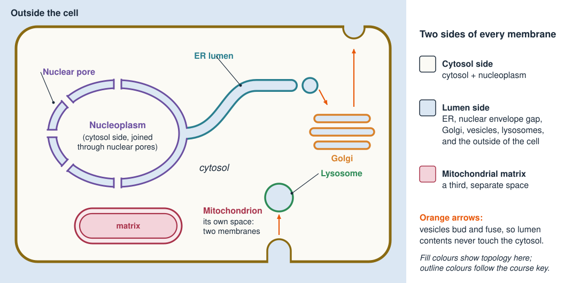{width="86%" fig-align="center"}

::: notes
This is the most important idea of today, because it explains much of protein sorting and vesicle traffic later. Every membrane separates two spaces. Look at the colours. The light yellow space is the cytosol side: the cytosol itself and the inside of the nucleus, the nucleoplasm. These two are joined through nuclear pores, which are large open channels, so they count as one space. The light blue space is the lumen side: the inside of the ER, the gap between the two nuclear membranes, the Golgi, the vesicles, endosomes and lysosomes. The lumen side is, in topology, the same as the outside of the cell. Why? Because these compartments are connected to the outside by vesicles that bud from one membrane and fuse with another, without a molecule ever crossing a membrane. A protein secreted from the ER lumen reaches the outside without ever being in the cytosol. Mitochondria are the exception: their inner space, the matrix, is a third space of its own, a legacy of their bacterial origin. Peroxisomes, not shown here, also import their proteins from the cytosol.
:::

## Inside-out logic: a protein keeps its orientation

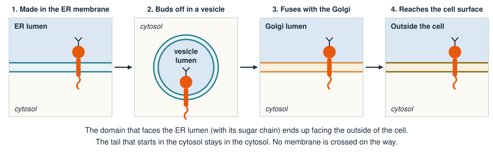{width="96%" fig-align="center"}

- The part of a protein that is in the **ER lumen** ends up **outside the cell**.
- This is why sugar chains (added in the ER and Golgi lumen) are found on the **outer** surface of the cell, and why receptors have their binding site outside.

::: notes
Here is topology in action. A membrane protein is made in the ER membrane. One part of it faces the ER lumen, and in the lumen the cell adds sugar chains to it. The other part, the tail, faces the cytosol. Now follow it. A vesicle buds from the ER: the lumen side of the protein now faces the inside of the vesicle. The vesicle fuses with the Golgi: the lumen side faces the Golgi lumen. A new vesicle carries it to the plasma membrane and fuses: now the lumen side faces the outside of the cell. At no step does the protein flip, and at no step does any part of it cross a membrane. So the rule is simple: lumen side equals outside. This explains why all the sugar chains of the cell surface face outwards, and why a hormone receptor made in the ER has its hormone-binding part outside the cell and its signalling part in the cytosol. When we study receptors and protein sorting, you will use this rule again and again. It is also a common exam question.
:::

## The scale ladder: from ion to cell

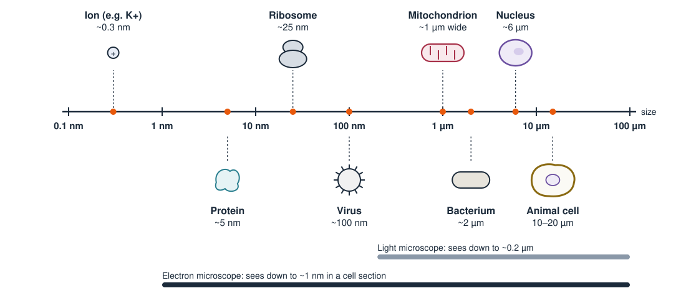{width="94%" fig-align="center"}

Each step on the axis is a **factor of 10**. A cell is about **50,000×** wider than an ion and about **3000×** wider than a protein.

::: notes
Cell biology covers about five orders of magnitude in size, so the axis is logarithmic: each tick is ten times the one before. An ion such as potassium is about a third of a nanometre across. A typical protein is about five nanometres. A ribosome, a large machine made of RNA and about eighty proteins, is about twenty-five nanometres. Many viruses, such as influenza or SARS coronavirus 2, are about a hundred nanometres. A bacterium and a mitochondrion are about one micrometre wide. The nucleus is a few micrometres, and a whole animal cell is ten to twenty micrometres. The bars at the bottom link to the next lecture. A light microscope cannot separate two objects closer than about two hundred nanometres, so with light you can see cells, nuclei and mitochondria, but not single ribosomes or proteins, unless you label them with a fluorescent tag. An electron microscope sees down to about a nanometre in a thin section of a cell. Remember these sizes: they let you check whether an answer is reasonable.
:::

## Numbers worth knowing {.smaller}

| Quantity | Typical value (order of magnitude) |
|---|---|
| Diameter of a cultured animal cell | 10–20 µm |
| Volume of a mammalian cell | ~1–4 pL (1000–4000 µm³) |
| Cell mass that is water / protein | ~70 % / ~15–20 % |
| Protein molecules per cell | **10⁹–10¹⁰** (about 10,000 different kinds) |
| Ribosomes per cell | ~10⁶–10⁷ |
| A protein diffuses across a cell (10 µm) | **a few seconds** |
| A small molecule diffuses across a cell | ~0.1 s |
| A protein diffuses 1 m (down a long nerve axon) | **hundreds of years**, so the cell uses motors |
| Cells in a human body | ~3 × 10¹³ |

[Rough values of the kind collected in BioNumbers (bionumbers.hms.harvard.edu) and *Cell Biology by the Numbers* (Milo and Phillips). Diffusion time: $t \approx x^2 / 6D$ with $D \approx 5$–$10\ \mu\text{m}^2/\text{s}$ for a protein in cytoplasm.]{style="font-size:0.75em"}

::: notes
These are numbers to remember as orders of magnitude, not exact values. A cell holds about one to ten billion protein molecules. Spread over a volume of a few picolitres, that is a protein concentration of a few hundred milligrams per millilitre: the cytoplasm is crowded, more like a gel than like water. Now diffusion. For a molecule that moves randomly, the time to travel a distance x grows with x squared: t is roughly x squared divided by six times the diffusion coefficient. A protein in cytoplasm has a diffusion coefficient of about five to ten square micrometres per second, so it crosses a ten-micrometre cell in a few seconds. That is fast enough for most signals. But because of the x squared, diffusion becomes useless over long distances: to diffuse one metre, from your spinal cord to your foot along a nerve axon, would take hundreds of years. This is why cells have motor proteins that carry cargo along the cytoskeleton, which you meet in the cytoskeleton block. Small molecules such as glucose diffuse about ten to a hundred times faster than proteins.
:::

## How do we know? Electron microscopy revealed the compartments {.smaller}

:::: {.columns}
::: {.column width="50%"}
- **Light microscopy** (from the 1600s) showed cells and nuclei, but nothing smaller than ~0.2 µm.
- **1940s–1950s:** the **electron microscope** and thin sections showed the ER, ribosomes, Golgi stacks and the inner structure of mitochondria.
- At the same time, **cell fractionation** (breaking cells and separating parts by centrifugation) showed **what each part does**, for example lysosomes full of digestive enzymes.
- Nobel Prize 1974: Claude, de Duve and Palade.

**Lesson:** one method shows *where*; another shows *what it does*. You need both.
:::
::: {.column width="50%"}
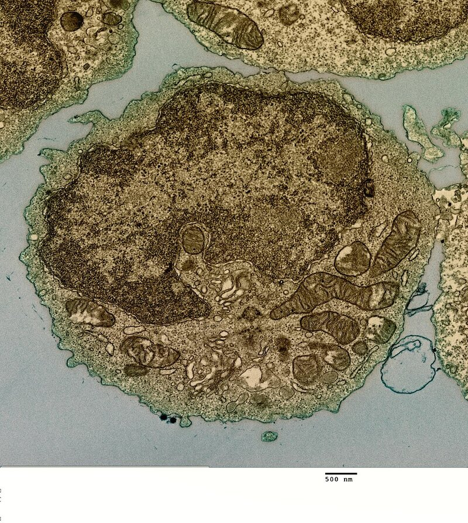{width="80%" fig-align="center"}

[Transmission electron micrograph of a human B lymphocyte. Large nucleus with dark chromatin; mitochondria with folded inner membranes in the cytoplasm. Scale bar 500 nm.]{style="font-size:0.7em"}
:::
::::

::: notes
How do we know that the map is true? Until the 1940s, the light microscope was the main tool, and it cannot resolve anything smaller than about two hundred nanometres. Cells and nuclei were visible, and mitochondria as tiny dots, but the ER and ribosomes were invisible. The electron microscope uses electrons instead of light, and electrons have a much shorter wavelength, so it resolves structures down to about a nanometre. When researchers learned to cut cells into very thin sections, they suddenly saw the membranes inside cells: the ER, ribosomes, the Golgi stacks and the folded inner membrane of mitochondria. In the image you see a human B lymphocyte: the large nucleus with dark, condensed chromatin, and mitochondria with their folded inner membrane. But a picture shows where things are, not what they do. At the same time, others broke cells open and separated their parts by centrifugation, then measured enzymes in each fraction. This is how lysosomes and peroxisomes were discovered. Combining the two methods won the Nobel Prize in 1974. Microscopy and fractionation are the topics of the next two lectures.
:::

## Model systems: choose the simplest system that can answer the question {.smaller}

:::: {.columns}
::: {.column width="62%"}
| System | Good for | Cannot tell you |
|---|---|---|
| **Bacteria** (*E. coli*) | fast genetics, basic machines | anything about organelles |
| **Budding yeast** (*S. cerevisiae*) | eukaryote; divides in ~90 min; easy genetics | how tissues and animals behave |
| **Human cell lines** (HeLa, HEK293, ...) | human proteins; easy to image and perturb | normal behaviour: most are cancer cells grown on plastic |
| **Organoids** | 3D tissue from stem cells, even from a patient | blood supply, immune system, whole body |
| **Mice** | whole organism | human biology exactly; slow, costly, ethics |

Yeast genetics found the genes for the **cell cycle** (Nobel 2001), **vesicle traffic** (2013) and **autophagy** (2016).
:::
::: {.column width="38%"}
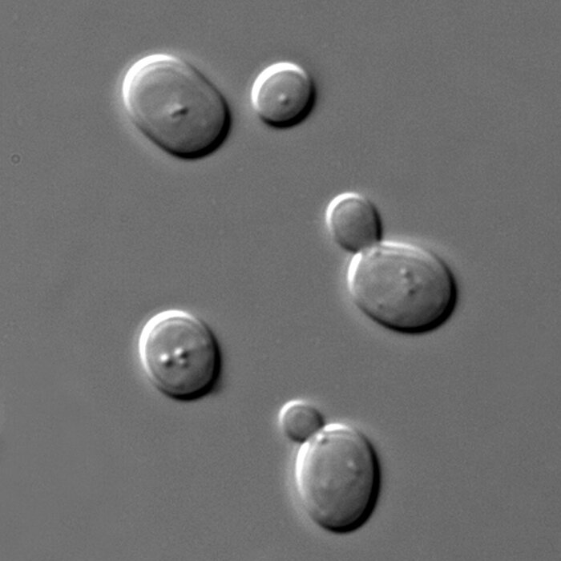{width="95%" fig-align="center"}

[Budding yeast, *Saccharomyces cerevisiae* (DIC microscopy). Small buds are daughter cells growing out of the mother cells.]{style="font-size:0.7em"}
:::
::::

::: notes
No single system answers every question, so cell biologists choose a model system. The rule is to use the simplest system that still has the feature you want to study. Bacteria are fast and simple but have no organelles. Budding yeast, the yeast used for baking and brewing, is the simplest common eukaryote: it has a nucleus, ER, Golgi and mitochondria, it divides in about ninety minutes, and its genes are easy to delete. Because most of the core machinery is shared with human cells, yeast genetics found the genes that control the cell cycle, the genes for vesicle traffic and the genes for autophagy, and each of these won a Nobel Prize. In the image you see yeast cells with buds; each bud is a new daughter cell. Human cell lines give human proteins in a dish. Organoids add three-dimensional tissue structure. Mice give a whole body. Each step up is closer to a patient but slower, more expensive and harder to control. In a VG question you may be asked to choose a system and to say what it cannot show.
:::

## Cell lines: HeLa, the first human cells that never stopped dividing {.smaller}

:::: {.columns}
::: {.column width="52%"}
- **Normal human cells** divide only about 40–60 times in culture, then stop.
- A **cell line** divides without limit. Most come from tumours.
- **HeLa** (1951) came from the cervical tumour of **Henrietta Lacks**. It was the first human cell line.
- HeLa cells carry **human papillomavirus 18 (HPV-18)**. Viral proteins switch off two brakes on cell division (you meet them in the cell-cycle and cancer lectures).
- HeLa is **not a normal cell**: around 76–80 chromosomes instead of 46, and the number varies. And HeLa grows so well that it has **contaminated** many other cell lines, so labs now check the identity of their cells with a DNA test.
:::
::: {.column width="48%"}
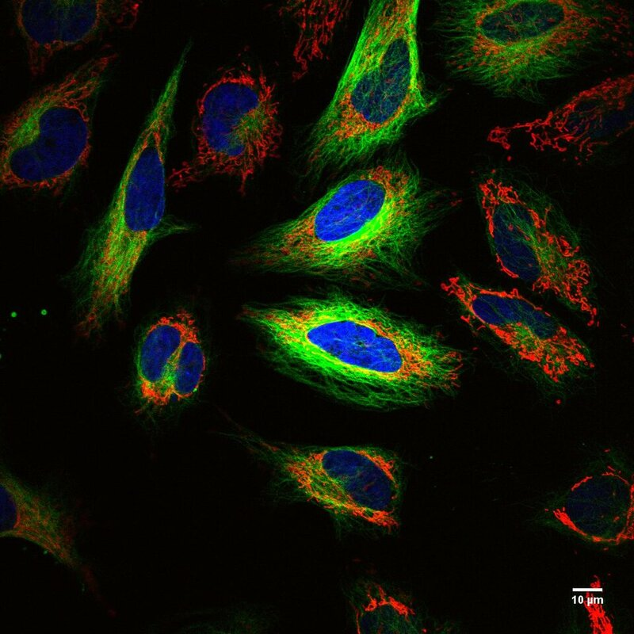{width="88%" fig-align="center"}

[Living HeLa cells. Blue: nucleus. Green: microtubules. Red: mitochondria. Scale bar 10 µm.]{style="font-size:0.7em"}
:::
::::

::: notes
Most cells taken from a human body divide a limited number of times in a dish, about forty to sixty times, and then stop. A cell line is a population of cells that can divide without limit. Almost all human cell lines come from tumours, because cancer cells have lost the normal limits on division. The first human cell line came from Henrietta Lacks, a thirty-one-year-old African American woman treated for cervical cancer at Johns Hopkins Hospital in Baltimore in 1951. Her cells, named HeLa from her name, grew faster than any human cells before them. We now know why. Her tumour was caused by human papillomavirus type 18, and viral proteins in HeLa cells switch off two key brakes on cell division, proteins called p53 and Rb, which you meet in the cell-cycle and cancer lectures. HeLa cells also have an abnormal genome, with about eighty chromosomes. In the image you see living HeLa cells with three fluorescent labels: nucleus, microtubules and mitochondria. Note the scale bar: these cells are about twenty to forty micrometres long when they spread on glass.
:::

## Organoids: tissue in a dish {.smaller}

:::: {.columns}
::: {.column width="52%"}
- An **organoid** is a small 3D structure that grows from **stem cells** in a gel, with the right growth factors.
- The cells **organise themselves**: an intestinal organoid forms crypts and a lumen, with several cell types, like the real gut lining.
- Organoids can be grown from **one patient's** biopsy, so you can test drugs on that patient's own cells.
- Example: in **cystic fibrosis**, a patient's intestinal organoids swell when a drug restores the faulty chloride channel (CFTR). The test helps choose a drug for that patient.
:::
::: {.column width="48%"}
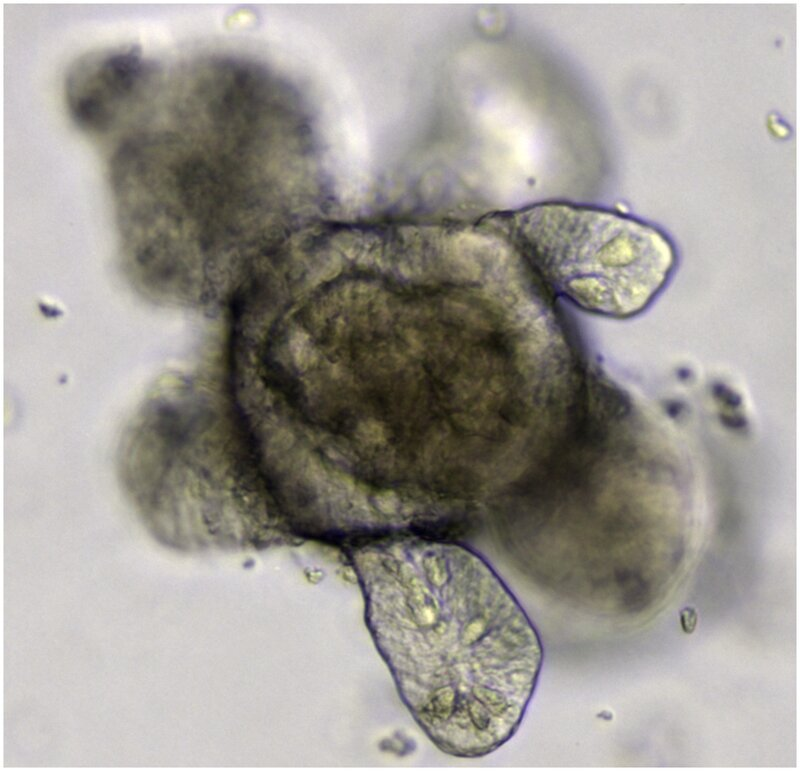{width="85%" fig-align="center"}

[Intestinal organoid grown from Lgr5⁺ stem cells. The buds are crypt-like domains around a central lumen.]{style="font-size:0.7em"}
:::
::::

::: notes
Cell lines grow as a flat layer on plastic, which is far from a real tissue. Organoids are a newer model, developed from about 2009. You take adult stem cells, for example from the base of an intestinal crypt, put them in a gel that mimics the material around cells in a tissue, and add the growth factors that the stem cells normally receive. The stem cells divide and organise themselves into a small three-dimensional structure with a central lumen and buds that look like crypts, with several cell types, much like the lining of the gut. The image shows such an intestinal organoid. Because organoids can be grown from a small biopsy, they can be made from one patient. A good example is cystic fibrosis, which is caused by a faulty chloride channel called CFTR. When a drug restores channel function in a patient's intestinal organoids, chloride and water flow into the lumen and the organoids swell. The amount of swelling helps predict whether the drug will work in that patient. You meet ion channels in lecture six and cystic fibrosis again in the disease lectures.
:::

## Why it matters: HeLa cells changed medicine {.smaller}

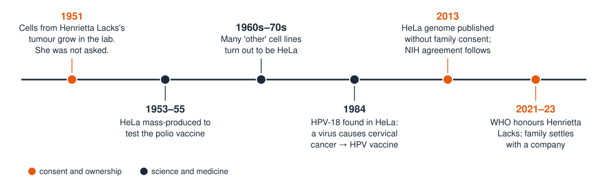{width="88%" fig-align="center"}

- **Polio vaccine:** poliovirus grows in HeLa, so HeLa was mass-produced to test the **Salk vaccine** (1953–55).
- **HPV and cervical cancer:** HPV-18 DNA in HeLa helped show that a virus causes cervical cancer (Nobel 2008), which led to the **HPV vaccine**.
- **Drug screening:** cell lines like HeLa are the first test for thousands of drug candidates: does the compound kill cells, reach its target, change an organelle?

::: notes
Here is why HeLa cells matter for medicine, and why we tie them back to the cell-line slide. Because HeLa cells were the first human cells that could be grown in large amounts, they became a tool for everything. In the early 1950s, poliovirus was found to grow in HeLa cells. A laboratory at the Tuskegee Institute mass-produced HeLa cells and sent them across the United States to test whether the Salk polio vaccine produced protective antibodies. In the 1980s, researchers found DNA from human papillomavirus type 18 in HeLa cells and in many other cervical cancers. This helped prove that a virus causes cervical cancer, work that won the Nobel Prize in 2008, and it led to the HPV vaccine that is now given to children, including in Sweden. HeLa cells have been used in more than a hundred thousand research papers. Today, cell lines are the first step of drug development: before any animal or human test, a drug candidate is tested on cells. You meet the later phases in the later programme course on clinical trials and drug development.
:::

## Why it matters: consent, then and now {.smaller}

:::: {.columns}
::: {.column width="58%"}
- In 1951 Henrietta Lacks was **not asked** whether her cells could be used. This was common practice at the time. She died the same year, aged 31.
- Her family learned about HeLa decades later. Companies sold HeLa cells; the family received nothing.
- **2013:** the HeLa genome was published without the family's consent. It also says something about her relatives' DNA. The US National Institutes of Health then agreed with the family on **controlled access**, with family members on the committee.
- **Today, in Sweden:** research on human tissue needs **ethical approval** and, as a rule, **informed consent**. Samples in biobanks are protected by law.

**Ask yourself:** who should decide how cells from a patient are used, and who should benefit?
:::
::: {.column width="42%"}
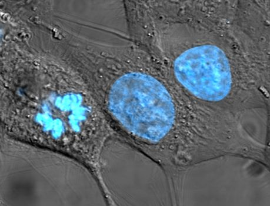{width="95%" fig-align="center"}

[HeLa cells, DNA stained with the blue dye Hoechst 33258.]{style="font-size:0.7em"}
:::
::::

::: notes
The science of HeLa cannot be separated from the person. Henrietta Lacks was a mother of five who was treated for cervical cancer in a segregated hospital ward in 1951. A sample of her tumour was taken during treatment and given to a research laboratory without her knowledge. This was common practice then, but that does not make it right, and her family did not learn about the cells for more than twenty years. When the HeLa genome sequence was published in 2013, it again happened without asking the family, even though a genome also reveals information about relatives. After discussions, the US National Institutes of Health agreed with the family that the data should be in controlled access, with family members helping to decide who can use it. In 2021 the World Health Organization honoured Henrietta Lacks, and in 2023 the family reached a settlement with a company that had sold HeLa cells. In Sweden today, research on human tissue needs approval from the Swedish Ethical Review Authority, informed consent is the rule, and biobank samples are protected by law. Treat this as a question for discussion, not a closed story.
:::

## Summary

1. A eukaryotic cell is divided by membranes into **compartments**, each with its own chemistry and job: nucleus, ER, Golgi, endosomes and lysosomes, mitochondria, peroxisomes, and the cytosol between them.
2. Every membrane has two sides. The **cytosol** and nucleoplasm form one side; the **lumen** of the ER, Golgi, vesicles and lysosomes is topologically **outside** the cell. Mitochondria have a third space.
3. **Sizes and numbers:** protein ~5 nm, ribosome ~25 nm, cell 10–20 µm; 10⁹–10¹⁰ proteins per cell; diffusion is fast over a cell but useless over long distances.
4. We know this from **microscopy** (where) and **fractionation** (what), and we study cells in **model systems** (yeast, cell lines such as HeLa, organoids), each with its limits.

*Read more (optional): Alberts et al., Molecular Biology of the Cell, 7th ed., ch. 1 and ch. 12 (first section).*

[Image credits](../credits.qmd#cell-tour){style="font-size:0.7em"}

::: notes
Let us return to the opening question: how does one small drop of cytoplasm do everything at once? The answer is compartments. Membranes divide the cell into spaces with different chemistry, such as the acidic lysosome and the calcium-rich ER, and vesicles carry material between the lumen-side compartments without crossing a membrane. Topology is the rule to remember: the lumen side equals the outside of the cell, and the cytosol side includes the nucleus. Sizes and numbers let you check your reasoning, and the diffusion numbers explain why a large cell needs a cytoskeleton and motors. Finally, every fact on today's map came from methods: electron microscopy showed where structures are, fractionation showed what they do, and model systems let us test ideas. The next two lectures are about these methods: microscopy, and how to take cells apart and perturb them. If you want to read more, chapter one and the first section of chapter twelve of Molecular Biology of the Cell cover today's material, but the slides and notes are enough for the exam.
:::
