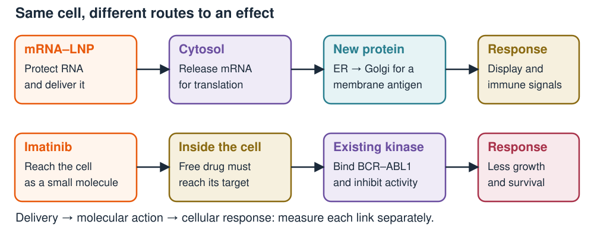
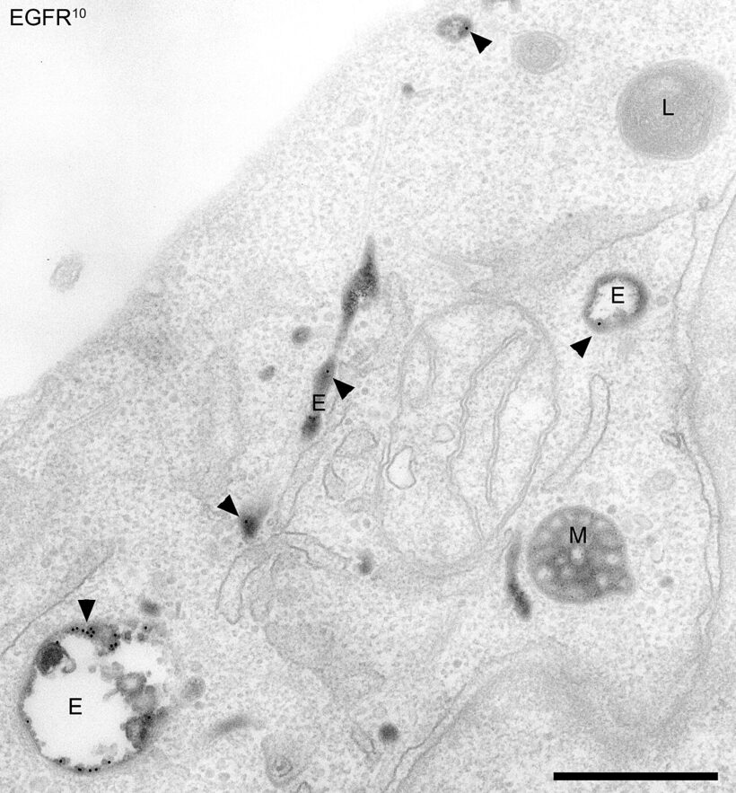
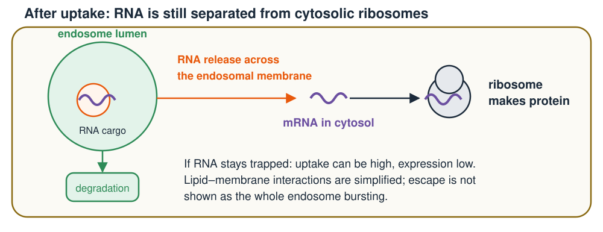
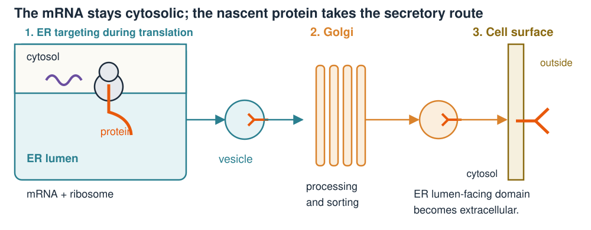
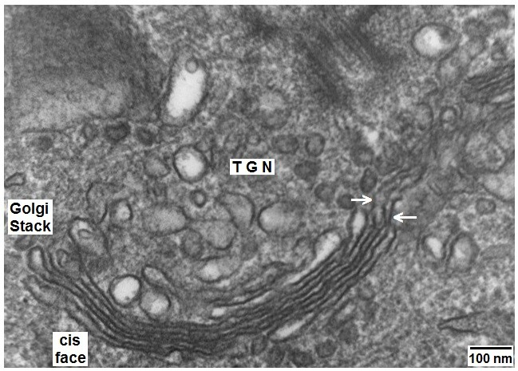
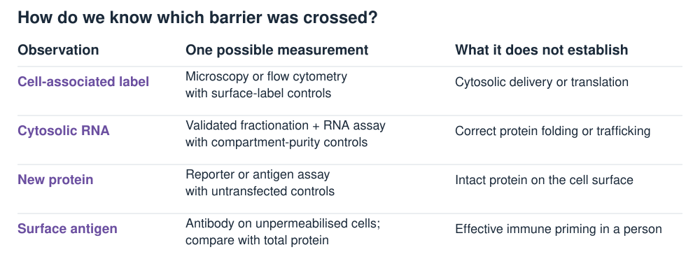
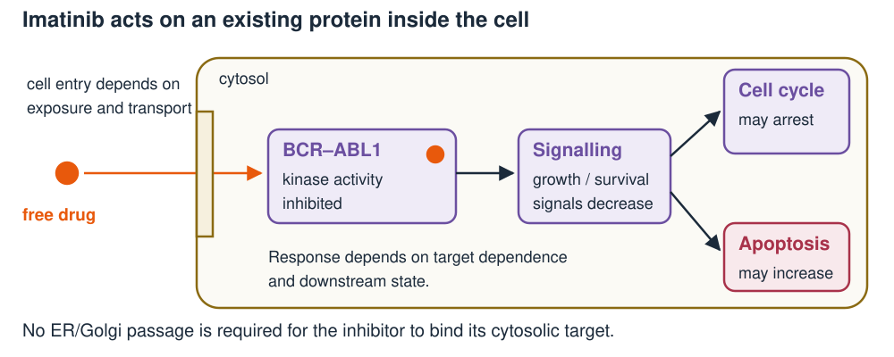
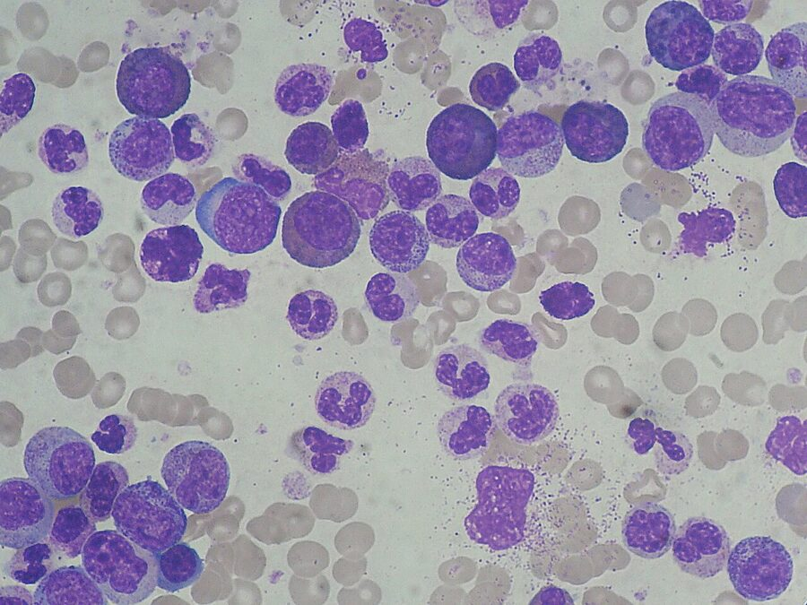
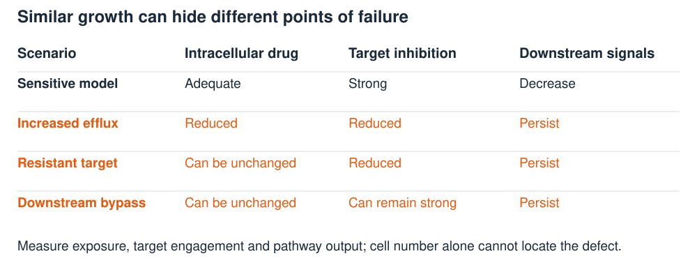
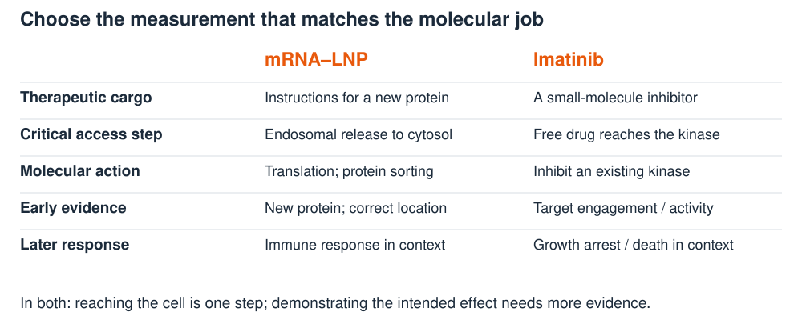

## About this lecture {.smaller}

A treatment works only if the right molecule reaches the right place and changes a process the cell depends on.

After this lecture you can:

- follow an **mRNA–lipid nanoparticle** from uptake to protein production and antigen display;
- follow **imatinib** from cellular exposure to kinase inhibition, altered proliferation and possible apoptosis;
- connect **membranes, organelles, protein sorting, cytoskeleton and signalling** along each route;
- choose measurements that distinguish **delivery, molecular action and cell response**, and explain where resistance can arise.

**ELO 1–9**, applied together. Immune recognition is a preview of **Immunologi**.

::: notes
We have studied the cell as compartments, machines and decisions. A treatment brings those parts together: it must reach a relevant cell, get to the compartment containing its target, and change something that matters for that cell or for the organism. Today we follow two examples. The first delivers instructions: an mRNA packaged in a lipid nanoparticle. The second delivers a molecule that acts directly on an existing protein: the kinase inhibitor imatinib. We ask where each molecule goes, which membrane it crosses, what the cell must do for it, and what observation would show success. The purpose is to explain complete mechanisms, rather than to introduce a new list of proteins.
:::

## The question: why does “inside the cell” not mean “working”? {.smaller}

{width="90%" fig-align="center"}

- A cell contains labelled nanoparticles, but makes almost no encoded protein.
- A leukaemia cell contains a kinase inhibitor, but keeps dividing.
- **Which step failed, and what would you measure next?**

::: notes
Imagine two experiments. In the first, a fluorescent lipid label makes many dots inside a cell after a nanoparticle treatment, yet the encoded protein is barely detectable. In the second, chemical analysis finds a kinase inhibitor in a leukaemia cell, but the cell continues to proliferate. Neither observation is a contradiction. A particle can be inside an endosome while its RNA is still separated from cytosolic ribosomes. A small molecule can enter a cell without inhibiting enough of its intended target, or the cell can maintain a downstream process through another pathway. We need a chain of evidence from exposure to delivery, molecular action and cell response. This is the common problem behind both journeys.
:::

## Journey 1: uptake puts the cargo in an endosome {.smaller}

:::: {.columns}
::: {.column width="39%"}
{width="100%"}

*Endosomes and a lysosome in a HeLa cell after labelled EGF and transferrin uptake. This is a view of the compartments, not an mRNA-delivery experiment.*
:::
::: {.column width="61%"}
- A **lipid nanoparticle (LNP)** protects its RNA cargo and helps it enter cells.
- Uptake is commonly **endocytic**; the route depends on the formulation and cell type.
- The endosomal **lumen is separated from the cytosol** by a membrane.
- Some cargo is recycled or degraded. Uptake alone does not establish productive delivery.
:::
::::

::: notes
Start after administration, when some particles reach cells at the injection site or elsewhere. Distribution depends on how the formulation is given and on its interactions with tissues; a particle does not automatically enter the intended cell. Here we focus on a particle that is taken up. Endocytosis wraps extracellular material in a membrane, placing it in a lumen. The electron micrograph shows the kinds of compartments involved, using different cargo from our example. Its significance is spatial: material can be inside the cell boundary but still outside the cytosol. Endosomes mature and exchange material with recycling pathways and lysosomes. Productive RNA delivery must compete with those routes. We do not assume that all LNPs use one uptake mechanism.
:::

## Crossing the second barrier: endosomal escape {.smaller}

{width="88%" fig-align="center"}

- The mRNA must reach **cytosolic ribosomes** before it is degraded.
- Endosomal acidification changes the charge of **ionisable lipids**, which can favour interactions with the endosomal membrane.
- **Escape is a limiting step**, not a guaranteed consequence of uptake. The diagram simplifies a formulation-dependent mechanism.

::: notes
The plasma membrane was the first barrier. After endocytosis, the endosomal membrane is the second. Cytosolic ribosomes cannot translate mRNA that remains in an endosomal lumen. Many delivery systems contain lipids whose charge changes with pH; interactions between the carrier and the endosomal membrane can enable cargo release. Do not imagine that every endosome bursts or that every internalised RNA reaches the cytosol. Imaging studies of LNP-delivered siRNA established how strongly uptake can differ from productive release, but their measured efficiencies cannot simply be transferred to a different mRNA formulation or tissue. Our useful prediction is qualitative: blocking escape can preserve intracellular particle fluorescence while reducing expression. [Gilleron et al.](https://doi.org/10.1038/nbt.2612) is a primary example of separating those measurements.
:::

## The delivered mRNA is translated in the cytoplasm {.smaller}

{width="84%" fig-align="center"}

- Ribosomes read the released mRNA; **the mRNA does not need to enter the nucleus**.
- Translation and folding require energy, amino acids and a functioning cell.
- The **sequence of the encoded protein** determines its next destination.
- Our example encodes a **membrane antigen** with an ER-targeting signal and a membrane anchor.

::: notes
The LNP delivers mRNA, not a finished antigen. Once released and accessible, the mRNA joins the cell's translation machinery. An ordinary delivered mRNA is read in the cytoplasm and does not require transcription or passage through the nuclear pore. Where the resulting protein goes is a separate question, determined by its sequence. A soluble cytosolic reporter and a membrane antigen can therefore use the same initial RNA delivery route but follow different protein routes. Our example contains an ER-targeting signal and a membrane anchor, so it enters the secretory pathway. Energy supply also matters: amino acid activation, translation and folding cannot continue normally in a severely energy-depleted or injured cell. Protein expression is evidence of productive delivery and of functioning downstream machinery.
:::

## The protein's signal sends it to the ER {.smaller}

{width="84%" fig-align="center"}

- Translation **starts on a cytosolic ribosome**. An emerging ER signal recruits **SRP** and brings the ribosome to the ER translocon.
- The antigen's external domain enters the **ER lumen**, where it folds and can acquire **N-glycans**.
- Its membrane anchor stays in the bilayer. Quality control retains or degrades proteins that fail to fold.

::: notes
We now follow the protein rather than the RNA carrier. The ribosome starts in the cytosol. When an ER-targeting signal emerges from the growing chain, signal recognition particle directs the ribosome to the ER, where translocation and translation continue together. The signal is in the protein sequence; an mRNA inside an LNP does not carry an address that makes the whole particle travel through the Golgi. The antigen domain entering the ER lumen encounters chaperones and enzymes that add glycans. A membrane-spanning segment anchors the protein. Folding quality control can prevent export even when plenty of mRNA has been delivered. Removing a signal peptide does not always eliminate ER targeting, because another hydrophobic segment may act as a signal-anchor; any such prediction needs the actual sequence.
:::

## ER → Golgi → surface preserves topology {.smaller}

:::: {.columns}
::: {.column width="38%"}
{width="100%"}

*A Golgi stack and trans-Golgi network in a human cell, TEM; scale bar 100 nm.*
:::
::: {.column width="62%"}
- Folded cargo leaves the ER, passes through the **Golgi**, and reaches the plasma membrane in secretory carriers.
- The domain facing the **ER lumen** eventually faces **outside the cell**.
- The cytosolic tail remains cytosolic; glycans remain on the non-cytosolic side.
- The mRNA and its lipid carrier do **not** have to follow the antigen through this route.
:::
::::

::: notes
The Golgi is not a second translation site. It receives proteins and lipids from the ER and modifies and sorts them. The micrograph makes the membrane stacks and tubules real; the pathway diagram explains the direction of traffic. Vesicles bud and fuse without turning the membrane inside out. Consequently, an antigen domain in the ER lumen stays lumen-facing through transport and faces the extracellular space when the carrier fuses with the plasma membrane. Its glycan chains face outwards as well. This lets an antibody recognise an accessible external domain. The cytosolic tail stays inside. Keep three objects separate throughout the story: delivered mRNA, delivery lipids and the protein made from that mRNA. Their later locations and lifetimes differ.
:::

## The route depends on motors and homeostasis {.smaller}

{width="78%" fig-align="center"}

- **Microtubules and motors** help position organelles and move many carriers; actin supports local membrane traffic.
- **ATP** supports transport and folding; ATP-driven pumps maintain compartment **pH** and **Ca²⁺**.
- A traffic defect can lower surface antigen while leaving RNA delivery and early translation intact.
- Predict the **first affected step**, then follow its consequences.

::: notes
The arrows in a pathway diagram hide the work required to move material. Microtubules provide tracks for kinesin and dynein, while actin and myosins contribute to traffic near membranes. Not every carrier uses the same motor, and movement alone does not provide the specificity of docking and fusion. Compartment conditions also matter. ATP supplies energy to motors and chaperones and to pumps that establish acidic organelles or maintain calcium stores. Mitochondria and glycolysis support that demand. A loss of surface expression after an energy or cytoskeleton perturbation is therefore not proof that the mRNA failed to enter. Such perturbations affect several cellular processes, so time-resolved measurements and viability controls help identify the earliest defect.
:::

## How do we know? Separate uptake, escape and expression {.smaller}

{width="88%" fig-align="center"}

- **Labelled particle or RNA + microscopy:** where is the label? Check endosomal colocalisation.
- **A validated cytosolic-access assay:** did cargo reach the cytosol? Control for damaged cells and fraction contamination.
- **Encoded protein + surface staining:** was it translated, and did it reach the correct side of the membrane?
- Use time courses, matched controls and viable-cell counts. **One bright image cannot answer all three questions.**

::: notes
No single readout proves the entire journey. A labelled lipid can separate from its RNA, so lipid fluorescence alone cannot establish intact RNA delivery. Endosomal colocalisation can support trapping, but the optical resolution of a light microscope limits what can be assigned to the lumen or nearby cytosol. Cytosolic-access reporters or carefully controlled fractionation ask a different question, and can be confounded by membrane injury or contaminating vesicles. Finally, encoded protein reports successful translation; staining an external epitope without permeabilisation asks whether that domain reached the surface. Compare that with staining after permeabilisation or a total-protein assay. Reporter mRNA studies demonstrate productive expression, while trafficking experiments locate the bottleneck. The measurements complement each other rather than replacing one another.
:::

## Antigen expression becomes a signal between cells {.smaller}

- **Whole antigen** at the surface can expose structures recognised by antibodies or B cells.
- **Antigen-derived peptides** can be displayed by **MHC molecules**: peptide displays read by T cells.
- A classical MHC-I route uses **proteasomal peptides → ER loading → surface display**; antigen-presenting cells also use other routes.
- Recognition works with **costimulation and cytokines**. Protein expression alone does not predict an immune response.

*Preview of Immunologi: this is a map of cell processes, not a complete account of vaccination.*

::: notes
A membrane antigen and a peptide–MHC complex are different things. The first is a folded protein whose external structure can be recognised by an antibody or a B-cell receptor. The second is a short fragment of protein held by a display molecule at the cell surface, where a T-cell receptor can recognise it. In the classical MHC-I pathway, the proteasome generates peptides that enter the ER through a transporter and load onto MHC-I before surface delivery. Professional antigen-presenting cells can acquire antigen from other cells and use additional presentation routes. Receptors, costimulation and cytokines determine how immune cells respond. We introduce only the connection to sorting, degradation and signalling; immune-cell specialisation and memory belong in Immunologi. Transfected-cell death is not a required step in every successful delivery event.
:::

## Journey 2: a small molecule acts on an existing protein {.smaller}

{width="88%" fig-align="center"}

- **Imatinib** must reach an adequate **free concentration at its intracellular target**.
- Cellular exposure reflects entry, binding, sequestration and export; membrane passage is not unlimited.
- Imatinib binds the kinase domain of **BCR–ABL1**, reducing its tyrosine-kinase signalling.
- Unlike the mRNA journey, this action does **not require making a new therapeutic protein**.

::: notes
The second journey starts when a small molecule is available outside a leukaemia cell. Imatinib acts on the BCR–ABL1 fusion kinase associated with chronic myeloid leukaemia. It must reach the intracellular kinase and bind in a way that inhibits its catalytic activity. Total drug measured in a whole-cell extract is not necessarily the freely available concentration near the target: binding to other molecules or sequestration in compartments can change that relationship. Entry and export contribute as well. We treat exposure qualitatively rather than assigning imatinib one universal transport mechanism in every cell. This drug acts on a protein that already exists. It does not need an ER signal, glycosylation or Golgi export to inhibit the kinase. The two journeys share delivery barriers but have different molecular actions.
:::

## Less kinase signalling can alter proliferation and survival {.smaller}

{width="84%" fig-align="center"}

- BCR–ABL1 can maintain growth and survival signals without normal external control.
- Inhibition can reduce cyclin-dependent cell-cycle progression and produce **arrest**.
- Loss of survival signalling can favour **BAX/BAK → cytochrome c → caspases**, causing intrinsic apoptosis.
- **Arrest, apoptosis and durable control are different outcomes.** They depend on cell state and alternative pathways.

::: notes
A drug–protein interaction is not itself a cell-fate decision. The inhibited kinase normally feeds networks that influence transcription, metabolism, the cell-cycle machinery and survival proteins. Reducing those signals can stop progression through the cell cycle. It can also shift the balance of the BCL-2 family, allowing mitochondrial outer-membrane permeabilisation and caspase activation. The cell may arrest without immediately dying, and some cells can persist despite target inhibition. Therefore we should measure proliferation and death separately rather than treating a reduced cell count as proof of apoptosis. DNA-synthesis assays or cell-cycle profiles address proliferation; caspase activity and appropriate membrane-integrity measurements address death. These are conditional consequences of pathway dependence, not an automatic chain that happens identically in every treated cell.
:::

## How do we know? Target action comes before cell response {.smaller}

:::: {.columns}
::: {.column width="35%"}
{width="100%"}

*CML blood smear: granulocytes at different stages of maturation. Morphology alone cannot measure kinase inhibition.*
:::
::: {.column width="65%"}
1. **Exposure:** measure cellular drug, with appropriate handling controls.
2. **Molecular action:** test target engagement or a validated phosphorylation readout, with total-protein controls.
3. **Response:** measure DNA synthesis, cell number, apoptosis and viability over time.

A phosphorylation change is evidence of pathway inhibition; it is not by itself proof of direct drug binding.
:::
::::

::: notes
A chain of measurements helps distinguish delivery failure from biological resistance. Chemical analysis can establish that drug is associated with the cells, although it does not automatically give the free concentration at the kinase. A target-engagement assay directly addresses interaction with the intended protein. A validated phosphoprotein readout addresses catalytic signalling and must be interpreted alongside total protein, loading controls and sampling time. Downstream phosphorylation can change indirectly, so it should not be described as direct binding. Later measurements ask whether cells slow their cycle, die or persist. The blood smear shows the disease context, but a change in morphology cannot replace these molecular measurements. The clinical response to imatinib provided important evidence that the abnormal kinase was a therapeutically useful dependency.
:::

## The same failed response can have different causes {.smaller}

{width="88%" fig-align="center"}

- **Exposure:** increased efflux can lower drug available at the target.
- **Target:** a kinase-domain change can reduce inhibitor sensitivity; **T315I** is an imatinib-resistance example.
- **Network or fate:** alternative signalling or altered death machinery can preserve survival after target inhibition.
- Compare **drug exposure, target inhibition and response** before choosing an explanation.

::: notes
If a cell continues growing, do not immediately conclude that the binding site mutated. A lower intracellular exposure can leave enough active kinase to sustain the cell. A target mutation can instead preserve kinase signalling even when drug exposure is adequate. The T315I substitution is a well-established example for imatinib. A third possibility is that the intended pathway is inhibited but another pathway or a changed cell-fate system keeps the cell alive. These possibilities predict different combinations of observations. Repeated measurements, sequencing and controlled perturbations can test them. Gorre and colleagues connected clinical resistance with BCR–ABL kinase mutations or gene amplification in a 2001 study; that finding established a mechanism in those samples, not a universal explanation for every failure of therapy.
:::

## Why it matters: delivery is part of the treatment {.smaller}

{width="82%" fig-align="center"}

- An RNA sequence with the intended function still needs **protection, suitable distribution and productive cytosolic delivery**.
- More uptake is useful only if enough intact cargo reaches a functioning translation system.
- Improving one step can change another: compare expression, cell injury and relevant biological effects.
- The same platform can encode proteins with different destinations; **the protein sequence defines its route**.

::: notes
RNA delivery illustrates why the formulation and the encoded sequence must be considered together. Protection against degradation and distribution to a useful cell population come before cytosolic access. Once translation begins, the new protein still needs the targeting signals and folding properties appropriate for its intended function. A formulation that produces brighter intracellular lipid fluorescence has not necessarily improved protein production. Likewise, increased expression is not sufficient evidence of a better vaccine response or an acceptable safety profile. Each claim needs the corresponding measurements. Primary reporter-mRNA studies, such as Pardi and colleagues' work on expression kinetics, show how protein production can be measured separately from carrier uptake. You will meet formulation comparisons, efficacy endpoints and clinical evaluation again in Kliniska prövningar och läkemedelsutveckling.
:::

## Why it matters: a disease mechanism becomes a target {.smaller}

:::: {.columns}
::: {.column width="32%"}
{width="100%"}
:::
::: {.column width="68%"}
- In CML, the **BCR–ABL1 fusion** provides an abnormal kinase signal that can support proliferation and survival.
- **Imatinib** connects a defined molecular abnormality to treatment by inhibiting that kinase.
- Response and resistance reveal what the cells depend on, but target inhibition does not guarantee elimination of every malignant cell.
- Drug mechanism, clinical benefit and long-term response require **different evidence**.
:::
::::

::: notes
The disease example brings the chain back to the organism. BCR–ABL1 is not simply a marker found near the disease; its kinase activity helps drive the abnormal behaviour of the malignant cells. In the original clinical study, imatinib produced antileukaemic responses consistent with inhibiting this dependency. Later resistance studies showed that changing or increasing the target could restore signalling in some cases. These are strong links between molecular cell biology and treatment. They do not remove the need for clinical evidence, nor do they mean that every cell in a cancer has identical dependencies. For our course, the lesson is how an abnormal protein changes signalling, how a drug changes that process and how cellular evidence supports the interpretation. Disease progression and treatment strategy return in Sjukdomslära and drug-development teaching.
:::

## Compare the journeys: locate the molecule and the bottleneck {.smaller}

{width="90%" fig-align="center"}

**Try it:** [Drug journey](questions.qmd#explore). Choose a route, step through it, then predict the effect of a blocked step before changing the scenario.

::: notes
The two journeys use the same reasoning pattern but involve different molecules. For the LNP, endocytosis and escape make RNA accessible to ribosomes, after which the encoded protein follows its own targeting signals. For imatinib, access to an existing kinase and inhibition of its activity are the critical molecular steps. Both routes depend on the state of the cell, and both can fail after apparently successful entry. Use the interactive map to name the current molecule, its compartment and the barrier between it and the next event. Then identify a measurement that would test that event. The map is a stepped explanation with qualitative predictions, not a simulation of clinical concentrations or treatment outcomes. A changed scenario is a causal assumption to examine, not experimental evidence.
:::

## Summary {.smaller}

1. **Delivery and topology:** entry into an endosome does not establish access to the cytosol; protein targeting determines later membrane crossings.
2. **Cooperation:** organelles, motors, energy supply and quality control support expression and trafficking.
3. **Molecular action:** an mRNA supplies instructions; imatinib inhibits an existing kinase.
4. **Cell decisions:** altered signalling can change proliferation and survival, with outcomes that depend on cell state.
5. **Evidence:** distinguish exposure, molecular action and response to locate a failure and explain resistance.

*Read more (optional): Alberts et al., Molecular Biology of the Cell, 7th ed., chapters on membranes, intracellular compartments, signalling and cancer.*

[Image credits](../credits.qmd#drug-journey){style="font-size:0.7em"}

::: notes
The unifying task is to follow a molecule and explain what each location allows it to do. First, an endosomal lumen and the cytosol are distinct spaces; a membrane protein's orientation is then preserved during secretory traffic. Second, energy supply, cytoskeletal transport, compartment conditions and protein quality control make those routes possible. Third, treatments act in different ways: one delivers information to make a protein, while another directly inhibits a pre-existing protein. Fourth, signalling connects that action to the cell-cycle and death systems without imposing one inevitable outcome. Finally, good evidence identifies the earliest changed step rather than using one endpoint to infer the entire mechanism. Together these explanations apply the course outcomes to a complete biological problem.
:::
