## About this lecture {.smaller}

The secretory pathway carries proteins **out** of the cell. Today we follow the opposite direction: how a cell **takes things in** from outside, sorts them, keeps what it can reuse, and **digests** the rest. The same digestion system also eats parts of the cell itself.

After this lecture you can:

- describe **clathrin-mediated endocytosis** step by step, and the role of **dynamin**;
- explain **receptor-mediated uptake of LDL**, and why receptors **recycle** while their cargo is digested;
- explain how **endosomes mature and acidify** (V-ATPase), and how pH sorts cargo into **recycling or degradation**;
- describe **lysosomes**, how their enzymes get there (**mannose-6-phosphate**), and the other routes in: **macropinocytosis, phagocytosis, autophagy**;
- explain how **statins, PCSK9 inhibitors, antibody–drug conjugates, lipid nanoparticles** and **enzyme replacement** depend on this pathway.

::: notes
This lecture is the mirror image of the lecture on the Golgi and the secretory pathway. There, proteins made in the ER travelled outwards in vesicles to the cell surface. Here, material from outside the cell, and pieces of the plasma membrane itself, travel inwards. We will see that the cell does not simply swallow things at random. It uses receptors to pick out specific molecules, such as the cholesterol-carrying particle LDL, and it uses acid to sort them: the receptor goes back to the surface to be used again, and the cargo goes on to the lysosome, the digestive organelle of the cell. The lysosome also receives material from inside the cell by autophagy, so it is both the stomach and the recycling centre of the cell. Several important drugs depend on this pathway: cholesterol-lowering drugs, cancer drugs that are carried by antibodies, the lipid nanoparticles of mRNA vaccines, and enzymes given to patients with lysosomal storage diseases. The lecture covers ELO 4 and ELO 5.
:::

## The question: why do some teenagers have heart attacks? {.smaller}

:::: {.columns}
::: {.column width="48%"}
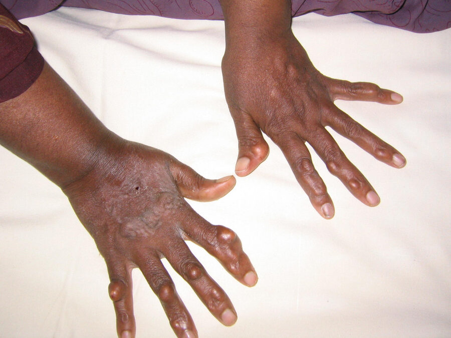{width="100%"}

*Hands of an 18-year-old with familial hypercholesterolaemia. The lumps over the knuckles are xanthomas: cholesterol deposits in tendons. She had a heart attack at 18.*
:::
::: {.column width="52%"}
- **Familial hypercholesterolaemia (FH)**: blood LDL cholesterol **2–3× normal** in about **1 in 250** people, **4–6×** in the rare children with two faulty genes.
- Cholesterol builds up in arteries: heart attacks at 30–40, or in childhood.
- The cells of these patients can **make cholesterol** normally. Yet they cannot **take LDL out of the blood**.
- In 1973 Michael Brown and Joseph Goldstein asked: **how does a cell take in a particle of 20 nm from the blood?** The answer opened the field of receptor-mediated endocytosis.
:::
::::

::: notes
Look at these hands. The lumps over the knuckles and along the tendons are xanthomas, deposits of cholesterol that build up when the blood cholesterol has been very high for a long time. The patient was an 18-year-old woman who had already had a heart attack. She has familial hypercholesterolaemia, one of the most common inherited diseases: about one person in 250 carries one faulty gene, and these people have about twice the normal LDL cholesterol from birth. Children who inherit two faulty genes can have four to six times normal levels and may have heart attacks before they are ten. In the early 1970s Michael Brown and Joseph Goldstein found that cells from these patients could make cholesterol perfectly well, but could not take up LDL, the cholesterol-carrying particle of the blood. Finding out why led them to the LDL receptor and to a general mechanism by which cells take in specific molecules: receptor-mediated endocytosis. They received the Nobel Prize in 1985. By the end of this lecture you will be able to explain the disease, and three kinds of drugs that treat it.
:::

## Ways into the cell: a map {.smaller}

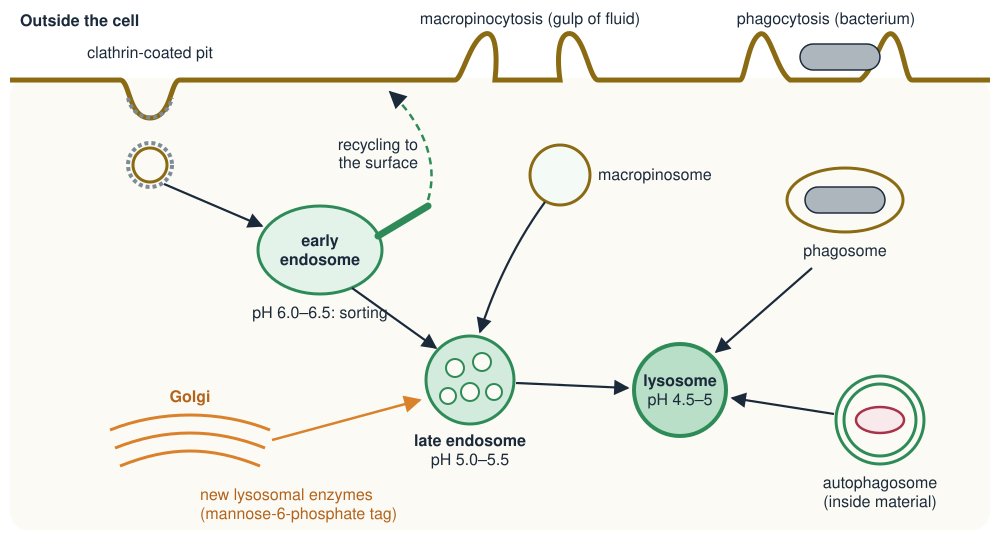{width="80%" fig-align="center"}

- **Endocytosis**: the plasma membrane folds in and pinches off a vesicle. Small vesicles (clathrin), large gulps of fluid (**macropinocytosis**), whole bacteria (**phagocytosis**).
- Everything meets in **endosomes**, which sort: **back to the surface** or **on to the lysosome**. **Autophagy** delivers material from **inside** the cell.
- *Recap* from the Golgi lecture: vesicles are shaped by a **coat**, find their target with **Rab** proteins and fuse with **SNAREs**. The same machinery works here.

::: notes
Here is the whole lecture on one map. At the top is the plasma membrane. On the left, a clathrin-coated pit pinches off a small vesicle, about a tenth of a micrometre wide. In the middle, the membrane throws up a ruffle and closes around a large gulp of fluid: macropinocytosis. On the right, a white blood cell wraps its membrane around a bacterium: phagocytosis. Vesicles from the surface fuse with the early endosome, a sorting station. From there, much of the membrane and many receptors go back to the surface, the recycling route. What stays behind matures into a late endosome and then reaches the lysosome, where it is digested. New digestive enzymes come from the Golgi, and autophagosomes bring material from inside the cell. Remember the general rules from the Golgi lecture: a coat bends the membrane and chooses the cargo, Rab proteins mark which compartment is which, and SNARE proteins fuse the vesicle with its target. Today the coat is mostly clathrin, and the important Rabs are Rab5 on early endosomes and Rab7 on late endosomes. This is a simplified map; real cells have more routes.
:::

## Clathrin-mediated endocytosis, step by step {.smaller}

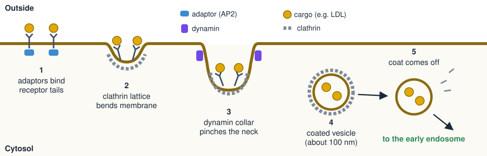{width="92%" fig-align="center"}

- **Adaptor** proteins (AP2) grab short **sorting signals** in the cytosolic tails of receptors (for the LDL receptor: **NPxY**, a 4-amino-acid motif).
- **Clathrin** binds the adaptors and forms a lattice that **bends the membrane** into a pit.
- **Dynamin**, a GTPase, forms a collar around the neck and **pinches** the vesicle off. The coat comes off within seconds.
- A pit takes about **a minute**; a cell makes **thousands of coated vesicles per minute**.

::: notes
Clathrin-mediated endocytosis is the main way cells take up specific molecules. Follow the steps. First, adaptor proteins called AP2 sit on the inner face of the plasma membrane and bind short signals in the cytosolic tails of receptors. For the LDL receptor this signal is four amino acids, asparagine, proline, any amino acid, tyrosine, written NPxY. This is how cargo is chosen: a receptor with the signal is collected, one without it is not. Second, clathrin binds the adaptors. Clathrin molecules have three legs and link up into a cage of hexagons and pentagons, which forces the membrane to curve into a pit. Third, when the pit is deep, the GTPase dynamin assembles as a ring around its neck. When dynamin hydrolyses GTP, the ring tightens and twists, and the vesicle is cut free. Fourth, the clathrin coat is removed by an ATP-driven chaperone within seconds, and the naked vesicle fuses with an early endosome. A coated pit forms and closes in about a minute, and a cultured fibroblast makes a few thousand coated vesicles every minute.
:::

## How do we know? Coats in the electron microscope, and a paralysed fly {.smaller}

:::: {.columns}
::: {.column width="27%"}
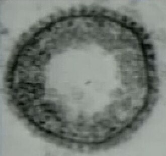{width="100%"}

*A clathrin-coated vesicle, thin-section EM: the bristly coat surrounds the membrane.*
:::
::: {.column width="27%"}
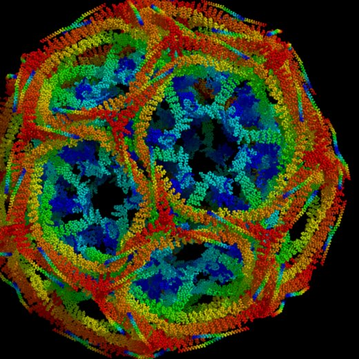{width="100%"}

*Structure of a clathrin cage (PDB 1XI4): legs of many three-legged clathrin molecules.*
:::
::: {.column width="46%"}
- **1964**, Roth and Porter: mosquito eggs take up yolk protein through pits with a **bristly coat** on the cytosolic side.
- **1976**, Anderson, Brown and Goldstein: LDL tagged with **ferritin** (iron core, dark in EM) sits in **coated pits** and appears in vesicles minutes later.
- **Dynamin**: the fruit-fly mutant ***shibire*** is paralysed within seconds at 29 °C. Its nerve endings are full of **pits stuck on necks**: they cannot pinch off, so synaptic vesicles are not recycled. The gene encodes dynamin. Cooling the fly reverses it.
:::
::::

::: notes
How do we know that pits, coats and dynamin do what the diagram claims? The first clue came from electron microscopy in 1964. Thomas Roth and Keith Porter studied mosquito eggs, which take up large amounts of yolk protein, and saw small pits in the membrane with a bristly coat on the cytosolic side. Twelve years later, Richard Anderson, Michael Brown and Joseph Goldstein attached ferritin, an iron-containing protein that is very dark in the electron microscope, to LDL. At low temperature the ferritin-LDL sat in coated pits; after warming for a few minutes it was inside vesicles. The left image shows a coated vesicle; the middle image is a model of the clathrin cage built from structural data. Dynamin was found through genetics. A fruit-fly mutant called shibire, Japanese for paralysed, collapses within seconds when warmed to 29 degrees. Its nerve endings fill with deep pits with long necks that cannot be cut, so synaptic vesicles are not recycled and the synapses run out. When the gene was cloned, it encoded dynamin. Cooling the flies lets the pits pinch off and the flies walk again: a temperature-sensitive switch for endocytosis.
:::

## Receptor-mediated uptake: the LDL receptor cycle {.smaller}

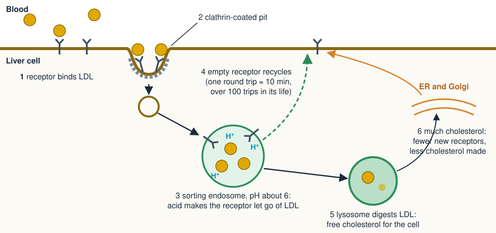{width="78%" fig-align="center"}

- **LDL**: a particle of about **22 nm** with ~1500 cholesterol esters inside and **one apoB protein** that the receptor binds.
- The receptor enters pits **with or without LDL**; at the **acidic pH** of the endosome it **lets go**. LDL goes to the **lysosome**; the receptor **recycles**.
- **Feedback**: a cell with plenty of cholesterol makes fewer receptors. **Try it:** [the LDL receptor cycle](questions.qmd#explore).

::: notes
Now the LDL receptor cycle, the classic example of receptor-mediated endocytosis. LDL, low-density lipoprotein, is a particle of about 22 nanometres. Its core holds about 1500 cholesterol molecules esterified to fatty acids; its surface is a single layer of phospholipid with one very large protein, apolipoprotein B, which the receptor recognises. Step one: the receptor in the plasma membrane binds LDL. Step two: the receptor's NPxY signal brings it into a clathrin-coated pit. Step three: the vesicle delivers it to the sorting endosome, where the pH is about 6. At this pH the receptor changes shape and releases LDL. Step four: the empty receptor returns to the surface in a recycling vesicle. A round trip takes about ten minutes, and one receptor can make more than a hundred trips during its life. Step five: LDL travels on to the lysosome, where enzymes split the cholesterol esters and free cholesterol leaves for the ER and membranes. Step six: when the cell has enough cholesterol, it makes fewer receptors and less cholesterol of its own. The demo lets you change each step and see the effect on blood LDL.
:::

## How do we know? Patients' cells revealed the receptor {.smaller}

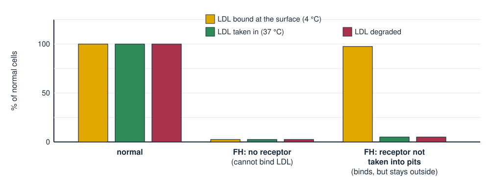{width="74%" fig-align="center"}

- Brown and Goldstein grew **skin fibroblasts** from patients and gave them **radioactive (¹²⁵I) LDL**. Binding at **4 °C** (no endocytosis), uptake and degradation at **37 °C**.
- Most FH cells **could not bind** LDL: no working receptor. One patient's cells (**"J.D."**) **bound LDL but never took it in**. His receptor had lost the **tyrosine of NPxY**: the signal that brings receptors into **coated pits**.
- *Schematic heights, not their data.*

::: notes
This is the experiment that revealed the receptor. Brown and Goldstein took small skin biopsies from healthy people and from patients with FH, grew the fibroblasts in culture and gave them LDL labelled with radioactive iodine. At 4 degrees, membranes do not bud, so the label measures only LDL bound to the surface. At 37 degrees they measured how much LDL got inside and how much was broken down to free iodotyrosine, which shows it reached the lysosome. Normal cells bound, took in and degraded LDL. Cells from most children with severe FH did none of these: they had no working receptor. But cells from one patient, known by his initials J.D., were different. They bound LDL normally but did not take it in. Electron microscopy showed his receptors spread over the surface instead of collected in coated pits. Years later, sequencing showed a single change in the receptor's cytosolic tail: the tyrosine of the NPxY signal was replaced by cysteine. One amino acid in the tail decides whether the receptor enters coated pits. The bar heights here are schematic.
:::

## Endosomes mature and become more acidic {.smaller}

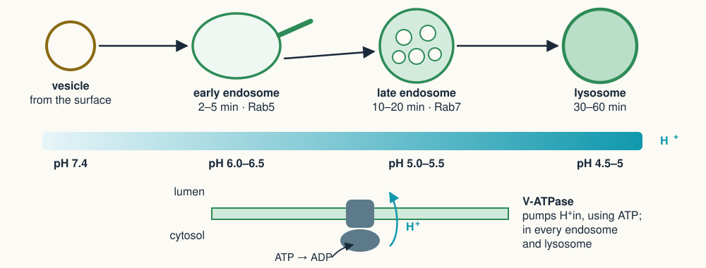{width="80%" fig-align="center"}

- The **V-ATPase** uses ATP to pump **H⁺** into the lumen (the transporters lecture). The further along, the **more pumps and the lower the pH**.
- **Early endosome**: sorting station, tubules for recycling, marked by **Rab5**. It **matures** into a **late endosome** (**Rab7**) with **internal vesicles** (a multivesicular body), which fuses with lysosomes.
- **Block the pump** (bafilomycin) or neutralise the acid (chloroquine, ammonia): sorting and digestion **stop**.

::: notes
The endocytic compartments form a series with falling pH. A vesicle from the surface has the neutral pH of the outside, 7.4. Within a few minutes it fuses with an early endosome, at about pH 6 to 6.5. The early endosome is the sorting station; it sends out thin tubules that carry membrane and receptors back to the surface. Over ten to twenty minutes the early endosome matures: it loses Rab5 and gains Rab7, moves towards the centre of the cell along microtubules, and buds parts of its own membrane inwards to form internal vesicles. This is a late endosome, also called a multivesicular body, at pH 5 to 5.5. It then fuses with lysosomes, at pH 4.5 to 5. The pH is set by the V-ATPase, the rotary proton pump you met in the transporters lecture, together with chloride channels that balance the charge. We know the acid matters because drugs that block the pump, such as bafilomycin, or weak bases that soak up the protons, such as chloroquine, stop receptors from releasing their cargo and stop lysosomal digestion.
:::

## Sorting: recycle or destroy? {.smaller}

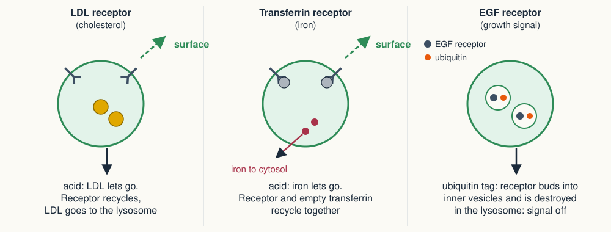{width="84%" fig-align="center"}

- The **same acid** gives different results: it frees **LDL** from its receptor, frees **iron** from transferrin.
- What goes back to the surface follows the **membrane** (tubules); what stays in the **lumen** goes to the lysosome.
- **Ubiquitin** on a receptor's tail sends it into **internal vesicles** and to the lysosome: this is how cells **switch off** growth-factor signalling.

::: notes
Three receptors, three outcomes, all decided in the same early endosome. The LDL receptor lets go of LDL in acid. The receptor stays in the membrane and returns to the surface, while LDL, free in the lumen, goes on to the lysosome. The transferrin receptor carries iron into the cell. Transferrin is a blood protein that holds two iron ions. In the acidic endosome the iron is released and transported into the cytosol, but the empty transferrin, unusually, stays bound to its receptor at acid pH. Both return to the surface, where at pH 7.4 the empty transferrin falls off and can pick up more iron. The EGF receptor is a growth-factor receptor. After it binds EGF it is tagged with ubiquitin on its cytosolic tail. A protein machine called ESCRT recognises the ubiquitin and pushes the receptor into the small internal vesicles of the late endosome, so it can no longer signal and is destroyed in the lysosome. This is one way cells end a signal, and it returns in the signalling lectures. The rule: membrane with no tag recycles, lumen content and tagged membrane go to the lysosome.
:::

## How do we know? Follow labelled cargo in the electron microscope {.smaller}

:::: {.columns}
::: {.column width="44%"}
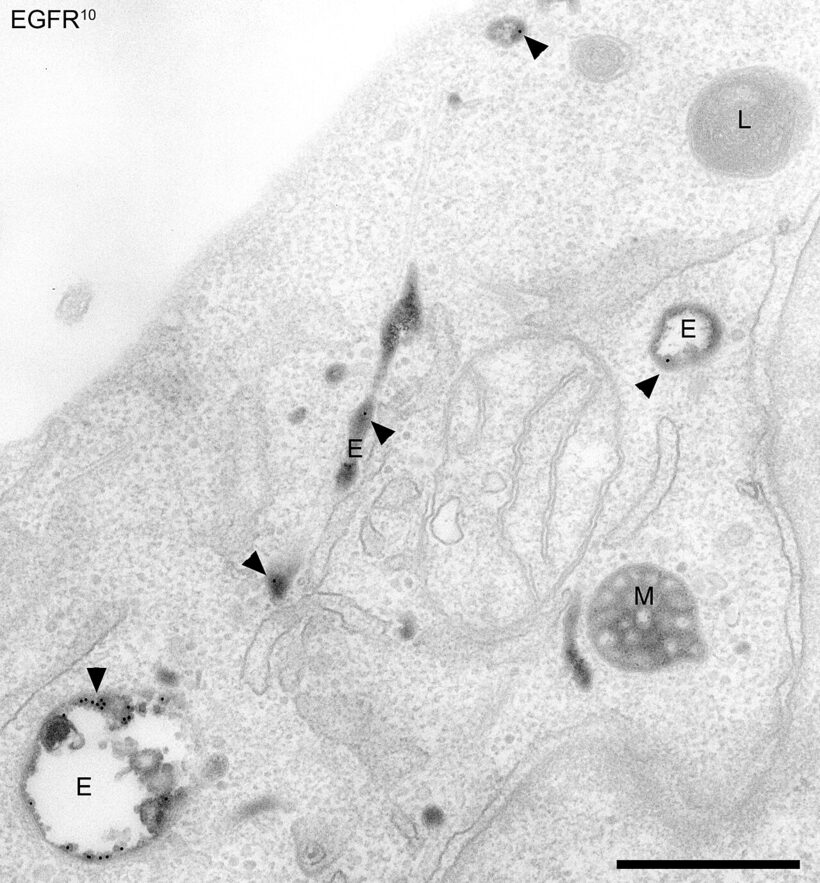{height="500px" fig-align="center"}
:::
::: {.column width="56%"}
- HeLa cell, **5 minutes** after uptake. Two cargoes are labelled in two ways:
  - **EGF receptors**: antibody with a **10 nm gold** bead (black dots, arrowheads);
  - **transferrin**: coupled to an **enzyme** (peroxidase) that makes a **dark stain**.
- Both are in **early endosomes (E)**; none yet in **late endosomes (M)**, which are full of internal vesicles, or **lysosomes (L)**.
- Repeat at 15, 30, 60 min: EGF receptor moves on to M and L; transferrin goes **back to the surface**. Scale bar 500 nm.
:::
::::

::: notes
How do we know which compartment a cargo visits, and when? This electron micrograph shows the method. The cells were given two labelled cargoes. The EGF receptors carry an antibody coupled to a gold particle of 10 nanometres, which is very dense to electrons and shows up as a sharp black dot; the arrowheads point to them. Transferrin was coupled to the enzyme horseradish peroxidase, which turns a chemical called DAB into a dark precipitate, so every compartment that contains transferrin is darkly stained. The cells were fixed five minutes after uptake. Both labels are in early endosomes, marked E, which are irregular and tubular. The late endosome, M, is round and full of small internal vesicles, and the lysosome, L, is dense; neither contains label yet. If you fix cells at later times, the EGF receptor gold appears in the late endosomes and then the lysosomes, while transferrin never gets there: it returns to the surface. Such pulse–chase experiments, a labelled pulse followed by a chase of time, built the map you saw at the start. Today they are often done with fluorescent tags in living cells.
:::

## Lysosomes: the cell's digestive organelle {.smaller}

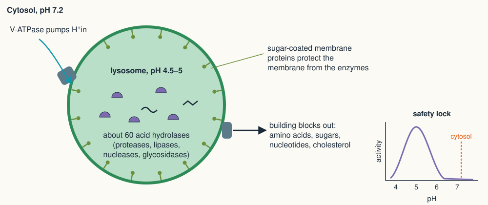{width="82%" fig-align="center"}

- About **60 hydrolases** that break down proteins, lipids, nucleic acids and sugars. They work best at **pH 4.5–5** and poorly at pH 7.2: a **safety lock** if a lysosome leaks.
- The membrane is protected by a thick layer of **sugar-coated proteins** on its inner face; **transporters** export amino acids, sugars and cholesterol for reuse.
- Discovered by **Christian de Duve** by cell fractionation (Nobel Prize 1974).

::: notes
The lysosome is where endocytosed material ends up. It is a membrane-bound organelle, usually a few hundred nanometres across, filled with about sixty different hydrolases, enzymes that split bonds with water: proteases, lipases, nucleases, phosphatases and glycosidases. Together they can break down almost any biological molecule. Two features keep the cell safe. First, the enzymes are acid hydrolases: they work best at the lysosome's pH of 4.5 to 5 and are much less active at the cytosol's pH of 7.2, so if a lysosome leaks a little, the cytosol is not digested. Second, the lysosomal membrane proteins are heavily glycosylated on the luminal side, and this sugar coat protects them from the proteases. The products of digestion are not wasted: transporters in the membrane export amino acids, sugars, nucleotides and cholesterol back to the cytosol. The lysosome was discovered in the 1950s by Christian de Duve, who separated rat liver cells by centrifugation and found a fraction with acid phosphatase activity that was hidden until the membranes were broken: a method you met in the cell-methods lecture. Lysosomes are also a signalling platform, as the autophagy slide will show.
:::

## Getting enzymes to the lysosome: the mannose-6-phosphate tag {.smaller}

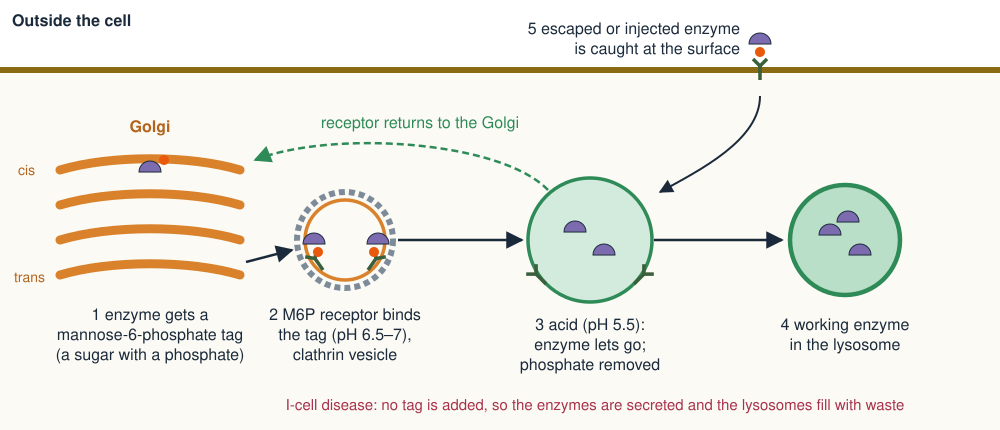{width="84%" fig-align="center"}

- Lysosomal enzymes are made in the **ER** like secreted proteins. In the **Golgi** an enzyme adds **phosphate to a mannose** sugar on them: **mannose-6-phosphate (M6P)**.
- **M6P receptors** in the trans Golgi collect them into **clathrin vesicles**; in the acidic late endosome they **let go**, and the receptor returns.
- M6P receptors also sit on the **cell surface** and catch enzymes from outside: the basis of **enzyme replacement therapy**.

::: notes
How do new lysosomal enzymes find the lysosome? They begin like secreted proteins: they are made on ribosomes on the ER, enter the ER lumen and receive N-linked sugar chains. In the cis Golgi, an enzyme called GlcNAc phosphotransferase recognises a patch on the folded surface of lysosomal enzymes, and only on them, and adds a phosphate to one or more mannose sugars. This mannose-6-phosphate is the address label. In the trans Golgi network, mannose-6-phosphate receptors bind the label at neutral pH and are collected into clathrin-coated vesicles, using the same coat as at the plasma membrane but a different adaptor. The vesicles fuse with late endosomes. At pH about 5.5 the receptor releases its enzyme, the phosphate is removed, and the receptor returns to the Golgi for another load: the same logic as the LDL receptor. Some enzyme escapes into the secretory route and leaves the cell, but M6P receptors on the cell surface catch it and bring it in by endocytosis. In I-cell disease the phosphotransferase is missing: the enzymes are not tagged, are secreted into the blood, and the patient's lysosomes fill with undigested material.
:::

## Big gulps: macropinocytosis and phagocytosis {.smaller}

:::: {.columns}
::: {.column width="40%"}
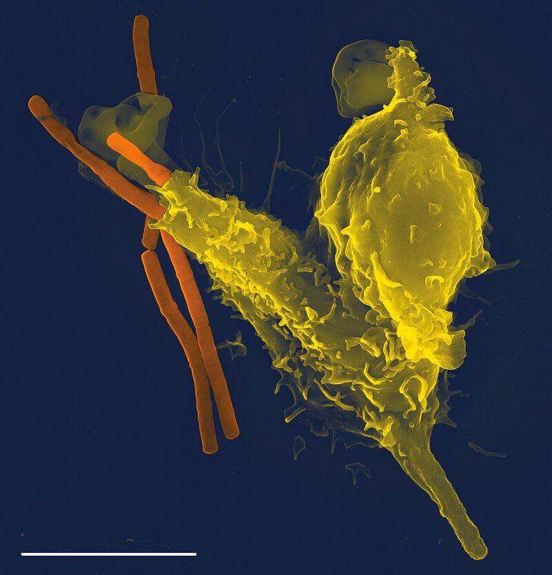{height="430px" fig-align="center"}

*A neutrophil (yellow) engulfing anthrax bacteria (orange), coloured scanning EM. Scale bar 5 µm.*
:::
::: {.column width="60%"}
| | Clathrin | Macropinocytosis | Phagocytosis |
|---|---|---|---|
| Size | ~0.1 µm | 0.2–5 µm | > 0.5 µm |
| Takes | chosen receptors | fluid, at random | particles, bacteria, dead cells |
| Driven by | clathrin, dynamin | **actin** ruffles | **actin**, triggered by receptors |
| Cells | all | most; high in cancer cells, macrophages | macrophages, neutrophils |

- A phagocyte needs a **signal**: antibodies or complement on a bacterium, or "eat-me" lipids on a dead cell.
- The **phagosome** fuses with lysosomes and kills and digests the contents (Immunologi).
:::
::::

::: notes
Not everything enters through small clathrin vesicles. In macropinocytosis the cell pushes out sheets of membrane, called ruffles, driven by actin filaments. The ruffles fall back and close around a large gulp of the surrounding fluid, up to several micrometres across. It is not selective: whatever is dissolved in the fluid comes in. Macrophages use it to sample their surroundings, and some cancer cells with an active RAS gene use it to feed on blood proteins such as albumin. Phagocytosis means cell eating. Specialised cells, macrophages and neutrophils, engulf bacteria, dead cells and other particles larger than about half a micrometre. It is triggered by receptors: Fc receptors bind antibodies coated on a bacterium, complement receptors bind complement proteins, and other receptors recognise phosphatidylserine, the eat-me lipid that dead cells expose on their outer leaflet, as you saw in the membrane-structure lecture. The receptors trigger actin to push the membrane around the particle like a zip. In the image, a neutrophil wraps around anthrax bacteria. The phagosome then fuses with lysosomes. Immunologi covers how phagocytes kill.
:::

## Autophagy: the cell eats itself {.smaller}

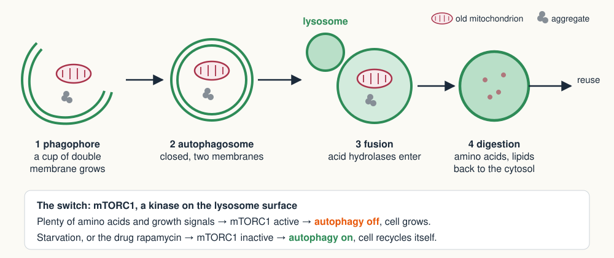{width="82%" fig-align="center"}

- A **double membrane** encloses part of the cytosol, an old mitochondrion or a protein aggregate, and delivers it to the **lysosome**.
- **Selective** forms remove damaged mitochondria (the mitochondria lecture), aggregates and invading bacteria.
- **How do we know?** Yoshinori **Ohsumi** starved yeast lacking vacuole proteases and saw autophagic bodies pile up; mutant screens found the **ATG genes** (Nobel Prize 2016).

::: notes
The lysosome also digests the cell's own material, a process called autophagy, self-eating. A flat cup of double membrane, the phagophore, forms in the cytosol, partly from ER membrane. It grows around a piece of cytosol and closes to form an autophagosome with two membranes. The autophagosome fuses with a lysosome; the inner membrane and the contents are digested, and the amino acids and lipids are returned to the cytosol. Autophagy can be bulk, taking a random piece of cytosol, or selective, using receptor proteins that link a target to the growing membrane: damaged mitochondria, protein aggregates and bacteria that escaped into the cytosol. The main switch is the kinase mTORC1, which sits on the lysosome surface and senses amino acids and growth signals. When nutrients are plentiful it is active, drives growth and blocks autophagy. In starvation, or with the drug rapamycin, it switches off and autophagy starts. The genes were found by Yoshinori Ohsumi, who used yeast that could not degrade material in their vacuole, the yeast lysosome. After starvation, autophagic bodies piled up and were visible in the light microscope. Mutants that failed to accumulate them revealed the ATG genes. Protein degradation by the proteasome, the other route, comes in the protein-lifecycle lecture.
:::

## Why it matters: lowering LDL with statins and PCSK9 inhibitors {.smaller}

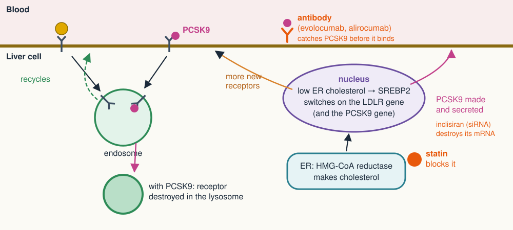{width="72%" fig-align="center"}

- **Statins** block **HMG-CoA reductase**. Less cholesterol in the liver cell → **SREBP2** switches on the **LDL receptor** gene → more receptors pull LDL from the blood: **−30 to −50 %**.
- **PCSK9**, secreted by the liver, binds the receptor at the surface; in the endosome it **stops recycling** and sends the receptor to the **lysosome**. Mutations that **raise** PCSK9 cause FH; mutations that **lose** it give low LDL and **fewer heart attacks**.
- **Anti-PCSK9 antibodies** (evolocumab, alirocumab) and **inclisiran** (an siRNA) give **−50 to −60 %**, on top of statins.

::: notes
Back to the opening question. Most LDL is removed from the blood by LDL receptors in the liver, so the number of receptors at the liver cell surface sets the blood LDL. Statins inhibit HMG-CoA reductase, the rate-limiting enzyme of cholesterol synthesis in the ER. The liver cell senses that its ER cholesterol has fallen; the transcription factor SREBP2 is released and switches on the gene for the LDL receptor. More receptors take more LDL out of the blood, lowering LDL cholesterol by 30 to 50 percent. PCSK9 is a protein secreted by liver cells. It binds the LDL receptor at the surface and travels with it into the endosome, where it binds even more tightly at acid pH and stops the receptor from recycling. The receptor goes to the lysosome and is destroyed. In 2003 families with FH were found with gain-of-function PCSK9 mutations, and in 2006 people with loss-of-function mutations were found to have low LDL and far fewer heart attacks, without other problems. That made PCSK9 an attractive drug target. Antibodies that capture PCSK9 in the blood were approved in 2015. Note that SREBP2 also switches on PCSK9, which partly blunts statins; combining both drugs works well. You meet trials of these drugs in drug development.
:::

## Why it matters: drugs that must ride endocytosis, and escape {.smaller}

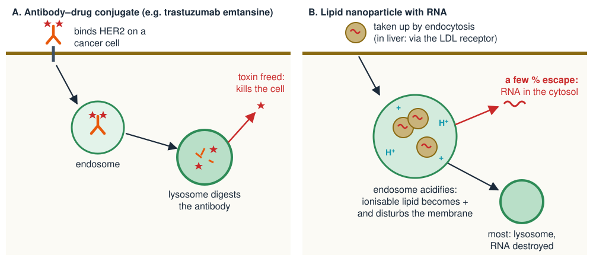{width="80%" fig-align="center"}

- **Antibody–drug conjugates**: an antibody brings a toxin to cancer cells that carry its target (**HER2**). After endocytosis the **lysosome** digests the antibody or cuts the linker, and the **toxin is freed**.
- **Lipid nanoparticles**: the **ionisable lipid** (pKa about **6.4**) is nearly neutral in blood but becomes **positive in the acidic endosome**, pairs with negative lipids of the endosome membrane and disrupts it. Only **1–2 %** of the RNA **escapes**; the rest is digested. Better escape is a major goal.

::: notes
Many modern medicines are large molecules that cannot cross a membrane, so they enter cells by endocytosis, and then face the lysosome. Antibody–drug conjugates use this on purpose. Trastuzumab emtansine is an antibody against HER2, a receptor made in large amounts by some breast cancers, linked to a toxin that stops microtubules. The conjugate binds HER2, is taken in by endocytosis, and reaches the lysosome, where the antibody is digested and the toxin is freed into the cytosol. Healthy cells with little HER2 take up little. For RNA medicines the lysosome is the enemy. Remember the lipid nanoparticle from the membrane-structure lecture. In the liver it picks up a blood protein, apolipoprotein E, and enters liver cells largely through the LDL receptor. The ionisable lipid has an amine with a pKa of about 6.4: at pH 7.4 only a few percent of it is charged, but as the endosome acidifies most of it becomes positive. The positive lipids pair with negative lipids in the endosome membrane, disturb the bilayer, and let some RNA out into the cytosol, where ribosomes can translate it. Measurements suggest that only about one to two percent escapes before the particle reaches the lysosome. The demo's second tab lets you explore why the pKa must be just right.
:::

## Why it matters: lysosomal storage diseases and enzyme replacement {.smaller}

:::: {.columns}
::: {.column width="45%"}
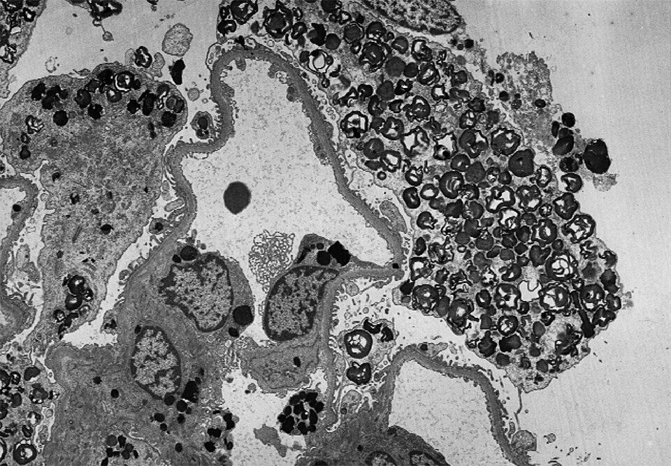{width="100%"}

*Fabry disease, kidney biopsy (TEM): lysosomes packed with undigested glycolipid (dark, onion-like bodies) in podocytes.*
:::
::: {.column width="55%"}
- About **70 diseases**, each missing **one lysosomal enzyme** (or transporter). Together about **1 in 5000** births. Undigested material piles up in lysosomes: **Gaucher, Fabry, Pompe, Tay–Sachs**.
- **Enzyme replacement**: infuse the missing enzyme. It enters cells by **receptor-mediated endocytosis**: the **M6P receptor** (Fabry, Pompe) or the **mannose receptor** of macrophages (Gaucher).
- Limits: the enzyme **does not cross the blood–brain barrier**, so brain disease is not helped; infusions every 1–2 weeks, for life.
:::
::::

::: notes
If one lysosomal enzyme is missing, its substrate cannot be broken down and accumulates in lysosomes, which swell until they disturb the cell. There are about seventy such lysosomal storage diseases; each is rare, but together they affect about one child in five thousand. The image shows a kidney biopsy from a patient with Fabry disease, who lacks the enzyme alpha-galactosidase A. The lysosomes of the podocytes, the filtering cells of the kidney, are stuffed with layered glycolipid. In Gaucher disease, glucocerebrosidase is missing and macrophages fill with lipid. In Pompe disease, acid alpha-glucosidase is missing and glycogen builds up in muscle lysosomes. The treatment follows directly from this lecture. Because cells have mannose-6-phosphate receptors on their surface, an enzyme with the M6P tag that is infused into the blood is taken up by endocytosis and delivered to the lysosome. For Gaucher disease the enzyme is trimmed to expose mannose, so that macrophages take it up through their mannose receptor. The big limitation is the brain: the enzyme is a protein and does not cross the blood–brain barrier. Sjukdomslära covers these diseases in more depth.
:::

## Summary {.smaller}

1. **Clathrin-mediated endocytosis**: adaptors pick receptors by short **tail signals**, clathrin bends the membrane, **dynamin** pinches off the vesicle. Macropinocytosis and phagocytosis take larger gulps with **actin**.
2. **Endosomes** sort and mature: the **V-ATPase** lowers the pH from about 6.5 to 4.5. **Acid** frees cargo from receptors; free receptors **recycle**, lumen content and **ubiquitin-tagged** receptors go to the **lysosome**.
3. The **LDL receptor** cycles about every 10 minutes; its number at the liver surface sets **blood LDL**. **FH** lacks working receptors; **statins** make more, **PCSK9** destroys them, **anti-PCSK9** drugs save them.
4. **Lysosomes** digest with **acid hydrolases** delivered by the **mannose-6-phosphate** tag and receptor. **Autophagy** brings the cell's own parts, controlled by **mTORC1**.
5. Drugs enter by endocytosis: **ADCs** are freed in the lysosome, **LNP** RNA must **escape the endosome** (a few %), **enzyme replacement** uses the M6P receptor.

*Read more (optional): Alberts et al., Molecular Biology of the Cell, 7th ed., ch. 13.*

[Image credits](../credits.qmd#endocytosis-lysosomes){style="font-size:0.7em"}

::: notes
Five take-home points. First, clathrin-mediated endocytosis chooses its cargo: adaptors recognise short signals in receptor tails, clathrin shapes the pit and dynamin cuts it free; larger, less selective gulps use actin. Second, endosomes are sorting stations that become more acidic as they mature, thanks to the V-ATPase; acid releases cargo from receptors, so the receptors can recycle while the cargo moves on to the lysosome, and ubiquitin tags send receptors for destruction. Third, the LDL receptor cycle links all this to a common disease: the number of receptors on liver cells sets the blood LDL, and statins and PCSK9 inhibitors raise that number in two different ways. Fourth, lysosomes digest with acid enzymes that are delivered by the mannose-6-phosphate tag, and they also digest the cell's own parts through autophagy, controlled by mTORC1. Fifth, antibody–drug conjugates, RNA nanoparticles and enzyme replacement therapy all ride the endocytic pathway, each with its own problem to solve. The protein-lifecycle lecture covers the other great degradation machine, the proteasome.
:::
