## About this lecture {.smaller}

About a third of all human proteins are made into the **endoplasmic reticulum (ER)**: every secreted protein, every protein of the plasma membrane, and the proteins of the ER, Golgi and lysosomes. Today: how they get in, how they fold, and how the ER checks them.

After this lecture you can:

- explain how **SRP** and the **translocon** bring a growing chain into the ER, **co-translationally**;
- predict the **topology** of a membrane protein from its **signal sequence, stop-transfer and signal-anchor** segments;
- describe **folding** in the ER: **BiP**, **disulfide bonds** (PDI), **N-glycosylation** and the **calnexin cycle**;
- explain **ER quality control**, **ERAD** and the **unfolded protein response**;
- describe the **smooth ER**: lipids, drug metabolism and the **Ca²⁺ store**.

::: notes
In the lecture on protein sorting you met the idea that a protein carries a zip code that tells the cell where to send it. Today we follow the biggest route of all: into the endoplasmic reticulum, the ER. About one third of the proteins a human cell makes start their life here. That includes hormones like insulin, antibodies, receptors in the plasma membrane, transporters and channels, and the enzymes of the Golgi and the lysosomes. The ER does three jobs for these proteins. It brings them in across or into its membrane. It helps them fold, adds disulfide bonds and sugar chains. And it checks them, keeping and destroying the ones that fail. When too many fail, the ER sends an alarm, the unfolded protein response. At the end we look at the smooth ER, which makes lipids, breaks down drugs and stores calcium, and at two applications: diseases of misfolding, and antibodies made as drugs. This lecture serves ELO 4 and ELO 5.
:::

## The question: why is this cell full of membrane? {.smaller}

:::: {.columns}
::: {.column width="52%"}
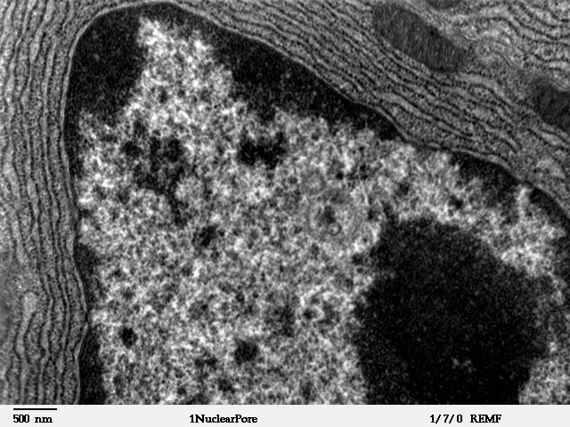{width="100%"}

*Pancreatic acinar cell (mammal), transmission electron micrograph; scale bar 500 nm. Centre: the nucleus, with gaps in its envelope (nuclear pores). Top right and left edge: stacked sheets of rough ER, lined with ribosomes.*
:::
::: {.column width="48%"}
- This cell makes **digestive enzymes** and secretes them into the gut, all day.
- Its cytoplasm is packed with **flat membrane sheets covered in ribosomes**: the **rough ER**.
- Each enzyme is made by a ribosome in the **cytosol**, but must end up **outside the cell**, folded, with its **disulfide bonds**.
- A receptor in the plasma membrane must also face the **right way**: its binding site outside, its signalling tail inside.

**How does a protein get into the ER, fold correctly, and how does the cell catch the ones that fail?**
:::
::::

::: notes
This electron micrograph shows part of a pancreatic acinar cell. On the left is the nucleus; you can see gaps in its envelope, the nuclear pores. The rest of the picture is filled with parallel membranes, each lined with small black dots. The dots are ribosomes, and the membranes are the rough ER. Cells that secrete a lot of protein, such as pancreatic cells, plasma cells that make antibodies, and liver cells that make serum proteins, are full of rough ER. Here is the puzzle. Ribosomes sit in the cytosol, so every protein starts there. Yet a digestive enzyme must end up outside the cell, and it must be folded and stable outside, which for most secreted proteins means disulfide bonds. Membrane proteins have an extra problem: they must sit in the membrane facing the right way. A hormone receptor with its binding site inside the cell would be useless. Today we answer three questions: how does a chain get in, how does it fold, and how is it checked.
:::

## The ER: one membrane, one lumen {.smaller}

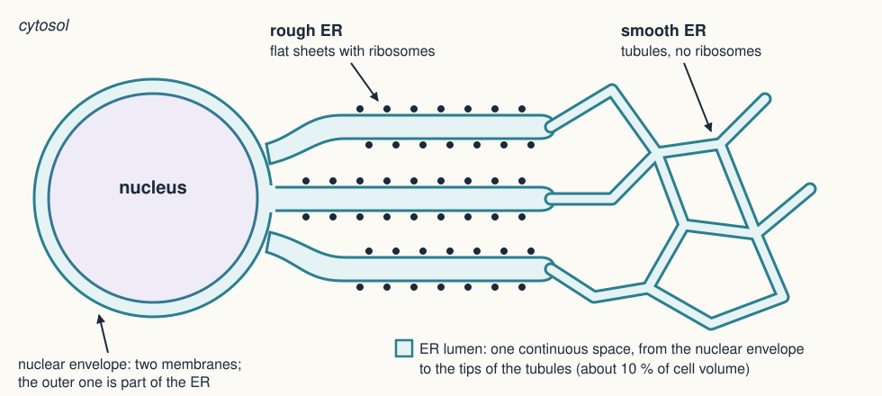{width="86%" fig-align="center"}

- The ER is a **single network** of membrane: **sheets** (rough ER, with ribosomes) and **tubules** (smooth ER). The **outer nuclear membrane** is part of it.
- Inside is **one continuous space**, the **lumen**. In topology it is like the **outside** of the cell (cell tour).
- In a liver cell the ER is about **half of all membrane** in the cell.

::: notes
The ER is not a set of separate bags. It is one continuous membrane system that spreads from the nuclear envelope through the whole cytoplasm. Where it carries ribosomes it forms flat sheets: the rough ER. Where it has no ribosomes it forms a network of thin tubules: the smooth ER. The two kinds are connected, and the space inside, the lumen, is one continuous compartment. Even the space between the two membranes of the nuclear envelope belongs to it, because the outer nuclear membrane is part of the ER. Remember the topology rule from the cell tour: the lumen of the ER is equivalent to the outside of the cell, because vesicles can carry material from the lumen to the outside without crossing a membrane. In a liver cell, the ER membrane makes up about half of all the membrane in the cell, and the lumen is about a tenth of the cell's volume. This large size reflects how much work the ER does. Its chemistry is also different from the cytosol: it is oxidizing, rich in calcium and full of chaperones.
:::

## The signal sequence: a ticket into the ER {.smaller}

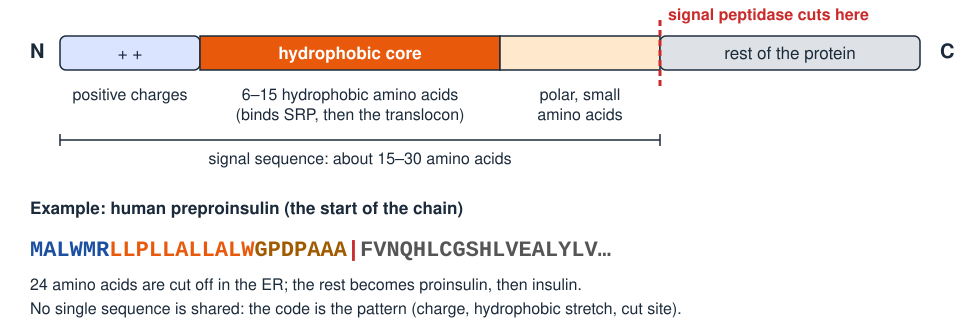{width="80%" fig-align="center"}

- Most ER proteins start with an **N-terminal signal sequence**: a few positive charges, then a **hydrophobic core**, then a cut site.
- The **pattern** is the signal, not an exact sequence. Put one in front of a cytosolic protein and it enters the ER.
- **Signal peptidase** in the ER membrane cuts it off: the mature protein is shorter.

::: notes
How does the cell know which proteins belong in the ER? The answer is a signal sequence, a stretch of about fifteen to thirty amino acids at the N-terminus. It has three parts: a few positive charges, a core of six to fifteen hydrophobic amino acids, and a polar region with small amino acids that marks where it will be cut. The example is the real start of human preproinsulin. The first twenty-four amino acids form the signal sequence, coloured here by region. After the cut, the chain becomes proinsulin, and later insulin. Signal sequences of different proteins share almost no exact sequence. What matters is the pattern, above all the hydrophobic core. Experiments show this clearly: put a signal sequence in front of a protein that normally stays in the cytosol, such as globin, and it is taken into the ER. Remove the signal from a secreted protein and it stays in the cytosol. Signal peptidase, an enzyme with its active site in the lumen, cuts the signal sequence off while the protein is still being made.
:::

## SRP brings the ribosome to the ER {.smaller}

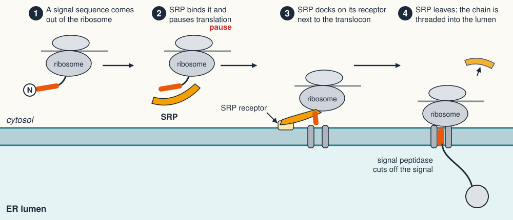{width="88%" fig-align="center"}

- **SRP** (signal recognition particle: six proteins + an RNA) binds the signal as it leaves the ribosome and **pauses translation**.
- SRP docks on the **SRP receptor** in the ER membrane; the ribosome is handed to the **translocon**.
- **GTP** hydrolysis releases SRP for another round. The chain is threaded in **while it is made**: **co-translational** translocation.

::: notes
All protein synthesis starts on free ribosomes in the cytosol. When a signal sequence comes out of the exit tunnel of the ribosome, it is grabbed by the signal recognition particle, SRP. SRP is a complex of six proteins and a long RNA. One of its proteins has a pocket lined with flexible methionine side chains that holds hydrophobic signals of many shapes. SRP also slows down translation, so the chain does not grow too long, or fold, before it reaches the ER. Then SRP, carrying the ribosome, binds the SRP receptor in the ER membrane, right next to the translocon. Both SRP and its receptor are GTPases. When they meet, the ribosome is handed to the translocon, the GTPs are hydrolysed, and SRP and its receptor separate, ready for another ribosome. Translation now continues, and the chain goes straight from the ribosome into the channel as it is made. This is co-translational translocation. Because many ribosomes can read one mRNA, the ER surface becomes covered in ribosomes: this is why rough ER looks rough.
:::

## The translocon: a channel with a plug and a side gate {.smaller}

:::: {.columns}
::: {.column width="40%"}
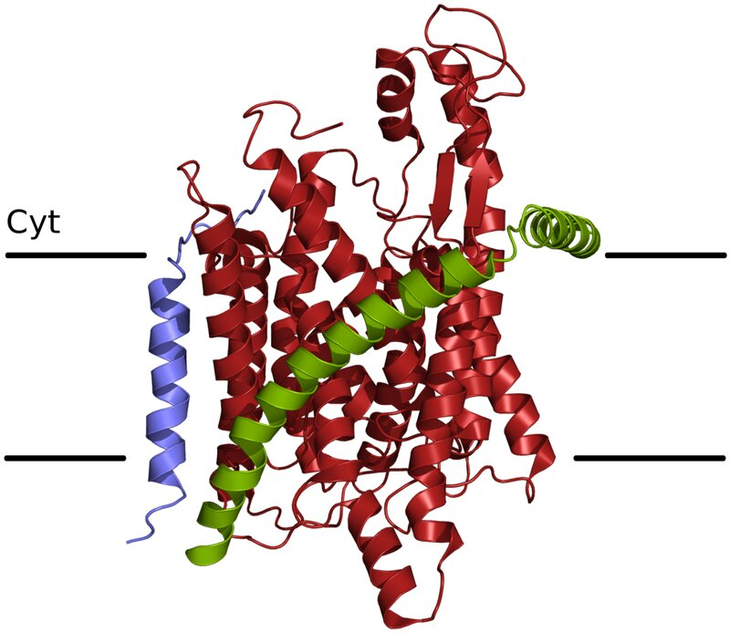{width="92%"}

*SecY translocon of the archaeon* Methanococcus jannaschii *(PDB 1RHZ), side view; cytosol on top. Human Sec61 has the same fold.*
:::
::: {.column width="60%"}
- **Sec61** complex: a pore in the membrane. A short **plug** helix keeps it closed when no chain is inside, so ions do not leak.
- The chain goes through as an **unfolded** string: one chain at a time.
- A **lateral gate** in the wall opens sideways into the lipid. A hydrophobic segment can slip out and stay in the membrane: this is how **membrane proteins** are made.
- Some proteins enter **after** translation: **tail-anchored** proteins, whose only hydrophobic segment is at the C-terminus (another route, the GET pathway).
:::
::::

::: notes
The translocon is a protein channel called the Sec61 complex. The picture shows the related channel from an archaeon, seen from the side, with the cytosol on top. The channel is shaped like an hourglass. In the middle there is a ring of hydrophobic side chains that seals tightly around the passing chain, and a short helix, the plug, closes the pore when no chain is inside. This matters because the ER is a calcium store, and an open hole would let calcium and other ions leak out. The chain passes through unfolded, like a thread through the eye of a needle. The most important feature is a seam in the wall, the lateral gate. It can open sideways towards the lipid bilayer. When a hydrophobic segment of about twenty amino acids sits in the channel, it can slip out through this gate and stay in the membrane as a transmembrane helix. That is how all multipass membrane proteins of the secretory pathway are made. A small group of proteins, called tail-anchored proteins, have their only membrane segment at the very end. They are inserted after translation, by a separate pathway.
:::

## How do we know? Microsomes and protease {.smaller}

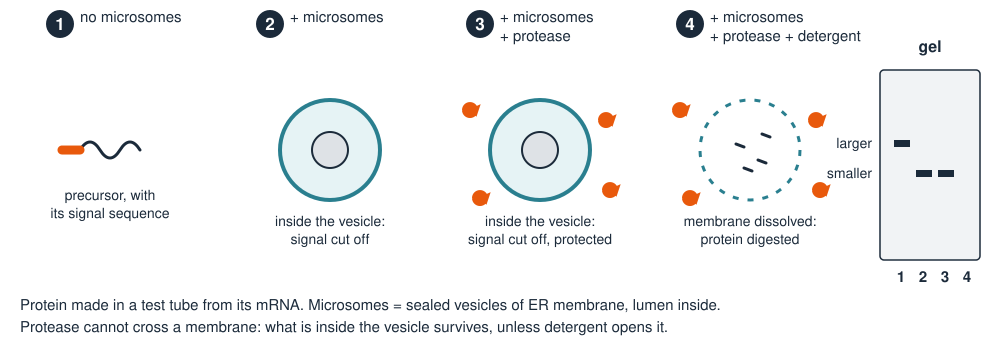{width="84%" fig-align="center"}

- **Milstein (1972):** antibody light chain made in a test tube **without** ER is about **20 amino acids longer**: the uncut signal.
- **Blobel:** with **microsomes** (ER vesicles) the chain is cut **and** protected from protease, unless detergent opens the membrane. Nobel Prize 1999 for the **signal hypothesis**.
- The same test shows **topology**: parts on the **cytosolic** side are digested, parts in the **lumen** are protected.

::: notes
How did we learn all this? With a test tube system. You can make protein from mRNA in a cell-free extract that contains ribosomes but no membranes. In 1972 César Milstein and colleagues did this with the mRNA for an antibody light chain. The product was about twenty amino acids longer than the light chain secreted by cells. Günter Blobel and colleagues then added microsomes: small sealed vesicles of ER membrane that form when cells are broken up. Now the chain was the normal, shorter size, so the signal had been cut off. Next they added a protease to the outside. The protein survived, because it was inside the vesicle and proteases cannot cross membranes. Only when they also added detergent, which dissolves the membrane, was the protein digested. This showed that the chain had crossed the membrane while it was being made. Blobel received the Nobel Prize in 1999 for the signal hypothesis. The same experiment is still used to find the topology of membrane proteins: whatever faces the cytosol is cut, whatever faces the lumen is protected.
:::

## Membrane proteins: which way round? {.smaller}

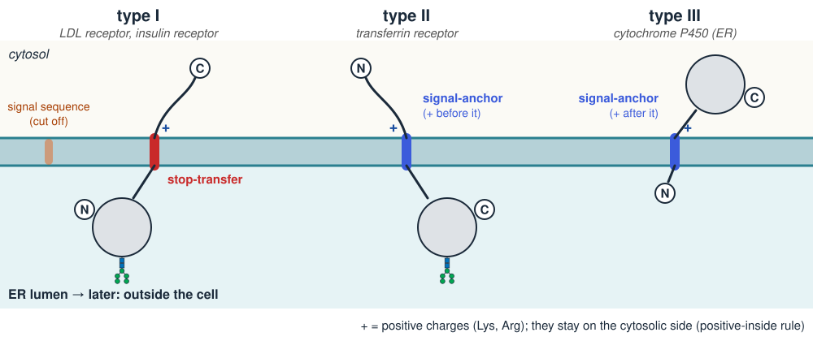{width="84%" fig-align="center"}

- **Type I:** cleaved signal sequence, then a **stop-transfer**: N-terminus in the lumen, C-terminus in the cytosol.
- **Types II and III:** no cleaved signal. The first hydrophobic segment is a **signal-anchor**. **Positive charges** stay on the **cytosolic** side and decide which end goes in.

::: notes
Now we can make membrane proteins. A type I protein, such as the LDL receptor, has a normal signal sequence. The chain after it is threaded into the lumen. Later a second hydrophobic segment arrives in the channel. It cannot be pushed through: it leaves the translocon sideways and stays in the membrane. This is a stop-transfer sequence. Everything after it stays in the cytosol. So the N-terminus is in the lumen and the C-terminus in the cytosol. Types II and III have no cleaved signal. Their first hydrophobic segment both brings them to the ER, through SRP, and stays as the membrane anchor: a signal-anchor. Which way it inserts depends mainly on charges. Positive amino acids, lysine and arginine, nearly always stay on the cytosolic side: the positive-inside rule. With the charges before the segment, the N-terminus stays in the cytosol: type II, such as the transferrin receptor. With the charges after it, the N-terminus is pulled into the lumen: type III, such as the cytochrome P450 enzymes in the liver ER.
:::

## Multipass proteins, and the side that faces out {.smaller}

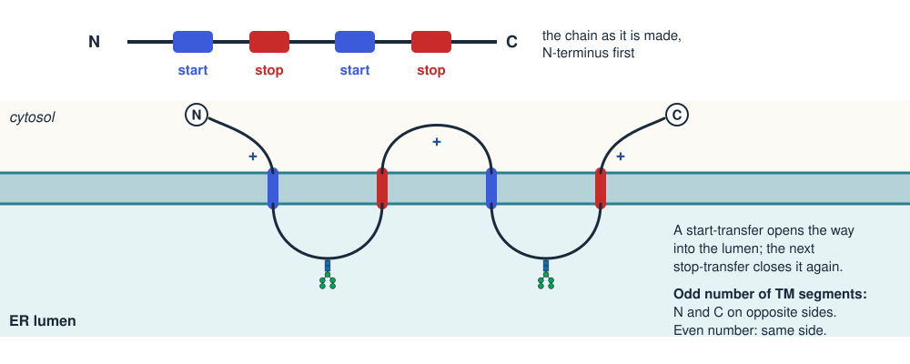{width="80%" fig-align="center"}

- After the first segment, hydrophobic segments act as **start-transfer** and **stop-transfer** in turn. The **same kind of helix** plays either role: it depends on where the chain is when it arrives.
- The orientation is **fixed in the ER**. Vesicles carry it to the cell surface **without flipping** it: the **lumen side becomes the outside** (cell tour). Sugars are added only in the lumen, so they always end up outside. **Try it:** [Demo: topology builder](questions.qmd#explore)

::: notes
Many membrane proteins cross the membrane several times: GLUT1 twelve times, receptors coupled to G proteins seven times. The rule is a simple extension. The first hydrophobic segment starts translocation. The next one stops it and stays in the membrane. The next one starts it again, and so on. A hydrophobic helix does not carry a label that says start or stop. Its role depends on where the chain is when the helix arrives in the translocon: if the chain is going into the lumen, the helix stops it; if the chain is in the cytosol, the helix starts a new loop into the lumen. A useful consequence: with an odd number of segments, the two ends are on opposite sides; with an even number, on the same side. This is a simplified rule: in real proteins charges and loop lengths matter too. Once made, the orientation never changes. Vesicles bud and fuse, and the part in the ER lumen ends up outside the cell. That is why sugar chains, which are added in the lumen, always face outwards. The topology builder lets you test this.
:::

## Folding in the ER: BiP and disulfide bonds {.smaller}

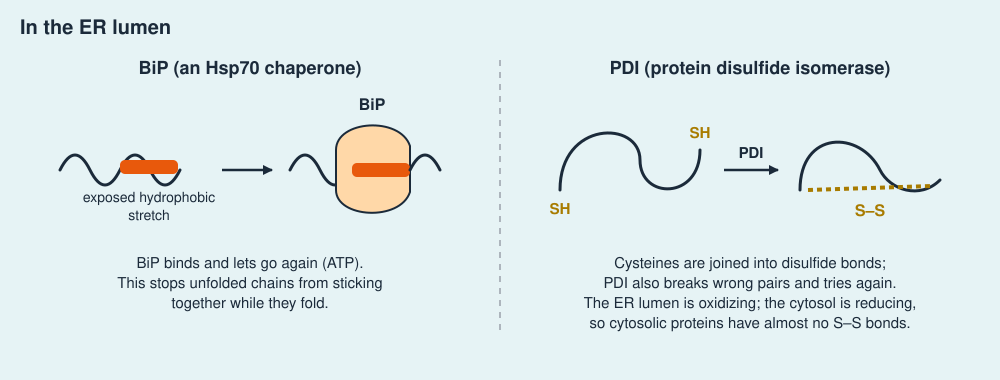{width="82%" fig-align="center"}

- The lumen is crowded with chaperones. **BiP** (an Hsp70) binds exposed hydrophobic stretches and lets go again, using **ATP**.
- **Disulfide bonds** (S–S) form only in the **oxidizing** ER lumen. **PDI** makes them and breaks wrong ones, until the right pairs are found.

::: notes
A chain entering the lumen is unfolded, and unfolded chains expose hydrophobic stretches that make them stick to each other and aggregate. The ER lumen is full of chaperones that prevent this. The main one is BiP, a member of the Hsp70 family. BiP binds a hydrophobic stretch, holds it for a moment using the energy of ATP, and lets it go again. Many cycles of binding and release give the chain time to fold without aggregating. BiP also sits at the translocon and helps pull the chain in. The second job is disulfide bonds, covalent links between two cysteines. They form only in an oxidizing environment. The ER lumen is oxidizing, while the cytosol is reducing, kept so by glutathione. This is why disulfide bonds are typical of secreted and cell-surface proteins, which must survive outside the cell. Protein disulfide isomerase, PDI, transfers disulfide bonds to the new chain, and it can also break a wrong pair and try again. An antibody, for example, has more than ten disulfide bonds that must be paired correctly.
:::

## N-glycosylation: a sugar block added in one step {.smaller}

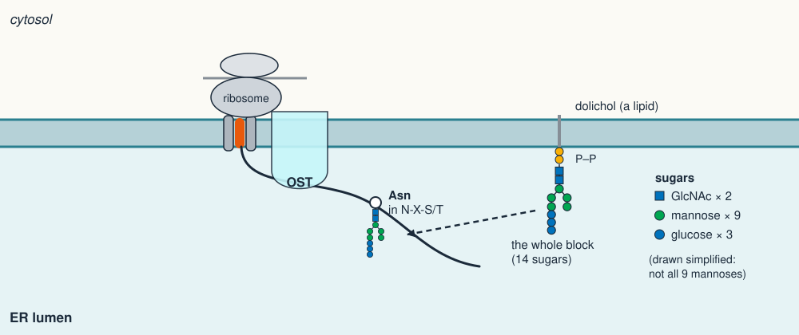{width="84%" fig-align="center"}

- **Oligosaccharyltransferase (OST)**, next to the translocon, moves a ready-made block of **14 sugars** from the lipid **dolichol** to an **asparagine** in the sequence **N-X-S/T** (X is not proline).
- It happens **co-translationally**, on most proteins that enter the ER. The sugars are later **trimmed** in the ER and **rebuilt** in the Golgi.
- **Tunicamycin**, an antibiotic, blocks the first step: proteins misfold. A standard way to stress the ER in the lab.

::: notes
Most proteins that enter the ER get sugar chains attached to asparagines, which is called N-linked glycosylation. The process is unusual. The sugar chain is not built on the protein one sugar at a time. Instead, a block of fourteen sugars is first built on a lipid carrier in the ER membrane, called dolichol. The block has two N-acetylglucosamines, nine mannoses and three glucoses. The enzyme oligosaccharyltransferase, OST, sits right next to the translocon. As the chain comes into the lumen, OST looks for the sequence asparagine, any amino acid except proline, then serine or threonine, and moves the whole block onto the asparagine in one step. The symbols in the figure follow the international colour code for sugars, which you will see in papers. The block is then trimmed in the ER and rebuilt in the Golgi, as the Golgi lecture shows. The antibiotic tunicamycin blocks the first step of building the block. Cells treated with it make proteins without N-glycans, many of which misfold. It is a standard tool to trigger ER stress.
:::

## The calnexin cycle: sugars as a folding tag {.smaller}

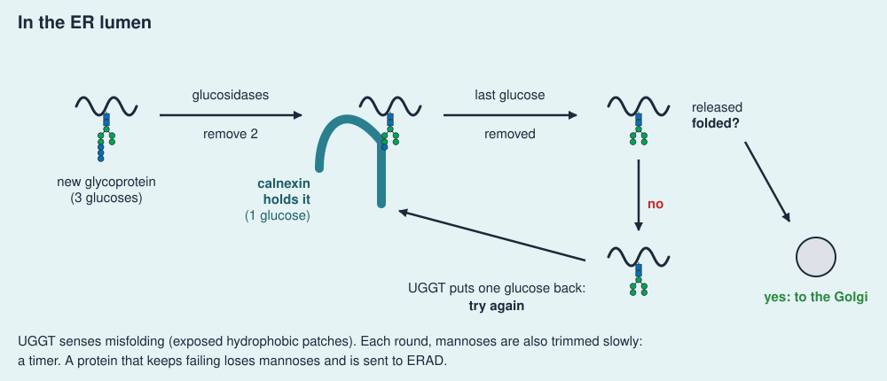{width="80%" fig-align="center"}

- Glucosidases remove two glucoses. With **one glucose** left, the protein binds **calnexin**, a lectin chaperone in the ER membrane.
- When the last glucose is removed, it is released. If it is still unfolded, **UGGT** puts a glucose back: **another round**.
- Slow **mannose trimming** works as a **timer**: a protein that never folds is sent to degradation.

::: notes
The sugar chain has a second job: it is a label that tells the ER how folding is going. Right after the block is added, two enzymes called glucosidases remove two of the three glucoses. A protein with one glucose left is bound by calnexin, a chaperone in the ER membrane that recognises this sugar. Its soluble partner in the lumen is calreticulin. While bound, the protein is protected and is helped by a PDI-like enzyme to make its disulfide bonds. Then the last glucose is removed and the protein is released. Now comes the check. An enzyme called UGGT looks at the released protein. If it still has exposed hydrophobic patches, UGGT adds one glucose back, and the protein binds calnexin again for another round. A folded protein is ignored by UGGT and moves on to the exit sites of the ER. Meanwhile, a slow mannosidase trims mannoses from the sugar chain. This works as a timer: after many failed rounds, the trimmed sugar chain marks the protein for destruction. The protein is not kept forever.
:::

## Quality control and ERAD {.smaller}

:::: {.columns}
::: {.column width="68%"}
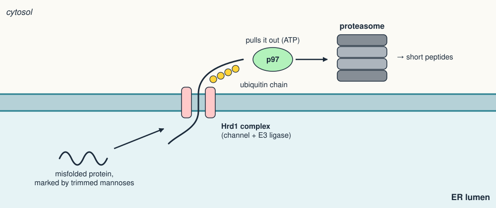{width="100%"}
:::
::: {.column width="32%"}
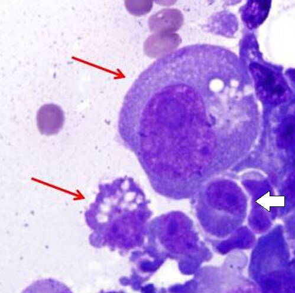{width="88%"}

*Myeloma cells in pleural fluid. Red arrows: plasma cells filled with Russell bodies, ER swollen with antibody that cannot leave. White arrow: a nearly normal plasma cell.*
:::
::::

- Only **folded and assembled** proteins leave the ER. Unfolded ones are held by chaperones.
- **ERAD** (ER-associated degradation): the protein is pulled **back into the cytosol** through the **Hrd1** complex, **ubiquitinated**, extracted by **p97** (ATP) and destroyed by the **proteasome**.

::: notes
The ER lets only correctly folded and correctly assembled proteins move on. An antibody heavy chain, for example, stays in the ER, bound to BiP, until it has paired with a light chain. Proteins that cannot fold must not pile up, so they are removed by ER-associated degradation, ERAD. But the destroying machine, the proteasome, is in the cytosol, not in the ER. So the misfolded protein is pulled back across the membrane, the opposite way. This happens through a membrane complex built around Hrd1. Hrd1 forms a channel and is also a ubiquitin ligase: it attaches a chain of ubiquitin to the protein as it comes out. An ATP-driven machine called p97 pulls the protein out of the membrane, and the proteasome degrades it. You meet ubiquitin and the proteasome in more detail in the lecture on protein life and death. The picture on the right shows what happens when export fails: plasma cells from a myeloma patient with Russell bodies, ER compartments swollen with antibody that could not leave.
:::

## When the ER is overloaded: the unfolded protein response {.smaller}

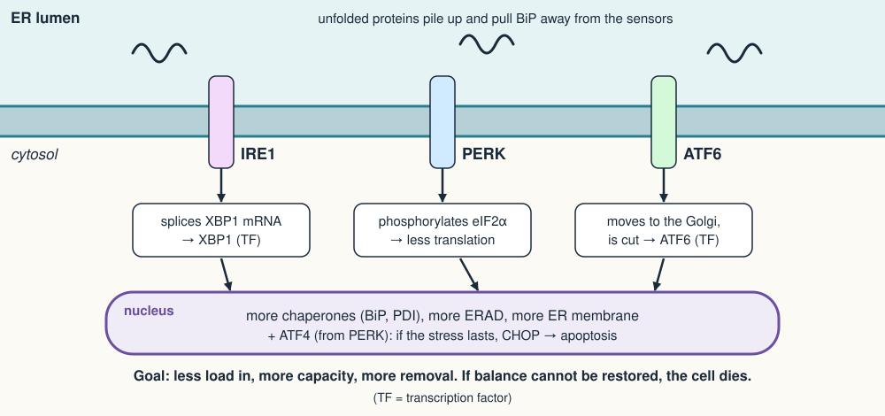{width="74%" fig-align="center"}

- Three sensors, **IRE1, PERK, ATF6**, are held quiet by **BiP**. Unfolded proteins pull BiP away and the sensors switch on.
- The cell makes **more chaperones** and **ERAD** machinery, **translates less**, and grows more ER. If the stress lasts, the UPR triggers **apoptosis** (CHOP).
- Plasma cells and β cells live with high ER load; ER stress contributes to **diabetes** and to many **neurodegenerative** diseases.

::: notes
What if more unfolded protein arrives than the ER can handle? Three sensors in the ER membrane notice. Each has a part in the lumen and a part in the cytosol. At rest, BiP sits on their lumenal parts. When unfolded proteins pile up, they take BiP away, and the sensors become active. IRE1 is a kinase and an RNA-cutting enzyme. It cuts an intron out of the mRNA for XBP1 in the cytosol, an unusual way to splice, and the spliced mRNA makes an active transcription factor. PERK phosphorylates the translation factor eIF2α, which slows down almost all translation, so less new protein enters the ER. ATF6 travels to the Golgi, where proteases cut it free from the membrane, and its fragment becomes a transcription factor. Together they make more chaperones, more ERAD machinery and more ER membrane. If balance cannot be restored, prolonged signalling, partly through the transcription factor CHOP, triggers apoptosis, which the apoptosis lecture explains. Insulin-making β cells in the pancreas work at the edge of this balance, and ER stress is one reason they fail in diabetes.
:::

## The smooth ER: lipids, drugs and calcium {.smaller}

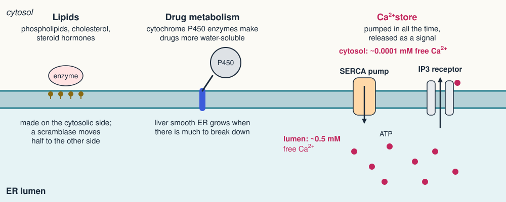{width="84%" fig-align="center"}

- **Lipids:** most **phospholipids** and **cholesterol** are made here, on the cytosolic side; **steroid hormones** in adrenal and gonad cells. Statins block HMG-CoA reductase, an ER enzyme.
- **Drug metabolism:** **cytochrome P450** enzymes (type III, as shown earlier) in the liver smooth ER oxidise drugs so they can be excreted.
- **Ca²⁺ store:** **SERCA** pumps keep ER Ca²⁺ high; **IP₃ receptors** release it as a signal. In muscle: the **sarcoplasmic reticulum**.

::: notes
The smooth ER has no ribosomes and does different work. First, lipids. Most membrane phospholipids and cholesterol are made by enzymes facing the cytosol, so new lipids appear in the cytosolic half of the bilayer. Proteins called scramblases move half of them to the lumenal half, so the membrane grows evenly. The rate-limiting enzyme of cholesterol synthesis, HMG-CoA reductase, is an ER membrane protein, and statins block it. Cells that make steroid hormones, in the adrenal gland, testis and ovary, are full of smooth ER. Second, drug metabolism. In liver cells, cytochrome P450 enzymes, anchored in the ER membrane with a type III topology, add oxygen to drugs and toxins and make them easier to excrete. When a person takes certain drugs for a long time, the smooth ER of the liver grows. Third, calcium. SERCA pumps use ATP to keep the free calcium in the lumen thousands of times higher than in the cytosol. Channels such as the IP3 receptor release it as a signal, as the signalling lectures show. In muscle this specialised ER is called the sarcoplasmic reticulum.
:::

## Why it matters: diseases of ER quality control {.smaller}

:::: {.columns}
::: {.column width="58%"}
- **Cystic fibrosis, ΔF508:** CFTR loses one phenylalanine in its first ATP-binding domain. It misfolds, is held by the **calnexin cycle** and destroyed by **ERAD**. Little reaches the surface, although it could still partly work. **Correctors** (elexacaftor, tezacaftor) help it fold and leave the ER (ion-channel lecture).
- **α1-antitrypsin deficiency (Z variant, Glu342Lys):** the liver's protease inhibitor folds slowly and forms **polymers in the ER**. **Liver:** the polymers damage hepatocytes (cirrhosis). **Lungs:** too little reaches the blood, so neutrophil **elastase** destroys lung tissue (emphysema; smoking makes it much worse). Discovered in **Sweden** (Laurell and Eriksson, Malmö, 1963).
- Both are **trafficking diseases**: the protein is made but **stuck in the ER**. Disease mechanisms in depth: Sjukdomslära.
:::
::: {.column width="42%"}
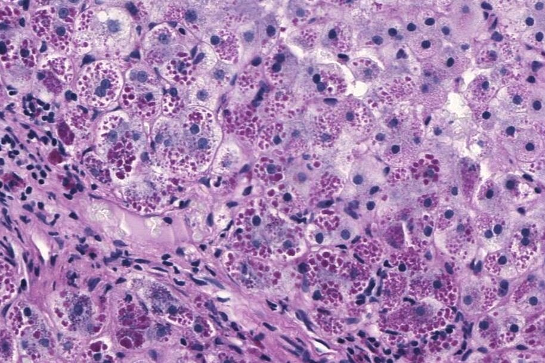{width="100%"}

*Liver biopsy, α1-antitrypsin deficiency, PAS stain after diastase. Pink globules: α1-antitrypsin trapped in the ER of hepatocytes.*
:::
::::

::: notes
Here the ER's strict checking becomes a problem. In cystic fibrosis, the most common mutation, called delta F508, removes one phenylalanine from the first ATP-binding domain of the CFTR chloride channel. The protein folds badly. The calnexin cycle and other chaperones hold it, and ERAD destroys almost all of it, although the few molecules that escape can still work partly as channels. A classic experiment showed this: growing the cells at a lower temperature lets some ΔF508 CFTR fold and reach the surface. Today, corrector drugs such as elexacaftor and tezacaftor bind CFTR and help it fold and pass quality control, combined with a potentiator that opens the channel; you met these in the ion-channel lecture. The second disease was discovered in Malmö in 1963. Alpha-1-antitrypsin is made in the liver and released into the blood, where it inhibits elastase from white blood cells. The Z variant folds slowly and links into long polymers inside the ER. The liver cells are damaged, which can cause cirrhosis, and the lungs, without enough inhibitor, are slowly digested by elastase, which causes emphysema. The pink globules in this biopsy are the trapped protein.
:::

## Why it matters: antibody drugs and their sugars {.smaller}

:::: {.columns}
::: {.column width="60%"}
- Most **therapeutic antibodies** (e.g. trastuzumab, adalimumab) are made in **CHO cells** (Chinese hamster ovary) in large bioreactors. Their ER folds them, adds **16 disulfide bonds** per IgG and **assembles** two heavy and two light chains.
- Each heavy chain carries **one N-glycan** (Asn297), added in the ER and finished in the Golgi. It changes how the antibody works: **without core fucose**, it binds killer-cell receptors much better (stronger killing). **Obinutuzumab** is made fucose-poor on purpose.
- The **cell line** matters: cetuximab, made in mouse cells, carries a non-human sugar (α-gal) that causes **allergic reactions** in some patients.
- So the glycan pattern is a **quality attribute** that regulators require (Kliniska prövningar och läkemedelsutveckling).
:::
::: {.column width="40%"}
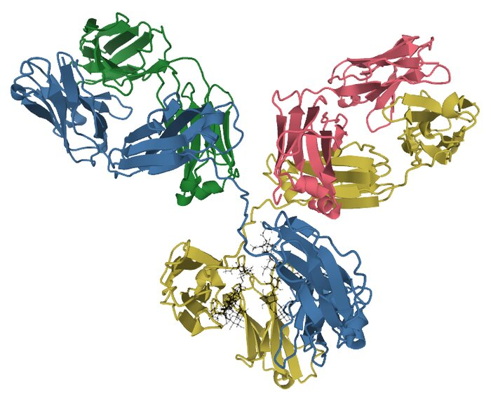{width="100%"}

*Structure of an IgG1 antibody: two heavy chains (blue, yellow) and two light chains (green, pink).*
:::
::::

::: notes
Antibodies are the largest class of protein drugs, and almost all are made by living cells, most often Chinese hamster ovary cells grown in steel bioreactors of thousands of litres. Why use mammalian cells and not bacteria? Because the antibody needs an ER: it has sixteen disulfide bonds in its most common form, two heavy and two light chains must be assembled, and each heavy chain carries an N-linked sugar chain at asparagine 297 in its constant part. Bacteria have no ER that can do all of this. The sugar chain is not decoration. It shapes the constant part of the antibody and changes how it binds to receptors on immune cells. Antibodies that lack one sugar, the core fucose, bind a receptor on natural killer cells much more strongly and kill target cells better. Obinutuzumab, used for some leukaemias and lymphomas, is made in cells engineered to add less fucose. The host cell also matters: cetuximab, made in a mouse cell line, carries a sugar humans do not make, and some patients who already have antibodies against it react with anaphylaxis. Manufacturers must therefore control the glycan pattern batch by batch, as you will meet again in the drug development course.
:::

## Summary {.smaller}

1. Proteins with an ER **signal sequence** are caught by **SRP** and threaded through the **Sec61 translocon** while they are made (**co-translational** translocation).
2. **Topology** is set in the ER: a **stop-transfer** stops translocation, a **signal-anchor** starts it, **positive charges stay in the cytosol**. The **lumen side becomes the outside** of the cell.
3. In the lumen, **BiP** prevents aggregation, **PDI** makes **disulfide bonds**, **OST** adds **N-glycans**; the **calnexin cycle** uses the glucose on the glycan as a folding tag.
4. **Quality control** keeps unfolded proteins in the ER; **ERAD** returns them to the cytosol for the **proteasome**; the **UPR** adjusts the ER to its load, or kills the cell.
5. The **smooth ER** makes **lipids**, metabolises **drugs** (P450) and stores **Ca²⁺**. Misfolding in the ER causes **cystic fibrosis** and **α1-antitrypsin deficiency**; the ER of **CHO cells** makes antibody drugs.

*Read more (optional): Alberts et al., Molecular Biology of the Cell, 7th ed., ch. 12.*

[Image credits](../credits.qmd#er){style="font-size:0.7em"}

::: notes
Five take-home points. First, entry: a hydrophobic signal is recognised by SRP, which brings the ribosome to the translocon, and the chain enters the ER while it is being made. Second, topology: hydrophobic segments act as start or stop signals depending on where the chain is, positive charges stay in the cytosol, and the side facing the ER lumen ends up facing the outside of the cell. Third, folding: the ER lumen is a special folding environment with chaperones, an oxidizing chemistry for disulfide bonds, and N-glycans that serve both as part of the protein and as a tag in the calnexin cycle. Fourth, checking: unfolded proteins are held back and eventually destroyed by ERAD, and when the load is too high the unfolded protein response restores balance or triggers cell death. Fifth, the smooth ER makes lipids, breaks down drugs and stores calcium. Next, the Golgi lecture follows the proteins that pass the check on their way to the cell surface.
:::
