## About this lecture {.smaller}

The earlier signalling lectures followed fast signals: a hormone binds, a second messenger or a kinase cascade changes a protein within seconds. Today: signals that change **which genes a cell uses**, and so decide **what the cell becomes**. They build tissues in the embryo and keep them in shape in the adult.

After this lecture you can:

- explain how a signal at the membrane ends as an **active transcription factor** and a **gene-expression programme**;
- describe the core logic of **Wnt/β-catenin**, **Hedgehog**, **Notch**, **TGF-β/SMAD**, **NF-κB** and **nuclear receptors**, and how each is switched off;
- explain **lateral inhibition** and **morphogen gradients**: how equal cells become different;
- connect pathways to drugs and disease: **tamoxifen**, **vismodegib**, **corticosteroids**, **APC** mutations in colorectal cancer.

::: notes
This lecture closes the signalling block. So far you have seen how a receptor talks to the inside of the cell: G proteins and second messengers, and kinase cascades. Those signals act fast, often in seconds, by changing the activity of proteins that already exist. Today the end point is different. The signals we meet now change gene expression, so the effect comes after hours and can last for days or for the rest of the cell's life. That is how a cell in an embryo decides to become a neuron or a skin cell, and how adult tissues such as the gut lining keep the right number of each cell type. You already know gene regulation from earlier courses: transcription factors, enhancers, activators and repressors. We build on that. The question for every pathway is the same: how does a signal outside the cell switch on a transcription factor in the nucleus, and how is it switched off again? At the end we look at cancers and drugs that depend on exactly these steps.
:::

## The question: why does one cell become a hair cell, and its neighbour not? {.smaller}

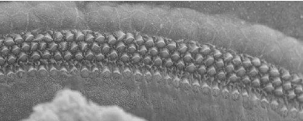{width="72%" fig-align="center"}

*Inner ear (cochlea) of a mouse embryo, scanning electron micrograph. Each V-shaped tuft is the hair bundle of one hair cell. Between them, hidden below, are supporting cells.*

- In the inner ear, every **hair cell** (it detects sound) is surrounded by **supporting cells**. No two hair cells touch.
- All these cells came from **one sheet of identical cells** with the same genes and the same surroundings.
- So how does a cell "know" what to become, and how do neighbours end up **different**?

::: notes
Look at this picture of the developing inner ear of a mouse, taken with a scanning electron microscope. The rows of V-shaped tufts are the hair bundles of hair cells, the cells that turn sound vibrations into nerve signals. What you cannot see is that every hair cell sits in a ring of supporting cells, so hair cells never touch each other. The pattern is very regular. Yet all of these cells came from one sheet of cells that looked the same, had the same genome and sat in the same environment. Something had to break the symmetry: one cell becomes a hair cell, its neighbours become supporting cells. The answer is cell–cell signalling that changes gene expression. In this case it is the Notch pathway, and we will see how a simple feedback between neighbours gives exactly this kind of spaced pattern. More generally, a handful of pathways, used again and again, decide cell fates in every tissue. They also cause disease when they get stuck in the on position.
:::

## Recap and plan: a signal ends at a transcription factor {.smaller}

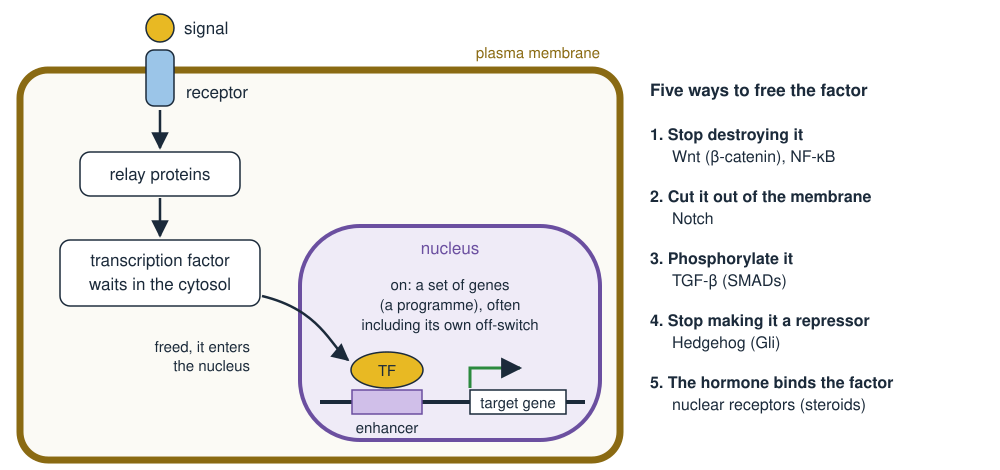{width="82%" fig-align="center"}

- *Recap:* a **transcription factor** binds an **enhancer** and recruits **coactivators** or **corepressors**. A **cell fate** is a stable set of genes that are on.
- In every pathway today the factor already **exists** in the cell, but is kept **inactive**. The signal **frees** it, in one of five ways.
- Many targets are the pathway's own **off-switches** (negative feedback).

::: notes
A short recap from gene regulation. A transcription factor binds a specific DNA sequence in an enhancer and recruits coactivators, which open chromatin and help RNA polymerase, or corepressors, which do the opposite. A cell type, or cell fate, is in this sense a stable combination of genes that are on. Now the new idea. In all six pathways today, the transcription factor is already made and waiting in the cell, but it is held inactive. The signal does not make the factor; it frees it. There are five ways to do that, listed on the right, and we will meet each one. Wnt and NF-κB stop destroying their factor. Notch cuts its factor out of the membrane. TGF-β phosphorylates its factor. Hedgehog stops turning its factor into a repressor. And for nuclear receptors, the hormone binds the transcription factor directly. Notice one more common feature: among the target genes are almost always inhibitors of the same pathway. That negative feedback keeps the response limited in time and strength.
:::

## Wnt: stop destroying β-catenin {.smaller}

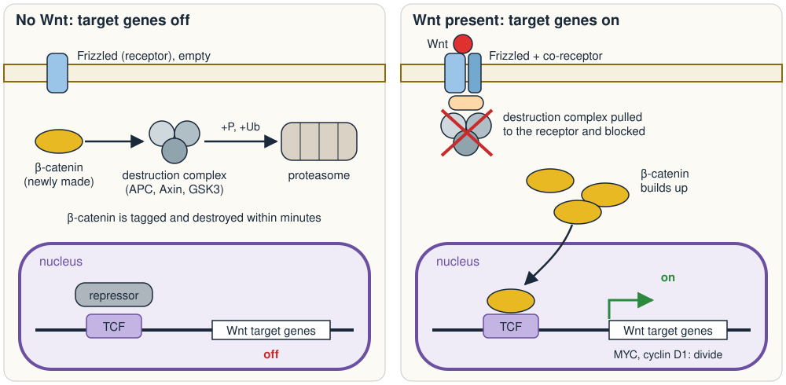{width="76%" fig-align="center"}

- Without Wnt, a **destruction complex** (APC, Axin, GSK3) phosphorylates **β-catenin**; it is then **ubiquitylated** and destroyed by the **proteasome**. **TCF** sits on DNA as a repressor.
- **Wnt** binds its receptor **Frizzled**: the complex is blocked, β-catenin **builds up**, enters the nucleus and turns TCF into an **activator**.
- Wnt keeps **stem cells** in the gut lining dividing.

::: notes
Wnt is a secreted lipid-modified protein that acts on nearby cells. The key player inside the cell is β-catenin. Without Wnt, β-catenin is made all the time but destroyed within minutes. A destruction complex built on the scaffold proteins Axin and APC holds β-catenin while the kinase GSK3 phosphorylates it. The phosphorylated β-catenin is recognised by a ubiquitin ligase, gets a ubiquitin chain and is broken down by the proteasome, which you met in the protein-degradation lecture. In the nucleus, the DNA-binding factor TCF sits on its target genes together with a repressor, so they stay off. When Wnt binds its receptor Frizzled and a co-receptor, the destruction complex is pulled to the membrane and blocked. β-catenin is no longer destroyed, builds up, enters the nucleus, displaces the repressor and turns TCF into an activator. Targets include MYC and cyclin D1, which drive cell division, and AXIN2, which builds more destruction complex: negative feedback. In the adult, Wnt from the surrounding tissue keeps the stem cells at the bottom of each intestinal crypt dividing. Remember the name APC: it comes back in the colorectal cancer slide.
:::

## Hedgehog: a receptor that works in the primary cilium {.smaller}

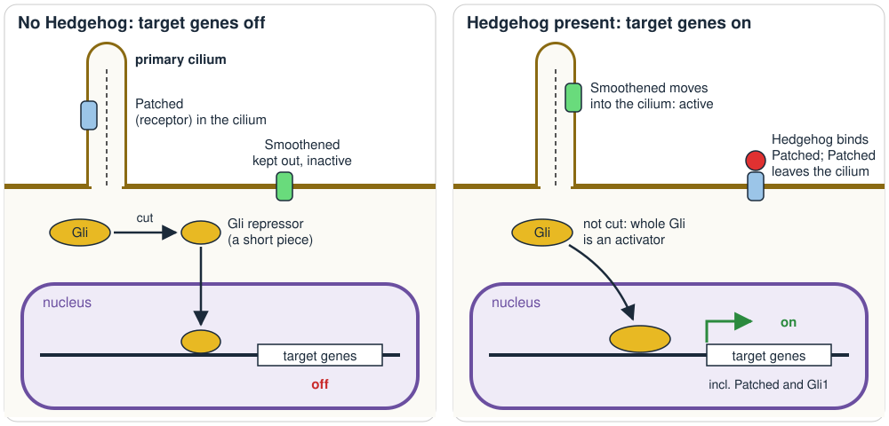{width="76%" fig-align="center"}

- Most of our cells have one **primary cilium**, a short antenna. Hedgehog signalling happens there.
- Without Hedgehog, **Patched** keeps **Smoothened** out of the cilium; the transcription factor **Gli** is cut into a **repressor**.
- Hedgehog binds Patched: **Smoothened** enters the cilium, Gli stays whole and **activates** genes. A **double negative**: the signal inhibits an inhibitor.

::: notes
Hedgehog is named after a fruit-fly mutant whose larvae are covered in spiky bristles. Mammals have three Hedgehog proteins; Sonic hedgehog is the best known. The surprise of the last twenty years is where this pathway works: in the primary cilium. Most of our cells carry one primary cilium, a single short projection built on microtubules that does not beat but acts as a signalling antenna. Without Hedgehog, the receptor Patched sits in the cilium and keeps a second membrane protein, Smoothened, out and inactive. The transcription factor Gli is then partly cut by the proteasome into a short form that represses target genes. When Hedgehog binds Patched, Patched leaves the cilium and is degraded. Smoothened moves into the cilium and becomes active. Gli is no longer cut; the whole protein goes to the nucleus as an activator. Note the logic: the signal inhibits Patched, and Patched inhibits Smoothened, a double negative. Among the target genes are Patched itself, a negative feedback, and Gli1. People with defective cilia, called ciliopathies, have malformations partly because Hedgehog signalling fails.
:::

## TGF-β: a receptor kinase phosphorylates SMADs {.smaller}

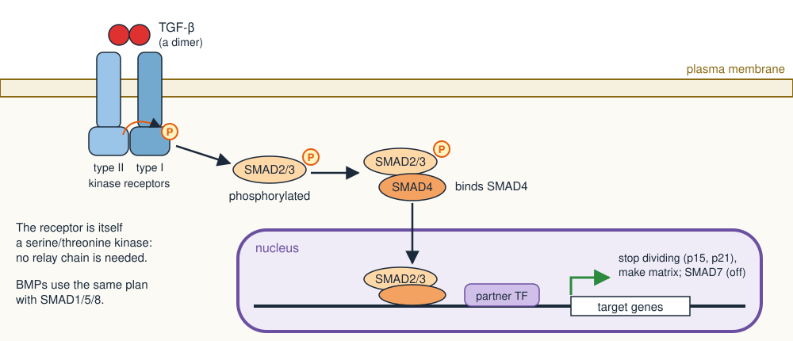{width="80%" fig-align="center"}

- **TGF-β** brings two receptor **serine/threonine kinases** together. Type II phosphorylates type I; type I phosphorylates **SMAD2/3**.
- Phosphorylated SMADs bind **SMAD4**, enter the nucleus and work **with other transcription factors**, so the answer depends on the cell type.
- Switched off by phosphatases and the inhibitor **SMAD7** (a target gene). In epithelial cells TGF-β **stops division**; many cancers lose this response.

::: notes
TGF-β, transforming growth factor beta, is a family of more than thirty secreted proteins, including the bone morphogenetic proteins, BMPs. The receptors resemble the receptor tyrosine kinases from the kinase-cascade lecture, but they are serine/threonine kinases, and the path to the nucleus is very short. The ligand, a dimer, brings together two kinds of receptor. The type II receptor phosphorylates and activates the type I receptor. The type I receptor then phosphorylates the transcription factors SMAD2 and SMAD3. Phosphorylated SMAD2/3 binds SMAD4, the complex enters the nucleus and binds DNA. SMADs bind DNA weakly, so they work together with other transcription factors that each cell type has. That is why TGF-β can stop division in an epithelial cell, make a fibroblast produce collagen, or calm down an immune cell. The response ends when phosphatases remove the phosphates, and when the target gene SMAD7 blocks the receptor. In normal epithelium TGF-β stops the cell cycle through inhibitors such as p15 and p21. Many cancers lose this brake, for example by mutations in SMAD4 in pancreatic cancer.
:::

## Morphogens: one signal, several fates {.smaller}

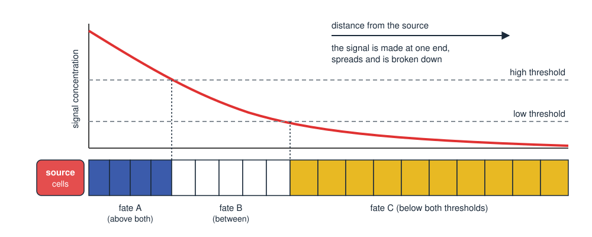{width="78%" fig-align="center"}

- A **morphogen** is a signal made at one place that spreads and forms a **concentration gradient**. Cells read their **distance** from the source as a concentration.
- Different **thresholds** switch on different genes: **high, middle and low** give three fates.
- Example: **Sonic hedgehog** from the floor of the neural tube makes several kinds of **spinal cord neurons** in order. Wnt, BMP (TGF-β family) and retinoic acid also act as morphogens.

::: notes
How can one signal make several cell types? By its concentration. A morphogen is a signal that is made by a small group of source cells, spreads through the tissue and is broken down or captured on the way. The result is a gradient: high near the source, low far away. Each cell reads the local concentration, and because target genes have different thresholds, a cell close to the source switches on a different set of genes from a cell further away. In the diagram, two thresholds divide a row of identical cells into three fates. A classic real example: in the embryo, the floor of the neural tube makes Sonic hedgehog. The cells closest to it become floor-plate cells, and the next ones become different kinds of neurons in a fixed order: one kind of interneuron, then motor neurons, then other interneurons further away. Cells also measure how long they have been exposed, not only how much. This one slide is a simplification of a large field: developmental biology. The same signals reappear in the adult, for example in the gut crypt, and in the course on organ structure and function.
:::

## Notch: the receptor is cut {.smaller}

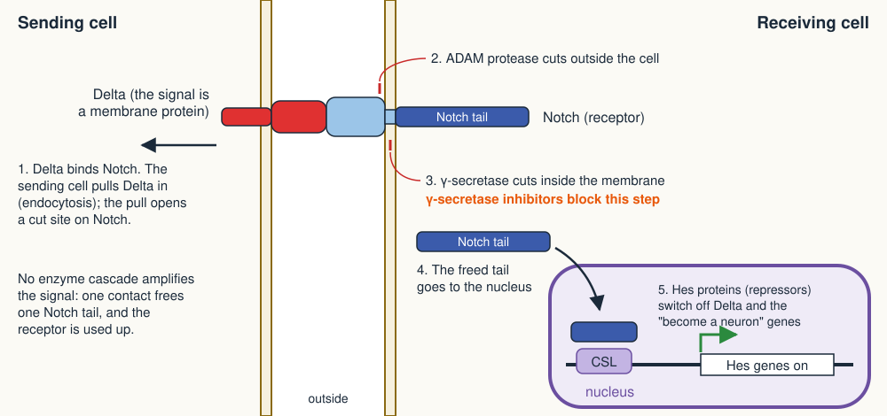{width="82%" fig-align="center"}

- **Delta** (the signal) is a membrane protein: Notch signalling needs **direct contact** between cells.
- Binding and pulling lets two proteases cut Notch: **ADAM** outside, then **γ-secretase** inside the membrane. The freed **Notch tail** goes to the nucleus and turns the factor **CSL** into an activator.
- No amplification and no second messenger: **one receptor, one signal**.

::: notes
Notch is the simplest pathway of all, and the most direct. Both the signal and the receptor are membrane proteins, so only cells that touch can talk. The signal is Delta, or its relative Jagged, on the sending cell. When Delta binds Notch on the receiving cell, the sending cell pulls Delta inwards by endocytosis. This pulling force stretches Notch and exposes a site that an ADAM protease cuts, just outside the membrane. The remaining stump is now a substrate for γ-secretase, a protease that cuts proteins inside the membrane. That cut releases the Notch intracellular domain, the Notch tail. The tail moves into the nucleus and binds the DNA-binding protein CSL. Without Notch, CSL sits on its targets with corepressors; with the Notch tail, it becomes an activator. The main targets are the Hes genes, which encode repressors. Notice that nothing amplifies this signal: each receptor is cut once and used up. So the strength of the signal depends on how many Delta molecules the neighbours show. γ-secretase also cuts other proteins, including the amyloid precursor protein of Alzheimer's disease.
:::

## Lateral inhibition: neighbours become different {.smaller}

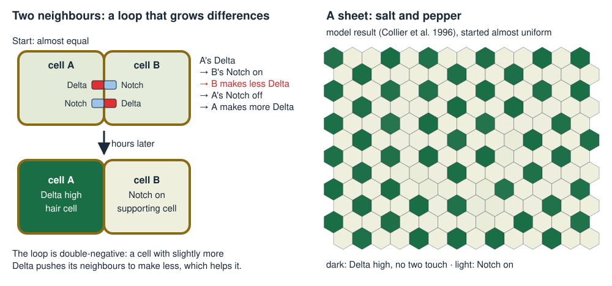{width="80%" fig-align="center"}

- Notch signalling **lowers Delta** in the receiving cell (through Hes repressors). So a cell with **a bit more Delta** silences its neighbours, which then send **less Delta back**.
- The loop **amplifies tiny random differences**: a **salt-and-pepper** pattern of Delta-high cells (hair cells, neurons) among Notch-high cells (supporting cells). **Try it:** [Notch lateral inhibition](questions.qmd#explore).

::: notes
Now we can explain the inner-ear pattern. Delta activates Notch in the neighbour. Active Notch, through the Hes repressors, switches off Delta and the genes for becoming a hair cell or a neuron in that same cell. Follow the loop between two neighbours, A and B, that start almost equal. If A has a little more Delta, B gets a little more Notch signal and makes a little less Delta. Then A receives less Notch signal and makes even more Delta. The small difference grows until A is Delta-high and B is Notch-high. This is called lateral inhibition, and it is a double-negative feedback loop between cells. In a whole sheet, each cell competes with all its neighbours, and the result is a salt-and-pepper pattern: isolated Delta-high cells, each surrounded by Notch-high cells. The pattern on the right was calculated with a standard mathematical model, Collier and colleagues 1996, from a nearly uniform start with small random differences. You can run this model yourself in the demo, change the strength of the feedback, knock out Notch in a patch, or add a γ-secretase inhibitor.
:::

## How do we know? Remove Notch and see what goes wrong {.smaller}

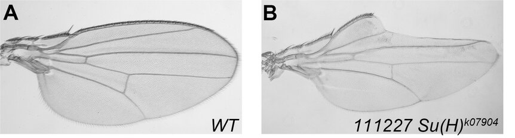{width="80%" fig-align="center"}

*Fruit-fly wings. A: normal. B: the fly CSL protein (Su(H)) removed in patches of the wing: the wing edge is lost in notches.*

- **Genetics:** flies with half the Notch gene have **notched wings** (1910s). Embryos with no Notch make **too many neurons** and little skin: every cell takes the "default" fate.
- **Mosaics:** a patch of Notch-negative cells in a normal tissue becomes **all neural**; its normal neighbours are inhibited.
- **Drugs:** a **γ-secretase inhibitor** in the inner ear of a mouse turns supporting cells into **extra hair cells**.
- **Models:** the Collier model predicts the spacing from the feedback alone.

::: notes
How do we know that Notch does lateral inhibition? The first clue came from fly genetics more than a hundred years ago. Flies that carry only one working copy of the Notch gene have notches at the edge of the wing, which gave the gene its name. Embryos with no Notch at all die with far too many neurons and almost no skin: without lateral inhibition, every cell in a group that could become neural does so. The picture shows a modern version: in B, the fly's CSL protein, called Suppressor of Hairless, was removed in patches of the wing, and the wing margin, which needs Notch signalling, is lost in those places. A second type of experiment is the genetic mosaic: make a patch of cells without Notch in a normal animal. The patch cells cannot be inhibited, so they all take the neural fate, while normal cells next to the patch are inhibited by them. A third is pharmacology: blocking γ-secretase with an inhibitor in the inner ear of a mouse turns some supporting cells into new hair cells. That result raised hopes for treating deafness. Finally, mathematical models show that the feedback alone is enough to make the pattern.
:::

## NF-κB: release by destroying the inhibitor {.smaller}

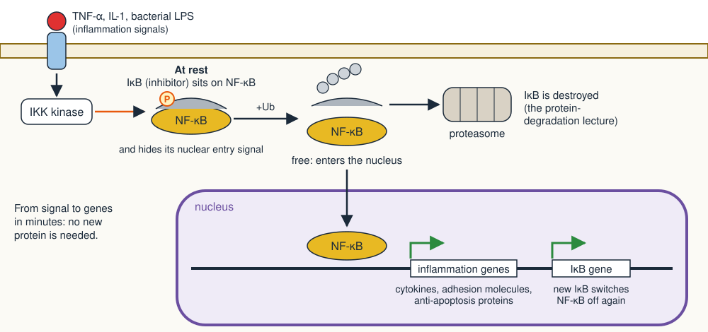{width="80%" fig-align="center"}

- At rest, **IκB** holds **NF-κB** in the cytosol by covering its nuclear entry signal.
- Inflammation signals activate the kinase **IKK**. It phosphorylates IκB, which is **ubiquitylated and destroyed by the proteasome**. Free NF-κB enters the nucleus **within minutes**.
- Targets: **cytokines**, adhesion molecules, anti-apoptosis proteins and **IκB** itself (negative feedback).

::: notes
NF-κB is the master switch of inflammation. It is a dimer of transcription factors kept in the cytosol by an inhibitor protein, IκB. IκB covers the nuclear localisation signal of NF-κB, so NF-κB cannot enter the nucleus. Signals of danger, such as the cytokines TNF-α and interleukin-1, or lipopolysaccharide from bacteria, act through their receptors on a kinase complex called IKK. IKK phosphorylates IκB on two serines. This marks IκB for a ubiquitin ligase, IκB gets a ubiquitin chain, and the proteasome destroys it. You saw this machinery in the protein-degradation lecture; here it is the switch of a signalling pathway, the same logic as β-catenin but the other way round: there the factor was destroyed, here its inhibitor is. Freed NF-κB enters the nucleus within minutes, because no new protein needs to be made. Its targets include cytokines that call immune cells, adhesion molecules on blood vessels, and proteins that stop apoptosis. One target is the IκB gene: new IκB enters the nucleus, pulls NF-κB out again and ends the response. You meet NF-κB again in immunology.
:::

## Nuclear receptors: the receptor is the transcription factor {.smaller}

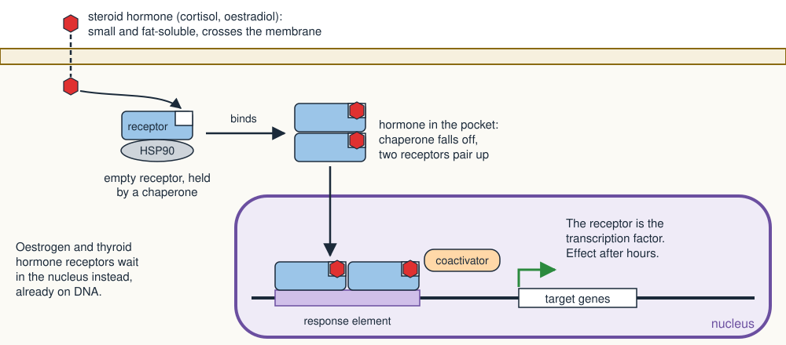{width="78%" fig-align="center"}

- **Steroid hormones** (cortisol, oestradiol, testosterone), **thyroid hormone**, vitamin D and retinoic acid are small and fat-soluble: they **cross the membrane**.
- They bind **nuclear receptors** inside the cell. The hormone–receptor pair binds a **hormone response element** in DNA and recruits **coactivators**.
- The shortest path from signal to gene: **no second messenger**. The effect takes **hours** and needs new protein.

::: notes
The last pathway has no relay at all. Steroid hormones such as cortisol, oestradiol and testosterone, and also thyroid hormone, vitamin D and retinoic acid, are small and hydrophobic, so they diffuse through the plasma membrane, as you saw in the membrane-transport lecture. Their receptors are inside the cell, and they are themselves transcription factors. Humans have 48 of these nuclear receptors. Each has a DNA-binding domain and a ligand-binding pocket. Take the glucocorticoid receptor, which binds cortisol. Without hormone it sits in the cytosol, held by the chaperone HSP90. Cortisol enters the pocket, the chaperone falls off, two receptors pair up, enter the nucleus and bind a hormone response element, a short DNA sequence near target genes. The hormone also changes the shape of the receptor so that it recruits coactivators. Other receptors, such as the oestrogen receptor and the thyroid hormone receptor, are already in the nucleus and on DNA, and the hormone switches them from repressor to activator. Because the response needs transcription and translation, it starts after an hour or more and lasts long.
:::

## How do we know? Reporter genes read out a pathway {.smaller}

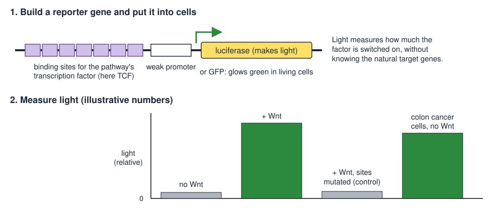{width="74%" fig-align="center"}

- Put **binding sites** for the pathway's transcription factor in front of a gene for **luciferase** (light) or **GFP** (green fluorescence).
- The signal measures **pathway activity** in cells, tissues or living animals. Control: the same construct with **mutated sites**.
- Used to find pathway components in **genetic screens** and to **screen drugs** that block a pathway.

::: notes
How do we measure whether a pathway is on? We could measure each of its target genes, but they differ between cell types. A simpler approach is a reporter gene. We build a piece of DNA with several copies of the binding site for the pathway's transcription factor, here TCF for the Wnt pathway, in front of a weak promoter and the gene for luciferase, the enzyme that makes fireflies glow. We put this construct into cells. Without signal, little luciferase is made. With Wnt, β-catenin and TCF bind the sites and the cells make light that we measure in a plate reader. The essential control is the same construct with mutated binding sites: if that one also lights up, the effect does not go through TCF. Colon cancer cells with a broken APC gene light up without any Wnt, which shows that their pathway is stuck in the on position. Similar reporters exist for Notch, NF-κB, SMADs and nuclear receptors, and with GFP instead of luciferase one can watch the pathway in living embryos. Drug companies use reporter cells to screen thousands of compounds for pathway inhibitors.
:::

## Six pathways, one logic {.smaller}

| Pathway | Signal | Factor is freed by | Off-switch (feedback) |
|---|---|---|---|
| **Wnt** | secreted, local | no longer **destroyed** (β-catenin) | Axin2, destruction complex |
| **Hedgehog** | secreted, gradient | no longer **cut** into a repressor (Gli) | Patched |
| **TGF-β/BMP** | secreted, gradient | **phosphorylated** by the receptor (SMADs) | SMAD7, phosphatases |
| **Notch** | **membrane-bound** (contact) | **cut** out of the membrane (Notch tail) | Hes repressors, receptor used up |
| **NF-κB** | cytokines, microbes | its **inhibitor IκB destroyed** | new IκB |
| **Nuclear receptors** | steroid, thyroid hormone | **hormone binds** the factor | hormone breakdown |

- The **same** signal gives **different** answers in different cells: the answer depends on which genes are open and which partner factors are present (**competence**). A few pathways, many fates.

::: notes
Here is the whole lecture on one slide. For each pathway, ask the same four questions: what is the signal, how is the transcription factor freed, and how is the pathway switched off. Wnt and NF-κB both use the proteasome, but in opposite ways: Wnt stops destroying the factor, NF-κB destroys the inhibitor. Notch and Hedgehog both involve cutting proteins: Notch cuts its receptor to free the factor, Hedgehog stops cutting its factor into a repressor. TGF-β is the shortest kinase path. Nuclear receptors skip the membrane altogether. And in every row there is negative feedback. A last point. Development uses only about seven major pathways to make hundreds of cell types. How can that work? Because the answer depends on the receiving cell. A cell's history has already opened some enhancers and closed others, and it already has certain partner transcription factors. The same Wnt signal can therefore make a gut stem cell divide and a neural cell choose a fate. This readiness to respond in a specific way is called competence. The kinase-cascade lecture showed cross-talk between pathways; the same is true here.
:::

## Why it matters: cancers with a pathway stuck on {.smaller}

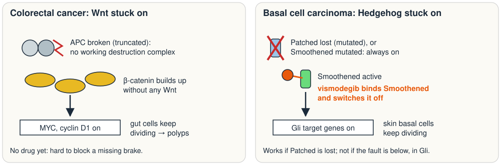{width="74%" fig-align="center"}

:::: {.columns}
::: {.column width="70%"}
- **APC** is mutated in about **80 %** of colorectal cancers. Inherited APC mutations (**familial adenomatous polyposis**) give hundreds of polyps by early adulthood.
- In **basal cell carcinoma**, the most common skin cancer, Patched or Smoothened is mutated. **Vismodegib** blocks **Smoothened**, for tumours that cannot be removed by surgery.
:::
::: {.column width="30%"}
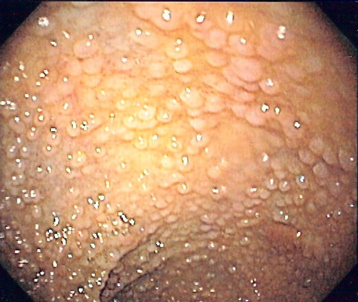{height="190px" fig-align="center"}

*Familial adenomatous polyposis: hundreds of small polyps (endoscopy).*
:::
::::

::: notes
Pathways that tell cells to divide during development are dangerous when they are stuck on in the adult. Wnt first. Remember the destruction complex with APC. About four out of five colorectal cancers have a mutation in APC that cuts the protein short, so β-catenin is never destroyed and TCF target genes such as MYC stay on, even without any Wnt. People who inherit one broken APC copy have familial adenomatous polyposis: the second copy is lost in many gut cells, and hundreds of polyps grow, as in the picture. Without surgery to remove the colon, cancer is almost certain. No drug yet targets this pathway in colorectal cancer, because it is hard to replace a missing brake. Hedgehog is the success story. In basal cell carcinoma, the cancer of the skin's basal cells, most tumours have lost Patched or carry an activating Smoothened mutation. Vismodegib, the first Smoothened inhibitor, was approved in 2012 for tumours that cannot be operated on. The first known Smoothened blocker was cyclopamine, a toxin from a wild lily that causes one-eyed lambs; vismodegib was later found by screening for drug-like inhibitors. Resistance appears when Smoothened mutates so that the drug no longer binds, or when the fault lies further down. More on cancer in Sjukdomslära.
:::

## Why it matters: hormone receptors as drug targets {.smaller}

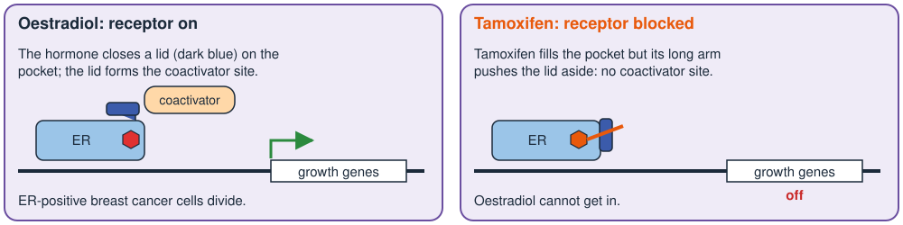{width="82%" fig-align="center"}

:::: {.columns}
::: {.column width="68%"}
- About **70 %** of breast cancers carry the **oestrogen receptor (ER)** and grow on oestrogen. **Tamoxifen** fills the hormone pocket but blocks the **coactivator** site: ER stays off in breast tissue.
- **Corticosteroids** (prednisolone, dexamethasone) activate the **glucocorticoid receptor**. It blocks **NF-κB** and turns on **IκB**: inflammation genes go off. The same receptor in other tissues gives the side effects (high blood sugar, bone loss).
:::
::: {.column width="32%"}
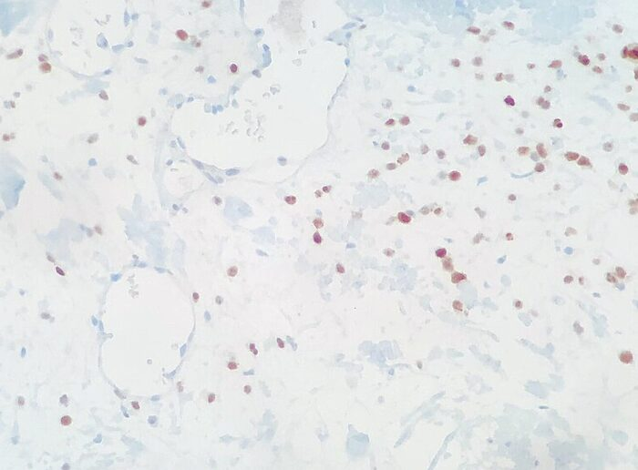{height="200px" fig-align="center"}

*Breast cancer stained for ER: brown nuclei carry the receptor.*
:::
::::

::: notes
Nuclear receptors are among the most successful drug targets, because a small molecule can enter the same pocket as the hormone. About seven out of ten breast cancers have the oestrogen receptor, and their growth depends on oestrogen. Pathologists test every breast tumour by staining for the receptor, as in the picture: brown nuclei mean ER-positive. Tamoxifen binds the hormone pocket, but its long side arm pushes aside the helix that normally closes over the pocket and forms the site for coactivators. So the receptor binds DNA but cannot switch genes on in breast tissue. In some other tissues, such as the uterus, tamoxifen partly activates the receptor, which is why it is called a selective oestrogen receptor modulator. Corticosteroids are synthetic versions of cortisol and among the most used drugs in medicine, for asthma, rheumatic disease and transplant rejection. They activate the glucocorticoid receptor, which binds NF-κB and blocks its genes, and also switches on the IκB gene. That connects two slides of today. The glucocorticoid receptor is in almost every tissue, which explains the side effects. You meet these drugs again in immunology and in drug development.
:::

## Summary {.smaller}

1. Fate-deciding pathways end at a **transcription factor** that is already in the cell but kept **inactive**. The signal **frees** it: by stopping its destruction (**Wnt**/β-catenin), cutting it out of the membrane (**Notch**), phosphorylating it (**TGF-β**/SMAD), stopping its conversion to a repressor (**Hedgehog**/Gli in the primary cilium), destroying its inhibitor (**NF-κB**/IκB) or binding it directly (**nuclear receptors**).
2. Each pathway turns on a **gene-expression programme** and its own **negative feedback**; the answer depends on the cell's **competence**.
3. **Morphogen gradients** give different fates at different concentrations; **lateral inhibition** by Notch makes neighbours different and gives salt-and-pepper patterns.
4. Pathways stuck on cause cancer (**APC** in colorectal cancer, **Patched/Smoothened** in basal cell carcinoma); drugs act at the receptor: **vismodegib**, **tamoxifen**, **corticosteroids**.

*Read more (optional): Alberts et al., Molecular Biology of the Cell, 7th ed., ch. 15 (and ch. 21–22 for development and stem cells).*

[Image credits](../credits.qmd#fate-signalling){style="font-size:0.7em"}

::: notes
Four take-home points. First, for every pathway in this lecture, find the transcription factor and ask how the signal frees it. There are five answers: stop destroying it, cut it out of the membrane, phosphorylate it, stop turning it into a repressor, or let the hormone bind it directly; for NF-κB, destroy its inhibitor. Second, the factor switches on a set of genes, a programme, which includes inhibitors of the same pathway, so the response is limited. Which genes respond depends on the history of the cell. Third, two simple ideas explain much of how tissues get their patterns: a morphogen gradient read at different thresholds, and lateral inhibition between neighbours through Notch. Fourth, these pathways are drug targets and cancer genes. Learn the four examples: APC and colorectal cancer, Smoothened and vismodegib, the oestrogen receptor and tamoxifen, and the glucocorticoid receptor and corticosteroids. This ends the signalling block. In the cytoskeleton lectures you will see signals again, now steering cell shape and movement.
:::
