## About this lecture {.smaller}

A protein made on the rough ER still has a long way to go. Hormones, antibodies and digestive enzymes must leave the cell; receptors must reach the cell surface; lysosomal enzymes must reach the lysosomes. Today: **the secretory pathway**, the route from the ER through the **Golgi apparatus** to the cell surface, and the **vesicles** that carry proteins along it.

After this lecture you can:

- describe the route **ER → ERGIC → Golgi → trans-Golgi network → plasma membrane**, and how a pulse-chase experiment shows it;
- explain how a vesicle **buds** (coats **COPII, COPI, clathrin**; a small GTPase switch; cargo selection), finds its target (**Rab GTPases, tethers**) and **fuses** (**SNAREs**);
- describe what the Golgi does to proteins (**glycosylation**, processing) and how cargo crosses the stack (**cisternal maturation**);
- explain **sorting in the trans-Golgi network**, and **constitutive versus regulated secretion**;
- explain how **botulinum toxin** and **failing insulin secretion** follow from this machinery.

::: notes
In the lecture on the endoplasmic reticulum you followed a new protein into the ER, saw it fold and saw how the ER checks its quality. Today we follow the proteins that pass that check. They leave the ER in small membrane bubbles called vesicles, pass through the Golgi apparatus, where their sugar chains are rebuilt, and are then sorted to the cell surface, to secretory granules or to the lysosomes. Along the way we meet a small set of machines that every transport step uses: coats that bend the membrane and choose the cargo, small GTPases that act as switches and address labels, and SNARE proteins that fuse two membranes. Most of the parts were found with three tools you will see today: radioactive pulse-chase, yeast genetics and a test-tube transport assay. We finish with two medical examples: botulinum toxin, which cuts SNAREs, and insulin secretion, which fails in type 2 diabetes. This lecture covers ELO 4 and ELO 5.
:::

## The question: how does a cell export its proteins? {.smaller}

:::: {.columns}
::: {.column width="52%"}
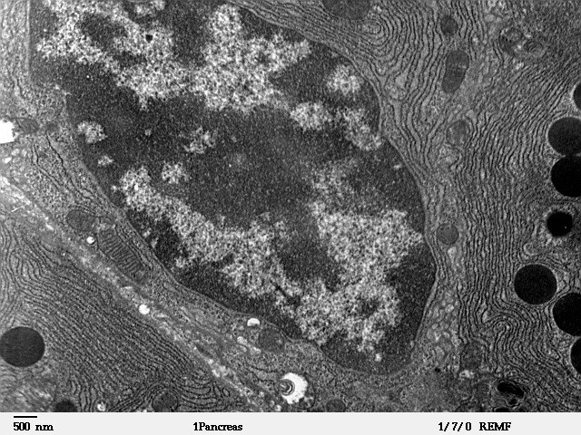{width="100%" fig-align="center"}

*Pancreatic acinar cells, transmission EM. Nucleus (left), stacks of rough ER (thin parallel lines) and dark zymogen granules (right). Scale bar 500 nm.*
:::
::: {.column width="48%"}
- Acinar cells of the pancreas make **digestive enzymes** for the gut: **several grams** of protein a day in a human.
- The enzymes are made on the **rough ER**, but they leave the cell from **granules** at the other end of the cell.
- They are **never free in the cytosol**: they cross **no membrane** after the ER.
- And they wait in granules until a **meal signal** says "now".

**How does a protein travel from ER to outside without crossing a membrane? And how does it know where to go?**
:::
::::

::: notes
This electron micrograph shows acinar cells from the pancreas. These cells make digestive enzymes: proteases, lipases and amylase, several grams of protein per day in a human. You can see the nucleus on the left, the rough ER as many thin parallel membranes filling the cell, and on the right the round, dark zymogen granules, which are packets of stored enzyme. The enzymes are made by ribosomes on the ER and enter the ER lumen during synthesis, as you saw in the ER lecture. They leave the cell when a granule fuses with the plasma membrane facing the gland duct. In between they never touch the cytosol, and this matters, because a protease loose in the cytosol would digest the cell. They also do not leave at once: they are stored until a hormone or nerve signal after a meal triggers release. So we have three questions. How does a protein move between compartments without crossing a membrane? How is it sorted to the right place? And how is release controlled in time?
:::

## The secretory pathway: a map {.smaller}

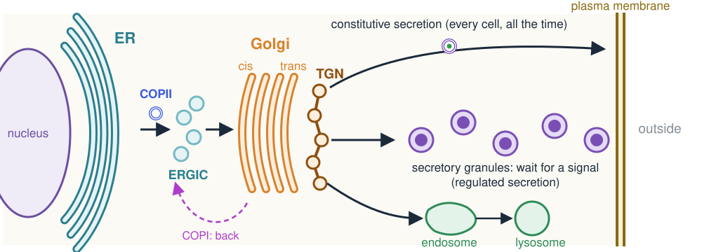{width="92%" fig-align="center"}

- **Anterograde** (forward): ER → **ERGIC** (ER–Golgi intermediate compartment) → **cis**, medial, **trans** Golgi → **trans-Golgi network (TGN)** → plasma membrane, granules or lysosomes. **Retrograde** (back): COPI vesicles return escaped ER proteins.
- The **lumen** of every compartment is **topologically outside** the cell: what faces the lumen will face the outside after fusion.

::: notes
Here is the whole route on one map. A protein that leaves the ER first reaches the ER–Golgi intermediate compartment, called the ERGIC, a set of tubules and vesicle clusters close to the Golgi. From there it enters the Golgi apparatus at its cis face, the side facing the ER, and passes through the stack of flattened cisternae, cis, medial and trans, to the trans-Golgi network, the TGN. The TGN is the sorting station: it sends cargo to the plasma membrane, into secretory granules, or to endosomes and lysosomes. Each step uses a membrane carrier, a vesicle or a tubule, which buds from one compartment and fuses with the next. Traffic also goes backwards: retrograde carriers bring back ER proteins that leaked out. One idea to keep in mind: the inside of every compartment on this map is topologically equivalent to the outside of the cell. A protein in the ER lumen, or the part of a membrane protein facing the lumen, ends up outside the cell or on the outer face of the plasma membrane. That is why sugars on your glycoproteins face outwards.
:::

## How do we know? Pulse-chase showed the route {.smaller}

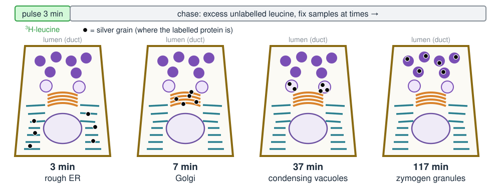{width="90%" fig-align="center"}

- **Pulse**: give pancreas slices radioactive amino acid (³H-leucine) for **3 minutes**. **Chase**: wash it away, add unlabelled amino acid. Only the proteins made during the pulse are labelled.
- Fix samples over time, **EM autoradiography** shows where the label is: **rough ER** (3 min) → **Golgi** (about 7–20 min) → **condensing vacuoles** (about 37 min) → **zymogen granules** (about 2 h).
- George **Palade**, Nobel Prize **1974** (with Albert Claude and Christian de Duve).

::: notes
How do we know that proteins take this route? George Palade and James Jamieson answered it in the 1960s with a pulse-chase experiment, a method you will meet again and again. They incubated slices of guinea-pig pancreas with a radioactive amino acid, tritium-labelled leucine, for only three minutes. That is the pulse: every protein made in those three minutes carries the label. Then came the chase: they washed out the label and added a large excess of ordinary leucine, so proteins made afterwards are not labelled. The labelled cohort is like a group of runners with red shirts in a marathon: you can follow them. At different times they fixed the tissue, cut thin sections, coated them with photographic emulsion and looked in the electron microscope. Silver grains appear where the radioactivity is. At three minutes the label was over the rough ER; after about ten minutes over the Golgi; after about forty minutes over condensing vacuoles at the trans side; and after two hours over zymogen granules. The order of compartments in time gave the route. The demo for this lecture is a modern version of this experiment.
:::

## One transport step: bud, move, tether, fuse {.smaller}

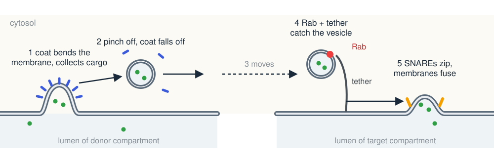{width="90%" fig-align="center"}

- A **coat** bends the donor membrane and collects cargo → a vesicle (about **50–100 nm**) pinches off → the coat falls off.
- **Rab** on the vesicle and **tethers** on the target catch it; **SNAREs** on both membranes zip together and **fuse** the bilayers.
- The **lumen stays lumen** and the **cytosolic side stays cytosolic**: cargo never crosses a membrane.

::: notes
Every step on the map uses the same four-part cycle. First, budding: coat proteins assemble on the cytosolic face of the donor membrane. They bend it into a bud and, at the same time, gather the right cargo into it. The bud pinches off as a vesicle, typically 50 to 100 nanometres across. Second, the coat comes off, because a fusion machine cannot reach a coated membrane. Third, the vesicle moves, often along microtubules, and is caught at the right target membrane. Two kinds of proteins do this: a Rab GTPase on the vesicle, which acts as an address label, and tethering proteins on the target, which grab vesicles that carry the right Rab. Fourth, SNARE proteins on the vesicle and on the target wind together and pull the two bilayers so close that they fuse. Look at the topology. Soluble cargo inside the vesicle enters the lumen of the target. A membrane protein keeps its orientation: the part that faced the lumen still faces the lumen. Nothing crosses a membrane, which answers the first question from the acinar cell.
:::

## Three coats for three kinds of route

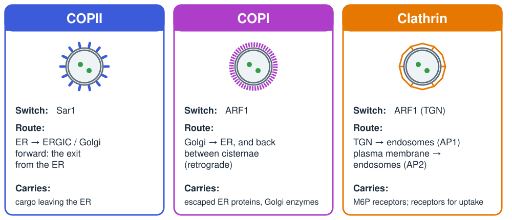{width="94%" fig-align="center"}

::: notes
Cells use three main coats, and each marks a different route. COPII, for coat protein complex two, makes vesicles that leave the ER; it is the exit coat. COPI, coat protein complex one, works at the ERGIC and the Golgi and makes vesicles that mostly travel backwards: from the Golgi to the ER and between Golgi cisternae. Clathrin forms a basket-like cage of three-legged units called triskelions. It works at two places: at the trans-Golgi network, where it makes vesicles going to endosomes and lysosomes, and at the plasma membrane, where it makes vesicles for endocytosis, the topic of the endocytosis lecture. Clathrin does not bind cargo itself: adaptor proteins sit between the cage and the membrane, AP1 at the TGN and AP2 at the plasma membrane, and the adaptors bind the cargo. Notice that there is no special coat on this map for the route from the TGN to the plasma membrane. Those constitutive carriers are larger tubules and vesicles whose coat proteins are still poorly understood. Learn the three coats with their routes; that is enough for this course.
:::

## How a coat forms and chooses its cargo {.smaller}

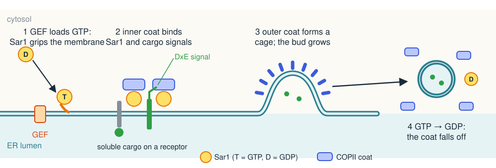{width="92%" fig-align="center"}

- A **small GTPase** is the switch: **Sar1** (COPII) or **ARF1** (COPI, clathrin at the TGN). A **GEF** in the donor membrane loads **GTP** → the GTPase puts an **amphipathic helix** into the membrane and recruits the coat.
- The inner coat binds **sorting signals** on cargo: e.g. a **di-acidic motif (DxE)** in a cytosolic tail for COPII. Soluble cargo is collected by **cargo receptors**.
- **GTP hydrolysis** releases the coat, so it can be used again.

::: notes
How does a coat know where and when to assemble? The answer is a small GTPase, a protein that is active with GTP bound and inactive with GDP, like the Ras switch you will meet in signalling. For the COPII coat the switch is Sar1. Its exchange factor, a GEF, sits only in the ER membrane, so Sar1 is turned on only there. Sar1 with GTP pushes an amphipathic helix into the cytosolic leaflet, which starts to bend it, and recruits the inner coat proteins. The inner coat has binding sites for sorting signals: short amino-acid motifs in the cytosolic tails of membrane cargo. For example, the viral glycoprotein VSVG, which you will see again as a tracer, carries a di-acidic signal, aspartate–x–glutamate. Soluble cargo in the lumen cannot touch the coat, so it binds transmembrane cargo receptors, which bind the coat. Then the outer coat forms a cage and the bud closes. After the vesicle leaves, GTP is hydrolysed, the GTPase leaves the membrane and the coat falls apart. COPI works the same way with ARF1 as its switch. Remember ARF1: the drug brefeldin A blocks its GEF.
:::

## Address labels and hooks: Rab GTPases and tethers {.smaller}

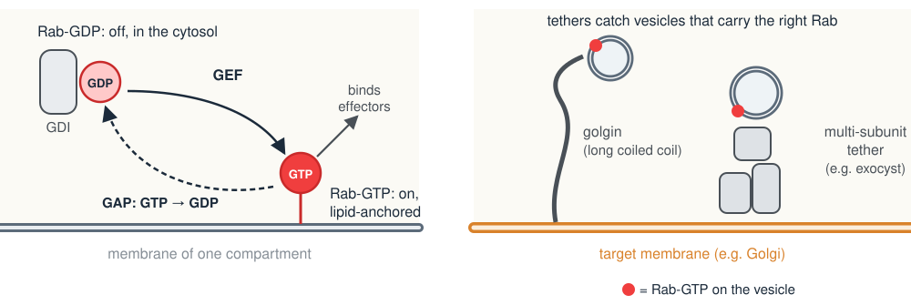{width="90%" fig-align="center"}

- **Rabs**: about **60 small GTPases** in human cells; each membrane carries its own set (e.g. **Rab1** ER→Golgi, **Rab27** secretory granules). **Rab-GTP** sits in the membrane, **Rab-GDP** is extracted into the cytosol.
- **Tethers** bind Rab-GTP and catch the vesicle from up to **~200 nm** away: long **coiled-coil proteins** (golgins) or **multi-subunit complexes** (e.g. the exocyst at the plasma membrane).
- Rabs and tethers give **specificity**; SNAREs give **fusion** (and some more specificity).

::: notes
A cell has many membranes and many vesicles, so how does a vesicle find the right target? Part of the answer is Rab proteins, another family of small GTPases, with about sixty members in human cells. Each compartment carries a characteristic set of Rabs, so Rabs work like address labels or membrane identity cards. For example, Rab1 works between the ER and the Golgi, Rab5 on early endosomes, and Rab27 on secretory granules. In the GTP form, a Rab is anchored to the membrane by a lipid tail and binds effector proteins. In the GDP form, a protein called GDI pulls it out of the membrane into the cytosol, ready to be used again. The most important effectors are tethers. Some are long, thin coiled-coil proteins, the golgins, that stick out from the Golgi like fishing lines up to a few hundred nanometres long and catch passing vesicles. Others are large complexes of several subunits, such as the exocyst, which catches secretory vesicles at the plasma membrane. Tethering brings the vesicle close, but the membranes are not yet fused. That is the job of the SNAREs.
:::

## SNAREs zip two membranes together {.smaller}

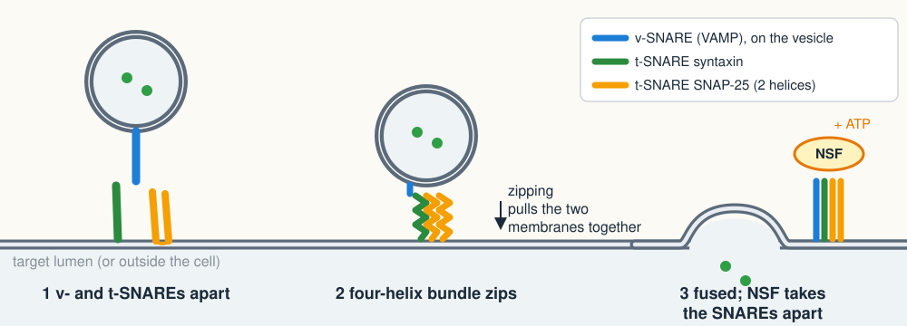{width="92%" fig-align="center"}

- A **v-SNARE** on the vesicle (e.g. **VAMP**/synaptobrevin) and **t-SNAREs** on the target (e.g. **syntaxin**, **SNAP-25**) form a **bundle of four α-helices**.
- The helices **zip from the far end towards the membranes**, pulling the bilayers together until they **fuse**. About **35 SNAREs** in human cells; different pairs at different membranes.
- After fusion, the ATPase **NSF** (with **α-SNAP**) uses ATP to pull the SNAREs apart so they can be reused.

::: notes
SNAREs are the fusion machine. A SNARE is a membrane protein with a long helical segment, the SNARE motif, that sticks out into the cytosol. The vesicle carries a v-SNARE, v for vesicle, such as VAMP, also called synaptobrevin. The target membrane carries t-SNAREs, t for target, such as syntaxin and SNAP-25. When the vesicle comes close, four SNARE motifs, one from the vesicle and three from the target, wind around each other into a very stable bundle of four helices. Assembly starts at the end far from the membranes and zips towards them, like a zipper that pulls two pieces of cloth together. The energy released by zipping overcomes the repulsion between the two water-covered bilayers, and the lipids of the two membranes merge: fusion. Afterwards both SNAREs sit in the same membrane in a relaxed complex, which is useless. The ATPase NSF, with its adaptor α-SNAP, spends ATP to pull the bundle apart so that the SNAREs can work again. Human cells have about 35 SNAREs, and only certain combinations work together, which adds a second layer of specificity on top of the Rabs.
:::

## How do we know? Yeast mutants and a test-tube assay {.smaller}

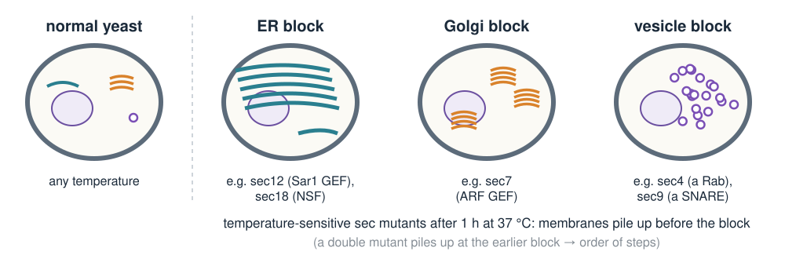{width="92%" fig-align="center"}

- **Genetics** (Randy **Schekman**): yeast **temperature-sensitive *sec* mutants** grow at 25 °C; at 37 °C they stop secreting, and membranes **pile up** where the block is: ER, Golgi or vesicles. Double mutants gave the **order** of the steps.
- **Biochemistry** (James **Rothman**): transport between **Golgi membranes in a test tube** needs ATP and cytosol → purified **NSF**, **SNAP** and then the **SNAREs**.
- **Physiology** (Thomas **Südhof**): **synaptotagmin** is the **Ca²⁺ sensor** that times fusion at synapses. Nobel Prize **2013** to all three.

::: notes
Three approaches found the machinery, and they shared the Nobel Prize in 2013. Randy Schekman used yeast genetics. Yeast secretes enzymes into its cell wall, so a mutant that cannot secrete is lethal. Schekman searched for temperature-sensitive mutants: they grow normally at 25 degrees, but at 37 degrees the mutant protein fails. When shifted to 37 degrees, these sec mutants, for secretion, stopped secreting, and the electron microscope showed where traffic was blocked: some filled with ER, some with Golgi-like stacks, others with thousands of small vesicles. By combining two mutations, he found which block comes first and so ordered the steps. Many sec genes turned out to code for coat proteins, a Rab and SNAREs. James Rothman used biochemistry. He mixed Golgi membranes from two kinds of mutant cells in a test tube and measured transport between them. Transport needed ATP and cytosol, so he purified the active cytosolic proteins: NSF, then SNAP, and finally the SNAREs. Thomas Südhof asked how fusion is timed at nerve terminals, and found that synaptotagmin binds calcium and triggers SNARE-driven fusion within a millisecond.
:::

## The Golgi apparatus: a stack with two faces {.smaller}

:::: {.columns}
::: {.column width="56%"}
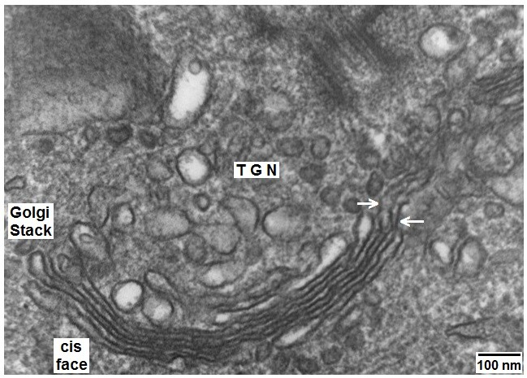{width="100%" fig-align="center"}

*Golgi apparatus in a human cell, transmission EM: the stack of cisternae, the cis face and the trans-Golgi network (TGN) with tubules (arrows). Scale bar 100 nm.*
:::
::: {.column width="44%"}
- A **stack of 4–8 flat cisternae**, each about 1 µm wide; mammalian cells link many stacks into one **Golgi ribbon** next to the nucleus.
- **Polarised**: the **cis** face receives from the ER; the **trans** face and the **TGN** ship out.
- Each cisterna has its own **enzymes**, in the order the cargo needs them, like an **assembly line**.
- Found by Camillo **Golgi** in 1898 with a silver stain; its existence was doubted until **EM** in the 1950s.
:::
::::

::: notes
Here is the Golgi apparatus itself, in a thin section of a human cell seen by transmission electron microscopy. Look for the curved stack of flat, membrane-bounded sacs, the cisternae, lying close together like a pile of plates. The side at the bottom, labelled cis, faces the ER and receives cargo. The trans side at the top continues into the trans-Golgi network, a mesh of tubules and buds; the white arrows point to tubules leaving the stack. In mammalian cells, many such stacks are connected side by side into a ribbon next to the nucleus, near the centrosome. The Golgi is polarised: each cisterna contains a different set of processing enzymes, arranged in the order in which they act on the cargo, from early trimming enzymes in cis to late enzymes in trans. Camillo Golgi saw this structure in nerve cells in 1898 with a silver stain, and for decades many people thought it was an artefact of the staining. Only electron microscopy settled that it is real.
:::

## What the Golgi does: rebuilding sugars and cutting proteins {.smaller}

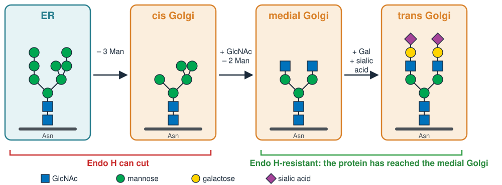{width="92%" fig-align="center"}

- **N-linked glycans** made in the ER are **trimmed** (mannose removed) and **rebuilt** (GlcNAc, galactose, **sialic acid** added): a **complex glycan**. Each step is done by a different enzyme in a different cisterna.
- **O-linked glycosylation** on Ser/Thr (mucins), **proteoglycans**, **sulfation**; lysosomal enzymes get a **mannose-6-phosphate** tag (cis Golgi).
- **Proteolytic cleavage** in the TGN and granules: proinsulin → insulin. **Lab test** for Golgi arrival: the glycan becomes resistant to the enzyme **Endo H**.

::: notes
What happens to a protein while it passes through the Golgi? Mostly, its sugars change. In the ER lecture you saw that proteins get a large N-linked glycan, a block of fourteen sugars on asparagine, and that the ER trims it during quality control. In the Golgi this tree is cut down and rebuilt. In the cis Golgi, mannosidases remove more mannose. In the medial Golgi, the first N-acetylglucosamine is added and more mannose is removed. In the trans Golgi, galactose and finally sialic acid are added, which gives the branched complex glycans on most cell-surface and secreted proteins. Each enzyme sits in its own cisterna, so the order of the stack gives the order of the reactions. The Golgi also adds O-linked sugars to serine and threonine, for example on the mucins that make mucus, builds the long sugar chains of proteoglycans, and marks lysosomal enzymes with mannose-6-phosphate. Late in the pathway, proteases cut some proteins into their active form, for example proinsulin into insulin. A useful lab trick: once the glycan has passed the medial Golgi, the enzyme Endo H can no longer cut it, so Endo H resistance tells you that a protein has reached the Golgi.
:::

## Moving through the stack: cisternal maturation {.smaller}

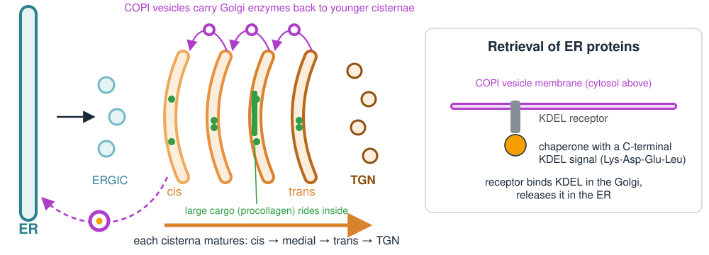{width="92%" fig-align="center"}

- The cisternae themselves **move forward and mature**: a new cis cisterna forms from ERGIC carriers, becomes medial, then trans, then breaks up in the TGN. **Cargo rides along.**
- **COPI vesicles** carry **Golgi enzymes backwards** to younger cisternae, and **escaped ER proteins** back to the ER (**KDEL** signal + KDEL receptor).
- Evidence: **large cargo** (procollagen rods, about 300 nm) crosses the stack without vesicles; in **live yeast**, one cisterna changes from cis to trans markers within minutes.

::: notes
How does cargo cross the stack? For years there were two models. In the first, the cisternae stay put and cargo hops forward from one to the next in vesicles. In the second, cisternal maturation, the cisternae themselves move: a new cis cisterna forms by fusion of carriers from the ERGIC, then it matures into a medial and a trans cisterna, and finally breaks up into carriers at the TGN. The cargo stays inside and rides along. To keep each cisterna's enzymes in place, COPI vesicles carry them backwards to the next younger cisterna. Two observations favour maturation. Procollagen forms rigid rods about 300 nanometres long, too big for a 60-nanometre COPI vesicle, yet it crosses the stack. And in live yeast cells, where cisternae are separate, a single cisterna labelled with a cis marker was seen to lose it and gain a trans marker within a few minutes. COPI also works at the start of the route. ER-resident proteins that escape, such as chaperones, carry a KDEL signal at their C-terminus. The KDEL receptor in the ERGIC and cis Golgi binds them and returns them to the ER in COPI vesicles. Today most researchers think maturation is the main mechanism, with some vesicle traffic as well.
:::

## Sorting at the trans-Golgi network: three exits {.smaller}

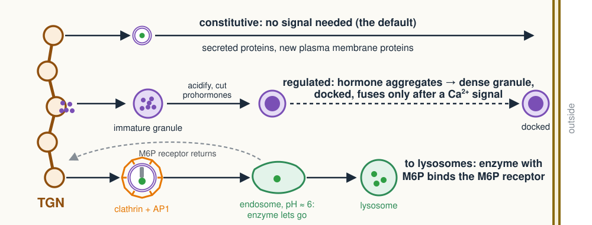{width="92%" fig-align="center"}

- **To lysosomes**: enzymes with **mannose-6-phosphate** bind the **M6P receptor**; clathrin + adaptor (AP1) vesicles take them to **endosomes**, where the acid pH releases them (the endocytosis lecture follows them on).
- **Regulated secretion**: hormones **aggregate** in the TGN and bud as **secretory granules** that wait for a signal.
- **Constitutive secretion**: everything without a special signal goes **straight to the surface** (the **default**). In epithelia there are separate **apical** and **basolateral** routes.

::: notes
The trans-Golgi network is the main sorting station. Three exits leave it. First, lysosomal enzymes. In the cis Golgi they received a special tag, mannose-6-phosphate. In the TGN, the mannose-6-phosphate receptor, a membrane protein, binds them on the lumen side and is collected into clathrin-coated vesicles with the adaptor AP1. These vesicles fuse with endosomes. The endosome is more acidic, so the enzyme lets go of the receptor and moves on to the lysosome, while the receptor returns to the TGN. The endocytosis lecture follows this route further. Second, regulated secretion. In cells that store products, such as endocrine cells, hormones such as insulin clump together in the mildly acidic, calcium-rich TGN and are packed into dense secretory granules. Third, everything else goes to the plasma membrane in a steady stream. This is the default: a protein without a sorting signal is secreted. That has a clinical consequence. In I-cell disease, the enzyme that adds mannose-6-phosphate is missing, so lysosomal enzymes take the default route and are secreted into the blood, while the lysosomes fill with undigested material.
:::

## Constitutive and regulated secretion {.smaller}

:::: {.columns}
::: {.column width="66%"}
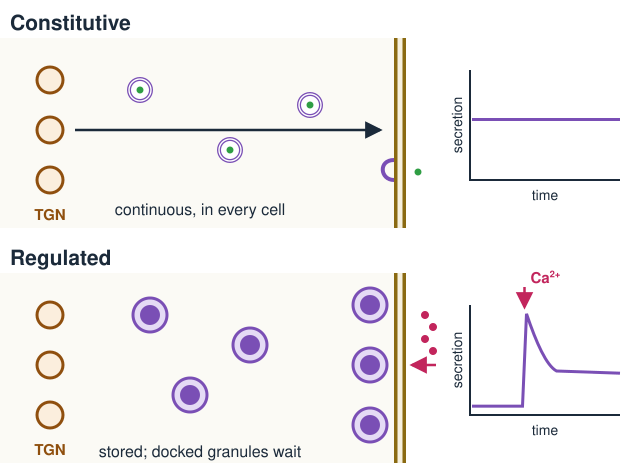{width="80%" fig-align="center"}
:::
::: {.column width="34%"}
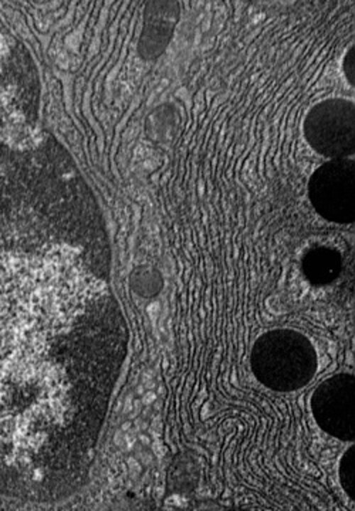{height="300px" fig-align="center"}

*Close-up of the acinar cell from the start of the lecture: rough ER (parallel lines) and dark, stored zymogen granules (right). TEM.*
:::
::::

- **Constitutive**: in **every cell**, all the time: collagen, albumin, antibodies, new plasma membrane proteins and lipids.
- **Regulated**: in **endocrine, exocrine and nerve cells**: granules **mature** (acidify, concentrate, cut prohormones), wait **docked** near the membrane, and fuse when **cytosolic Ca²⁺ rises**. **Synaptotagmin** senses the Ca²⁺.

::: notes
Every cell secretes constitutively. Vesicles from the TGN fuse with the plasma membrane at a steady rate, carrying secreted proteins such as collagen from fibroblasts, albumin from liver cells and antibodies from plasma cells, as well as new membrane proteins and lipids for the plasma membrane. Constitutive secretion is not controlled at the fusion step: what is made is shipped. Regulated secretion exists only in specialised cells: endocrine cells such as β cells, exocrine cells such as the pancreatic acinar cells in the micrograph, a close-up of the cell you saw at the start, mast cells and neurons. Their secretory granules mature after budding: they become more acidic, their content is concentrated up to two hundred times, and prohormones are cut into active hormones. Then they wait, some of them docked at the plasma membrane with partly assembled SNARE complexes. When the cell is stimulated, calcium enters the cytosol, through calcium channels in the plasma membrane or from the ER. Synaptotagmin on the granule binds calcium and triggers the final zipping of the SNAREs, and the granule fuses within milliseconds in a neuron, or seconds in an endocrine cell. Synaptic vesicles are a special case: small vesicles recycled locally in the nerve terminal.
:::

## How do we know? Watching cargo move in living cells {.smaller}

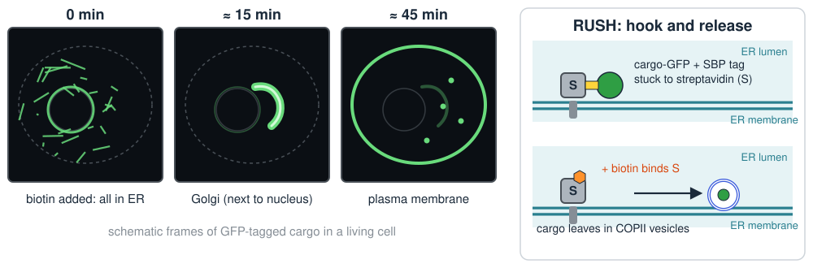{width="92%" fig-align="center"}

- **Synchronise** a wave of cargo: **VSVG-GFP ts045** misfolds and stays in the ER at **40 °C** and leaves when cooled to 32 °C. **RUSH**: cargo is held in the ER on a **streptavidin hook**; adding **biotin** releases it.
- **Blocks** stop the wave at one station: **15 °C** (cargo collects in the ERGIC), **20 °C** (in the TGN), **brefeldin A** (blocks ARF1 activation: no COPI, the Golgi **merges into the ER**). **Try it:** [the pulse-chase demo](questions.qmd#explore).

::: notes
Palade's autoradiographs were snapshots of fixed cells. Today we watch living cells. The trick is to start a synchronised wave of fluorescent cargo. The classic tracer is VSVG, the glycoprotein of vesicular stomatitis virus, in a temperature-sensitive mutant form called ts045, fused to GFP. At 40 degrees the protein misfolds and the ER keeps it. Cool the cells to 32 degrees, it folds, and the whole wave leaves the ER together: within about ten minutes it fills the Golgi, and within an hour it reaches the surface. A newer method, RUSH, works for any protein and at body temperature. The cargo is fused to a streptavidin-binding peptide, and an ER-resident hook protein carries streptavidin. The cargo sticks to the hook until you add biotin, which binds streptavidin much more tightly and releases the cargo. Blocks then stop the wave at chosen places. At 15 degrees cargo collects in the ERGIC, at 20 degrees in the TGN; warming again releases a sharp wave. Brefeldin A, a fungal compound, blocks the GEF that activates ARF1. Without COPI, the Golgi forms tubules that fuse with the ER within minutes. Try all of these in the demo.
:::

## Why it matters: botulinum toxin cuts SNAREs {.smaller}

:::: {.columns}
::: {.column width="64%"}
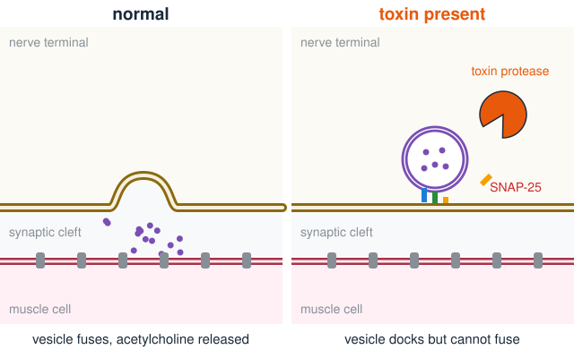{width="100%" fig-align="center"}
:::
::: {.column width="36%"}
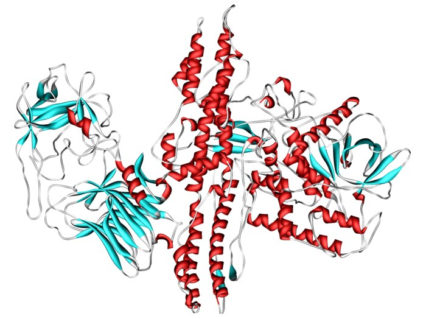{width="80%" fig-align="center"}

*Botulinum neurotoxin A (PDB 3BTA). Red: α-helices, cyan: β-strands.*
:::
::::

- **Botulinum toxins** (from *Clostridium botulinum*) enter **motor nerve terminals**; their **protease** chain cuts **SNAP-25**, **VAMP** or **syntaxin**. Vesicles dock but **cannot fuse** → no acetylcholine → **flaccid paralysis**. Among the most toxic substances known (about **1 ng/kg**).
- **Tetanus toxin** cuts **VAMP** in **inhibitory** neurons of the spinal cord → **spastic** paralysis.
- **Botox** injections: tiny doses for **dystonia, spasticity, chronic migraine, excessive sweating**, wrinkles. The effect lasts **about 3–4 months**, until the nerve terminal recovers.

::: notes
This is the SNARE zipper from earlier, now as a drug target. Botulinum toxins are made by the bacterium Clostridium botulinum, which grows without oxygen, for example in badly canned food. The toxin has two chains. The heavy chain binds receptors on motor nerve terminals and helps the light chain enter the cytosol. The light chain is a zinc protease that cuts one SNARE: type A, the form in Botox, cuts SNAP-25; type B cuts VAMP; type C cuts syntaxin. Synaptic vesicles still dock, but the zipper cannot close, so acetylcholine is not released and the muscle does not contract. The result is a flaccid paralysis that can stop breathing. About a nanogram per kilogram of body weight is enough to kill, which makes these toxins among the most poisonous substances known. Tetanus toxin cuts the same SNARE as type B, but travels backwards along the axon to the spinal cord and blocks inhibitory neurons, so muscles cramp instead. In medicine, tiny local injections of botulinum toxin weaken overactive muscles in dystonia and spasticity and are used for chronic migraine and excessive sweating. The effect wears off after about three to four months, as the nerve terminal recovers.
:::

## Why it matters: insulin secretion and type 2 diabetes {.smaller}

:::: {.columns}
::: {.column width="60%"}
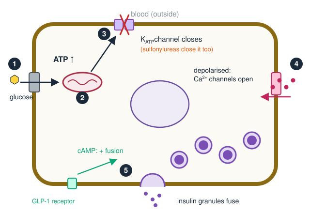{width="88%" fig-align="center"}
:::
::: {.column width="40%"}
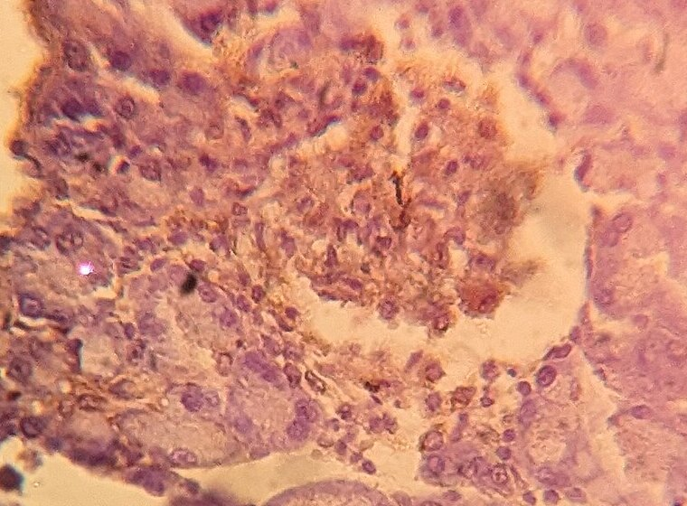{height="280px" fig-align="center"}

*Rat pancreas, immunostained for insulin (brown): an islet of Langerhans among acinar tissue.*
:::
::::

- A **β cell** stores about **10 000 granules**. Glucose → more **ATP** → **K~ATP~ channels close** → depolarisation → **Ca²⁺ channels open** → granules fuse: a fast **first phase** (docked granules) and a slower **second phase**.
- **Type 2 diabetes**: the **first phase is lost early**; β cells are overloaded (ER stress) and release more unprocessed **proinsulin**.
- Drugs act on this pathway: **sulfonylureas** close K~ATP~; **GLP-1 receptor agonists** (semaglutide) strengthen glucose-triggered **granule exocytosis**. More in Sjukdomslära.

::: notes
The β cells of the pancreatic islets, the brown cells in this stained section, are regulated-secretion specialists. Each stores about ten thousand insulin granules. Insulin is made as proinsulin in the ER, and it is cut into insulin and C-peptide inside maturing granules. Release is tied to blood glucose. Glucose enters the β cell and is metabolised, which raises ATP. ATP closes ATP-sensitive potassium channels, the membrane depolarises, voltage-gated calcium channels open, and calcium triggers granule fusion through synaptotagmin and SNAREs, as on the previous slides. When glucose rises suddenly, a first phase of release lasting a few minutes comes from granules already docked at the membrane; then a second, slower phase follows as new granules are brought up. In type 2 diabetes, the first phase is one of the earliest things to disappear. The β cells also make more proinsulin than they can process, so more unprocessed proinsulin appears in the blood. Several drugs act here. Sulfonylureas close the potassium channel directly. GLP-1 receptor agonists such as semaglutide raise cyclic AMP in β cells and strengthen glucose-triggered exocytosis. You will meet these drugs again in Sjukdomslära and in drug development.
:::

## Summary {.smaller}

1. Secretory proteins travel **ER → ERGIC → Golgi (cis → trans) → TGN → surface, granules or lysosomes**, always inside membranes; pulse-chase and live imaging of a **synchronised cargo wave** showed the route.
2. Each step uses a **carrier**: a **coat** (COPII out of the ER, COPI back and within the Golgi, clathrin at the TGN and plasma membrane), switched on by a **small GTPase**, bends the membrane and **selects cargo** by its sorting signals.
3. **Rab GTPases** and **tethers** find the right target; **SNAREs** zip the membranes together and fuse them; **NSF** takes them apart again.
4. The **Golgi** rebuilds **glycans** in cisternae that **mature** from cis to trans; **COPI** brings enzymes and escaped ER proteins (**KDEL**) back. The **TGN** sorts: **M6P** → lysosomes, **granules** → regulated secretion, the rest → **constitutive** secretion.
5. **Regulated secretion** fuses stored granules when **Ca²⁺** rises; **botulinum toxin** blocks fusion by cutting SNAREs, and the loss of **first-phase insulin secretion** is an early sign of **type 2 diabetes**.

*Read more (optional): Alberts et al., Molecular Biology of the Cell, 7th ed., ch. 13.*

[Image credits](../credits.qmd#golgi-secretion){style="font-size:0.7em"}

::: notes
Five take-home points. First, the route: secretory proteins move from the ER through the ERGIC and the Golgi stack to the trans-Golgi network, and from there to the plasma membrane, into secretory granules or to the lysosomes, without ever crossing a membrane; pulse-chase experiments and live imaging of synchronised cargo showed this. Second, budding: coats bend the membrane and pick the cargo, and each coat belongs to a route; a small GTPase switch decides where a coat forms. Third, targeting and fusion: Rab GTPases and tethers recognise the right membrane, SNAREs fuse the two bilayers, and NSF recycles the SNAREs. Fourth, the Golgi: it rebuilds sugar chains in an ordered stack whose cisternae mature from cis to trans, COPI retrieves enzymes and ER proteins, and the TGN sorts cargo by its signals, with constitutive secretion as the default. Fifth, regulated secretion waits for a calcium signal, and medicine meets this machinery in botulinum toxin and in type 2 diabetes. The endocytosis lecture takes the reverse direction, into the cell, and follows the mannose-6-phosphate route on to the lysosomes.
:::
