## About this lecture {.smaller}

A hormone such as adrenaline never enters the cell. It binds a receptor on the outside, and within seconds the inside of the cell changes. Today: the largest family of receptors, the **G-protein-coupled receptors (GPCRs)**, and the small **second messengers** they make inside the cell.

After this lecture you can:

- describe a GPCR (**seven transmembrane helices**) and how a hormone switches it on;
- explain the **trimeric G protein** as a timed switch, and the three main kinds: **Gs, Gi, Gq**;
- follow the two main pathways: **cAMP → PKA** and **IP₃ → Ca²⁺ / DAG → PKC**, including **calmodulin**;
- explain how the cascade **amplifies** the signal, and how every step is **switched off** (GTP hydrolysis, phosphodiesterase, GRK + arrestin, endocytosis);
- describe how we **watch** second messengers in living cells (Ca²⁺ imaging, FRET sensors);
- explain how **cholera toxin**, **β-blockers**, **opioids** and **GLP-1 drugs** act on this machinery.

**ELO 3** (signalling), with drug and disease examples for **ELO 9**.

::: notes
In the lecture on the principles of cell communication you met the receptor classes, dose–response curves and molecular switches. Today we open one receptor class in detail: the G-protein-coupled receptors. They are the largest family of membrane receptors in our genome, and they are the targets of about a third of all approved drugs, so this is the lecture where signalling meets pharmacology. We follow a signal from a hormone outside the cell, across the membrane, through a G protein, to a small molecule called a second messenger, and on to a protein kinase that changes what the cell does. We ask two quantitative questions: how can one hormone molecule outside cause millions of molecular events inside, and how does the cell switch the signal off again? We meet two methods that let us watch the signal live in a cell, and we finish with a bacterial toxin and three drug classes that act on exactly the steps we have drawn. This covers ELO 3, with examples for ELO 9.
:::

## The question: one hormone, many effects, all from outside {.smaller}

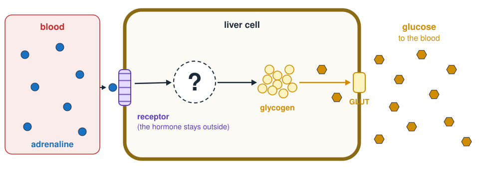{width="78%" fig-align="center"}

- Fright or exercise: the adrenal gland releases **adrenaline** (epinephrine) into the blood. Within seconds the **heart** beats faster and the **liver** releases glucose.
- Adrenaline is **water-soluble**: it cannot cross the membrane. It binds a receptor on the outside.
- **How does the signal cross the membrane? Why is the response so large and so fast, and how does it stop?** And why does cholera, a gut infection, cause litres of watery diarrhoea?

::: notes
Imagine you are startled. Your adrenal glands release adrenaline into the blood. Within seconds your heart beats faster and harder, and your liver breaks down its glycogen store and releases glucose into the blood, fuel for your muscles. Adrenaline is a small, charged, water-soluble molecule. It cannot cross the lipid bilayer, so it never enters the liver cell. It binds a receptor protein on the outer surface, and the message must cross the membrane by a change in the shape of that protein. The numbers are striking. Adrenaline in the blood is in the nanomolar range, yet a liver cell can release millions of glucose molecules per second. So the signal must be amplified on the way. And when the danger has passed, the response must stop within minutes, so the signal must also be switched off. Keep the fourth puzzle in mind: cholera bacteria in the gut make a toxin that hijacks exactly this machinery. We solve it at the end of the lecture.
:::

## GPCRs: seven helices across the membrane {.smaller}

:::: {.columns}
::: {.column width="64%"}
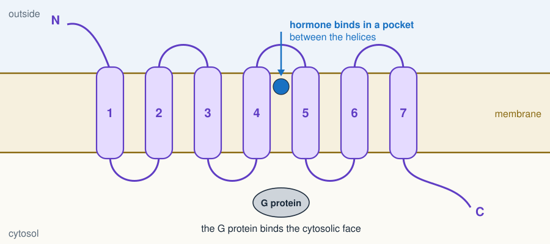{width="100%"}

- One protein chain crosses the membrane **seven times** (7TM). N-terminus outside, C-terminus inside. Drawn unrolled here; in reality the helices form a **bundle**.
- The ligand binds **outside or in a pocket between the helices**; the **G protein binds the cytosolic face**.
- About **800 human GPCRs**: receptors for hormones, neurotransmitters, light (rhodopsin), smell and taste (about half are odorant receptors).
:::
::: {.column width="36%"}
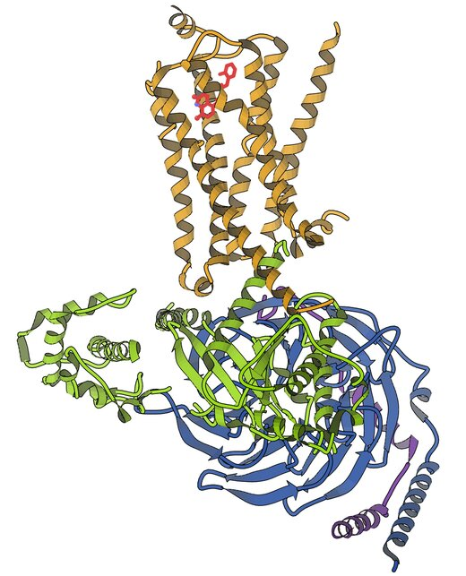{height="430px" fig-align="center"}

*β₂-adrenergic receptor (gold) bound to its G protein (green, blue, purple), from X-ray crystallography (PDB 3SN6).*
:::
::::

::: notes
All GPCRs share one architecture. A single polypeptide chain crosses the membrane seven times as alpha helices, so they are also called seven-transmembrane receptors. The N-terminus is outside the cell, the C-terminus inside. The diagram unrolls the chain so you can count the helices; in the real protein the seven helices pack into a barrel-like bundle. Small ligands such as adrenaline bind in a pocket between the helices, reached from the outside; large protein hormones bind to the outer loops and the N-terminus. The cytosolic face, with its loops and the C-terminal tail, binds the G protein. The image on the right is a real structure: the beta-2 adrenergic receptor in gold, in complex with its G protein, solved by X-ray crystallography. The human genome encodes about 800 GPCRs. About half of them are odorant receptors in the nose. Others detect light in the eye, taste, hormones and neurotransmitters. One family, one design, hundreds of signals.
:::

## Activation: the receptor swaps GDP for GTP {.smaller}

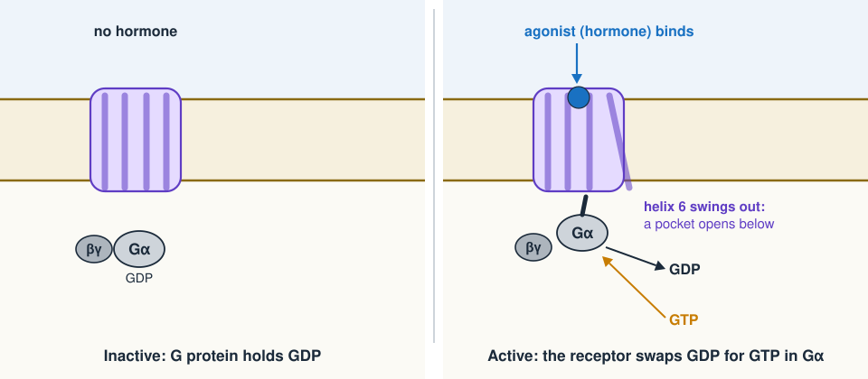{width="78%" fig-align="center"}

- Agonist binding shifts the helices: **helix 6 swings outwards** (about 1.4 nm in the β₂ receptor), opening a pocket on the **cytosolic** side.
- The **Gα** subunit's C-terminal helix inserts into that pocket. This pulls open Gα's nucleotide site: **GDP leaves**, and **GTP** (10 × more abundant in the cytosol) **enters**.
- So the active receptor is a **GEF** (guanine nucleotide exchange factor) for the G protein. It then lets go and activates the next one.

::: notes
How does binding outside change anything inside? The receptor is not rigid. When an agonist binds in the pocket between the helices, it stabilises a slightly different arrangement of the bundle. The largest movement is on the cytosolic side: helix 6 swings outwards, by about 1.4 nanometres in the beta-2 receptor, and a cavity opens. The G protein's alpha subunit fits into this cavity with its C-terminal helix. This contact is transmitted through Gα to its nucleotide-binding site, which opens. GDP falls out. In the cytosol GTP is about ten times more abundant than GDP, so GTP binds next, and Gα closes around it in its active shape. In the language of the principles lecture, the receptor acts as a guanine nucleotide exchange factor, a GEF. Note what the receptor does not do: it does not add the phosphate, it only lets GDP out. Once Gα holds GTP, it lets go of the receptor, and the receptor, still bound to its hormone, can activate another G protein.
:::

## The trimeric G protein is a switch with a timer {.smaller}

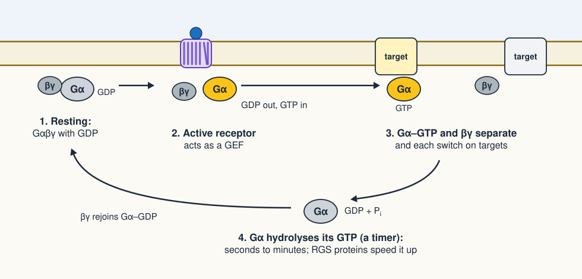{width="80%" fig-align="center"}

- Three subunits: **Gα** (binds GDP or GTP) and the tight pair **Gβγ**. Both are anchored to the membrane by lipid tails.
- With GTP, Gα separates from βγ: **both** halves can switch on targets.
- Gα is itself a slow **GTPase**: after seconds to minutes it hydrolyses GTP and switches off. **RGS proteins** speed this up for many G proteins.

::: notes
The G protein has three subunits, alpha, beta and gamma, which is why it is called trimeric or heterotrimeric. Beta and gamma never separate, so we treat them as one unit, βγ. Both Gα and βγ carry lipid anchors, so the whole cycle happens on the inner surface of the plasma membrane. At rest, Gα holds GDP and sits with βγ. An active receptor exchanges GDP for GTP. Gα with GTP changes shape and leaves βγ. Now both halves are free to bind target proteins in the membrane: enzymes or ion channels. Here is the clever part. Gα is an enzyme that slowly hydrolyses its own GTP to GDP and phosphate. This is a built-in timer. For Gs, the GTP lasts on average ten to twenty seconds. Then Gα–GDP rebinds βγ, and the switch is off. Proteins called RGS proteins, regulators of G-protein signalling, act as GTPase-activating proteins and can make the timer much faster. Remember from the principles lecture: a GTPase switch is on with GTP and off with GDP. This is the same idea.
:::

## Three main kinds of G protein: Gs, Gi, Gq {.smaller}

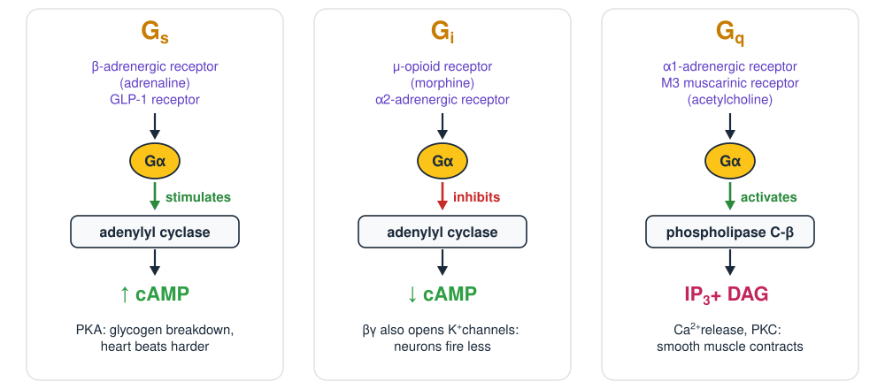{width="84%" fig-align="center"}

- The **receptor** decides which G protein is used; the **Gα type** decides the effect. The same hormone can act through different receptors: adrenaline uses **β** (Gs), **α₂** (Gi) and **α₁** (Gq) receptors.
- Simplified: there are more Gα types (e.g. G₁₂/₁₃, and transducin in the eye), and βγ has its own targets.

::: notes
Humans have sixteen genes for Gα, but three families do most of the work we need. Gs, s for stimulatory, activates adenylyl cyclase, the enzyme that makes cyclic AMP. Gi, i for inhibitory, inhibits adenylyl cyclase, so cyclic AMP falls; in neurons and the heart its βγ subunits also open potassium channels, which makes the cell harder to excite. Gq activates a different enzyme, phospholipase C beta, which makes two messengers, IP₃ and diacylglycerol, and leads to a rise in cytosolic calcium. Which G protein a cell uses depends on the receptor. That is why one hormone can have opposite effects in different tissues. Adrenaline acting on beta receptors in the heart uses Gs and makes the heart beat harder. The same adrenaline acting on alpha-1 receptors in the smooth muscle of skin blood vessels uses Gq and constricts the vessel. This is a simplified map: there are more Gα families, for example transducin in the retina, and βγ has its own targets. But Gs, Gi and Gq will carry us through this lecture.
:::

## The cAMP pathway: adenylyl cyclase, cAMP and PKA {.smaller}

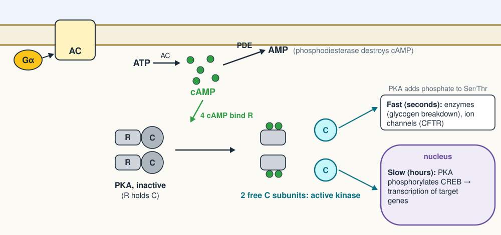{width="80%" fig-align="center"}

- **Adenylyl cyclase** (in the plasma membrane) turns ATP into **cyclic AMP**. **Phosphodiesterases** (PDEs) turn cAMP into AMP. Resting cAMP is low (about 0.1 µM), stimulated several µM.
- **PKA** (protein kinase A) is held inactive by its **regulatory (R)** subunits. Four cAMP bind the R subunits, and two **catalytic (C)** subunits are released.
- Free C phosphorylates Ser/Thr on target proteins: **fast** effects on enzymes and channels (seconds), **slow** effects on genes via CREB (hours).

::: notes
Here is the Gs pathway in detail. Active Gαs binds adenylyl cyclase, a large enzyme in the plasma membrane, and switches it on. Adenylyl cyclase converts ATP into cyclic AMP, a small, water-soluble molecule that diffuses through the cytosol. This is the second messenger: the hormone was the first messenger. Cyclic AMP is destroyed by phosphodiesterases, which open the ring to give plain AMP. The balance between cyclase and phosphodiesterase sets the cAMP level, and the phosphodiesterases also make sure cAMP falls quickly when the cyclase stops. The main target of cAMP is protein kinase A. PKA is a complex of two regulatory and two catalytic subunits. The regulatory subunits block the active sites. Each regulatory subunit binds two cAMP molecules, so four in total; the regulatory subunits change shape and release the two catalytic subunits, which are now active kinases. They phosphorylate serines and threonines on many proteins. Some effects are fast, like switching on enzymes for glycogen breakdown, or opening CFTR, which you met in the ion-channel lecture. Others are slow: PKA enters the nucleus and phosphorylates the transcription factor CREB, which switches on genes over hours.
:::

## Amplification: from one hormone to thousands of molecules {.smaller}

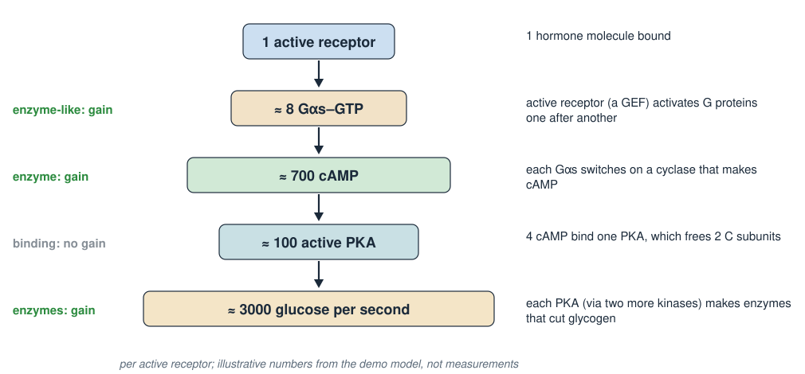{width="74%" fig-align="center"}

- Gain comes from steps where **one active molecule acts on many**: the receptor (one G protein after another), adenylyl cyclase, the kinases and the enzymes they switch on.
- **Binding** steps do not amplify: four cAMP free two C subunits of PKA.
- In the liver, the glycogen cascade has two more kinase steps after PKA, so a few hormone molecules can release **millions** of glucose molecules.

::: notes
Let us count. One hormone molecule keeps one receptor active for as long as it stays bound. While active, the receptor catalyses GDP–GTP exchange on one G protein after another, so it switches on several to many G proteins: with the numbers in our demo model, about eight at a time. Each active Gαs switches on one adenylyl cyclase, which is an enzyme that makes many cAMP molecules per second. That is the largest gain in this cascade. The next step looks like a loss: four cAMP molecules are needed to release two catalytic subunits of PKA. Binding does not amplify; only catalysis does. But each PKA catalytic subunit is an enzyme. In the liver, PKA phosphorylates phosphorylase kinase, which phosphorylates glycogen phosphorylase, which cuts glucose units off glycogen, so each step multiplies again. The exact numbers depend on the cell and are illustrative here. The principle is not: enzymes in series multiply the signal, so a nanomolar hormone can move the metabolism of a whole organ. Amplification also has a price: a cascade that amplifies must be switched off at every step.
:::

## Gq: IP₃ releases Ca²⁺, DAG recruits PKC {.smaller}

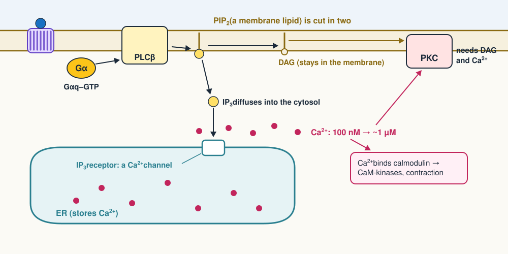{width="78%" fig-align="center"}

- **Phospholipase C-β** cuts the membrane lipid **PIP₂** into **IP₃** (soluble) and **DAG** (stays in the membrane).
- **IP₃** opens the **IP₃ receptor**, a Ca²⁺ channel in the ER. Cytosolic Ca²⁺ rises from about **100 nM** to about **1 µM**.
- **PKC** (protein kinase C) moves to the membrane when Ca²⁺ rises and becomes active when it also binds **DAG**.

::: notes
Now the Gq branch. Active Gαq switches on phospholipase C beta. Its substrate is a minor membrane lipid, phosphatidylinositol 4,5-bisphosphate, PIP₂ for short, which has a sugar-phosphate head group in the inner leaflet. Phospholipase C cuts PIP₂ into two messengers at once. The head group, inositol trisphosphate or IP₃, is water-soluble and diffuses into the cytosol. The rest, diacylglycerol or DAG, is a lipid and stays in the membrane. IP₃ binds the IP₃ receptor, a calcium channel in the ER membrane. You know from the ion-channel lecture that cytosolic calcium is kept at about 100 nanomolar, ten thousand times lower than in the ER. So when the channels open, calcium floods out and the cytosolic level rises roughly tenfold within a second. Calcium and DAG then work together. Protein kinase C binds calcium, moves to the membrane, and becomes fully active when it also binds DAG there. This is a coincidence detector: both messengers are needed. Calcium has many other targets, and the most important is calmodulin, on the next slide.
:::

## Ca²⁺ acts through calmodulin {.smaller}

:::: {.columns}
::: {.column width="40%"}
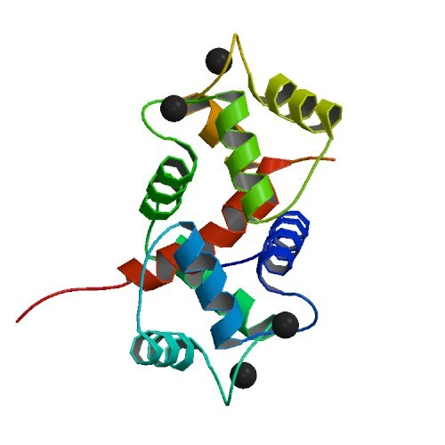{height="420px" fig-align="center"}

*Calmodulin with four Ca²⁺ ions (black spheres), wrapped around a helix of its target, myosin light-chain kinase.*
:::
::: {.column width="60%"}
- **Calmodulin** is a small, abundant protein with **four Ca²⁺ binding sites**. They fill when Ca²⁺ rises towards 1 µM.
- With Ca²⁺ bound, calmodulin **wraps around a helix** of its target and switches it on:
  - **CaM-kinase II**: a kinase in neurons (memory);
  - **myosin light-chain kinase**: smooth muscle contraction;
  - adenylyl cyclases and phosphodiesterases: **cross-talk** with cAMP.
- Ca²⁺ signals often come as **spikes or oscillations**: the cell can code strength in their **frequency**.
- Pumps (**SERCA** in the ER, **PMCA** in the plasma membrane) bring Ca²⁺ back to 100 nM.
:::
::::

::: notes
Calcium itself does nothing until it binds a protein. The main calcium sensor in every eukaryotic cell is calmodulin, a small protein of about 150 amino acids with four calcium-binding sites. These sites have an affinity in the micromolar range, so at resting calcium they are mostly empty, and when calcium rises towards one micromolar they fill. Calcium-bound calmodulin changes shape, exposing sticky hydrophobic surfaces, and wraps around a helix in its target protein, as you see in the structure, where calmodulin grips a peptide from myosin light-chain kinase. That kinase then phosphorylates myosin in smooth muscle, and the muscle contracts. Another target, calcium-calmodulin-dependent kinase II, is abundant in synapses and is important for memory. Calmodulin also regulates some adenylyl cyclases and phosphodiesterases, so the calcium and cAMP pathways talk to each other. Calcium signals are often brief spikes, repeated as oscillations, and cells can read the frequency. Pumps in the ER and plasma membrane, which you met in the transport lectures, constantly return calcium to 100 nanomolar and end each spike.
:::

## How do we know? Finding and seeing the receptor {.smaller}

:::: {.columns}
::: {.column width="55%"}
- **1970s:** Robert **Lefkowitz** used **radioactive ligands** to show that receptors are real, countable proteins in the membrane, and purified the β-adrenergic receptor.
- **1986:** his group, with Brian **Kobilka**, **cloned the gene**. Its sequence showed **seven hydrophobic helices**, like rhodopsin, the light receptor: one family for hormones and light.
- **2007–2011:** Kobilka's group solved the **crystal structure** of the β₂ receptor, and then of the receptor **caught in the act** of activating Gs (PDB 3SN6, the structure two slides back).
- **Nobel Prize in Chemistry 2012.** Today cryo-EM gives new GPCR–G protein structures every week, and drugs are designed against them.
:::
::: {.column width="45%"}
{width="100%"}

*Brian Kobilka (left) and Robert Lefkowitz at the Nobel Prize ceremony in Stockholm, December 2012.*
:::
::::

::: notes
For a long time receptors were an abstract idea: something on the cell that a drug must bind. Robert Lefkowitz made them concrete. In the 1970s his group labelled adrenaline-like drugs with radioactive isotopes and measured how much bound to membranes: a saturable number of high-affinity sites, which they could count and purify. Then, in 1986, Lefkowitz's group, with Brian Kobilka as a young researcher, cloned the gene for the beta-2 adrenergic receptor. The sequence was a surprise: seven stretches of hydrophobic amino acids, just like rhodopsin, the light receptor of the eye. This showed that hormone receptors and light receptors belong to one family. Kobilka then spent twenty years trying to crystallise the receptor, which is floppy and unstable outside the membrane. In 2007 his group solved its structure, and in 2011 they caught the receptor bound to its G protein in the active state, the structure you saw earlier. Lefkowitz and Kobilka shared the 2012 Nobel Prize in Chemistry. Today cryo-electron microscopy produces such structures routinely, and they guide drug design.
:::

## How do we know? Watching second messengers live {.smaller}

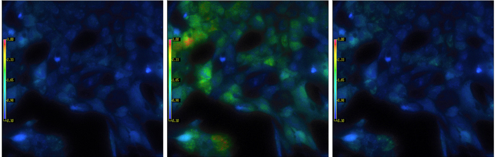{width="60%" fig-align="center"}

*Retinal glial cells loaded with the Ca²⁺ dye fura-2: before ATP, a few seconds after adding ATP (which acts on a Gq-coupled receptor), and later. Blue = low Ca²⁺, red = high.*

:::: {.columns}
::: {.column width="45%"}
- **Ca²⁺ imaging:** a dye (fura-2) or a genetically encoded sensor (GCaMP: GFP + calmodulin) gets brighter or changes colour when it binds Ca²⁺.
- **FRET sensor for cAMP** (right): cAMP opens the sensor, so less energy passes from CFP to YFP; the blue/yellow ratio reads cAMP.
:::
::: {.column width="55%"}
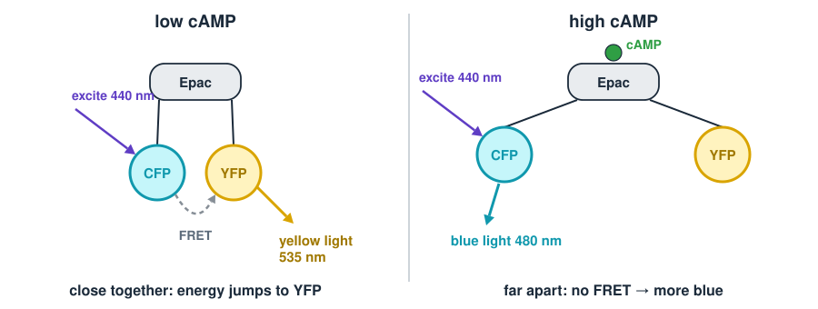{width="100%"}
:::
::::

::: notes
How do we know that calcium rises, and how fast, in a living cell? We make it visible. The images at the top show glial cells from the retina loaded with fura-2, a fluorescent dye that changes its excitation spectrum when it binds calcium; the colours show the calcium level, blue low and red high. Before stimulation the cells are blue. A few seconds after ATP is added, which acts on P2Y receptors that couple to Gq, many cells turn green to red, and the signal then fades as pumps clear the calcium. Today we often use genetically encoded sensors such as GCaMP, a fusion of GFP and calmodulin that becomes brighter when calcium binds, so we can image calcium in a specific cell type in a living animal. For cAMP we use FRET sensors, shown bottom right. A cAMP-binding domain, here from the protein Epac, sits between two fluorescent proteins, CFP and YFP. Without cAMP they are close: light absorbed by CFP is passed to YFP by FRET, and the sensor glows yellow. When cAMP binds, the sensor opens, FRET drops and more blue light comes out. The blue-to-yellow ratio reads cAMP in real time.
:::

## Switching off: every step has its own off-switch {.smaller}

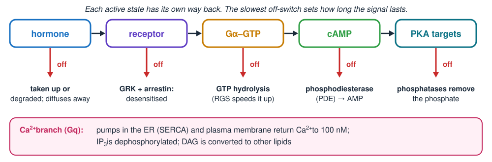{width="86%" fig-align="center"}

- A signal is only useful if it **ends**. Each active state decays on its own: **GTP hydrolysis** in Gα, **PDE** for cAMP, **phosphatases** for the phosphorylated targets, **pumps** for Ca²⁺.
- The signal lasts as long as the **slowest** off-step allows. Block one off-switch and the signal outlasts the hormone.
- This is why the **PDE inhibitors** caffeine and theophylline raise cAMP (theophylline was used for asthma).

::: notes
We have built a powerful amplifier. Now we need the brakes. A signal that cannot end carries no information about time: the cell must know not only that adrenaline came, but also that it has gone. Every step of the cascade has its own way back. The hormone is removed from the blood, taken up or broken down. Gα hydrolyses its GTP. Phosphodiesterases destroy cyclic AMP. Protein phosphatases remove the phosphates that PKA added. In the calcium branch, pumps in the ER and plasma membrane return calcium to 100 nanomolar, IP₃ is dephosphorylated, and DAG is converted to other lipids. Because these steps are in series, the signal can last only as long as the slowest of them allows. If you slow down one off-switch, the signal outlasts the hormone. Methylxanthines such as caffeine and theophylline inhibit phosphodiesterases. At the doses in coffee, caffeine acts mainly on adenosine receptors, another GPCR, but at higher doses PDE inhibition raises cAMP; theophylline was used to relax airway smooth muscle in asthma. Next: the receptor's own off-switch.
:::

## Desensitisation: GRK, arrestin and endocytosis {.smaller}

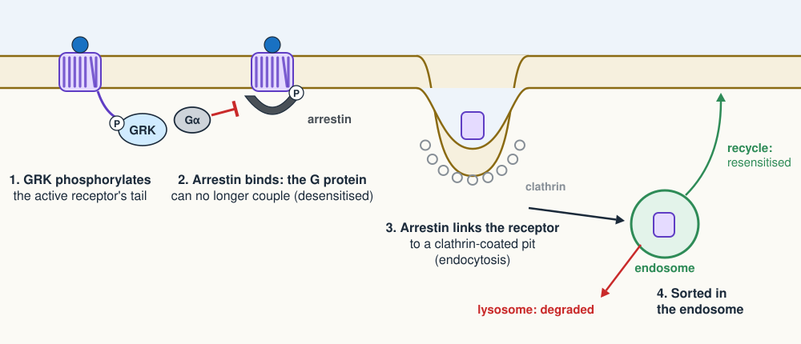{width="80%" fig-align="center"}

- **GRK** (G-protein-coupled receptor kinase) phosphorylates **only active** receptors on their tail. **Arrestin** binds the phosphorylated tail and **blocks** G-protein coupling: the receptor is **desensitised**, even with hormone bound.
- Arrestin is also an adaptor for **clathrin**: the receptor is taken into the cell by **endocytosis** (the **endocytosis lecture**). In the endosome it is **recycled** (resensitised) or sent to the **lysosome** (fewer receptors).
- Result: under constant hormone the response **fades** (minutes), and with long drug use **tolerance** develops.

::: notes
The receptor has an off-switch of its own, and it acts only on receptors that are in use. G-protein-coupled receptor kinases, GRKs, recognise the active shape of the receptor and phosphorylate serines and threonines on its cytosolic tail. The phosphorylated tail is bound by arrestin. Arrestin sits on the same cytosolic face that the G protein needs, so the receptor can no longer activate G proteins, even though the hormone is still bound. This is desensitisation, and it takes seconds to minutes. Arrestin does more: it also binds clathrin and its adaptor, so the receptor is collected into a clathrin-coated pit and taken into the cell by endocytosis, which you will meet in detail in the endocytosis lecture. In the endosome the hormone dissociates, the phosphates are removed, and the receptor is either recycled to the surface, ready to signal again, or sent to the lysosome and degraded. Repeated or constant stimulation therefore reduces the number of receptors on the surface. This is one cause of drug tolerance: patients need higher doses of some drugs, such as opioids, to get the same effect.
:::

## The off-rates set the shape of the signal {.smaller}

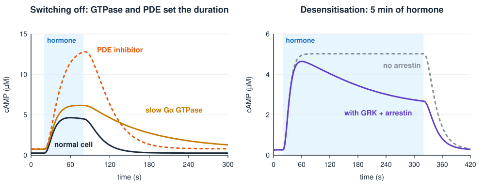{width="84%" fig-align="center"}

- **Left:** a 1-minute hormone pulse. A **slow GTPase** or a **PDE inhibitor** makes cAMP rise higher and last longer after the hormone has gone.
- **Right:** 5 minutes of hormone. With GRK + arrestin, cAMP **peaks and then falls** although the hormone is still there.
- Curves from a simple model with illustrative numbers. **Try it:** [Demo: GPCR cascade](questions.qmd#explore)

::: notes
Here is what the off-switches do to the time course of cAMP, computed with the simple model in the demo for this lecture. On the left, the hormone is present for one minute, shaded blue. In the normal cell, black, cAMP rises within about twenty seconds, stays up while the hormone is there, and falls back within a minute after it has gone. If Gα hydrolyses its GTP five times more slowly, orange, active Gα accumulates: cAMP rises higher and stays up long after the hormone has gone. If a drug inhibits the phosphodiesterase, dashed, cAMP rises much higher and also falls more slowly. On the right, the hormone stays for five minutes. Without arrestin, dashed grey, cAMP rises to a plateau and stays there as long as the hormone is present. With GRK and arrestin, purple, cAMP peaks and then falls, although the hormone is still present: the receptors are being desensitised. The cell responds to a change in hormone more than to a constant level. These are illustrative numbers, not data, but the shapes are what experiments show. In the demo you can change each rate yourself.
:::

## Why it matters: cholera toxin locks Gs on {.smaller}

:::: {.columns}
::: {.column width="70%"}
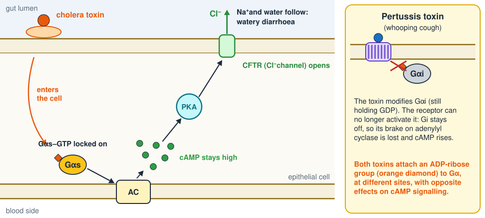{width="100%"}
:::
::: {.column width="30%"}
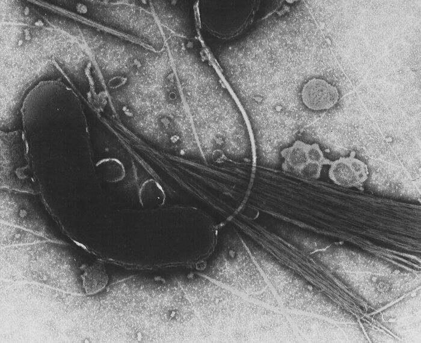{width="100%"}

*Vibrio cholerae, electron microscope (negative stain).*
:::
::::

- Cholera toxin attaches **ADP-ribose** to Gαs, which then **cannot hydrolyse GTP**: Gs stays on, cAMP stays high in gut cells. PKA opens **CFTR**; Cl⁻, Na⁺ and water pour into the gut: **several litres a day**.
- Treatment: **oral rehydration** (water + salt + glucose), which uses the **SGLT** Na⁺–glucose symporter that cholera leaves intact.

::: notes
Now the puzzle from the start. Vibrio cholerae lives in contaminated water. In the small intestine it makes cholera toxin, a protein with one A subunit and a ring of five B subunits. The B ring binds a ganglioside on the gut cell surface, the toxin is taken into the cell, and part of the A subunit reaches the cytosol. There it is an enzyme: it transfers an ADP-ribose group from NAD onto Gαs. Modified Gαs can still bind GTP, but it can no longer hydrolyse it. The timer is broken, so every Gαs that is switched on stays on. Adenylyl cyclase runs continuously, cAMP stays high, and PKA keeps CFTR, the chloride channel from the ion-channel lecture, open. Chloride flows into the gut, sodium and water follow, and the patient loses several litres of fluid a day. Without treatment, dehydration can kill within a day. The treatment is simple and cheap: oral rehydration solution. It works because the SGLT sodium–glucose symporter from the transport lecture still works, and water follows the absorbed salt and sugar. Pertussis toxin, from the whooping-cough bacterium, modifies Gαi instead: its receptors can no longer activate it, so the brake on cyclase is lost.
:::

## Why it matters: three drug classes acting on GPCRs {.smaller}

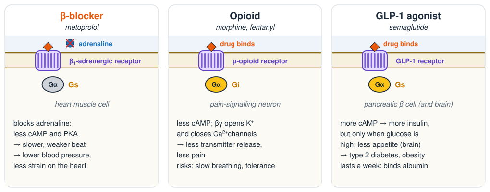{width="82%" fig-align="center"}

- About **one third** of approved drugs act on GPCRs. **β-blockers** are **antagonists**: they occupy the receptor without activating it. **Opioids** and **GLP-1 drugs** are **agonists**.
- **Semaglutide** is GLP-1 made long-lasting: natural GLP-1 lasts **minutes**; semaglutide resists breakdown and binds albumin, so one injection lasts **a week**.
- You meet these drugs again in **Organs struktur och funktion** (heart, pancreas) and **Kliniska prövningar och läkemedelsutveckling**.

::: notes
Three drug classes show the range. Beta-blockers such as metoprolol are antagonists at beta-1 adrenergic receptors in the heart. They bind the pocket but do not activate the receptor, so adrenaline cannot act; Gs, cAMP and PKA stay lower, the heart beats more slowly and less forcefully, and blood pressure falls. They are used for high blood pressure, angina, heart failure and after heart attacks. Opioids such as morphine and fentanyl are agonists at the mu-opioid receptor, which couples to Gi. In pain-signalling neurons, Gαi lowers cAMP, and βγ opens potassium channels and closes calcium channels at the nerve terminal, so less transmitter is released and less pain signal reaches the brain. The same receptors in the brainstem slow breathing, which makes overdoses deadly, and desensitisation contributes to tolerance. Semaglutide is an agonist at the GLP-1 receptor, a Gs-coupled receptor on pancreatic beta cells. Extra cAMP increases insulin release only when glucose is high, so the risk of low blood sugar is small. It also acts in the brain to reduce appetite. Natural GLP-1 is destroyed within minutes; semaglutide carries an amino-acid change and a fatty-acid chain that binds albumin, so it lasts about a week.
:::

## Summary {.smaller}

1. **GPCRs** have **seven transmembrane helices**. An agonist shifts the helices; the active receptor is a **GEF** that swaps GDP for GTP in the **trimeric G protein**.
2. **Gα–GTP** and **βγ** switch on targets: **Gs** ↑ cAMP, **Gi** ↓ cAMP, **Gq** → PLC-β → **IP₃** (Ca²⁺ from the ER) + **DAG** (with Ca²⁺ activates **PKC**). Ca²⁺ acts through **calmodulin**.
3. **cAMP** frees the catalytic subunits of **PKA**, which phosphorylate enzymes, channels and transcription factors. Enzymes in series **amplify** the signal.
4. Every step is **switched off**: **GTP hydrolysis**, **phosphodiesterase**, phosphatases, Ca²⁺ pumps; **GRK + arrestin** desensitise the receptor and lead to **endocytosis**.
5. **Ca²⁺ imaging** and **FRET sensors** show these signals live. Toxins and drugs act on single steps: **cholera toxin** (Gs stuck on), **β-blockers**, **opioids**, **semaglutide**.

*Read more (optional): Alberts et al., Molecular Biology of the Cell, 7th ed., ch. 15.*

[Image credits](../credits.qmd#gpcr){style="font-size:0.7em"}

::: notes
Five take-home points. First, GPCRs are seven-helix receptors; the hormone changes the shape of the bundle, and the active receptor acts as an exchange factor that loads GTP onto the G protein. Second, the G protein is a timed switch; its alpha type decides the output: Gs raises cAMP, Gi lowers it, and Gq splits PIP₂ into IP₃, which releases calcium from the ER, and DAG, which with calcium activates protein kinase C; calcium itself acts through calmodulin. Third, cAMP activates protein kinase A by releasing its catalytic subunits, and the chain of enzymes amplifies a few hormone molecules into a large response. Fourth, a signal must end: GTP hydrolysis, phosphodiesterases, phosphatases and pumps reset the messengers, and GRK and arrestin desensitise the receptor and send it into endocytosis. Fifth, we can watch these signals in living cells, and many toxins and drugs act on exactly one step. In the next lecture we meet the other big class of surface receptors, the enzyme-coupled receptors and their kinase cascades.
:::
