## About this lecture {.smaller}

Every cell has a **voltage across its plasma membrane**. Nerves and muscles use it to send signals, but so does every other cell: to move salt and water, to take up nutrients and to trigger secretion. Today: the proteins that make and use this voltage, the **ion channels**.

After this lecture you can:

- explain how a **channel** differs from a **transporter** (rate, selectivity, gating);
- explain why the **K⁺ channel** lets K⁺ through but not the smaller Na⁺;
- describe the three main ways a channel opens: **voltage, ligand, mechanical force**;
- derive the **Nernst equation** from ΔG and use it to calculate an equilibrium potential;
- explain how the **resting membrane potential** arises, and what happens in an **action potential**;
- explain how **patch clamp** records one channel, and how channel defects and channel drugs act (**cystic fibrosis, local anaesthetics**).

**ELO 2** (membranes and transport), with a disease example for **ELO 9**.

::: notes
This lecture builds on the two lectures before it. In the lecture on membrane structure you saw that a lipid bilayer is almost impermeable to ions. In the lecture on transporters and pumps you saw how the sodium-potassium pump uses ATP to build concentration gradients: high potassium inside, high sodium outside. Today we ask what happens when we open a hole for one kind of ion. The answer is a voltage, the membrane potential, and that voltage is used by every cell, not only nerves. We will use your chemistry: the Gibbs energy, delta G, which you know from equilibria, gives us the Nernst equation in three lines. We also meet one of the great methods of cell biology, patch clamp, which lets you watch a single protein molecule open and close in real time. We finish with two medical stories: cystic fibrosis, where modern drugs are matched to the exact molecular defect, and local anaesthetics, which you have probably met at the dentist. This covers ELO 2 and gives an example for ELO 9.
:::

## The question: every cell is a small battery {.smaller}

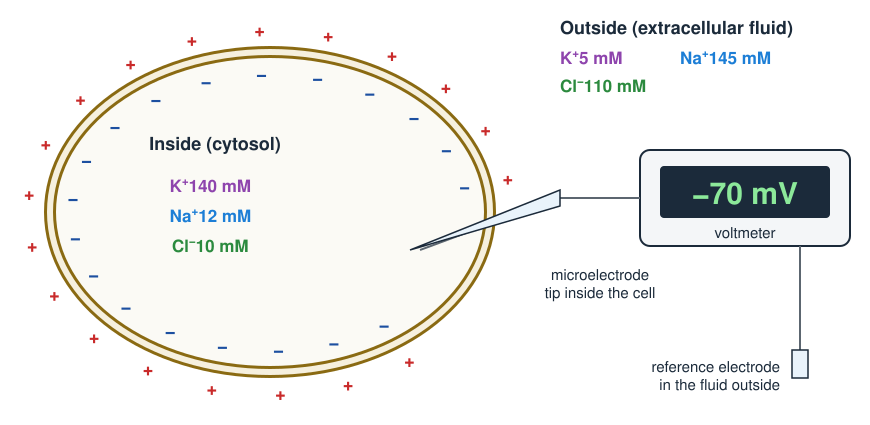{width="62%" fig-align="center"}

- Put a fine electrode into almost any animal cell: the inside is about **70 mV more negative** than the outside.
- The membrane is only **5 nm** thick, so the electric field across it is huge: about **14 million volts per metre**.
- **Where does the voltage come from? How can a protein pore pass K⁺ but not the smaller Na⁺? And why does a child with cystic fibrosis taste salty?**

::: notes
If you push a very fine glass electrode into a cell and compare it with a second electrode in the fluid outside, the voltmeter reads about minus 70 millivolts. The inside is negative. That sounds small, a twentieth of a torch battery. But the membrane is only about 5 nanometres thick. Seventy millivolts across five nanometres is about fourteen million volts per metre, an electric field strong enough to move charged parts of proteins inside the membrane. Look also at the ion concentrations: potassium is about thirty times higher inside, sodium more than ten times higher outside. You saw in the transport lecture that the sodium-potassium pump builds these gradients. Today we connect the gradients to the voltage. Three puzzles guide the lecture. First, where does the voltage come from? Second, a potassium channel lets potassium through ten thousand times better than sodium, although sodium is the smaller ion. How? Third, an old European saying warned that a child who tastes salty when kissed will die young. We now know this is cystic fibrosis, a disease of one chloride channel.
:::

## Channels and transporters: two ways across {.smaller}

*Recap:* the bilayer stops ions; the **Na⁺/K⁺ pump** uses ATP to keep K⁺ high inside and Na⁺ high outside.

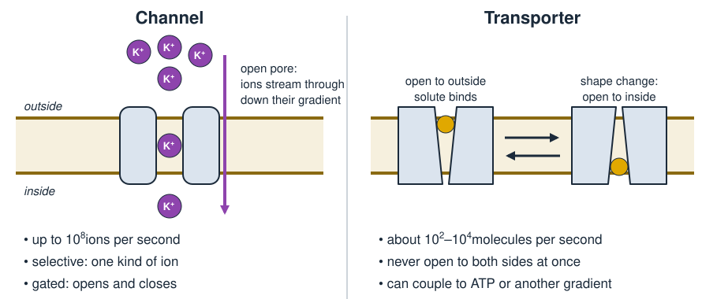{width="72%" fig-align="center"}

A channel is fast because nothing has to change shape for each ion. It can only let ions flow **down** their electrochemical gradient: **passive** transport.

::: notes
In the transport lecture you met transporters. A transporter binds its solute, changes shape, and releases the solute on the other side. It is never open to both sides at the same time, which is why it can couple the movement of one solute to ATP or to another gradient, and pump uphill. The price is speed: each cycle needs a shape change, so a transporter moves a hundred to ten thousand molecules per second. A channel is different. When it is open, it is a water-filled pore through the membrane, and ions stream through one after another, up to a hundred million per second. That is close to the speed of free diffusion. But a channel can never pump: ions only go downhill, from high to low electrochemical potential. Channels have two more properties. They are selective: most let only one kind of ion through, for example potassium, sodium, calcium or chloride. And they are gated: they switch between open and closed, and the cell controls the switch. Rate, selectivity and gating are the three words to remember.
:::

## How do we know? The structure of a K⁺ channel {.smaller}

:::: {.columns}
::: {.column width="38%"}
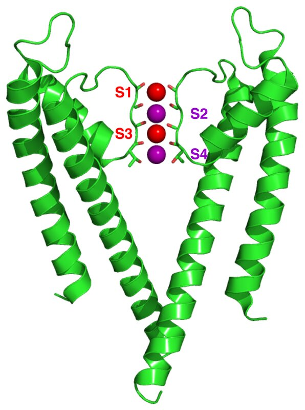{height="470px" fig-align="center"}

*KcsA, a bacterial K⁺ channel (PDB 1K4C). Two of the four subunits are shown. K⁺ ions (purple) and water (red) sit in the selectivity filter, sites S1–S4.*
:::
::: {.column width="62%"}
- **1998:** Roderick MacKinnon's group solved the first atomic structure of an ion channel by **X-ray crystallography**: KcsA from the bacterium *Streptomyces*.
- **Four identical subunits** form a ring around a central pore, like the staves of a barrel.
- Most of the pore is **wide and lined with water**. Only a short part near the outside, the **selectivity filter** (about 1.2 nm long), is narrow.
- The filter is lined by **backbone carbonyl oxygens** (C=O) of the sequence **TVGYG**, the same in K⁺ channels from bacteria to humans.
- Nobel Prize in Chemistry **2003** (MacKinnon, with Peter Agre for water channels).
:::
::::

::: notes
For decades, physiologists knew from electrical measurements that potassium channels were very selective and very fast, and they could not explain how both were possible. The answer came from a structure. Roderick MacKinnon chose a simple potassium channel from a soil bacterium, KcsA, because it could be made in large amounts and crystallised. In 1998 his group solved the structure by X-ray crystallography. The image shows two of the four identical subunits; the other two, in front and behind, are removed so you can see into the pore. Each subunit has two long helices that cross the membrane. The four subunits make a ring, and the pore runs down the middle. Most of the pore is wide and full of water. Near the outer end it narrows into the selectivity filter. Here, the protein backbone, not the side chains, points its carbonyl oxygen atoms into the pore. The filter sequence, threonine, valine, glycine, tyrosine, glycine, is conserved in potassium channels of bacteria, plants and humans. You can see four ion sites, with potassium ions and water molecules alternating. MacKinnon shared the 2003 Nobel Prize in Chemistry.
:::

## The selectivity filter: why K⁺ passes and Na⁺ does not {.smaller}

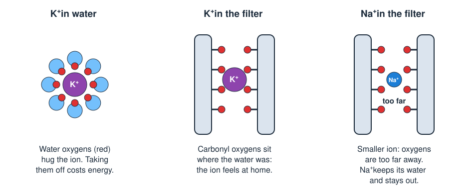{width="74%" fig-align="center"}

- In water, every ion is wrapped in a **shell of water molecules**. To enter the narrow filter, the ion must **lose its water**, which costs energy.
- For **K⁺** (radius 0.13 nm), the filter's carbonyl oxygens sit **exactly where the water oxygens were**: the energy is paid back.
- **Na⁺** is smaller (0.10 nm). The rigid filter cannot close in on it, so losing water is not paid back. Na⁺ stays out: **about 1 in 10 000** ions that pass is Na⁺.

::: notes
Here is the solution to the puzzle. An ion in water is never naked. Water molecules turn their partly negative oxygen atoms towards a positive ion and hold it tightly. Pulling these water molecules off costs a lot of energy. The selectivity filter is too narrow for an ion with its water shell, so an ion can only enter if it gives up its water. For potassium, the filter offers a perfect replacement. The carbonyl oxygens of the protein backbone are held by the rigid structure at the same distance from the ion as the water oxygens were. The potassium ion trades water oxygens for protein oxygens and hardly notices the change. Sodium is smaller. In water its shell is tighter. In the filter, the oxygens are too far away to touch it, and the filter is too stiff to close in. So for sodium, entering the filter means losing water without getting anything back. That costs too much, and sodium stays out. Speed comes from the same structure: two potassium ions sit in the filter at a time, and they repel each other, so one pushes the next one through.
:::

## Gating: three ways to open a channel {.smaller}

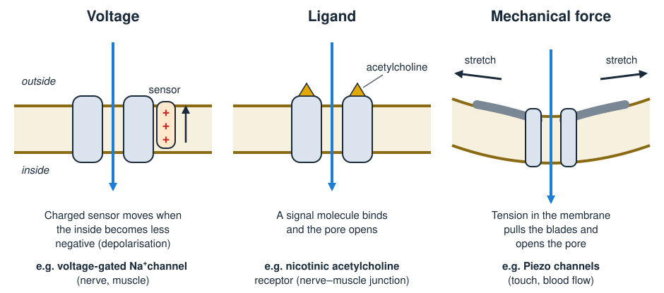{width="80%" fig-align="center"}

- **Voltage-gated:** positive charges in a **voltage-sensor** helix are pulled by the membrane field. When the inside becomes less negative, the sensor moves and opens the gate.
- **Ligand-gated:** a molecule binds and opens the pore. Two **acetylcholine** molecules open the receptor on a muscle cell; Na⁺ flows in.
- **Mechanically gated:** tension in the membrane opens **Piezo**, a large three-bladed channel (Nobel Prize 2021, Patapoutian). Piezo2 lets you feel touch.

::: notes
Most channels are closed most of the time and open only for a few milliseconds when they get a signal. There are three main kinds of signal. Voltage-gated channels have a voltage sensor: a helix that crosses the membrane and carries a positive charge at every third amino acid. At rest, the negative inside pulls these charges inwards. When the membrane depolarises, that is, the inside becomes less negative, the sensor moves outwards and pulls the gate open. Voltage-gated sodium channels in nerve and muscle open this way. Ligand-gated channels open when a molecule binds. The nicotinic acetylcholine receptor at the junction between nerve and muscle is a ring of five subunits; when two acetylcholine molecules bind, the pore opens and lets sodium and potassium through, mostly sodium in. Mechanically gated channels respond to force. The Piezo channels have three long blades that sit in the membrane; when the membrane is stretched, the blades flatten and the central pore opens. Piezo2 in skin nerve endings makes touch possible, and Piezo1 senses blood flow in vessels. You will meet more ligand-gated channels in the signalling lectures.
:::

## Two forces on an ion: the electrochemical gradient {.smaller}

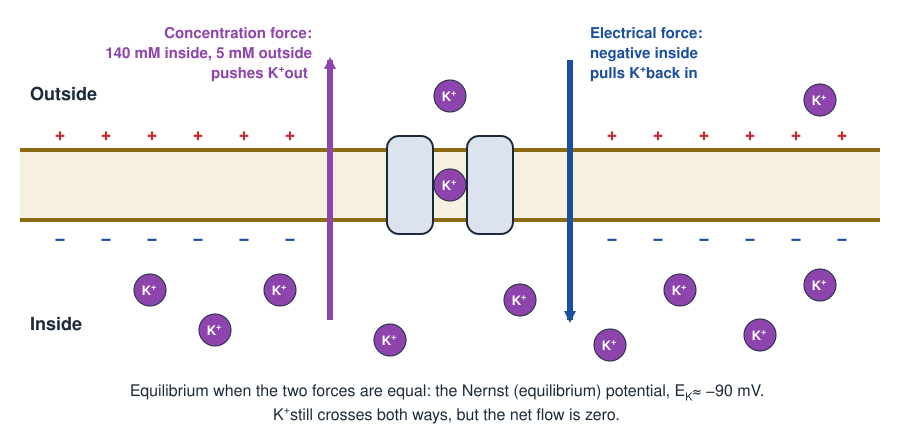{width="70%" fig-align="center"}

- **Concentration:** more K⁺ inside than outside pushes K⁺ **out**.
- **Voltage:** a negative inside pulls positive ions **in** (and pushes negative ions out).
- Together they make the **electrochemical gradient**. The ion flows until the two forces are equal: the **equilibrium potential** of that ion.

::: notes
An ion feels two forces at once. The first is the concentration gradient, which you know from diffusion: potassium is about thirty times more concentrated inside, so potassium ions that find an open channel tend to leave. The second is the electrical force. Potassium is positive, and a negative inside pulls it back. The sum of these two is called the electrochemical gradient. Imagine you open only potassium channels. Potassium starts to flow out. Each ion that leaves takes a positive charge with it and leaves a negative charge behind, so the inside becomes more negative, and the electrical pull back grows. At some voltage the two forces balance. Ions still cross in both directions, but as many go in as come out, so there is no net flow. That voltage is the equilibrium potential of potassium, written E sub K. For potassium it is about minus 90 millivolts. Every ion has its own equilibrium potential, set by its own concentrations. On the next slide we calculate it from Gibbs energy.
:::

## The Nernst equation from ΔG {.smaller}

You know $\Delta G = \Delta G^\circ + RT\ln Q$. Move **1 mol of ion** from **outside to inside**:

1. Same ion on both sides, so $\Delta G^\circ = 0$ and $Q = c_\text{in}/c_\text{out}$. Chemical part: $\;RT \ln \dfrac{c_\text{in}}{c_\text{out}}$
2. Moving charge $z$ across the membrane potential $V = V_\text{in} - V_\text{out}$ adds electrical work: $\;zFV$
3. Total: $\quad \Delta G = RT \ln \dfrac{c_\text{in}}{c_\text{out}} + zFV$
4. At equilibrium $\Delta G = 0$. Solve for $V$:

$$E_\text{ion} = \frac{RT}{zF}\,\ln\frac{c_\text{out}}{c_\text{in}}$$

$R$ = 8.314 J mol⁻¹ K⁻¹, $T$ = 310 K (37 °C), $F$ = 96 485 C mol⁻¹, so $RT/F \approx$ **26.7 mV**. In base-10 logarithm: $E \approx \dfrac{61.5\text{ mV}}{z}\,\log_{10}\dfrac{c_\text{out}}{c_\text{in}}$: **61.5 mV per tenfold gradient** for a +1 ion.

::: notes
You already know this from chemistry, so we only need three steps. Take one mole of an ion and move it from outside to inside. The chemical part of the Gibbs energy is RT ln Q, where Q is the inside concentration over the outside concentration; delta G zero is zero because the ion is the same chemical on both sides. The new part is electrical. Moving a mole of charge z through a voltage V costs z times F times V, where F, the Faraday constant, is the charge of one mole of electrons, about 96 thousand coulombs. Add the two. If delta G is negative, the ion flows in by itself; if positive, it flows out. At equilibrium, delta G is zero, and solving for V gives the Nernst equation. Notice the shape: the equilibrium potential depends only on the ratio of the concentrations and the charge of the ion. At body temperature RT over F is about 26.7 millivolts. A handy rule: for a singly charged ion, each tenfold concentration difference gives about 61.5 millivolts. The sign of z matters: for chloride, z is minus one, and for calcium, plus two.
:::

## Nernst with numbers {.smaller}

| Ion | Inside (mM) | Outside (mM) | $E = \dfrac{26.7\text{ mV}}{z}\ln\dfrac{c_\text{out}}{c_\text{in}}$ |
|-----|-----|-----|------------------------|
| K⁺ | 140 | 5 | $26.7 \times \ln(5/140) = 26.7 \times (-3.33) =$ **−89 mV** |
| Na⁺ | 12 | 145 | $26.7 \times \ln(145/12) = 26.7 \times 2.49 =$ **+67 mV** |
| Cl⁻ | 10 | 110 | $(26.7/{-1}) \times \ln(110/10) = -26.7 \times 2.40 =$ **−64 mV** |
| Ca²⁺ | 0.0001 | 2 | $(26.7/2) \times \ln(20\,000) = 13.35 \times 9.90 \approx$ **+130 mV** |

- **$E_\text{K}$ ≈ −89 mV:** K⁺ would stop flowing out when the inside is 89 mV negative.
- **$E_\text{Na}$ ≈ +67 mV:** Na⁺ would keep flowing in until the inside is 67 mV **positive**.
- The resting cell (−70 mV) is **close to $E_\text{K}$ and far from $E_\text{Na}$**. So at rest K⁺ leaks out slowly, and Na⁺ is pulled in **strongly** whenever a Na⁺ channel opens.

*Typical mammalian values; concentrations differ between cell types.*

::: notes
Let us put in numbers. Potassium: inside 140 millimolar, outside 5. The ratio out over in is 0.036; its natural log is about minus 3.3; times 26.7 gives minus 89 millivolts. Sodium: inside 12, outside 145. The ratio is about 12, the log is 2.5, so plus 67 millivolts. Sodium is in equilibrium only when the inside is strongly positive. Chloride has a negative charge, so we divide by minus one, and E for chloride is about minus 64, close to the resting potential. Calcium has a huge gradient, twenty thousand fold, and a charge of two, which gives about plus 130 millivolts. Now compare each number with the real resting potential, minus 70. The difference between the membrane potential and E tells you the driving force. For potassium the difference is small, so potassium leaks out slowly. For sodium the difference is about 140 millivolts, so the moment a sodium channel opens, sodium rushes in. For calcium the driving force is even bigger. This driving force is the energy store that channels spend. The exact concentrations vary between cells, so treat these as typical values.
:::

## How the resting potential arises {.smaller}

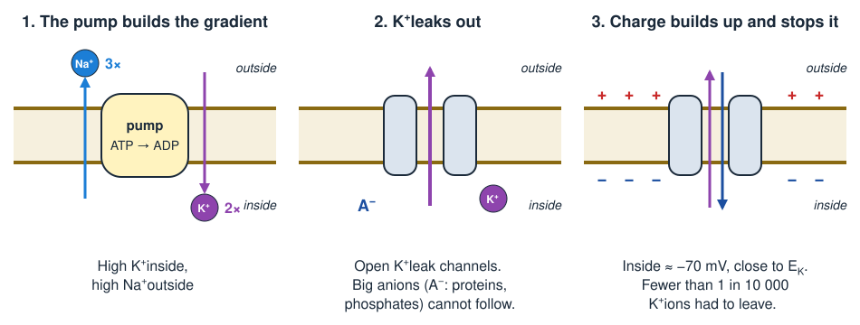{width="82%" fig-align="center"}

- **Pump:** the Na⁺/K⁺ pump (3 Na⁺ out, 2 K⁺ in per ATP) builds and keeps the gradients.
- **Leak:** the resting membrane has many open **K⁺ leak channels**, few open Na⁺ channels. K⁺ leaves; the large negative molecules inside cannot follow.
- **Charge:** the thin layer of extra charge at the membrane **is** the membrane potential. Concentrations hardly change.

::: notes
Put the pieces together. Step one: the sodium-potassium pump, from the transport lecture, uses ATP to move three sodium ions out and two potassium ions in. This builds the gradients. The pump itself makes the inside only a few millivolts more negative, because it moves more positive charge out than in, but that is not the main source of the voltage. Step two: the resting membrane contains potassium leak channels, which are open most of the time. Potassium ions flow out down their concentration gradient. Their partners inside, mostly negatively charged proteins, phosphates and other organic molecules, are too large and cannot follow. Step three: every potassium ion that leaves adds one positive charge outside and leaves one negative charge inside. These charges collect in a thin layer on both faces of the membrane, and the voltage builds up until it stops further net potassium loss, close to E K. Surprisingly few ions are needed: in a typical cell, fewer than one potassium ion in ten thousand has to leave. So the voltage changes quickly, but the concentrations stay almost the same.
:::

## The voltage follows the most open channels {.smaller}

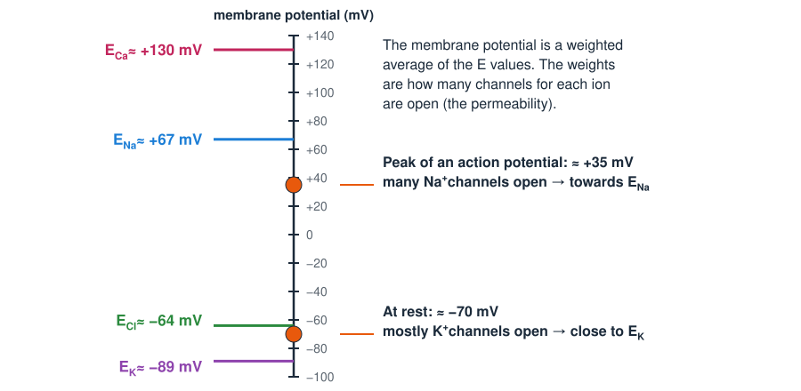{width="56%" fig-align="center"}

- At rest the membrane is mostly permeable to K⁺, so the resting potential (about **−70 mV**) lies **close to $E_\text{K}$**, pulled a little towards $E_\text{Na}$ by a small Na⁺ leak.
- This weighted average is the **Goldman equation**. Learn the idea, not the formula: **more open channels for an ion = voltage closer to that ion's E**.
- Open many Na⁺ channels, and the voltage swings towards **$E_\text{Na}$**. That is the **action potential**.
- Change the K⁺ outside, and the resting potential changes: high blood K⁺ is dangerous for the heart.

::: notes
If only potassium channels were open, the membrane potential would sit exactly at E K, minus 89. Real resting membranes also let through a little sodium and some chloride. The membrane potential then becomes a kind of weighted average of the equilibrium potentials, where the weights are the permeabilities, that is, how many channels for each ion are open. This is the Goldman equation. We will not use its formula, but the idea is powerful. At rest, potassium dominates, so the resting potential is close to E K, a bit less negative because of the small sodium leak. If the cell suddenly opens many sodium channels, sodium dominates and the voltage swings towards E Na. That is what happens in an action potential, next slide. The same idea explains a clinical fact. If potassium in the blood rises, E K becomes less negative, the resting potential of heart muscle cells moves up, and the heart's rhythm can fail. Doctors watch blood potassium carefully for this reason. You will meet the heart in detail in the course on organ structure and function.
:::

## The action potential in one slide {.smaller}

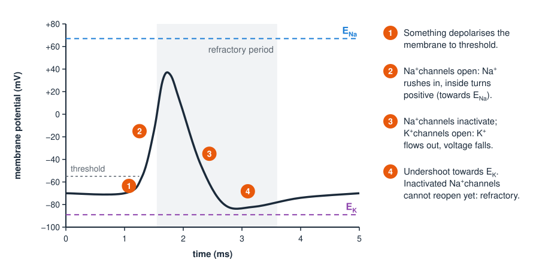{width="72%" fig-align="center"}

An all-or-none spike of about **1 ms**: voltage-gated **Na⁺ in**, then voltage-gated **K⁺ out**. Na⁺ channel **inactivation** makes a short **refractory period**, so the signal only travels **forwards** along an axon. Only a tiny number of ions move; the pump restores the gradients later.

::: notes
Nerve and muscle cells use the voltage to send fast signals. Follow the numbers. One: something, for example a synaptic input, makes the membrane less negative. If it reaches the threshold, about minus 55 millivolts, enough voltage-gated sodium channels open to start a positive feedback loop. Two: sodium rushes in, which depolarises the membrane more, which opens more sodium channels. Within half a millisecond the voltage swings to about plus 35, towards E Na. Three: the sodium channels inactivate. A part of the channel on the inside plugs the pore, even though the voltage is still positive. At the same time, slower voltage-gated potassium channels open. Potassium flows out, and the voltage falls. Four: because many potassium channels are still open, the voltage briefly goes below the resting level, towards E K. Inactivated sodium channels cannot reopen until the membrane has been negative for a while, so a second spike cannot start at once. This refractory period makes the spike travel in one direction along an axon. The whole spike moves very few ions. The full neuroscience comes in the course on organ structure and function.
:::

## How do we know? Patch clamp {.smaller}

:::: {.columns}
::: {.column width="52%"}
{width="100%"}

*A glass pipette (left, blue-grey) sealed onto a neuron in a brain slice (hippocampus), seen by DIC microscopy.*
:::
::: {.column width="48%"}
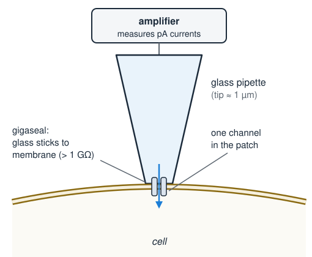{width="70%" fig-align="center"}

- Press a polished glass pipette onto a cell and apply gentle suction. The glass seals to the membrane so tightly (**gigaseal**) that the only current is through channels **in the patch** under the tip.
- **Cell-attached** recording: the cell stays intact; you measure currents of a few **picoamperes**.
:::
::::

::: notes
How could anyone see one channel? Erwin Neher and Bert Sakmann solved this in the late 1970s with patch clamp. You pull a glass tube into a fine pipette with a tip about one micrometre wide, fill it with salt solution and put a wire inside. Under a microscope you press the tip against a cell, as in the photograph, and suck gently. The membrane seals to the glass with an electrical resistance of more than a gigaohm, a billion ohms. Because almost no current can leak around the seal, any current you measure must flow through the few channels in the small patch of membrane under the tip. A sensitive amplifier holds the voltage constant, the clamp, and measures the tiny current. This configuration, with the cell still intact, is called cell-attached. You can also tear the patch off to study the inside face, or break the patch to record from the whole cell, the whole-cell configuration used in most drug tests today. Neher and Sakmann received the Nobel Prize in Physiology or Medicine in 1991.
:::

## Watching one protein open and close {.smaller}

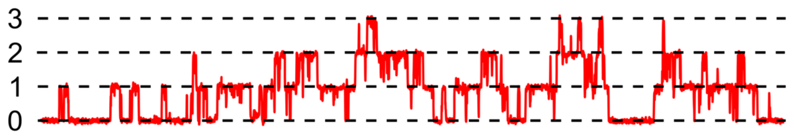{width="88%" fig-align="center"}

*Single-channel recording (inside-out patch) of BK channels, a Ca²⁺-activated K⁺ channel. Dashed lines: 0, 1, 2 or 3 channels open. Each step is the current through one channel.*

- The current jumps in **square steps**: a channel is either **fully open or closed**. No half-open state.
- One step of **2 pA** = 2 × 10⁻¹² C/s ÷ 1.6 × 10⁻¹⁹ C ≈ **12 million ions per second** through one protein.
- Open times are random, milliseconds long. Gating signals change the **probability** of being open, not the size of the step.

::: notes
This is what patch clamp gives you. The trace shows the current through a patch that contains three potassium channels. The current does not change smoothly. It jumps between fixed levels: zero, one, two or three channels open. Each jump is one protein molecule changing its shape. This was the first time anyone had watched a single protein molecule work, in real time. Let us calculate what a step means. A current of two picoamperes is two times ten to the minus twelve coulombs per second. Divide by the charge of one ion, 1.6 times ten to the minus nineteen coulombs, and you get about twelve million ions per second through one channel, the high rate we promised on the channel slide. Notice also that each channel opens and closes at random. A gating signal, such as voltage or a ligand, does not open a channel halfway. It changes the probability that the channel is open. When you record from a whole cell with thousands of channels, these random steps add up to the smooth currents seen in textbooks. Drug companies use automated patch clamp to test thousands of compounds on channels.
:::

## Channels in non-excitable cells: CFTR moves salt and water {.smaller}

::::: {.columns}
::: {.column width="72%"}
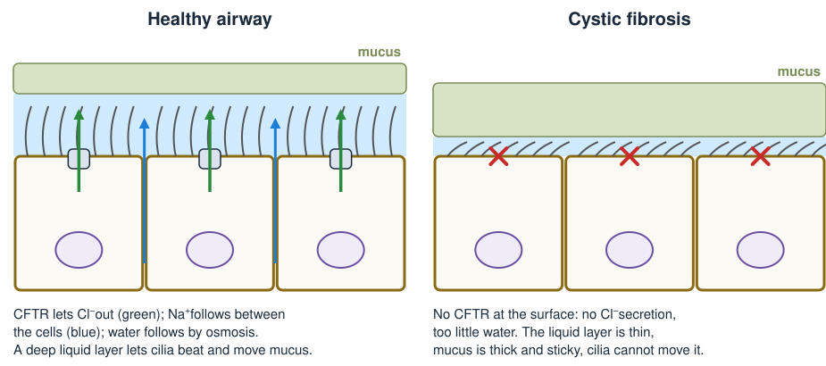{width="100%"}

- **CFTR** is a **Cl⁻ channel** in the apical (top) membrane of epithelia: airways, gut, pancreas, sweat glands. It opens when phosphorylated by protein kinase A and when it binds ATP.
- Cells cannot pump water. They **secrete salt** (Cl⁻ through CFTR, Na⁺ between the cells), and **water follows by osmosis**. This keeps the airway surface wet, so cilia can clear mucus.
:::
::: {.column width="28%"}
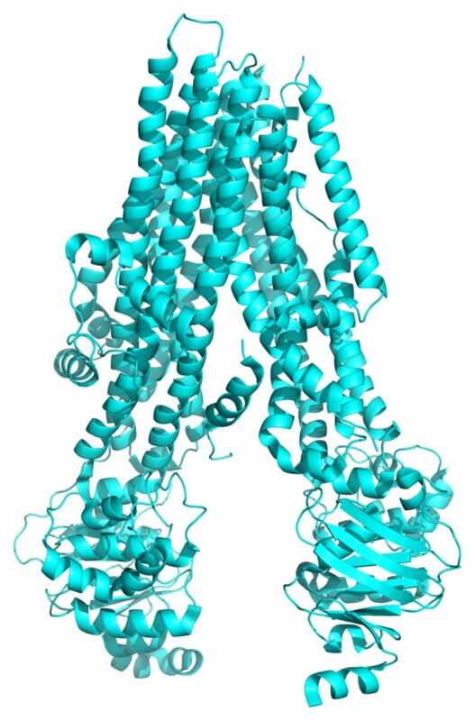{height="380px" fig-align="center"}

*Human CFTR, cryo-EM (PDB 5UAK).*
:::
:::::

::: notes
Channels are not only for nerves. Here is one in an epithelium, a sheet of cells that lines the airways, gut and glands. The airway surface is covered by a thin liquid layer, with mucus on top. Cilia beat in the liquid and move the mucus, with trapped dust and bacteria, up and out of the lungs. Cells cannot pump water directly. Instead they move salt, and water follows by osmosis, partly through water channels. The key protein is CFTR, a chloride channel in the apical membrane, the side that faces the airway. When the cell is stimulated, protein kinase A phosphorylates CFTR, ATP binds, and the channel opens. Chloride flows out into the airway, down its electrochemical gradient. Sodium follows between the cells, attracted by the negative charge, and water follows the salt. The structure on the right, solved by cryo-EM, shows the two membrane domains on top and the two ATP-binding domains below, in the cytosol. CFTR belongs to the family of ABC transporters, but it evolved into a channel. In cystic fibrosis, this channel is missing or broken, the liquid layer dries out, and mucus becomes thick.
:::

## Ca²⁺ channels: making a signal {.smaller}

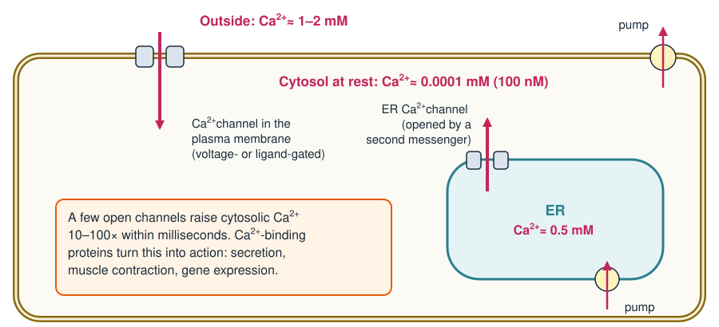{width="66%" fig-align="center"}

- Pumps keep cytosolic Ca²⁺ **10 000 times lower** than outside and in the ER. Opening a few Ca²⁺ channels therefore makes a **large, fast** rise.
- Ca²⁺ binds proteins that change shape and act: **neurotransmitter release**, **muscle contraction**, **insulin secretion**, gene expression.
- Channels in the **plasma membrane** (voltage- or ligand-gated) and in the **ER membrane** (opened by second messengers). More in the **signalling lectures**.

::: notes
Calcium is special. Cells keep free calcium in the cytosol extremely low, about 100 nanomolar, while outside the cell and inside the ER lumen it is around a millimolar or more: a gradient of ten thousand times. Pumps in the plasma membrane and in the ER membrane work all the time to keep it so. Because the resting level is so low, opening even a few calcium channels raises cytosolic calcium ten- or a hundred-fold within milliseconds. Calcium then binds proteins such as calmodulin or synaptotagmin, which change shape and switch on a process. In a nerve terminal, voltage-gated calcium channels open when the action potential arrives, and calcium triggers the release of neurotransmitter. In muscle, calcium triggers contraction. In pancreatic beta cells, it triggers insulin secretion. Calcium can also be released from the ER through channels that open when a second messenger binds. So here a channel is not used to make a voltage, but to make a chemical signal. You will meet these pathways again in the signalling lectures and in the lecture comparing organelles. Calcium-channel blockers are common drugs for high blood pressure.
:::

## Why it matters: cystic fibrosis and drugs matched to the defect {.smaller}

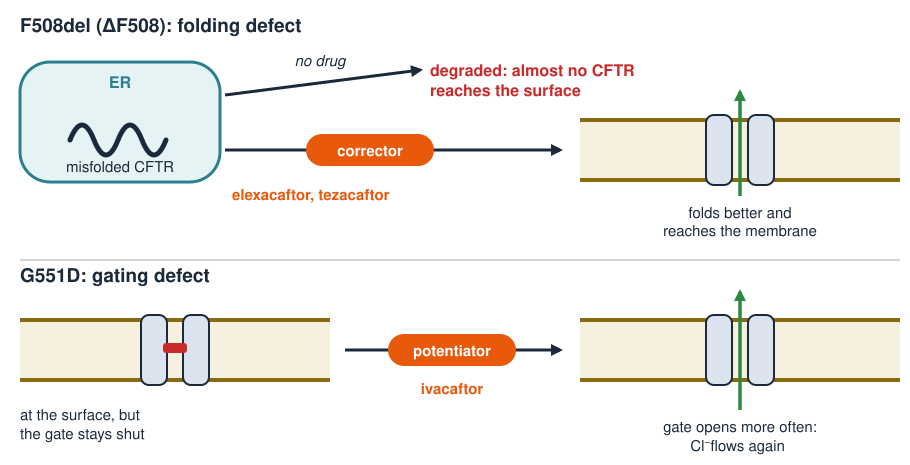{width="58%" fig-align="center"}

:::: {.columns}
::: {.column width="50%"}
- Cystic fibrosis: **both copies** of the CFTR gene mutated. Thick mucus, lung infections, blocked pancreas.
- **F508del**: one amino acid missing; CFTR **misfolds in the ER** and is degraded (the **ER lecture**). Carried by about 9 in 10 patients.
:::
::: {.column width="50%"}
- **G551D**: CFTR reaches the surface, but the **gate** does not open.
- **Elexacaftor/tezacaftor/ivacaftor** (one combination, approved 2019): two correctors plus a potentiator. Lung function improves markedly.
:::
::::

::: notes
Cystic fibrosis is one of the most common severe inherited diseases in people of European descent. It is recessive: both copies of the CFTR gene carry a mutation. Without working CFTR, the airway liquid layer becomes thin, mucus is thick and sticky, and bacteria grow in the lungs; the pancreas ducts also block. More than two thousand mutations are known, but they fall into a few types of molecular defect, and that is the key to treatment. The most common, F508del, deletes one phenylalanine. The protein folds badly in the ER, quality control recognises it, and it is degraded, so almost none reaches the surface. You will learn this quality control in the ER lecture. Drugs called correctors, such as elexacaftor and tezacaftor, bind the protein while it folds and help it reach the membrane. Another mutation, G551D, gives a protein that reaches the membrane but rarely opens. A potentiator, ivacaftor, binds CFTR and holds the gate open longer. Since F508del protein that reaches the surface also gates poorly, the combination of two correctors and a potentiator works for most patients. You will meet drug development like this in Kliniska prövningar och läkemedelsutveckling.
:::

## Why it matters: salty sweat, and blocking Na⁺ channels {.smaller}

::::: {.columns}
::: {.column width="66%"}
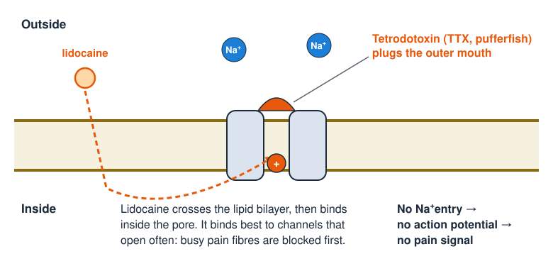{width="100%"}

- **Lidocaine** (local anaesthetic, dentist) crosses the membrane, then **blocks the Na⁺ channel pore from inside**. No action potentials in pain fibres.
- **Tetrodotoxin** from pufferfish plugs the **outer mouth**. It blocks all nerve signals: deadly.
:::
::: {.column width="34%"}
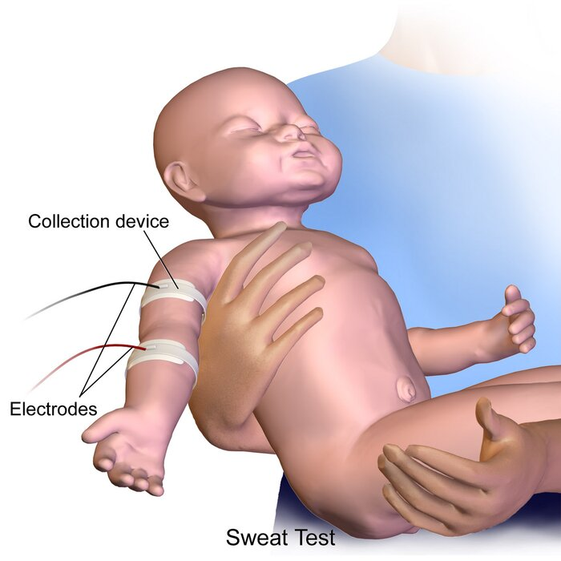{height="250px" fig-align="center"}

*Sweat test: Cl⁻ in sweat ≥ 60 mmol/L means cystic fibrosis.*

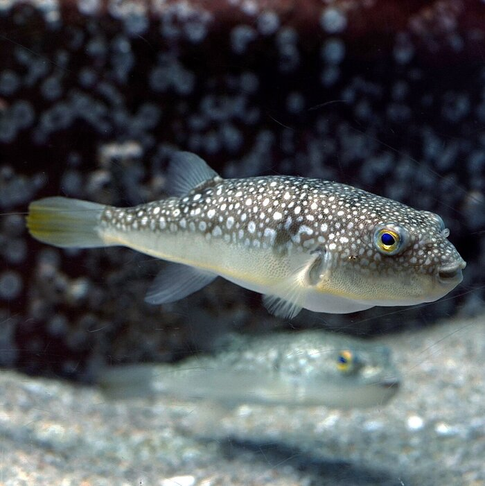{height="170px" fig-align="center"}

*Pufferfish (Takifugu). Its toxin is made by bacteria.*
:::
:::::

::: notes
Two more examples link this lecture to the clinic. First, the sweat test. In the sweat gland duct, CFTR normally takes chloride back from the sweat into the body, and sodium follows, so sweat on the skin is only a little salty. Without CFTR the salt stays in the sweat. A sweat test collects sweat from the arm, and a chloride level of 60 millimoles per litre or more indicates cystic fibrosis; this is the old saying about the salty kiss. Second, sodium channels as drug targets. If voltage-gated sodium channels cannot open, no action potential can start. Lidocaine, the local anaesthetic used by dentists, crosses the membrane in its uncharged form, becomes charged inside the cell and binds inside the pore. It binds best to channels that open often, so active pain fibres are blocked first. Tetrodotoxin, from the pufferfish, is a toxin that plugs the outer mouth of the sodium channel. A tiny amount stops nerve signals to the breathing muscles. Disease mechanisms like these return in Sjukdomslära, and the development of channel drugs in Kliniska prövningar och läkemedelsutveckling.
:::

## Summary {.smaller}

1. **Channels** are open pores: fast (up to 10⁸ ions/s), **selective** and **gated** (voltage, ligand, mechanical force). Transporters are slower but can pump.
2. The **K⁺ channel filter** selects K⁺ over the smaller Na⁺ because its carbonyl oxygens replace the water shell of K⁺ exactly, but not of Na⁺.
3. Each ion has an **equilibrium potential** from $\Delta G = RT\ln(c_\text{in}/c_\text{out}) + zFV = 0$: the **Nernst equation**. $E_\text{K}$ ≈ −89 mV, $E_\text{Na}$ ≈ +67 mV.
4. The **resting potential** (≈ −70 mV) comes from the pump's gradients plus open **K⁺ leak channels**, so it lies near $E_\text{K}$. Opening Na⁺ channels gives the **action potential**. **Patch clamp** shows single channels opening and closing.
5. Channels work in all cells: **CFTR** drives salt and water secretion, **Ca²⁺ channels** make signals. Drugs match the defect: **CFTR correctors and potentiators**, **lidocaine** on Na⁺ channels.

*Read more (optional): Alberts et al., Molecular Biology of the Cell, 7th ed., ch. 11.*

<small>Image credits: [credits](credits.md)</small>

::: notes
Five take-home points. First, channels are pores that let ions flow down their electrochemical gradient, very fast, and they are selective and gated; transporters are slower but can couple to energy and pump. Second, selectivity comes from structure: the potassium channel filter replaces the water around a potassium ion with protein oxygens at exactly the right distance, which does not work for the smaller sodium ion. Third, the Nernst equation is just Gibbs energy with an electrical term; set delta G to zero and you get the equilibrium potential, which you should be able to calculate. Fourth, the resting potential arises because the pump makes the gradients and the resting membrane is mainly permeable to potassium; when sodium channels open, the voltage swings towards E Na, which is the action potential. Patch clamp lets us record a single channel. Fifth, all cells use channels: CFTR for salt and water secretion, calcium channels for signals. Knowing the exact molecular defect lets us choose the drug. Next we leave the plasma membrane and follow proteins into the compartments of the cell.
:::
