## About this lecture {.smaller}

Growth factors, cytokines and insulin do not open channels or activate G proteins. Their receptors are **enzymes**, or bind enzymes: mostly **tyrosine kinases**. Today: how a receptor kinase passes a signal through a chain of kinases to the nucleus, and why these chains are the most common targets of modern cancer drugs.

After this lecture you can:

- describe how a **receptor tyrosine kinase** (RTK) is switched on: **dimerisation**, **autophosphorylation**, **SH2 docking**;
- explain how **Ras** works as a GTPase switch, turned on by a **GEF** and off by a **GAP**;
- follow three pathways: **Ras–RAF–MEK–ERK**, **PI3K–Akt–mTOR** and **JAK–STAT**;
- explain how a kinase cascade **amplifies** a signal and makes a **switch-like** response, and how **negative feedback** and **cross-talk** shape it;
- explain how **phospho-specific antibodies** show which kinase is active;
- explain how **imatinib**, **trastuzumab**, **EGFR** and **BRAF** inhibitors act, and how tumours become **resistant**.

::: notes
This is the third lecture on cell signalling. In the lecture on principles of cell communication you met the receptor classes and the idea of molecular switches. In the lecture on G-protein-coupled receptors you followed a signal through a G protein to second messengers such as cyclic AMP and calcium. Today we look at the third big class of cell-surface receptors: enzyme-coupled receptors. Most of them are tyrosine kinases themselves, or they bind a tyrosine kinase. They answer growth factors, insulin and cytokines, so they control whether a cell divides, grows, survives or changes what it is. We will follow three pathways that you will meet again and again in later courses: the Ras–MAP kinase pathway, the PI3K–Akt pathway and the JAK–STAT pathway. We will also ask a systems question: why does a cell use a chain of three kinases instead of one? Finally, these pathways are where many cancers start, and where the first targeted cancer drugs act. This covers ELO 3, with examples for ELO 9.
:::

## The question: who decides when a cell divides? {.smaller}

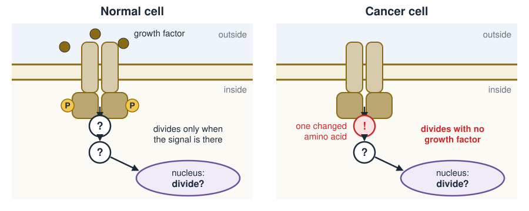{width="78%" fig-align="center"}

- Cells in your body divide only when **neighbours send growth factors**. Take the growth factor away, and a normal cell stops.
- Many cancer cells divide **without** the signal. Often the cause is a **single changed amino acid** in one kinase, or in Ras.
- **How does a signal outside become a decision inside? Why can one point mutation take over that decision? And can a drug take it back?**

::: notes
Cells in a tissue do not divide on their own initiative. A skin cell divides when a wound releases growth factors; a blood stem cell divides when cytokines call for more blood cells. In a cell culture dish, you add serum, which contains growth factors, and the cells divide; take the serum away and they stop in the first gap phase of the cell cycle. So the decision to divide is made outside the cell, by other cells. The signal must cross the membrane and travel to the nucleus, where genes for cell division are turned on. Look at the cell on the right. In many cancers, the decision is taken without any growth factor. When the genes of such tumours were sequenced, the cause was often one changed amino acid: glycine 12 of Ras, or valine 600 of the kinase BRAF. Today we follow the chain from receptor to nucleus and find out why such small changes take over the decision. We end with drugs that block the stuck switch.
:::

## Recap: two kinds of molecular switch {.smaller}

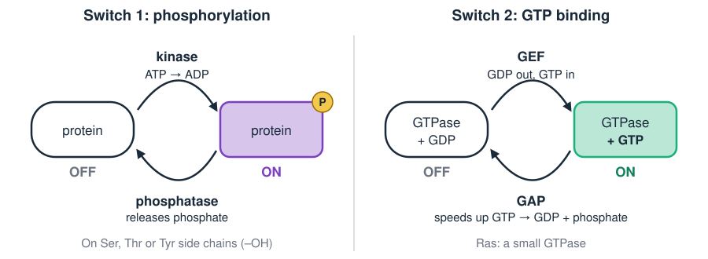{width="86%" fig-align="center"}

- **Phosphorylation:** a **kinase** puts a phosphate from ATP on a Ser, Thr or Tyr; a **phosphatase** takes it off. The negative charge changes the protein's shape or creates a binding site.
- **GTP binding:** a **GTPase** is ON with GTP and OFF with GDP. A **GEF** swaps GDP for GTP; a **GAP** speeds up GTP hydrolysis.

*Recap from the lecture on principles of cell communication; today both switches are wired together.*

::: notes
This is a recap from the lecture on principles of cell communication, because everything today is built from these two switches. The first switch is phosphorylation. A protein kinase takes the last phosphate of ATP and puts it on the hydroxyl group of a serine, threonine or tyrosine side chain. The phosphate carries two negative charges. It can change the shape of the protein, for example opening the active site of an enzyme, or it can create a binding site for another protein. A phosphatase removes the phosphate again. The second switch is a GTP-binding protein. With GTP bound, it has an active shape; when it hydrolyses GTP to GDP, it switches off. On its own, it does both steps slowly. A guanine nucleotide exchange factor, GEF, pulls out GDP so that GTP, which is more abundant in the cytosol, can bind. A GTPase-activating protein, GAP, speeds up hydrolysis. You met trimeric G proteins in the GPCR lecture. Today we meet a small, single-chain GTPase called Ras.
:::

## Enzyme-coupled receptors: three kinds {.smaller}

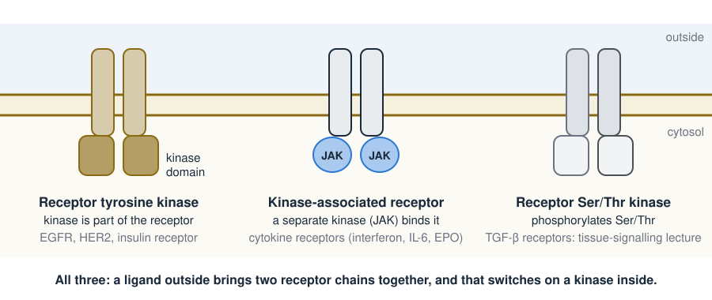{width="86%" fig-align="center"}

- **Receptor tyrosine kinases (RTKs):** about 58 in humans. Growth factors (EGF, PDGF, FGF), insulin. Our main topic.
- **Kinase-associated receptors:** no kinase of their own; a **JAK** kinase is bound to them. Most cytokines.
- **Receptor serine/threonine kinases:** TGF-β family, in the **lecture on signalling that shapes tissues**.

::: notes
Enzyme-coupled receptors are single-pass membrane proteins: each chain crosses the membrane once. That is very different from a GPCR, which crosses seven times. A single helix cannot easily transmit a change of shape from outside to inside. So these receptors use a different trick, as the bottom line says: the ligand brings two receptor chains together, and the enzyme domains inside then act on each other. There are three main kinds. Receptor tyrosine kinases carry the kinase domain inside the receptor itself. Humans have about 58 of them, including the receptors for epidermal growth factor, EGF, for platelet-derived growth factor, for fibroblast growth factors, and for insulin. Kinase-associated receptors, such as the receptors for interferons, interleukin-6 and erythropoietin, have no kinase domain; a separate tyrosine kinase called JAK sits on their tail. A third group, the receptor serine/threonine kinases for TGF-beta, phosphorylate serines and threonines; you meet them in the lecture on signalling that shapes tissues. Today we focus on the first two.
:::

## RTK activation: dimerisation and autophosphorylation {.smaller}

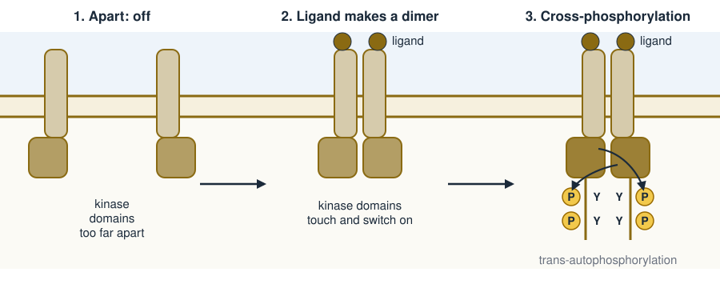{width="84%" fig-align="center"}

- One ligand brings **two receptor chains together** (a **dimer**).
- The two kinase domains **phosphorylate each other** (*trans*-autophosphorylation): first in their activation loops, which turns the kinases fully on, then on **tyrosines in the tails**.
- *Simplified:* the insulin receptor is already a dimer; insulin changes its shape. The EGF receptor forms an asymmetric dimer: one kinase activates the other.

::: notes
Here is the key mechanism. In the membrane, receptor chains move around freely, mostly apart, and their kinase domains are nearly inactive. The ligand, for example EGF, binds the outside and stabilises a dimer of two receptor chains. Now the two kinase domains inside are close together. Each has a little activity, enough to phosphorylate the other on a tyrosine in its activation loop, a flexible part that blocks the active site. Phosphorylation moves the loop away, and the kinase becomes fully active. The active kinases then phosphorylate several more tyrosines on each other's tails. This is called trans-autophosphorylation: the receptor phosphorylates itself, but each chain phosphorylates the other. Two details for honesty. The insulin receptor is already a covalent dimer, and insulin rearranges it. And in the EGF receptor, structures show an asymmetric dimer, where one kinase domain acts as an activator for the other. The principle is the same: bringing kinases together switches them on.
:::

## Phosphotyrosines are docking sites: SH2 domains {.smaller}

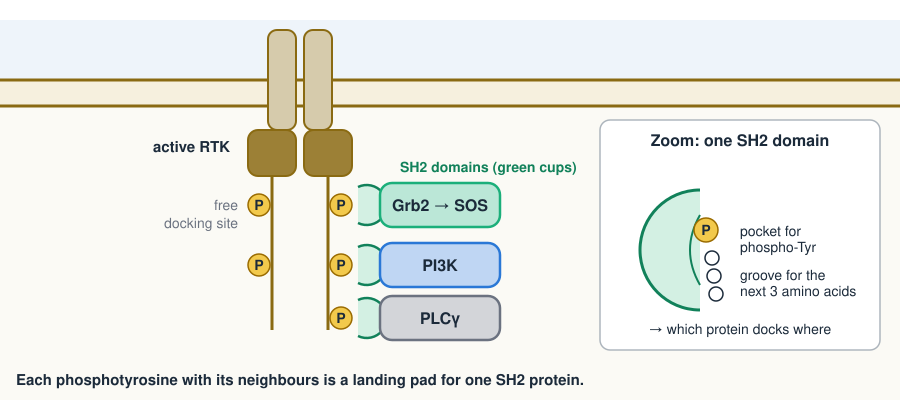{width="84%" fig-align="center"}

- An **SH2 domain** (about 100 amino acids) binds a **phosphotyrosine** plus the **next few amino acids**. Each docking site therefore attracts particular proteins.
- **Grb2** (an adaptor) brings **SOS** to the membrane → Ras. **PI3K** → lipid signals. **PLCγ** → IP₃ and Ca²⁺ (as in the GPCR lecture).
- One active receptor builds a **signalling complex** that starts several pathways at once.

::: notes
What do the phosphorylated tails do? They are not switches on the receptor itself. They are landing pads. Many signalling proteins carry a small domain of about one hundred amino acids called the SH2 domain, for Src homology 2, first found in the Src kinase. An SH2 domain has a deep pocket that binds a phosphorylated tyrosine, and a groove next to it that reads the three or so amino acids that follow the tyrosine. Because the neighbouring sequence differs between sites, each phosphotyrosine attracts a different set of SH2 proteins. Three important ones are shown. Grb2 is an adaptor, a protein with no enzyme activity that links two others; it holds the protein SOS, and brings it to the membrane, where we meet it on the next slide. PI3K, a lipid kinase, starts the survival pathway. PLC gamma makes IP3 and DAG, the same second messengers you saw in the GPCR lecture. So one active receptor assembles a whole complex and starts several pathways in parallel. Other proteins use a PTB domain, which also binds phosphotyrosine.
:::

## Ras: a GTPase switch at the membrane {.smaller}

:::: {.columns}
::: {.column width="79%"}
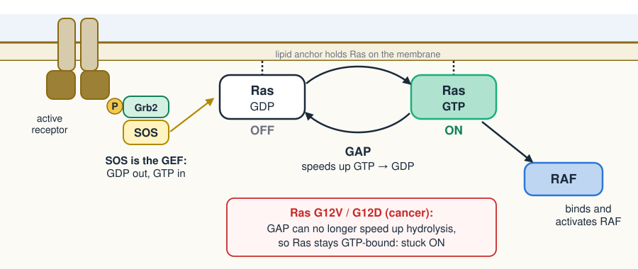{width="100%"}
:::
::: {.column width="21%"}
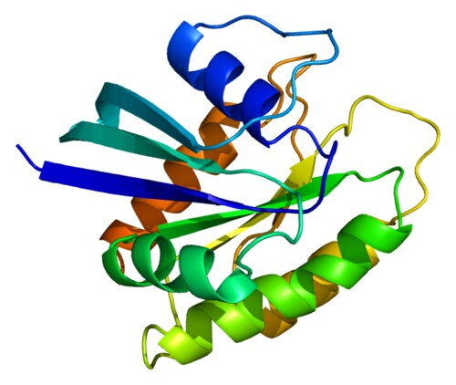{width="100%"}

*Human H-Ras (PDB 121P): a small GTPase, about 21 kDa.*
:::
::::

- Grb2 brings **SOS** (a **GEF**) to the membrane, where **Ras** sits on a lipid anchor. SOS swaps GDP for GTP: **Ras ON**.
- Ras-GTP binds and activates the kinase **RAF**. A **GAP** (e.g. neurofibromin, NF1) makes Ras hydrolyse its GTP: **Ras OFF**.

::: notes
Ras is the link between the receptor and the kinase cascade. It is a small GTPase of about 21 kilodaltons, a single domain, shown on the right. A lipid group attached to its end anchors it to the inner face of the plasma membrane. In a resting cell, almost all Ras carries GDP and is off. When the receptor is active, Grb2 binds a phosphotyrosine with its SH2 domain and brings SOS from the cytosol to the membrane, right next to Ras. SOS is a guanine nucleotide exchange factor: it opens Ras so that GDP falls out, and GTP, which is about ten times more abundant in the cytosol, binds instead. Ras-GTP changes the shape of two loops, called switch regions, and now binds RAF. Ras switches itself off by hydrolysing GTP, but alone this is very slow. A GAP, for example neurofibromin, puts an arginine into the active site of Ras and speeds hydrolysis about a hundred thousand times. Now look at the red box: in cancer, mutations at glycine 12 leave no room for that arginine, so Ras stays on.
:::

## The MAP kinase cascade: Ras → RAF → MEK → ERK {.smaller}

:::: {.columns}
::: {.column width="50%"}
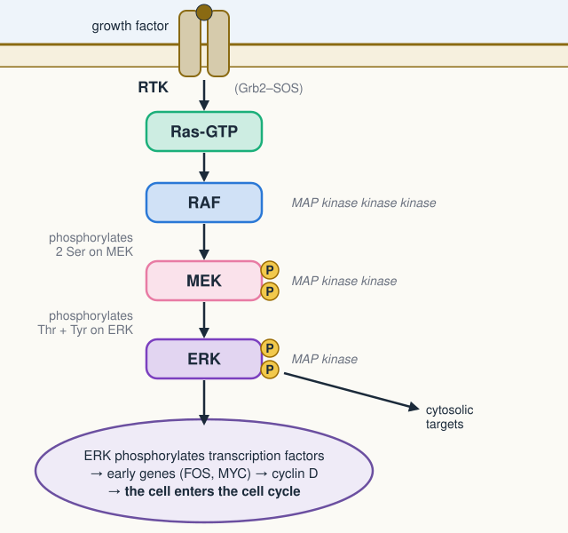{height="560px" fig-align="center"}
:::
::: {.column width="50%"}
- **RAF** phosphorylates **MEK** on two serines. **MEK** phosphorylates **ERK** on a Thr and a Tyr. ERK is active only when **both** are phosphorylated.
- Active ERK phosphorylates hundreds of proteins in the cytosol and **enters the nucleus**.
- In the nucleus it activates transcription factors → **immediate early genes** (FOS, MYC) within minutes → **cyclin D** → the cell passes the start of the cell cycle.
- General name: **MAP kinase** cascade (mitogen-activated protein kinase). The same three-kinase design is used for stress signals (JNK, p38).
:::
::::

::: notes
Now the cascade. Ras-GTP pulls RAF to the membrane and helps it form an active dimer. RAF is a serine/threonine kinase. Its substrate is another kinase, MEK, which it phosphorylates on two serines. MEK is unusual: it is a dual-specificity kinase that phosphorylates its only known substrate, ERK, on a threonine and a tyrosine, two residues apart. ERK needs both phosphates to be active. ERK is the end of the chain. It phosphorylates hundreds of targets. Some are in the cytosol, including the upstream proteins, as we will see. A large fraction of active ERK moves into the nucleus and phosphorylates transcription factors. Within minutes, immediate early genes such as FOS and MYC are transcribed. Their products turn on later genes, among them cyclin D, which you will meet in the cell-cycle lectures as the protein that lets a cell pass the restriction point. The general name for this design is a MAP kinase cascade. Mitogen means a signal that causes division. Cells use the same three-level design for other signals, for example the JNK and p38 pathways that respond to stress.
:::

## Why three kinases? Amplification and a switch {.smaller}

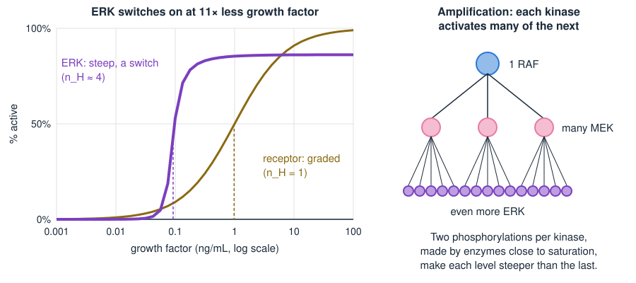{width="84%" fig-align="center"}

- **Amplification:** each active kinase phosphorylates many molecules of the next. A few thousand active receptors can switch on hundreds of thousands of ERK molecules.
- **Switch-like (ultrasensitive):** each level needs **two** phosphorylations, by enzymes near saturation, so each level is **steeper** than the one above. ERK goes from off to on over a small change in growth factor. **Try it:** [Demo: kinase cascade](questions.qmd#explore).

::: notes
Why not let the receptor phosphorylate ERK directly? A cascade does two things. First, it amplifies. Each active RAF molecule phosphorylates many MEK molecules before it is switched off, and each active MEK phosphorylates many ERK. There is also much more MEK and ERK in the cell than RAF. So a small number of active receptors can switch on a large part of the cell's ERK. Second, a cascade makes a switch. Look at the plot, made with the demo model. The receptor follows a simple binding curve: from 10 to 90 percent bound takes an 81-fold change in growth factor, a Hill coefficient of 1, as you know from dose–response. ERK rises much more steeply, and at about ten times less growth factor. Two features cause this. MEK and ERK each need two phosphorylations, which roughly squares the response; and the kinases and phosphatases work close to saturation, which sharpens it more. The effect compounds level by level. James Ferrell and colleagues measured a Hill coefficient of about five for MAP kinase in frog egg extracts. So the cell makes a clear decision: divide or not, rather than a little bit.
:::

## PI3K–Akt–mTOR: survive and grow {.smaller}

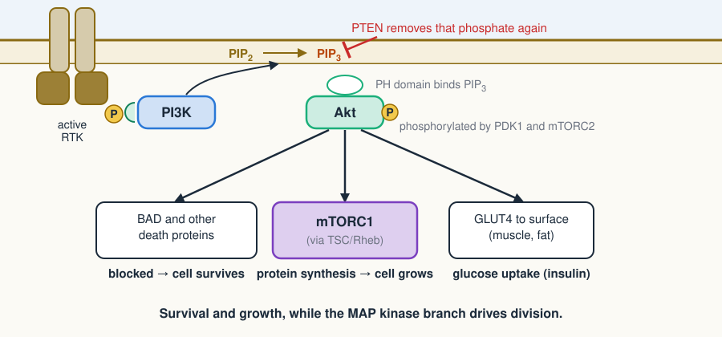{width="86%" fig-align="center"}

- **PI3K** docks on the receptor and phosphorylates a membrane lipid: PIP₂ → **PIP₃**. **PTEN** reverses this.
- **Akt** binds PIP₃ with its **PH domain**, is phosphorylated and activated, then leaves the membrane.
- Akt **blocks death proteins** (BAD; the apoptosis lecture), activates **mTORC1** (protein synthesis, cell growth) and, after insulin, sends **GLUT4** to the cell surface.

::: notes
The second pathway starts at the same receptors. PI3K, phosphoinositide 3-kinase, has a regulatory subunit with SH2 domains, so it docks on phosphotyrosines; Ras-GTP can also activate it. PI3K is a lipid kinase. It adds a phosphate to the inositol ring of the membrane lipid PIP2, making PIP3. PIP3 is a second messenger that stays in the inner leaflet of the plasma membrane. Proteins with a PH domain, short for pleckstrin homology, bind it. One of them is the kinase Akt, also called protein kinase B. At the membrane, Akt is phosphorylated by two other kinases, PDK1 and mTORC2, and becomes active. Akt has several jobs. It phosphorylates and inactivates BAD, a protein that promotes apoptosis; you will meet BAD in the apoptosis lecture. Through the proteins TSC and Rheb it activates mTORC1, the complex that drives protein synthesis and cell growth. And in muscle and fat cells, after insulin, it sends vesicles with the glucose transporter GLUT4 to the cell surface; you met GLUT transporters in the transport lecture. The phosphatase PTEN removes the phosphate from PIP3 and is a tumour suppressor.
:::

## JAK–STAT: from receptor to gene in four steps {.smaller}

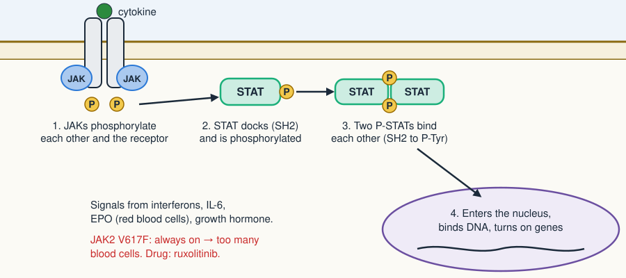{width="86%" fig-align="center"}

- Cytokine receptors have **JAK** kinases bound to their tails. The ligand brings two JAKs together; they phosphorylate each other and the receptor.
- **STAT** docks with its SH2 domain, is phosphorylated, and two STATs bind each other.
- The STAT dimer **is** the transcription factor: no second messenger, no cascade. Interferons, IL-6, EPO; much more in **Immunologi**.

::: notes
The JAK–STAT pathway is the shortest route from the cell surface to the genes. Receptors for many cytokines, such as interferons and interleukin-6, and for hormones like erythropoietin and growth hormone, have no kinase domain. Instead, a tyrosine kinase of the JAK family is bound to each receptor tail. Step one: the cytokine brings two receptor chains together, the two JAKs phosphorylate each other and then tyrosines on the receptor. The logic is the same as for an RTK, but with the kinase borrowed. Step two: a STAT protein, short for signal transducer and activator of transcription, docks on a phosphotyrosine with its SH2 domain, and JAK phosphorylates one tyrosine on the STAT. Step three: the phosphorylated STAT lets go of the receptor and binds another phosphorylated STAT, each SH2 domain grabbing the other's phosphotyrosine. Step four: the dimer enters the nucleus and binds DNA. A mutation that keeps JAK2 on, V617F, causes polycythaemia vera, too many red blood cells; the JAK inhibitor ruxolitinib treats it. You will meet cytokine signalling again in Immunologi.
:::

## Switching off, and negative feedback {.smaller}

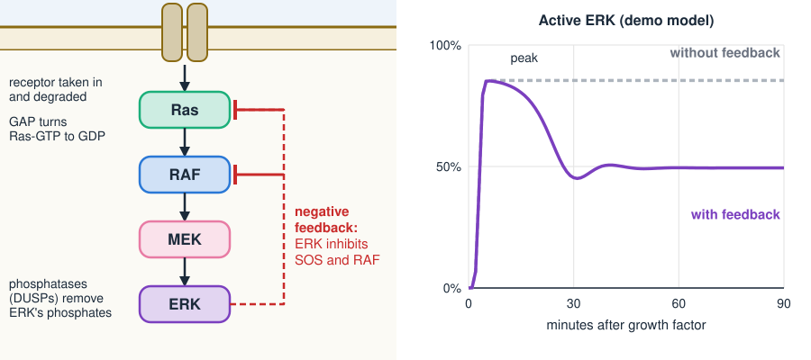{width="88%" fig-align="center"}

- Every step has an off switch: **receptor endocytosis** and degradation (the endocytosis lecture), **GAPs** for Ras, **phosphatases** for the kinases and for PIP₃.
- **Negative feedback:** active ERK phosphorylates SOS and RAF, which **weakens the signal upstream**, and it turns on genes for ERK phosphatases. Result: a **peak, then a lower plateau**.
- Feedback makes the response robust, but it also matters for drugs: **block one step, and the brake upstream is released**.

::: notes
A signal is only useful if it can end. Each step has its own off switch. The active receptor is taken into the cell by endocytosis; part of it is degraded in lysosomes, which you will see in the endocytosis lecture. GAPs switch Ras off. Phosphatases remove the phosphates from ERK and MEK; some, called dual-specificity phosphatases or DUSPs, are made in response to ERK activity itself. PTEN removes the phosphate from PIP3. On top of this, the pathway brakes itself. Active ERK phosphorylates SOS and RAF, which makes them less active. This is negative feedback, a general principle from the lecture on principles of cell communication. The plot on the right, from the demo model, shows what feedback does to the time course: a peak after a few minutes, then a lower, steady level, as seen in real cells after adding EGF. Feedback makes a pathway more robust to changes in protein amounts. But it has a consequence for drugs that we will return to: when a drug lowers ERK, it also lowers the brake, and the upstream steps become more active.
:::

## Cross-talk: pathways form a network {.smaller}

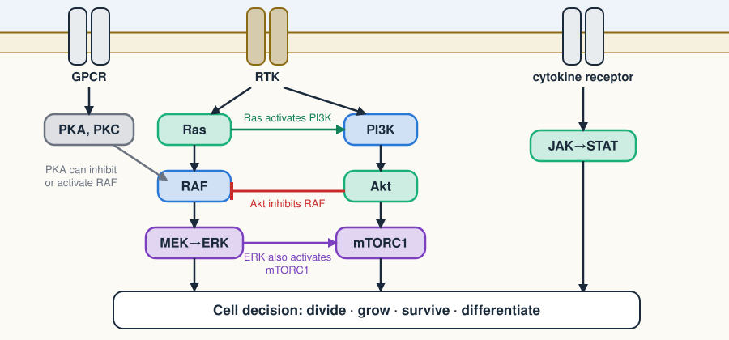{width="84%" fig-align="center"}

- One receptor starts several pathways; **one pathway is fed by several receptors**.
- The branches **activate** (Ras → PI3K; ERK → mTORC1) and **inhibit** each other (Akt → RAF). GPCR signals (PKA) feed in too.
- The cell **integrates** all of this into one decision. *Our slides show single lines through a network of hundreds of proteins.*

::: notes
So far we have drawn clean, separate lines. Real pathways are a network. One receptor, such as the EGF receptor, starts the MAP kinase, PI3K and PLC gamma pathways at the same time. Ras activates not only RAF but also PI3K. ERK and Akt both feed into mTORC1, so growth signals and division signals are coordinated. There is also inhibition between branches: Akt phosphorylates RAF and can weaken it. And signals from other receptor classes feed in. Protein kinase A, downstream of GPCRs and cyclic AMP, inhibits RAF in some cells and activates the MAP kinase pathway in others, such as neurons. This is called cross-talk. What the cell decides, divide, grow, survive or differentiate, depends on the combination of all inputs, and on how long ERK stays active, not only on whether it is on. For example, in a classic nerve-cell line, a short ERK pulse after EGF makes the cells divide, while a long ERK signal after nerve growth factor makes them grow neurites. Our slides, and the demo, simplify the network to a few lines; keep that in mind when you predict a drug effect.
:::

## How do we know? Phospho-specific antibodies {.smaller}

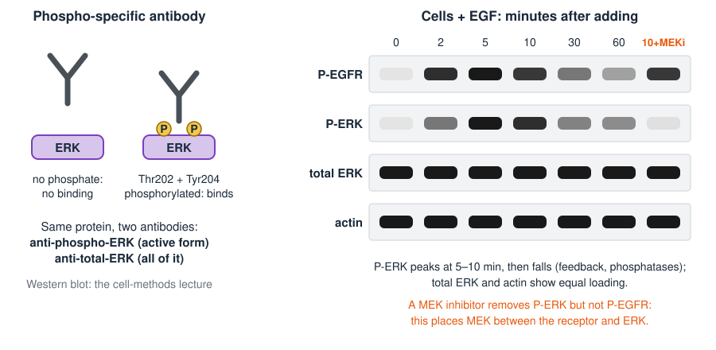{width="80%" fig-align="center"}

- An antibody raised against a **phosphorylated peptide** binds the protein only when that site is phosphorylated: it reports **activity**, not just amount.
- [Western blot](../cell-methods/lec.qmd) with **anti-phospho-ERK** and **anti-total-ERK** on cells at different times after EGF: P-ERK peaks at 5–10 min. Loading control: actin.
- Add an inhibitor: the steps **below** it lose their phosphates, the steps **above** do not. This orders the pathway.

::: notes
How do we know which kinase is active, and in which order they work? The key tool is the phospho-specific antibody. You immunise an animal with a short peptide that carries a phosphate on the tyrosine or threonine of interest, and then select the antibodies that bind the phosphorylated peptide but not the unphosphorylated one. Such an antibody recognises, for example, ERK only when both threonine 202 and tyrosine 204 are phosphorylated, which is the active form. You met the western blot in the cell-methods lecture. Here, cells are starved of growth factor, then EGF is added, and samples are taken at different times. The blot is stained with anti-phospho-EGFR, anti-phospho-ERK, an antibody against total ERK, and a loading control. The figure is a schematic, with the typical result: receptor phosphorylation within a minute or two, phospho-ERK peaking at five to ten minutes, then declining, while the total amount of ERK stays the same. In the last lane a MEK inhibitor removes phospho-ERK but not phospho-EGFR. That tells you MEK sits between the receptor and ERK. The same antibodies are used in flow cytometry and on tumour samples.
:::

## Why it matters: cancer breaks these switches {.smaller}

:::: {.columns}
::: {.column width="66%"}
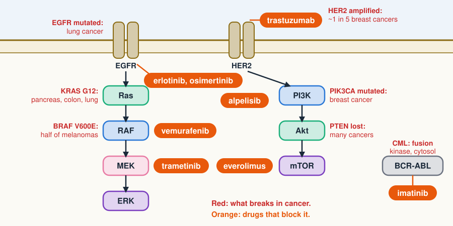{width="100%"}
:::
::: {.column width="34%"}
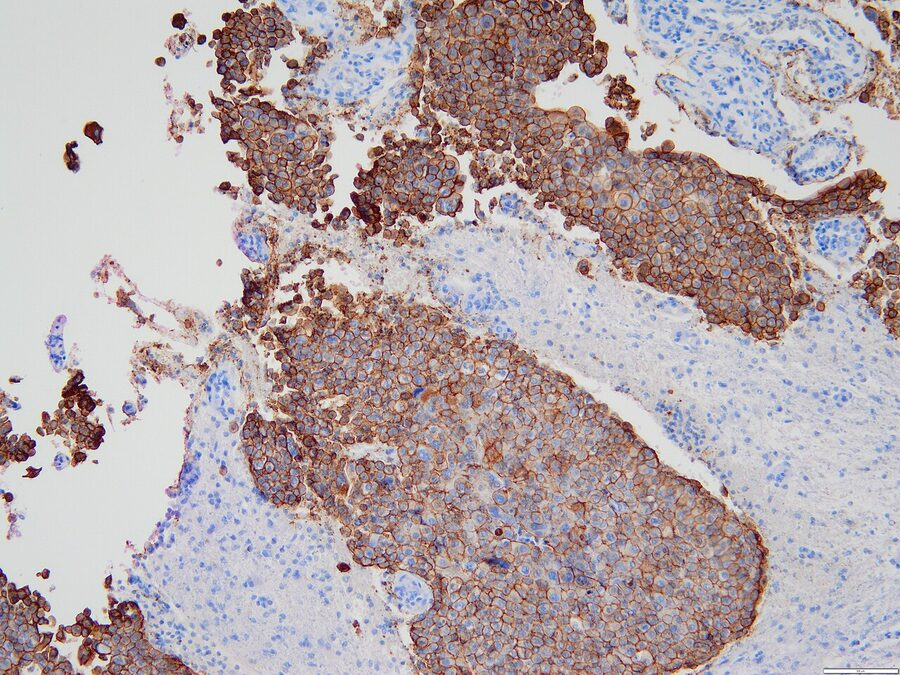{width="100%"}

*Breast cancer stained for HER2 (brown, cell membranes), score 3+: the gene is amplified.*
:::
::::

- **RAS** genes are mutated in about one cancer in five; **BRAF V600E** in about half of melanomas; **HER2** is amplified in about 15–20 % of breast cancers.
- **Trastuzumab** (1998), an **antibody** against the outside of HER2, blocks signalling and marks the cells for immune attack. **EGFR inhibitors** (erlotinib, osimertinib) block the ATP pocket in lung cancers with **EGFR mutations**.

::: notes
Now the medical side, which you will meet again in Sjukdomslära and in the cancer lecture. Many cancers have a broken switch in exactly these pathways. Mutated RAS genes are found in about one human cancer in five: in most pancreatic cancers, about four in ten colon cancers and a third of lung adenocarcinomas. About half of melanomas carry a BRAF mutation, mostly V600E. In about fifteen to twenty percent of breast cancers the HER2 gene is amplified: the cells make so many HER2 receptors that they dimerise and signal without any ligand. The photograph shows such a tumour stained with an anti-HER2 antibody; the brown outlines are cell membranes full of HER2. Trastuzumab, approved in 1998, is a monoclonal antibody against the extracellular part of HER2. It reduces signalling and marks the cancer cells for immune cells. HER2 testing decides who gets it: the drug only helps when the target is there. Small-molecule EGFR inhibitors, such as erlotinib and osimertinib, bind the ATP pocket inside the kinase. They work in lung cancers that carry activating EGFR mutations. Other drugs on the figure act on MEK, PI3K and mTOR.
:::

## Why it matters: imatinib, the first targeted cancer drug {.smaller}

:::: {.columns}
::: {.column width="70%"}
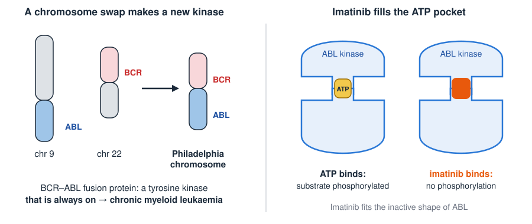{width="100%"}
:::
::: {.column width="30%"}
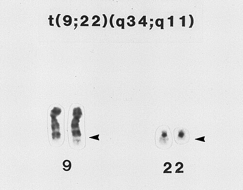{height="165px" fig-align="center"}

*Chromosomes 9 and 22 from a CML patient; arrows: the swapped pieces.*

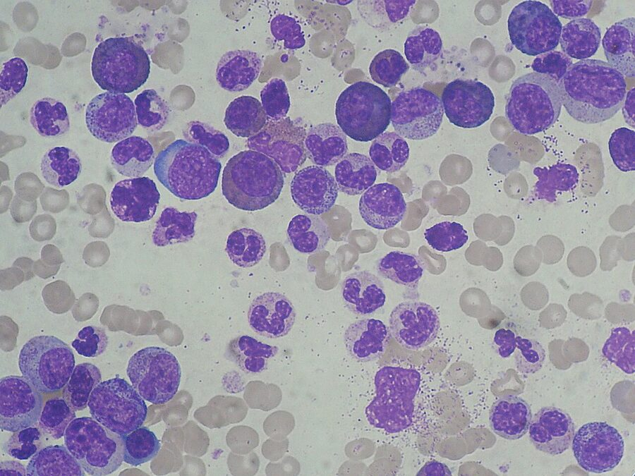{height="165px" fig-align="center"}

*CML blood: far too many white cells.*
:::
::::

- **CML:** chromosomes 9 and 22 swap pieces; the fusion gene makes **BCR-ABL**, a tyrosine kinase that is **always on**.
- **Imatinib** (approved 2001) sits in the **ATP pocket** of ABL. About 8 in 10 patients are alive after 10 years.

::: notes
The story that started targeted cancer therapy is chronic myeloid leukaemia. In 1960 two researchers in Philadelphia found an unusually small chromosome in the white blood cells of these patients, the Philadelphia chromosome shown on the upper right. In 1973 Janet Rowley showed that it comes from an exchange of pieces between chromosomes 9 and 22. The joint creates a fusion gene: the front of a gene called BCR joined to most of the tyrosine kinase ABL. The BCR part makes the protein form oligomers, which, like a dimerised receptor, keeps the kinase permanently active. The result is too many white blood cells, as in the blood smear. In the 1990s, chemists and the physician Brian Druker developed imatinib, a small molecule that fits the ATP pocket of ABL in its inactive shape. Without ATP, the kinase cannot phosphorylate its substrates. Imatinib was approved in 2001, and a disease that used to kill most patients within a few years became a chronic condition: about eight in ten patients are alive ten years later. It also works on the kinase KIT in gastrointestinal stromal tumours.
:::

## Why it matters: BRAF V600E and vemurafenib {.smaller}

:::: {.columns}
::: {.column width="40%"}
{width="100%"}

*Melanoma on the skin. About half carry a BRAF mutation.*
:::
::: {.column width="60%"}
- **BRAF V600E** is active **without Ras** and escapes the ERK feedback. Melanoma cells depend on it.
- **Vemurafenib** (2011) blocks V600E-BRAF: most tumours shrink, but often **regrow within months**.
- In cells **without** the mutation, the same drug can **activate** RAF dimers ("paradoxical activation"): some patients get new skin tumours.
- **BRAF + MEK inhibitor** together (dabrafenib + trametinib) work longer and cause fewer side effects.
- In **colon cancer** with the same mutation, vemurafenib alone hardly works: the ERK brake is released and **EGFR** turns the pathway back on.
:::
::::

::: notes
BRAF V600E is the clearest example of a cancer that depends on one stuck kinase. Valine 600 sits in the activation loop of BRAF. Replacing it with glutamate, which is negatively charged, mimics the phosphorylation that normally activates the loop. The mutant kinase is active as a single molecule, without Ras, and it ignores the negative feedback from ERK. Vemurafenib, approved in 2011, binds V600E-BRAF in its ATP pocket. Most patients' tumours shrink within weeks, a dramatic result for a disease that used to have few options. But the tumours often grow back within months. And there was a surprise. In normal cells with Ras activity, vemurafenib binds one RAF in a dimer and makes the partner more active; some patients developed new, mostly benign skin tumours. Adding a MEK inhibitor blocks both problems, and the combination of dabrafenib and trametinib works longer. The biggest surprise came in colon cancers with the same mutation: vemurafenib alone hardly worked. The reason was negative feedback, as we will see on the next slide. You can test this in the demo.
:::

## How resistance appears {.smaller}

:::: {.columns}
::: {.column width="78%"}
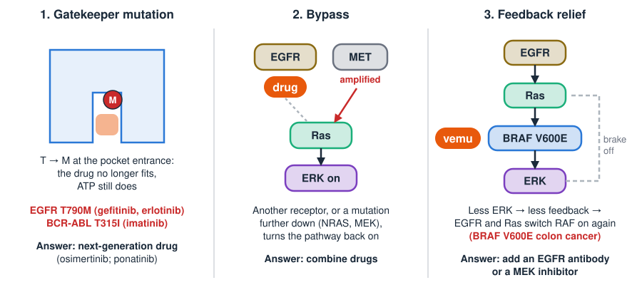{width="100%"}
:::
::: {.column width="22%"}
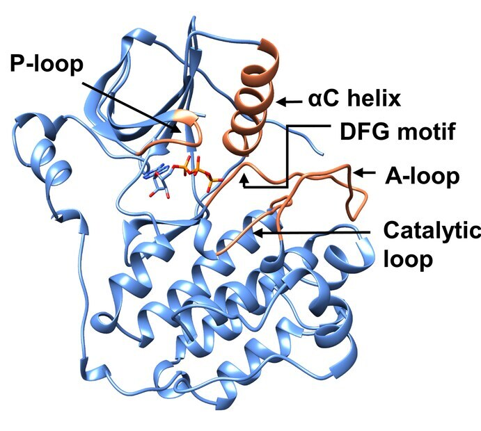{width="100%"}

*EGFR kinase domain; the ATP pocket lies between the two lobes, under the P-loop.*
:::
::::

- **Gatekeeper** mutation: a bigger amino acid at the entrance of the ATP pocket keeps the drug out, but not ATP (EGFR **T790M**, BCR-ABL **T315I**).
- **Bypass** and **feedback relief**: another route turns ERK back on. Answer: next-generation drugs and **combinations** (Kliniska prövningar och läkemedelsutveckling).

::: notes
Targeted drugs select for resistant cells, just as antibiotics select for resistant bacteria, which you know from microbiology. A tumour has billions of cells; if one carries a resistance mutation, it survives and grows. There are three common routes. First, the target changes. The gatekeeper residue is an amino acid at the back of the ATP pocket. When a small threonine is replaced by a bigger methionine or isoleucine, ATP still binds, but the drug no longer fits. In lung cancer, EGFR T790M appears in about half of patients who relapse on gefitinib or erlotinib; osimertinib was designed to bind it. In CML, T315I in BCR-ABL resists imatinib; ponatinib still binds. Second, bypass: another receptor such as MET is amplified, or a mutation further down, in NRAS or MEK, turns the pathway back on. Third, feedback relief: in BRAF V600E colon cancer, the drug lowers ERK, the feedback brake is released, and EGFR drives RAF dimers that the drug blocks poorly. Adding the EGFR antibody cetuximab works. Designing such combinations is part of drug development, which you study in Kliniska prövningar och läkemedelsutveckling.
:::

## Summary {.smaller}

1. **Enzyme-coupled receptors** are single-pass. The ligand brings two chains together; the kinases **phosphorylate each other**, and phosphotyrosines become **docking sites for SH2 proteins**.
2. **Ras** is a GTPase switch: **SOS (GEF)** turns it on, a **GAP** turns it off. Ras-GTP starts the **RAF → MEK → ERK** cascade; ERK turns on genes for division.
3. A three-kinase cascade **amplifies** and makes a **switch-like** response. **PI3K–Akt–mTOR** drives survival and growth; **JAK–STAT** goes straight to the genes. The pathways **cross-talk**.
4. Signals are switched off by GAPs, phosphatases, endocytosis and **negative feedback**. **Phospho-specific antibodies** show which step is active.
5. Cancers break these switches (**HER2, EGFR, KRAS, BRAF V600E, BCR-ABL**). Targeted drugs (**trastuzumab, imatinib, vemurafenib**) block them; **resistance** comes from gatekeeper mutations, bypass and feedback relief.

*Read more (optional): Alberts et al., Molecular Biology of the Cell, 7th ed., ch. 15.*

[Image credits](../credits.qmd#kinase-signalling){style="font-size:0.7em"}

::: notes
Five take-home points. First, enzyme-coupled receptors cross the membrane only once, so they signal by being brought together: the ligand makes a dimer, the kinase domains phosphorylate each other, and the phosphotyrosines become docking sites read by SH2 domains. Second, Ras links the receptor to the cascade. It is on with GTP, switched on by the exchange factor SOS and off by a GAP; mutations that stop the GAP from working keep it on. Third, a chain of kinases amplifies the signal and makes a switch-like response, which helps a cell make a clear decision. Two other pathways start at the same receptors: PI3K–Akt–mTOR for survival and growth, and JAK–STAT for cytokines. They form a network. Fourth, every step has an off switch, and the pathway brakes itself through negative feedback; we know the order of the steps from phospho-specific antibodies and inhibitors. Fifth, these pathways are where many cancers start, and where targeted drugs act. Tumours escape those drugs in predictable ways. In the next lecture we see signals that shape tissues and decide cell fates.
:::
