## About this lecture

Every compartment in the cell is bounded by a membrane. Today: what a membrane is made of, why it forms by itself, why it is **liquid**, and how proteins sit in it. This is the base for the next lectures on transporters, pumps and ion channels.

After this lecture you can:

- explain why lipids **self-assemble** into a bilayer (the hydrophobic effect), and name the main **lipid classes**;
- explain what sets **membrane fluidity** (tail length, double bonds, cholesterol, temperature);
- explain **lipid asymmetry**, and what flippases and scramblases do;
- describe how **membrane proteins** are attached, and predict transmembrane helices from a **hydropathy plot**;
- explain how **FRAP**, **cell fusion** and **freeze-fracture EM** showed that the membrane is a fluid with proteins in it;
- explain how **lipid nanoparticles** and **liposomes** use these rules to deliver drugs.

**ELO 2** (membranes and transport).

::: notes
This is the first lecture of the membranes block. You met membranes in biochemistry: phospholipids, the bilayer, amphipathic molecules. We will not repeat that course. Instead we ask the cell biologist's questions. Why does a bilayer form at all, and why does it seal itself? Why is it liquid, and how does a cell keep it at the right fluidity? Why are the two halves of the bilayer different, and what happens when that difference is lost? How do proteins sit in a membrane, and how can you predict that from a sequence? And how do we know any of this? At the end we look at medicines that are built from the same rules: the lipid nanoparticles in mRNA vaccines, and liposomes that carry a cancer drug. Everything today belongs to ELO 2. The next two lectures, on transport and on ion channels, use the membrane proteins we meet today.
:::

## The question: a barrier that flows

:::: {.columns}
::: {.column width="42%"}
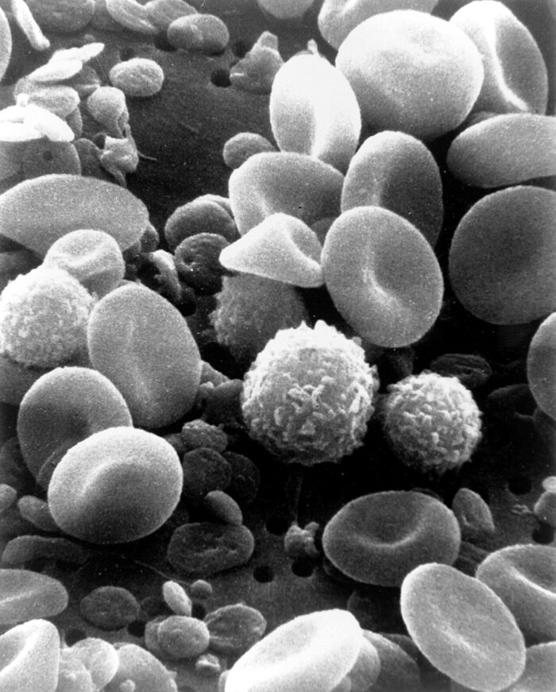{height="520px" fig-align="center"}

*Human blood, scanning EM: red blood cells (discs), white blood cells (rough surface), platelets (small).*
:::
::: {.column width="58%"}
- A red blood cell is about **8 µm** wide. Many capillaries are only about **3–5 µm** wide. The cell **folds** to squeeze through, again and again during its **120-day** life.
- Its plasma membrane is only about **5 nm** thick: two layers of lipid molecules.
- Yet it **never tears open**, and it keeps ions and haemoglobin inside.

**How can a film two molecules thick be both a tight barrier and a liquid that flows?**
:::
::::

::: notes
Look at these red blood cells in a scanning electron microscope. They are flat discs, about eight micrometres across, with a dip in the middle. The rough round cells are white blood cells, and the small fragments are platelets. A red blood cell has no nucleus and no internal membranes; it is little more than a bag of haemoglobin wrapped in a plasma membrane. That membrane is only about five nanometres thick, one thousandth of a micrometre times five, yet it holds. Every time the cell passes through a narrow capillary it bends and folds, and then springs back. If the membrane were a solid sheet, like a plastic film, it would crack. If it were simply oil, it would break up. Today we will see how a membrane can be both: a liquid in its own plane, and a tight barrier across it. Red blood cells are also where much of membrane biology started, because they are easy to get and have only one membrane. We will meet them again three times today: in the recap, in freeze-fracture images and in blood groups.
:::

## Recap, and one step further: why lipids self-assemble {.smaller}

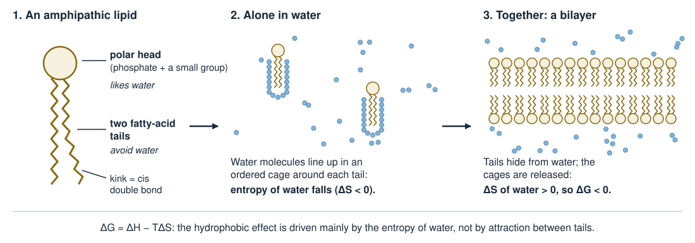{width="94%" fig-align="center"}

- *Recap:* membrane lipids are **amphipathic**: a polar head and two hydrophobic tails. In water they form a **bilayer**, tails inside.
- **Why?** A tail alone forces water molecules into an ordered cage. Tails that come together **free that water**: the entropy of water rises, so **ΔG < 0**. This is the **hydrophobic effect**.
- A bilayer edge would expose tails to water, so a bilayer **closes on itself** into a sealed compartment, and a small tear **reseals**.

::: notes
This is the one recap slide. You know from biochemistry that membrane lipids are amphipathic, and that they form a bilayer in water. Now use your chemistry to ask why. You might think that the tails attract each other strongly. They do a little, but that is not the main force. When a hydrocarbon tail sits in water, the water molecules next to it cannot form hydrogen bonds with it, so they line up in an ordered cage around it. Ordered water means low entropy. When many tails come together, most of those water molecules are released into the bulk liquid, and their entropy rises. In ΔG equals ΔH minus T times ΔS, the large positive ΔS makes ΔG negative, so assembly is spontaneous. We call this the hydrophobic effect. It explains three things we need. Bilayers form without any enzyme. They have no free edges, because an edge would expose tails to water, so they close into sealed compartments. And a small hole closes again by itself. Historical note: in 1925 Gorter and Grendel extracted the lipids from red blood cells and found they covered twice the cell's surface: the first hint of a bilayer.
:::

## Three classes of membrane lipid {.smaller}

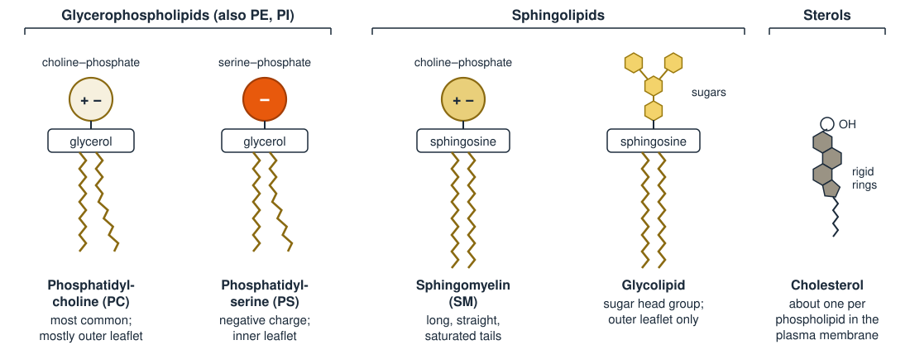{width="88%" fig-align="center"}

- **Glycerophospholipids** (PC, PE, PS, PI): glycerol backbone, two fatty-acid tails. Most membrane lipid.
- **Sphingolipids**: sphingosine backbone. Sphingomyelin; **glycolipids** carry sugars and face the outside.
- **Cholesterol**: a rigid ring plate with a small OH head. In the plasma membrane, about one for every phospholipid.

::: notes
A real membrane contains hundreds of different lipid species, but three classes cover most of them. The glycerophospholipids are built on glycerol, which carries two fatty-acid tails and a phosphate. The group on the phosphate gives the name: choline gives phosphatidylcholine, PC, the most common one; serine gives phosphatidylserine, PS, which has a net negative charge; ethanolamine gives PE, and inositol gives PI, which the cell uses for signalling, as you will see in the signalling lectures. The sphingolipids are built on sphingosine, an amino alcohol that already carries one long tail; a second fatty acid is attached. Their tails are usually long and saturated, so they pack tightly. Sphingomyelin has the same choline-phosphate head as PC. If the head is a chain of sugars instead, the lipid is a glycolipid; these are always on the outside of the cell. The third class is the sterols, which in animal cells means cholesterol. It is small and rigid, with a tiny polar OH head. The plasma membrane has a lot of it, almost one cholesterol molecule per phospholipid, while the ER has very little. So each organelle membrane has its own lipid mixture.
:::

## A bilayer is a two-dimensional liquid

:::: {.columns}
::: {.column width="36%"}
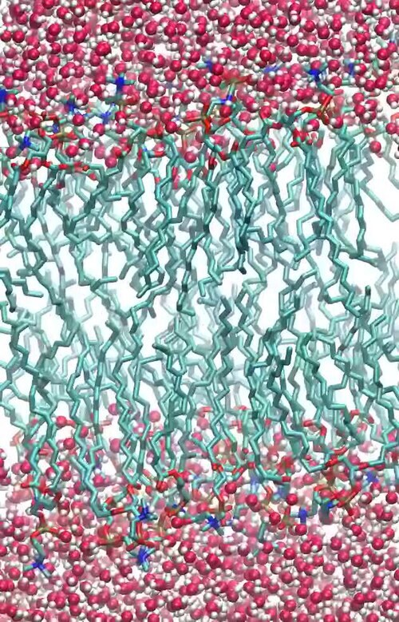{height="460px" fig-align="center"}

*Molecular dynamics simulation of a PC bilayer. Red and white: water; cyan: lipid tails.*
:::
::: {.column width="64%"}
- About **5 nm** thick; the hydrophobic core is about **3 nm**.
- The tails are **disordered** and move all the time.
- A lipid swaps places with its neighbour about **10⁷ times per second**, so it moves about **2 µm in 1 s** within its own leaflet (**lateral diffusion**).
- It also **spins** about its long axis and **flexes** its tails.
- But moving to the **other leaflet (flip-flop)** is very rare: about **once a month** for a phospholipid. The polar head would have to cross the oily core.
- So: **liquid in the plane, a barrier across it.**
:::
::::

::: notes
This image is not a micrograph. It is one frame from a computer simulation, called molecular dynamics, in which the forces between every atom are calculated and the molecules are allowed to move. The red and white balls at top and bottom are water. The cyan lines are the lipid tails, and the head groups sit at the two water surfaces. Notice how disordered the tails are: they are not straight sticks like in textbook cartoons, but bend and wriggle all the time. Experiments agree with simulations: a lipid changes place with its neighbour about ten million times per second, and it can travel about two micrometres, the length of a bacterium, in one second. It also spins about its long axis and its tails flex. What it almost never does is move to the other leaflet. For that, the charged head group would have to pass through three nanometres of hydrocarbon, which costs a lot of energy. A phospholipid flips on its own less than about once a month. This answers part of our question: in the plane the membrane is a liquid that can flow and bend, but across it, it is a strong barrier.
:::

## What sets membrane fluidity? {.smaller}

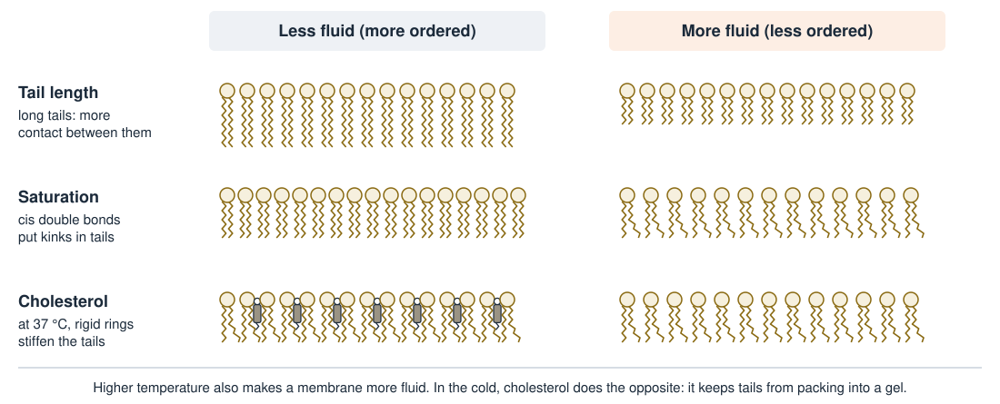{width="88%" fig-align="center"}

- **Shorter tails** and **cis double bonds** (kinks) mean less contact between tails: **more fluid**.
- **Cholesterol** stiffens the tails near the heads (less fluid, less leaky at 37 °C), but stops them freezing in the cold: a **fluidity buffer**.
- Cells **adjust** their lipids to keep fluidity right: bacteria and fish grown in the cold make more unsaturated tails.

::: notes
Fluidity is not fixed; it depends on how well the tails pack. Long straight tails touch along their whole length, so van der Waals contacts hold them together and the membrane is stiffer. Short tails touch less. A cis double bond puts a permanent kink in a tail, about thirty degrees, so kinked tails cannot pack tightly and the membrane is more fluid. That is the same reason olive oil is liquid and butter is solid at room temperature. Temperature works in the same direction as for any liquid: cool a pure lipid bilayer and at a certain temperature it freezes into an ordered gel. Cholesterol has two effects. At body temperature its rigid rings sit next to the first part of the tails and stiffen them, so the membrane becomes less fluid and less leaky to small water-soluble molecules. In the cold, it gets between tails and stops them from crystallising, so the membrane does not freeze. Living cells keep their fluidity in a working range. Bacteria grown in the cold make more unsaturated fatty acids, and fish in cold water do the same. Membrane proteins, such as transporters, need this fluidity to work.
:::

## Two leaflets, two compositions: lipid asymmetry {.smaller}

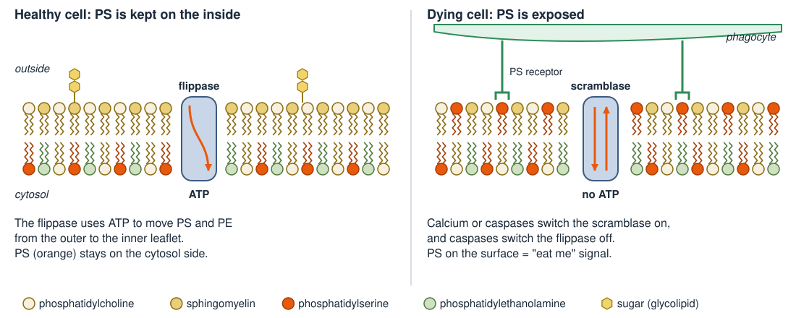{width="92%" fig-align="center"}

- Outer leaflet: mostly **PC, sphingomyelin, glycolipids**. Inner leaflet: **PS, PE, PI**.
- **Flippases** use ATP to keep PS inside. **Scramblases** mix the leaflets without ATP.
- Exposed PS means "**eat me**" (dying cells, more in the cell-death lectures) and "**clot here**" (activated platelets).

::: notes
The two leaflets of the plasma membrane have different lipids. The outer leaflet is rich in PC, sphingomyelin and glycolipids; the inner leaflet holds almost all the PS and most of the PE and PI. Because flip-flop is so slow, this difference is stable, but the cell also maintains it actively. Flippases are P-type ATPases: they use ATP to pick up PS and PE from the outer leaflet and move them to the inner one. Scramblases do not use energy; when they are switched on they let lipids move both ways, so the asymmetry is lost. Why should you care? First, the negative PS on the inner face attracts positively charged regions of proteins, so it helps signalling proteins find the membrane. Second, PS on the outside is a signal. When a cell dies by apoptosis, enzymes called caspases switch the flippase off and a scramblase on, so PS appears on the surface, and phagocytes recognise it as "eat me". You will see this again in the cell-death lectures. In activated platelets, calcium switches on a scramblase; the exposed PS forms a surface on which clotting factors assemble. Patients who lack this scramblase have a bleeding disorder.
:::

## Bending a membrane {.smaller}

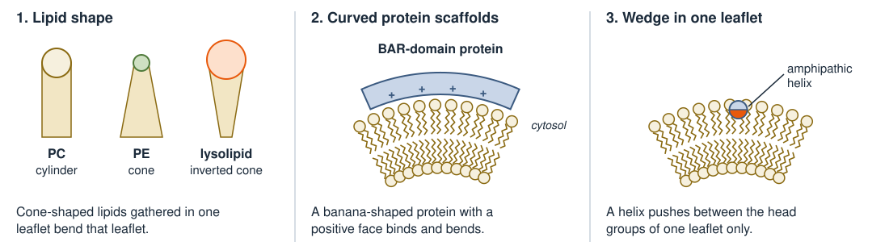{width="92%" fig-align="center"}

- A flat bilayer is the easy shape. Vesicles, tubules and the folds of the ER and mitochondria need **curvature**.
- Cells bend membranes with **cone-shaped lipids**, **curved proteins** and **wedges**; for vesicles, also with protein **coats** (see the vesicle traffic lectures).

::: notes
Cells are full of curved membranes: small vesicles about fifty nanometres across, tubules of the ER, the folds of the inner mitochondrial membrane. A bilayer prefers to be flat, so curvature costs energy, and the cell pays it in three main ways. First, lipid shape. PC is roughly a cylinder: its head is as wide as its tails, so it packs flat. PE has a small head and is cone-shaped; a lysolipid, with one tail removed, is an inverted cone. If one leaflet collects cone-shaped lipids, it curves. Second, proteins with a curved shape. BAR-domain proteins are banana-shaped dimers with positive charges on their curved face; they bind negatively charged lipids and hold the membrane in their shape. Third, wedges: some proteins push an amphipathic helix, which has one oily face, in among the head groups of one leaflet only. That leaflet gets wider than the other, and the membrane bends. In the vesicle traffic lectures you will see protein coats, such as clathrin, which combine these tricks to pull a vesicle out of a membrane. This is one slide of a big field; the point is that shape is made, not given.
:::

## How proteins sit in a membrane {.smaller}

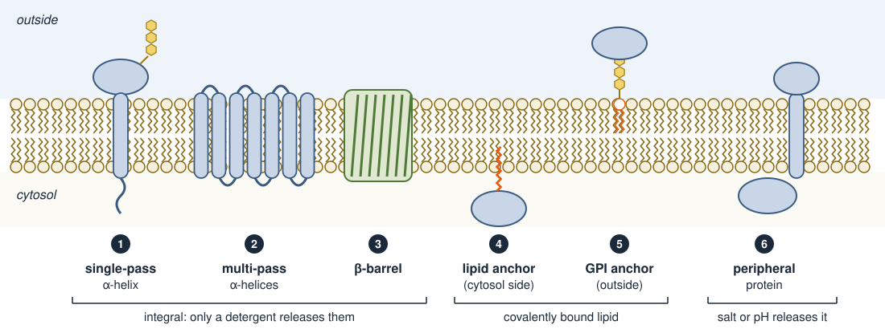{width="92%" fig-align="center"}

- **Integral**: cross the bilayer once (**single-pass**) or many times (**multi-pass**), as α-helices or a β-barrel.
- **Lipid-anchored**: a covalently attached fatty acid or prenyl group (cytosol side) or a **GPI anchor** (outside).
- **Peripheral**: bound to other proteins or to head groups; washed off with salt or a change in pH.

::: notes
About a third of human genes encode membrane proteins, and more than half of all drug targets are membrane proteins, so this slide matters. There are three ways to be attached. Integral proteins cross the bilayer. A single-pass protein, such as many receptors, crosses once with one alpha-helix; a multi-pass protein crosses many times, like the seven-helix receptors you will meet in signalling. In the outer membranes of bacteria, mitochondria and chloroplasts, proteins cross instead as a beta-barrel. To remove an integral protein you must dissolve the bilayer with detergent. Lipid-anchored proteins do not cross the membrane at all: a lipid chain, attached covalently to the protein, dips into one leaflet. On the cytosolic side the anchor is a fatty acid such as myristate or palmitate, or a prenyl group; Ras, a protein you will meet in signalling and cancer, is held this way. On the outside the anchor is GPI, a glycolipid made in the ER. Peripheral proteins bind by non-covalent contacts to other proteins or to head groups, so a high-salt or high-pH wash removes them while the membrane stays intact.
:::

## Crossing the bilayer: α-helix or β-barrel

:::: {.columns}
::: {.column width="30%"}
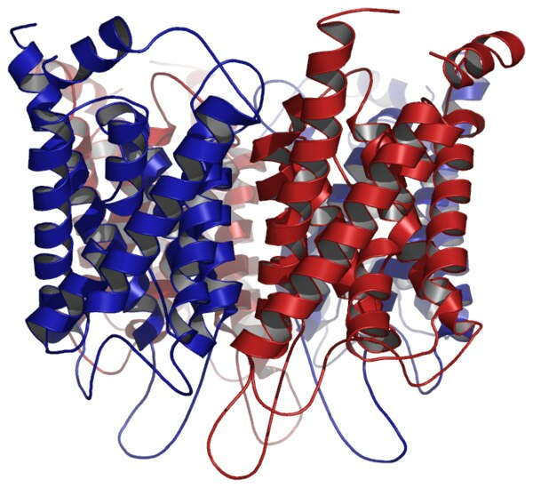{width="100%"}

*Aquaporin-1 (PDB 1J4N): bundles of α-helices. Two chains in blue and red.*
:::
::: {.column width="30%"}
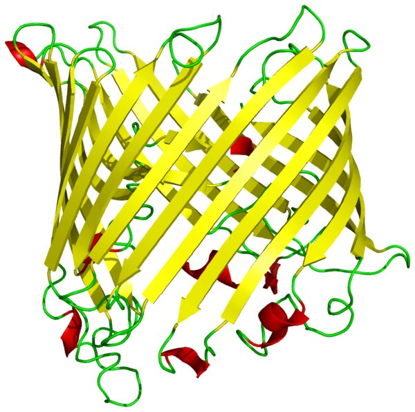{width="100%"}

*Sucrose porin from* Salmonella *(PDB 1A0S): an 18-strand β-barrel.*
:::
::: {.column width="40%"}
- Inside the bilayer there is **no water** to bond with the peptide backbone (its C=O and N–H groups).
- An **α-helix** bonds its backbone to itself. About **20 hydrophobic amino acids** span the 3 nm core.
- A **β-barrel** closes a sheet into a tube, so every strand has neighbours to bond with. Hydrophobic side chains face the lipids; the inside can be a water-filled pore.
:::
::::

::: notes
Why do membrane proteins only use two shapes to cross the bilayer? The protein backbone has polar groups: every peptide bond has a C equals O and an N–H. In water these make hydrogen bonds with water molecules. In the hydrocarbon core of the bilayer there is no water, so an unpaired backbone group would cost a lot of energy. An alpha-helix solves this by bonding each peptide group to the one four residues further along. The side chains point outwards, and if they are hydrophobic, such as leucine, isoleucine, valine and phenylalanine, the helix sits happily among the lipid tails. Each residue adds 0.15 nanometres, so about twenty residues span the three-nanometre core. On the left is aquaporin, the water channel of red blood cells and kidney: each chain is a bundle of six such helices. A beta-strand cannot satisfy its own backbone, but a beta-sheet rolled up into a closed barrel can: every strand bonds to its two neighbours. Side chains alternate, so every other one faces the lipids and the others face the inside, which is often a water-filled pore, as in this porin. You will see much more of these structures in the transport and ion channel lectures.
:::

## Predicting transmembrane helices: hydropathy plots {.smaller}

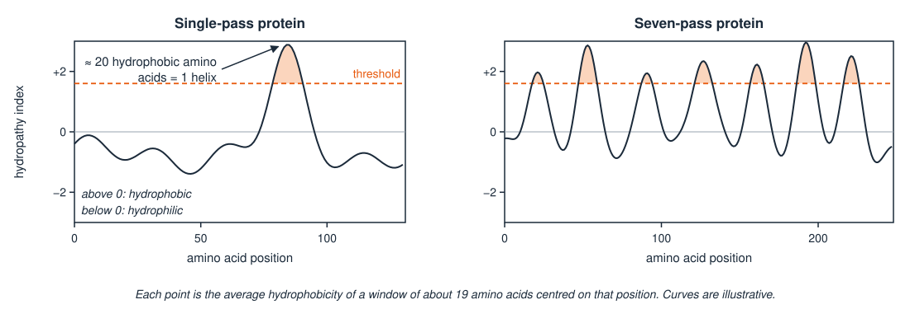{width="88%" fig-align="center"}

- Give each amino acid a **hydropathy** score (e.g. Ile +4.5, Leu +3.8, Arg −4.5). Slide a **window of about 19 residues** along the sequence and plot the average.
- A peak of about 20 residues **above the threshold** predicts one transmembrane α-helix.
- Prediction, not proof: β-barrels and short or partly polar helices are missed. Test with **structures** and **topology** experiments.

::: notes
From the last slide follows a simple rule: a stretch of about twenty hydrophobic amino acids is probably a transmembrane helix. A hydropathy plot finds such stretches from the sequence alone. Each amino acid gets a score for how much it prefers oil over water; in the common Kyte–Doolittle scale isoleucine scores plus 4.5, leucine plus 3.8, and arginine minus 4.5. A computer takes a window of about nineteen residues, averages their scores, plots the value at the window centre, moves one residue on, and repeats. Short hydrophobic patches average out, but a stretch of twenty hydrophobic residues gives a broad peak. With this window, peaks above about 1.6 usually mean a transmembrane helix. On the left, a protein with one peak is single-pass, like glycophorin of the red blood cell. On the right, seven peaks suggest seven transmembrane helices, the pattern of bacteriorhodopsin and of the G-protein-coupled receptors. The curves here are illustrative. Be critical: the method misses beta-barrels, whose strands are short and alternate polar and nonpolar, and it can be fooled by helices that line a water-filled pore. Modern tools, and AlphaFold, do better, but the idea is the same.
:::

## Getting membrane proteins out: detergents {.smaller}

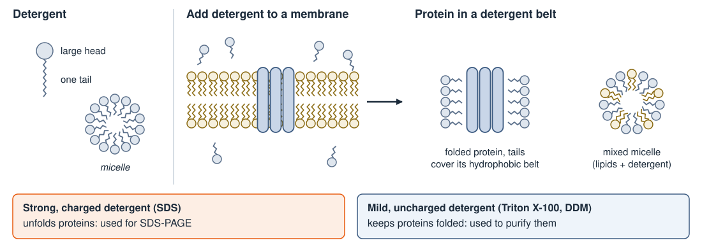{width="90%" fig-align="center"}

- A detergent has **one tail** and a **large head**: it forms small **micelles**, not bilayers.
- It replaces the lipids around the protein's hydrophobic belt, so the protein becomes **soluble** in water.
- Choose the detergent for the job: **SDS** to unfold and separate by size; **mild detergents** to purify a working protein (for activity, structure, drugs).

::: notes
You cannot purify a membrane protein in plain buffer: its hydrophobic belt would make it clump and precipitate. Detergents solve this. A detergent is a small amphipathic molecule with a single tail and a relatively big head, so it is cone-shaped and packs into small spherical micelles rather than bilayers. Above a certain concentration, called the critical micelle concentration, detergent molecules enter the bilayer, break it up into mixed micelles of lipid and detergent, and coat the hydrophobic surface of each membrane protein. The protein is now a soluble protein–detergent complex. Detergents differ. SDS, which you know from SDS-PAGE, is charged and strong: it binds all along the polypeptide and unfolds it, which is what you want to separate proteins by size, but the protein no longer works. Mild, uncharged detergents such as Triton X-100 or dodecyl maltoside, DDM, coat the hydrophobic belt but leave the folded structure alone. That is how membrane proteins are purified for activity tests and for cryo-EM structures, including structures of drug targets such as receptors and channels. The same mild detergents are used to permeabilise cells for immunofluorescence.
:::

## How do we know? Membrane proteins move {.smaller}

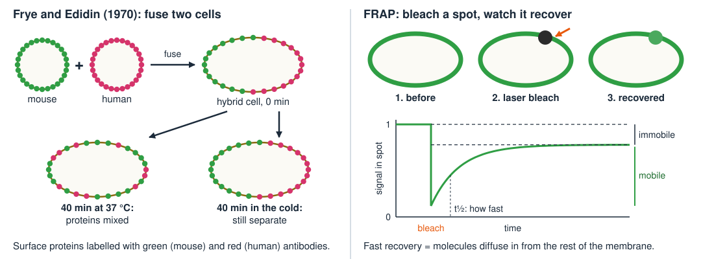{width="90%" fig-align="center"}

- **Cell fusion (1970):** after fusion, mouse and human surface proteins **mixed in about 40 min** at 37 °C, but not in the cold. Proteins diffuse in the membrane.
- **FRAP:** bleach the fluorescent molecules in a spot with a laser and watch others **diffuse back in**. The speed gives the **diffusion coefficient**; the part that never recovers is **immobile** (held by the cytoskeleton or other proteins). **Try it:** [the FRAP lab](questions.qmd#explore).

::: notes
Two experiments convinced people that membrane proteins move. In 1970 Larry Frye and Michael Edidin fused a mouse cell with a human cell, using a virus that makes membranes fuse. They labelled mouse surface proteins with a green antibody and human proteins with a red one. Right after fusion, each colour stayed on its own half of the hybrid cell. Forty minutes later at 37 degrees, the colours were completely mixed. In the cold the mixing did not happen, and drugs that block protein synthesis or ATP production did not stop it, so this was diffusion, not new proteins. The modern method is FRAP, fluorescence recovery after photobleaching. You label a protein or lipid, for example as a GFP fusion, then use a strong laser to bleach a small spot. The fluorescence in the spot comes back as unbleached molecules diffuse in from around. How fast it recovers gives the diffusion coefficient. Typical membrane proteins diffuse ten to a hundred times more slowly than lipids. Often the recovery stops below the starting level: that fraction of the protein is immobile, tied to the cytoskeleton or to other cells.
:::

## How do we know? Freeze-fracture EM shows proteins inside the bilayer {.smaller}

:::: {.columns}
::: {.column width="58%"}
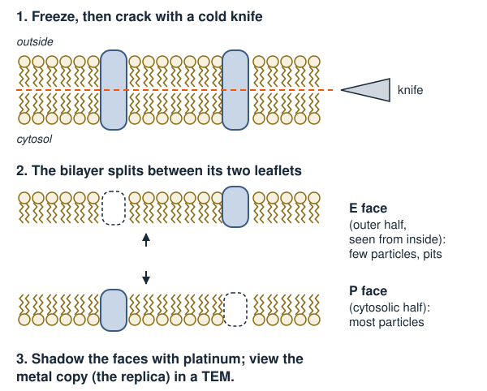{width="100%"}
:::
::: {.column width="42%"}
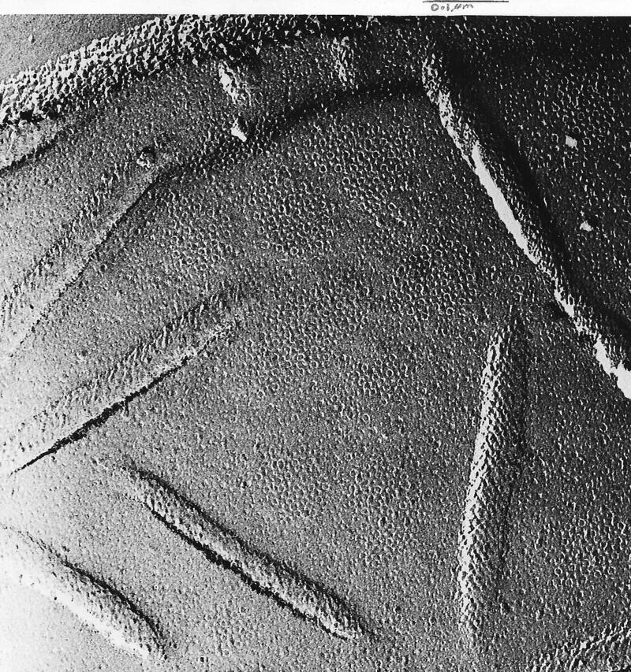{height="380px" fig-align="center"}

*Freeze-fracture replica of the plasma membrane of baker's yeast. Each small bump is a particle, mostly integral proteins; the long grooves are folds of the membrane. Scale bar (top) 0.1 µm.*
:::
::::

::: notes
How do we know that proteins sit inside the bilayer and do not just coat its surface? The answer came from freeze-fracture electron microscopy in the 1960s and 70s. A cell is frozen very quickly and then cracked with a cold knife. The crack follows the path of least resistance, and in a frozen membrane that is the plane between the two leaflets, where only weak contacts between tail ends hold them together. So the bilayer splits into two halves, and you look at the inside face of each half. Platinum is evaporated from an angle, which shadows the bumps, and the cell material is dissolved away; the thin metal copy, the replica, is viewed in the transmission electron microscope. Pure lipid bilayers give smooth faces. Real membranes are covered in particles about eight to ten nanometres across, and the number of particles goes up and down with the amount of protein in the membrane. These particles are integral membrane proteins. Most stay with the cytosolic half, the P face, leaving pits in the E face. The image shows the yeast plasma membrane, crowded with particles. This was direct evidence for the fluid mosaic model of Singer and Nicolson, 1972.
:::

## Not a uniform sea: membrane domains {.smaller}

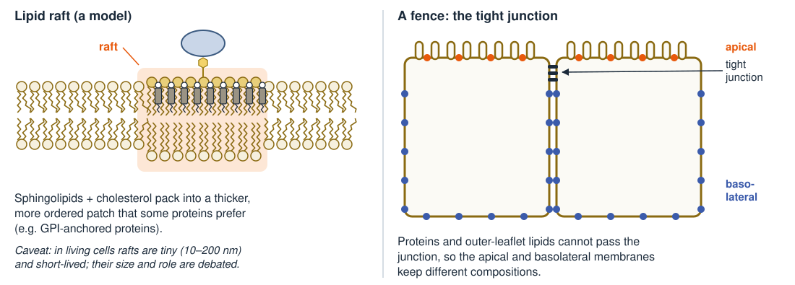{width="90%" fig-align="center"}

- **Lipid rafts**: sphingolipid- and cholesterol-rich nano-domains may gather some proteins for signalling. *Honest caveat:* they are **too small and short-lived** to see directly in living cells, and early evidence (detergent-resistant membranes) was weak.
- **Fences**: in epithelia, the **tight junction** keeps apical and basolateral membranes apart. The **cortical cytoskeleton** under the membrane also slows diffusion.

::: notes
The fluid mosaic model is right, but the membrane is not a perfectly mixed sea. Two kinds of domain are worth knowing. The first is the lipid raft. In artificial membranes, sphingomyelin and cholesterol separate from unsaturated PC into a thicker, more ordered phase. Rafts are thought to be the cell's version: small patches that gather GPI-anchored proteins and some signalling proteins. Be careful. Early evidence came from the fact that some membrane fractions do not dissolve in cold Triton X-100, but the detergent itself can create such domains. In living cells, rafts, if they exist, are smaller than about two hundred nanometres and last less than a second, so they are hard to see directly. The second kind of domain is clear and important. In an epithelium, the tight junction seals neighbouring cells together near the top, and it also acts as a fence: proteins and outer-leaflet lipids cannot diffuse past it. So the apical membrane, facing the gut lumen for example, keeps different transporters from the basolateral membrane. The transport lecture uses this to explain how glucose crosses the gut wall.
:::

## The sugar coat: glycocalyx and blood groups

- Sugars on glycoproteins, glycolipids and proteoglycans form the **glycocalyx**, always on the **outside** (they are added in the ER and Golgi lumen). It protects the cell, holds water and is used in **cell recognition**.
- **ABO blood groups** are the tips of sugar chains on red blood cells. One gene, three alleles: the enzyme adds **GalNAc (A)**, **galactose (B)** or **nothing (O)**.

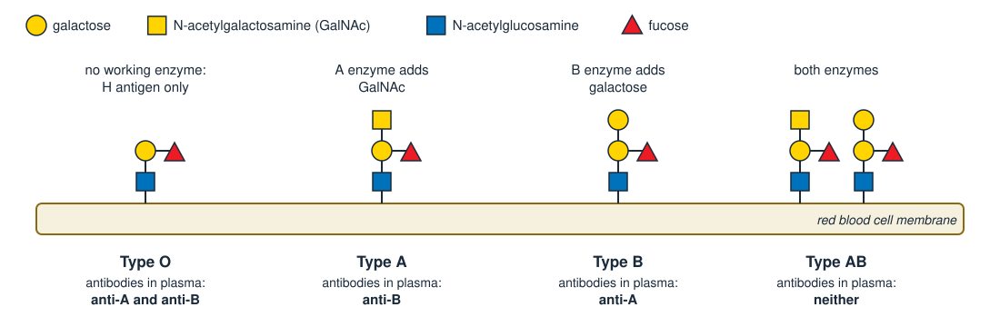{width="88%" fig-align="center"}

The plasma has antibodies against the sugars you lack: the wrong transfusion makes the antibodies attack the donor's red blood cells.

::: notes
The outside of every cell is covered in carbohydrate: sugar chains on proteins and lipids, and large proteoglycans. Together they form the glycocalyx, the sugar coat. Remember topology from the cell tour: sugars are added in the lumen of the ER and Golgi, and the lumen side becomes the outside, so the sugars always face outwards. The coat protects the membrane, binds water, makes cells slippery, and carries information. White blood cells and blood vessel walls, for example, recognise each other's sugars, through sugar-binding proteins called selectins, when white cells leave the blood to fight an infection. Blood groups are the classic example. Red blood cells carry a core chain ending in galactose with a fucose: the H antigen. One gene encodes a glycosyltransferase in the Golgi. The A version adds N-acetylgalactosamine, the B version adds galactose, and the O version is broken and adds nothing. An AB person has both enzymes. Because we meet similar sugars on gut bacteria, we make antibodies against the sugars we do not have. A type A person has anti-B antibodies, so blood from a type B donor would be attacked and the red cells destroyed.
:::

## Why it matters: lipid nanoparticles deliver RNA {.smaller}

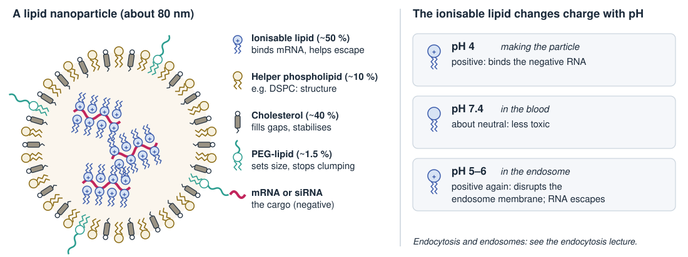{width="90%" fig-align="center"}

- RNA is large and negative: it cannot cross a bilayer, and enzymes in blood destroy it. An **LNP** packs it in lipid.
- **Patisiran** (2018), the first siRNA drug: silences **transthyretin** mRNA in the liver (hereditary amyloidosis). The mRNA **COVID-19 vaccines** use the same four-lipid design.
- Only a few per cent of the RNA **escapes the endosome**: how LNPs get in and out is in the **endocytosis lecture**.

::: notes
Here the rules of today become medicine. RNA drugs face two problems: RNA is quickly destroyed by enzymes in blood, and a big, negatively charged molecule cannot cross the hydrophobic core of a membrane. A lipid nanoparticle solves both by hiding the RNA inside lipids. It has four components, and you can now explain each one. The ionisable lipid has an amine head whose charge depends on pH. At pH 4, when the particle is made, it is positive and binds the negative RNA. In blood at pH 7.4 it is almost neutral, which makes it less toxic. After the particle is taken up by endocytosis, the endosome becomes acidic, the lipid becomes positive again, pairs with negative lipids of the endosome membrane, and disturbs it, so some RNA escapes into the cytosol. The helper phospholipid, DSPC, and cholesterol give structure. The PEG-lipid controls particle size and stops particles sticking together. Patisiran, approved in 2018, carries a small interfering RNA that destroys transthyretin mRNA in liver cells; misfolded transthyretin causes a hereditary amyloidosis. The COVID-19 vaccines use the same design with mRNA. You meet vaccines again in Immunologi, and drug development in Kliniska prövningar och läkemedelsutveckling.
:::

## Why it matters: liposomal doxorubicin (Doxil) {.smaller}

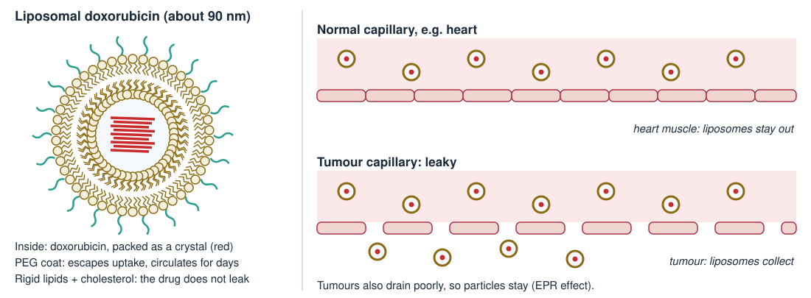{width="88%" fig-align="center"}

- **Doxorubicin** blocks **topoisomerase II** and kills dividing cells, but damages the **heart** (dose-limiting).
- In a rigid, **PEG-coated liposome** (approved 1995), it circulates for days. Tumour vessels are leaky (**EPR effect**), heart capillaries are tight: **less heart damage**, new side effect in the skin (hand–foot syndrome).
- *Caveat:* EPR is strong in mouse tumours but varies a lot between human tumours; survival is similar to free drug.

::: notes
Doxorubicin is an old and effective cancer drug. It inserts between DNA bases and traps topoisomerase II on cut DNA, which kills dividing cells. Its big problem is the heart: above a lifetime dose it damages heart muscle, even years later. Liposomal doxorubicin packs the drug into a liposome of about ninety nanometres, a small bilayer vesicle. The lipids are saturated phospholipid plus cholesterol, so the bilayer is stiff and the drug does not leak out. Inside, the drug is loaded with a gradient and forms a crystal. The outside carries a PEG coat that hides the particle from phagocytes, so it circulates for days instead of being cleared in minutes. Most normal capillaries, including those of the heart, have a tight wall, so the particle stays in the blood. Many tumour vessels have gaps of hundreds of nanometres and poor lymph drainage, so particles leak in and stay: the enhanced permeability and retention, or EPR, effect. In patients, Doxil causes much less heart damage. But be honest: EPR was found in fast-growing mouse tumours, it varies widely in human tumours, and in trials survival was similar to free doxorubicin. The gain is mainly safety. Clinical trials return in Kliniska prövningar och läkemedelsutveckling.
:::

## Summary

1. Membrane lipids **self-assemble** into a sealed bilayer because of the **hydrophobic effect**. The plasma membrane mixes **glycerophospholipids, sphingolipids and cholesterol**.
2. The bilayer is a **two-dimensional liquid**: fast lateral diffusion, rare flip-flop. **Tail length, double bonds, cholesterol and temperature** set its fluidity.
3. The two leaflets differ (**asymmetry**): flippases keep PS inside; scramblases expose it as an "eat me" or "clot here" signal.
4. Proteins are **integral** (α-helices or β-barrels; predicted from **hydropathy plots**; extracted with **detergents**), **lipid-anchored** or **peripheral**. **FRAP**, **cell fusion** and **freeze-fracture EM** show a fluid mosaic with domains and fences.
5. Drug carriers use the same rules: **lipid nanoparticles** for RNA, **PEG-liposomes** for doxorubicin.

*Read more (optional): Alberts et al., Molecular Biology of the Cell, 7th ed., ch. 10.*

[Image credits](../credits.qmd#membrane-structure){style="font-size:0.7em"}

::: notes
Let us go back to the red blood cell that squeezes through a capillary. Its membrane is a bilayer that forms and reseals by itself because water pushes the tails together. It is a liquid in its own plane, so it can bend and flow, but polar molecules and ions cannot cross its oily core, so it is a barrier. The cell tunes its fluidity with tail length, double bonds and cholesterol, and it keeps the two leaflets different with flippases; when a cell dies or a platelet is activated, scramblases expose PS as a signal. Proteins sit in the membrane in a few defined ways, and the rules of the bilayer, twenty hydrophobic residues for a helix, explain how we can predict them and how detergents take them out. FRAP, cell fusion and freeze-fracture are the evidence for this fluid mosaic, with domains such as the region fenced off by tight junctions. Finally, the same rules let us build drug carriers. The next lecture asks the question this one leaves open: if the bilayer blocks ions and sugars, how do they get across? The answer is transporters and pumps.
:::
