## About this lecture {.smaller}

A lipid bilayer keeps almost everything out. Yet a cell must take up sugars, amino acids and ions, throw out waste and drugs, and keep the inside very different from the outside. Today: the **proteins that move molecules across membranes**, and where the energy comes from.

After this lecture you can:

- predict **which molecules cross a pure lipid bilayer**, and explain why most others need a protein;
- explain **passive** and **active** transport with **ΔG**, and why transporters **saturate** like enzymes;
- describe the **alternating-access** mechanism and **uniport, symport and antiport**;
- explain **primary active transport** (P-type, V-type and ABC pumps; the **Na⁺/K⁺ pump**) and **secondary active transport** driven by the Na⁺ gradient;
- explain how an **epithelium** moves glucose from the gut to the blood, and how drugs act on transporters.

**ELO 2** (membranes and transport).

::: notes
In the lecture on membrane structure you met the lipid bilayer: a thin, oily sheet that separates two water-filled spaces. Today we ask how anything gets through it. The answer has three parts. First, physics: a few small, uncharged molecules simply dissolve in the bilayer and cross on their own, but most of what a cell needs cannot. Second, proteins: transporters and channels give polar molecules and ions a path. Third, energy: to move something against its concentration gradient, the cell must pay, either directly with ATP or indirectly with another gradient. You already know the tools from chemistry and biochemistry: ΔG tells us which way a process goes, and Michaelis–Menten kinetics describes a protein with a limited number of binding sites. We will use both. Channels and the membrane potential get their own lecture next, so today channels appear only as a contrast to transporters. This lecture covers ELO 2, and it ends with drugs that act on transporters, which you meet again in drug development.
:::

## The question: how does sugar get from your gut into your blood? {.smaller}

:::: {.columns}
::: {.column width="45%"}
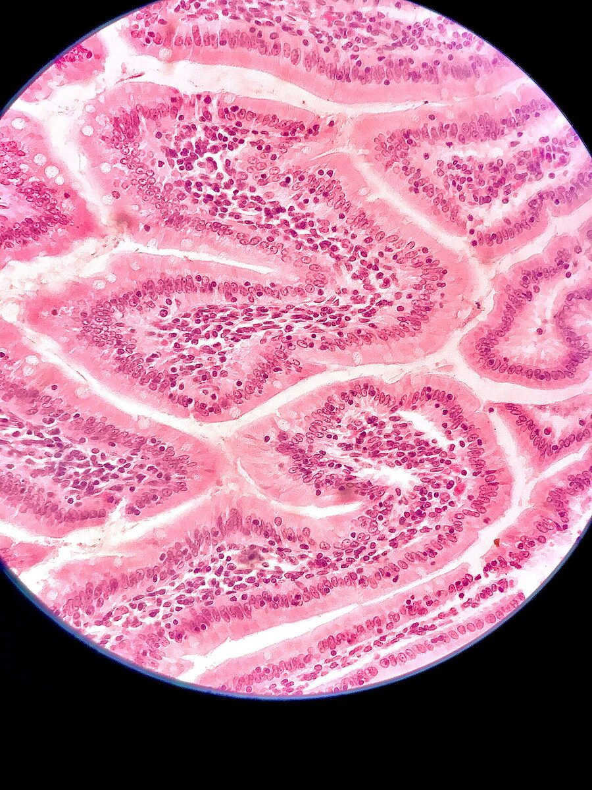{height="430px" fig-align="center"}

*Small intestine (rat), stained section. The finger-like villi are covered by one layer of epithelial cells.*
:::
::: {.column width="55%"}
- After a meal, the gut takes up **hundreds of grams of glucose** a day.
- Glucose is **polar**: it barely crosses a lipid bilayer.
- It must cross **two membranes**: into the epithelial cell from the gut, and out again on the blood side.
- Between meals the cell still takes up glucose when the gut has **less glucose than the blood**: uphill.
- And every one of your cells keeps **Na⁺ low and K⁺ high** inside, the opposite of the blood. A resting cell spends **about a quarter of its ATP** on this.

**How, and why?**
:::
::::

::: notes
Look at the picture. This is a section through the small intestine of a rat, stained with dyes. The finger-like folds are villi, and each villus is covered by a single layer of epithelial cells. Everything you absorb from food must pass through these cells: in through the membrane facing the gut, and out through the membrane facing the blood. Glucose is a polar molecule with many hydroxyl groups, so it hardly enters a lipid bilayer at all. Still, your gut absorbs it very efficiently, even towards the end of digestion when there is less glucose in the gut than in the blood. That means the cell can move glucose uphill, against its gradient. At the same time, every cell in your body keeps sodium low and potassium high inside, the reverse of the blood, and spends a large part of its ATP to do so. By the end of the lecture you will see that these two puzzles have the same answer: the sodium gradient made by one pump drives the uptake of glucose.
:::

## What crosses a pure lipid bilayer? {.smaller}

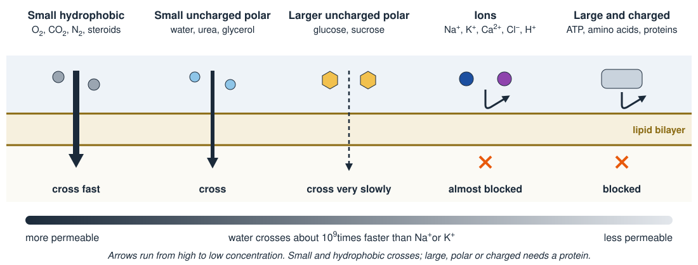{width="88%" fig-align="center"}

- The middle of the bilayer is **hydrophobic**. A molecule must leave water and dissolve in oil to cross.
- **Small and hydrophobic** (O₂, CO₂, steroid hormones, many drugs): fast. **Small polar** (water, urea): slower. **Glucose**: very slow. **Ions**: practically never, because they carry a charge and a shell of water.
- So a cell needs **membrane transport proteins**: they make up about **15–30 %** of the membrane proteins in a cell.

::: notes
Imagine an artificial membrane made only of lipid, with no proteins, and ask what gets through. The answer depends on two things: size and how well the molecule dissolves in oil. Small hydrophobic molecules such as oxygen, carbon dioxide and nitrogen cross very fast, and so do steroid hormones and many drugs. This is why most drugs taken as tablets are designed to be fairly small and fairly lipophilic. Small uncharged polar molecules such as water, urea and glycerol also cross, more slowly. Larger polar molecules such as glucose cross very slowly, far too slowly for a cell's needs. Ions almost never cross: a sodium ion carries a charge and holds a shell of water molecules, and pulling it into the oily core costs a great deal of energy. A pure bilayer lets water through about a billion times faster than sodium or potassium. So the bilayer is a barrier, and the cell controls traffic with proteins. In a typical cell, roughly 15 to 30 percent of membrane proteins are transport proteins, which shows how important this job is.
:::

## Inside is not like outside {.smaller}

| Ion | Inside a mammalian cell (cytosol) | Outside (blood, tissue fluid) | Ratio |
|---|---|---|---|
| **Na⁺** | about 12 mM | about 145 mM | ~10× higher outside |
| **K⁺** | about 140 mM | about 5 mM | ~30× higher inside |
| **Ca²⁺** | about 0.0001 mM (100 nM) | about 2 mM | ~10 000× higher outside |
| **Cl⁻** | about 5–15 mM | about 110 mM | ~10× higher outside |
| **H⁺** | pH about 7.2 | pH 7.4 | |

- Inside, the extra positive charge of K⁺ is balanced by **negatively charged proteins, nucleic acids and metabolites** that cannot leave.
- These differences are **not equilibrium**. Ions leak all the time, and pumps work all the time to restore them. **Stop the pumps and the gradients run down.**
- Gradients store energy, like water behind a dam. Cells use them to **drive transport** and to **send electrical signals** (the ion-channels lecture).

::: notes
This table is worth learning, because almost everything in the next two lectures follows from it. Typical values for a mammalian cell: sodium is about 12 millimolar inside and 145 outside. Potassium is the reverse: about 140 inside and 5 outside. Free calcium in the cytosol is extremely low, about 100 nanomolar, ten thousand times lower than outside. Chloride is low inside. The cytosol is slightly more acidic than blood. Inside the cell, the positive charge of potassium is balanced mostly by large negatively charged molecules, proteins, nucleic acids and phosphorylated metabolites, which cannot leave. The key word is steady state, not equilibrium. Ions leak slowly across the membrane all the time, down their gradients, and pumps keep putting them back. If you poison the pumps, for example by blocking ATP production, the gradients slowly disappear and the cell swells and dies. Why keep these gradients? Because a gradient is stored energy. Today we see how cells spend the sodium gradient to move other molecules. In the ion-channels lecture you will see how the same gradients create the membrane potential and nerve signals.
:::

## Recap: ΔG decides the direction {.smaller}

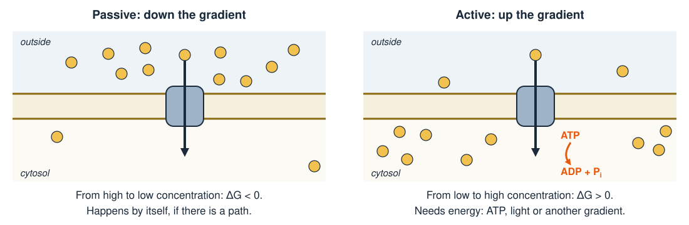{width="76%" fig-align="center"}

For an uncharged solute moving from outside to inside, at 37 °C:

$$\Delta G = RT \ln\frac{c_\text{in}}{c_\text{out}} \qquad (RT \approx 2.6\ \text{kJ/mol})$$

- **Passive transport**: down the gradient, $\Delta G < 0$. A **10-fold** gradient is worth about **5.9 kJ/mol**.
- **Active transport**: up the gradient, $\Delta G > 0$, so it must be **coupled** to a reaction with a larger negative ΔG. **ATP hydrolysis** in a cell gives about **−50 kJ/mol**.
- For an **ion**, the membrane voltage adds an electrical term: the **electrochemical gradient** (the ion-channels lecture).

::: notes
This is a recap from chemistry, applied to a membrane. Moving one mole of an uncharged solute from outside to inside changes free energy by RT times the natural log of the inside concentration over the outside concentration. If the inside is lower, the log is negative, ΔG is negative, and the movement can happen by itself, provided there is a path. That is passive transport, also called facilitated diffusion when a protein provides the path. If the inside is higher, ΔG is positive: the cell must pay. At body temperature RT is about 2.6 kilojoules per mole, so each tenfold difference in concentration is worth about 5.9 kilojoules per mole. Hydrolysis of ATP under cell conditions releases about 50 kilojoules per mole, enough to pump against large gradients. A pump couples the two reactions in one protein, so the total ΔG is negative. For ions there is one more term: the voltage across the membrane pushes or pulls charges. The sum is the electrochemical gradient, and we leave the electrical part to the ion-channels lecture, where it gives the Nernst equation.
:::

## Two kinds of transport protein: transporters and channels {.smaller}

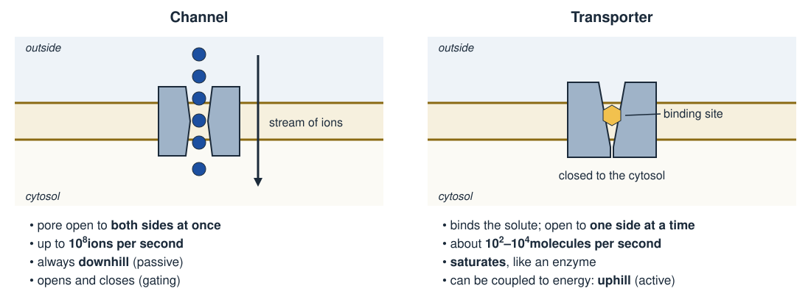{width="88%" fig-align="center"}

A **channel** is a gated hole: fast, but only downhill. A **transporter** (also called a carrier) binds its solute and changes shape: slower, but it can be **coupled to energy** and move things uphill.

::: notes
Membrane transport proteins come in two kinds. A channel forms a water-filled pore. When it is open, ions flow through it in single file, down their electrochemical gradient, at rates up to a hundred million ions per second. A channel cannot push anything uphill, because the pore is open to both sides at the same time. Channels open and close in response to signals, called gating, and they are the topic of the next lecture. A transporter works differently. It binds its solute at a specific site, like an enzyme binds its substrate, and then changes shape so that the site faces the other side. Each cycle moves one or a few molecules, so transporters are much slower, about a hundred to ten thousand molecules per second. But because each cycle is a defined series of shape changes, it can be linked to another event, such as ATP hydrolysis or the movement of a sodium ion. That is how transporters do active transport. Remember the rule: channels are fast and passive; transporters are slow, specific, saturable, and can be active.
:::

## How a transporter works: alternating access {.smaller}

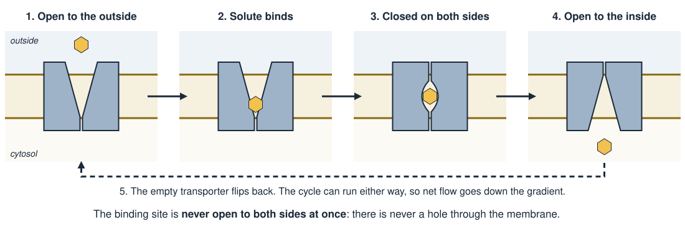{width="74%" fig-align="center"}

:::: {.columns}
::: {.column width="62%"}
- The binding site faces **out**, then **in**, never both at once.
- One cycle can run in either direction. With no energy input, net flow goes **down the gradient** (passive).
- Example: **GLUT1**, the glucose uniporter of red blood cells and the blood–brain barrier.
:::
::: {.column width="38%"}
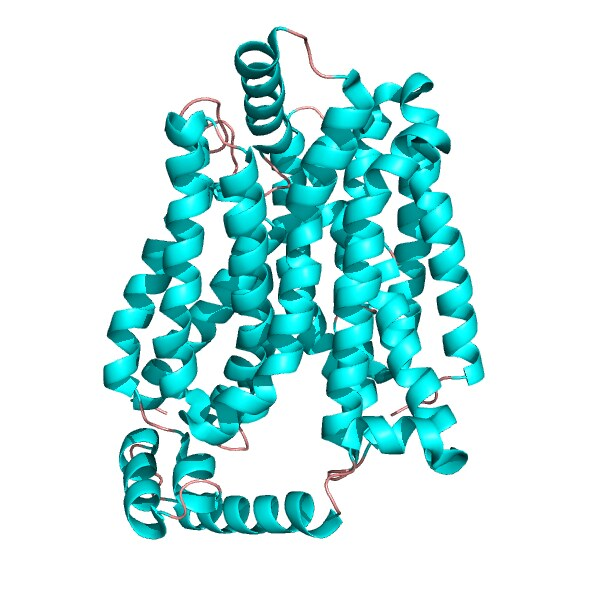{height="190px" fig-align="center"}

*Human GLUT1 (PDB 4PYP), side view. Its 12 membrane helices form two halves (blue, red) around the sugar site.*
:::
::::

::: notes
How does a transporter move a molecule without ever making a hole in the membrane? The answer is alternating access. In step one the transporter is open to the outside, and its binding site is empty. A glucose molecule binds. The protein then closes behind it, so for a moment the glucose is trapped inside the protein, closed to both sides. Then the protein opens to the inside and the glucose leaves into the cytosol. Finally the empty transporter flips back. Nothing in this cycle has a preferred direction, so if glucose is higher inside, the same cycle runs the other way. Net flow is always down the gradient. This is passive transport, but much faster and more specific than diffusion through lipid. The structure on the right is the real protein, GLUT1, solved by X-ray crystallography in 2014. It has twelve helices crossing the membrane, arranged as two bundles, and the sugar binds between them. The two halves rock against each other like a seesaw to open one side and close the other. GLUT1 supplies glucose to red blood cells and to the brain.
:::

## How do we know? Uptake assays show that transporters saturate {.smaller}

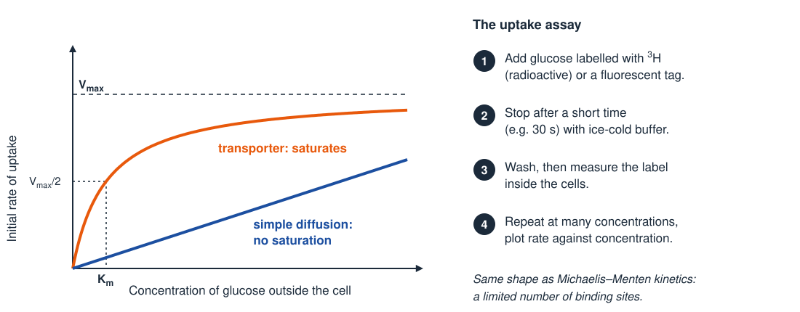{width="80%" fig-align="center"}

- Diffusion through lipid rises **linearly** with concentration. Transport by a protein reaches a **maximum (V~max~)**: all binding sites are busy. **K~m~** = concentration at half-maximal rate. **Try it:** [the uptake assay](questions.qmd#explore).
- Transporters are **specific**: GLUT1 takes D-glucose, not its mirror image L-glucose. They can be **competed** by similar molecules and **blocked** by inhibitors.

::: notes
How do we know that a protein is involved at all? Here is the classic experiment, and you can do it in a teaching lab. Cells, for example red blood cells, are given glucose labelled with a radioactive atom such as tritium, or with a fluorescent tag. After a short time, say thirty seconds, uptake is stopped by washing with ice-cold buffer, and the label inside the cells is measured. Repeat at many concentrations and plot the initial rate against concentration. If glucose simply diffused through lipid, the rate would rise in a straight line. Instead the curve bends and reaches a plateau. You know this shape from enzyme kinetics: it is the Michaelis–Menten curve. The plateau, Vmax, is reached when all transporter molecules are busy. Km is the concentration that gives half of Vmax, a measure of affinity. Two more results point to a protein. The transporter is stereospecific: it moves D-glucose, the natural form, but hardly L-glucose, which has the same size and polarity. And similar sugars compete for uptake, just as competitive inhibitors do for an enzyme.
:::

## Three ways to couple: uniport, symport, antiport {.smaller}

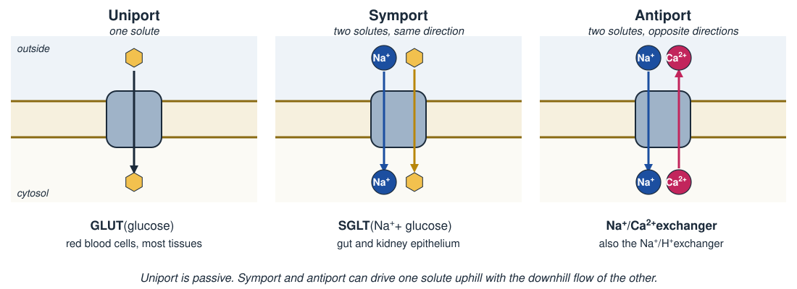{width="84%" fig-align="center"}

- **Uniport**: one solute, passive (GLUT).
- **Symport** (co-transport): two solutes cross **in the same direction**. Example: **SGLT1** carries **2 Na⁺ + 1 glucose** into gut cells.
- **Antiport** (exchange): two solutes cross **in opposite directions**. **Na⁺/Ca²⁺ exchanger**: 3 Na⁺ in, 1 Ca²⁺ out. **Na⁺/H⁺ exchanger**: 1 Na⁺ in, 1 H⁺ out (controls cytosolic pH).

::: notes
Transporters are classified by how many solutes they move and in which direction. A uniporter moves one kind of molecule, like GLUT. It can only move it downhill. A symporter binds two different solutes and moves them together, in the same direction. The transporter only completes its cycle when both are bound, so the two movements are tightly coupled. In SGLT1, two sodium ions and one glucose molecule enter together. An antiporter, or exchanger, moves two solutes in opposite directions: it takes one in and carries the other out in the same cycle. The sodium–calcium exchanger lets three sodium ions in and pushes one calcium ion out; it is important in heart muscle. The sodium–proton exchanger lets one sodium in and pushes one proton out, which protects the cytosol from becoming acidic. The important point: in symport and antiport, one solute can go downhill and pay for the other going uphill. Notice that in all three examples, sodium enters the cell. That is not a coincidence, as the next slide shows.
:::

## Secondary active transport: the Na⁺ gradient is a battery {.smaller}

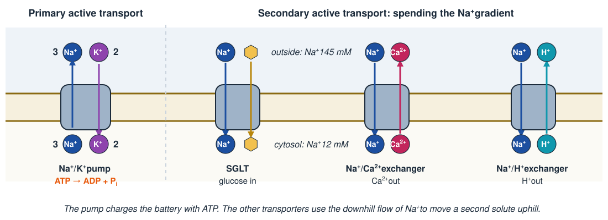{width="84%" fig-align="center"}

- **Primary** active transport uses ATP directly (a **pump**). **Secondary** active transport uses a gradient that a pump made.
- Na⁺ flowing in releases energy: about **−13 kJ/mol** (concentration plus voltage). With **2 Na⁺** per glucose, SGLT1 can in theory concentrate glucose **more than 10 000-fold**.
- Animal cells use **Na⁺**; bacteria, plants and fungi mostly use an **H⁺** gradient.

::: notes
Now we can solve the opening puzzle. The sodium–potassium pump, on the left, spends ATP to push sodium out. That keeps sodium about ten times higher outside than inside. In addition, the inside of the cell is electrically negative, which pulls positive sodium ions inwards. So sodium entering the cell is strongly downhill: about minus thirteen kilojoules per mole, about half from the concentration difference and half from the voltage. A symporter or antiporter can use this downhill flow to drive a second solute uphill. This is secondary active transport: no ATP is used by the transporter itself, but the energy came from ATP spent earlier by the pump. Think of the pump as charging a battery and the other transporters as devices running on it. Because SGLT1 couples two sodium ions to each glucose, it has twice that energy available and can, in theory, concentrate glucose more than ten thousand times. If you poison the pump, the battery runs down and glucose uptake stops too. Bacteria and plants do the same with a proton gradient instead of sodium.
:::

## Primary active transport: the Na⁺/K⁺ pump {.smaller}

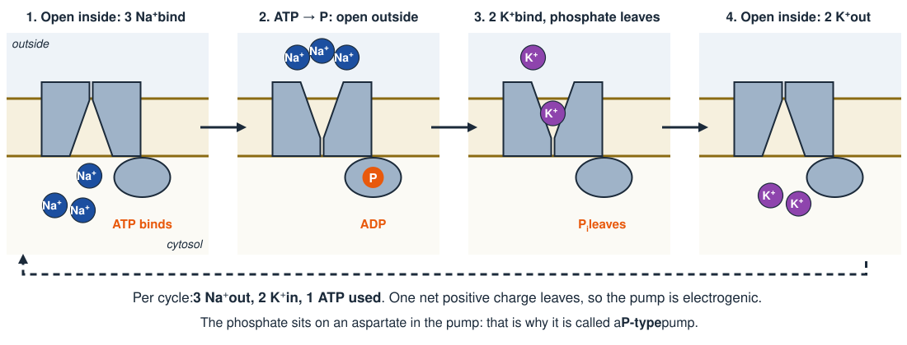{width="84%" fig-align="center"}

- A **P-type ATPase**: it **phosphorylates itself** on an aspartate, and this switches its shape from inward-open to outward-open.
- **3 Na⁺ out, 2 K⁺ in per ATP**. It uses about **a quarter of a resting cell's ATP**, and much more in nerve cells.
- Found in **every animal cell**. Discovered by Jens Skou in crab nerves in 1957 (Nobel Prize in Chemistry 1997).

::: notes
Here is the battery charger. The sodium–potassium pump, also called the sodium–potassium ATPase, is a P-type pump: P for phosphorylation. Follow the cycle. In state one, the binding sites face the cytosol, where sodium is relatively low, but the sites have a high affinity for sodium, so three sodium ions bind. That triggers the pump to transfer the phosphate of ATP to one of its own aspartate residues. The phosphorylated pump changes shape: the sites now face the outside, and their affinity for sodium drops, so the three sodium ions are released, even though sodium outside is high. In this shape the sites bind two potassium ions from the outside. Potassium binding triggers removal of the phosphate, the pump flips back, and potassium is released into the cytosol. Each cycle uses one ATP. Because three positive charges go out and only two come in, the pump also makes a small electrical current: it is electrogenic. This single protein uses roughly a quarter of the ATP of a resting cell, and in the brain a much larger share. Jens Skou found it in crab nerves in 1957.
:::

## How do we know? Rebuild the pump, and block it {.smaller}

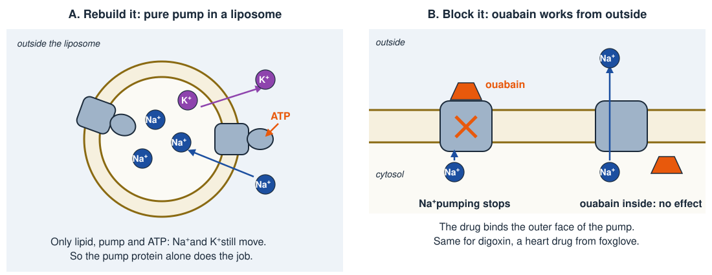{width="80%" fig-align="center"}

- **Reconstitution**: purify the pump, put it into **liposomes** (artificial lipid vesicles), add ATP: Na⁺ and K⁺ move in a **3 : 2** ratio. No other protein is needed.
- **Inhibitors**: **ouabain** (an arrow poison) and **digoxin** block the pump **only from the outside**. **Resealed red-cell membranes** ("ghosts") showed that ATP and Na⁺ must be **inside**, K⁺ **outside**.

::: notes
Two classic approaches prove that one protein does all of this. The first is reconstitution. You dissolve membranes with a mild detergent, purify the pump protein, and mix it with lipids. When the detergent is removed, the lipids form closed vesicles, liposomes, with pumps in their membranes. The pumps insert in both orientations, but only those whose ATP-binding part faces the outside can use ATP added to the outside. Those pumps move sodium into the liposome and potassium out, three to two. Since the liposome contains nothing but lipid and pump, the pump alone is sufficient. The second approach uses inhibitors. Ouabain, a plant toxin once used on arrow tips, binds the pump and stops it. Researchers made red blood cell ghosts: they let the cells swell until the haemoglobin leaked out, then resealed the empty membranes with chosen solutions inside. Ouabain worked only when it was outside; the pump needed ATP and sodium inside and potassium outside. That told us the pump's orientation in the membrane. Digoxin, a heart drug from the foxglove plant, binds the same site.
:::

## Other pumps: Ca²⁺ pumps, V-type and F-type {.smaller}

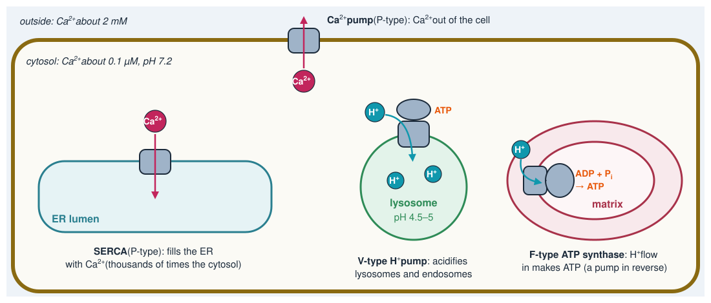{width="80%" fig-align="center"}

- **Ca²⁺ pumps (P-type)** keep cytosolic Ca²⁺ at about **100 nM**: out of the cell (**PMCA**) and into the ER (**SERCA**). A brief rise in Ca²⁺ is a signal (the signalling lectures).
- **V-type H⁺ pump** acidifies **lysosomes** (pH 4.5–5), endosomes and secretory vesicles (the lysosome lecture).
- **F-type ATP synthase** looks like a V-type pump but runs **backwards**: H⁺ flowing down its gradient **makes ATP** (the mitochondria lecture).

::: notes
The sodium–potassium pump is not alone. Calcium pumps are also P-type pumps, with the same phosphorylation cycle. One kind in the plasma membrane pushes calcium out of the cell. Another, SERCA, pumps calcium into the endoplasmic reticulum, so the ER lumen holds thousands of times more calcium than the cytosol. Because cytosolic calcium is kept so low, opening a calcium channel for a moment makes a large relative rise, which the cell uses as a signal for muscle contraction, secretion and much more. A second family, the V-type pumps, are large rotating machines that pump protons into lysosomes, endosomes and secretory vesicles. That makes the lysosome acidic, around pH 4.5 to 5, which its digestive enzymes need. A third family, the F-type ATPases, is built like the V-type but works in reverse. In the inner membrane of mitochondria, protons flow back into the matrix through the ATP synthase, and this flow turns a rotor that makes ATP from ADP and phosphate. Any pump can in principle run backwards if the gradient is steep enough. You meet both again in the organelle lectures.
:::

## ABC transporters: ATP-powered exporters {.smaller}

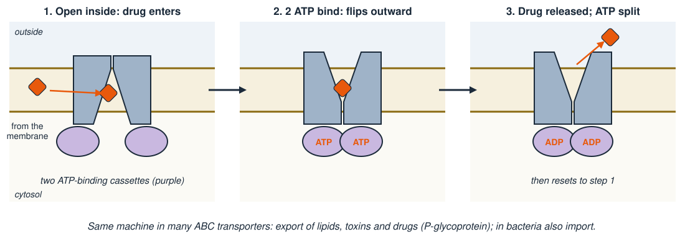{width="84%" fig-align="center"}

- Two membrane halves plus two **ATP-binding cassettes** (hence "ABC"). **ATP binding** brings the cassettes together and flips the transporter to face outward; **hydrolysis** resets it.
- The largest transporter family: humans have about **48** ABC genes. In our cells most are **exporters**: lipids, bile salts, toxins and **drugs**.
- **P-glycoprotein** (ABCB1) pumps many different hydrophobic drugs out of cells. The CFTR chloride **channel** is an unusual member (the ion-channels lecture).

::: notes
The third big family of ATP-driven pumps is the ABC transporters, named after their ATP-binding cassettes. Each ABC transporter has two halves that cross the membrane, and two cassettes in the cytosol that bind ATP. Follow the cartoon. In the inward-facing state the cassettes are apart and a cavity opens towards the cytosol and the inner half of the membrane. A hydrophobic molecule, often coming from inside the membrane itself, enters the cavity. Two ATP molecules then bind between the cassettes and glue them together. This pulls the membrane halves into an outward-facing shape, and the substrate is released outside. Hydrolysis of ATP lets the cassettes separate, and the transporter resets. Bacteria use ABC transporters to import nutrients, but in human cells nearly all of them export. They move lipids between membrane leaflets, bile salts out of liver cells, and toxins and drugs out of cells. One of them, P-glycoprotein, is famous for having a large, greasy binding cavity that accepts many unrelated drugs. We come back to it at the end. CFTR, the protein defective in cystic fibrosis, belongs to this family but works as a channel.
:::

## Transcellular transport: from gut to blood {.smaller}

::::: {.columns}
::: {.column width="74%"}
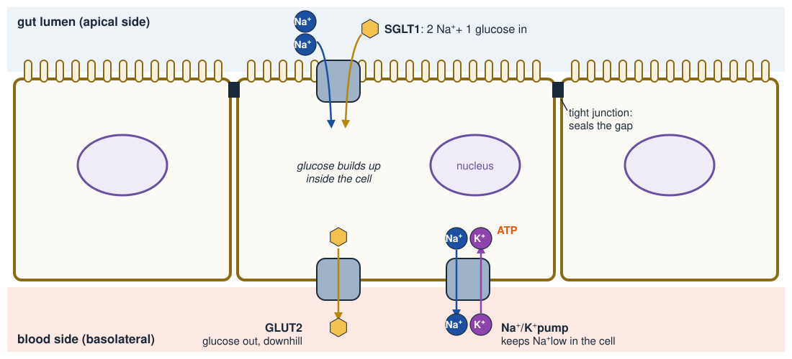{width="100%"}

- **Apical** (gut side): **SGLT1** brings glucose in, uphill. **Basolateral** (blood side): **GLUT2** lets it out, downhill; the **Na⁺/K⁺ pump** removes the Na⁺.
- **Tight junctions** seal the gaps between cells and keep apical and basolateral proteins apart.
:::
::: {.column width="26%"}
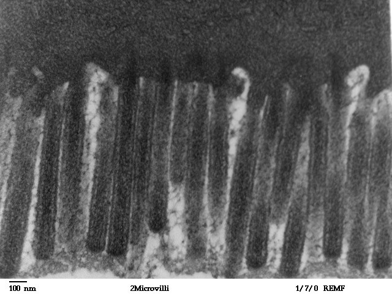{width="100%"}

*Microvilli on a human gut epithelial cell (TEM). Scale bar 100 nm. They enlarge the apical surface many times.*
:::
:::::

::: notes
Now we put the pieces together in an epithelium. An epithelial cell is polarised: its apical membrane faces the gut and its basolateral membrane faces the blood, and the two membranes carry different proteins. The apical side is folded into thousands of microvilli, shown in the electron micrograph, which increase the surface area. In the apical membrane, SGLT1 couples glucose entry to sodium entry, so glucose builds up inside the cell even when the gut contains little. In the basolateral membrane, GLUT2, a uniporter, lets glucose leave down its gradient into the blood. The sodium that came in with the glucose is pumped out on the basolateral side by the sodium–potassium pump, which keeps the battery charged. Tight junctions seal the spaces between neighbouring cells, so glucose cannot leak back, and they act as a fence that keeps apical and basolateral proteins in their own membrane. The same design works in the proximal tubule of the kidney, which takes back glucose, amino acids and salt from the urine. Oral rehydration solution, sugar and salt in water, uses SGLT1 to save the lives of children with severe diarrhoea.
:::

## Water: aquaporins {.smaller}

:::: {.columns}
::: {.column width="40%"}
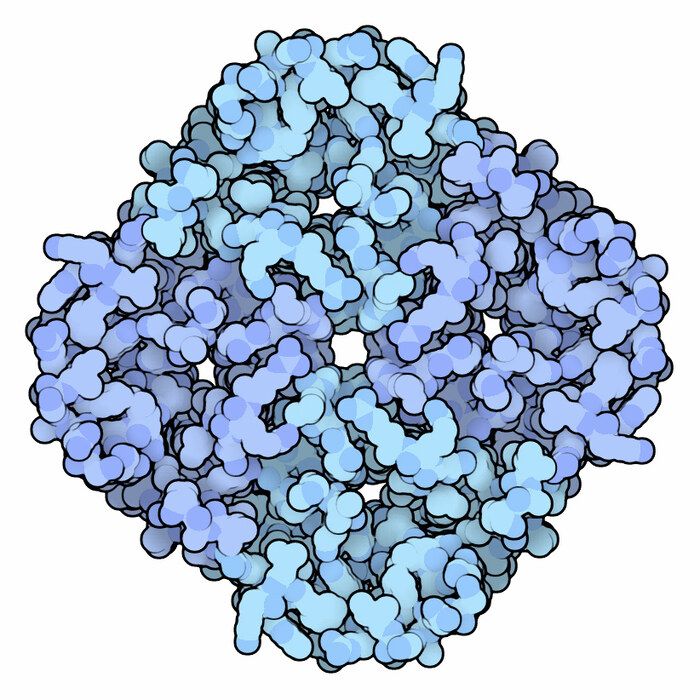{width="100%"}

*Aquaporin seen from outside the cell: four subunits, each with its own water pore (space-filling model, PDB 1FQY).*
:::
::: {.column width="60%"}
- Water crosses lipid slowly. Kidney, red cells and glands need it fast.
- **Aquaporins** are water **channels**: about a **billion water molecules per second** per pore, in single file.
- They **exclude ions, even H⁺**, so they do not destroy gradients.
- Water always moves **passively**, by **osmosis**: towards the side with more dissolved particles. Cells move water by moving solutes.
- **AQP2** in the kidney collecting duct is inserted into the membrane when the hormone **vasopressin** signals; this concentrates the urine. Peter Agre, Nobel Prize in Chemistry **2003**.
:::
::::

::: notes
One last passenger: water. Water does cross a lipid bilayer, but slowly. Cells that move a lot of water, such as kidney tubule cells, red blood cells and gland cells, add channels for it: aquaporins. Peter Agre found the first one in red blood cells. His team put its RNA into frog eggs, which normally take up very little water; in a dilute solution the eggs with aquaporin swelled and burst within minutes. Each aquaporin has four subunits, and each subunit has its own narrow pore, as you see in this view from outside the cell. Water passes in single file at up to a billion molecules per second. A clever feature of the pore stops protons, which could otherwise hop along a chain of water molecules; so aquaporins carry water without letting the proton gradient leak. Note that no pump moves water. Water always follows solutes by osmosis, so cells move water by moving salt first. In the kidney, the hormone vasopressin makes collecting-duct cells insert aquaporin 2 into their apical membrane, which lets water return to the blood and concentrates the urine. You meet this in the course on organs and tissues.
:::

## Why it matters: SGLT2 inhibitors in diabetes and heart failure {.smaller}

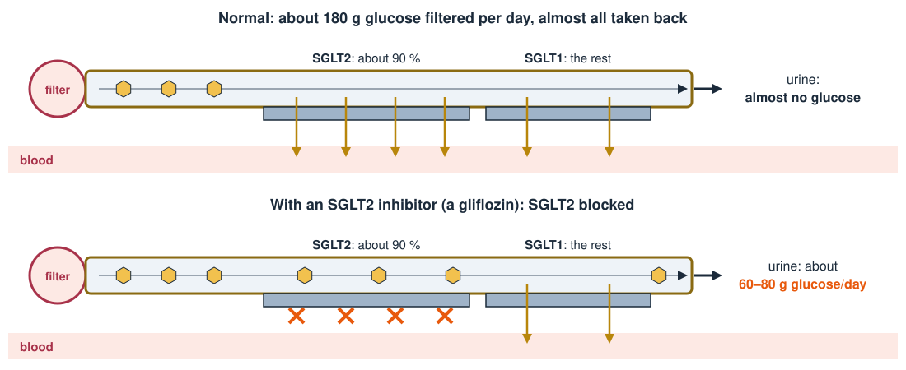{width="78%" fig-align="center"}

- The kidneys filter about **180 g of glucose a day**; **SGLT2** in the proximal tubule takes back about **90 %**, SGLT1 the rest. Above a blood glucose of about **10 mM** the transporters **saturate** and glucose appears in urine.
- **Gliflozins** (dapagliflozin, empagliflozin) block **SGLT2**: glucose and some Na⁺ leave in the urine, and blood glucose falls in **type 2 diabetes**.
- In large trials they also **reduced heart failure** and slowed **kidney disease**, even in people without diabetes. Exactly why is still studied.

::: notes
Here the symporter from the gut slide becomes a drug target. The kidneys filter your blood plasma, about 180 litres a day, and with it about 180 grams of glucose. The proximal tubule takes nearly all of it back. The first part of the tubule uses SGLT2, a sodium–glucose symporter with one sodium per glucose, which takes about ninety percent; SGLT1 further along takes the rest. Basolateral GLUT2 lets glucose return to the blood, as in the gut. Remember saturation: when blood glucose is above about ten millimolar, the transporters are full and glucose spills into the urine. That is why untreated diabetes gives sweet urine. Gliflozins block SGLT2. The story started with phlorizin, a natural compound from apple tree bark known since the nineteenth century to cause glucose in the urine. A person on a gliflozin loses tens of grams of glucose a day in the urine, and blood glucose falls. Surprisingly, large clinical trials showed that these drugs also protect the heart and kidneys, even in people without diabetes. The mechanism is still debated. You meet trials like these in the course on clinical trials and drug development.
:::

## Why it matters: pumps as drug targets and drug barriers {.smaller}

:::: {.columns}
::: {.column width="56%"}
- **Digoxin** (from foxglove) blocks the **Na⁺/K⁺ pump** in heart muscle. Less Na⁺ gradient → the Na⁺/Ca²⁺ exchanger removes less Ca²⁺ → more Ca²⁺ → **stronger contraction**. Used in heart failure and atrial fibrillation; the safe dose range is **narrow**.
- **P-glycoprotein** (ABCB1) pumps chemotherapy drugs out of cancer cells: **multidrug resistance**. In the gut, liver, kidney and **blood–brain barrier** it pumps drugs back out, which limits **oral absorption** and keeps many drugs **out of the brain**.
- A tablet must cross the **gut epithelium**: by diffusion through lipid (small, lipophilic drugs) or on a transporter, while escaping P-glycoprotein. More in **drug development** (Kliniska prövningar och läkemedelsutveckling).
:::
::: {.column width="22%"}
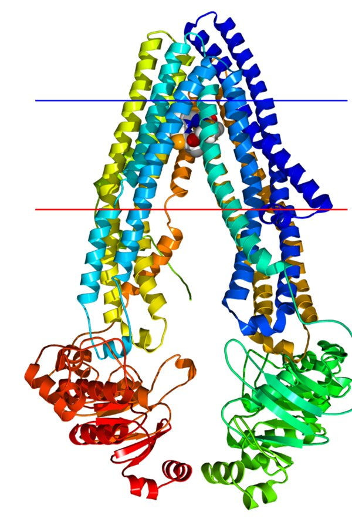{width="100%"}

*P-glycoprotein (mouse, PDB 3G5U). Lines: outer (blue) and inner (red) face of the membrane.*
:::
::: {.column width="22%"}
{width="100%"}

*Foxglove, Digitalis. Its leaves contain digitalis glycosides.*
:::
::::

::: notes
Two more examples of transport and medicine. Foxglove extracts were used for heart failure as early as 1785, by William Withering in England. The active compounds are digitalis glycosides, such as digoxin; digoxin itself is mostly made from a related species, the woolly foxglove. They bind the sodium–potassium pump from outside, as ouabain does. In heart muscle a partly blocked pump lets sodium rise a little inside. The smaller sodium gradient means the sodium–calcium exchanger removes less calcium, more calcium is stored in the sarcoplasmic reticulum, and each beat is stronger. The difference between a helpful and a toxic dose is small, so levels are monitored. The second example is P-glycoprotein, the ABC exporter from earlier. Cancer cells that make a lot of it pump out many unrelated chemotherapy drugs, which is called multidrug resistance. In healthy tissue it sits on the gut side of intestinal cells and in brain capillaries, where it pumps drugs back out. The diarrhoea drug loperamide, an opioid, does not reach the brain because P-glycoprotein removes it. Drug developers test early whether a candidate is a P-glycoprotein substrate.
:::

## Summary {.smaller}

1. A lipid bilayer lets **small hydrophobic** molecules through but blocks **ions and most polar molecules**; **transport proteins** give them a path.
2. **Passive** transport goes down the gradient (ΔG < 0); **active** transport goes up and must be **coupled** to ATP or to another gradient. Cells keep large, non-equilibrium gradients of **Na⁺, K⁺ and Ca²⁺**.
3. **Channels** are fast pores, always passive. **Transporters** bind their solute, work by **alternating access**, **saturate** like enzymes, and can be **uniporters, symporters or antiporters**.
4. **Pumps** use ATP directly: **P-type** (Na⁺/K⁺ pump, 3 Na⁺ out, 2 K⁺ in; Ca²⁺ pumps), **V-type** (acidify organelles), **ABC** (export, including drugs); the **F-type** ATP synthase runs in reverse. The **Na⁺ gradient** drives **secondary active transport**.
5. **Epithelia** move solutes across the cell with different transporters on the apical and basolateral sides; **drugs** such as gliflozins and digoxin act on transporters, and P-glycoprotein pumps drugs away.

*Read more (optional): Alberts et al., Molecular Biology of the Cell, 7th ed., ch. 11.*

[Image credits](../credits.qmd#membrane-transport){style="font-size:0.7em"}

::: notes
Five take-home points. First, the bilayer is a barrier to ions and polar molecules; only small hydrophobic molecules, and water slowly, cross on their own. Second, ΔG tells you whether transport can be passive, and cells keep large gradients of sodium, potassium and calcium that are not at equilibrium; they cost energy to maintain and are a store of energy to use. Third, transporters and channels are different machines: channels are fast and only passive, transporters bind their solute, alternate between outward-open and inward-open shapes, saturate like enzymes and can couple two solutes. Fourth, primary active transport uses ATP directly in P-type, V-type and ABC pumps, while secondary active transport spends the sodium gradient made by the sodium–potassium pump. Fifth, an epithelium combines these proteins on two sides of a cell to move glucose from gut to blood, and many drugs act on transporters or are limited by them. Next lecture: ion channels, where the same gradients produce the membrane potential.
:::
