## About this lecture {.smaller}

Almost everything you will learn in this course about *where* things are in a cell was first **seen in a microscope**. Today is about how those pictures are made, and how far you can trust them.

After this lecture you can:

- explain the difference between **magnification** and **resolution**, and why a light microscope cannot separate two objects closer than about **200 nm**;
- explain how **phase contrast**, **DIC** and **fluorescence** make transparent cells visible;
- describe how we label one kind of protein: **immunofluorescence** (fixed cells) and **fluorescent proteins such as GFP** (living cells);
- say what **confocal**, **light-sheet**, **super-resolution** and **electron microscopy** (TEM, SEM, cryo-EM, tomography) add;
- **choose a method** for a question, and **read a microscopy figure** critically.

**ELO 1** (cell and methods) and **ELO 6** (methods to study the cytoskeleton).

::: notes
This lecture follows the tour of the cell. In the tour we showed you organelles in pictures; today we ask how those pictures were made. Every microscope answers three questions in its own way. First, can it make small things big enough and sharp enough to separate them? That is resolution. Second, can it make a transparent cell stand out from the water around it? That is contrast. Third, can it show one particular molecule among thousands? That is specificity, or labelling. Keep these three words in mind; every method today improves one or more of them, and every method pays a price, usually that the cell must be dead, or that the picture is blurrier, or slower. A thread runs through the whole lecture: "How do we know?" A picture is evidence, and you need to know what a method can and cannot show before you believe it. This covers ELO 1, choosing a method, and supports ELO 6, because many of the examples are the cytoskeleton.
:::

## The question: how do you see one protein in a living cell? {.smaller}

A human cell is about **20 µm** across and almost **transparent**. A protein is about **5 nm**: 4000 times smaller. The cell contains about 10 000 different proteins. Three problems:

1. **Resolution**: can we separate two things that are close together?
2. **Contrast**: can we see a cell that is mostly water?
3. **Specificity**: can we see *one kind* of molecule and not the others?

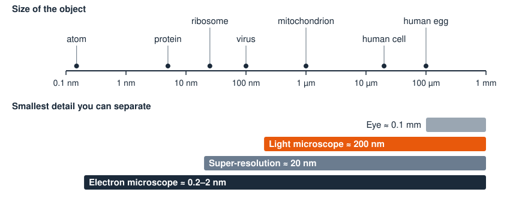{width="80%" fig-align="center"}

::: notes
Look at the scale. The horizontal axis is logarithmic: each step is ten times bigger. A human cell is around 20 micrometres, a mitochondrion about one micrometre wide, a virus about a hundred nanometres, a ribosome twenty-five, a typical protein five. The bars below show the smallest detail each tool can separate. Your eye stops at about a tenth of a millimetre, so it sees a human egg but not an ordinary cell. The light microscope reaches about 200 nanometres: enough for cells, nuclei and mitochondria, not enough for a ribosome or a single protein. Super-resolution light microscopy gets to about 20 nanometres, and electron microscopes go below a nanometre, down to individual atoms in purified proteins. But resolution is only the first problem. Most of a cell is water and barely changes light, so we also need contrast. And even a sharp, high-contrast picture shows all molecules at once, so we need a way to label one kind. The rest of the lecture solves these three problems in turn.
:::

## Magnification is not resolution {.smaller}

- **Magnification** makes the image bigger. **Resolution** is the smallest distance at which two points still look like two.
- Light spreads when it passes through a lens. A point of light becomes a small **blur spot**. When two spots overlap too much, they merge into one.
- The limit (Abbe, Rayleigh): $\;d \approx \dfrac{0.61\,\lambda}{\mathrm{NA}}$. Green light ($\lambda \approx 500$ nm) and the best oil objective ($\mathrm{NA} \approx 1.4$) give $d \approx$ **200 nm** side to side, and about **500 nm** along the optical axis (depth).

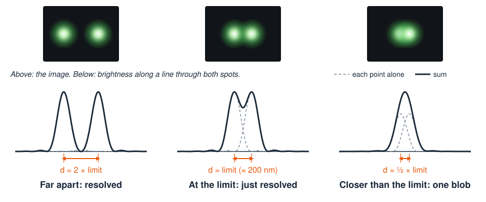{width="78%" fig-align="center"}

Enlarging a blurred image more ("empty magnification") adds no detail. **Try it:** [the resolution demo](questions.qmd#explore).

::: notes
Students often think a better microscope is one that magnifies more. It is not. Magnification only makes the image bigger; resolution decides how much detail is in it. Because light is a wave, a lens cannot focus it to a perfect point. Each point in the sample becomes a small blur spot in the image. If two points are far apart, you see two spots. When they come closer, the spots overlap. At the Rayleigh limit the dip between them is just visible; closer than that you see one blob, and no amount of enlargement can split it again. The formula says d equals 0.61 times the wavelength divided by the numerical aperture. You do not need to derive it. Read it like this: shorter wavelength gives finer detail, and a lens that collects light from a wider angle, a higher NA, gives finer detail. NA is at most about 1.4 with immersion oil. Put in 500 nanometre light and you get about 200 nanometres. That is why a light microscope cannot show a ribosome, and why electron microscopes, with a much shorter wavelength, can.
:::

## Contrast: making transparent cells visible {.smaller}

:::: {.columns}
::: {.column width="60%"}
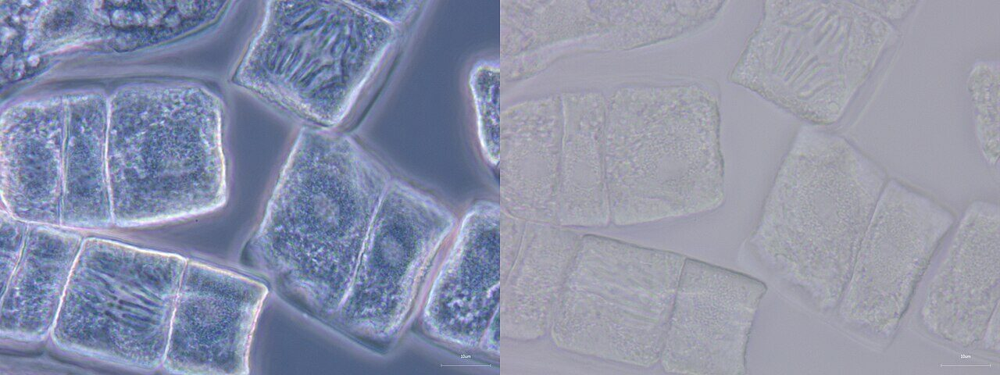{width="100%"}

*The same onion root-tip cells. Left: phase contrast. Right: bright field. Scale bar 10 µm.*
:::
::: {.column width="40%"}
- **Bright field**: light passes straight through. Unstained cells are almost invisible. Tissues are **stained** (dyes), which needs dead, fixed cells.
- **Phase contrast**: light slowed by dense parts (nucleus, membranes) is turned into **darker or brighter** areas. Living cells, no stain.
- **DIC**: shows **edges and slopes** as light and shadow, so cells look 3D.

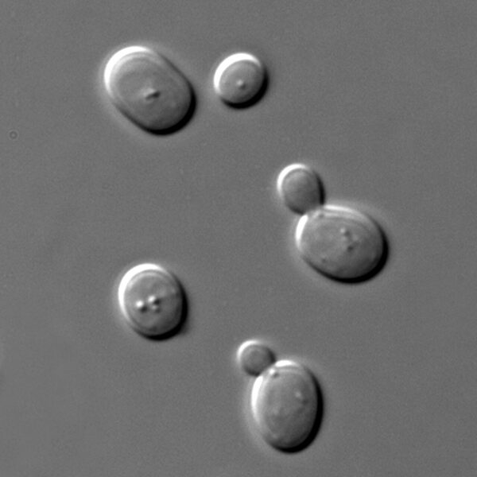{width="55%"}

*Yeast cells, DIC.*
:::
::::

::: notes
Most of a living cell is water, proteins and lipids, which absorb very little visible light. In ordinary bright-field microscopy the light simply passes through, so an unstained cell is a faint ghost. One answer is to stain the cells with coloured dyes, which is what histology does, and you will use that in the course on organs and tissues. But staining usually means killing and fixing the cells. The other answer is to use something cells already do to light. Dense parts of the cell, such as the nucleus and membranes, have a higher refractive index, so light passing through them is slowed a little. The eye cannot see this delay, called a phase shift. A phase-contrast microscope converts the phase shift into a difference in brightness, so the same unstained living cells suddenly show their nucleus and edges. Compare the left and right halves of the image: same cells, same moment, two kinds of optics. Differential interference contrast, DIC, uses polarised light to show where the optical path changes steeply, so edges look like a relief map. These methods are used every day to check cultured cells.
:::

## Fluorescence: absorb one colour, emit another {.smaller}

- A **fluorophore** absorbs light of one wavelength, loses a little energy as heat, and within nanoseconds **emits light of a longer wavelength** (lower energy).
- You know **absorption spectra** from spectrophotometry. A fluorophore has two spectra: **excitation** and **emission**. The gap between the peaks is the **Stokes shift**.
- The shift lets us **filter away** the excitation light and keep only the glow: a bright signal on a **black background**, so even a few molecules can be seen.

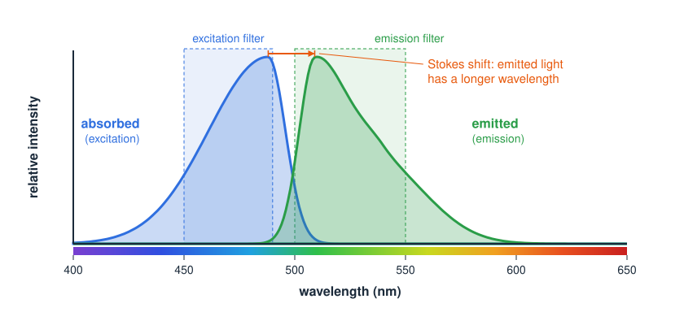{width="72%" fig-align="center"}

::: notes
You measured absorption spectra in chemistry: a molecule absorbs some wavelengths more than others. A fluorophore is a molecule that, after absorbing a photon, gives some of the energy back as light. The electron is lifted to an excited state, loses a little energy as heat while the molecule relaxes, and then falls back, emitting a photon. Because some energy was lost, the emitted photon has less energy, which means a longer wavelength. Blue in, green out. The difference between the excitation peak and the emission peak is called the Stokes shift. This shift is the whole trick of fluorescence microscopy. The excitation light is millions of times brighter than the glow, but because the two colours differ, filters can block the excitation light and pass only the emitted light. What remains is a bright signal on a black background. That gives enormous contrast: you can detect a few hundred fluorophores, and with sensitive cameras even single molecules. The shaded boxes show the filters you would choose for this green fluorophore. Next slide: where these filters sit.
:::

## Inside a fluorescence microscope: the filter cube {.smaller}

:::: {.columns}
::: {.column width="66%"}
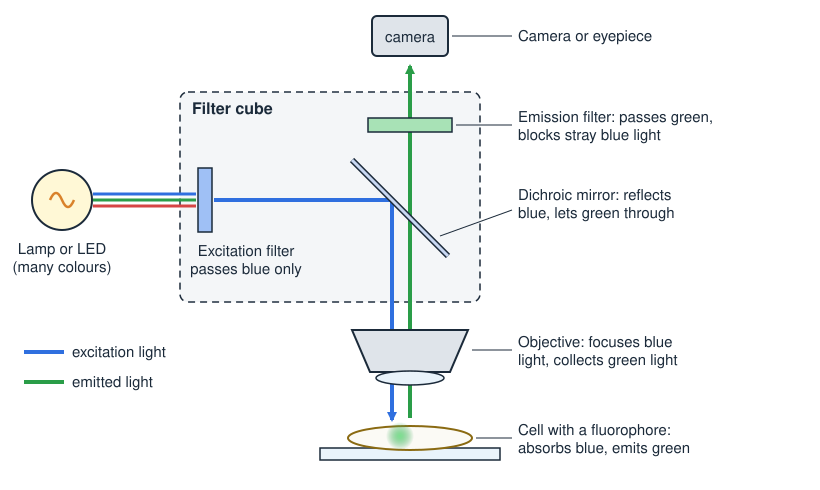{width="100%"}
:::
::: {.column width="34%"}
1. **Excitation filter** picks the colour that excites the fluorophore.
2. **Dichroic mirror** reflects that colour down onto the sample, but lets the longer emitted wavelength pass.
3. The **objective** both lights the sample and collects its glow.
4. **Emission filter** removes the last stray excitation light.

One **cube per fluorophore**. To image blue, green and red labels, the microscope takes one picture per cube (**channel**) and combines them.
:::
::::

::: notes
Follow the light. The lamp or LED gives many colours. The excitation filter lets only blue through. The blue light reaches a special mirror called a dichroic mirror, which reflects short wavelengths and lets long wavelengths pass. It reflects the blue light down through the objective onto the sample. The fluorophores in the cell absorb blue and emit green in all directions. Some of the green light goes back up into the objective. Because it is green, it passes straight through the dichroic mirror. The emission filter then removes any blue light that was scattered back, so the camera sees only green. The objective does two jobs: it focuses the excitation light and collects the emission. This design is called epifluorescence. The three filters are mounted together in a filter cube, and each fluorophore needs its own cube. A three-colour image is therefore three separate black-and-white pictures, one per cube, which software colours and overlays. Remember this when you read figures: each colour is a separate channel, and the colours are chosen by the scientist.
:::

## Labelling a protein in fixed cells: immunofluorescence {.smaller}

:::: {.columns}
::: {.column width="50%"}
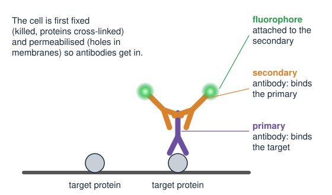{width="100%"}

- A **primary antibody** binds the target protein. A **secondary antibody** carrying a fluorophore binds the primary. Several secondaries per primary make the signal **brighter**.
- Any protein you have a good antibody against can be shown, but **only in dead cells**.
:::
::: {.column width="50%"}
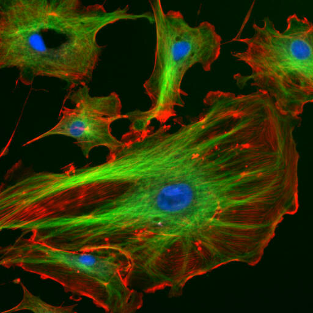{width="88%"}

*Endothelial cells. Blue: DNA (DAPI). Green: microtubules (antibody against tubulin). Red: actin filaments (phalloidin).*
:::
::::

::: notes
Fluorescence gives contrast, but we still need specificity: one kind of protein, not all of them. The classic answer is to use antibodies, which you know from biochemistry as proteins that bind one target very tightly. Antibodies are large and cannot cross the plasma membrane of a living cell. So we first fix the cells, usually with formaldehyde, which cross-links proteins and freezes everything in place. Then we permeabilise the membranes with a mild detergent so antibodies can get in. The primary antibody, made for example in a mouse, binds the target. A secondary antibody against mouse antibodies, coupled to a fluorophore, binds the primary. Because several secondaries can bind one primary, the signal is amplified. Other probes are not antibodies: DAPI binds DNA, and phalloidin, a toxin from a mushroom, binds actin filaments. In the image, three labels are imaged in three channels and merged. You can see microtubules spreading out from the centre and actin bundles near the edges. The price: the cells are dead, and fixation can move or extract things, so we need controls.
:::

## Fluorescent proteins: a gift from a jellyfish {.smaller}

:::: {.columns}
::: {.column width="34%"}
{width="100%"}

*Aequorea victoria, the crystal jelly.*
:::
::: {.column width="32%"}
- The jellyfish makes **green fluorescent protein (GFP)**: 238 amino acids that fold into a **barrel** and build their own light-emitting group inside. **No other molecule is needed.**
- The GFP gene works in any cell: bacteria, worms, mice, human cells (1994).
- Mutations changed its colour: **blue, cyan, yellow**. Red proteins (e.g. mCherry) came from corals.
- Nobel Prize in Chemistry **2008** (Shimomura, Chalfie, Tsien).
:::
::: {.column width="34%"}
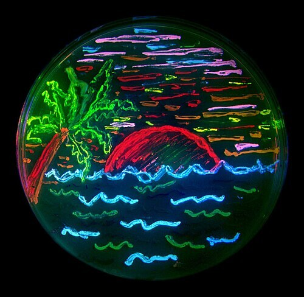{width="100%"}

*A beach scene painted with bacteria that make eight different fluorescent proteins.*
:::
::::

::: notes
The second way to label a protein started with a jellyfish from the Pacific coast of North America. Osamu Shimomura purified its light-making proteins in the 1960s. The jellyfish glows green because a protein, GFP, takes energy from a blue light-producing protein and emits green light. What makes GFP special is that it needs nothing else. The chain of 238 amino acids folds into a barrel, and three amino acids in the middle react with each other and with oxygen to form the fluorescent group, the chromophore, protected inside the barrel. So when Martin Chalfie put the GFP gene into bacteria and worms in 1994, they glowed. Roger Tsien and others then mutated GFP to make it brighter and to change its colour, giving blue, cyan and yellow versions. Red fluorescent proteins were later found in corals and improved in the same way. The beach picture on the right was painted with bacterial colonies, each making a different fluorescent protein. With several colours you can follow several proteins in the same cell at the same time.
:::

## GFP fusion proteins: watching a protein in a living cell {.smaller}

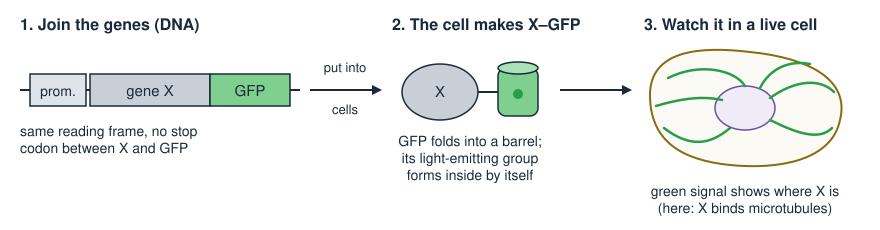{width="76%" fig-align="center"}

:::: {.columns}
::: {.column width="55%"}
- Join the gene for your protein to the GFP gene, **in frame**, and put it into cells.
- The cell makes one chain, **protein X–GFP**, which usually goes where X normally goes.
- **Living cells**, no antibody. **Check** that the tag does not disturb X: does X–GFP still work, and is it in the same place as the untagged protein?
:::
::: {.column width="45%"}
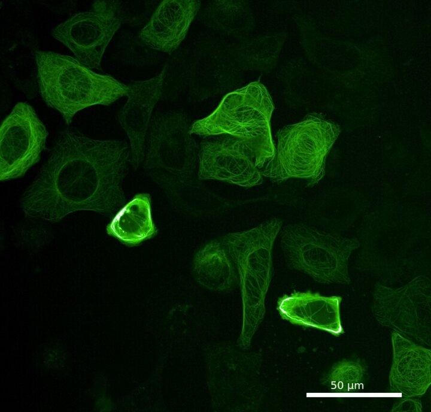{height="250px" fig-align="center"}

*HeLa cells with a GFP-tagged microtubule-binding protein: the microtubule network.*
:::
::::

::: notes
Here is how GFP is used in practice. You take the DNA for your protein of interest, call it X, and join it to the DNA for GFP so that the two reading frames continue without a stop codon in between. You put this DNA into cells, for example with a plasmid. The cell transcribes and translates it into one long chain: X with GFP attached at one end. GFP folds on its own and glows, and X usually still folds and goes where it normally goes. Now the green light tells you where X is, in a living cell, in real time. The image shows HeLa cells making a microtubule-binding protein fused to GFP: the green threads are the microtubule network, which you will meet in the cytoskeleton lectures. Some cells are bright and some dim, because after transfection each cell takes up a different amount of DNA and makes a different amount of fusion protein. Be critical: GFP is about 27 kilodaltons, so it can disturb a small protein, and too much fusion protein can end up in the wrong place. Good studies check that the tagged protein still works and matches antibody staining of the untagged protein.
:::

## Confocal microscopy: a sharp optical section {.smaller}

:::: {.columns}
::: {.column width="66%"}
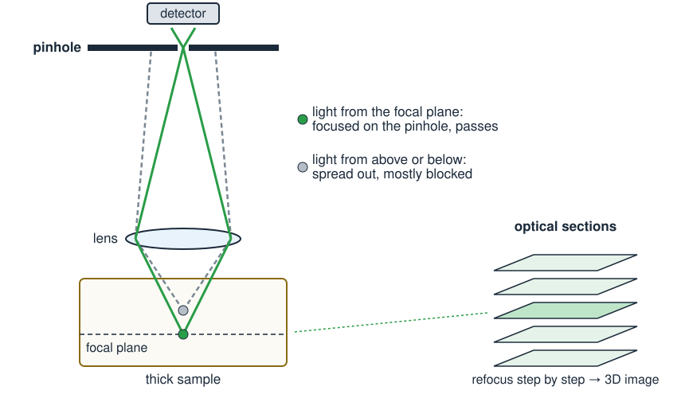{width="100%"}
:::
::: {.column width="34%"}
- In a normal (wide-field) fluorescence microscope, light from **above and below** the focus adds a **haze**.
- A confocal microscope puts a **pinhole** where the in-focus light comes to a point. Light from other depths is spread out and **blocked**.
- A **laser spot scans** the sample point by point to build the image.
- Result: a thin **optical section** (about 0.5–1 µm). Refocus step by step to get a **3D stack**, without cutting the sample.
:::
::::

::: notes
A cell is several micrometres thick, and tissue much more. In wide-field fluorescence, the whole depth is lit, so fluorophores above and below the focal plane also glow and their blurred light adds a haze to the image. The confocal microscope fixes this with a simple idea. Light coming from the focal plane is focused by the lens to a sharp point; we put a small hole, a pinhole, exactly there. That light goes through to the detector. Light from a plane above or below comes to a focus in a different place, so at the pinhole it is spread out, and most of it hits the metal around the hole and is blocked. Because the pinhole sees only one point, a laser spot is scanned across the sample, line by line, and a computer builds the image. What you get is an optical section: a thin slice, about half to one micrometre thick, taken without cutting. Step the focus up and down and you get a stack of sections, a z-stack, from which software builds a three-dimensional image. The price is speed and more light on the sample.
:::

## Live-cell imaging and light-sheet microscopy {.smaller}

:::: {.columns}
::: {.column width="50%"}
Filming living cells needs:

- **37 °C, CO₂ and medium** on the microscope stage;
- **little light**: strong light **bleaches** fluorophores (**photobleaching**) and makes reactive oxygen species that damage cells (**phototoxicity**);
- a **fast, sensitive camera**.
:::
::: {.column width="50%"}
**Light-sheet** microscopy lights only a thin plane from the side, and the camera looks from above. It is gentle and fast, so whole embryos and organoids can be filmed in 3D for hours or days.
:::
::::

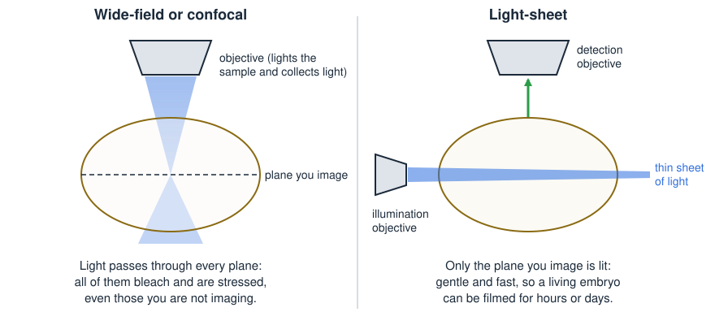{width="70%" fig-align="center"}

::: notes
Fixed cells give you a snapshot. Many questions in cell biology are about change: how fast does a vesicle move, when does a cell divide, how long does a protein stay at a site. For these you need live-cell imaging. The cells must be kept happy on the microscope: warm, with the right gas and medium. The biggest enemy is light itself. Each time a fluorophore is excited there is a small chance it is destroyed, so the signal fades; this is photobleaching. Excited fluorophores can also react with oxygen to make reactive oxygen species, which damage the cell; this is phototoxicity. A cell that looks fine can still be stressed, so you must use as little light as possible. Light-sheet microscopy is one answer. In wide-field and confocal microscopes the light passes through the whole sample, even though you image one plane. In a light-sheet microscope a thin sheet of light enters from the side and lights only the plane the camera is looking at. Less light, less damage, and a whole plane at once, so it is fast. Later, in the cytoskeleton lectures, you will meet FRAP, a live-cell method that uses bleaching on purpose.
:::

## Super-resolution: beating the 200 nm limit {.smaller}

:::: {.columns}
::: {.column width="55%"}
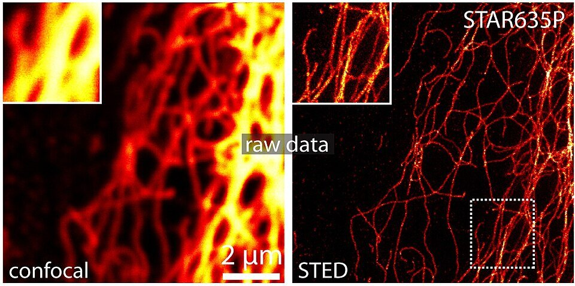{width="100%"}

*Intermediate filaments (vimentin), same area. Left: confocal. Right: STED. Insets: enlarged view of the dotted box. Scale bar 2 µm.*
:::
::: {.column width="45%"}
The limit is about separating **neighbouring glowing molecules at the same time**. Super-resolution methods get around it:

- **STED**: a second, doughnut-shaped laser switches off fluorescence everywhere except a tiny centre.
- **PALM/STORM**: only a few molecules glow at a time; the centre of each blur spot is found precisely, then thousands of frames are combined.
- **SIM**: patterned light, about 2× better, gentle enough for live cells.
- **Expansion microscopy**: swell the sample in a gel, then image it.

About **20–100 nm**. Nobel Prize in Chemistry **2014**.
:::
::::

::: notes
For a hundred years the 200 nanometre limit was thought to be absolute. Super-resolution methods do not break the laws of optics; they get around them by making sure that neighbouring molecules do not glow at the same time. In STED, the sample is excited with a normal spot, and a second, doughnut-shaped laser immediately switches the fluorophores in the ring back off. Only the centre of the doughnut can still glow, and that centre can be made much smaller than 200 nanometres. In single-molecule methods called PALM and STORM, special fluorophores are switched on randomly so that only a few, far-apart molecules glow in each frame. Each one still makes a blur spot, but the centre of a spot can be found to within about 20 nanometres. Thousands of frames give a map of positions. SIM uses striped light and gains about a factor of two. Expansion microscopy physically swells the sample. The image shows the gain: the same filament network, confocal on the left and STED on the right. The prices: special dyes, more light, slower imaging, and harder data analysis.
:::

## Transmission electron microscopy (TEM) {.smaller}

:::: {.columns}
::: {.column width="55%"}
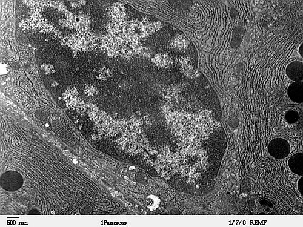{width="100%"}

*TEM of a pancreatic acinar cell: large nucleus, parallel stacks of rough ER, mitochondria and round, dark secretory (zymogen) granules. Scale bar 500 nm.*
:::
::: {.column width="45%"}
- Uses **electrons** instead of light. Their wavelength is about **100 000× shorter**, so resolution reaches **about 1–2 nm** in cells.
- Electrons pass **through** a very thin slice (about 50–100 nm). Dense, heavy-metal-stained parts scatter electrons and look **dark**.
- Price: the sample must be in a **vacuum**: cells are **fixed**, stained with heavy metals (osmium, uranium, lead), embedded in plastic and cut. **No living cells.**
- Specific proteins: antibodies with **gold particles** (immunogold).
:::
::::

::: notes
To see membranes, ribosomes and the inside of organelles we need a much shorter wavelength than light. Electrons accelerated through a high voltage behave as waves with a wavelength of a few thousandths of a nanometre. In practice, lens errors and the sample itself limit resolution in cell sections to about one or two nanometres, still a hundred times better than light. In a transmission electron microscope the beam passes through the sample, so the sample must be very thin, about 50 to 100 nanometres, which is thinner than a mitochondrion. Electrons are stopped by air, so the inside of the microscope is a vacuum, and the cell must be completely dry. That is why cells are fixed with glutaraldehyde, stained with salts of heavy metals that stick to membranes and proteins, dehydrated, embedded in plastic resin and cut with a diamond knife. Dark areas are where the heavy metals scattered electrons. Look at the image: a stack of rough ER, round secretory granules, the nucleus. These are the structures we draw in cartoons. To find one protein, antibodies are coupled to tiny gold particles that appear as black dots. Remember the price: dead, processed cells, so artefacts are possible.
:::

## Scanning electron microscopy (SEM): the surface {.smaller}

:::: {.columns}
::: {.column width="55%"}
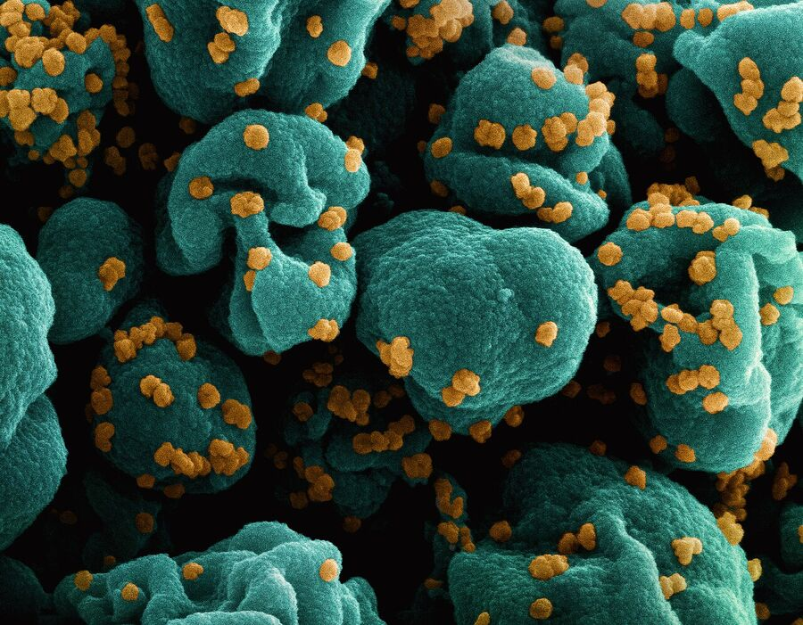{width="100%"}

*SEM, colour added: cultured cells (teal) covered with SARS-CoV-2 particles (orange), virus isolated from a patient. Each particle is about 100 nm across.*
:::
::: {.column width="45%"}
- The sample is coated with a thin layer of **metal**. A fine electron beam **scans** across it.
- Electrons knocked out of the **surface** are counted point by point.
- The image shows **shape and surface in 3D**, with a large depth of focus. Resolution about **a few nm**.
- It does **not** show the inside of the cell.
- Colours in EM images are **added afterwards** by people. Electrons have no colour.
:::
::::

::: notes
The scanning electron microscope answers a different question: what does the outside look like? The cells are fixed, dried and coated with a very thin layer of metal such as gold. A finely focused electron beam is moved across the surface, line by line. Where it hits, electrons are knocked out of the surface and collected by a detector. Surfaces facing the detector give more signal, so the picture looks like a lit three-dimensional object, with a large depth of focus. Resolution is a few nanometres. SEM shows the shape of cells, microvilli, cilia, bacteria on a surface, or, as here, virus particles budding from and sticking to an infected cell. It does not show the inside, unless you cut the sample open first. One important point for reading figures: electron images are black and white. The teal and orange here were painted on by a person to make the picture easier to read. That is fine, but it is not data. We will come back to this virus at the end of the lecture.
:::

## Cryo-EM and electron tomography {.smaller}

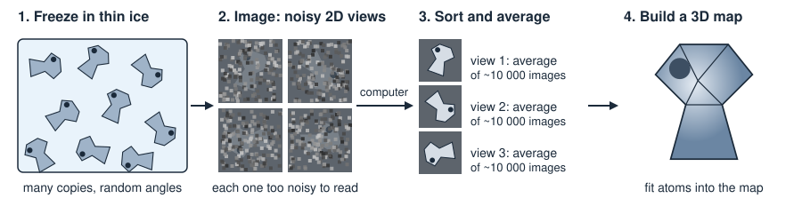{width="80%" fig-align="center"}

:::: {.columns}
::: {.column width="58%"}
- **Cryo-EM**: freeze the sample so fast (about −180 °C) that water becomes **glass-like ice**, not crystals. No stain, no drying: molecules keep their **native shape**.
- **Single-particle analysis**: average **tens of thousands to millions** of noisy images of one purified protein → a 3D **density map**, often better than **0.3 nm** (atoms). Nobel Prize in Chemistry **2017**.
- **Cryo-electron tomography**: **tilt** a thin slice of a frozen cell and combine the views into a **3D image of the inside** of the cell.
:::
::: {.column width="42%"}
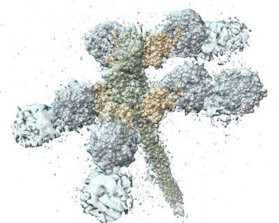{width="50%" fig-align="center"}

*Cryo-EM density map (pale blue surface) of a bacterial protein complex at 0.43 nm, with the atomic model (spheres) fitted inside.*
:::
::::

::: notes
Classical EM needs dead, dried, stained samples. Cryo-electron microscopy avoids most of this. A thin layer of sample is plunged into a very cold liquid so fast that water has no time to form ice crystals; it becomes a glass-like solid. Molecules are trapped in their natural, hydrated shape, without stain. The cost is very low contrast and a lot of noise, because we must use few electrons to avoid destroying the molecules. Single-particle analysis solves this by numbers. A purified protein is frozen in many copies, lying at random angles. A computer finds thousands of images of each view, aligns and averages them, so the noise cancels and the signal stays. Combining the views gives a three-dimensional density map, and an atomic model is built into it, as in the image. Since about 2013, better cameras made near-atomic structures routine. Cryo-electron tomography instead tilts one frozen slice of a cell and takes images from many angles, like a medical CT scan, giving a 3D view of molecules in their real place in the cell. This is how we know many protein structures, including the one in the next-but-one slide.
:::

## How do we know? Reading a microscopy figure {.smaller}

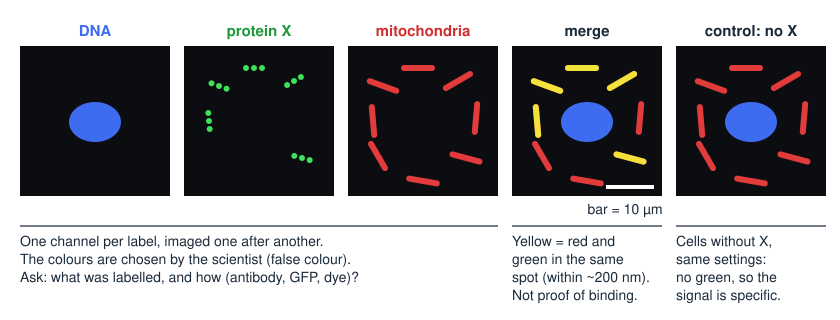{width="78%" fig-align="center"}

Before you believe a microscopy figure, check:

- **Scale bar**: how big is this? Compare with the resolution limit of the method.
- **What is labelled, and how?** Antibody (fixed cells) or fusion protein (living cells)? One cell or many? Is the cell typical?
- **Controls**: no primary antibody, cells without the protein (**knockout** or knockdown), same camera settings. A merge is **not** proof that two proteins bind.

::: notes
A microscopy image is evidence, and like any evidence it must be read critically. Start with the scale bar: it tells you the size, and you can compare it with what the method can resolve. If two proteins look like they are in the same spot in a confocal image, remember that "same spot" means within about 200 nanometres, which is forty protein diameters. That is why yellow in a merge means "close", not "bound to each other". Next, ask what was labelled and how. Each channel is a separate black-and-white image, and the colours were chosen by the authors. Was it an antibody in fixed cells, or a GFP fusion in living cells? Then look for controls. For antibodies: a sample without the primary antibody shows background from the secondary, and cells that lack the protein, for example a knockout made with CRISPR, should show no signal. If they still glow, the antibody binds something else. Images should be taken with the same settings so brightness can be compared. Finally, a single beautiful cell may be the best of a hundred; look for numbers: how many cells, how many experiments, and a quantification.
:::

## Choosing a method {.smaller}

| Method | Best resolution | Living cells? | What it shows best |
|---|---|---|---|
| Bright field, phase, DIC | ~200 nm | yes | cell shape, division, movement; no labels |
| Wide-field fluorescence | ~200 nm | yes (GFP) / no (antibodies) | where a labelled protein is; fast |
| Confocal | ~200 nm, 0.5–1 µm deep | yes | sharp sections, 3D stacks of cells and tissue |
| Light-sheet | ~300 nm | yes, for days | whole embryos and organoids over time, gently |
| Super-resolution | ~20–100 nm | mostly fixed | arrangement of proteins inside small structures |
| TEM | ~1–2 nm | no | membranes and organelles inside the cell |
| SEM | a few nm | no | the cell surface in 3D |
| Cryo-EM (single particle) | < 0.3 nm | no (purified protein) | atomic structure of a protein or complex |
| Cryo-electron tomography | ~2–4 nm | no (frozen cell) | molecules in place inside the cell |

Start from the **question**: what size, alive or not, which molecule?

::: notes
This table is the summary of the methods part, and it is the kind of reasoning ELO 1 asks for. Do not learn it as a list of numbers; learn to ask three questions. How small is the thing I want to see? If it is a whole cell or an organelle, light microscopy is enough; if it is the shape of a protein, you need cryo-EM. Do I need the cell to be alive? If the question is about time, movement or dynamics, you need living cells, which means light microscopy with fluorescent proteins, and preferably gentle methods like spinning-disk confocal or light-sheet. Which molecule? Antibodies can label almost any protein but need fixed cells; fluorescent proteins need genetic engineering but work in living cells. Often the best answer combines methods: a GFP fusion to follow a protein over time, immunofluorescence to check it, and EM to see the membrane it sits on. Numbers in the table are typical values, not hard limits; they depend on the instrument and the sample. In the study questions you will practise choosing.
:::

## Why it matters: a microscope helped design COVID-19 vaccines {.smaller}

:::: {.columns}
::: {.column width="64%"}
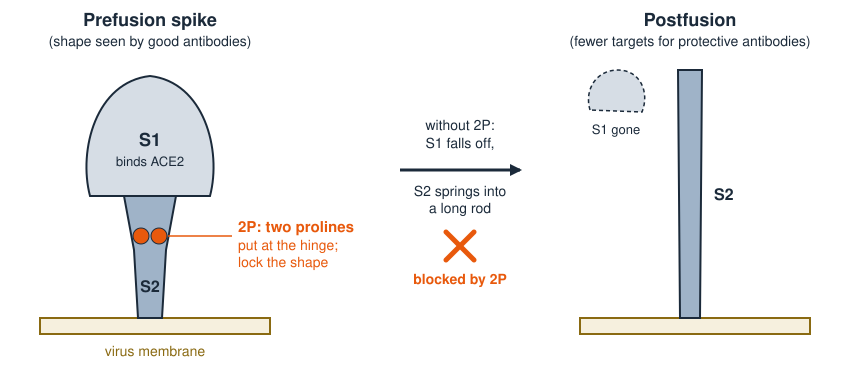{width="100%"}

- The spike's **prefusion** shape is the best target for protective antibodies, but it can spring into a **postfusion** rod.
- Two **prolines (2P)** at a hinge in S2 lock it. The trick came from earlier cryo-EM work on related coronaviruses (MERS, SARS).
- February 2020: a **cryo-EM structure** confirmed that the SARS-CoV-2 2P spike keeps the prefusion shape. The **mRNA vaccines** (Pfizer-BioNTech, Moderna) encode this 2P spike.
:::
::: {.column width="36%"}
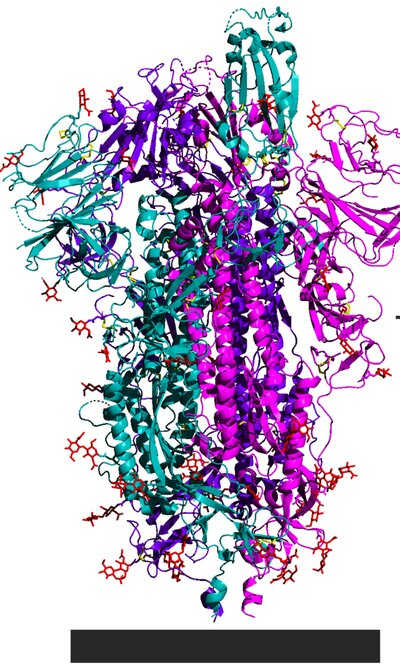{height="430px" fig-align="center"}

*Cryo-EM structure of the SARS-CoV-2 2P spike (PDB 6VSB). Three chains in three colours, sugars red; grey block: virus membrane.*
:::
::::

::: notes
Here the methods of this lecture met a pandemic. The SARS-CoV-2 spike is a trimer on the virus surface. Its S1 part binds the receptor ACE2 on our cells; its S2 part fuses the virus membrane with the cell membrane. To do that, the spike changes shape: S1 falls off and S2 springs from a compact prefusion shape into a long postfusion rod. Antibodies that block infection mostly recognise the prefusion shape, but a spike made on its own tends to flip into the postfusion form. Researchers studying related coronaviruses, MERS and the first SARS virus, had used cryo-EM structures to find that changing two amino acids at a hinge in S2 into prolines, which are stiff, locks the prefusion shape. This is called the 2P spike. In January 2020 the new virus sequence was published; within weeks a group made the 2P version of the SARS-CoV-2 spike and solved its structure by cryo-EM, shown on the right, confirming the prefusion shape. Both mRNA vaccines encode this 2P spike. You will meet how vaccines work in Immunologi, and how they are tested in Kliniska prövningar och läkemedelsutveckling.
:::

## Summary {.smaller}

1. **Resolution, not magnification**, sets what you can see. Light microscopes stop at about **200 nm**; super-resolution reaches about **20 nm**; electron microscopes reach **nanometres**, and cryo-EM reaches atoms in purified proteins.
2. **Contrast** comes from optics (phase contrast, DIC), from stains, or from **fluorescence**, where filters separate the emitted colour from the exciting colour.
3. **Specificity** comes from labels: **antibodies** in fixed cells, **fluorescent proteins (GFP fusions)** in living cells. Confocal and light-sheet microscopes give sharp optical sections and gentle live imaging.
4. **Choose a method from the question**: size, living or fixed, which molecule. Every method has a price.
5. **Read figures critically**: scale bar, channels, merge, controls.

*Read more (optional): Alberts et al., Molecular Biology of the Cell, 7th ed., ch. 9.*

<small>Image credits: [credits](credits.md)</small>

::: notes
Five take-home points. First, resolution is what matters, and the light microscope's limit of about 200 nanometres comes from the wave nature of light; the formula tells you shorter wavelength and higher numerical aperture help. Second, cells are transparent, so we need contrast: phase contrast and DIC for living unstained cells, stains for fixed tissue, and fluorescence for the highest contrast, with a filter cube separating colours. Third, to see one protein we label it: antibodies in fixed and permeabilised cells, or a GFP fusion in living cells; confocal removes out-of-focus haze, light-sheet is gentle enough for long films. Fourth, choose a method from your question, and remember the price of each: electron microscopy gives the finest detail but only in dead or frozen samples. Fifth, read every microscopy figure as evidence: check the scale, what was labelled, and whether the controls are there. In the next lecture we take cells apart and perturb them, and we use these tools to see the result.
:::
