## About this lecture {.smaller}

Microtubules are the cell's long-distance tracks. They are built and torn down all the time, they point one way, and motor proteins walk along them carrying cargo. Today: how a microtubule is built, why it switches between growing and shrinking, how motors use ATP to walk, and what this means for neurons, cilia and cancer drugs.

After this lecture you can:

- describe how **αβ-tubulin** builds a polar, hollow microtubule, and explain **dynamic instability** with the **GTP cap** (catastrophe and rescue);
- explain how the **centrosome** and **γ-tubulin** start microtubules, and how the arrays differ in a **fibroblast, a neuron and an epithelial cell**;
- compare **kinesin** and **dynein** (direction, ATP use, cargo), and explain why long cells need **motors instead of diffusion**;
- describe the **9 + 2 axoneme** of cilia and flagella and how dynein makes it bend;
- give examples of **methods** (EB1 comets, single-molecule motor assays, optical traps), and explain how **taxanes, vinca alkaloids** and **ciliopathies** act on this machinery.

::: notes
This is the second lecture on the cytoskeleton. In the actin lecture you met the three filament systems side by side; today we zoom in on the one that is built for distance: the microtubule. We start with its building block, tubulin, and see how the way tubulin handles GTP makes each microtubule switch at random between growing and shrinking. That behaviour, called dynamic instability, lets a cell search its space and rebuild its tracks within minutes. Then we look at where microtubules start, the centrosome, and how different cell types arrange them. The second half is about the motors kinesin and dynein: how they walk, how we measured their steps one molecule at a time, and why a nerve cell one metre long would be impossible without them. We finish with cilia, which are microtubule machines that bend, and with two groups of cancer drugs and several diseases that act on this machinery. Everything today belongs to ELO 6.
:::

## The question: how does a one-metre cell feed its far end? {.smaller}

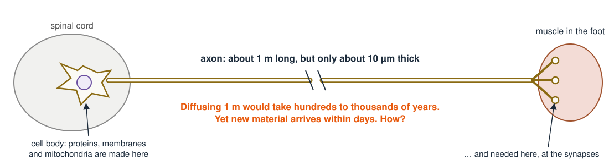{width="96%" fig-align="center"}

- A motor neuron that moves your big toe has its **cell body in the spinal cord** and its **synapse in the foot**: one cell, about **1 m** long.
- Almost all proteins, membranes and mitochondria are **made in the cell body**.
- The tour of the cell lecture showed that **diffusion** is fast across a cell (seconds) but hopeless over a metre: the time grows with **distance squared**.
- Yet new material reaches the synapse within **days**. **What carries it, and along what?**

::: notes
Here is the puzzle for today. Think of the nerve cell that makes your big toe move. Its cell body sits in the spinal cord in your lower back, and its axon runs all the way down the leg to a muscle in the foot. That is one single cell, about a metre long, yet only about ten micrometres thick. The nucleus, the rough ER and the Golgi are all in the cell body, so nearly every new protein, every new piece of membrane and many mitochondria start there. They are needed at the far end, at the synapse. In the tour of the cell you saw that diffusion is fine across a normal cell: a protein crosses ten micrometres in a few seconds. But diffusion time grows with the square of the distance. A hundred thousand times further means ten billion times longer: hundreds to thousands of years for one metre. Real neurons deliver new synaptic vesicle proteins in a few days. So there must be an active transport system with tracks and engines. The tracks are microtubules, and the engines are motor proteins. By the end of the lecture you can calculate how long the trip takes.
:::

## The building block: tubulin makes a polar, hollow tube {.smaller}

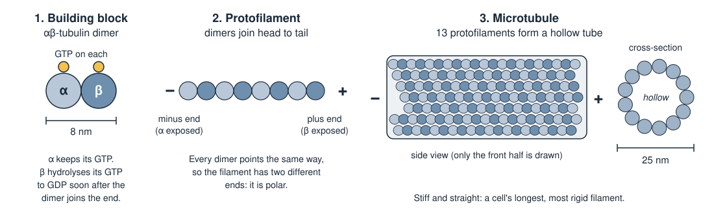{width="84%" fig-align="center"}

:::: {.columns}
::: {.column width="78%"}
- **αβ-tubulin** dimers stack head to tail into **protofilaments**; **13** protofilaments close into a hollow tube **25 nm** wide.
- Every dimer points the same way, so the tube is **polar**: a fast-growing **plus end** (β exposed) and a slower **minus end** (α exposed).
- Both subunits bind **GTP**. Only the GTP on **β** is hydrolysed to **GDP**, shortly after the dimer is added.
:::
::: {.column width="22%"}
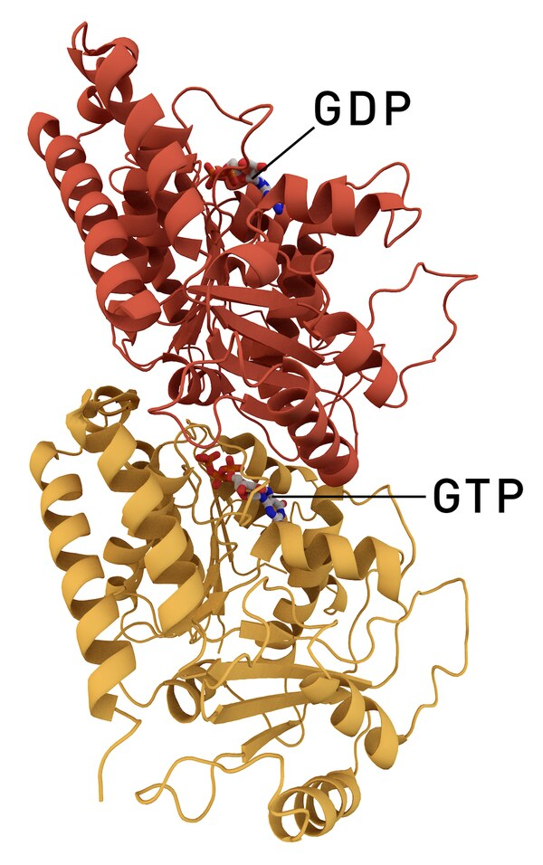{height="175px" fig-align="center"}

*Tubulin dimer (PDB 1JFF): β (red) on top, α (gold) below.*
:::
::::

::: notes
The building block of a microtubule is a dimer of two similar proteins, alpha-tubulin and beta-tubulin, each about fifty kilodaltons. The dimer is eight nanometres long. On the right is the real atomic structure, solved by electron crystallography: beta on top in red, alpha below in gold, each with its nucleotide. Dimers join head to tail into a protofilament, and thirteen protofilaments sit side by side and close into a hollow tube twenty-five nanometres across. That makes the microtubule the stiffest and widest of the three filament systems: a good track. Because all dimers point the same way, the two ends are different. The plus end, where beta-tubulin is exposed, grows and shrinks fast; the minus end is slower and, in cells, is usually capped and anchored. Remember the polarity: motors read it to know which way to walk. Both tubulins bind GTP. The GTP in alpha is buried and stays. The GTP in beta is hydrolysed to GDP soon after the dimer is built in, and that single chemical detail is the key to the next slide.
:::

## Dynamic instability: the GTP cap {.smaller}

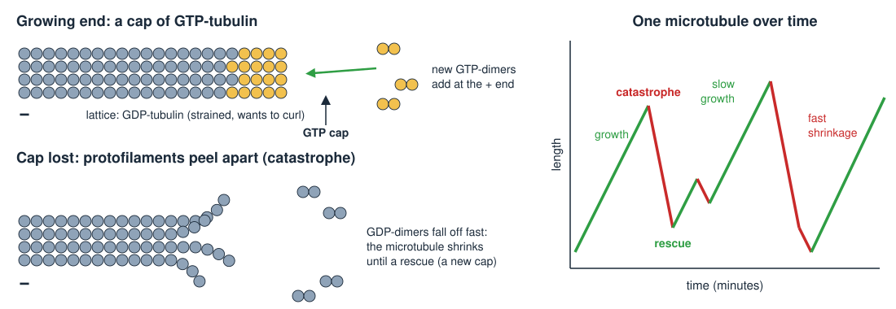{width="92%" fig-align="center"}

- New dimers carry **GTP**. Hydrolysis lags behind growth, so a growing end has a **GTP cap** that holds it straight.
- GDP-tubulin in the lattice is **strained**: it wants to curve. If the cap is lost, the protofilaments **peel apart** and the tube shrinks fast: a **catastrophe**. Regaining a cap stops the shrinking: a **rescue**.
- Each microtubule switches **at random**. A typical microtubule lasts **about 10 min** in an interphase cell and **less than a minute** in mitosis.

::: notes
Here is the most surprising property of microtubules. In 1984 Tim Mitchison and Marc Kirschner found that in one solution, with the same free tubulin, some microtubules grow while others shrink, and each one switches between the two states now and then. They called this dynamic instability. The explanation is the GTP on beta-tubulin. A dimer arrives carrying GTP and is built into the end. Its GTP is hydrolysed a little later. As long as dimers arrive faster than GTP is hydrolysed, the end carries a cap of GTP-tubulin, which keeps the protofilaments straight and stuck together. Behind the cap is GDP-tubulin, which would rather be curved. It is held straight only by its neighbours, like a loaded spring. If, by chance, the cap is lost, the protofilaments curl outward and fall apart, and the microtubule shrinks very fast. That switch is a catastrophe. Sometimes a shrinking microtubule regains a cap and starts growing again: a rescue. On the right is the life of one microtubule: slow growth, sudden catastrophe, fast shrinkage, rescue. The cell pays GTP for this, and gets tracks that it can rebuild within minutes.
:::

## How do we know? EB1 comets and kymographs {.smaller}

:::: {.columns}
::: {.column width="44%"}
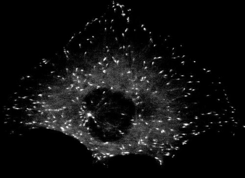{width="100%" fig-align="center"}

*Human U2OS cell expressing EB1-GFP: each bright dash is the growing plus end of one microtubule (one frame of a time-lapse movie).*
:::
::: {.column width="56%"}
- **EB1** binds only the **growing end** (it reads the GTP cap). Fused to **GFP**, it makes each growing end a moving **comet**.
- Track the comets: their **speed** is the growth rate (about **10–20 µm/min** in a cell); a comet that **vanishes** marks a pause or a catastrophe.
- A **kymograph** stacks the same line through the image at each time point: a growing end draws a **sloped line**, a catastrophe a **sharp turn back**.
- In a test tube, purified tubulin shows the same switching: it needs **no other protein**. **Try it:** [Demo: dynamic instability](questions.qmd#explore).
:::
::::

::: notes
How can we watch single microtubule ends in a living cell? The best trick uses a protein called EB1, an end-binding protein. EB1 recognises the special structure of tubulin near the growing end, so it sits only on growing plus ends and falls off a few seconds after a dimer is built in. If you fuse EB1 to green fluorescent protein and express it in cells, every growing end lights up as a short moving comet, like in this human cell. The comets start near the centrosome and race outward. From a movie you can measure the speed of each comet, which is the growth rate, and you see comets disappear when a microtubule stops or has a catastrophe; shrinking ends are invisible with EB1. A common way to analyse such movies is a kymograph: take one line in the image, along a microtubule, and stack that line for every time point. Growth then draws a sloped line, and a catastrophe appears as a sharp turn. The original evidence came from purified tubulin in a test tube, which shows that dynamic instability is a property of tubulin itself. You can build your own kymograph in the demo.
:::

## Where microtubules start: the centrosome {.smaller}

:::: {.columns}
::: {.column width="76%"}
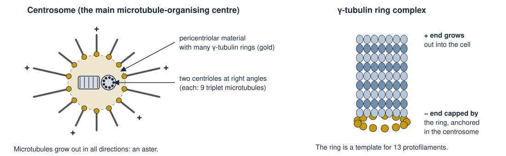{width="100%" fig-align="center"}
:::
::: {.column width="24%"}
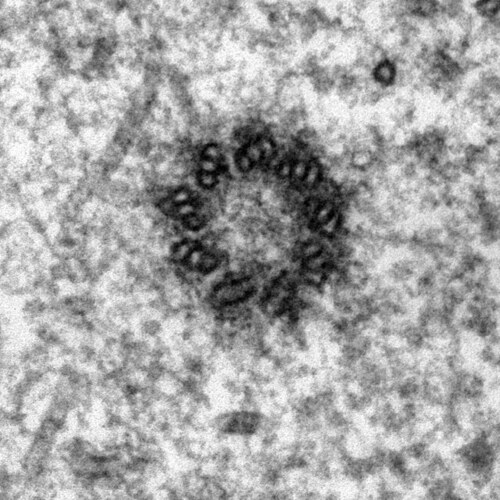{width="100%" fig-align="center"}

*Electron micrograph of a centriole cut across (mouse embryo): nine triplet microtubules, about 0.2 µm across.*
:::
::::

- Starting a tube from free tubulin is slow. Cells start microtubules on **γ-tubulin ring complexes**, which act as a **template** and cap the **minus end**.
- In animal cells most rings sit in the **centrosome**: a pair of **centrioles** in a cloud of **pericentriolar material**. Minus ends stay there; **plus ends grow outward**.
- The centrosome is copied once per cell cycle; the two copies become the **spindle poles** (the mitosis lecture).

::: notes
A microtubule can in principle start anywhere, but starting a new tube from free dimers is slow, because several dimers must come together in the right shape before growth becomes favourable. Cells solve this with a third tubulin, gamma-tubulin. Gamma-tubulin and some partner proteins form a ring that looks like the end of a microtubule. Dimers bind to the ring and grow into a tube with thirteen protofilaments. The ring also caps the minus end, so the minus end neither grows nor shrinks. In animal cells most of these rings are packed into the centrosome, the main microtubule-organising centre, close to the nucleus. The centrosome has a pair of centrioles at its core, surrounded by a cloud of protein called pericentriolar material, which holds the rings. The electron micrograph shows a centriole cut across: nine triplets of microtubules in a ring. Remember that structure, because a cilium grows from the same kind of barrel. Before a cell divides, the centrosome is duplicated, and the two centrosomes become the two poles of the mitotic spindle, which you meet in the mitosis lecture.
:::

## Different cells, different arrays {.smaller}

:::: {.columns}
::: {.column width="72%"}
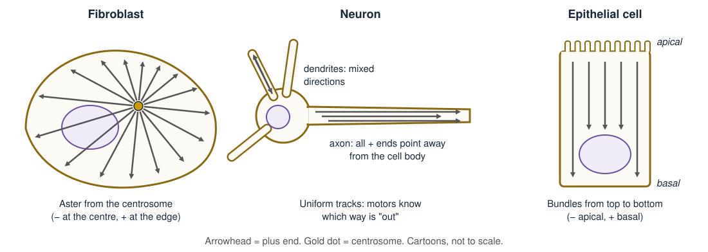{width="100%" fig-align="center"}
:::
::: {.column width="28%"}
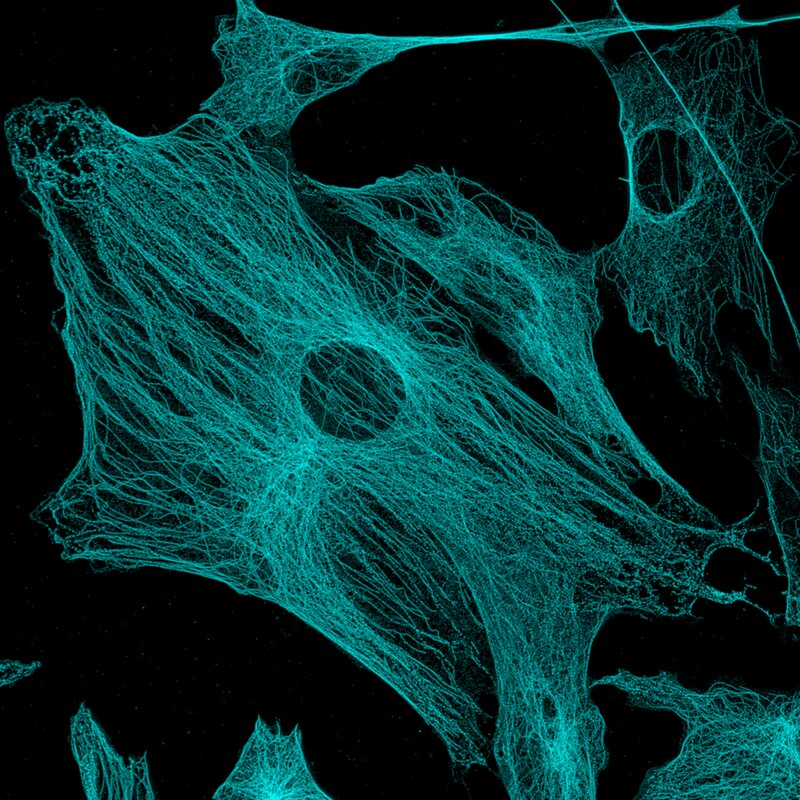{width="100%" fig-align="center"}

*Mouse fibroblasts stained for tubulin (confocal): radial arrays around the nucleus.*
:::
::::

- **Fibroblast**: a radial **aster**; minus ends at the centrosome, plus ends at the cell edge.
- **Neuron**: in the **axon** every plus end points **away from the cell body**; dendrites have mixed directions. The arrays are made **without** a centrosome.
- **Epithelium**: bundles run from **apical to basal**, minus ends near the apical surface. They deliver cargo to the right side of a polarised cell.

::: notes
The rules are the same in every cell, but the arrangement differs, and it decides where motors can take things. In a fibroblast or most cells in culture, the centrosome sits next to the nucleus and microtubules radiate out like the spokes of a wheel. You can see it in the fluorescence image of mouse fibroblasts stained with an antibody against tubulin. Minus ends are in the middle and plus ends at the cell edge, so a plus-end motor carries cargo outward and a minus-end motor carries it inward. In a neuron, the axon has a uniform array: every microtubule has its plus end towards the axon tip. These microtubules are not attached to the centrosome; they are nucleated along the axon and cut and moved into place. Dendrites in mammals have mixed directions, which helps the cell send some cargo only to dendrites. In an epithelial cell, such as those lining your gut, microtubules run from top to bottom, with minus ends anchored near the apical surface. That lets the cell send membrane proteins to the apical or basolateral side, which matters for the transport epithelia you met in the transport lecture.
:::

## Microtubule-associated proteins tune the tracks {.smaller}

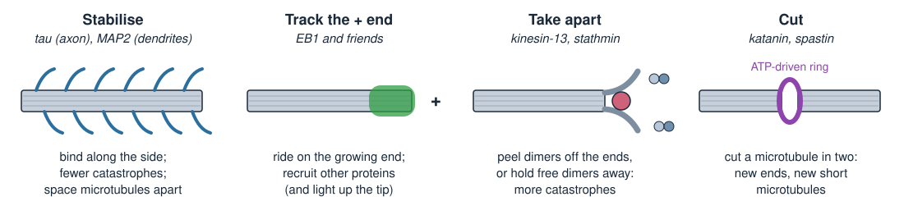{width="96%" fig-align="center"}

- **Stabilisers** such as **tau** (axon) bind along the lattice, reduce catastrophes and bundle microtubules.
- **Plus-end trackers** such as **EB1** ride on growing ends and recruit other proteins to them.
- **Destabilisers** (kinesin-13, stathmin) and **severing enzymes** (katanin, spastin) make microtubules short and dynamic.
- Cells change this balance quickly: in **mitosis** catastrophes become much more frequent, so microtubules get **shorter and turn over faster**.

::: notes
Pure tubulin already shows dynamic instability, but in cells dozens of microtubule-associated proteins, MAPs for short, tune it. We group them by what they do. Stabilisers bind along the side of the microtubule. Tau in the axon and MAP2 in dendrites are the classic examples; they make catastrophes rarer and hold microtubules at a set distance from each other. Tau comes back at the end of this lecture, in Alzheimer's disease. Plus-end tracking proteins, such as EB1 from the previous slide, ride on growing ends and recruit other proteins there, for example to capture the end at the cell cortex or at a chromosome. Destabilisers do the opposite: kinesin-13 is a kinesin that does not walk but pulls dimers off the ends, and stathmin holds free tubulin dimers away from the ends. Severing enzymes such as katanin and spastin use ATP to cut a microtubule in two, which makes new ends. The cell changes this balance by phosphorylating MAPs. When a cell enters mitosis, catastrophes become much more frequent, the long interphase array breaks down and many short, fast microtubules build the spindle.
:::

## Two motor families walk in opposite directions {.smaller}

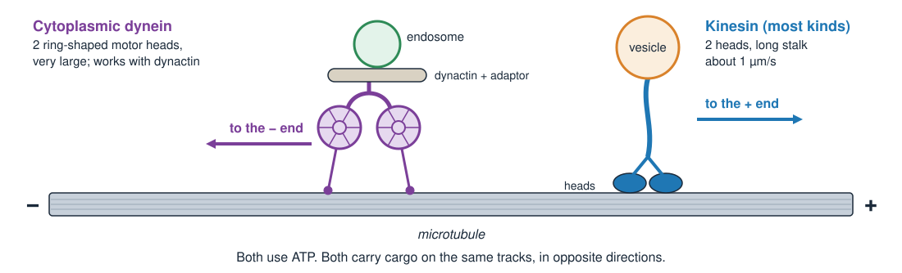{width="92%" fig-align="center"}

| | **Kinesin** (most kinds) | **Cytoplasmic dynein** |
|---|---|---|
| Direction | towards the **plus end** (outward) | towards the **minus end** (inward) |
| Size | two heads, ~80 nm long; ~45 kinesin genes in humans | very large (~1.4 MDa); one main form does most transport |
| Typical cargo | vesicles, mitochondria, mRNA particles | endosomes, Golgi membranes, viruses on their way to the nucleus |

::: notes
Two families of motor proteins walk on microtubules. Both convert the energy of ATP hydrolysis into steps, and both bind cargo with their tails. They differ in direction. Kinesins, with a few exceptions, walk towards the plus end, which in most cells means outward, from the centre to the periphery or down the axon. Humans have about forty-five kinesin genes, so different kinesins carry different cargo. Cytoplasmic dynein walks towards the minus end, inward. It is a much bigger machine: each motor head is a ring of six ATPase domains, and the whole complex is about one and a half megadaltons. Dynein needs a partner complex called dynactin and a cargo adaptor to move cargo over long distances. Unlike kinesins, there is essentially one cytoplasmic dynein that does nearly all minus-end transport. Many viruses, such as herpes viruses, hijack dynein to reach the nucleus, a topic of the pathogenesis course. A cargo often carries both kinds of motor, and the cell decides which one wins. The third motor family, myosin, walks on actin; it is the topic of the lecture on myosin and intermediate filaments.
:::

## How kinesin walks: one ATP per 8-nm step {.smaller}

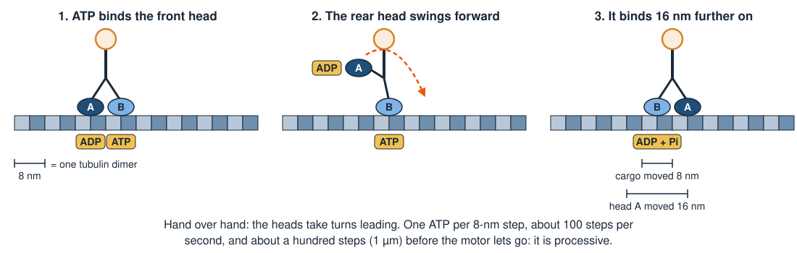{width="92%" fig-align="center"}

- Kinesin walks **hand over hand**: the two heads take turns leading, and **one head is always bound**.
- ATP binding to the front head swings the rear head forward by **16 nm**; the cargo moves **8 nm**, one tubulin dimer.
- **One ATP per step**, ~100 steps per second: about **1 µm/s**. It stalls against a force of about **6 pN**.

::: notes
How does a protein walk? Kinesin has two identical heads, each of which binds the microtubule and ATP. The cycle works like this. Imagine both heads are bound, the rear one holding ADP. ATP binds to the front head. That makes a short segment called the neck linker zip onto the front head and point forward, which throws the rear head ahead, past its partner, by sixteen nanometres. The swinging head finds the next binding site, releases its ADP and binds firmly. Meanwhile the old front head, now at the rear, hydrolyses its ATP and is ready to let go. The heads take turns, like your feet when you walk, and because one head is always attached, a single kinesin can take about a hundred steps before it falls off. We call that processive. Each step moves the cargo by eight nanometres, exactly one tubulin dimer, and uses exactly one ATP. At about a hundred steps per second, kinesin moves about one micrometre per second. It keeps going against a load of up to about six piconewtons, which is plenty to drag a vesicle through cytoplasm.
:::

## How do we know? Watching one motor at a time {.smaller}

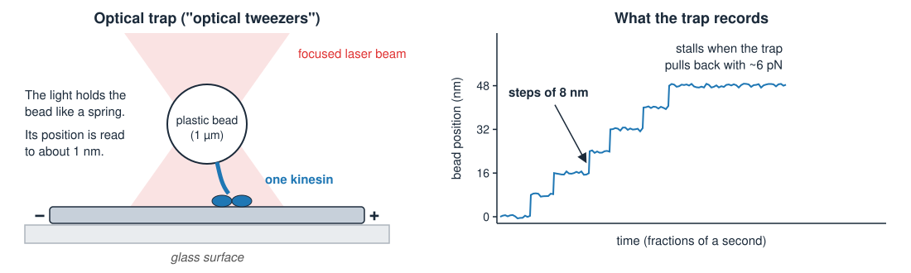{width="90%" fig-align="center"}

- **Gliding assay**: motors stuck to glass move fluorescent microtubules. This is how **kinesin was discovered** (1985, in squid giant axons).
- **Optical trap**: a laser holds a bead carrying **one kinesin**; the bead is followed to **~1 nm**. It shows **8-nm steps**, **one ATP per step** and the **stall force**.
- **Single-molecule fluorescence**: a motor tagged with a bright dye can be followed as it walks along a microtubule.

::: notes
The numbers on the last slide come from experiments with single molecules. The first is the gliding assay. Purified motors are stuck to a glass slide, fluorescent microtubules are added with ATP, and the microtubules glide across the glass, pushed by the motors. In 1985 Ron Vale and colleagues used this kind of assay with extracts of the squid giant axon to find kinesin. The second method is the optical trap, also called optical tweezers. A strongly focused laser beam holds a small plastic bead, as if on a spring. A single kinesin is attached to the bead and set down on a microtubule fixed to the glass. As the motor walks, it pulls the bead out of the centre of the trap, and the bead position is measured with a precision of about a nanometre. The record looks like a staircase with steps of eight nanometres. By changing the ATP concentration you can show that each step uses one ATP, and by making the trap stiffer you find the force at which the motor stalls, about six piconewtons. The same methods were later used for dynein and myosin.
:::

## Axonal transport: motors beat diffusion over long distances {.smaller}

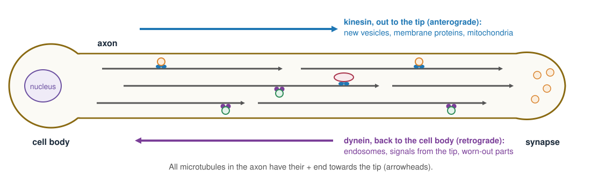{width="88%" fig-align="center"}

| Distance | Diffusion of a protein ($t \approx x^2/2D$, D ≈ 5 µm²/s) | Kinesin ($t = x/v$, v ≈ 1 µm/s) |
|---|---|---|
| 10 µm (a cell) | ~10 s | ~10 s |
| 1 m (an axon) | ~3000 years | ~12 days (fast transport, 2–5 µm/s: 2–6 days) |

::: notes
Now we can answer the question from the start. In the axon all microtubules point their plus end towards the tip, so kinesins carry new synaptic vesicle precursors, membrane proteins and mitochondria outward. This is called anterograde transport. Dynein carries endosomes, worn-out parts on their way to lysosomes, and signals from the target tissue, such as growth factors, back to the cell body: retrograde transport. Compare the two ways of moving along a line. Diffusion along one dimension takes about x squared over 2D; a motor takes x over v. Over ten micrometres both take about ten seconds for a protein, so in a small cell diffusion is good enough. But because diffusion grows with the square of the distance, one metre would take thousands of years, while a kinesin at one micrometre per second needs about twelve days, and fast axonal transport in neurons, up to a few micrometres per second, needs two to six days. A large vesicle diffuses even more slowly than a protein, so for organelles there is no alternative to motors. Cytoskeletal proteins travel by slow axonal transport, a millimetre or so per day, because their motors pause most of the time.
:::

## Motors also place organelles {.smaller}

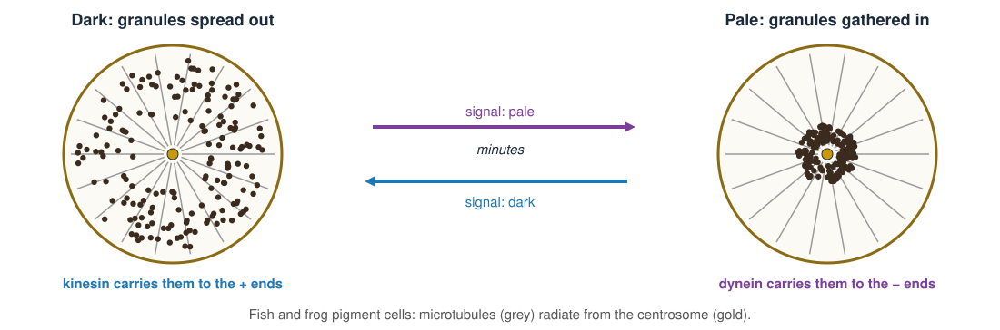{width="80%" fig-align="center"}

- **Pigment cells** of fish and frogs change colour in minutes: dynein gathers the pigment granules at the centre, kinesin spreads them out.
- The **Golgi** sits next to the centrosome because dynein pulls it towards minus ends; **ER** tubules are pulled outward along microtubules.
- Destroy microtubules with a drug and the Golgi **breaks up into small stacks** spread through the cytoplasm.

::: notes
Motors do not only carry cargo over long distances. They also decide where organelles sit in an ordinary cell. A beautiful example is the pigment cell of fish and frogs, the melanophore. It is full of dark pigment granules. When the animal needs to become pale, a hormone signal makes dynein carry all the granules to the centre of the cell, so the skin looks light. When the signal reverses, kinesin carries them back out along the radial microtubules, and the cell turns dark again within minutes. The same tug of war between plus-end and minus-end motors positions organelles in your own cells. The Golgi apparatus sits close to the centrosome because dynein keeps pulling Golgi membranes towards the minus ends. If you add a drug that depolymerises microtubules, such as nocodazole, the Golgi falls apart into many small stacks scattered through the cytoplasm, and comes together again when the drug is washed out. The endoplasmic reticulum is stretched out towards the cell edge along microtubules. You meet the Golgi and the ER in detail in the organelle lectures.
:::

## Cilia and flagella: microtubules that bend {.smaller}

:::: {.columns}
::: {.column width="68%"}
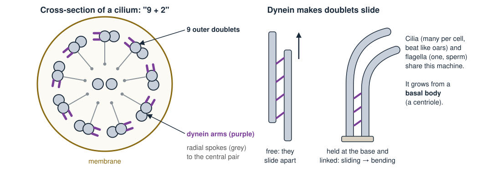{width="100%" fig-align="center"}
:::
::: {.column width="32%"}
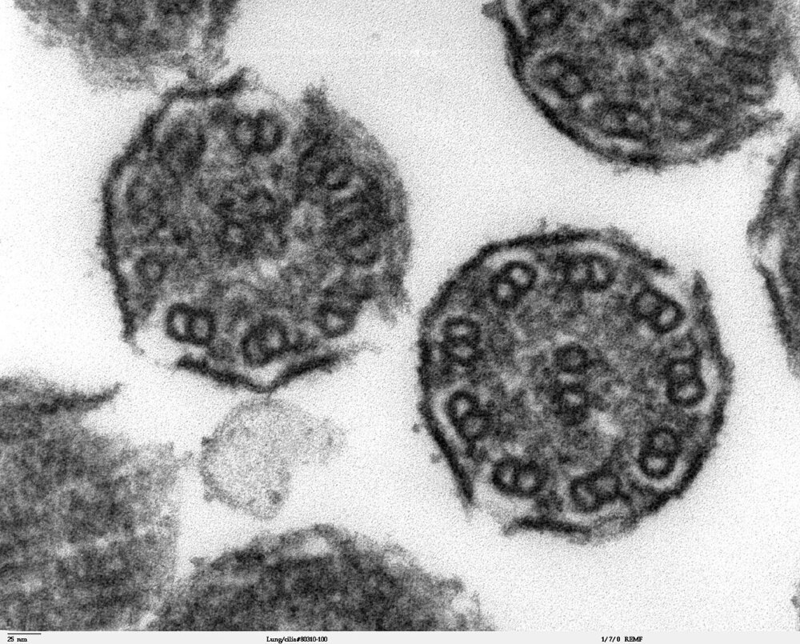{width="100%" fig-align="center"}

*Electron micrograph of cilia cut across (mouse airway). Each shows nine doublets around a central pair.*
:::
::::

- The core, the **axoneme**, has **9 doublet microtubules around 2 single ones** ("9 + 2"). It grows from a **basal body**, a modified centriole.
- **Axonemal dynein arms** on each doublet walk on the neighbouring doublet. Links stop the doublets from sliding apart, so **sliding becomes bending**.
- **Motile cilia** clear mucus in the airways and move the egg in the oviduct; a **flagellum** drives a sperm. Most cells also have one non-moving **primary cilium** (9 + 0), an antenna for signals.

::: notes
Cilia and flagella are hair-like extensions of the cell surface, built around a bundle of microtubules called the axoneme. Look at the electron micrograph of cilia from a mouse airway, cut across: each shows nine doublet microtubules in a ring around two single microtubules in the middle. This is the famous nine plus two pattern, and it is the same in a sperm tail, an airway cilium and a single-celled alga, so it has been conserved for more than a billion years. The axoneme grows from a basal body, which is a centriole that has moved to the cell surface. Each doublet carries two rows of dynein arms, which reach to the next doublet and walk on it towards its minus end. If the doublets were free, this would push them past each other, as in the left drawing. But they are held together by links and anchored at the base, so the sliding is converted into bending. Waves of dynein activity around the ring make the cilium beat. Airway cells carry about two hundred cilia each, which sweep mucus up and out of the lungs. Almost every cell in your body also has one primary cilium without dynein arms, which does not move but senses signals.
:::

## Why it matters: taxanes and vinca alkaloids in chemotherapy {.smaller}

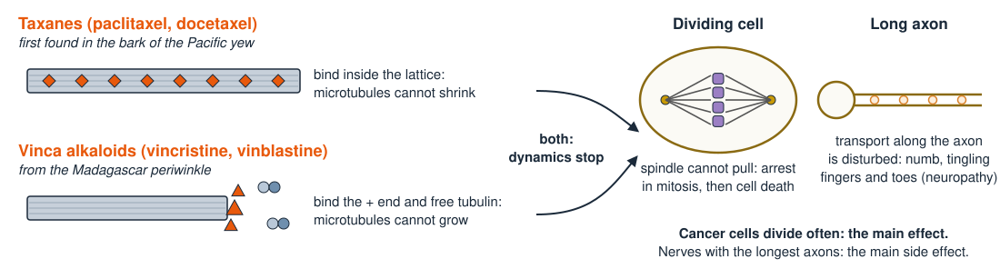{width="88%" fig-align="center"}

:::: {.columns}
::: {.column width="70%"}
- **Taxanes** (paclitaxel, docetaxel) bind **β-tubulin inside the lattice** and **stabilise** microtubules; **vinca alkaloids** (vincristine, vinblastine) bind tubulin **at the plus end** and **block growth**. Used against breast, ovarian and lung cancer, leukaemias and lymphomas.
- Both **freeze dynamic instability**: the **spindle** cannot capture and move chromosomes, the cell **arrests in mitosis** and dies (the mitosis lecture).
- **Side effect: peripheral neuropathy.** Numb, tingling hands and feet: the **longest axons** depend most on microtubule transport.
:::
::: {.column width="30%"}
{height="150px"} {height="150px"}

*Pacific yew (left) and Madagascar periwinkle.*
:::
::::

::: notes
Now to medicine. Two of the oldest and most used groups of cancer drugs act on tubulin, and both come from plants. Paclitaxel, sold as Taxol, was found in the bark of the Pacific yew in a large screen of plant extracts in the 1960s; docetaxel is a close relative. Taxanes bind beta-tubulin on the inside of the microtubule and lock the lattice, so microtubules cannot shrink: they behave as if catastrophes no longer happened. Vinca alkaloids, such as vincristine and vinblastine, come from the Madagascar periwinkle. They bind tubulin at the plus end and between dimers, and block growth; at high doses microtubules fall apart. The two drugs push in opposite directions, yet both work, because both stop the dynamics. A mitotic spindle needs microtubules that grow and shrink to search for and pull on chromosomes, so the cell gets stuck in mitosis and dies. Cancer cells divide often, so they are hit hardest. The most common dose-limiting side effect is peripheral neuropathy: numbness and pain in fingers and toes, because the longest axons depend most on transport along microtubules. You meet these drugs again in drug development.
:::

## Why it matters: diseases of cilia and axonal transport {.smaller}

| Disease | What goes wrong | Link to this lecture |
|---|---|---|
| **Primary ciliary dyskinesia** (about 1 in 10 000–20 000) | Mutations in **axonemal dynein** or its partners: motile cilia do not beat | Chronic airway infections; **male infertility** (sperm do not swim); in about half of patients **organs on the wrong side** (situs inversus), because cilia in the embryo set left and right |
| **Polycystic kidney disease** (dominant form, about 1 in 1000) | **Polycystins**, sensor proteins of the **primary cilium** in kidney tubules | The tubules lose their sense of flow and grow into fluid-filled **cysts**; a common inherited cause of kidney failure |
| **Neurodegeneration** | Mutations in **kinesin (KIF5A)**, **dynein/dynactin** or **spastin** (severing); **tau** detaches from microtubules in Alzheimer's disease | The **longest motor neurons** fail first (hereditary spastic paraplegia, some forms of ALS and Charcot–Marie–Tooth disease) |

These are cell-level mechanisms only; the clinical pictures come in the course on disease mechanisms.

::: notes
The machinery of this lecture also explains several inherited diseases. In primary ciliary dyskinesia, mutations in the genes for the dynein arms of the axoneme, or for proteins that build them, leave the cilia without a proper beat. Mucus is not cleared from the airways, so patients have chronic bronchitis and sinusitis. Men are usually infertile because their sperm cannot swim. And about half of the patients have their organs mirrored, heart on the right, because a small patch of rotating cilia in the early embryo creates a leftward flow that tells the embryo which side is left. In autosomal dominant polycystic kidney disease, the mutated proteins, polycystin 1 and 2, sit in the primary cilium of kidney tubule cells, where they sense the flow of urine. Without that signal the tubule cells keep dividing and form large cysts; it is one of the most common inherited diseases leading to kidney failure. Finally, neurons depend on axonal transport, so defects in kinesin, dynein, dynactin or the severing enzyme spastin cause diseases in which the longest axons degenerate first. In Alzheimer's disease the stabiliser tau is modified, falls off the microtubules and forms tangles.
:::

## Summary {.smaller}

1. **αβ-tubulin** builds a polar, hollow tube. A **GTP cap** keeps a growing plus end stable; losing it causes a **catastrophe**, regaining it a **rescue**: **dynamic instability**, seen with **EB1 comets** and kymographs.
2. **γ-tubulin rings** in the **centrosome** start microtubules and anchor minus ends. Arrays differ by cell type: **radial** in a fibroblast, **uniform plus-out** in an axon, **apical-to-basal** in an epithelium. **MAPs** stabilise, track, take apart or cut.
3. **Kinesins** walk to the **plus end**, **dynein** to the **minus end**, using **one ATP per step** (kinesin: 8 nm, ~1 µm/s), as shown in **single-molecule** and **optical-trap** assays. Over long distances, motors beat diffusion (x/v versus x²/2D): **axonal transport**.
4. In **cilia and flagella** (9 + 2 axoneme), dynein makes doublets slide, and links turn sliding into **bending**. The **primary cilium** is a signalling antenna.
5. **Taxanes** (stabilise) and **vinca alkaloids** (block growth) stop dynamics, arrest mitosis and damage long axons; **ciliopathies** and **transport defects** cause disease.

*Read more (optional): Alberts et al., Molecular Biology of the Cell, 7th ed., ch. 16.*

[Image credits](../credits.qmd#microtubules){style="font-size:0.7em"}

::: notes
Five take-home points. First, a microtubule is a polar, hollow tube of alpha-beta tubulin, and the GTP on beta-tubulin makes it dynamically unstable: growing ends keep a GTP cap, and when it is lost the tube shrinks fast until rescued. We see this with EB1 comets and kymographs. Second, gamma-tubulin rings, mostly in the centrosome, start microtubules and hold their minus ends, and different cells arrange their arrays to suit their shape; MAPs tune the dynamics. Third, kinesins walk to plus ends and dynein to minus ends, each step paid for with one ATP, as single-molecule experiments showed. Over long distances, transport by motors wins easily over diffusion, which is why a one-metre axon works. Fourth, in cilia and flagella, dynein arms make doublet microtubules slide, and links convert the sliding into the bending that moves mucus and sperm; the primary cilium is an antenna. Fifth, drugs that freeze microtubule dynamics are mainstays of chemotherapy, with nerve damage as the price, and defects in cilia and motors cause disease. The lecture on myosin and intermediate filaments completes the cytoskeleton, with the third motor family and the mechanics of the cell.
:::
