## About this lecture {.smaller}

You know the metabolism: glycolysis, the TCA cycle and oxidative phosphorylation. Today we look at **the membranes and the machines** that turn food into ATP, and at the other jobs of mitochondria.

After this lecture you can:

- describe the **structure** of a mitochondrion (two membranes, cristae, matrix), its own **DNA** and why it is **inherited from the mother**, and how mitochondria **divide and fuse**;
- explain **chemiosmosis**: how electron transport pumps H⁺, how the **proton-motive force** stores energy, and how the **ATP synthase** rotary motor uses it;
- explain how **transporters** move ATP, ADP and phosphate across the inner membrane;
- describe the roles of mitochondria **beyond ATP**: Ca²⁺ buffering, reactive oxygen species and **cytochrome c in apoptosis**;
- read a **mito stress test**, and explain **mitochondrial diseases**, **mitochondrial donation**, and how **DNP, cyanide and metformin** act.

::: notes
In biochemistry you learned the chemistry of energy metabolism: glucose is broken down to pyruvate, pyruvate is oxidised in the TCA cycle, and the electrons end up on oxygen. In this course we ask cell biology questions about the same process. Where does each step happen? Which membrane holds which machine? How is the energy of electrons turned into a gradient of protons, and how does a rotating protein motor turn that gradient into ATP? We will reuse two ideas from the membranes block. From the ion-channels lecture, the idea of a membrane potential, a voltage across a membrane. From the transporters lecture, the idea that an ATP-driven pump run backwards can make ATP. Mitochondria also do much more than make ATP. They take up calcium, they make reactive oxygen species, and they hold the switch for one kind of programmed cell death. We end with medicine: diseases of mitochondrial DNA, the new technique of mitochondrial donation, and three chemicals that act on the proton circuit: a deadly diet pill, a classic poison and a common diabetes drug. This covers ELO 5, with examples for ELO 9.
:::

## The question: where does all the ATP come from? {.smaller}

:::: {.columns}
::: {.column width="44%"}
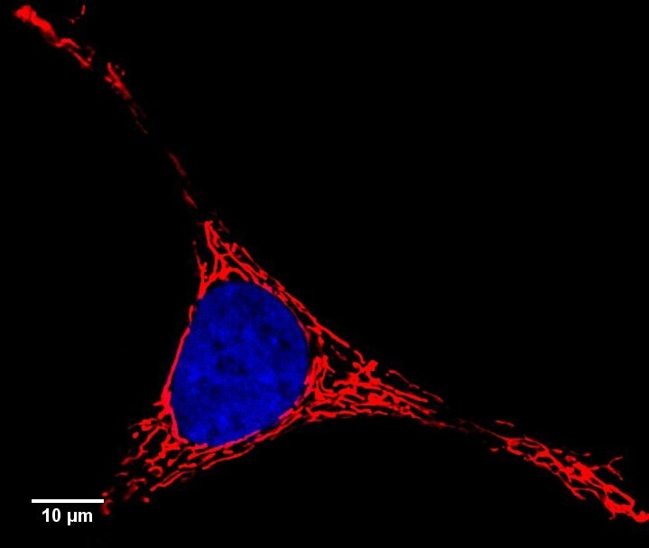{width="100%"}

*Mitochondria (red) in a living HeLa cell, with the nucleus (blue). Scale bar 10 µm.*
:::
::: {.column width="56%"}
- A resting adult turns over roughly **its own body weight in ATP every day**. The cells hold only a small pool at any moment, so each ATP is recycled **hundreds to a thousand times a day**.
- In many aerobic tissues, **most ATP** is made in mitochondria. They are not beans: in a living cell they form a **branched, moving network**.
- **How does burning food with O₂ make ATP? Why did a 1930s diet pill kill people by overheating? And why can a child inherit a disease only from the mother?**
:::
::::

::: notes
Here is a living cell stained with a dye that collects in mitochondria. You do not see the bean shapes of the textbook. You see a network of tubes that spreads through the cytoplasm, branches and changes all the time. Now some numbers. A resting adult uses about forty to seventy kilograms of ATP per day, roughly the body weight. The body does not contain that much ATP: at any moment there is only a small pool, so each molecule is made from ADP and phosphate, used, and made again hundreds to a thousand times a day. In many aerobic tissues most ATP regeneration happens in mitochondria and depends on oxygen; the contribution varies with cell type and activity, and red blood cells have no mitochondria. Three puzzles guide this lecture. First, how does the oxidation of food make ATP, when the electron transport chain and the ATP synthase are separate proteins that never touch? Second, in the 1930s a drug called DNP was sold as a slimming pill. It worked, but some people died with a body temperature above 43 degrees. Why? Third, some diseases pass only from mothers to children, never from fathers. Why? We will answer all three.
:::

## Recap: from food to the inner membrane {.smaller}

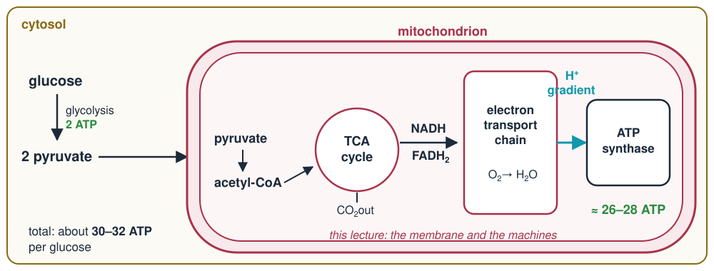{width="88%" fig-align="center"}

- *Recap from biochemistry:* glycolysis in the **cytosol** gives pyruvate and 2 ATP. Pyruvate enters the mitochondrion; the **TCA cycle** in the matrix oxidises it to CO₂ and loads electrons onto **NADH** and **FADH₂**.
- The rest happens **in the inner membrane**: the electron transport chain passes the electrons to **O₂**, and the ATP synthase makes most of the ATP. That is today's topic.

::: notes
This is the only recap slide, because you know the chemistry. Glucose is split into two pyruvate molecules in the cytosol. This gives a net two ATP and some NADH. Pyruvate is carried into the mitochondrial matrix, the inner compartment, by a transporter. There it is converted to acetyl-CoA, and the TCA cycle, also called the citric acid or Krebs cycle, oxidises the acetyl group to two molecules of CO2. The cycle does not make much ATP directly. Its main product is reduced electron carriers: NADH and FADH2. These carry high-energy electrons. The final step, oxidative phosphorylation, is where most of the ATP comes from, about 26 to 28 of the 30 to 32 ATP per glucose. Biochemistry treats this step as a list of reactions. In cell biology we want to know where it happens and how. The answer is: in a membrane, the inner mitochondrial membrane, and the coupling between the two halves, electron transport and ATP synthesis, is not a chemical reaction at all. It is a gradient of protons across that membrane.
:::

## Two membranes and folded cristae {.smaller}

:::: {.columns}
::: {.column width="32%"}
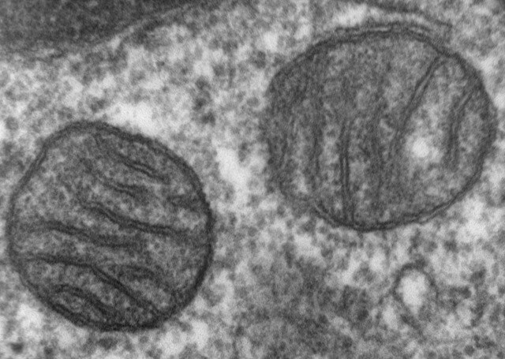{width="100%"}

*Two mitochondria in a lung cell, transmission electron microscope. Note the outer membrane and the folded inner membrane (cristae).*
:::
::: {.column width="68%"}
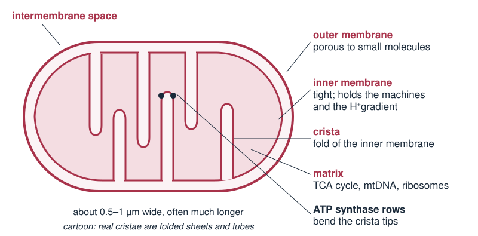{width="100%"}

- **Outer membrane**: porous (large channels, porins), so the intermembrane space has cytosol-like small molecules.
- **Inner membrane**: very tight, rich in protein and the lipid **cardiolipin**; folded into **cristae** that increase its area. Cristae connect to the rest through narrow **cristae junctions**.
:::
::::

::: notes
In the electron microscope, a mitochondrion is a bag within a bag. The outer membrane is smooth. It contains many copies of porin, a channel protein that lets through any molecule smaller than about five thousand daltons. So ions, ATP and sugars pass freely, and the intermembrane space between the two membranes has almost the same small molecules as the cytosol. The inner membrane is the opposite: it is one of the tightest membranes in the cell. Even protons cannot leak through easily, which is essential, as you will see. About three quarters of its mass is protein, and it contains a special lipid, cardiolipin, which helps hold the respiratory complexes together. The inner membrane is folded into cristae, which greatly increase its area. Cristae are not open folds: they join the rest of the inner membrane through narrow necks, the cristae junctions. So the space inside a crista is a partly separate compartment. Rows of ATP synthase pairs sit along the sharp edges of the cristae and help bend the membrane. Cells that need much energy, like heart muscle, have many mitochondria with dense cristae. In the explorer from the cell tour you can find mitochondria in a real cell.
:::

## Mitochondria have their own DNA {.smaller}

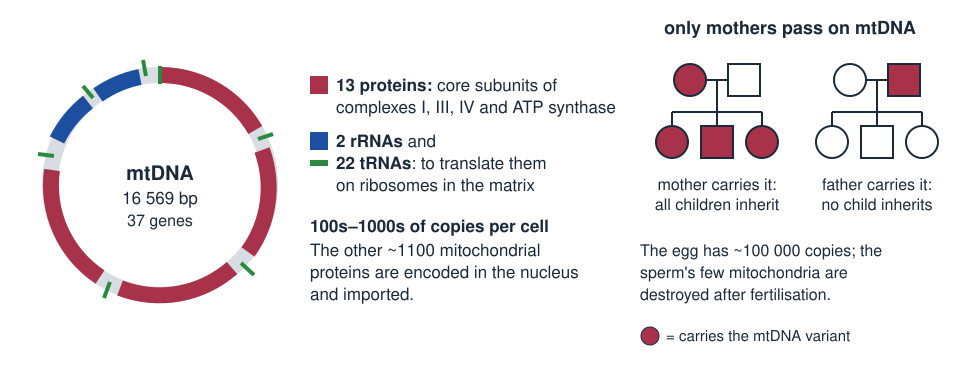{width="84%" fig-align="center"}

- A relic of their origin: mitochondria descend from a **bacterium** taken up by an ancestral cell about 2 billion years ago (**endosymbiosis**). Most of its genes moved to the nucleus.
- About 99 % of mitochondrial proteins are made in the cytosol and **imported** through the TOM and TIM complexes (see the protein-sorting lecture).
- **Maternal inheritance:** all your mtDNA comes from your mother's egg.

::: notes
Mitochondria are the descendants of a bacterium, related to today's alpha-proteobacteria, that lived inside an ancestral cell about two billion years ago. This idea, endosymbiosis, explains their double membrane, their own ribosomes, which resemble bacterial ones, and their own DNA. Human mitochondrial DNA is a small circle of 16 569 base pairs with 37 genes. Thirteen code for proteins, all of them core subunits of the respiratory complexes and the ATP synthase. The other 24 code for the two ribosomal RNAs and 22 transfer RNAs that are needed to translate those 13 proteins inside the matrix. Each cell has hundreds to thousands of copies. Over evolution most of the bacterial genes moved to the nucleus. So the other roughly 1100 mitochondrial proteins are made on cytosolic ribosomes and imported, through the TOM complex in the outer membrane and the TIM complexes in the inner membrane, as you saw in the protein-sorting lecture. A key genetic fact: an egg contains about a hundred thousand copies of mtDNA, a sperm only a few, and those are tagged and destroyed after fertilisation. So mtDNA is inherited only from the mother. A mother can transmit an mtDNA variant to sons and daughters; the mutant fraction and disease severity can differ between children. Fathers normally do not transmit mtDNA variants. Nuclear causes of mitochondrial disease have different inheritance patterns.
:::

## A network that divides and fuses {.smaller}

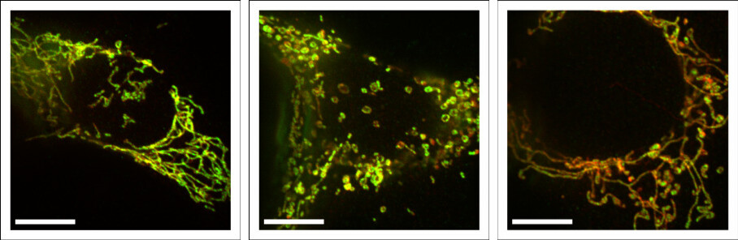{width="86%" fig-align="center"}

*Mouse fibroblasts, outer membrane (red) and matrix (green). Left: control. Middle: after the uncoupler CCCP (30 min). Right: a cell without DRP1, same CCCP. Scale bars 10 µm.*

- **Fission:** rings of the GTPase **DRP1** constrict the tubule, often where an ER tubule wraps around it. **Fusion:** mitofusins join the outer membranes, OPA1 the inner ones.
- The balance sets the shape: fusion **shares** mtDNA and proteins; fission lets the cell **separate damaged parts** and remove them by autophagy (**mitophagy**).

::: notes
Mitochondria in a living cell divide and fuse all the time. The balance between the two decides whether the cell has a few long, connected tubes or many small fragments. Fission is done by DRP1, a dynamin-related GTPase. It is recruited from the cytosol and forms a ring that constricts the tubule until it splits. Often the place is marked by a tubule of ER that wraps around the mitochondrion. Fusion needs two sets of proteins: mitofusins for the outer membranes and OPA1 for the inner membranes. The images show a simple experiment. In a normal cell the mitochondria form a network. Add CCCP, an uncoupler that collapses the proton gradient, and within half an hour the network breaks into small round pieces. In a cell that lacks DRP1, the same treatment cannot fragment the network. So fragmentation is active fission. Why would a cell do this? Fusion mixes contents, so a mitochondrion with a damaged mtDNA copy can borrow proteins from its neighbours. Fission separates a damaged, depolarised piece, which can then be removed by mitophagy, a kind of autophagy. Mutations in mitofusin 2 and OPA1 cause nerve diseases. Defects in mitophagy proteins, PINK1 and Parkin, cause inherited Parkinson's disease.
:::

## Chemiosmosis 1: electron transport pumps protons {.smaller}

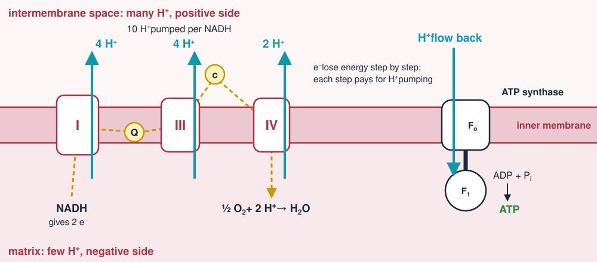{width="80%" fig-align="center"}

- Electrons from NADH pass **I → Q → III → cytochrome c → IV → O₂**. At each step they fall to a lower energy.
- Complexes **I, III and IV** use this energy to **pump H⁺** out of the matrix: **10 H⁺ per NADH**. (FADH₂ enters at complex II and gives 6.)
- **Mechanism before names:** the chain is a set of **redox-driven H⁺ pumps**, like the ATP-driven pumps of the transporters lecture.

::: notes
Here is the inner membrane, with the intermembrane space on top and the matrix below. NADH gives two electrons to complex I. The electrons pass to ubiquinone, Q, a small lipid-soluble carrier that moves within the membrane, then to complex III, then to cytochrome c, a small protein in the intermembrane space, then to complex IV, which finally gives them to oxygen to make water. Overall, electrons move towards carriers with a higher reduction potential, ending at oxygen. In total about 220 kilojoules per mole are released for each NADH. The key idea is that part of this energy is captured in the proton gradient. Three of the complexes are proton pumps. As electrons pass through them, they change shape and move protons from the matrix to the intermembrane space. Complex I moves four protons per NADH, complex III four, and complex IV two, so ten in total. FADH2 from succinate enters through complex II, which does not pump, so it gives only six. You can think of the complexes as pumps, like the sodium-potassium pump from the transporters lecture, but powered by electron transfer instead of ATP. Peter Mitchell called this chemiosmosis.
:::

## Chemiosmosis 2: the proton-motive force {.smaller}

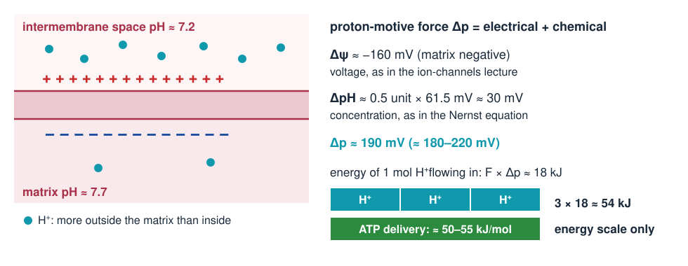{width="86%" fig-align="center"}

- The pumped H⁺ make the matrix **negative** (voltage, **Δψ ≈ −150 to −180 mV**) and **alkaline** (ΔpH). Both push H⁺ back in: together the **proton-motive force Δp ≈ 190 mV**.
- Like the Nernst equation: each pH unit is worth **61.5 mV**. One mole of H⁺ flowing back releases **F × Δp ≈ 18 kJ**: several proton-equivalents are needed per ATP delivered.

::: notes
Pumping protons out does two things. It moves positive charge, so the matrix becomes negative relative to the intermembrane space. And it lowers the proton concentration in the matrix, so the matrix becomes more alkaline. This is exactly the electrochemical gradient of the ion-channels lecture. The voltage across the inner membrane, delta psi, is about minus 150 to minus 180 millivolts, matrix negative: more than twice the plasma membrane potential. The pH difference is about half a unit. Using the Nernst idea, one pH unit, a tenfold concentration difference, is worth 61.5 millivolts, so half a unit adds about 30 millivolts. Together they make the proton-motive force, about 190 millivolts. Both parts push protons back into the matrix. How much energy is that? Multiply by the Faraday constant: 96 500 coulombs per mole times 0.19 volts is about 18 kilojoules per mole of protons. For comparison, ATP synthesis in the cytosol can cost about 50 to 55 kilojoules per mole, so one proton is not enough. This is an energy-scale estimate, not a rotor stoichiometry: the mammalian synthase translocates eight protons per three ATP, and transport contributes an additional cost to ATP delivery. The phosphorylation potential differs between matrix and cytosol. The membrane must be tight: any leak short-circuits the battery.
:::

## How do we know? A pH gradient alone makes ATP {.smaller}

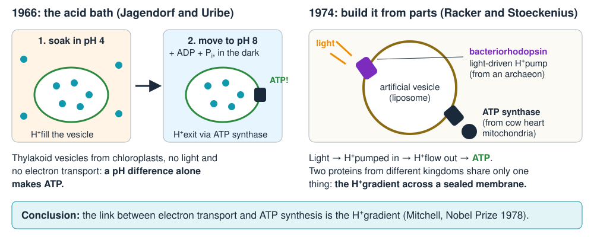{width="86%" fig-align="center"}

Mitchell's idea (1961) was **rejected for years**: everybody looked for a high-energy chemical intermediate. These two experiments showed that the **gradient itself** is the link.

::: notes
Mitchell proposed chemiosmosis in 1961. Most biochemists did not believe him. They were looking for a chemical intermediate, a high-energy compound made by electron transport that would then give its phosphate to ADP, as in glycolysis. Nobody ever found it. Two elegant experiments changed minds. In 1966 André Jagendorf and Ernest Uribe used thylakoid membranes from chloroplasts, which form sealed vesicles. They soaked the vesicles in an acid buffer at pH 4, so that the inside became acidic, and then quickly moved them into a buffer at pH 8 with ADP and phosphate, in the dark. There was no light and no electron transport, yet the vesicles made ATP. A pH difference alone was enough. In 1974 Efraim Racker and Walther Stoeckenius built the system from parts. They put two proteins into artificial lipid vesicles: bacteriorhodopsin, a light-driven proton pump from an archaeon, and the ATP synthase from cow heart mitochondria. When they shone light on the vesicles, ATP was made. The two proteins come from different domains of life and share nothing except the proton gradient. Mitchell received the Nobel Prize in Chemistry in 1978.
:::

## ATP synthase: a rotary motor {.smaller}

:::: {.columns}
::: {.column width="26%"}
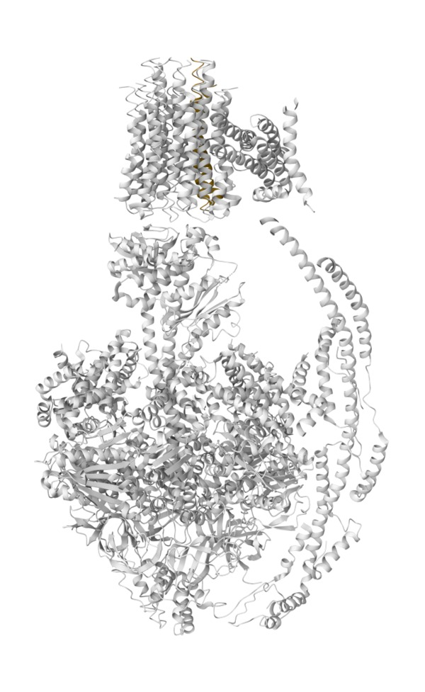{height="480px" fig-align="center"}

*Bovine ATP synthase, cryo-EM (PDB 5ARA). Gold: the c-ring in the membrane; bottom: the α₃β₃ head in the matrix.*
:::
::: {.column width="74%"}
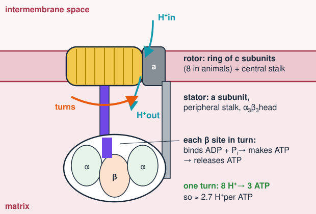{width="72%" fig-align="center"}

- H⁺ enter a half-channel in subunit **a**, bind to the **c-ring**, ride once around and leave to the matrix: the ring and **central stalk turn**.
- The bent stalk turns inside the fixed **α₃β₃ head**; each **β** site in turn binds ADP + Pᵢ, makes ATP, and lets it go (**binding change**, Boyer). **8 H⁺ → 3 ATP**.
- Seen directly (1997): a fluorescent actin filament glued to the stalk **rotates** when F₁ uses ATP.
:::
::::

::: notes
The ATP synthase is the smallest rotary motor known. It has two parts. F-o sits in the membrane. Its rotor is a ring of c subunits, eight in animals. Next to the ring sits the a subunit, which has two half-channels: one open to the intermembrane space, one to the matrix. A proton enters from the outside, sits on a negatively charged amino acid of a c subunit, and can only leave through the other half-channel after the ring has turned almost a full circle. So the flow of protons turns the ring, like water turns a mill wheel. The ring is attached to a central stalk that reaches into F-1, the head of three alpha and three beta subunits, held still by a peripheral stalk. The stalk is bent, so as it turns it pushes each beta subunit through three shapes in turn: one binds ADP and phosphate, one makes ATP, one releases it. This is Paul Boyer's binding-change mechanism. One full turn makes three ATP and uses eight protons. In 1997 Hiroyuki Noji and colleagues glued a fluorescent actin filament to the stalk and watched it spin under the microscope. In the transporters lecture you saw that this machine run backwards is a pump: it can use ATP to pump protons.
:::

## Getting ATP out: carriers in the inner membrane {.smaller}

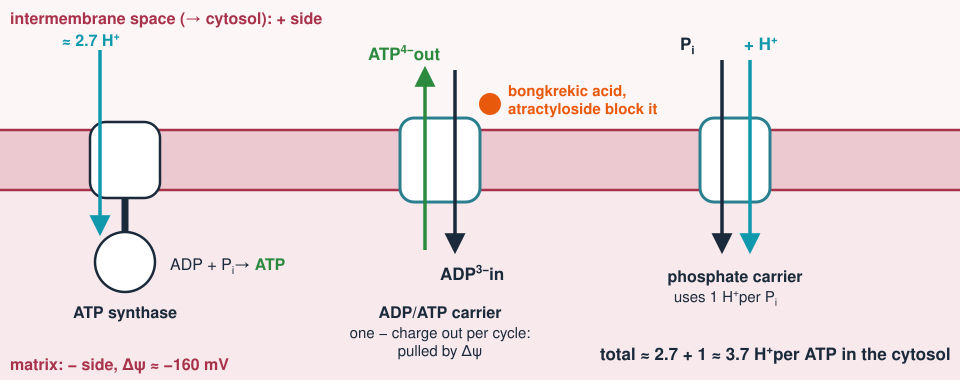{width="84%" fig-align="center"}

- The **ADP/ATP carrier** swaps one ATP⁴⁻ out for one ADP³⁻ in. Each swap moves one negative charge out, so the **membrane potential drives it**.
- The **phosphate carrier** brings in Pᵢ together with H⁺. Together: about **1 extra H⁺ per ATP**, so ≈ **3.7 H⁺ per ATP** delivered to the cytosol, ≈ **2.5 ATP per NADH**.

::: notes
ATP is made in the matrix, but most of it is used in the cytosol. The tight inner membrane needs transporters. The most abundant protein of the inner membrane is the ADP/ATP carrier. It is an antiporter: it takes one ATP out and one ADP in, never one without the other. ATP carries four negative charges, ADP only three, so every exchange moves one net negative charge out of the matrix. With the matrix at minus 160 millivolts, the voltage pushes ATP out and pulls ADP in, so the cytosol is kept rich in ATP. Phosphate enters through the phosphate carrier together with a proton. So the delivery of one ATP to the cytosol costs the energy of about one more proton. Add this to the 8 over 3, about 2.7, protons used by the synthase, and the total is about 3.7 protons per ATP. With 10 protons per NADH, that gives about 2.5 to 2.7 ATP per NADH, the textbook P/O ratio. Two natural poisons block this carrier: atractyloside, from a thistle, and bongkrekic acid, made by bacteria in badly fermented coconut and corn products, which has caused deadly outbreaks of food poisoning. Pyruvate, too, needs a carrier to get into the matrix.
:::

## How do we know? The mito stress test {.smaller}

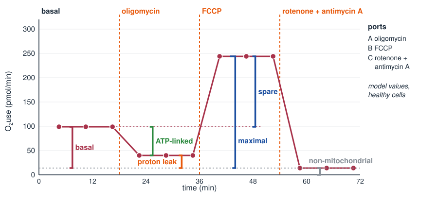{width="70%" fig-align="center"}

- Measure **O₂ consumption** of live cells in a well (an extracellular flux analyser), then inject drugs in order: **oligomycin** (blocks ATP synthase) → **FCCP** (uncoupler: lets H⁺ leak back) → **rotenone + antimycin A** (stop the chain).
- Each step separates a part: **ATP-linked**, **proton leak**, **maximal** and **spare** respiration, **non-mitochondrial** O₂ use. **Try it:** [the mito stress test](questions.qmd#explore).

::: notes
How do we measure how well the mitochondria of a cell work? A widely used method measures the oxygen consumption rate of living cells in a small well, every few minutes, while drugs are added from injection ports. The logic follows directly from the proton circuit. At the start you see basal respiration. Oligomycin blocks the proton channel of the ATP synthase. Protons now come back only through the leak, so the chain slows down, and the drop in oxygen use is the part that was used to make ATP. What remains is the proton leak. Next, FCCP, an uncoupler, makes the membrane leaky to protons. The proton-motive force collapses, nothing holds the chain back, and it runs at full speed: this is the maximal respiration. The difference between maximal and basal is the spare capacity, the reserve that a cell can call on when it suddenly needs more ATP. Finally, rotenone and antimycin A stop complexes I and III. Any oxygen still used comes from other enzymes in the cell, the non-mitochondrial part, which is subtracted from the other values. The order matters, which you can test yourself in the demo.
:::

## Beyond ATP: calcium and reactive oxygen {.smaller}

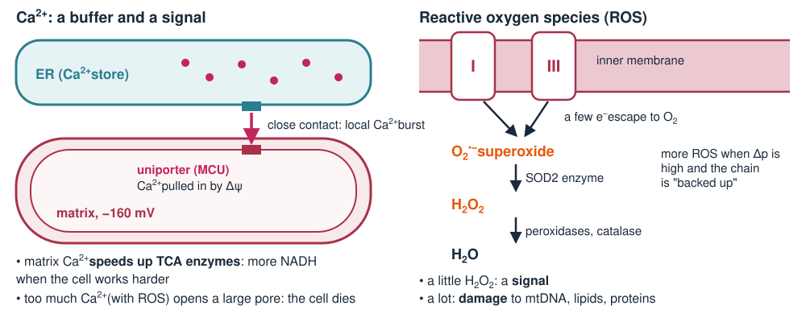{width="86%" fig-align="center"}

- **Ca²⁺:** where the ER touches a mitochondrion, released Ca²⁺ enters through the **uniporter (MCU)**, pulled by Δψ. Matrix Ca²⁺ **speeds up TCA enzymes**, so ATP supply rises with demand. Mitochondria also buffer Ca²⁺ peaks.
- **ROS:** a few electrons escape from complexes I and III to O₂ and make **superoxide (O₂•⁻)**, then H₂O₂. Low levels **signal**; high levels **damage**.

::: notes
Mitochondria are not only power plants; they help keep the cell in balance, which is the topic of ELO 5. First, calcium. Many signals release calcium from the ER, as you saw in the ion-channels lecture. Where the ER and a mitochondrion are tethered close together, the local calcium concentration becomes high, and calcium enters the mitochondrion through a channel in the inner membrane, the mitochondrial calcium uniporter. The strong negative matrix potential pulls the positive ion in. In the matrix, calcium activates several TCA-cycle dehydrogenases, so when a muscle cell is stimulated, it automatically makes more NADH and more ATP. Mitochondria can also take up large amounts of calcium and so shape calcium signals. But too much calcium, especially together with oxidative stress, opens a large pore in the inner membrane, the permeability transition pore, and the cell dies by necrosis, for example in a heart attack. Second, reactive oxygen species. A small fraction of electrons escapes from complexes I and III directly to oxygen and makes superoxide. An enzyme, SOD2, turns it into hydrogen peroxide, which other enzymes remove. Low levels act as signals; high levels damage mtDNA, lipids and proteins.
:::

## Mitochondria decide over life and death {.smaller}

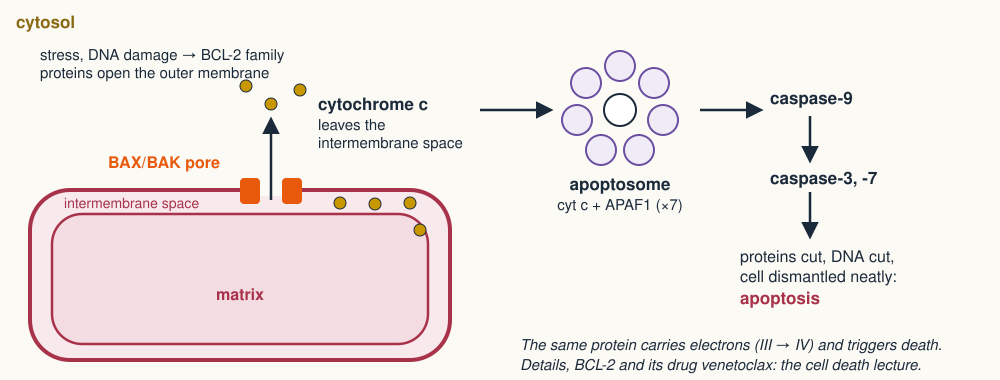{width="84%" fig-align="center"}

- In the **intrinsic pathway** of apoptosis, BCL-2-family proteins **BAX and BAK** make pores in the **outer** membrane.
- **Cytochrome c** escapes to the cytosol, binds APAF1 and builds the **apoptosome**, which activates **caspases**: proteases that take the cell apart in an orderly way.

::: notes
Cytochrome c has a second job, and it is a dramatic one. Normally it shuttles electrons between complexes III and IV in the intermembrane space. When a cell is badly stressed, for example by DNA damage, members of the BCL-2 protein family decide whether it should die. If the pro-death members win, two proteins called BAX and BAK insert into the outer mitochondrial membrane and form pores. This is called mitochondrial outer membrane permeabilisation. Cytochrome c, a small soluble protein, leaks out into the cytosol. There it binds a protein called APAF1. Seven APAF1 molecules assemble into a wheel-shaped complex, the apoptosome, which activates caspase-9, which in turn activates caspase-3 and caspase-7. Caspases are proteases that cut hundreds of proteins, and the cell is dismantled neatly into small packages that are eaten by neighbours, without inflammation. This is apoptosis. The same molecule therefore carries electrons for life and triggers death when it is in the wrong compartment. You will meet the BCL-2 family in detail in the cell death lecture, including venetoclax, a drug that blocks BCL-2 and makes leukaemia cells die.
:::

## Chloroplasts: the same machine, run by light {.smaller}

:::: {.columns}
::: {.column width="40%"}
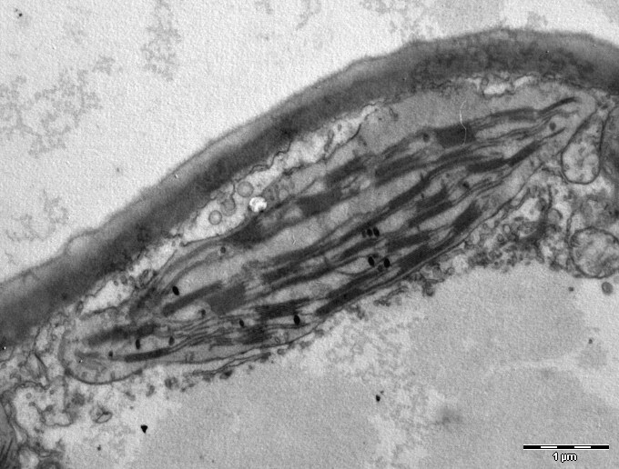{width="100%"}

*Chloroplast in a leaf cell (*Anemone*), TEM. The stacked thylakoid membranes fill the inside.*
:::
::: {.column width="60%"}
::: {style="font-size:120%"}

| | Mitochondrion | Chloroplast |
|---|---|---|
| Origin | α-proteobacterium | cyanobacterium |
| Electrons from | NADH (food) | H₂O, driven by **light** |
| Electrons to | O₂ → H₂O | NADP⁺ → NADPH |
| H⁺ pumped into | intermembrane space | **thylakoid lumen** |
| Δp mostly | Δψ (voltage) | ΔpH (≈ 3 units) |
| ATP synthase faces | matrix | stroma |

Same principle: **electron transport → H⁺ gradient → ATP synthase**.
:::
:::
::::

::: notes
Plants and algae have a second energy-converting organelle, the chloroplast, which comes from a cyanobacterium taken up much later than the mitochondrial ancestor. Chloroplasts have a third membrane system inside, the thylakoids, flat sacs stacked into piles that you can see in the micrograph. Light absorbed by chlorophyll gives electrons enough energy to be taken from water, releasing oxygen, and passed along an electron transport chain to NADP plus. On the way, protons are pumped into the thylakoid lumen. The ATP synthase in the thylakoid membrane is built like the mitochondrial one, and its head faces the stroma, where the Calvin cycle uses ATP and NADPH to fix CO2. A few details differ. In chloroplasts the proton-motive force is mostly a pH difference, about three units, because other ions move to cancel the voltage. In mitochondria it is mostly voltage. And remember that the acid bath experiment, the first proof of chemiosmosis, was done with thylakoids. The lesson is that life uses one principle, a proton gradient across a sealed membrane, in mitochondria, chloroplasts and bacteria.
:::

## Why it matters: mitochondrial disease and donation {.smaller}

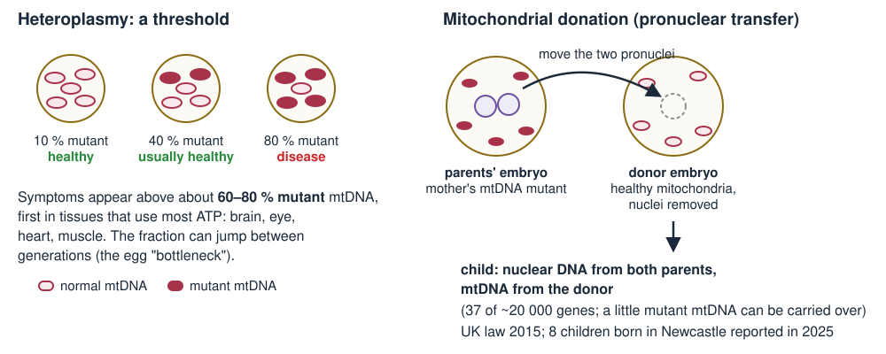{width="86%" fig-align="center"}

- About **1 in 5000** people has a mitochondrial disease, from mutations in **mtDNA** or in nuclear genes for mitochondrial proteins: e.g. **LHON** (blindness, complex I genes), **MELAS**, **Leigh syndrome**.
- Cells can carry a **mix** of normal and mutant mtDNA (**heteroplasmy**). A disease **threshold** depends on the variant and tissue.
- **Mitochondrial donation** transfers parental nuclear material into donor cytoplasm, **reducing** transmission of mutant mtDNA; some carryover can remain.

::: notes
Mitochondrial diseases affect about one in five thousand people. Some are caused by mutations in mtDNA, others by mutations in the nuclear genes for mitochondrial proteins, because most of them are encoded in the nucleus. Examples: Leber hereditary optic neuropathy, LHON, in which young adults lose their sight because of mutations in complex I genes in the mtDNA; MELAS, a mutation in a mitochondrial tRNA gene that causes stroke-like episodes and muscle weakness; and Leigh syndrome, a severe brain disease of infants. Because each cell has hundreds of copies of mtDNA, a cell can carry both normal and mutant copies. This is heteroplasmy. Symptoms depend on the variant, mutant fraction and tissue; there is no universal percentage threshold. The tissues most often affected have high energy demand: brain, eye, heart, muscle. The fraction can change sharply between a mother and her children, because only a small number of mtDNA copies pass through the egg's bottleneck. Mitochondrial donation reduces the risk of transmitting pathogenic mtDNA, but does not correct nuclear mutations. After fertilisation, the two pronuclei are moved from the parents' embryo into a donor embryo whose own pronuclei were removed. The UK allowed this by law in 2015, and in 2025 the Newcastle team reported eight children born. Some maternal mtDNA can be carried over with the pronuclei, so the procedure does not guarantee zero mutant mtDNA. See the [2025 clinical report](https://eprints.ncl.ac.uk/307272). Ethics and long-term follow-up return in later courses.
:::

## Why it matters: poisons and drugs on the proton circuit {.smaller}

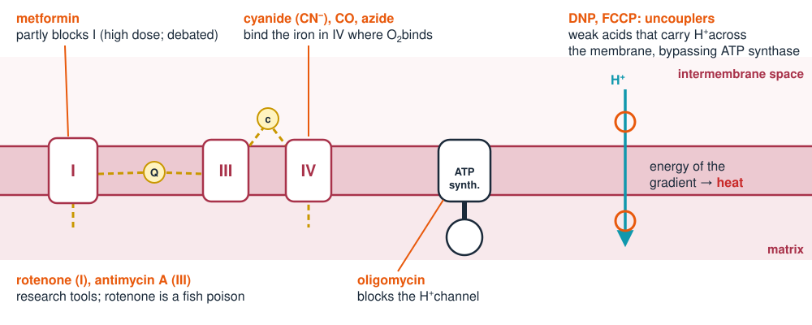{width="78%" fig-align="center"}

- **DNP** (2,4-dinitrophenol), a weak acid, carries H⁺ across the inner membrane: an **uncoupler**. The chain runs flat out, food is burned, but the energy becomes **heat**. Sold as a diet pill in the **1930s**, banned after deaths and blindness, still sold illegally online: fatal **hyperthermia**.
- **Cyanide** blocks complex IV: no O₂ use, no ATP, even though the blood is full of O₂. **Metformin** (type 2 diabetes) partly inhibits complex I in the liver, so less glucose is made; **caveat:** at normal doses this is debated and other targets are proposed.

::: notes
Now the three puzzles from the start come together. DNP is a weak acid that is soluble in membranes. In the acidic intermembrane space it picks up a proton, diffuses across the inner membrane, and releases the proton in the alkaline matrix. It is a proton shuttle, an uncoupler, like FCCP in the stress test. The proton-motive force collapses, so the chain is no longer held back and burns fat and sugar as fast as it can, but the ATP synthase gets few protons, and the energy is released as heat. In 1933 DNP was sold as a slimming pill, and it did work. But the dose that causes weight loss is close to the dose that raises body temperature beyond control. People died, others got cataracts, and it was banned in the United States in 1938. It is still sold illegally online, and young people still die from it. Cyanide binds to the iron in complex IV, at the site where oxygen binds, and stops the whole chain within seconds. The cells cannot use oxygen, even though the blood is full of it. Metformin, the most used drug for type 2 diabetes, lowers glucose production in the liver. One proposed mechanism is partial inhibition of complex I, which lowers the energy state of liver cells. But this effect is seen most clearly at high concentrations, and other targets are proposed, so the mechanism is still debated. You will meet these drugs again in Sjukdomslära and in Kliniska prövningar och läkemedelsutveckling.
:::

## Summary {.smaller}

1. A mitochondrion has a porous **outer** and a tight, folded **inner membrane** (cristae). It has its own **mtDNA** (13 proteins), inherited **from the mother**; the other ~1100 proteins are **imported**. Mitochondria form a network that **divides and fuses**.
2. **Chemiosmosis:** complexes I, III and IV use electron energy to **pump H⁺**; the **proton-motive force** (Δψ ≈ −160 mV plus ΔpH, Δp ≈ 190 mV) drives H⁺ back through the **ATP synthase**, a **rotary motor** (8 H⁺ → 3 ATP).
3. **Carriers** in the inner membrane exchange ATP for ADP (driven by Δψ) and import phosphate.
4. Beyond ATP: mitochondria take up **Ca²⁺**, make **ROS**, and release **cytochrome c** to start **apoptosis**.
5. **Uncouplers** (DNP), **cyanide**, **oligomycin** and **metformin** act on the proton circuit; the **mito stress test** reads it out. Mitochondrial disease can arise from **mtDNA or nuclear mutations**; **mitochondrial donation** reduces transmission risk.

*Read more (optional): Alberts et al., Molecular Biology of the Cell, 7th ed., ch. 14.*

[Image credits](../credits.qmd#mitochondria){style="font-size:0.7em"}

::: notes
Five take-home points. First, structure: two membranes with different jobs, cristae that increase the area of the inner membrane, and a small genome of its own, a relic of a bacterial ancestor, passed on only by mothers. Most mitochondrial proteins are imported, and mitochondria form a dynamic network shaped by fission and fusion. Second, chemiosmosis, the central idea: electron transport and ATP synthesis are linked by a proton gradient, not by a chemical intermediate. You should be able to explain how the proton-motive force is built from a voltage and a pH difference, and roughly how many protons one ATP costs. Third, transport: ATP leaves through an exchanger driven by the membrane potential. Fourth, mitochondria also handle calcium, make reactive oxygen species, and hold cytochrome c, the trigger of intrinsic apoptosis, which comes back in the cell death lecture. Fifth, every part of the proton circuit is a target: poisons, research tools and drugs act at defined places, and the stress test uses exactly this logic. In the lecture that compares the organelles we see how they all cooperate to keep the cell in balance.
:::
