## About this lecture {.smaller}

In genetics you learned what mitosis **looks like**: chromosomes condense, line up and split. Today: the **machines** that do it, and the **checks** that make it almost error-free.

After this lecture you can:

- explain how **cohesin** holds sister chromatids together and **condensin** packs them, and how the **nuclear envelope** breaks down;
- describe how the **spindle** is built from microtubules and motors, and how **kinetochores** attach to it;
- explain how wrong attachments are **corrected by tension** (Aurora B) and how the **spindle assembly checkpoint** (Mad2, APC/C–Cdc20) delays anaphase;
- explain how **separase** starts anaphase, what happens in **anaphase A and B**, and how the **contractile ring** divides the cell;
- compare mitosis with **meiosis**, and explain how **antimitotic drugs** and **aneuploidy** follow from these mechanisms.

**ELO 7** (cell cycle and division), with **ELO 6** (cytoskeleton).

::: notes
This lecture is about the most dramatic hour in the life of a cell. You already know the stages from genetics: prophase, metaphase, anaphase, telophase. We will not repeat the pictures. Instead we ask how the cell does it. Which proteins hold the copies of each chromosome together, and which cut them apart? How does the cell build a spindle from microtubules and motors, the parts you met in the cytoskeleton lectures? How does it know that every chromosome is attached the right way before it lets go? And how does a ring of actin and myosin cut the cell in two? The lecture before this one explained the cell-cycle control system: cyclin-dependent kinases that drive the cell into mitosis, and the APC/C that drives it out. Here we use those two switches. At the end we connect the mechanisms to medicine: drugs that stop the spindle are among the most used cancer drugs, and errors in chromosome segregation cause Down syndrome and are a hallmark of cancer. This lecture covers ELO 7 and draws on ELO 6.
:::

## The question: how does every daughter get exactly one copy of each chromosome? {.smaller}

:::: {.columns}
::: {.column width="45%"}
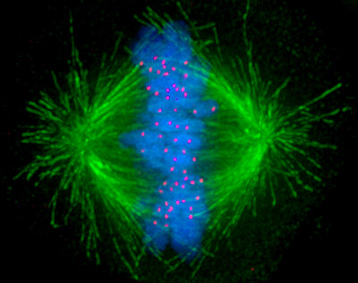{width="100%"}

*A human cell in metaphase: microtubules (green), DNA (blue), kinetochores (red).*
:::
::: {.column width="55%"}
- A human cell has **46 chromosomes**; after S phase that is **92 chromatids**.
- In about **one hour** each pair of sisters must be **pulled apart** and sent to **opposite** ends of the cell.
- The chromosomes are scattered at random when the nuclear envelope breaks. Nobody "places" them.
- Yet a normal human cell sends a chromosome the wrong way in only about **1 division in 100**.
- One wrong chromosome changes the dose of **hundreds of genes**.

**How does the cell get it right, and what happens when it does not?**
:::
::::

::: notes
Look at this cell. The green fibres are microtubules forming the spindle, the blue is DNA, and the small red dots are kinetochores, the protein structures on each chromosome that grab the microtubules. Every chromosome in the cell has been copied, so there are 92 chromatids, held together in pairs. In about an hour the cell must separate every pair and deliver exactly one copy to each daughter. This is harder than it sounds. When the nuclear envelope breaks down, the chromosomes lie at random in the cytoplasm. No motor carries them to a fixed address. Instead, microtubules grow and shrink at random until they hit kinetochores, and mistakes happen all the time during this search. Still, a healthy human cell in culture missegregates a chromosome only about once in a hundred divisions. The reason is that the cell checks its work and corrects errors before it commits. A cell that gains or loses a chromosome changes the amount of hundreds of proteins at once, and that is usually harmful. Today we will see how the error correction and the checkpoint work.
:::

## Recap: the stages you know, and the two switches behind them {.smaller}

::: {layout-ncol=4}
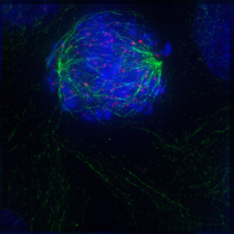

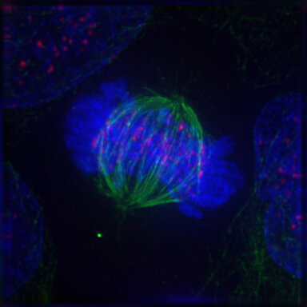

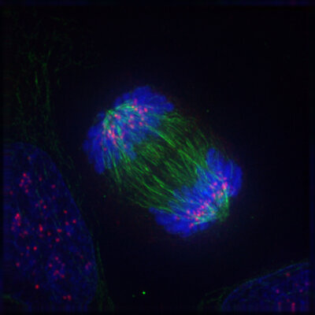

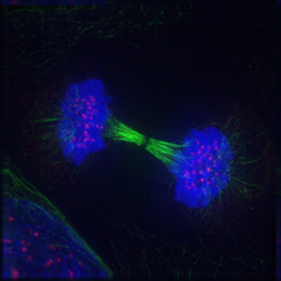
:::

*Human cells stained for DNA (blue), microtubules (green) and kinetochores (red). Prophase (not shown) happens inside the intact nucleus.*

- **Prophase**: chromosomes condense; centrosomes move apart. **Prometaphase**: the nuclear envelope breaks; microtubules capture chromosomes. **Metaphase**: all chromosomes at the equator. **Anaphase**: sisters separate. **Telophase** and **cytokinesis**: two nuclei, two cells.
- *Recap from the cell-cycle control lecture:* **CDK1–cyclin B** drives the cell **into** mitosis; the **APC/C** (with Cdc20) destroys cyclin B and drives it **out**.

::: notes
This is the only recap slide. The four images are real immunofluorescence pictures of human cells, with DNA in blue, microtubules in green and kinetochores in red. In prophase the chromosomes condense inside the nucleus, and the two centrosomes, copied during S phase, start to move apart. In prometaphase the nuclear envelope breaks down and microtubules from the two poles reach the chromosomes. In metaphase every chromosome sits at the equator, called the metaphase plate. In anaphase the sister chromatids separate and move to the poles. In telophase two new nuclei form, and cytokinesis divides the cytoplasm. In the cell-cycle control lecture you met the engine behind this. CDK1 bound to cyclin B phosphorylates hundreds of proteins and pushes the cell into mitosis. To get out again, the anaphase-promoting complex, the APC/C, together with its activator Cdc20, attaches ubiquitin to cyclin B so that the proteasome destroys it. Keep these two switches in mind: today we see what they phosphorylate and what they destroy.
:::

## Cohesin glues the sisters, condensin packs them {.smaller}

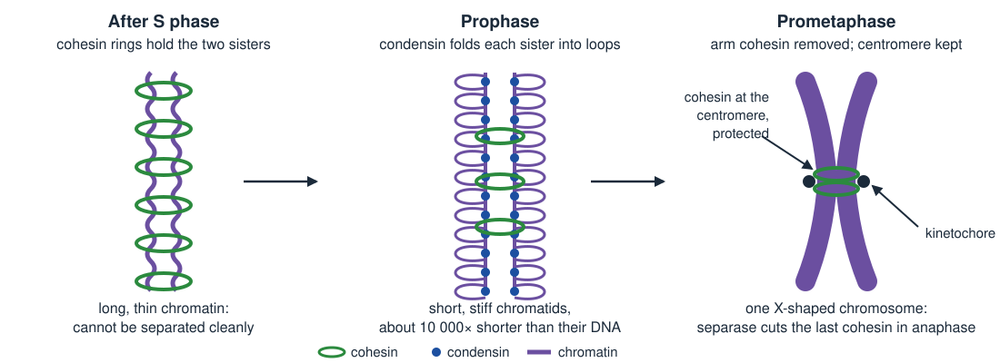{width="90%" fig-align="center"}

- **Cohesin**: a protein **ring** (SMC1, SMC3 and a kleisin) that encircles both sister DNAs from **S phase**. It is the only thing that holds the sisters together.
- **Condensin**: a related ring that uses ATP to **pull DNA into loops**. Each chromatid becomes a short, stiff rod that can be moved without tangling.
- In prophase and prometaphase most **arm cohesin is removed**; **centromere cohesin is protected** (by a protein called shugoshin) until anaphase.

::: notes
Two related protein complexes shape a mitotic chromosome. Both are built from SMC proteins, long coiled arms with an ATPase at one end, closed into a ring by a third protein called a kleisin. Cohesin is loaded onto DNA before replication. When the replication fork passes, cohesin ends up encircling both new sister DNA molecules, and from then on it is the only thing that holds the sisters together. Condensin acts in prophase. It uses ATP to reel DNA into loops, a process called loop extrusion. Thousands of loops along a central axis turn a long, thin chromatin fibre into a short, stiff rod, about ten thousand times shorter than the DNA it contains. Without condensin, chromosomes are floppy and tangled and break in anaphase. As chromosomes condense, most cohesin on the arms is removed, so the arms of the sisters come apart and you see the familiar X shape. Cohesin at the centromere is protected by a protein called shugoshin, Japanese for guardian spirit. This last bit of glue is what separase cuts to start anaphase.
:::

## Breaking the nuclear envelope: lamins are phosphorylated {.smaller}

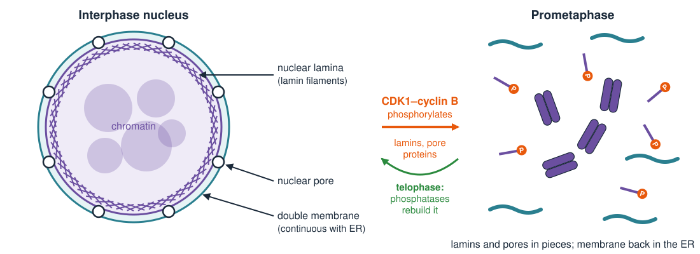{width="88%" fig-align="center"}

- **CDK1–cyclin B** phosphorylates **lamins**: the **nuclear lamina** (an intermediate-filament network) falls apart.
- Nuclear **pores** come apart in the same way, and the **membrane** is absorbed into the **ER**.
- **Telophase**: CDK1 activity falls, **phosphatases** remove the phosphates, and an envelope forms again around each set of chromosomes.

::: notes
In animal cells the spindle is outside the nucleus, so the nuclear envelope must open. This is called open mitosis; yeast keep their envelope and build the spindle inside it. You met the nuclear lamina in the lecture on intermediate filaments: a mesh of lamin filaments under the inner nuclear membrane that gives the nucleus its shape and strength. Lamins are intermediate-filament proteins, so their filaments are held together by many weak contacts between the rod domains. When CDK1 phosphorylates lamins at sites next to the rod domain, the filaments come apart into soluble dimers, and the lamina dissolves. Other mitotic kinases phosphorylate nucleoporins, and the nuclear pores fall apart into subcomplexes. The nuclear membranes are continuous with the ER, so they simply retract into the ER network. At the end of mitosis the process runs backwards. Cyclin B is destroyed, CDK1 activity falls, and phosphatases remove the phosphates. Lamins and pore proteins assemble again on the surface of the chromosomes, and the ER wraps membrane around each set, making two new nuclei.
:::

## Building the spindle: two poles and three kinds of microtubules {.smaller}

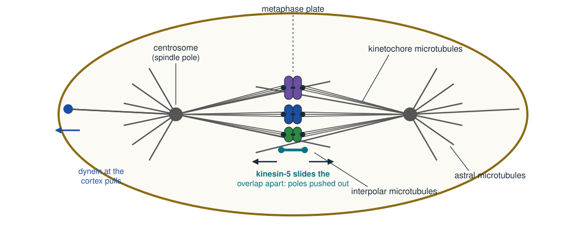{width="82%" fig-align="center"}

- Two **centrosomes** (copied in S phase) nucleate microtubules: **kinetochore**, **interpolar** and **astral** microtubules.
- **Kinesin-5** (a four-headed, plus-end motor) links antiparallel microtubules and **slides them apart**: the poles are pushed away from each other.
- **Dynein** at the cell cortex pulls on astral microtubules and helps **position** the spindle; dynein and kinesin-14 also **focus** the minus ends at the poles.

::: notes
The spindle is a machine built from the parts you met in the microtubule lecture. Each pole is a centrosome, duplicated once in S phase. Microtubules grow from the poles with their minus ends at the pole and their plus ends outward. There are three kinds. Kinetochore microtubules end at a kinetochore, in bundles of about twenty in a human cell. Interpolar microtubules from the two poles overlap in the middle, antiparallel. Astral microtubules radiate towards the cell cortex. Motors organise the structure. Kinesin-5 is special: it has two motor heads at each end of a rod, so it can walk on two microtubules at once. On antiparallel microtubules it walks towards both plus ends, which pushes the two microtubules, and the two poles, apart. Inhibiting kinesin-5, for example with the drug monastrol, gives a monopolar spindle: one aster with chromosomes around it. Dynein anchored at the cortex pulls astral microtubules and so pulls the poles outward and positions the spindle. In mitosis microtubules are also much more dynamic than in interphase, so they can search the cell for chromosomes.
:::

## Kinetochores hold on to growing and shrinking ends {.smaller}

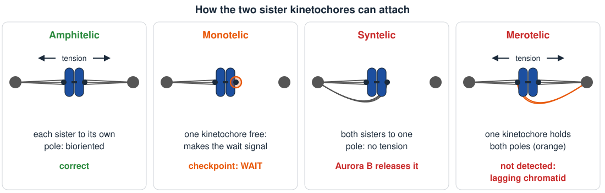{width="88%" fig-align="center"}

- The **kinetochore** is a large protein machine on the centromere. Its **Ndc80** complex binds the side of the microtubule **plus end** and **stays bound** while the end grows or shrinks.
- **Search and capture**: dynamic microtubules probe the cell until they hit a kinetochore. Errors are common at first.
- Only **amphitelic** (bioriented) attachment is correct. **Syntelic** and **merotelic** attachments would send a chromatid the wrong way.

::: notes
Each sister chromatid has one kinetochore, assembled on its centromere from about a hundred different proteins. Its outer part contains the Ndc80 complex, long fibrous proteins that bind the microtubule lattice near the plus end. The remarkable property of a kinetochore is that it holds on to a microtubule end that is growing or shrinking, so a chromosome can be pulled by a microtubule that is losing subunits. How do microtubules find kinetochores? By search and capture. Plus ends grow out in all directions, and dynamic instability lets them shrink back and try again; a gradient of a small GTPase called Ran around the chromosomes also helps microtubules grow there. Because capture is random, early attachments are often wrong. The diagram shows the four possibilities. Amphitelic: each sister to its own pole, the only correct one. Monotelic: one sister attached, the other free; this is normal for a while. Syntelic: both sisters attached to the same pole. Merotelic: one kinetochore holds microtubules from both poles. The cell must find and fix the last two before anaphase.
:::

## Error correction: tension says "right" {.smaller}

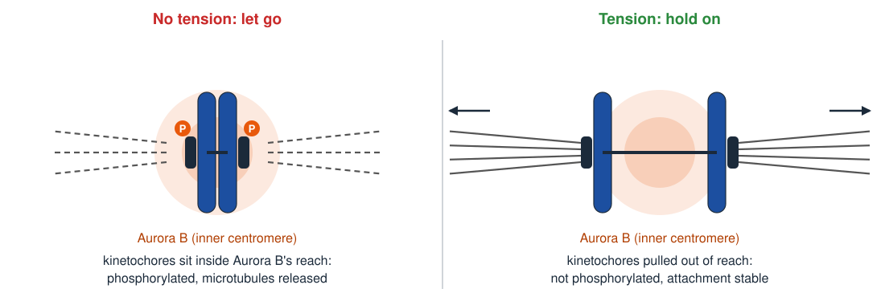{width="84%" fig-align="center"}

- **Aurora B** kinase sits at the **inner centromere**, between the sisters. It phosphorylates kinetochore proteins (such as Ndc80) **within its reach**, which **weakens** their grip on microtubules.
- **Bioriented** chromosome: the sisters are **pulled apart**, the kinetochores move **out of reach**, phosphorylation drops, the attachment **holds**.
- **No tension** (syntelic): the kinetochores stay close to Aurora B and **let go**. The free kinetochore can try again.

::: notes
How can the cell tell a right attachment from a wrong one? Not by looking at which pole a microtubule comes from: a kinetochore has no way to know. Instead, the cell uses force. When the two sisters are attached to opposite poles, the poles pull them in opposite directions, but cohesin holds them together. The centromere stretches, and the chromosome is under tension. With a syntelic attachment both sisters are pulled the same way, so there is no tension. The enzyme that reads this is Aurora B, a kinase that sits on the inner centromere between the two sister kinetochores. It phosphorylates the Ndc80 complex and other kinetochore proteins, which lowers their affinity for microtubules. When there is tension, the kinetochores are pulled several hundred nanometres away from the inner centromere, out of reach of Aurora B, and phosphatases win. The attachment becomes stable. Without tension, the kinetochores stay close, are phosphorylated, and release their microtubules. This is trial and error: wrong attachments are destroyed until only right ones remain. Classic evidence came from insect spermatocytes, where pulling on a badly attached chromosome with a glass needle stabilised the attachment.
:::

## The spindle assembly checkpoint: wait until every kinetochore is attached {.smaller}

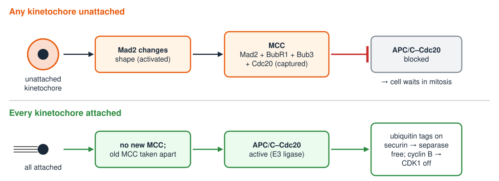{width="80%" fig-align="center"}

- An **unattached kinetochore** is a catalyst: it activates **Mad2**, which helps build the **mitotic checkpoint complex (MCC)**. The MCC captures **Cdc20** and **blocks APC/C–Cdc20**.
- **One** unattached kinetochore is enough to stop the whole cell.
- When the last kinetochore attaches, MCC is no longer made, APC/C–Cdc20 is free, and the cell enters **anaphase** within minutes. **Try it:** [the spindle checkpoint demo](questions.qmd#explore).

::: notes
Error correction makes attachments right, but it takes time, and every correction creates a free kinetochore. So the cell needs a rule: do not separate any sisters until every kinetochore is attached. This is the spindle assembly checkpoint. An unattached kinetochore recruits checkpoint proteins, among them Mad1 and Mad2. Mad2 exists in two shapes; at the kinetochore it is converted to an active shape that binds Cdc20 tightly. Together with the proteins BubR1 and Bub3 this forms the mitotic checkpoint complex, the MCC. The MCC holds Cdc20 in a position where it cannot activate the APC/C. As long as one kinetochore is unattached, new MCC is produced and the APC/C stays off. Note what the checkpoint senses: attachment, not tension. A syntelic attachment is detected only because Aurora B releases it, which creates an unattached kinetochore. A merotelic attachment, which is under tension and fully attached, is not seen at all. When the last kinetochore is attached, MCC production stops, the existing MCC is taken apart, and APC/C–Cdc20 starts to destroy its targets. In the demo you can attach kinetochores yourself and watch the checkpoint.
:::

## How do we know? One unattached kinetochore stops the cell {.smaller}

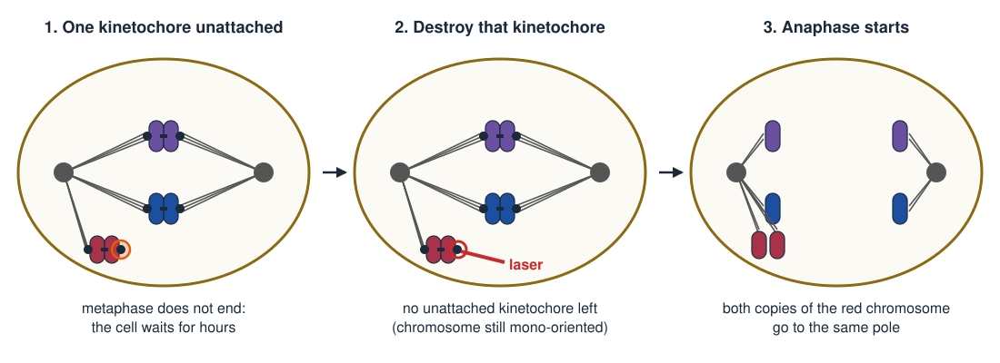{width="86%" fig-align="center"}

- **Laser ablation** (Rieder and colleagues, 1995): in a cell waiting with **one** unattached kinetochore, a laser destroyed that kinetochore. The cell then went into **anaphase**, even though that chromosome was still wrong.
- So the "wait" signal comes **from the unattached kinetochore itself**, not from a missing chromosome at the plate.
- Mutants and knock-down of **Mad2** (first found in yeast genetic screens) lose the delay: cells divide on time **with errors**.

::: notes
How do we know that a single unattached kinetochore produces the stop signal? Conly Rieder and colleagues filmed rat kangaroo cells, which have few, large chromosomes and stay flat during mitosis. Sometimes a cell has all chromosomes at the metaphase plate except one, which is attached to only one pole. Such a cell waits, often for hours. The researchers then destroyed the unattached kinetochore of that chromosome with a focused laser beam. Soon afterwards, about as fast as a normal cell does after its last kinetochore attaches, the cell entered anaphase as if everything were fine, and the damaged chromosome went to one pole with both its chromatids. The conclusion is that the checkpoint signal comes from the unattached kinetochore itself. It is not a count of chromosomes at the plate. Genetics told the same story from the other side. Yeast mutants that keep dividing in drugs that destroy microtubules identified the Mad genes, for mitotic arrest deficient, and the Bub genes. When Mad2 is removed from human cells, they start anaphase about on schedule even with unattached chromosomes, and their daughters are aneuploid.
:::

## Separase cuts cohesin: the anaphase switch {.smaller}

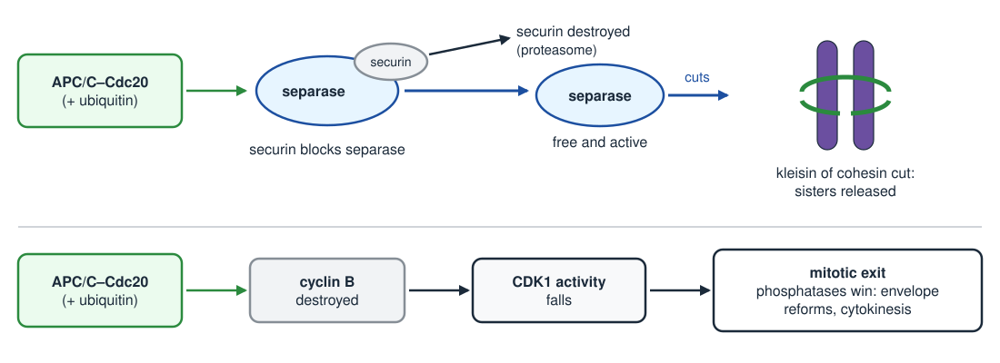{width="86%" fig-align="center"}

- **Securin** binds and blocks the protease **separase**. APC/C–Cdc20 tags securin with **ubiquitin**; the **proteasome** destroys it.
- Free separase **cuts the kleisin** of cohesin: the rings open and all sisters part **at the same moment**.
- APC/C–Cdc20 also destroys **cyclin B**: CDK1 activity falls and the cell **exits mitosis**. Destruction cannot be undone, so anaphase is **irreversible**.

::: notes
Here is the molecular switch for anaphase. Separase is a protease, an enzyme that cuts proteins. Its target is the kleisin subunit of cohesin, the protein that closes the ring. For most of the cycle separase is held inactive by an inhibitor protein called securin. When the checkpoint is satisfied, APC/C–Cdc20 adds a chain of ubiquitin to securin, and the proteasome destroys it within minutes. Free separase now cuts the kleisin, the cohesin rings open, and every pair of sisters is released at the same moment. That is why all chromosomes start to move together: you never see one pair separating while others still wait. The APC/C has a second target: cyclin B. As cyclin B is destroyed, CDK1 activity falls, phosphatases dephosphorylate CDK1's targets, and the cell runs mitosis backwards: the spindle disassembles, the nuclear envelope reforms, and cytokinesis starts. Both steps depend on destroying proteins, not on modifying them. Destruction cannot be reversed, which makes anaphase a one-way decision. This is the reason the checkpoint must be strict before it.
:::

## Anaphase A and B: moving chromatids, separating poles {.smaller}

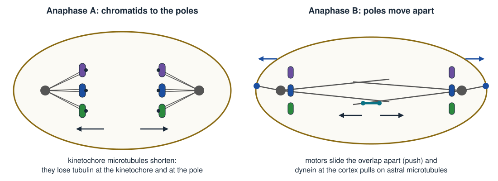{width="84%" fig-align="center"}

- **Anaphase A**: chromatids move to the poles at about **1 µm per minute**. Kinetochore microtubules **shorten**: tubulin is lost at the **kinetochore** (the kinetochore holds on to a shrinking end) and at the **pole** (poleward flux).
- **Anaphase B**: the **poles move apart**. Motors slide the interpolar overlap apart, and **cortical dynein** pulls on astral microtubules.
- The energy comes mainly from **microtubule depolymerisation** and from **motor proteins**.

::: notes
Once cohesin is cut, two movements take place, partly at the same time. In anaphase A the chromatids move towards the poles. Remarkably, the main force does not come from a motor walking. The kinetochore microtubules depolymerise, mostly at their plus ends at the kinetochore, and the kinetochore keeps its grip on the shrinking end, so the chromatid is dragged along, like a person holding on to a rope that is being reeled in. In many cells the microtubules also lose subunits at the pole, so the whole lattice moves slowly poleward; this is called poleward flux, and it was shown by marking spindle microtubules with light and watching the mark move. Taxol blocks both, because it prevents depolymerisation. In anaphase B the spindle itself grows longer. Motors in the overlap zone, kinesin-5 and related kinesins, slide the antiparallel interpolar microtubules apart, and dynein at the cortex pulls on astral microtubules. Different cell types use these two movements to different extents. Together they move the two sets of chromatids far enough apart that the cell can be cut between them.
:::

## How do we know? Watching mitosis live {.smaller}

:::: {.columns}
::: {.column width="48%"}
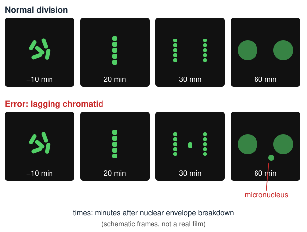{width="100%"}
:::
::: {.column width="52%"}
- Fuse **GFP** to a **histone** (H2B): every chromosome glows, and the cell still divides normally. Add fluorescent **tubulin** to see the spindle.
- Film one cell every 1–3 minutes: measure **how long** each stage takes, and see **lagging chromosomes**, **micronuclei** and failed divisions.
- In a typical human cell line, nuclear envelope breakdown to anaphase takes about **20–40 minutes**; with a spindle poison, **many hours**.
- Mark a stripe of spindle microtubules with light (**photoactivation**) and follow it: this showed **poleward flux**.
:::
::::

::: notes
Most of what we know about the timing of mitosis comes from live-cell imaging. The trick is to make the chromosomes visible without disturbing them. Histone H2B is part of every nucleosome, so a version of H2B fused to green fluorescent protein labels all chromatin in a living cell, and the cells still divide normally. The drawing shows what such a film looks like, as a few frames. With time-lapse microscopy you film the same cells every minute or so for a day, and then measure for each cell when the nuclear envelope broke down, when the chromosomes were aligned, and when anaphase started. In a typical human cell line this takes about twenty to forty minutes; in a spindle poison the same cells stay rounded up in mitosis for many hours. You also see errors directly: a chromatid that lags behind in anaphase, or a small extra nucleus, a micronucleus, in a daughter cell. Adding fluorescent tubulin shows the spindle. If you use a tubulin that can be switched on by light, you can mark a stripe across the spindle and watch it move to the poles. That experiment revealed poleward flux. Live imaging links nicely to the demo.
:::

## Cytokinesis: RhoA builds a contractile ring {.smaller}

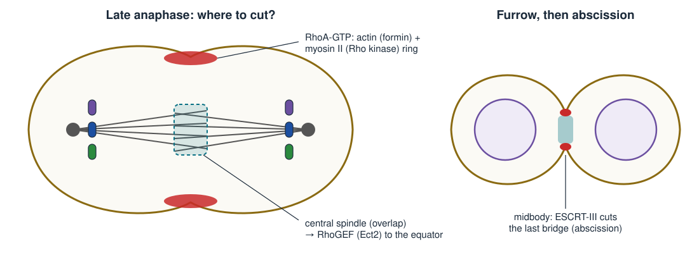{width="78%" fig-align="center"}

- The **central spindle** brings a RhoGEF to the equator: **RhoA-GTP** forms in a narrow band of cortex.
- RhoA switches on **formins** (new **actin** filaments) and **Rho kinase** (activates **myosin II**): a **contractile ring** forms and closes like a purse string.
- The last bridge, the **midbody**, is cut by **ESCRT-III** (**abscission**), often an hour or more later.

::: notes
The chromosomes are now apart; the cell must be cut between them. In animal cells the cut is placed by the spindle. The overlap of interpolar microtubules in the middle, called the central spindle, collects a protein complex that carries a guanine-nucleotide exchange factor for RhoA. You met small GTPases like Rho in the signalling and actin lectures. Here, RhoA is switched on only in a narrow band of cortex around the equator. RhoA-GTP does two things. It activates formins, which make long, unbranched actin filaments, and it activates Rho kinase, which phosphorylates the light chain of non-muscle myosin II, as you saw in the myosin lecture. The result is a ring of actin and myosin under the plasma membrane. Myosin pulls the filaments past each other, and the ring tightens like a purse string, pulling the membrane in to form the cleavage furrow. You saw the result in the telophase image on the recap slide: two daughter nuclei joined by a thin bridge. Finally a thin bridge remains, the midbody, packed with microtubules. The ESCRT-III machinery, which also buds vesicles into endosomes, forms spirals that cut the bridge. This last step, abscission, can take an hour or more.
:::

## Meiosis: the same machines, one change in the rules {.smaller}

| | **Mitosis** | **Meiosis I** | **Meiosis II** |
|---|---|---|---|
| What separates | sister chromatids | **homologous chromosomes** | sister chromatids |
| What holds the pair | cohesin | **crossovers + arm cohesin** | centromere cohesin |
| Sister kinetochores | to opposite poles | to the **same** pole | to opposite poles |
| Cohesin cut by separase | all | **arms only** (centromere protected) | the rest |
| Result | 2 diploid cells | 2 cells, 1 copy of each chromosome | 4 haploid cells |

- Same spindle, kinetochores, checkpoint, APC/C and separase. **Two** rounds of cohesin cleavage, **one** round of DNA replication.

::: notes
You know meiosis from genetics, so here is one comparison in terms of today's machines. Meiosis uses the same spindle, the same kinetochores, the same checkpoint, the same APC/C and the same separase. What changes is how the chromosomes are held together and how the kinetochores are oriented. In meiosis I, the units that separate are homologous chromosomes, not sisters. Homologues are held together by crossovers, where DNA has been exchanged, plus the cohesin on the arms beyond the crossover. The two sister kinetochores of each homologue are fused into one functional unit that faces one pole. When separase cuts cohesin in anaphase I, it cuts only the arm cohesin; centromere cohesin is protected by shugoshin. So homologues part, but sisters stay together. In meiosis II, without a new S phase, the sisters biorient and separase cuts the remaining centromere cohesin, as in mitosis. Note one human fact we will need soon: oocytes start meiosis before birth and stop in prophase I for decades, held together by the same cohesin all that time.
:::

## Why it matters: antimitotic drugs, and why they hit hair and gut {.smaller}

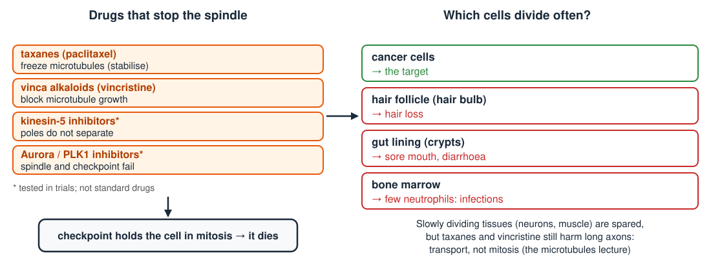{width="82%" fig-align="center"}

- **Taxanes** (paclitaxel, docetaxel) and **vinca alkaloids** (vincristine, vinblastine) stop microtubule dynamics (the microtubules lecture): no proper attachment or tension, the **checkpoint holds** the cell in mitosis, and most cells **die** there or soon after.
- **Every** fast-dividing cell is hit: **hair** follicles (hair loss), **gut lining** (sore mouth, diarrhoea), **bone marrow** (few neutrophils, infections). Bone-marrow toxicity usually limits the dose.
- Drugs against **kinesin-5**, **Aurora** and **PLK1** spared nerves but were disappointing in trials. More in **drug development** (Kliniska prövningar och läkemedelsutveckling).

::: notes
Now to medicine. In the microtubule lecture you met taxanes, which stabilise microtubules, and vinca alkaloids, which block their growth. Today you can see why they stop cell division. A spindle needs dynamic microtubules to search, to correct errors and to make tension. With the drug, kinetochores stay unattached or without tension, the checkpoint keeps APC/C–Cdc20 off, and the cell stays in mitosis for many hours. Most cells then die by apoptosis, the topic of a later lecture; some slip out of mitosis without dividing and die or stop later. The drugs do not know which cells are cancer cells. They act on every cell that divides during treatment. Hair follicles have some of the fastest-dividing cells in the body, so hair falls out. The lining of the gut renews itself every few days from dividing cells in the crypts, so the mouth gets sore and diarrhoea follows. Bone marrow makes billions of white blood cells a day, and a drop in neutrophils, with the risk of infection, usually limits the dose. Nerve damage is a different effect, on axonal transport. Newer drugs against kinesin-5, Aurora kinases and PLK1 hit only mitosis, so they spared nerves, but bone-marrow toxicity remained and they worked poorly in patients. You meet trials like these in drug development.
:::

## Why it matters: aneuploidy in Down syndrome and in cancer {.smaller}

:::: {.columns}
::: {.column width="40%"}
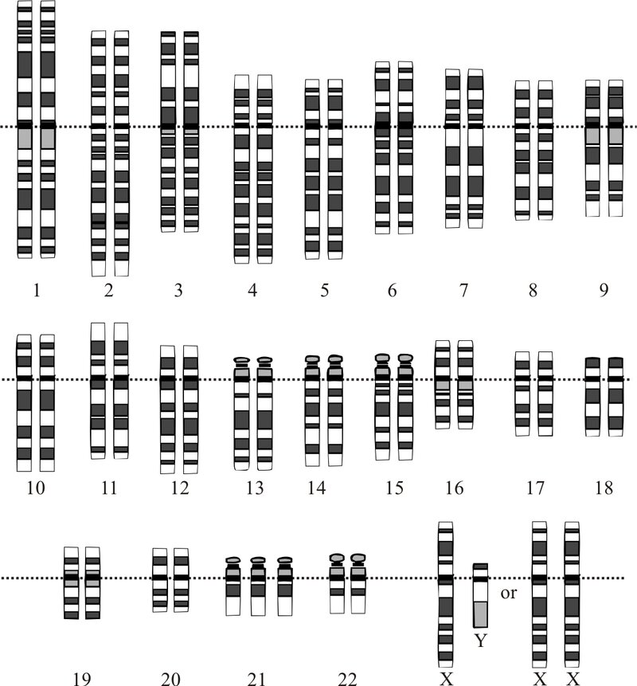{width="100%"}

*Karyotype drawing with three copies of chromosome 21 (trisomy 21).*
:::
::: {.column width="60%"}
- **Aneuploidy**: a wrong number of chromosomes. Most are lethal in embryos; **trisomy 21** (Down syndrome, about **1 in 700** births) is one that survives.
- Most cases come from **nondisjunction** in the **mother's meiosis I**. Risk rises steeply with maternal age: oocyte **cohesin** is loaded before birth and is **not renewed**, so homologues fall apart too early.
- **Cancer**: most solid tumours are aneuploid and many keep missegregating (**chromosomal instability**). Common causes: **merotelic** attachments that escape the checkpoint, extra centrosomes, a weak checkpoint. More in **Sjukdomslära**.
:::
::::

::: notes
Aneuploidy means having the wrong number of chromosomes. In humans, most aneuploid embryos die early; it is the commonest cause of miscarriage. Trisomy 21, Down syndrome, is one of the few that survives, in roughly one birth in seven hundred. The karyotype drawing here shows three copies of chromosome 21. About nine in ten cases come from an error in the mother, mostly in meiosis I, when the two homologues of chromosome 21 go to the same pole: this is called nondisjunction. Why does the risk rise so much with the mother's age? Remember the last slide: oocytes enter meiosis before birth and wait in prophase I for up to forty or fifty years, held together by cohesin loaded in the fetal ovary. Experiments in mice show that this cohesin is not replaced and slowly gets lost, so in older oocytes homologues and sisters separate too early. Cancer is the other big story. Most solid tumours are aneuploid, and many keep losing and gaining chromosomes as they divide, which is called chromosomal instability. Merotelic attachments, which the checkpoint cannot see, extra centrosomes and a weakened checkpoint are common causes. You will meet this again in the cancer lecture and in Sjukdomslära.
:::

## Summary {.smaller}

1. **Cohesin** rings hold sister chromatids together from S phase; **condensin** folds each chromatid into a compact rod. **CDK1** phosphorylates **lamins** to open the nuclear envelope.
2. The **spindle** is built from two centrosomes, three kinds of microtubules and motors: **kinesin-5** pushes the poles apart, **dynein** pulls and focuses. **Kinetochores** hold on to growing and shrinking plus ends.
3. **Aurora B** releases attachments that are not under **tension**; the **spindle assembly checkpoint** (Mad2, MCC) blocks **APC/C–Cdc20** while any kinetochore is unattached.
4. APC/C–Cdc20 destroys **securin** (separase cuts cohesin: **anaphase**) and **cyclin B** (exit). **Anaphase A** moves chromatids, **anaphase B** separates poles; **RhoA** builds the **actin–myosin ring**, ESCRT-III completes **abscission**.
5. **Antimitotic drugs** arrest every fast-dividing cell (hair, gut, marrow); errors that escape the checks cause **aneuploidy** (Down syndrome via meiotic nondisjunction; cancer).

*Read more (optional): Alberts et al., Molecular Biology of the Cell, 7th ed., ch. 17.*

[Image credits](../credits.qmd#mitosis){style="font-size:0.7em"}

::: notes
Five take-home points. First, sister chromatids are held together by cohesin rings from the moment they are made, and condensin packs each chromatid into a stiff rod; CDK1 opens the nuclear envelope by phosphorylating lamins. Second, the spindle is a self-organising machine of microtubules and motors, and kinetochores are couplers that hold on to dynamic microtubule ends. Third, correct segregation depends on two linked controls: Aurora B destroys attachments that lack tension, and the spindle assembly checkpoint stops the APC/C until every kinetochore is attached. Fourth, when the checkpoint is satisfied, APC/C–Cdc20 triggers the destruction of securin and cyclin B, which makes anaphase sudden and irreversible; the chromatids move and the poles separate, and a RhoA-controlled actin–myosin ring divides the cell. Fifth, drugs that stop the spindle kill dividing cells, including healthy ones, and mistakes that escape these controls cause aneuploidy, in Down syndrome and in cancer. In the next lecture we ask how the body controls how many cells divide at all.
:::
