## About this lecture {.smaller}

The last lecture on the cytoskeleton. Actin and microtubules are tracks; today we meet the **motor that pulls on actin**, **myosin**, and the third filament system, the **intermediate filaments**, which makes cells strong.

After this lecture you can:

- describe the **myosin family** and explain the **cross-bridge cycle** of myosin II: what ATP binding, ATP hydrolysis and phosphate release each do;
- explain how a **sarcomere** shortens by **sliding filaments**, and why force depends on **sarcomere length**;
- explain how **Ca²⁺** switches contraction on through **troponin and tropomyosin**;
- give examples of **non-muscle myosin II** (cell division, migration) and of **myosin V** as a cargo carrier;
- describe how **intermediate filaments** are built, name the main families, and explain how they give **mechanical strength**;
- choose a method to study the cytoskeleton: **FRAP, TIRF, traction-force microscopy, optical tweezers**;
- explain how **mavacamten** treats hypertrophic cardiomyopathy and why broken **keratin** gives blistering skin.

**ELO 6** (cytoskeleton and motility), with disease examples for **ELO 9**.

::: notes
This lecture closes the cytoskeleton block. In the lecture on actin you saw how actin filaments grow and push the front of a migrating cell. In the lecture on microtubules you met kinesin and dynein, the motors that walk on microtubules. Today we add the motor of the actin system, myosin, and we see how one kind of myosin, myosin II, makes a muscle contract. We take the sarcomere apart, the repeating unit of muscle, and see how its geometry decides how much force a muscle can make. We see how calcium, the signal you met in the lecture on ion channels, switches contraction on. Then we turn to the third filament system, intermediate filaments, which do not move anything but stop cells and tissues from tearing. We end with a round-up of the methods used to study the whole cytoskeleton, and two medical stories: a new heart drug that acts directly on myosin, and a skin disease caused by broken keratin. The physiology of muscle and heart comes in the course on organ structure and function; here we stay at the level of molecules and cells.
:::

## The question: how does a muscle shorten? {.smaller}

:::: {.columns}
::: {.column width="55%"}
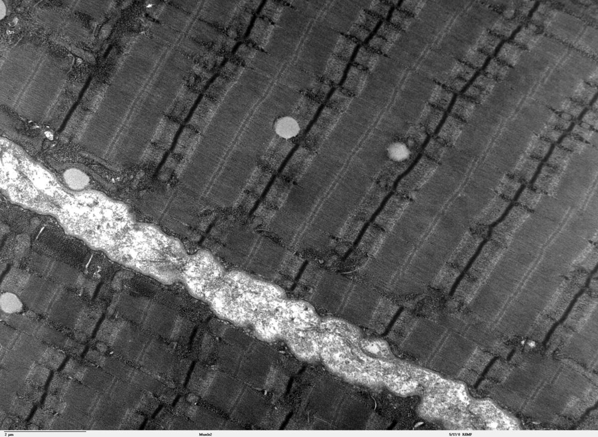{width="100%"}

*Human skeletal muscle, thin section, transmission electron microscopy. Each repeat of dark and light bands is one sarcomere, about 2.5 µm long.*
:::
::: {.column width="45%"}
- Skeletal muscle is striped (**striated**): the same unit repeats thousands of times along each fibre.
- When a muscle contracts, each unit shortens by up to a third, in milliseconds.
- **But no filament in the unit gets shorter.** How can a structure shorten if none of its parts do?
- And a second puzzle: your skin is rubbed and stretched all day, but it does not tear. **What holds cells together under force?**
:::
::::

::: notes
This is an electron micrograph of a thin slice through human skeletal muscle. You can see long parallel structures, the myofibrils, and along each of them a regular pattern of dark and light bands with thin dark lines. One repeat, from one thin dark line to the next, is a sarcomere. It is about two and a half micrometres long, and a single muscle fibre contains many thousands of them in a row. When you lift a cup, every sarcomere shortens a little, all at the same time, and the shortenings add up. In the 1950s, researchers measured the filaments inside the sarcomere during contraction and found something surprising: the filaments themselves did not shorten at all. So how does the sarcomere shorten? The answer is a molecular motor, myosin, which makes filaments slide past each other. The second puzzle of today is the opposite of movement: strength. Skin cells are pulled and rubbed all day without tearing. In the second half of the lecture you will see that a different filament system, the intermediate filaments, makes this possible.
:::

## Myosin: one motor domain, many jobs {.smaller}

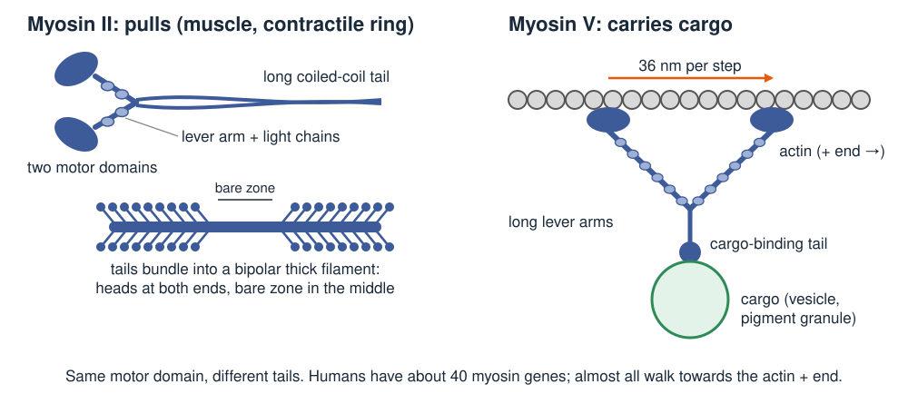{width="80%" fig-align="center"}

- Every myosin has a **motor domain** that binds **actin** and **ATP**, and a **lever arm** that swings. The **tail** decides the job.
- **Myosin II** has a long tail; many tails bundle into a **thick filament** with heads at both ends. It pulls actin filaments towards each other: **contraction**.
- **Myosin V** has long lever arms and a tail that binds **cargo**; it walks along actin.

::: notes
Myosins are a large family. Humans have about forty myosin genes, grouped into classes by their tails. They all share the same kind of motor domain, the head. It binds actin and ATP, and it changes shape as it breaks down ATP. Behind the motor domain sits a lever arm, a long helix stabilised by small proteins called light chains. A small shape change in the motor domain is amplified by the lever arm into a swing of several nanometres, a bit like a short movement of your wrist giving a long movement at the end of a fishing rod. The tail decides what the myosin does. Myosin II, on the left, has a long coiled-coil tail. Hundreds of tails pack together into a thick filament, with heads pointing outwards at both ends and a bare zone in the middle. Because the two halves point in opposite directions, a myosin II filament pulls actin filaments towards its centre. That is how muscle contracts, and how a cell pinches itself in two. Myosin V, on the right, has two heads with long lever arms and a tail that grabs a vesicle or pigment granule; it walks along actin like the kinesin you met on microtubules. Almost all myosins walk towards the plus end of actin.
:::

## The cross-bridge cycle: ATP lets go, hydrolysis cocks, phosphate release pulls {.smaller}

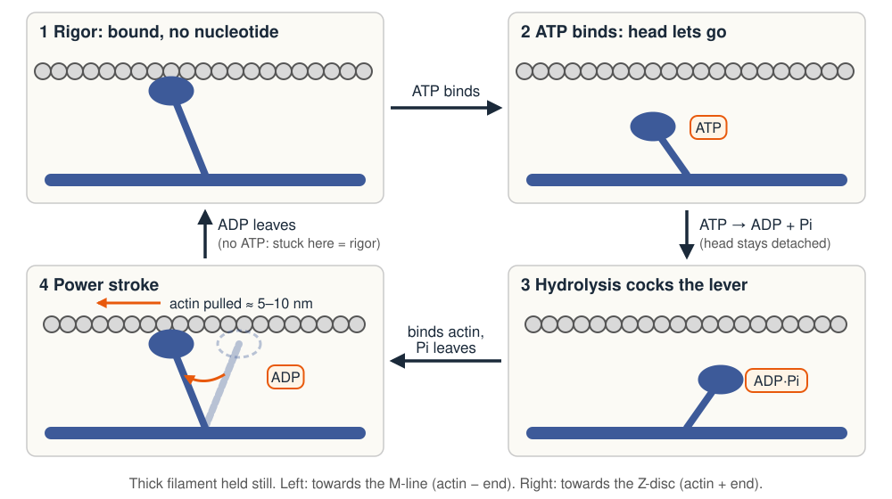{width="68%" fig-align="center"}

**1** Without nucleotide the head is locked on actin (**rigor**). **2** **ATP binding releases** the head. **3** **ATP hydrolysis cocks** the lever (ADP·Pi stays bound). **4** The head binds actin, **Pi leaves**, and the lever swings: the **power stroke** (≈ 5–10 nm). ADP leaves, and we are back at 1.

::: notes
This cycle is the heart of the lecture, so go through it slowly. Start at panel 1, top left. The head is bound tightly to actin and carries no nucleotide. This is the rigor state. Panel 2: ATP binds to the head. This changes the shape of the actin-binding cleft, and the head lets go of actin. So ATP is needed for release, not for the pull. Panel 3: while detached, the head hydrolyses ATP to ADP and phosphate, which both stay bound. The energy of hydrolysis is used to swing the lever back into a cocked position, like pulling back the string of a bow. Panel 4: the cocked head binds to a new site on actin. Binding makes phosphate leave, and this triggers the power stroke: the lever swings back and pulls the actin filament five to ten nanometres towards the centre of the sarcomere. Then ADP leaves, and the head is in rigor again, ready for the next ATP. One ATP, one stroke. Remember the three words: binding releases, hydrolysis cocks, phosphate release pulls. If ATP runs out, as after death, heads get stuck in panel 1: muscles become stiff. This is rigor mortis.
:::

## The sarcomere: the unit of contraction {.smaller}

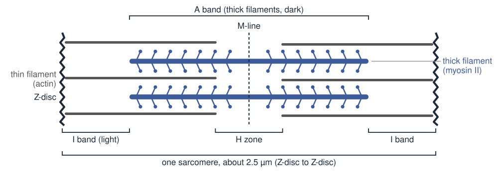{width="72%" fig-align="center"}

:::: {.columns}
::: {.column width="30%"}
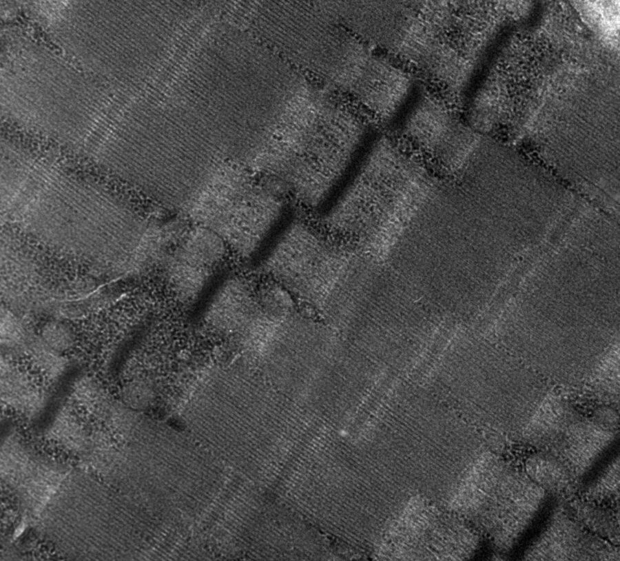{height="190px" fig-align="center"}

*Human skeletal muscle (TEM): Z-discs (dark diagonal bars), A bands (dark), I bands (light).*
:::
::: {.column width="70%"}
- **Thin filaments** (actin, about 1 µm) are anchored in the **Z-disc** with their **plus ends**, and point towards the middle.
- **Thick filaments** (myosin II, 1.6 µm) sit in the middle, held at the **M-line**.
- **A band** = length of the thick filaments. **I band** = only thin filaments. **H zone** = only thick filaments.
:::
::::

::: notes
Here is the sarcomere in detail, a micrograph on the left and our diagram on the right. A sarcomere runs from one Z-disc to the next. The Z-disc is a dense protein plate that anchors the thin filaments, which are actin filaments, about one micrometre long. Their plus ends are in the Z-disc, so the minus ends point towards the middle. In the middle sit the thick filaments, made of myosin II, 1.6 micrometres long, held in register by proteins at the M-line. In the light microscope and the electron microscope, the region with thick filaments looks dark: this is the A band. The regions on each side with only thin filaments look light: the I bands. The middle part of the A band that thin filaments do not reach is the H zone. A giant elastic protein, titin, runs from the Z-disc to the M-line and keeps the thick filament centred; we will not go into it. Notice the polarity: myosin heads walk towards the plus end of actin, so the heads in each half pull their thin filaments towards the M-line. Both Z-discs are pulled towards the centre, and the sarcomere shortens.
:::

## How do we know? The filaments slide {.smaller}

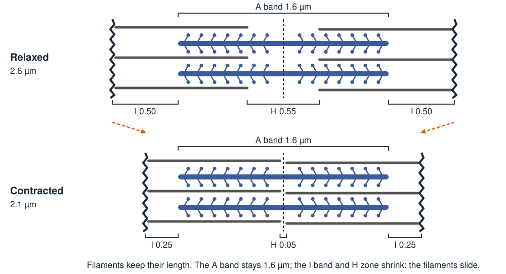{width="70%" fig-align="center"}

- **1954**, two papers in the same issue of *Nature*: A. F. Huxley and R. Niedergerke (interference light microscopy of living fibres) and H. E. Huxley and J. Hanson (phase contrast and EM of myofibrils).
- During contraction the **A band keeps its length**; the **I band and H zone shrink**. So the filaments keep their length and **slide past each other**: the **sliding-filament model**.

::: notes
How do we know that filaments slide? In 1954, two groups published side by side in Nature. Andrew Huxley and Rolf Niedergerke used a special light microscope to watch single living frog muscle fibres. Hugh Huxley and Jean Hanson, who were not related to Andrew, looked at isolated myofibrils with phase-contrast microscopy and electron microscopy. Both measured the bands at different sarcomere lengths. The result was the same. The A band, which is the length of the thick filaments, stayed at 1.6 micrometres whether the muscle was stretched or contracted. The I bands and the H zone, the regions where the two kinds of filament do not overlap, got shorter. The only explanation is that both filaments keep their length and slide past each other, so the overlap increases. This was a major change in thinking: before, many believed that contraction was a folding or coiling of long protein chains. The sliding-filament model then asked a new question: what makes the filaments slide? The answer, the cross-bridges between thick and thin filaments, came over the following decades.
:::

## How do we know? Force depends on filament overlap {.smaller}

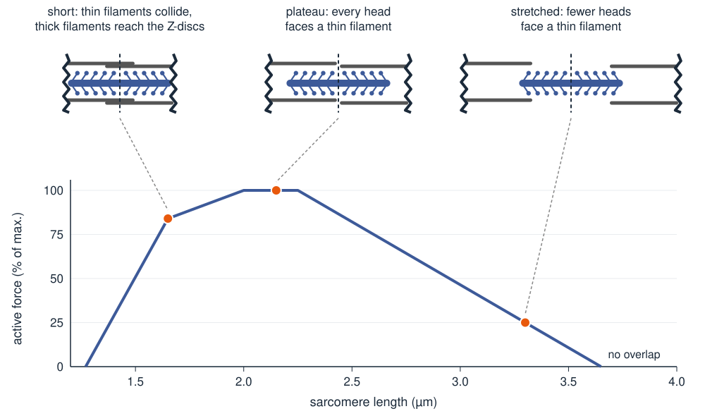{width="62%" fig-align="center"}

- **Gordon, Huxley and Julian, 1966**: hold single frog muscle fibres at fixed sarcomere lengths, stimulate, measure force.
- **Long sarcomere**: force falls in a straight line with the **overlap**, to zero at 3.65 µm. So **force comes from the heads that face a thin filament**: each cross-bridge adds a little force.
- **Short sarcomere**: thin filaments collide, thick filaments hit the Z-discs: force falls again. **Try it:** [Demo: sarcomere](questions.qmd#explore)

::: notes
If force comes from cross-bridges between overlapping filaments, then force should depend on how much the filaments overlap. In 1966, Gordon, Andrew Huxley and Julian tested this with great care. They took single fibres from frog muscle, held a short segment at a fixed sarcomere length with a feedback system, stimulated the fibre and measured the force. The result is the length–tension curve. Above 2.25 micrometres, force falls in a straight line as the sarcomere gets longer, and it reaches zero at 3.65 micrometres. That is exactly the length where thin filaments are pulled out of the thick filaments: 1.6 plus two times one micrometre, plus the Z-disc. Between 2.0 and 2.25 there is a plateau, where every myosin head faces a thin filament; the bare zone has no heads, so a little extra overlap there adds nothing. Below 2.0, thin filaments from the two halves cross and get in each other's way, and below about 1.65 the thick filaments press against the Z-discs, so force falls steeply. The shape of this curve follows from the filament lengths: strong evidence that each head adds its own small force. You can explore this in the demo.
:::

## The switch: Ca²⁺, troponin and tropomyosin {.smaller}

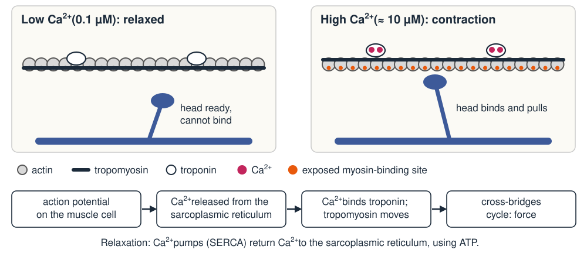{width="74%" fig-align="center"}

- At rest, **tropomyosin** lies along the actin filament and **covers the myosin-binding sites**. Heads are cocked but cannot bind.
- A nerve signal opens Ca²⁺ channels in the **sarcoplasmic reticulum** (the ER of muscle). Ca²⁺ rises from **0.1 µM to about 10 µM**, binds **troponin**, and troponin pulls tropomyosin aside: heads bind and pull.
- This is the **Ca²⁺ signal** from the ion-channels lecture. Ca²⁺ pumps (**SERCA**) take it back: relaxation.

::: notes
A muscle must not contract all the time, so the cross-bridge cycle needs a switch. In skeletal and heart muscle, the switch sits on the thin filament. Tropomyosin is a long rod-shaped protein that lies in the groove of the actin filament, covering seven actins. At rest it covers the sites where myosin heads bind. Every seven actins there is a troponin complex attached to tropomyosin. One of its subunits, troponin C, binds calcium. When a motor nerve fires, an action potential spreads over the muscle cell membrane and into the cell, and calcium channels in the sarcoplasmic reticulum, which is the ER of muscle, open. Remember from the ion-channels lecture that cytosolic calcium is kept around 0.1 micromolar, ten thousand times lower than in the ER. Now calcium floods out and rises about a hundred-fold. Calcium binds troponin C, troponin changes shape, and tropomyosin rolls away from the binding sites. The cocked heads bind, and the cycle runs. To relax, calcium pumps called SERCA use ATP to pump calcium back into the sarcoplasmic reticulum. Notice the two jobs of ATP in muscle: release of the heads, and removal of calcium. The full story of excitation and contraction comes in the course on organ structure and function.
:::

## Non-muscle myosin II: the cell's own muscle {.smaller}

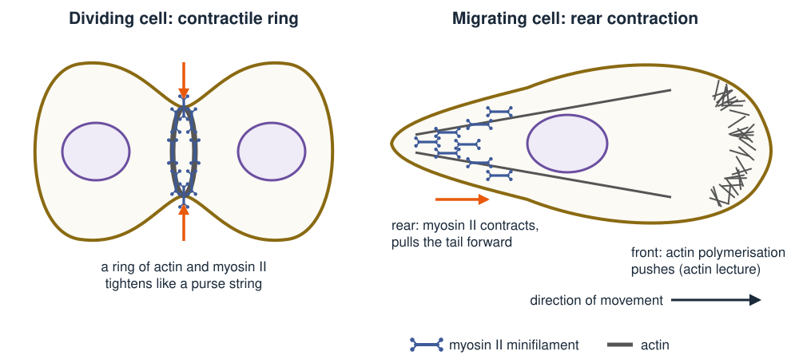{width="72%" fig-align="center"}

- Every cell has **myosin II**, in small **bipolar minifilaments** that pull on actin.
- **Contractile ring** in cell division: a ring of actin and myosin II pinches the cell in two (more in the **mitosis** lecture).
- **Migration**: at the cell **rear**, myosin II contracts and pulls the tail forward, while actin polymerisation pushes the front (the **actin** lecture).
- Switched on by **phosphorylation of its light chain** (by a kinase activated by Ca²⁺–calmodulin, or by Rho kinase), not by troponin.

::: notes
Myosin II is not only for muscle. Every cell in your body makes non-muscle myosin II. It forms small bipolar filaments of a few dozen molecules, called minifilaments, which work just like a tiny piece of muscle: they pull actin filaments of opposite polarity towards each other. Two examples. First, cell division. At the end of mitosis, a ring of actin filaments and myosin II forms under the plasma membrane at the equator of the cell. Myosin pulls the actin filaments past each other, the ring tightens like a purse string, and the cell is pinched in two. You will meet the contractile ring again in the mitosis lecture. Second, migration. In the actin lecture you saw that a migrating cell pushes its front forward by actin polymerisation. That is only half of moving. The rear must follow, and here myosin II contracts and pulls the tail forward and detaches it from the surface. Non-muscle cells have no troponin. Instead, myosin II is switched on when a small regulatory light chain on the head is phosphorylated, either by a kinase activated by calcium and calmodulin, or by Rho kinase, which you will meet in the signalling lectures. Smooth muscle uses the same switch.
:::

## Myosin V: a cargo carrier on actin {.smaller}

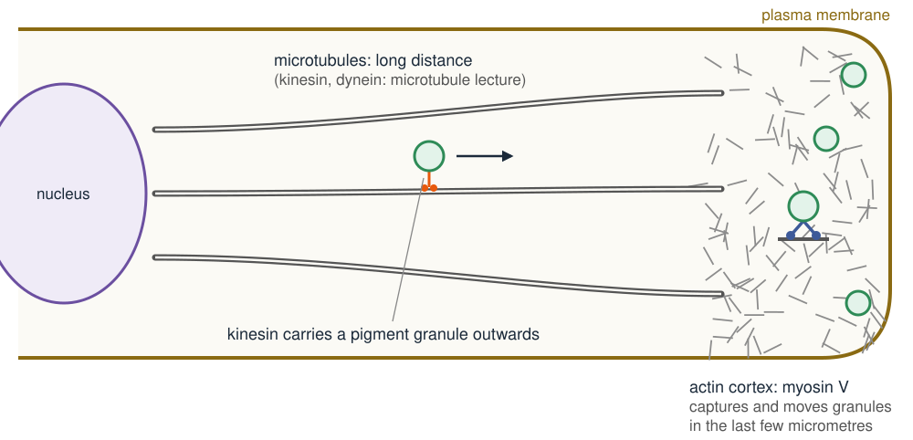{width="72%" fig-align="center"}

- Myosin V walks **hand over hand** along actin, **36 nm per step**, one ATP per step, for many steps before it falls off.
- Long distances: **microtubules** and kinesin/dynein. The last few micrometres in the **actin-rich cortex**: myosin V.
- Example: pigment cells (melanocytes) hand pigment granules to skin cells. **No myosin V** (Griscelli syndrome type 1): granules pile up in the cell centre, hair is silvery.

::: notes
Myosin V shows that myosin can also be a transporter. Its two heads are joined by long lever arms, each stabilised by six light chains. The heads take turns: while one head is bound, the other swings forward, 36 nanometres, and binds the next site. Thirty-six nanometres is not a random number: it is the distance at which the twisted actin filament repeats, so the motor walks straight along one face of the filament. A myosin V molecule takes many steps before it lets go; such a motor is called processive, like kinesin. Why would a cell need two transport systems? Microtubules are the long-distance highways: kinesin carries cargo from the cell centre to the periphery. Near the plasma membrane, the cytoplasm is full of a dense mesh of actin, the cortex, and here myosin V takes over and moves the cargo the last few micrometres. Pigment cells in the skin are the classic example. They make pigment granules and carry them out to the tips of their extensions, from where they are handed to skin cells. In patients without functional myosin V, in a rare disease called Griscelli syndrome, the granules pile up around the nucleus and the hair looks silvery.
:::

## Intermediate filaments: built like a rope {.smaller}

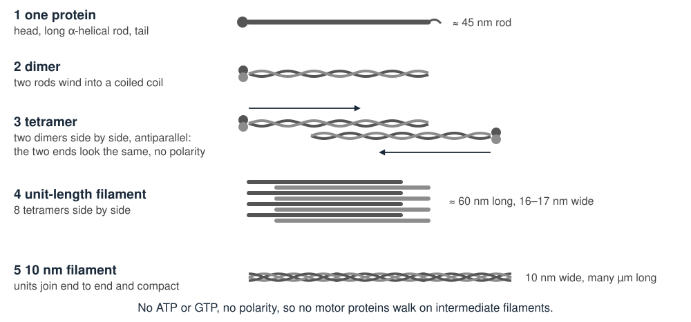{width="72%" fig-align="center"}

- A long **α-helical rod** with a head and a tail. Two rods form a **coiled-coil dimer**; two dimers lie side by side, **antiparallel**, in a tetramer.
- Tetramers pack side by side and end to end into a rope **10 nm** thick: between actin (7 nm) and microtubules (25 nm), hence "intermediate".
- **No nucleotide, no polarity, no motors.** Their job is **strength**, not movement.

::: notes
Now the third filament system. Intermediate filaments got their name from their diameter, about ten nanometres, between actin and microtubules. They are built in a completely different way. Each protein has a long central rod domain, an alpha helix about 45 nanometres long, with flexible head and tail domains at the ends. Two rods wind around each other into a coiled-coil dimer, with both heads at the same end. Two dimers then lie side by side, pointing in opposite directions and slightly staggered. This antiparallel tetramer looks the same from both ends, so the filament built from it has no polarity. Eight tetramers associate side by side into a short unit-length filament, and these join end to end and compact into the final filament. Compare this with actin and microtubules. Intermediate filaments bind no ATP or GTP, so they have no built-in dynamic instability or treadmilling. They have no plus and minus ends, so no motor protein can walk on them. They are regulated mainly by phosphorylation, for example during mitosis. And because many long helices are packed side by side and overlap, the filament behaves like a rope: flexible, but very hard to break.
:::

## Intermediate filament families: one per tissue {.smaller}

:::: {.columns}
::: {.column width="42%"}
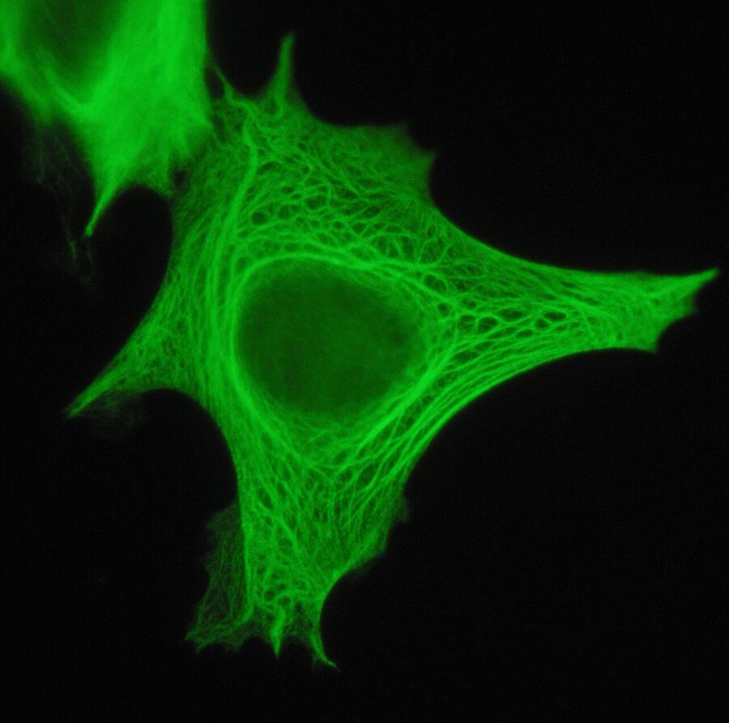{width="100%"}

*Cytokeratin filaments in a human epithelial cell (immunofluorescence). The network spans the cytoplasm around the nucleus (dark).*
:::
::: {.column width="58%"}

| Family | Where | Note |
|---|---|---|
| **Keratins** (type I + II pairs) | epithelia: skin, gut, liver | the largest family, about 50 genes |
| **Vimentin** | fibroblasts, white blood cells, endothelium | |
| **Desmin** | muscle | links Z-discs to each other |
| **Neurofilaments** | nerve axons | set the axon diameter |
| **Nuclear lamins** | inside the nucleus, all cells | the **nuclear lamina** (organelles-compared lecture) |

Pathologists use the IF type to find **where a tumour came from**: keratin = carcinoma (epithelium), vimentin = sarcoma.
:::
::::

::: notes
Humans have about seventy intermediate filament genes, and different cell types use different ones. Keratins are the largest family, with about fifty genes. They come in two types, acidic and basic, and a keratin filament always contains one of each, as a pair. Epithelial cells, in skin, gut lining or liver, are full of keratin. The image shows a keratin network in a cultured epithelial cell: a dense meshwork around the dark nucleus that spreads to the cell edges. Vimentin is the typical intermediate filament of cells of mesenchymal origin, such as fibroblasts and endothelial cells. Desmin is found in muscle, where it links neighbouring Z-discs and keeps myofibrils in register. Neurofilaments fill nerve axons and set their diameter, which affects how fast signals travel. The nuclear lamins are different: they line the inside of the nuclear envelope and form the nuclear lamina, which you met in the lecture comparing organelles. Because the type of intermediate filament is so tissue-specific, pathologists stain tumours for it. A tumour that makes keratin came from an epithelium and is a carcinoma, even if it sits in a lymph node or a bone.
:::

## Mechanical strength: a network riveted to its neighbours {.smaller}

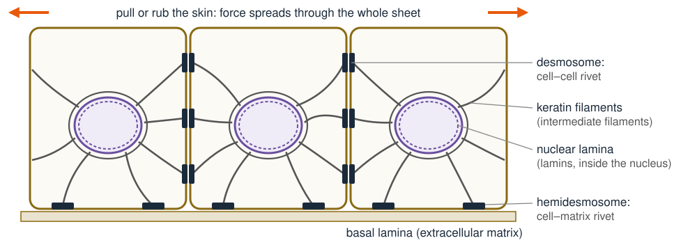{width="74%" fig-align="center"}

- Keratin filaments end in **desmosomes** (rivets between cells) and **hemidesmosomes** (rivets to the basal lamina). The filaments of one cell are linked to those of the next: the **whole sheet** shares the load.
- Intermediate filaments can be **stretched to two or three times their length** before breaking, and they get stiffer as they stretch. Actin filaments and microtubules break much earlier.
- The **nuclear lamina** does the same for the nucleus.

::: notes
How do intermediate filaments make a tissue strong? In an epithelium, the keratin filaments of each cell end in two kinds of junction. Desmosomes are button-like junctions between neighbouring cells: on each side, a dense plaque inside the cell anchors keratin filaments, and adhesion proteins cross the gap between the cells and hold on to each other. Hemidesmosomes are half of this: they anchor the bottom of the cell to the basal lamina, the sheet of extracellular matrix below the epithelium. The tissue is therefore one continuous network, from cell to cell and down to the matrix. When you rub your skin, the force does not land on one cell; it is spread over thousands. The filaments themselves are tough. Single intermediate filaments can be stretched to two or three times their length before they break, and they become stiffer the more they are stretched, like a rope. Actin filaments and microtubules are stiff, but break after a stretch of a few per cent. The nucleus has its own intermediate filament net, the lamina, which protects the DNA when cells squeeze through narrow spaces. The junctions themselves come back in the course on organ structure and function.
:::

## How do we know? Watching filaments turn over: FRAP and TIRF {.smaller}

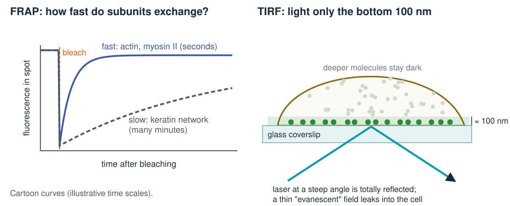{width="72%" fig-align="center"}

- **FRAP** (from the membrane-structure lecture; [FRAP lab](../membrane-structure/questions.qmd#explore)): bleach a GFP-tagged filament protein in a spot, watch fluorescence return. Fast return = subunits **exchange** quickly (actin, myosin II); slow = a **stable** network (keratin).
- **TIRF microscopy**: only a ≈ 100 nm layer above the glass is lit. Sharp images of **adhesions, single motors and filaments** at the bottom of a cell or in a test-tube assay, with almost no background.

::: notes
This and the next slide gather the main methods for the whole cytoskeleton block. FRAP, fluorescence recovery after photobleaching, you met in the membrane-structure lecture. Here, you express a filament protein fused to GFP, bleach a small spot with a strong laser, and watch how fast fluorescence comes back. Recovery means that bleached subunits leave the filaments and fresh, fluorescent subunits from the cytosol take their place. Actin in a lamellipodium, or myosin II in the contractile ring, recovers within seconds: these structures are rebuilt all the time. A keratin network recovers over many minutes or longer: it is much more stable, although it still exchanges subunits. TIRF, total internal reflection fluorescence microscopy, solves a different problem. If you shine a laser through the glass at a steep enough angle, it is totally reflected. A thin field of light, the evanescent field, still leaks about 100 nanometres into the sample. Only molecules in this thin layer light up. TIRF gives very sharp images of focal adhesions at the bottom of a cell, and in a test tube it lets you watch single fluorescent myosin or kinesin molecules walk along filaments fixed on the glass.
:::

## How do we know? Measuring forces: traction-force microscopy and optical tweezers {.smaller}

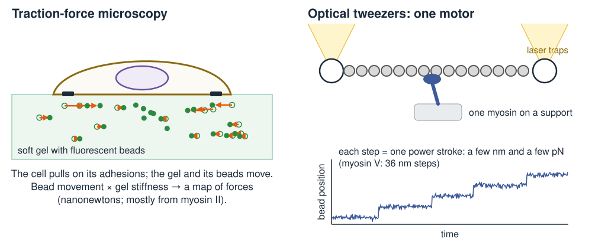{width="74%" fig-align="center"}

- **Traction-force microscopy**: grow cells on a soft gel with beads. From how far the beads move and how stiff the gel is, calculate the **forces** each adhesion feels (nanonewtons). Block myosin II (blebbistatin) and the forces vanish.
- **Optical tweezers**: a focused laser holds a bead like a spring. Attach an actin filament and let **one myosin** pull: each **step** is one power stroke, a few nanometres and a few **piconewtons**.

::: notes
Cell biology is usually about chemistry, but the cytoskeleton is about mechanics, so we need to measure forces. Traction-force microscopy measures the forces a whole cell exerts on its surroundings. The cell grows on a soft gel of known stiffness that contains fluorescent beads. When the cell pulls on its adhesions, the gel is deformed and the beads move. You image the beads with the cell, then remove the cell and image them again in their relaxed positions. From the displacement field and the stiffness of the gel, a computer calculates a map of forces, typically nanonewtons per adhesion. If you add blebbistatin, a drug that blocks myosin II, most of these forces disappear: so they come from myosin pulling on actin. Optical tweezers work at the level of a single molecule. A tightly focused laser beam traps a small plastic bead; the bead behaves as if held by a spring, so its displacement tells you the force. In the classic experiment, an actin filament is stretched between two trapped beads and lowered onto a single myosin. Each time the myosin binds and strokes, the beads jump a few nanometres. This is how the step sizes and forces of myosin II, myosin V and kinesin were measured.
:::

## Why it matters: mavacamten, a drug that parks myosin heads {.smaller}

:::: {.columns}
::: {.column width="70%"}
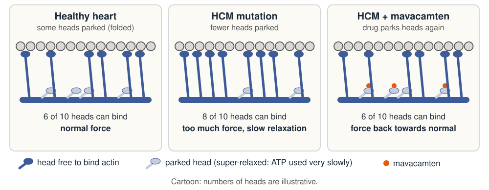{width="100%"}

- **Hypertrophic cardiomyopathy (HCM)**: about 1 in 500 people. Often a mutation in **cardiac myosin** (*MYH7*) or a myosin-binding protein. Fewer heads are **parked**, so too many cross-bridges cycle: the heart pulls too hard, relaxes poorly, and its wall thickens.
- **Mavacamten** (approved 2022) binds the myosin motor domain, slows its ATPase and **parks heads**: fewer cross-bridges (back to the cycle slide). Too high a dose weakens the heart, so the dose is adjusted with ultrasound.
:::
::: {.column width="30%"}
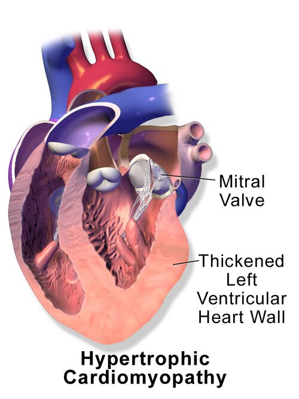{height="430px" fig-align="center"}

*Hypertrophic cardiomyopathy: the wall of the left ventricle is thickened (illustration).*
:::
::::

::: notes
Hypertrophic cardiomyopathy is the most common inherited heart disease, affecting about one person in five hundred. The heart muscle wall, especially of the left ventricle, becomes thick and stiff. It can block the outflow of blood, cause shortness of breath and, in young people, sudden death during exercise. Many patients carry a mutation in the beta cardiac myosin heavy chain or in myosin-binding protein C, which normally helps to hold heads still. In a relaxed heart, many myosin heads are folded back onto the thick filament in a parked state, the super-relaxed state, which uses ATP very slowly. Many HCM mutations release heads from this state. More heads cycle, the heart contracts too strongly, uses too much energy and relaxes poorly, and over years the wall thickens. Mavacamten is the first drug designed to act directly on the sarcomere. It binds the motor domain of cardiac myosin, slows phosphate release and stabilises the parked state. Fewer heads form cross-bridges, so force is reduced, as in step four of the cycle. Because too much inhibition makes the heart pump too weakly, patients are checked with ultrasound and the dose is adjusted. You can test this in the demo. Drug development of this kind returns in the course on clinical trials and drug development.
:::

## Why it matters: epidermolysis bullosa simplex, when keratin breaks {.smaller}

:::: {.columns}
::: {.column width="64%"}
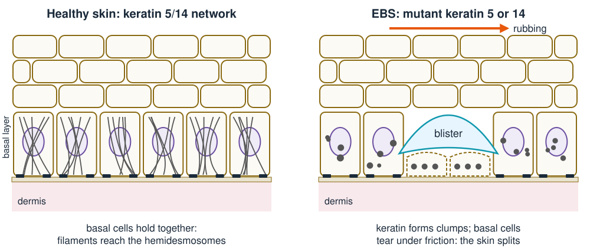{width="100%"}

- **Mutations in keratin 5 or 14**, the keratin pair of the **basal layer** of the skin. Usually **dominant**: the mutant protein poisons the filament it joins.
- Keratin forms **clumps** instead of a network. Basal cells **tear** under friction, and the skin above lifts off as a **blister**.
:::
::: {.column width="36%"}
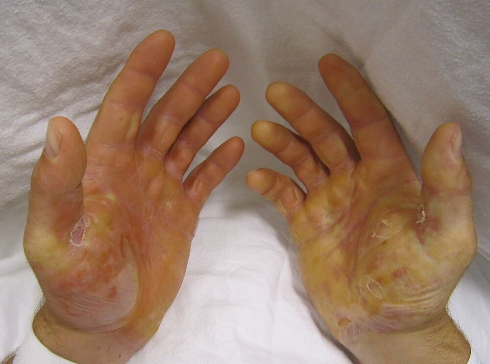{width="100%"}

*Blisters on the hands of a person with epidermolysis bullosa simplex.*
:::
::::

::: notes
Epidermolysis bullosa simplex shows what happens when an intermediate filament network fails. The basal layer of the skin, the layer of dividing cells that sits on the basal lamina, makes keratin 5 and keratin 14, which pair up to form filaments. In the 1990s, it was shown that most patients with this disease carry a point mutation in one of these two genes, often in the conserved ends of the rod domain that are needed for filaments to join end to end. The disease is usually dominant. Each patient also makes normal keratin, but the mutant protein is built into the same filaments and spoils them, so one bad copy is enough. In basal cells, keratin forms clumps instead of a network linked to desmosomes and hemidesmosomes. The cells look normal until the skin is rubbed. Then basal cells break open, the layers above lift off, and fluid fills the gap: a blister. In mild forms, blisters appear on hands and feet after walking or work, especially in warm weather; severe forms start at birth. There is no cure yet; care means protecting the skin. The link between keratin and the disease was confirmed in mice with a mutant keratin 14, which had blistering skin. More in Sjukdomslära.
:::

## Summary {.smaller}

1. **Myosins** share a motor domain that binds actin and ATP; the tail decides the job. **Myosin II** pulls (muscle, contractile ring, cell rear); **myosin V** carries cargo.
2. **Cross-bridge cycle:** ATP **binding** releases the head, **hydrolysis** cocks the lever, **Pi release** gives the power stroke. No ATP = rigor.
3. In the **sarcomere**, thick and thin filaments **slide**; force follows **filament overlap** (length–tension curve). **Ca²⁺** on **troponin** moves **tropomyosin** and switches contraction on.
4. **Intermediate filaments** (keratins, vimentin, desmin, neurofilaments, lamins) are non-polar ropes that, linked by **desmosomes and hemidesmosomes**, give cells and tissues **mechanical strength**.
5. Methods: **FRAP, TIRF, traction-force microscopy, optical tweezers**. Disease and drugs: **mavacamten** parks myosin heads in **HCM**; mutant **keratin 5/14** gives blistering skin (**EBS**).

*Read more (optional): Alberts et al., Molecular Biology of the Cell, 7th ed., ch. 16.*

[Image credits](../credits.qmd#myosin-if){style="font-size:0.7em"}

::: notes
Five take-home points to close the cytoskeleton block. First, myosins are actin motors with a common motor domain; the tail decides whether a myosin pulls, like myosin II, or carries, like myosin V. Second, the cross-bridge cycle: ATP binding releases the head from actin, ATP hydrolysis re-cocks the lever, and phosphate release on binding to actin drives the power stroke. Without ATP, heads stay stuck: rigor. Third, the sarcomere shortens because filaments slide, not because they shorten; the force depends on how many heads face a thin filament, which gives the length–tension curve, and calcium binding to troponin moves tropomyosin to let heads bind. Fourth, intermediate filaments are rope-like, non-polar and have no motors; through desmosomes and hemidesmosomes they make a tissue one mechanical unit. Fifth, we have a toolbox: FRAP for turnover, TIRF for the cell bottom and single molecules, traction-force microscopy and optical tweezers for forces. And two medical lessons: a drug can treat a heart disease by parking motor heads, and a single mutant keratin can make skin fall apart. Next block: how cells divide, where actin, myosin and microtubules all come back.
:::
