## About this lecture {.smaller}

The lectures before this one followed one organelle at a time: protein sorting, the ER, the Golgi, endosomes and lysosomes, protein turnover, mitochondria. Today we put the organelles **side by side** and ask how they **work together**.

After this lecture you can:

- describe the **nucleus and its envelope**, including the **nuclear lamina**; **peroxisomes**; and **lipid droplets**;
- explain what an **organelle contact site** is, and how organelles share **lipids, Ca²⁺ and signals** there;
- explain **homeostasis** in each compartment as a **set point kept by feedback**: pH, Ca²⁺, energy and protein load;
- **compare** all organelles in one table: membranes, DNA, how proteins get in, main job, pH and Ca²⁺;
- explain two diseases of organelles that are not the usual suspects: **progeria** (lamin A) and **Zellweger syndrome** (no peroxisomes).

::: notes
This lecture closes the block on protein handling and organelles. So far you have met each organelle on its own: how proteins are sorted, how the ER folds and checks them, how the Golgi modifies and ships them, how endosomes and lysosomes take material in and digest it, how proteins are made and destroyed, and how mitochondria make ATP. Today we do two new things. First, we fill the gaps: three organelles have not had their own lecture, namely the nucleus with its envelope and lamina, the peroxisome, and the lipid droplet. Second, we change the question. Instead of asking what one organelle does, we ask how all of them together keep the cell stable. That is homeostasis, and it is what ELO 5 asks for: compare organelles, and explain how they cooperate to keep energy, calcium, pH, lipids and protein load in balance. We end with a comparison table that you can use to revise for the exam, and with two diseases that show what happens when one organelle fails.
:::

## The question: ten chemistries in one small bag {.smaller}

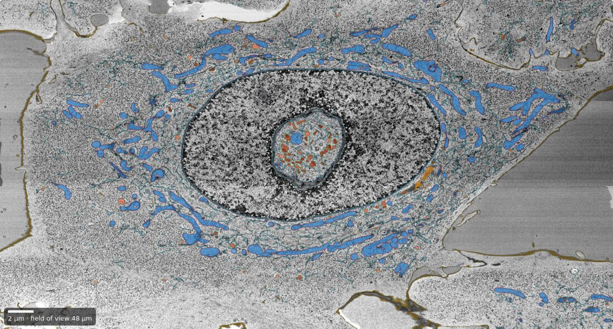{width="82%" fig-align="center"}

[One slice through a HeLa cell (electron microscopy, 48 µm wide), coloured by pH: **blue** = mitochondria, about pH 8; **orange to red** = endosomes and lysosomes, pH 6.5 to 4.5; uncoloured = about pH 7.2.]{style="font-size:0.75em"}

- A lysosome at pH 4.5 has **500 times more H⁺** than the cytosol next to it. The ER holds **5000 times more free Ca²⁺** than the cytosol.
- These differences are kept for the whole life of the cell, while organelles grow, divide and exchange material all the time. **How?**

::: notes
Look at this picture. It is a real electron micrograph of a HeLa cell, the same slice you can explore in the cell explorer, but here we have coloured each compartment by its pH. Blue structures are mitochondria: their inner space, the matrix, is slightly alkaline, about pH 8. Orange and red structures are endosomes and lysosomes, which are acidic, down to pH 4.5. Everything else is close to pH 7.2. The colours are typical textbook values, not a measurement in this cell. Now the puzzle. pH is a logarithm, so a lysosome at 4.5 holds about five hundred times more free protons than the cytosol a few nanometres away. The ER holds several thousand times more free calcium than the cytosol. Membranes are thin and leaky, organelles exchange vesicles and lipids constantly, and the cell grows and divides. Yet these values stay put, hour after hour. How does the cell keep so many different chemistries stable in one small bag? That is the question of today.
:::

## The nucleus: a double membrane and a lamina {.smaller}

:::: {.columns}
::: {.column width="70%"}
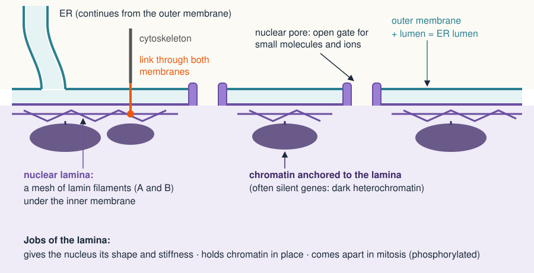{width="100%"}
:::
::: {.column width="30%"}
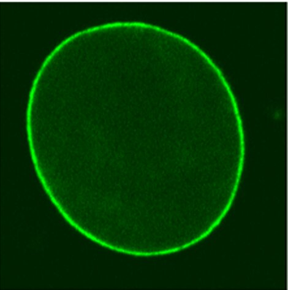{width="92%" fig-align="center"}

[A normal human cell nucleus stained for lamin A: the lamina is a thin rim (confocal microscopy).]{style="font-size:0.8em"}
:::
::::

- **Two membranes**; the outer one continues into the ER. **Nuclear pores** let ions and small molecules pass freely, so the nucleoplasm has the **same pH and Ca²⁺ as the cytosol**. Proteins go through pores with signals (the protein-sorting lecture).
- The **lamina**: a mesh of **lamin** filaments (intermediate filaments) under the inner membrane. It gives the nucleus its **shape and stiffness** and holds **chromatin**.

::: notes
The nucleus is enclosed by the nuclear envelope, which is two membranes. The outer membrane is continuous with the ER, and the space between the two membranes is part of the ER lumen. Where the two membranes meet, they form nuclear pores, large protein complexes that you met in the protein-sorting lecture. Ions and small molecules pass through the pores freely, so the nucleus is not a separate chemical compartment: its pH and calcium follow the cytosol. Under the inner membrane lies the nuclear lamina, a thin mesh of proteins called lamins. Lamins are intermediate filaments, a type of cytoskeleton you meet again in the cytoskeleton block. There are A-type lamins, mainly lamin A and C, and B-type lamins. The lamina makes the nucleus stiff and round, anchors chromatin, often silent chromatin, at the edge, and connects through both membranes to the cytoskeleton outside. In mitosis, kinases phosphorylate the lamins and the mesh comes apart, so the envelope can break down. The picture on the right shows a normal nucleus stained for lamin A: a sharp, smooth rim. Remember it for the progeria slide.
:::

## Peroxisomes: small oxidation chambers {.smaller}

:::: {.columns}
::: {.column width="66%"}
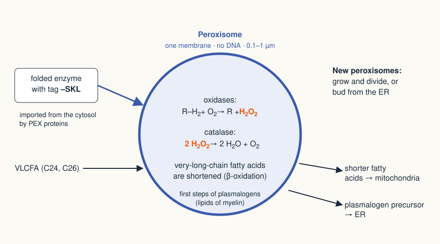{width="100%"}
:::
::: {.column width="34%"}
- **One membrane**, no DNA, 0.1–1 µm; hundreds per liver cell.
- Import **folded** enzymes from the cytosol; most carry the tag **SKL** (Ser-Lys-Leu) at the end (the protein-sorting lecture).
- **Oxidases** use O₂ and make **H₂O₂**; **catalase** destroys it at once. Keeping this dangerous chemistry in one box protects the rest of the cell.
- Jobs: shorten **very-long-chain fatty acids**, start **plasmalogens** (myelin lipids), and, in liver, bile acids.
:::
::::

::: notes
Peroxisomes are small organelles with a single membrane and no DNA. A liver cell has several hundred of them. They take up proteins from the cytosol after translation, like mitochondria, but they can even import proteins that are already folded. Most peroxisomal enzymes carry a short tag at their end, serine-lysine-leucine, which a receptor in the cytosol recognises. The name comes from hydrogen peroxide. Peroxisomes contain oxidases that take hydrogen atoms from their substrates and give them to oxygen, which makes hydrogen peroxide. Hydrogen peroxide is a reactive oxygen species that can damage proteins, lipids and DNA, so the same organelle is packed with catalase, which breaks it down to water and oxygen. This is compartment logic again: dangerous chemistry stays in one box. What do peroxisomes make or break? In humans they are the only place where very-long-chain fatty acids, with 22 or more carbons, are shortened. They also make the first steps of plasmalogens, special lipids that are abundant in myelin around nerves, and in liver they help make bile acids. New peroxisomes come from growth and division, or bud from the ER. Keep the very-long-chain fatty acids in mind for Zellweger syndrome.
:::

## Lipid droplets: the cell's fat store {.smaller}

:::: {.columns}
::: {.column width="64%"}
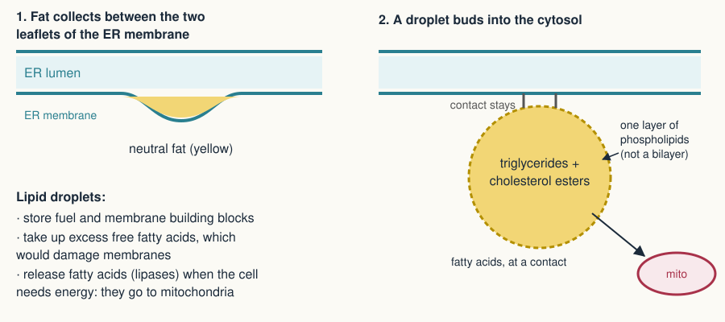{width="100%"}
:::
::: {.column width="36%"}
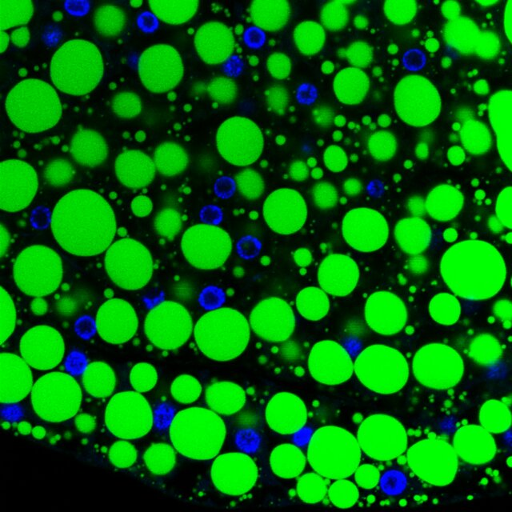{width="80%" fig-align="center"}

[Fat cells (adipocytes) in culture: lipid droplets stained green with the dye BODIPY, nuclei blue.]{style="font-size:0.8em"}

- Covered by **one layer** of phospholipids: the inside is **oil, not water**.
- Size: 0.1 µm to over 100 µm (a fat cell is one huge droplet).
:::
::::

::: notes
Lipid droplets were long seen as boring blobs of fat, but they are real organelles with their own proteins. They are born in the ER. Enzymes in the ER membrane make neutral fats, triglycerides and cholesterol esters, which have no charged head group. These fats do not stay in the bilayer; they collect between its two leaflets, like oil between two sheets, until a lens forms and buds into the cytosol. The finished droplet is therefore covered by only one layer of phospholipids, the half of the ER membrane that faced the cytosol. Inside there is no water at all, so pH and calcium have no meaning there. Lipid droplets store fuel and building blocks for membranes. They also protect the cell: free fatty acids act like detergents and damage membranes, so cells trap excess fatty acids as triglycerides. When the cell needs energy, lipases release fatty acids, which go to mitochondria, often at sites where a droplet touches a mitochondrion. In the image, fat cells in culture are full of droplets of many sizes. In a mature white fat cell, one droplet fills almost the whole cell.
:::

## Organelles touch: contact sites {.smaller}

:::: {.columns}
::: {.column width="56%"}
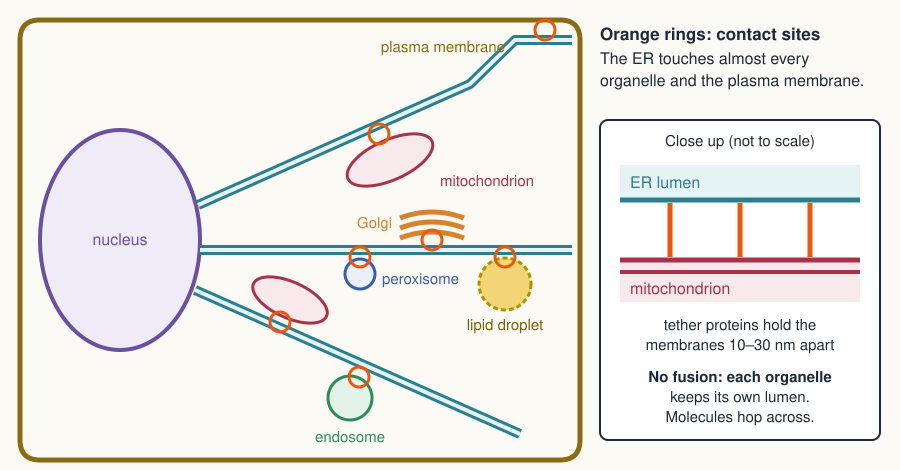{width="100%"}
:::
::: {.column width="44%"}
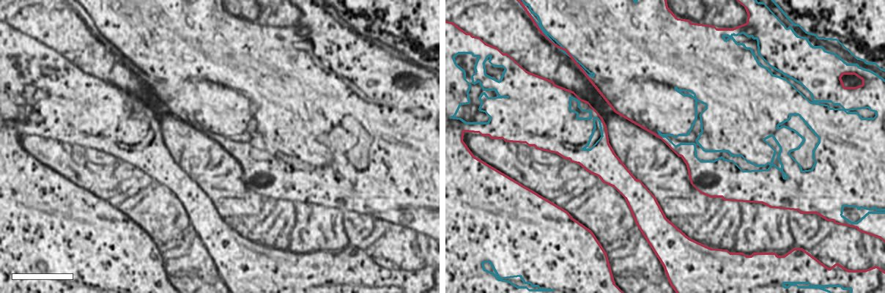{width="100%"}

[Mitochondria (red outlines; note the cristae) and ER (teal) in a HeLa cell, FIB-SEM. ER tubes run right along the mitochondria. Scale bar 500 nm.]{style="font-size:0.8em"}

- At a **contact site** two membranes are held **10–30 nm** apart by tether proteins, **without fusing**.
- Most contacts involve the **ER**: it reaches every organelle and the plasma membrane.
:::
::::

::: notes
For a long time we drew organelles as islands that only talk by vesicles. Electron microscopy and live imaging show something else: organelles touch. At a contact site, two membranes come within ten to thirty nanometres of each other, which is closer than the width of a ribosome, and tether proteins hold them there. The membranes do not fuse, so each organelle keeps its own lumen and its own chemistry. Instead, molecules hop across the narrow gap: lipids carried by transfer proteins, and ions released by one organelle and taken up by the other before they diffuse away. The ER is the hub. Its network reaches every corner of the cell and makes contacts with mitochondria, the plasma membrane, endosomes, lysosomes, the Golgi, peroxisomes and lipid droplets. On the right you see a real example from the same HeLa cell as the cell explorer: two mitochondria with their cristae, and ER tubes running right along them. A single section cannot prove that two membranes are tethered, but this close, parallel arrangement is typical of contact sites. The next slide shows what passes across.
:::

## What passes at contact sites: lipids and Ca²⁺ {.smaller}

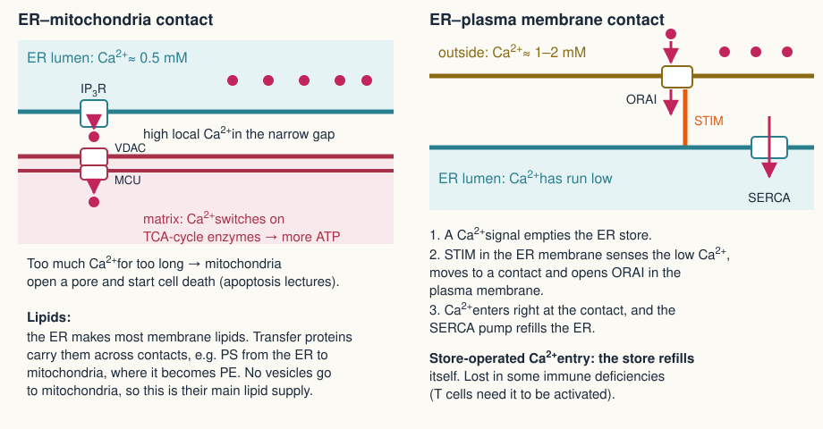{width="84%" fig-align="center"}

- **ER–mitochondria:** Ca²⁺ released from the ER is taken up right away by mitochondria and speeds up ATP production. Too much triggers cell death. ER tubes also mark where mitochondria divide.
- **ER–plasma membrane:** when the ER store runs low, **STIM** in the ER opens **ORAI** in the plasma membrane, and the store refills.

::: notes
Two contact sites show the idea well. Left: the ER and mitochondria. When a signal opens IP3 receptor channels in the ER, calcium floods out into the narrow gap between the two organelles. There, its concentration becomes much higher than in the bulk cytosol, high enough to pass the outer mitochondrial membrane and enter the matrix through the calcium uniporter, which has a low affinity and needs such hot spots. In the matrix, calcium switches on dehydrogenases of the citric acid cycle, so the cell makes more ATP exactly when it is working harder. If calcium overload lasts, mitochondria open a pore and release proteins that start apoptosis, which you will meet in the cell death block. The same contacts carry lipids: mitochondria receive no vesicles, so the ER supplies most of their lipids through transfer proteins. ER tubes also wrap around mitochondria where they divide. Right: the ER and the plasma membrane. After a calcium signal the ER store is low. The ER protein STIM senses this, gathers at contacts with the plasma membrane and opens the channel ORAI. Calcium enters at the contact and is pumped into the ER. People with broken ORAI1 have a severe immune deficiency, because T cells need this calcium entry.
:::

## Homeostasis: every compartment has set points {.smaller}

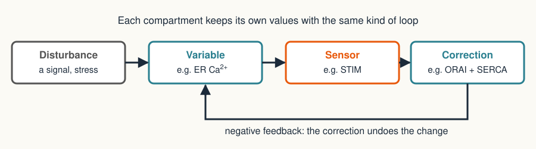{width="78%" fig-align="center"}

| What is kept stable | Where | Sensor | Correction |
|---|---|---|---|
| pH | lysosome, Golgi | lumen pH (on the pump and its partners) | **V-type H⁺ pump** works more or less |
| Ca²⁺ | ER store | **STIM** | ORAI opens, **SERCA** refills |
| Energy | whole cell | **AMPK** (AMP, ADP) | more fuel burning, less building |
| Protein load | ER | **IRE1, PERK, ATF6** | the unfolded protein response |

::: notes
Homeostasis means keeping a variable near a set point, despite disturbances. You know the idea from physiology, for example body temperature or blood glucose. The cell does the same thing in each compartment, and the logic is always a negative feedback loop. Something disturbs a variable: a signal empties the ER calcium store, a burst of secretion loads the ER with new proteins, exercise burns ATP. A sensor detects the change. A correction is switched on that pushes the variable back, and when it is back, the sensor switches the correction off. The table gives the four examples of this lecture. Lysosomes and the Golgi keep their pH with a proton pump. The ER keeps its calcium with STIM and the pumps. The whole cell keeps its energy charge with the kinase AMPK, which senses AMP. And the ER keeps its protein load with three stress sensors, the unfolded protein response. Notice the pattern: each compartment has its own sensors, but they also talk to each other, often at contact sites. The next four slides go through the four variables one at a time.
:::

## pH: each compartment pumps its own protons {.smaller}

:::: {.columns}
::: {.column width="62%"}
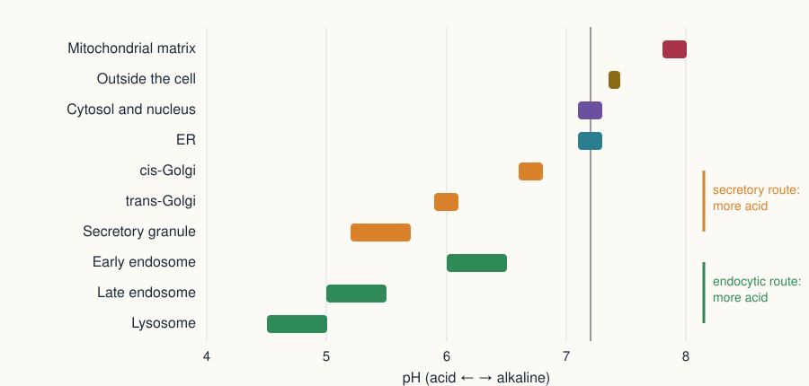{width="100%"}
:::
::: {.column width="38%"}
- **V-type H⁺-ATPase** pumps H⁺ **into** Golgi, endosomes and lysosomes. More pumps and fewer leaks = lower pH. Cl⁻ entering with the H⁺ keeps the voltage low enough for the pump to continue.
- **Why acid?** Receptors **release** their cargo (LDL, M6P enzymes); lysosomal enzymes work best at pH 4.5–5 and are almost inactive in the cytosol: a safety lock.
- **Mitochondria** are the opposite: the electron transport chain pumps H⁺ **out** of the matrix (pH ≈ 8).
:::
::::

::: notes
Here is the pH of each compartment on one scale. The cytosol, the nucleus and the ER sit around 7.2, and the outside of the cell around 7.4. Along the secretory route the pH falls step by step: the cis-Golgi about 6.7, the trans-Golgi about 6.0, secretory granules about 5.5. Along the endocytic route it falls even further: early endosomes about 6.2, late endosomes about 5.5, lysosomes 4.5 to 5. The machine behind all of these is the same: the V-type proton pump, which uses ATP to push protons into the lumen. Each compartment sets its own pH by how many pumps it has, how leaky it is for protons, and how fast counter-ions such as chloride move to balance the charge. Why go to this trouble? Acid makes receptors let go of their cargo, as you saw for the LDL receptor and the mannose-6-phosphate receptor. And lysosomal enzymes work only at low pH, so if a lysosome leaks, its enzymes are almost harmless in the neutral cytosol. Mitochondria are different: the electron transport chain pumps protons out of the matrix, so the matrix is alkaline.
:::

## Ca²⁺: kept low in the cytosol, stored in the ER {.smaller}

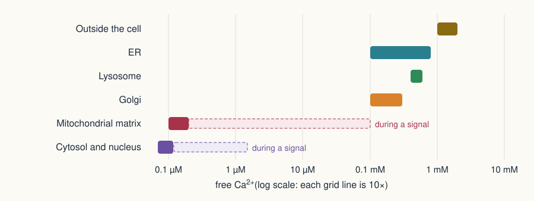{width="74%" fig-align="center"}

- **Pumps keep the cytosol at about 0.1 µM**: SERCA (into the ER), PMCA and Na⁺/Ca²⁺ exchange (out of the cell). Free Ca²⁺ outside and in the ER is **5 000–10 000 times** higher.
- Opening channels gives a fast, large **signal**; mitochondria take up Ca²⁺ during a signal and help shape it.
- The ER needs its Ca²⁺ for folding: the chaperones calnexin and calreticulin bind Ca²⁺. **Emptying the store causes ER stress.**

::: notes
Calcium is kept even more unequally than protons. The free calcium in the cytosol and nucleus is about 0.1 micromolar. Outside the cell it is one to two millimolar, and in the ER lumen around half a millimolar. The Golgi and lysosomes also store calcium. The scale is logarithmic: each grid line is a factor of ten, so the ER holds roughly five thousand times more free calcium than the cytosol. Pumps maintain this: SERCA pumps calcium from the cytosol into the ER, and the plasma membrane calcium pump and the sodium-calcium exchanger move it out of the cell. Because the resting level is so low, a few open channels give a large and fast rise, the calcium signal you met in the ion-channel lecture, and will meet again in signalling. During a signal, mitochondria near the release sites take up calcium, which both boosts their ATP production and limits how high the signal goes. Finally, a link to protein load: the ER folding chaperones calnexin and calreticulin need calcium. A drug that blocks SERCA, such as thapsigargin, empties the ER store and is a standard way to cause ER stress in experiments.
:::

## Energy and lipids: organelles feed each other {.smaller}

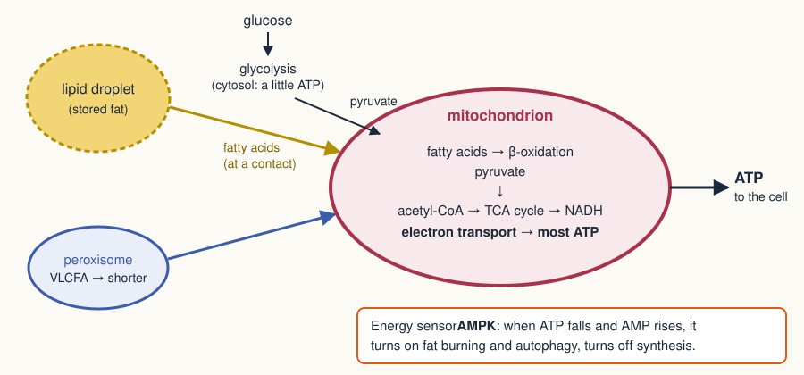{width="74%" fig-align="center"}

- **Fat** is stored in lipid droplets, **very long fatty acids** are shortened in peroxisomes, and **mitochondria** burn the rest. Most ATP comes from mitochondria (the mitochondria lecture).
- The sensor **AMPK** watches the energy charge: little ATP, much AMP → it switches on fuel use and **autophagy**, and switches off building (lipids, proteins).

::: notes
Energy is a team effort between organelles. Glucose is split in the cytosol by glycolysis, which gives a little ATP, and the product, pyruvate, goes into mitochondria. Fat is stored in lipid droplets. When it is needed, lipases release fatty acids, which are handed to mitochondria, often at contact sites between the droplet and the mitochondrion. Very long fatty acids, which mitochondria cannot handle, are first shortened in peroxisomes. In mitochondria, beta-oxidation and the citric acid cycle feed electrons into the electron transport chain, which makes most of the cell's ATP; you saw the mechanism in the mitochondria lecture, so we do not repeat it here. How does the cell know whether it has enough energy? The kinase AMPK is the sensor. When ATP is used faster than it is made, AMP and ADP rise, they bind AMPK and activate it. AMPK then switches on processes that make ATP, such as fatty-acid oxidation and glucose uptake, and autophagy, which recycles cell parts as fuel, and it switches off processes that cost ATP, such as making fat and proteins. Metformin, the diabetes drug, works partly through AMPK.
:::

## Protein load: the unfolded protein response as a feedback loop {.smaller}

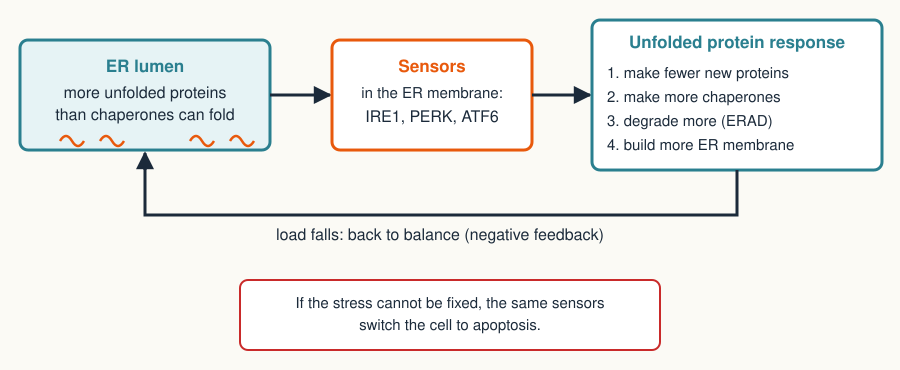{width="80%" fig-align="center"}

- A plasma cell makes **thousands of antibody molecules per second**; a β cell makes insulin in bursts. The ER must match its **folding capacity** to the **load**.
- **Recap** from the ER lecture: three sensors start the UPR. Here the point is the **logic**: a negative feedback loop, with **cell death** as the way out when it fails.

::: notes
The fourth variable is protein load. The ER folds about a third of all proteins the cell makes, and some cells are protein factories: a plasma cell secretes thousands of antibody molecules per second, and a pancreatic beta cell makes large amounts of insulin after every meal. If more proteins come in than the chaperones can fold, unfolded proteins pile up in the ER lumen. You met the response in the ER lecture: three sensors in the ER membrane, IRE1, PERK and ATF6, detect the unfolded proteins and start the unfolded protein response. Today, look at its logic. The response does four things: it slows the making of new proteins, it makes more chaperones, it makes more machinery for degrading misfolded proteins, and it makes more ER membrane. All four reduce the load or raise the capacity, so the load falls and the sensors go quiet again. That is a classic negative feedback loop, exactly like the pH and calcium loops. But if the stress cannot be fixed, the same sensors switch the cell to apoptosis. This matters in disease: beta cells in type 2 diabetes die partly from chronic ER stress.
:::

## How do we know? Measuring organelles {.smaller}

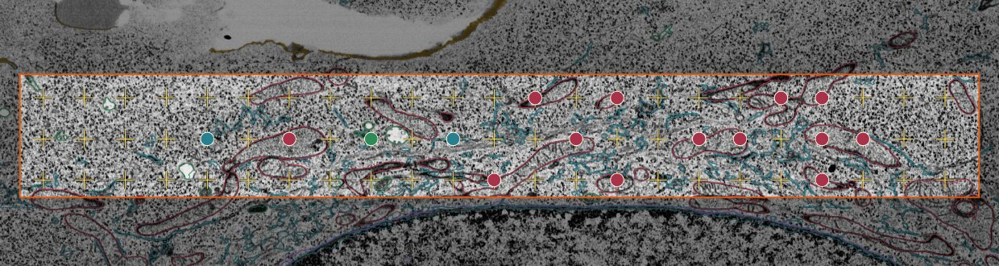{width="86%" fig-align="center"}

- **How much of the cell is mitochondria?** Put a **grid of points** on EM sections and count the points that fall on each organelle (**stereology**). Points on mitochondria ÷ all points = **area fraction**, and on random sections area fraction = **volume fraction**. Many sections, many cells. **Try it:** [Demo: measure the organelles](questions.qmd#explore).
- **What is the pH or Ca²⁺ inside?** Fluorescent **sensor proteins** with a sorting signal: a pH-sensitive GFP, or a Ca²⁺ sensor sent to the ER or the mitochondrial matrix. The colour or brightness reports the value in that compartment only.

::: notes
How do we know the numbers on the last slides? Two kinds of methods. First, how big is each organelle? Since the 1960s, cell biologists have measured organelle volumes with stereology. You lay a grid of points over an electron micrograph and count how many points fall on mitochondria, on ER and so on. The fraction of points on an organelle estimates the fraction of the section area it covers, and a geometric rule, found in the nineteenth century by the geologist Delesse for minerals in rock, says that on random sections the average area fraction equals the volume fraction. This is how we know that mitochondria fill about a fifth of a liver cell. The picture shows exactly this on our HeLa cell, and in the demo you can do it yourself. Second, what is the chemistry inside? We cannot put an electrode in a lysosome. Instead we make the cell express a fluorescent sensor protein with a sorting signal, so it ends up in one compartment only. A pH-sensitive GFP reports pH; calcium sensors, such as the photoprotein aequorin, have been sent to the ER and the mitochondrial matrix. Such sensors first showed the hot spots of calcium at ER–mitochondria contacts.
:::

## Organelles compared {.smaller}

| Compartment | Membranes | Own DNA | How proteins get in | Main job | pH | Free Ca²⁺ |
|---|---|---|---|---|---|---|
| **Cytosol** | – | – | made here (free ribosomes) | metabolism, signalling, protein synthesis | 7.2 | 0.1 µM |
| **Nucleus** | 2 (envelope) + lamina | yes (genome) | through pores (nuclear signal) | store and read DNA, make ribosomes | 7.2 | 0.1 µM |
| **ER** | 1 | – | **during** translation (signal peptide) | fold membrane and secreted proteins, lipids, Ca²⁺ store | 7.2 | 0.1–0.8 mM |
| **Golgi** | 1 | – | vesicles from the ER | modify (sugars) and sort | 6.7 → 6.0 | 0.1–0.3 mM |
| **Endosomes, lysosomes** | 1 | – | vesicles (M6P tag for enzymes) | sort uptake, digest | 6.5 → 4.5 | lysosome ≈ 0.5 mM |
| **Mitochondria** | 2 | yes (37 genes) | **after** translation (presequence, TOM/TIM) | ATP, Ca²⁺ buffer, start apoptosis | matrix ≈ 8 | 0.1 µM at rest |
| **Peroxisomes** | 1 | – | **after** translation, folded (–SKL) | oxidise fatty acids, destroy H₂O₂ | ≈ 7–8 | ? |
| **Lipid droplets** | **half** (monolayer) | – | proteins insert from the ER or cytosol | store fat, buffer fatty acids | (no water) | (no water) |

*Typical values for a mammalian cell. Learn the pattern, not the decimals.*

::: notes
This table is the exam summary of the whole block. Read it in columns. Membranes: two for the nucleus and mitochondria, one for most organelles, and only half a bilayer for the lipid droplet. Own DNA: only the nucleus and mitochondria, the second a remnant of their bacterial origin. How proteins get in: there are three routes, which you learned in the protein-sorting lecture. Gated transport through pores into the nucleus; transport across a membrane, either during translation into the ER, or after translation into mitochondria and peroxisomes; and vesicles for the Golgi, endosomes and lysosomes, which all receive their proteins from the ER. Then the chemistry: neutral pH in the cytosol, nucleus and ER, falling pH along the secretory and endocytic routes, alkaline mitochondrial matrix; free calcium low in the cytosol, nucleus and mitochondria at rest, high in the ER, Golgi and lysosomes. Notice a rule: compartments that are topologically outside the cell, the lumens of the ER, Golgi and lysosomes, have high calcium like the outside. A typical exam question asks you to compare two organelles in three or four of these columns.
:::

## Why it matters: progeria and lonafarnib {.smaller}

:::: {.columns}
::: {.column width="64%"}
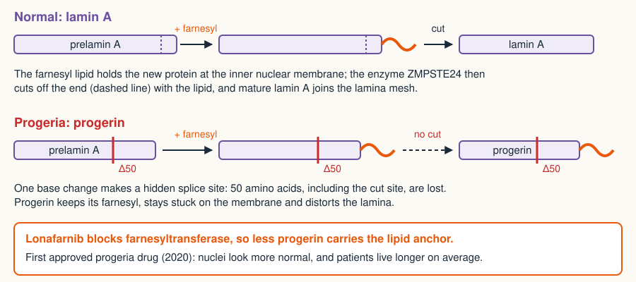{width="100%"}
:::
::: {.column width="36%"}
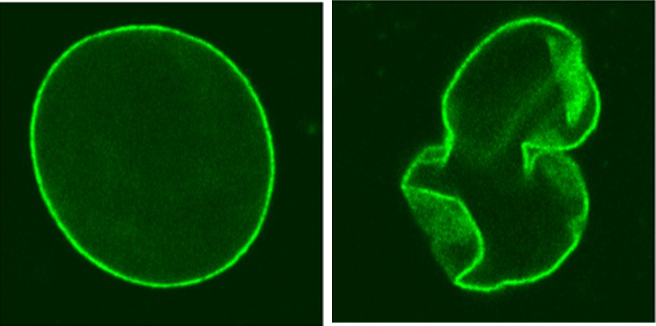{width="100%"}

[Nuclei stained for lamin A: a healthy cell (left) and a cell from a child with progeria (right), with a folded, blebbed envelope.]{style="font-size:0.8em"}

- **Hutchinson–Gilford progeria**: about 1 in 4–8 million births. Children age fast and die in their teens, mostly of heart attack or stroke.
:::
::::

::: notes
Progeria shows what happens when the lamina goes wrong. Remember the smooth rim of lamin A from the nucleus slide. Lamin A is made as a precursor, prelamin A, which ends in a short motif that gets a farnesyl group, a lipid. The lipid holds the new protein at the inner nuclear membrane. Then an enzyme, ZMPSTE24, cuts off the last fifteen amino acids together with the lipid, and mature lamin A joins the lamina. In Hutchinson–Gilford progeria, a single, new base change in the lamin A gene creates a hidden splice site, and fifty amino acids are lost, including the cut site. The resulting protein, progerin, keeps its lipid forever, stays stuck on the membrane and disturbs the lamina. The nuclei become folded and blebbed, as in the image, chromatin organisation and DNA repair suffer, and cells, especially in blood vessels, age early. Children with progeria look old in early childhood and die, on average in their teens, of atherosclerosis. Lonafarnib blocks farnesyltransferase, the enzyme that adds the lipid. It was first developed against cancer, to block the farnesylation of Ras. In 2020 it became the first approved drug for progeria; it improves survival by a few years on average, but it is not a cure.
:::

## Why it matters: Zellweger syndrome, a cell without peroxisomes {.smaller}

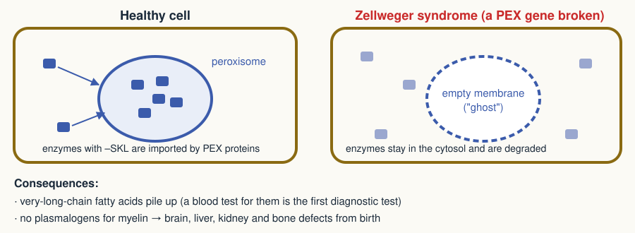{width="76%" fig-align="center"}

- Caused by mutations in a **PEX** gene, which encodes the import machinery (PEX1 most often). About 1 in 50 000 births.
- Without import, peroxisomes are empty **"ghosts"**. **Very-long-chain fatty acids** accumulate (blood test) and **plasmalogens** are missing.
- Babies have weak muscle tone, seizures, liver disease; the severe form is fatal in the first year. No cure: treatment supports the child. You meet such diseases again in **Sjukdomslära**.

::: notes
Zellweger syndrome is the clearest proof that peroxisomes are essential. It was described in 1964, and in 1973 electron microscopists found that the liver and kidney cells of these children had no visible peroxisomes. Today we know why. The disease is caused by mutations in any of about thirteen PEX genes, which encode the import machinery of peroxisomes; PEX1 is the most common. The peroxisome membrane can still form, but the enzymes with the SKL tag cannot get in. They stay in the cytosol, where they do not work and are degraded. What is left are empty membrane sacs, called ghosts. The cell can no longer shorten very-long-chain fatty acids, so these accumulate in blood and tissues, and the first diagnostic test measures them in a blood sample. Plasmalogens are missing, which harms myelin and the brain. Affected babies are floppy, have seizures and liver disease, and in the severe form usually die in the first year. Milder forms exist, together called Zellweger spectrum disorders. There is no cure yet. Note the logic: one broken import step empties a whole organelle, which is why the protein-sorting machinery matters so much.
:::

## Summary {.smaller}

1. The **nucleus** has a double membrane continuous with the ER, pores that let small molecules pass, and a **lamina** of lamins that gives shape and holds chromatin. **Peroxisomes** (one membrane, imported folded enzymes) oxidise very long fatty acids and destroy H₂O₂. **Lipid droplets** store fat under a single phospholipid layer.
2. Organelles meet at **contact sites** (10–30 nm, no fusion), mostly with the **ER**: lipids and **Ca²⁺** pass there (ER–mitochondria), and the ER store refills there (STIM–ORAI).
3. Each compartment keeps **set points** by **negative feedback**: **pH** by H⁺ pumps (lysosome 4.5–5, matrix ≈ 8), **Ca²⁺** by pumps and channels (cytosol 0.1 µM, ER ~0.5 mM), **energy** via AMPK, **protein load** via the UPR.
4. **Compare** organelles by membranes, DNA, protein entry, job, pH and Ca²⁺. **Stereology** measures their size; targeted **sensors** measure their chemistry.
5. One broken part of one organelle causes systemic disease: **progerin** in progeria (**lonafarnib**), **PEX** genes in **Zellweger syndrome**.

*Read more (optional): Alberts et al., Molecular Biology of the Cell, 7th ed., ch. 12 and 14.*

[Image credits](../credits.qmd#organelles-homeostasis){style="font-size:0.7em"}

::: notes
Five take-home points. First, three organelles that had no lecture of their own: the nucleus with its double envelope, pores and lamina; peroxisomes, which import folded enzymes and do oxidations that make hydrogen peroxide, which they destroy at once; and lipid droplets, fat stores with only half a membrane. Second, organelles are not islands. They meet at contact sites, mostly with the ER, and pass lipids and calcium across a gap of a few tens of nanometres; the ER refills its calcium through contacts with the plasma membrane. Third, homeostasis: each compartment has set points for pH, calcium, energy and protein load, kept by sensors and negative feedback. Fourth, you should be able to compare any two organelles using the table, and to say how we measure their size and their chemistry. Fifth, defects in single organelle proteins cause whole-body diseases, from progeria to Zellweger syndrome. This ends the block on protein handling and organelles. Next, we move on to how cells receive and process signals.
:::
