## About this lecture {.smaller}

A protein is not made once and kept forever. It must **fold** in a crowded cytosol, it is switched **on and off** by chemical marks, and sooner or later it is **destroyed**, some within minutes, some after years. Today: the life of a protein from the ribosome to the proteasome.

After this lecture you can:

- explain why folding is risky in the cytosol and how **chaperones** (Hsp70, chaperonins) help;
- explain how misfolded proteins **aggregate** and form **amyloid**;
- describe how **phosphorylation**, **acetylation** and **ubiquitination** turn a protein into a **switch**;
- describe the **ubiquitin–proteasome system**: E1, E2, E3, degrons and the proteasome;
- use **synthesis and degradation rates** to explain protein **half-life** and **steady state**, and how they are measured (**cycloheximide chase**, **pulse-chase**);
- explain how **bortezomib**, **PROTACs** and **lenalidomide** use this machinery, and how misfolding leads to **Alzheimer's** and **Parkinson's** disease.

**ELO 4** (protein handling), with links to **ELO 9** (disease).

::: notes
In biochemistry you learned what a protein is: a chain of amino acids that folds into a shape, and the shape decides what it does. Today we follow a protein through its life inside a cell. It starts as a chain leaving the ribosome, and it must fold correctly in a very crowded space; helper proteins called chaperones make this possible. Once folded, a protein is often switched on and off by small chemical marks that enzymes add and remove. And finally every protein is destroyed, mostly by a machine called the proteasome, after being marked with a small protein called ubiquitin. The balance between making and destroying sets how much of each protein a cell has. We will also look at how we measure protein lifetimes, and at drugs that block or hijack the destruction machinery. Folding and quality control inside the endoplasmic reticulum, and degradation in lysosomes, get their own lectures; today we stay in the cytosol and nucleus. This lecture covers ELO 4, with links to disease mechanisms, ELO 9.
:::

## The question: why do some proteins live for minutes, and others for your whole life? {.smaller}

:::: {.columns}
::: {.column width="45%"}
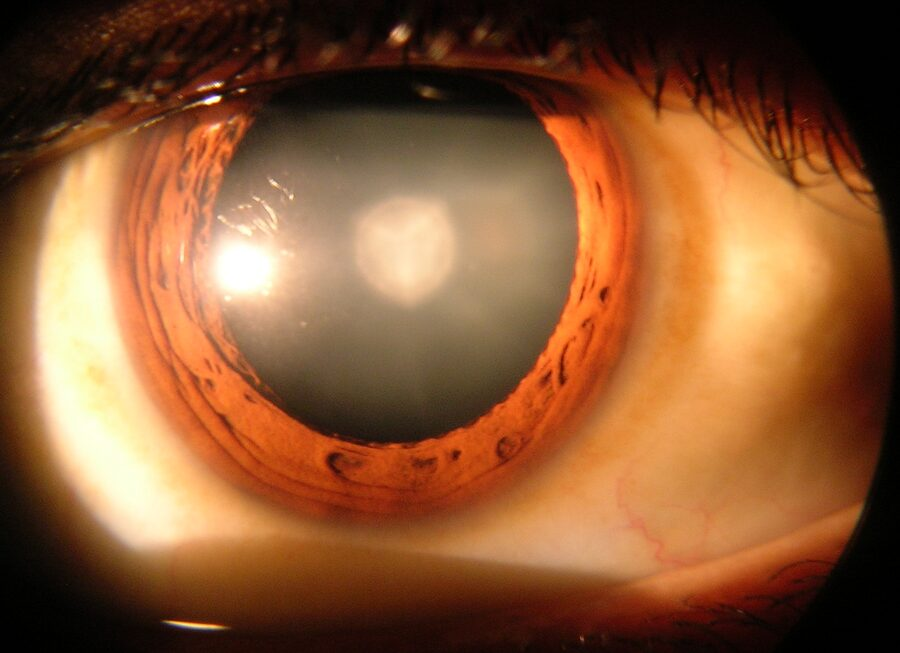{width="100%"}

*Cataract: the lens of this eye has become cloudy.*
:::
::: {.column width="55%"}
- The **crystallins** in your eye lens were made **before you were born**. They are never replaced. Over decades they are damaged, **unfold and clump**: the lens turns cloudy (**cataract**).
- The tumour suppressor **p53** is made all the time but lives only **5–20 minutes**. When DNA is damaged, the cell **stops destroying it**, and p53 builds up within an hour.
- Most proteins in a growing human cell live **hours to a few days**.

**How does a cell decide which protein to destroy, and when? And how does a protein keep its shape at all?**
:::
::::

::: notes
Look at this eye. The lens should be clear, but here it is milky white: a cataract. The lens is made of tightly packed cells that lost their nucleus and organelles early in life. They are filled with proteins called crystallins, which were made when you were an embryo and never replaced. Over sixty or seventy years, UV light and chemical damage slowly unfold some crystallins. Unfolded proteins stick together, and the clumps scatter light. Cataract is the most common cause of blindness worldwide. Compare this with p53, the protein that stops a cell from dividing when its DNA is damaged. A cell makes p53 all the time, but destroys each molecule within minutes. When DNA is damaged, the cell simply stops destroying it, and p53 rises fast. So the lifetime of a protein is not an accident: it is controlled, and control of destruction is as important as control of synthesis. Today we ask how proteins keep their shape, how the cell marks proteins for destruction, and how this sets the amount of each protein.
:::

## Recap: a protein's fold is only just stable {.smaller}

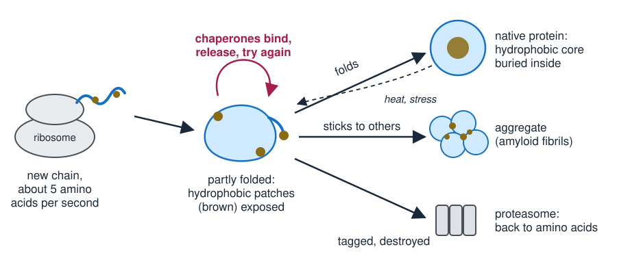{width="84%" fig-align="center"}

- The amino acid sequence contains the information for the fold (Anfinsen). The **hydrophobic** side chains are buried in a **core**.
- A folded protein is only slightly more stable than the unfolded chain: often only **20–60 kJ/mol**, the energy of a few hydrogen bonds. Heat, mutations or damage can unfold it.
- A chain that is **partly folded** shows hydrophobic patches. It can **fold**, **stick to other chains** (aggregate), or be **destroyed**. This lecture is about these three fates.

::: notes
This is a recap from biochemistry, with one new point. Christian Anfinsen showed in the 1950s and 60s that a purified, unfolded enzyme can refold by itself in a test tube: the sequence contains all the information for the shape. In the folded protein the hydrophobic side chains are hidden in the core, away from water. The new point is that the folded state is only marginally stable. The difference in free energy between the folded and unfolded protein is typically twenty to sixty kilojoules per mole, about as much as a few hydrogen bonds. So proteins breathe, partly unfold and refold, all the time, and a small push from heat or a mutation can tip the balance. A partly folded chain has a problem: its hydrophobic patches are exposed. Such a chain has three possible futures, shown in the diagram. It can fold, often with help. It can stick to other exposed chains and form an aggregate. Or the cell can recognise it as damaged and destroy it. The rest of the lecture follows these three paths, and how the cell chooses between them.
:::

## Folding in a crowded cytosol {.smaller}

:::: {.columns}
::: {.column width="42%"}
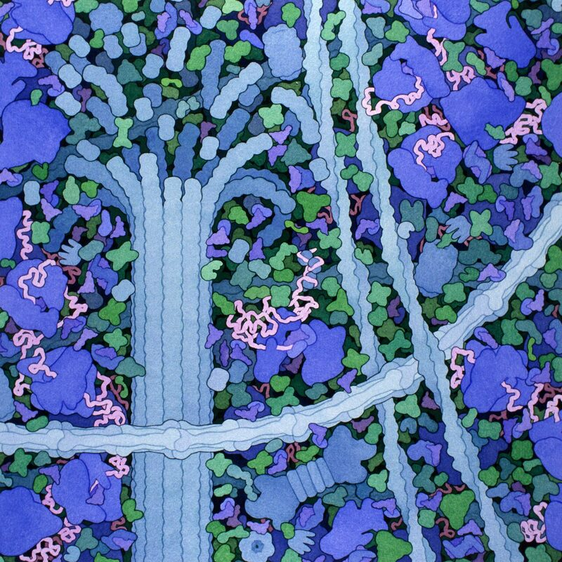{width="100%"}

*Painting of the cytoplasm at molecular scale, drawn from known structures. Blue: ribosomes; long tubes: cytoskeleton filaments.*
:::
::: {.column width="58%"}
- The cytosol holds about **200–300 g of protein per litre**: macromolecules fill a quarter or more of the volume.
- A new chain leaves the ribosome **one amino acid at a time**, about **5 per second** in human cells. A 500-residue protein needs **about 2 minutes**; it cannot fold until a whole domain is out.
- Meanwhile its hydrophobic stretches are exposed, among thousands of other sticky surfaces. **Crowding** makes sticking more likely.
- **Chaperones** bind exposed hydrophobic stretches, prevent wrong contacts and give the chain time and space to fold. Many are **heat shock proteins (Hsp)**: the cell makes more of them when stress unfolds proteins.
:::
::::

::: notes
Anfinsen's experiments were done in dilute solution in a test tube. A cell is very different. This painting by David Goodsell shows the inside of a cell at the scale of molecules, drawn from real structures. Every space is filled: ribosomes in blue, filaments of the cytoskeleton, and thousands of other proteins. The cytosol contains two to three hundred grams of protein per litre, which is like a thick syrup. In such a crowded space, molecules are pushed together, which makes them stick to each other more easily. The second problem is time. A ribosome adds about five amino acids per second, so a large protein takes minutes to make, and a domain cannot fold properly until the whole domain has left the ribosome. During that time, the growing chain shows hydrophobic stretches to its neighbours. The solution is a set of proteins called molecular chaperones. They do not contain information about the final shape. They simply bind exposed hydrophobic stretches and release them again, so that wrong contacts are prevented. Many chaperones were first found as heat shock proteins, because cells make more of them after a heat shock, when many proteins unfold.
:::

## Hsp70: hold and release, powered by ATP {.smaller}

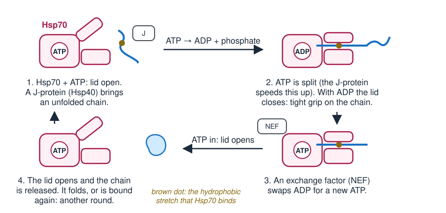{width="80%" fig-align="center"}

- Hsp70 binds short **hydrophobic stretches** of an unfolded chain, often while it is still on the ribosome. With **ATP**: open, loose binding. With **ADP**: lid closed, tight grip.
- Each round of binding and release gives the chain a new chance to fold. Helpers: **J-proteins** (Hsp40) bring chains and start ATP hydrolysis; **exchange factors** reload ATP.
- Hsp70 also unfolds aggregates (with Hsp110) and hands hopeless cases to an **E3 ligase** for destruction.

::: notes
Hsp70 is the main all-purpose chaperone of the cytosol, and it works by a cycle of binding and release. It has two parts: a domain that binds ATP and a domain that binds the substrate chain, with a lid. Follow the cycle from step one. With ATP bound, the lid is open and Hsp70 binds chains loosely. A helper called a J-protein, or Hsp40, brings an unfolded chain and stimulates Hsp70 to split its ATP. In step two, with ADP bound, the lid closes over a short hydrophobic stretch of the chain, and Hsp70 holds it tightly. That stretch is now covered and cannot stick to anything else. In step three, a nucleotide exchange factor removes the ADP, and new ATP binds. In step four the lid opens and the chain is released. If it folds, fine. If it still shows hydrophobic stretches, Hsp70 binds it again. So Hsp70 uses ATP not to fold the protein, but to give it many chances. If a chain never folds, Hsp70 can pass it to an E3 ubiquitin ligase, which marks it for destruction. We meet E3s later today.
:::

## Chaperonins: a folding cage {.smaller}

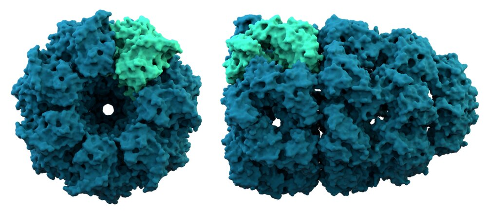{width="46%" fig-align="center"}

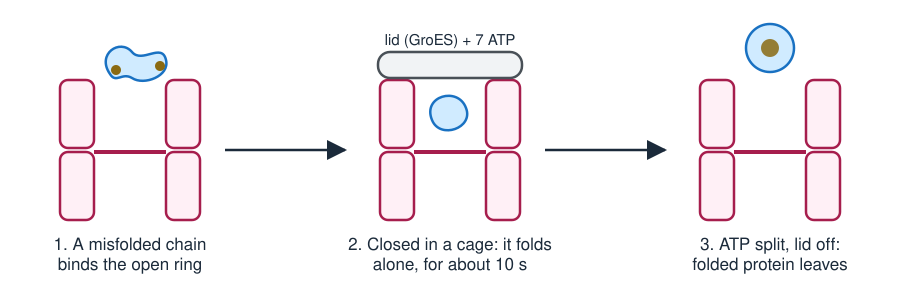{width="58%" fig-align="center"}

- A barrel of **two rings** (7 or 8 subunits each). A misfolded chain enters the ring, a **lid** closes, and it folds **alone** in a protected chamber for about **10 s** (an ATP timer).
- Bacteria: **GroEL** with the lid **GroES** (structure above). Human cytosol: **TRiC** (CCT), needed for **actin and tubulin**; mitochondria: **Hsp60**.

::: notes
Some proteins need more than Hsp70. For these, cells have chaperonins: large barrel-shaped machines with a cavity inside. The structure at the top is the bacterial chaperonin GroEL, seen from the end and from the side, with its lid, GroES, in green. GroEL is two rings of seven subunits stacked back to back. The cartoon shows how it works. A misfolded chain binds to hydrophobic patches at the rim of an open ring. Then ATP and the lid bind. This changes the shape of the ring: the inside wall becomes water-loving, the chain is released into the closed chamber, and it can fold there alone, without meeting any other chain. This is sometimes called the Anfinsen cage, because inside it the protein is in the same situation as in Anfinsen's test tube. After about ten seconds, ATP hydrolysis acts as a timer, the lid comes off and the protein leaves, folded or not. If not, it can enter again. Human cells have a chaperonin called TRiC in the cytosol, which is essential for folding actin and tubulin, the building blocks of the cytoskeleton, and Hsp60 in mitochondria.
:::

## When folding fails: aggregates and amyloid {.smaller}

:::: {.columns}
::: {.column width="64%"}
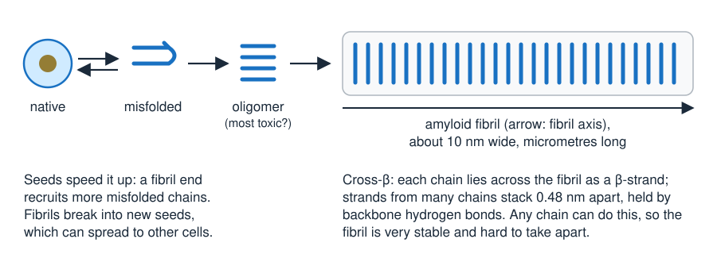{width="100%"}
:::
::: {.column width="36%"}
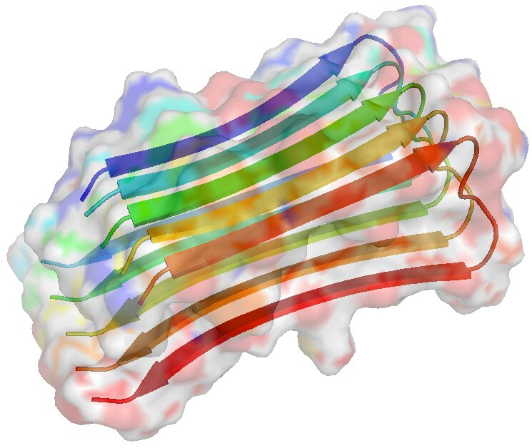{width="100%"}

*Model of an amyloid fibril: β-strands (arrows) from many chains stacked into one long sheet.*
:::
::::

- **Amorphous aggregates**: tangles of misfolded chains, often cleared by chaperones and degradation.
- **Amyloid**: ordered fibrils in which chains of **any sequence** stack as **cross-β** sheets. Very stable, they **seed** their own growth. About **50** human diseases involve amyloid.

::: notes
What happens when chaperones and degradation cannot keep up? Misfolded chains stick to each other. Often they form disordered clumps, called amorphous aggregates, which chaperones can sometimes pull apart. But some proteins form a special, highly ordered aggregate: amyloid. In an amyloid fibril, each chain forms a flat β-strand that lies across the fibril, and strands from thousands of chains stack on top of each other, just under half a nanometre apart, held by hydrogen bonds between their backbones. The model on the right shows this sheet of stacked strands. Because the backbone is the same in every protein, almost any chain can form amyloid under some conditions. Fibrils grow from their ends: a fibril end acts as a seed and recruits new misfolded chains, and when fibrils break, the pieces become new seeds. This is why amyloid can spread, and in prion diseases even pass from one animal to another. Small clumps of a few chains, called oligomers, may be more toxic to cells than the large fibrils. Amyloid is found in Alzheimer's disease, Parkinson's disease, type 2 diabetes and about fifty other diseases.
:::

## A protein as a switch: phosphorylation {.smaller}

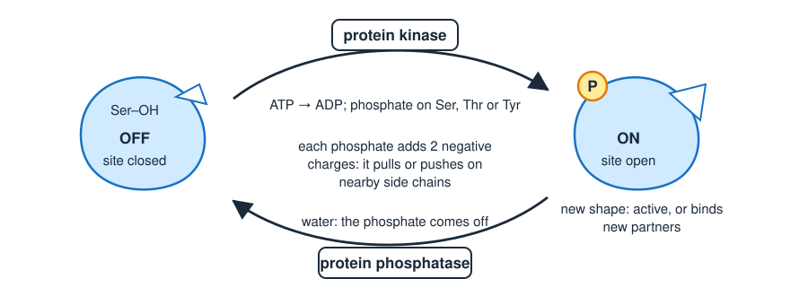{width="80%" fig-align="center"}

- A **protein kinase** moves the end phosphate of **ATP** onto **serine, threonine or tyrosine**; a **protein phosphatase** removes it. Humans have about **500 kinases** and about **150 phosphatases**.
- The phosphate carries **two negative charges**: it changes the protein's **shape**, its **activity**, its **partners** or its **location**, within seconds.
- **Reversible and fast**: the cell's most common way to switch proteins in **signalling** (the signalling lectures) and the **cell cycle**.

::: notes
A folded protein is often not simply active. Many proteins can be switched between two states, and the most common switch is phosphorylation. A protein kinase takes the end phosphate from ATP and attaches it to the hydroxyl group of a serine, threonine or tyrosine side chain. The phosphate is large and carries two negative charges. It can attract positively charged side chains nearby and repel negative ones, which can pull a loop into a new position, open an active site, or create a new binding surface for another protein. A protein phosphatase removes the phosphate again with water. The switch is therefore fully reversible, and the balance of kinase and phosphatase activity decides how much of the protein is in the on state. Humans have about five hundred protein kinases and fewer phosphatases, and most proteins are phosphorylated at some time. Phosphorylation is fast, within seconds, and does not need new protein to be made. That is why it dominates signalling, which you will meet in the signalling lectures, and the cell cycle. Kinase inhibitors are one of the largest groups of cancer drugs.
:::

## More marks: acetylation, ubiquitination, methylation {.smaller}

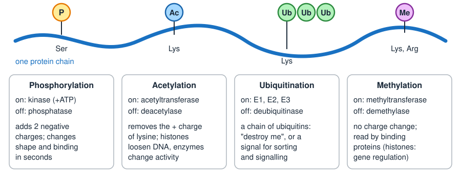{width="86%" fig-align="center"}

- Each mark has **writers** (add it), **erasers** (remove it) and **readers** (proteins that bind the mark and act).
- Marks **combine**: one phosphate can create a binding site for an **E3 ligase**, so the protein is ubiquitinated and destroyed (next slides).
- Many other modifications exist (sugars, lipids); the sugars added in the ER and Golgi come in those lectures.

::: notes
Phosphorylation is not the only mark. Lysine side chains, with their positive charge, can carry several. Acetylation adds an acetyl group from acetyl-CoA to a lysine and removes its positive charge. On histones this loosens the grip of the histone on negatively charged DNA and opens chromatin for transcription, which you met in gene regulation. Acetylation also changes the activity of many enzymes in the cytosol and mitochondria, linking them to the cell's metabolic state. Deacetylases remove the mark; some deacetylase inhibitors are used against lymphoma. Methylation adds one to three methyl groups to lysine or arginine without changing the charge; it is read by proteins that bind the methylated site, especially on histones. Ubiquitination attaches a whole small protein, ubiquitin, to a lysine. A chain of ubiquitins is the signal for destruction, but single ubiquitins and other chain types have other jobs. The general idea is the same for all marks: enzymes write them, other enzymes erase them, and reader proteins bind them and act. Marks also combine: phosphorylation can create the signal that leads to ubiquitination, as we will see.
:::

## Ubiquitin tagging: E1, E2, E3 {.smaller}

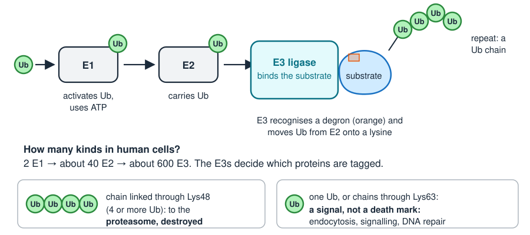{width="80%" fig-align="center"}

- **Ubiquitin** (Ub) is a small protein of **76 amino acids**, found in all eukaryotes ("ubiquitous").
- **E1** activates it with ATP, **E2** carries it, **E3** picks the substrate and links Ub to one of its **lysines**. Repeated rounds build a **chain**. **Deubiquitinases** can remove it again.
- The **chain type** is a code: **Lys48 chains** send a protein to the **proteasome**; single Ub and **Lys63** chains are signals (e.g. for **endocytosis**, the endocytosis lecture).

::: notes
How does the cell mark a protein for destruction? It attaches ubiquitin, a small, very stable protein of seventy-six amino acids. Three kinds of enzyme work in a relay. E1, the activating enzyme, uses ATP to attach ubiquitin to itself. E1 passes the ubiquitin to an E2, the conjugating enzyme. The E2 then teams up with an E3, the ligase, which binds the target protein, the substrate. The E3 positions the substrate so that the ubiquitin is transferred onto one of its lysine side chains. Ubiquitin itself has seven lysines, so a second ubiquitin can be added onto the first, and so on, building a chain. Notice the numbers: humans have two E1s, about forty E2s, but about six hundred E3s. The E3s recognise different substrates, so they provide the specificity, much as kinases do for phosphorylation. The type of chain matters. A chain of four or more ubiquitins linked through lysine 48 is read by the proteasome and means destroy. A single ubiquitin, or chains linked through lysine 63, act as signals, for example to send a membrane protein into endocytosis, which comes in the endocytosis lecture.
:::

## Degrons: what decides that a protein is destroyed? {.smaller}

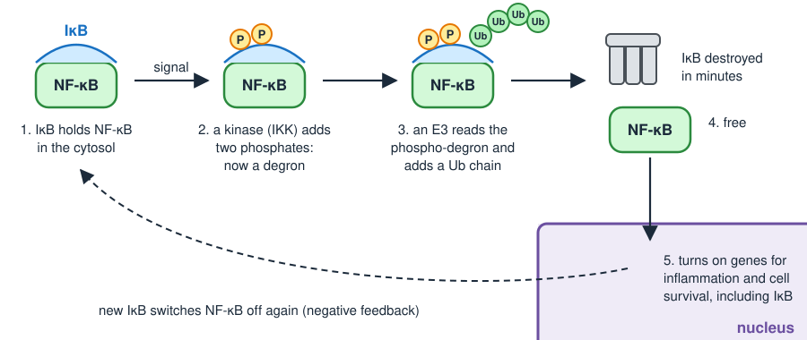{width="76%" fig-align="center"}

A **degron** is a feature that an E3 recognises:

- a **phosphorylated motif** (phospho-degron): the switch decides the protein's life, as for **IκB** above, **β-catenin** and many **cyclins** and cell-cycle proteins;
- **exposed hydrophobic stretches** of a misfolded protein (via Hsp70 and its partner E3s): **quality control**;
- certain amino acids at the **N-terminus** (the N-degron rule).

::: notes
E3 ligases do not pick substrates at random: they recognise degrons, short features that mark a protein as ready to destroy. The diagram shows a classic example, the transcription factor NF-kappa-B. In a resting cell, NF-kappa-B is held in the cytosol by an inhibitor protein, I-kappa-B. When the cell senses infection or inflammation, a kinase called IKK phosphorylates I-kappa-B on two serines. These two phosphates form a phospho-degron, which an E3 ligase recognises. The E3 adds a lysine-48 chain, and the proteasome destroys I-kappa-B within minutes. NF-kappa-B is now free, enters the nucleus and turns on genes for inflammation and cell survival. One of these genes encodes I-kappa-B itself, so the system switches itself off again: negative feedback. The same logic, phosphorylation followed by ubiquitination, controls beta-catenin in Wnt signalling and the destruction of cyclins in the cell cycle. A second type of degron is simply misfolding: exposed hydrophobic stretches are bound by chaperones, which recruit E3s. A third depends on which amino acid is at the very start of the chain, the N-degron rule.
:::

## The proteasome: a shredder with a gate {.smaller}

:::: {.columns}
::: {.column width="46%"}
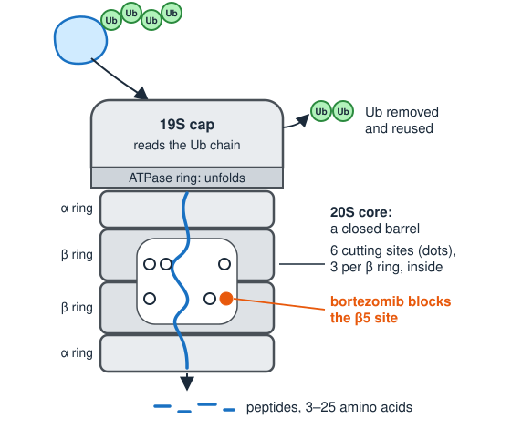{width="100%"}
:::
::: {.column width="54%"}
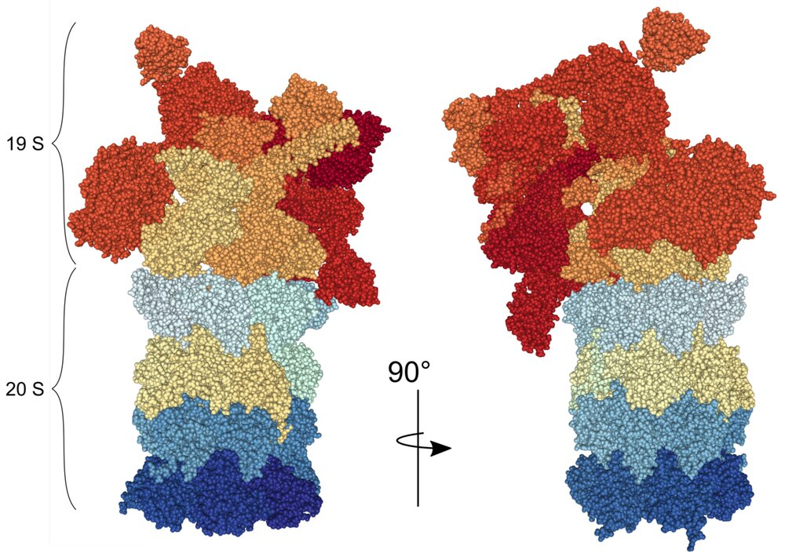{width="80%"}

*Structure of the yeast 26S proteasome: 20S core (blue–yellow rings) and 19S cap (red), each subunit in its own colour.*

- **26S proteasome**: about 2.5 MDa, many thousands per cell, in the **cytosol and nucleus**.
- The **19S cap** binds the Ub chain, removes and **recycles** the ubiquitin, and **unfolds** the protein with ATP.
- The **20S core** cuts it inside a closed chamber into short peptides, which cytosolic peptidases turn into amino acids.
:::
::::

::: notes
The proteasome is where ubiquitinated proteins end. It is a huge complex, about two and a half megadaltons, and every cell has many thousands of them in the cytosol and the nucleus. The structure on the right, and the cartoon on the left, show its two parts. The core particle, 20S, is a barrel of four stacked rings of seven subunits. The two inner rings, the beta rings, carry six protease active sites, all facing the inside of the barrel. The two outer alpha rings form a gate. Because the active sites are hidden inside, a normal folded protein in the cytosol is safe: it cannot get in. The cap, 19S, is the gatekeeper. Its receptors bind the lysine-48 ubiquitin chain. Enzymes in the cap remove the ubiquitin, which is reused. A ring of six ATPases then grips the protein, unfolds it, and threads it as a single chain into the core. Inside, the chain is cut into peptides of about three to twenty-five amino acids, which other enzymes in the cytosol break down to amino acids. Some peptides are shown on the cell surface to the immune system, which you will meet in immunology.
:::

## Turnover: synthesis and degradation set the amount {.smaller}

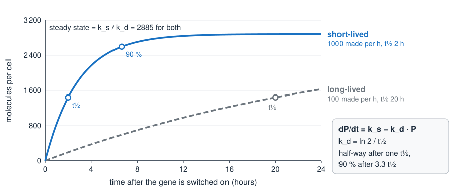{width="82%" fig-align="center"}

- $\dfrac{dP}{dt} = k_s - k_d\,P$: molecules are **made** at rate $k_s$; each is **destroyed** with probability $k_d$ per hour, so $t_{1/2} = \ln 2 / k_d$.
- **Steady state**: $P_{ss} = k_s / k_d$. The **time to get there depends only on $k_d$**: half-way after one half-life. Short-lived proteins respond fast. **Try it:** [Demo: protein turnover](questions.qmd#explore)

::: notes
Now we can put synthesis and destruction together with one equation. The amount of protein P changes as the rate of synthesis, k s, minus the rate of degradation. Degradation is first order: each molecule has the same chance per hour of being destroyed, k d, so the total rate is k d times P. The half-life is the natural log of two divided by k d. At steady state the two rates are equal, and P equals k s divided by k d. Look at the plot. Both proteins end up at the same amount, almost three thousand molecules per cell. The blue one is made ten times faster but also destroyed ten times faster. The difference is how quickly they get there. The time to reach steady state depends only on the degradation rate: half-way after one half-life, ninety percent after about three point three half-lives. So a protein with a two-hour half-life responds to a change within hours, while one with a twenty-hour half-life needs days. This is why regulators such as transcription factors, cyclins and p53 are short-lived: high turnover costs energy but makes them fast. In growing cells, dilution by cell division adds to k d. The demo lets you try all this.
:::

## How do we know? Cycloheximide chase {.smaller}

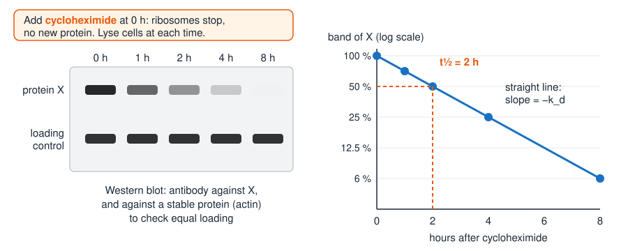{width="82%" fig-align="center"}

- **Cycloheximide** blocks the eukaryotic ribosome: $k_s = 0$, so $P(t) = P_0\,e^{-k_d t}$. On a **log scale** the decay is a **straight line**; read $t_{1/2}$ where the band is 50 %.
- Add a **proteasome inhibitor** too: if the decay slows, the protein is degraded by the proteasome. **Caution:** cycloheximide stops all synthesis, which stresses the cell, so only short experiments (hours) can be trusted.

::: notes
How do we measure a half-life in a real cell? The simplest method is a cycloheximide chase. Cycloheximide is a small molecule from a soil bacterium that blocks elongation on eukaryotic ribosomes. Add it to cultured cells and no new protein is made. From that moment the amount of each protein can only fall, and it falls exponentially with its own degradation rate. Collect cells at several times, separate the proteins by SDS gel electrophoresis, and detect your protein with an antibody on a Western blot. A stable protein such as actin serves as a control that equal amounts were loaded. Plot the band intensity on a logarithmic scale against time: the points fall on a straight line whose slope is minus k d, and the half-life is where the band has fallen to half. Here the protein has a half-life of two hours. A useful variation is to add a proteasome inhibitor together with cycloheximide. If the protein now disappears more slowly, it is degraded by the proteasome. The weakness of the method is that stopping all protein synthesis harms the cell: short-lived regulators vanish, and after many hours the cell's behaviour changes. So results over long times are unreliable.
:::

## How do we know? Pulse-chase labelling {.smaller}

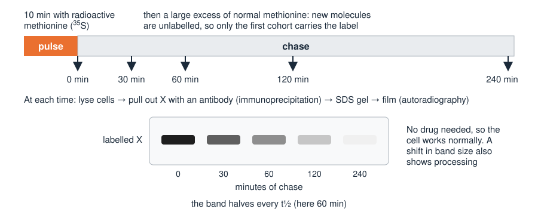{width="84%" fig-align="center"}

- **Pulse**: a short time with a **labelled amino acid** (radioactive ³⁵S-methionine, or today often a heavy-isotope or clickable amino acid). Only molecules made in this window are labelled.
- **Chase**: excess normal amino acid. Follow the **labelled cohort** over time; the cell itself keeps working normally.
- Modern versions with **mass spectrometry** measured thousands of half-lives at once: the **median** protein in cultured mouse cells lives about **2 days**.

::: notes
A second method avoids the drug. In a pulse-chase experiment you give cells a short pulse, for example ten minutes, of an amino acid that carries a label. Classically this was methionine with radioactive sulfur-35. Every protein made during those ten minutes carries the label; proteins made before or after do not. Then you chase: you replace the medium with one that contains a large excess of normal methionine, so any new protein is unlabelled. At each time point you lyse the cells, pull out your protein with an antibody, run a gel and expose it to film. The labelled band fades as the labelled molecules are destroyed, and you can read the half-life as before. Because nothing is blocked, the cell works normally. The same design can show where a protein goes and how it is processed, for example a change in size when sugars are added; the secretion lectures use it to follow proteins through the ER and Golgi. Today, labels with heavy isotopes and mass spectrometry measure the turnover of thousands of proteins in one experiment. In mouse fibroblasts the median half-life was about two days, while many regulators lived less than an hour.
:::

## Why it matters: bortezomib in multiple myeloma {.smaller}

:::: {.columns}
::: {.column width="36%"}
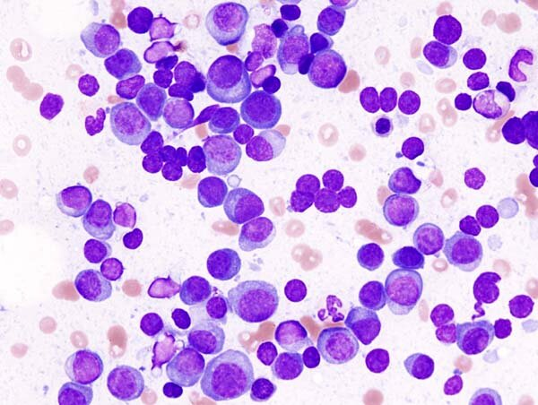{width="100%"}

*Bone marrow smear from a patient with multiple myeloma: many plasma cells (purple, round, nucleus to one side).*
:::
::: {.column width="64%"}
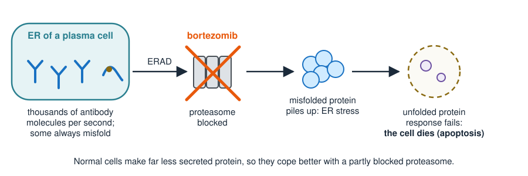{width="100%"}

- **Multiple myeloma**: a cancer of **plasma cells**, which make huge amounts of antibody.
- **Bortezomib** (2003) blocks the **β5 site** of the proteasome (the proteasome slide). Misfolded protein piles up and the myeloma cell dies. Newer: **carfilzomib**, oral **ixazomib**.
:::
::::

::: notes
Our first drug acts on the proteasome directly. Multiple myeloma is a cancer of plasma cells, the cells that make antibodies. The smear on the left shows bone marrow full of them. Each plasma cell secretes thousands of antibody molecules every second, made in the endoplasmic reticulum. Some of them always misfold; these are pulled back out of the ER into the cytosol and destroyed by the proteasome, a process you meet in the ER lecture. Myeloma cells therefore depend heavily on their proteasomes. Bortezomib is a small molecule with a boronic acid group that binds the active threonine of the beta-5 site inside the proteasome core, the site shown in orange on the proteasome slide. When it is partly blocked, misfolded proteins pile up, the unfolded protein response cannot cope, and the myeloma cell kills itself by apoptosis. Normal cells, which make far less protein for export, survive better. Bortezomib was approved in 2003 and, together with other drugs, has more than doubled survival in myeloma. Its side effects, such as nerve damage, show that all cells need their proteasomes. You meet the testing of such drugs in the course on clinical trials and drug development.
:::

## Why it matters: drugs that hijack E3 ligases {.smaller}

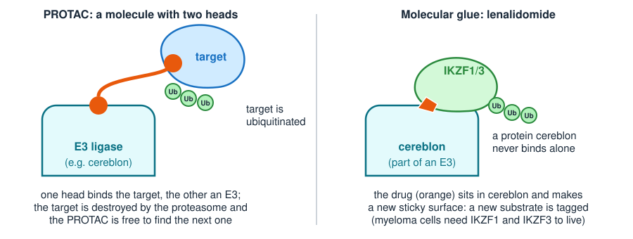{width="84%" fig-align="center"}

- **Thalidomide** (1957) caused severe limb malformations in about 10 000 children. Fifty years later its target was found: the E3 component **cereblon**. Thalidomide, **lenalidomide** and pomalidomide are **molecular glues**: cereblon now tags **new substrates** (for myeloma cells, IKZF1 and IKZF3; in embryos, SALL4).
- **PROTACs** are designed glues: remove a disease protein instead of only blocking it. One drug molecule destroys **many** targets. The first are in **late clinical trials** (e.g. against the oestrogen receptor in breast cancer).

::: notes
The second application turns the ubiquitin system into a tool. Thalidomide was sold from 1957 as a sleeping pill and against morning sickness. Taken in early pregnancy it caused severe malformations, especially missing or shortened limbs, in about ten thousand children, and it was withdrawn in 1961. Decades later, related drugs, lenalidomide and pomalidomide, turned out to work well against multiple myeloma. In 2010 the target was found: cereblon, the substrate-recognising part of an E3 ligase. The drug sits in a pocket of cereblon and creates a new surface that grabs proteins cereblon never binds alone. In myeloma cells these are the transcription factors IKZF1 and IKZF3, which the cancer cells need; they are ubiquitinated and destroyed. In the embryo, one of the new substrates is SALL4, a transcription factor needed for limb development, which explains the birth defects. Such drugs are called molecular glues. PROTACs are designed versions: two binding heads joined by a linker, one for the target, one for an E3. They can remove proteins that have no druggable active site, and because the drug is released after each round, one molecule can destroy many targets.
:::

## Why it matters: misfolding in Alzheimer's and Parkinson's {.smaller}

:::: {.columns}
::: {.column width="30%"}
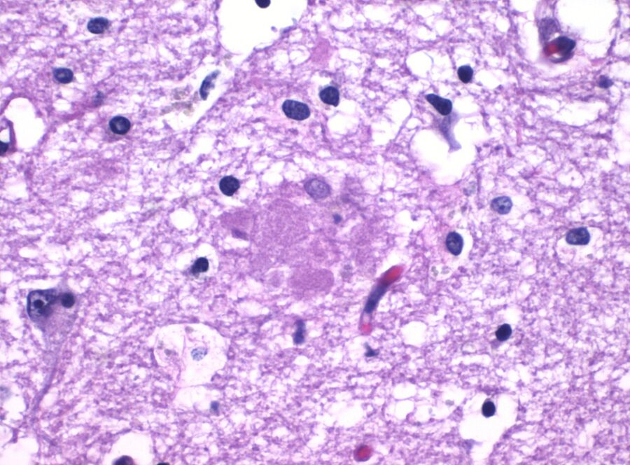{width="100%"}

*Alzheimer's disease: an amyloid plaque (pink, centre) in the hippocampus.*
:::
::: {.column width="25%"}
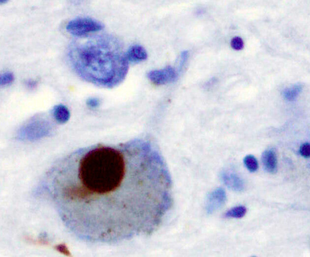{width="100%"}

*Parkinson's disease: a Lewy body (brown, α-synuclein) in a neuron.*
:::
::: {.column width="45%"}
- **Alzheimer's**: amyloid plaques of **Aβ** peptide outside neurons, and tangles of **hyperphosphorylated tau** inside them.
- **Parkinson's**: **α-synuclein** amyloid in Lewy bodies kills dopamine neurons. Some inherited forms break **parkin**, an **E3 ligase**.
- Neurons never divide, so they **cannot dilute** damaged protein; chaperone and proteasome capacity **decline with age**.
- Antibodies that clear Aβ (**lecanemab**, **donanemab**) slow early Alzheimer's **modestly**.
:::
::::

::: notes
Misfolding and amyloid return in the most common neurodegenerative diseases. On the left is brain tissue from a person with Alzheimer's disease. The pink, fluffy structure in the centre is an amyloid plaque, made mainly of a peptide called amyloid beta, which is cut from a larger membrane protein. Inside neurons, the protein tau, which normally binds microtubules, becomes heavily phosphorylated, lets go, and forms tangles: a protein switch gone wrong. In the middle is a neuron from a person with Parkinson's disease. The brown ball is a Lewy body, full of the protein alpha-synuclein in amyloid form; these neurons, which make dopamine, slowly die. Some inherited forms of Parkinson's are caused by mutations in parkin, an E3 ubiquitin ligase, which links the disease to today's machinery. Why neurons? They live as long as we do and never divide, so they cannot dilute damaged protein into daughter cells, and the capacity of chaperones and proteasomes declines with age. Antibodies that remove amyloid beta, lecanemab and donanemab, are now approved; they slow decline in early Alzheimer's somewhat, but do not stop it. You meet these diseases again in Sjukdomslära.
:::

## Summary {.smaller}

1. A protein's fold is only just stable. In the **crowded cytosol**, **chaperones** prevent wrong contacts: **Hsp70** binds and releases hydrophobic stretches using ATP; **chaperonins** fold proteins inside a closed cage.
2. Chains that fail can **aggregate**; **amyloid** is an ordered, self-seeding **cross-β** fibril found in Alzheimer's, Parkinson's and many other diseases.
3. Reversible marks turn proteins into **switches**: **phosphorylation** (kinase/phosphatase), **acetylation**, **methylation** and **ubiquitination**, each written, erased and read by proteins.
4. **E1–E2–E3** enzymes attach **Lys48 ubiquitin chains** to proteins with a **degron**; the **26S proteasome** unfolds them and cuts them into peptides.
5. The amount of a protein is set by **synthesis and degradation**: $P_{ss} = k_s/k_d$, reached in a few **half-lives**, measured by **cycloheximide chase** and **pulse-chase**. Drugs block (**bortezomib**) or redirect (**lenalidomide**, **PROTACs**) this system.

*Read more (optional): Alberts et al., Molecular Biology of the Cell, 7th ed., ch. 3 and 6.*

[Image credits](../credits.qmd#protein-lifecycle){style="font-size:0.7em"}

::: notes
Five take-home points. First, folding is risky in a crowded cell because new chains expose hydrophobic stretches; chaperones such as Hsp70 and the chaperonins give chains time and space to fold, using ATP, without carrying any information about the final shape. Second, when folding fails, chains aggregate, and amyloid fibrils are a particularly stable, self-seeding form of aggregate behind many diseases. Third, proteins are switched on and off by reversible chemical marks, with phosphorylation as the most common; each mark has enzymes that add it, enzymes that remove it and proteins that read it. Fourth, the ubiquitin–proteasome system destroys proteins selectively: E3 ligases recognise degrons, attach lysine-48 ubiquitin chains, and the proteasome unfolds and cuts the tagged protein. Fifth, every protein's amount is a balance of synthesis and degradation; short-lived proteins can change quickly, and we measure lifetimes with cycloheximide chase and pulse-chase. The ER lecture follows proteins into the endoplasmic reticulum, where folding, quality control and degradation have their own special machinery.
:::
