## About this lecture {.smaller}

A human cell makes more than 10 000 different proteins, almost all of them on ribosomes in the cytosol. Each one must end up in the right place: the nucleus, the ER, a mitochondrion, a peroxisome, a lysosome, the plasma membrane or outside the cell. Today: **how a protein knows where to go**.

After this lecture you can:

- explain how **sorting signals** in a protein's sequence work like **zip codes**, and how we show that a signal is necessary and sufficient;
- name the **three ways in**: **gated** (nuclear pores), **transmembrane** (ER, mitochondria, peroxisomes) and **vesicular** (from the ER onwards);
- describe **nuclear import and export**: the NLS, importins, exportins and the **Ran** gradient;
- describe **import into mitochondria** (TOM and TIM) and **peroxisomes** (PTS1);
- predict where a protein with a given set of signals ends up, and explain how **selinexor** and **NLS-tagged Cas9** use these rules.

::: notes
This lecture opens the block on protein handling and organelles. In biochemistry you learned how a ribosome makes a protein. Today we ask what happens next. A typical human cell makes more than ten thousand different proteins, and nearly all of them start on ribosomes in the cytosol. Yet each has a specific address. Histones must reach the nucleus, enzymes of the citric acid cycle must reach the mitochondrial matrix, insulin must leave the cell. The answer is that the address is written into the protein itself, as short stretches of amino acids called sorting signals. We will treat them as zip codes, and we will see the machines that read them. The plan: first the logic, using the topology rules from the cell tour; then the three kinds of transport, gated, transmembrane and vesicular; then the nucleus, mitochondria and peroxisomes in more detail. The ER, the Golgi and endocytosis get their own lectures, so we only set them up here. This covers ELO 4 and part of ELO 5.
:::

## The question: one cytosol, many addresses {.smaller}

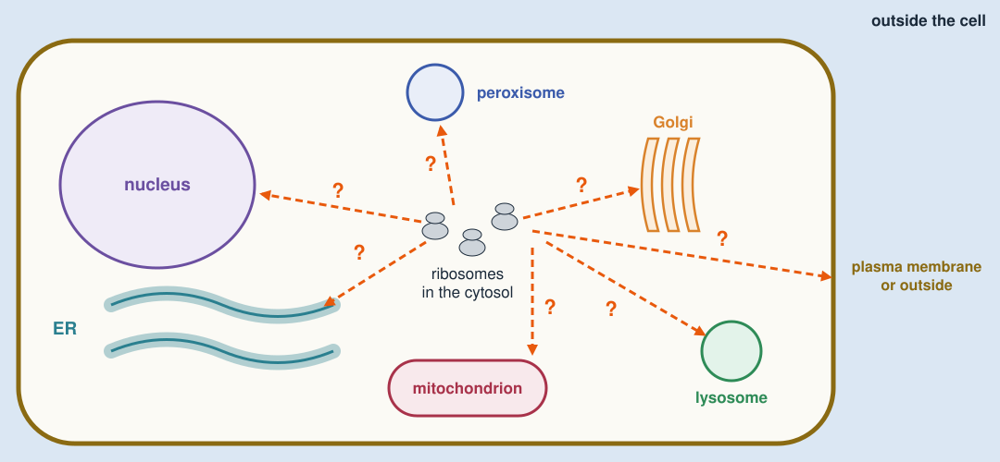{width="78%" fig-align="center"}

- Almost every protein is made on a ribosome **in the cytosol**. Only **13** human proteins are made inside mitochondria.
- The ribosome does not know where the protein should go. **The protein carries its own address.**
- **How is the address written? Who reads it? And how does a protein cross a membrane that ions cannot cross?**

::: notes
Here is the puzzle. All the cell's ribosomes sit in the cytosol, either free or on the surface of the ER. The only exception is the small set of ribosomes inside mitochondria, which make just thirteen proteins in human cells, all parts of the respiratory chain. Everything else, including the more than one thousand other mitochondrial proteins, is made in the cytosol. The ribosome itself is the same for all proteins; it does not decide anything. So the information must be in the protein. Think of a parcel in a post office: the sorting machines read the zip code, not the content. In the same way, receptors in the cytosol and in membranes read short sequences on the protein. Three questions follow. How is the address written? Who reads it? And how can a protein, a large and often charged molecule, get through a lipid bilayer that you know from the membrane lectures stops even small ions? The answers differ for each compartment, but the logic is shared.
:::

## Recap: two sides of every membrane {.smaller}

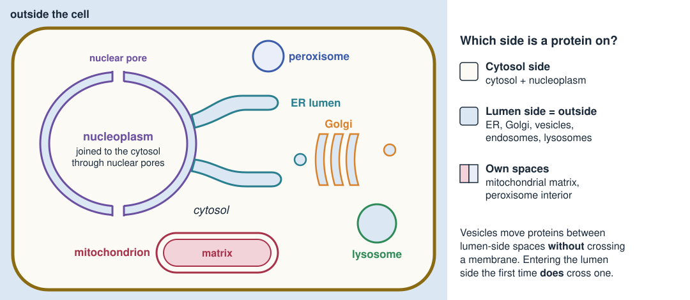{width="80%" fig-align="center"}

- *Recap from the cell tour.* The **nucleoplasm** is joined to the cytosol through pores: it is the **same space**.
- The **ER, Golgi, vesicles and lysosomes** are on the **lumen side**, which is topologically the **outside** of the cell.
- **Mitochondria** and **peroxisomes** are spaces of their own: their proteins come from the cytosol.

::: notes
A short recap from the cell tour, because this explains how sorting works. Look at the fill colours. The pale cytosol colour also fills the nucleus. Nuclear pores are large open channels, so the inside of the nucleus and the cytosol form one continuous space. The blue fill marks the lumen side: the inside of the ER, the gap between the two nuclear membranes, the Golgi, the vesicles and the lysosomes. Vesicles bud from one of these compartments and fuse with the next, so material moves between them without crossing a membrane, and in the end it can reach the outside of the cell. That is why the lumen side counts as topologically outside. The mitochondrial matrix and the inside of peroxisomes are separate spaces. Proteins for them are made in the cytosol and must cross one or two membranes. This one picture already tells us that a protein will use different kinds of machinery depending on which space it is going to. Keep it in mind for the rest of the lecture.
:::

## Sorting signals are zip codes {.smaller}

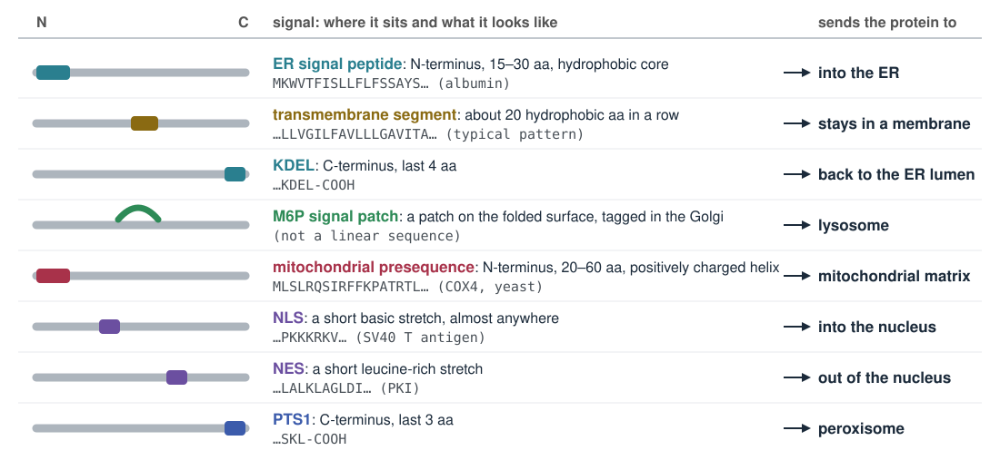{width="84%" fig-align="center"}

Most signals are a **short stretch of amino acids**. The **pattern** matters more than the exact sequence. Many are **cut off** after use; KDEL, NLS and PTS1 stay.

::: notes
Here are the main sorting signals of this course. Each is drawn on a protein chain, from the N-terminus on the left to the C-terminus on the right. The ER signal peptide sits at the very start: fifteen to thirty amino acids with a core of hydrophobic ones; the one shown is from albumin, the main blood protein. A transmembrane segment is about twenty hydrophobic amino acids in a row, long enough to span the bilayer. KDEL, four amino acids at the very end, brings ER proteins back to the ER. The mannose-6-phosphate signal is different: it is not a stretch of sequence but a patch on the surface of the folded protein, which gets a sugar phosphate tag in the Golgi. The mitochondrial presequence is also at the N-terminus, but it is rich in positive arginines and hydrophobic residues and forms a helix with a positive face. The NLS is a short basic stretch that can sit almost anywhere. The NES is rich in leucines. PTS1 is the last three amino acids, serine, lysine, leucine. Notice that the receptors read a pattern, not an exact word, so many different sequences work.
:::

## How do we know? A signal is necessary and sufficient {.smaller}

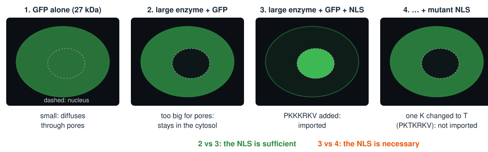{width="88%" fig-align="center"}

- **Sufficient:** add the signal to an unrelated protein and it **moves** to the new place.
- **Necessary:** mutate the signal (one Lys → Thr) and the protein **stays out**.
- Same logic for the ER signal peptide (Günter **Blobel**, Nobel Prize **1999**) and every other signal. Today the readout is usually a **GFP fusion** in living cells.

::: notes
How do we know that these short sequences are really the addresses? The test has two parts, and you will see the same logic in every field of cell biology. First, sufficiency. Take a protein that normally lives in the cytosol, for example a large enzyme, and attach the candidate signal. If the fusion protein now goes to the new compartment, the signal is enough. This was done in 1984 with the NLS of a virus protein, SV40 large T antigen, PKKKRKV, which moved a large cytosolic enzyme into the nucleus. Second, necessity. Change a single amino acid in the signal, here one lysine to threonine, and the protein stays in the cytosol. Today we fuse the protein to GFP and look at living cells by fluorescence microscopy. Notice panel one: GFP alone is small, 27 kilodaltons, and diffuses through the nuclear pores, so it fills both cytosol and nucleus. That is why the test uses a large protein. Günter Blobel used the same logic for the ER signal peptide and received the 1999 Nobel Prize for showing that proteins carry intrinsic signals for their transport.
:::

## The three ways in {.smaller}

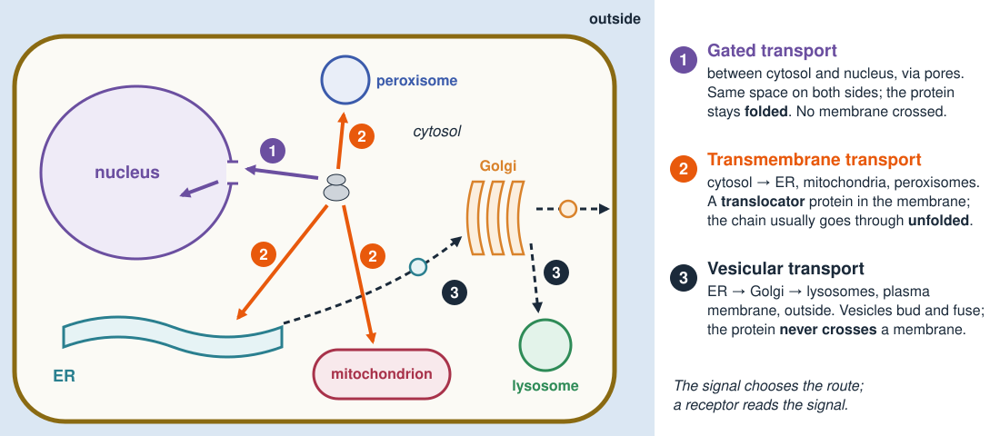{width="86%" fig-align="center"}

Which machine is used depends on the **topology**: same space (gated), into a new space from the cytosol (transmembrane), or between lumen-side spaces (vesicular).

::: notes
Now we can put the signals and the topology together. There are only three ways for a protein to move between compartments. One, gated transport, between the cytosol and the nucleus. Since these are the same space, the protein does not cross a membrane. It passes through a nuclear pore, a large gate that lets small molecules through freely and controls larger ones. The protein stays folded. Two, transmembrane transport, from the cytosol into the ER, the mitochondria or the peroxisomes. Here a protein translocator sits in the membrane, and the chain is threaded across it, usually in an unfolded state; peroxisomes are an exception, as we will see. Three, vesicular transport, from the ER onwards. Vesicles bud from one membrane and fuse with the next, carrying their cargo in the lumen or in their membrane, so the protein never crosses a membrane again. In every case the logic is the same: a signal on the protein is recognised by a receptor, and the receptor delivers it to the right machine. The vesicle machines come in the lectures on the Golgi and on endocytosis.
:::

## Gated transport: the nuclear pore complex {.smaller}

:::: {.columns}
::: {.column width="40%"}
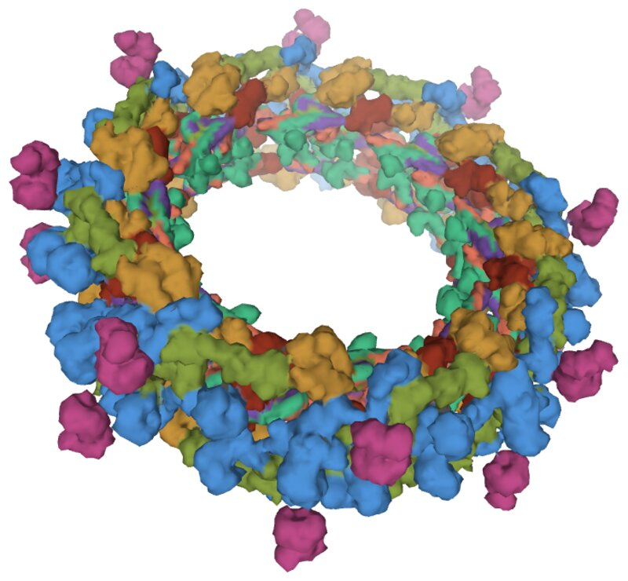{width="100%"}

*Human nuclear pore complex, scaffold rings (cryo-electron tomography and modelling, PDB 5IJO).*
:::
::: {.column width="60%"}
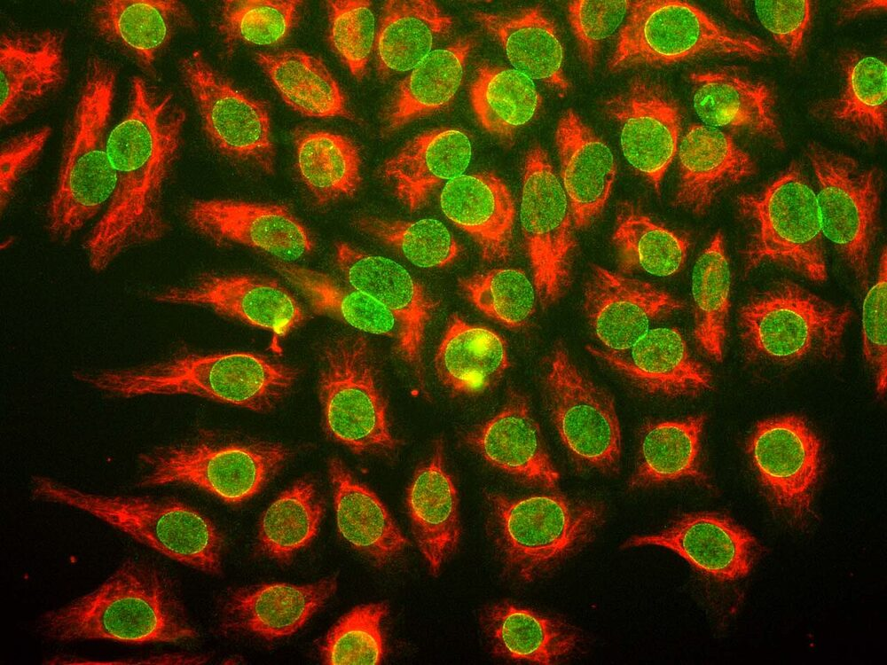{height="320px" fig-align="center"}

*HeLa cells: a pore protein (green) outlines every nucleus; vimentin filaments (red).*

- About **120 MDa**, ~30 different proteins (**nucleoporins**), each in 8 or more copies; ~**3000** pores per nucleus.
- The central channel is filled with **FG repeats**, flexible chains rich in Phe-Gly: a **sieve**. Proteins below ~**40 kDa** diffuse; larger ones need a **carrier** that binds the FG repeats.
:::
::::

::: notes
The nuclear envelope has thousands of pores, each a huge protein complex of about 120 megadaltons, roughly thirty times the mass of a whole ribosome. It is built from about thirty different proteins called nucleoporins, each present in eight or more copies, arranged with eightfold symmetry. On the left is a model of the scaffold of the human pore, built by combining cryo-electron tomography of real nuclear envelopes with structures of the parts. On the right, cells stained with an antibody against a pore protein: every nucleus is outlined, because thousands of pores cover its surface. The interesting part is what fills the central channel. Many nucleoporins have long, disordered tails with repeats of phenylalanine and glycine, called FG repeats. These form a dense, sticky meshwork. Small molecules and small proteins, below roughly forty kilodaltons, diffuse through. Larger proteins are held back, unless they are bound to a nuclear transport receptor, which can dissolve into the FG meshwork. This is why it is called gated transport: the gate is open for the right partners.
:::

## Nuclear import: NLS, importins and Ran {.smaller}

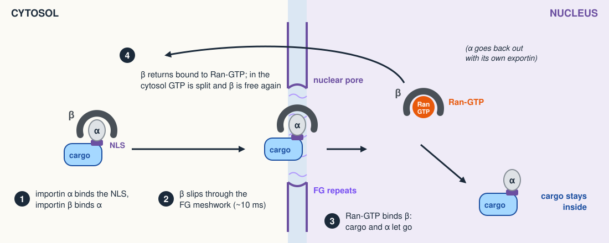{width="88%" fig-align="center"}

- **Importin α** reads the NLS; **importin β** carries the complex through the FG meshwork. The cargo stays **folded**.
- In the nucleus, **Ran-GTP** binds importin β and the cargo is **released**. Ran-GTP is (almost) only in the nucleus, so import goes **one way**.

::: notes
Here is the import cycle for a protein with a classical NLS. Step one, in the cytosol: importin alpha binds the NLS, and importin beta binds importin alpha. Step two: importin beta interacts with the FG repeats and slips through the pore together with its cargo. A single passage takes about ten milliseconds, and the cargo is fully folded; in the other direction, exportins even carry whole ribosomal subunits out. Step three, in the nucleus: a small GTPase called Ran, in its GTP-bound form, binds importin beta. This changes its shape, and importin alpha and the cargo let go. The cargo is now inside. Step four: importin beta, still bound to Ran-GTP, goes back to the cytosol. There, Ran splits its GTP, lets go of importin beta, and the importin is free to pick up the next cargo. Importin alpha is sent back out by its own exportin. Notice the trick. The importin binds cargo where Ran-GTP is absent and releases it where Ran-GTP is present. So the direction of transport is set by where Ran-GTP is, which is the next slide.
:::

## The Ran gradient gives direction; export is the mirror image {.smaller}

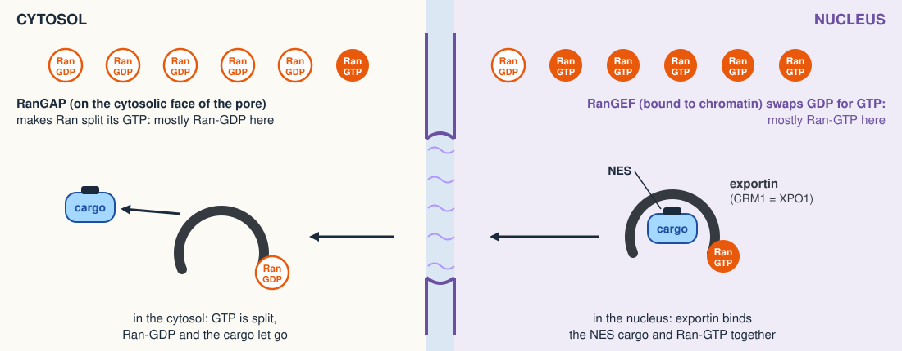{width="84%" fig-align="center"}

- **RanGEF** sits on **chromatin**: Ran-GTP is made in the nucleus. **RanGAP** is in the cytosol: Ran-GTP is turned into Ran-GDP there.
- **Exportins** do the opposite of importins: they bind cargo with a **nuclear export signal (NES)** **together with** Ran-GTP, and let go in the cytosol.
- The energy comes from **GTP hydrolysis by Ran**, not from the pore.

::: notes
Why is Ran-GTP only in the nucleus? Because the two enzymes that control Ran are on different sides. The exchange factor, RanGEF, which swaps GDP for GTP, is bound to chromatin, so it works only in the nucleus. The GTPase-activating protein, RanGAP, which makes Ran split its GTP, is in the cytosol and on the cytosolic face of the pore. The result is a steep gradient: lots of Ran-GTP in the nucleus, almost only Ran-GDP in the cytosol. Exportins use the same gradient the other way round. The main exportin, called CRM1 or XPO1, binds a cargo that carries a leucine-rich nuclear export signal, but only when Ran-GTP is bound too. The three-part complex leaves through the pore, Ran splits its GTP in the cytosol, and the cargo is released. Many proteins shuttle back and forth, and the cell controls where they act by masking or unmasking their NLS or NES. The pore itself uses no energy; the energy that makes transport one-way comes from Ran's GTP. Remember XPO1: it is the drug target at the end of the lecture.
:::

## Transmembrane transport into the ER: the first fork {.smaller}

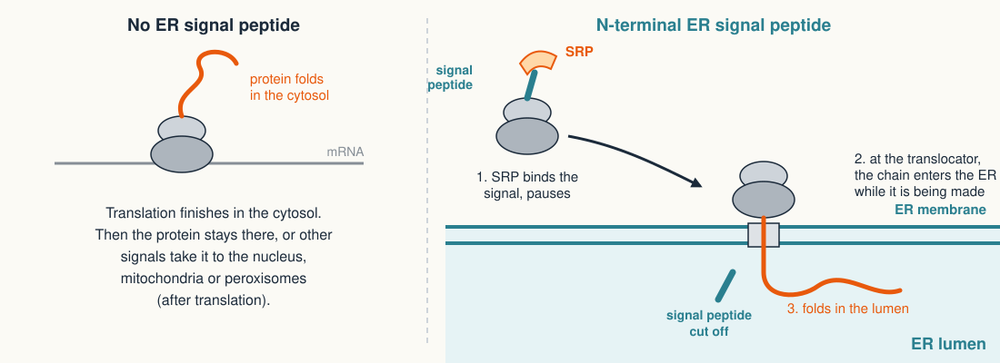{width="84%" fig-align="center"}

- An **N-terminal signal peptide** is recognised by **SRP** as soon as it leaves the ribosome. The chain enters the ER **while it is made** (co-translational).
- A **transmembrane segment** stops the transfer: the protein stays **in the ER membrane**. Details: the **ER lecture**.
- Every protein of the ER, Golgi, lysosomes, plasma membrane and every secreted protein starts here.

::: notes
The first and biggest decision is made during translation. If the first thing to come out of the ribosome is an ER signal peptide, a particle called SRP, the signal recognition particle, binds it and slows translation. SRP brings the whole ribosome to the ER membrane, where it docks on a protein channel, the translocator. Translation then continues and the chain is pushed through the channel into the ER lumen as it is made. An enzyme on the lumen side cuts off the signal peptide. If the protein contains a hydrophobic transmembrane segment further on, that segment stops the transfer and moves sideways into the bilayer, so the protein ends up in the membrane. Proteins without an ER signal are finished in the cytosol, and only then can other signals act. So this first fork splits all proteins into two families. Every protein of the ER, the Golgi, the lysosomes and the plasma membrane, and every secreted protein, takes the ER road. We only need the principle today; the machinery, membrane topology and folding in the ER come in the next lecture.
:::

## Transmembrane transport into mitochondria: TOM and TIM {.smaller}

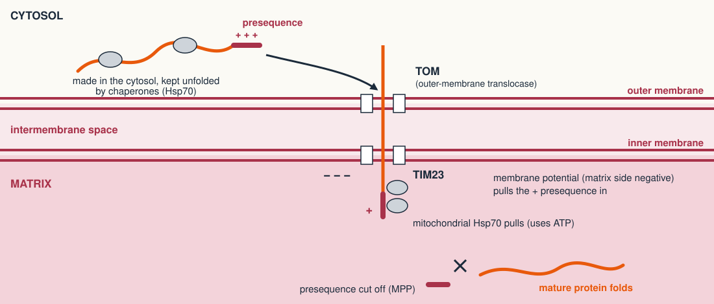{width="82%" fig-align="center"}

- Made **in the cytosol**, then imported (**post-translational**). Chaperones keep the chain **unfolded**.
- **TOM** reads the presequence; the chain passes **TOM and TIM23** at a contact point. The **membrane potential** pulls the positive presequence; **mitochondrial Hsp70** pulls the rest using ATP.
- A **hydrophobic segment** after the presequence can **stop** the chain in TIM23: an **inner-membrane** protein.

::: notes
Mitochondria have about fifteen hundred different proteins, and about ninety-nine percent of them are made in the cytosol. The precursor, with its presequence at the N-terminus, is finished by a free ribosome and kept unfolded by cytosolic chaperones of the Hsp70 family. The presequence binds receptors of the TOM complex, the translocase of the outer membrane. The chain passes through the TOM channel and, where the two membranes come close, directly into the TIM23 channel, the translocase of the inner membrane. Two forces drive import. First, the inner membrane carries a voltage of about 150 to 180 millivolts, negative on the matrix side, which you know from the transport lectures as part of the proton-motive force. It pulls the positive presequence through. Second, a mitochondrial Hsp70 in the matrix binds the incoming chain and pulls it in, using ATP. A matrix protease then cuts off the presequence and the protein folds. If a hydrophobic segment follows the presequence, it stops in TIM23 and moves sideways into the inner membrane. Other routes exist for outer-membrane proteins; you meet them in the mitochondria lecture.
:::

## How do we know? Import into isolated mitochondria {.smaller}

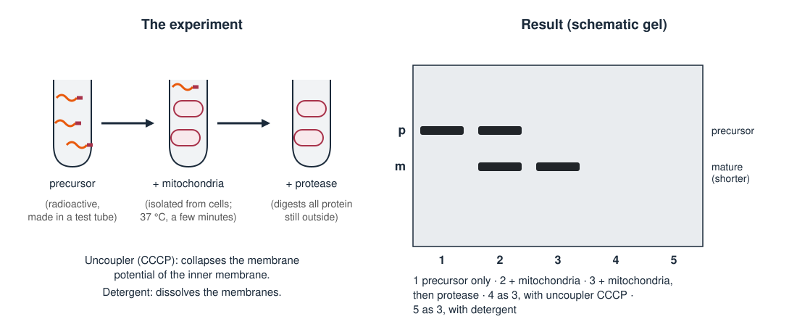{width="84%" fig-align="center"}

- **Lane 3:** the shorter, mature protein is **protected** from the protease: it is **inside**, and the presequence was cut off.
- **Lane 4:** without a membrane potential (uncoupler **CCCP**) nothing gets in. **Lane 5:** with the membranes dissolved, protease reaches everything: a control.

::: notes
This is the classic experiment that worked out mitochondrial import, and it is a method you can use for any organelle. Make the precursor protein in a test tube with radioactive amino acids, so it is the only labelled protein. Isolate mitochondria from yeast or liver cells by centrifugation, mix them with the precursor and incubate. Then add a protease. The protease cannot cross membranes, so it digests every protein that is still outside, but not proteins that are already inside. Run the samples on a gel and look for the label. Lane one: the precursor. Lane two: with mitochondria, a second, shorter band appears, the mature protein with its presequence removed. Lane three: after protease, only the mature band is left, so it is protected, which means inside. Lane four: add CCCP, an uncoupler that collapses the membrane potential; the protein is not imported and is digested. This showed that import needs the voltage. Lane five: detergent dissolves the membranes, the protease reaches everything, and no band survives. This control proves the protection was due to membranes. This gel is a schematic, not real data.
:::

## Peroxisomes: import of folded proteins {.smaller}

:::: {.columns}
::: {.column width="52%"}
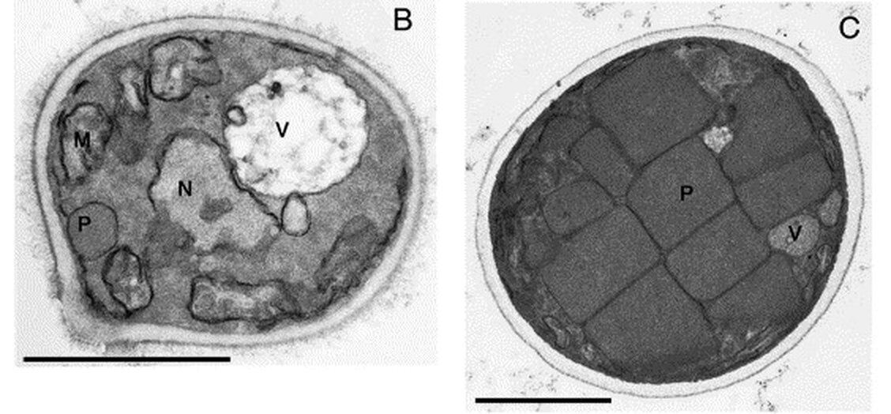{width="100%"}

*Yeast (Hansenula polymorpha) by electron microscopy. B: grown on glucose, a few small peroxisomes (P). C: grown on methanol, the cell is filled with large peroxisomes. N nucleus, M mitochondrion, V vacuole.*
:::
::: {.column width="48%"}
- One membrane, no DNA, no ribosomes. Enzymes for **oxidation of very long fatty acids**, H₂O₂ and its breakdown by **catalase**, plasmalogen lipids.
- **PTS1** (C-terminal **-SKL**) is read by the receptor **PEX5** in the cytosol.
- Unusual: proteins are imported **fully folded**, even as oligomers. PEX5 enters with its cargo and is recycled.
- Without working **PEX** genes, no import: **Zellweger syndrome** (the organelles lecture).
:::
::::

::: notes
Peroxisomes are small organelles with a single membrane. They have no DNA and no ribosomes, so every protein is imported. Their enzymes break down very long fatty acids, which mitochondria cannot handle, and many of these reactions make hydrogen peroxide, which the enzyme catalase destroys. Peroxisomes also make plasmalogens, lipids that are important in myelin. The images show yeast cells. When yeast grows on glucose it has only a few small peroxisomes. When it grows on methanol, which it can only use with peroxisomal enzymes, the cell fills with large peroxisomes. Organelles grow and multiply when the cell needs them. The import signal for most matrix proteins is PTS1, the last three amino acids, serine, lysine, leucine, or similar. The cytosolic receptor PEX5 binds it and docks at the peroxisome membrane. Surprisingly, the cargo does not need to unfold: even large folded complexes enter, and PEX5 goes in with them and is recycled. How this works is still being studied. If import fails, cells have empty peroxisome membranes, which causes Zellweger syndrome.
:::

## Vesicular transport: signals read inside the ER and Golgi {.smaller}

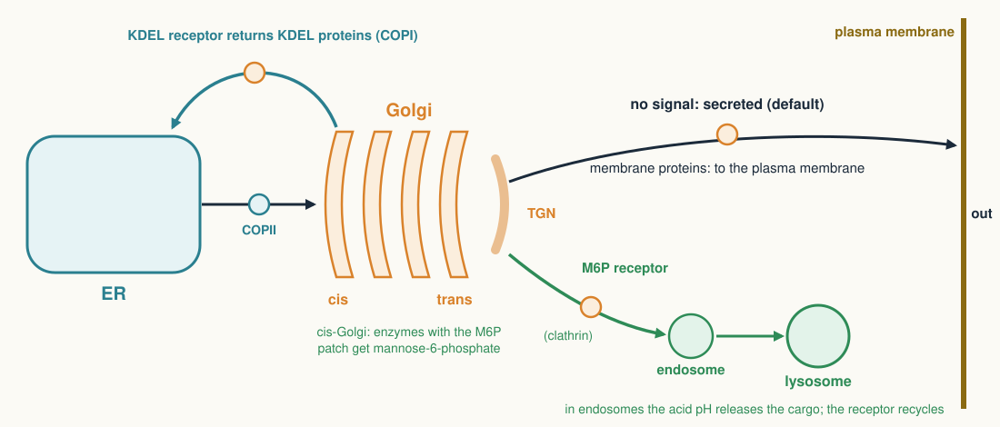{width="84%" fig-align="center"}

- **Default:** a soluble protein in the ER lumen with no further signal is **secreted**; a membrane protein goes to the **plasma membrane**.
- **KDEL:** ER proteins (e.g. the chaperone BiP) leak to the Golgi and are brought **back** by the KDEL receptor: **retrieval**, not retention.
- **M6P:** a mannose-6-phosphate tag is added to lysosomal enzymes in the cis-Golgi; the **M6P receptor** sends them to **lysosomes**. Lose the tag (I-cell disease): the enzymes are **secreted** instead.

::: notes
Once a protein is in the ER lumen, it can only move on in vesicles, and the signals are now read by receptors on the lumen side. If there is no further signal, the protein follows the default route through the Golgi to the outside: it is secreted, or, if it is a membrane protein, it ends up in the plasma membrane. ER-resident proteins, such as the chaperone BiP, carry KDEL at their C-terminus. Surprisingly, KDEL does not hold them in the ER. They leave with everything else, and in the cis-Golgi the KDEL receptor binds them and sends them back in COPI vesicles. Lysosomal enzymes carry a signal patch on their folded surface. In the cis-Golgi an enzyme recognises the patch and adds a phosphate to a mannose sugar, making mannose-6-phosphate. In the trans-Golgi network the M6P receptor binds it, and clathrin-coated vesicles carry receptor and cargo to endosomes, where the acid pH releases the cargo. In I-cell disease the tagging enzyme is missing, so lysosomal enzymes are secreted into the blood and lysosomes fill with undigested material. The vesicle machines come in the Golgi and endocytosis lectures.
:::

## When a protein has several signals: the order of reading {.smaller}

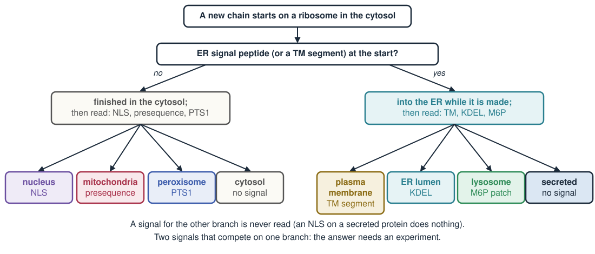{width="80%" fig-align="center"}

The **first fork** (ER or not) is made during translation. After that, only signals **on the same side of the membrane** as their receptor can be read. **Try it:** [Demo: zip-code game](questions.qmd#explore)

::: notes
Real proteins can carry more than one signal, so we need a rule for which one wins. The key is timing and topology. The first decision is made while the protein is still being translated: an ER signal peptide, or a first transmembrane segment, sends the ribosome to the ER. If that happens, the protein is inside the ER or in its membrane, and from now on only signals that are read in the lumen matter: transmembrane segments, KDEL, the mannose-6-phosphate patch. An NLS or a PTS1 on such a protein is never seen by its cytosolic receptor, so it does nothing. If there is no ER signal, the protein is finished in the cytosol, and the cytosolic receptors compete: importins for the NLS, TOM for the presequence, PEX5 for PTS1. Some real proteins carry two cytosolic signals on purpose and end up in two places; then the outcome depends on details, and only an experiment can tell. This is a simplification, one protein, one route, but it predicts the location of most proteins. Try it in the zip-code game: build a protein, predict, then watch its route.
:::

## Why it matters: selinexor blocks nuclear export {.smaller}

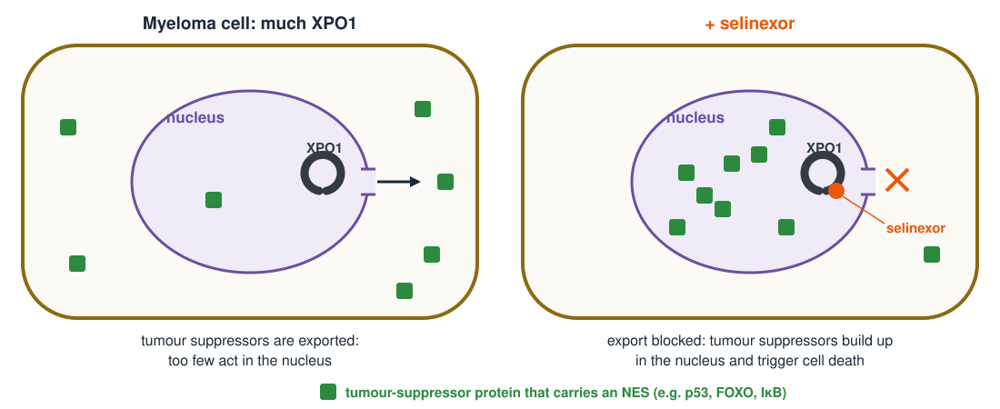{width="76%" fig-align="center"}

- Many cancer cells, including **multiple myeloma**, make **too much XPO1**. Tumour suppressors such as **p53** are exported and cannot act in the nucleus.
- **Selinexor** binds XPO1 **covalently** (to a cysteine in the NES-binding groove). Export stops; tumour suppressors build up in the nucleus; the cancer cell dies. **Approved 2019** for myeloma, with dexamethasone.

::: notes
Here is a drug that acts directly on the export machine from earlier in the lecture. Many tumour-suppressor proteins, such as p53, FOXO transcription factors and IkappaB, must be in the nucleus to work: they control genes, stop the cell cycle or trigger cell death. They carry nuclear export signals and shuttle in and out. Many cancers, including multiple myeloma, a cancer of plasma cells in the bone marrow, have high levels of the exportin XPO1. So these tumour suppressors spend too much time in the cytosol, where they cannot act. Selinexor is a small molecule that fits into the groove of XPO1 where the NES normally binds, and it forms a covalent bond with a cysteine there. Export of NES cargo stops, the tumour suppressors accumulate in the nucleus, and the cancer cell is pushed into apoptosis. Normal cells are affected too, which explains side effects such as nausea and low platelet counts. Selinexor was approved in 2019 for myeloma that has relapsed after other drugs. You will meet drug development of this kind in Kliniska prövningar och läkemedelsutveckling, and myeloma in Sjukdomslära.
:::

## Why it matters: NLS tags in CRISPR and gene therapy {.smaller}

:::: {.columns}
::: {.column width="64%"}
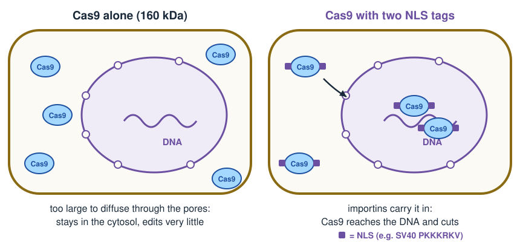{width="100%"}
:::
::: {.column width="36%"}
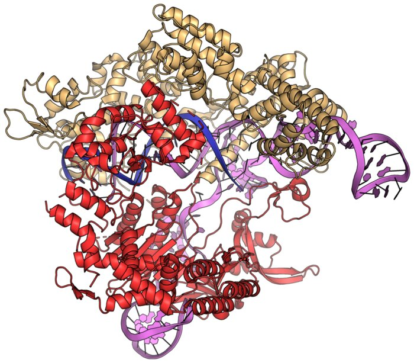{width="80%" fig-align="center"}

*Cas9 with guide RNA (purple) and target DNA (blue); PDB 4OO8.*
:::
::::

- **Cas9** (from bacteria, 160 kDa) has no NLS and is far too big to diffuse through a pore. Every CRISPR tool adds **one or two NLS** tags (often the SV40 NLS from the GFP experiment).
- Gene therapy has the same problem: DNA delivered to a **non-dividing** cell (neuron, liver cell) must get through the pores. Dividing cells get it when the envelope breaks down in mitosis.

::: notes
Our second application is in biotechnology and gene therapy. Cas9, the DNA-cutting enzyme of CRISPR, comes from bacteria, which have no nucleus, so it has no NLS. It is about 160 kilodaltons, much larger than the size limit for diffusion through the nuclear pore. If you deliver Cas9 protein or its mRNA into a human cell, it stays in the cytosol and edits almost nothing. The solution is exactly the experiment from the How do we know slide on signals: add an NLS. Most CRISPR constructs carry the SV40 NLS, often together with a second NLS from a protein called nucleoplasmin, at the ends of Cas9. The importins then carry it into the nucleus, where it finds the DNA. The same problem limits gene therapy. DNA delivered to a cell has to reach the nucleus to be transcribed. In dividing cells it can be trapped in the nucleus when the envelope reforms after mitosis, but neurons, muscle and liver cells hardly divide, so import through the pores becomes the bottleneck. Viruses used as vectors solved this problem in evolution, and you meet them in later courses.
:::

## Summary {.smaller}

1. Sorting signals are **zip codes** written in the protein: short patterns (signal peptide, presequence, NLS, NES, PTS1, KDEL) or a **patch** (M6P). Receptors read them; **fusion and mutation experiments** show a signal is sufficient and necessary.
2. **Three ways in**, set by topology: **gated** (nuclear pores, folded protein), **transmembrane** (a translocator: ER, mitochondria, peroxisomes), **vesicular** (from the ER onwards, no membrane crossed).
3. **Nuclear transport:** importins and exportins pass the FG meshwork; the **Ran-GTP gradient** (GEF in the nucleus, GAP in the cytosol) makes it one-way.
4. **Mitochondria** import unfolded proteins through **TOM and TIM**, driven by the membrane potential and ATP; **peroxisomes** import folded proteins with **PTS1**. The **first fork** (ER or not) is made during translation.
5. Drugs and tools use the rules: **selinexor** blocks XPO1; **NLS tags** take Cas9 into the nucleus.

*Read more (optional): Alberts et al., Molecular Biology of the Cell, 7th ed., ch. 12.*

[Image credits](../credits.qmd#protein-sorting){style="font-size:0.7em"}

::: notes
Five points to take home. First, a protein carries its own address as one or more sorting signals, and the cell has receptors that read each kind. You should be able to say what each signal looks like, where it sits on the protein, and how an experiment shows that it is necessary and sufficient. Second, there are three ways to move a protein between compartments, and which one is used follows from topology: gated transport between cytosol and nucleus, transmembrane transport into a new space, and vesicular transport between lumen-side compartments. Third, in nuclear transport the receptors carry folded cargo through the FG meshwork, and the Ran-GTP gradient decides the direction. Fourth, mitochondria import unfolded chains, pulled by the membrane potential and an ATP-driven motor, and peroxisomes do the unusual thing of importing folded proteins. The decision to enter the ER comes first, during translation. Fifth, these rules are targets for drugs and tools. Next, we follow the proteins that take the ER road: the endoplasmic reticulum, where they fold and are checked.
:::
