## About this lecture {.smaller}

Apoptosis is not the only way a cell can kill itself. Cells also have programmes that make them **swell and burst**. These deaths are messy on purpose: they **alarm the immune system**.

After this lecture you can:

- tell **accidental** necrosis from **regulated** necrosis;
- explain **necroptosis** (RIPK1, RIPK3, MLKL) and why it is a **backup** when caspase-8 is blocked;
- explain **pyroptosis** (inflammasome, caspase-1, **gasdermin D pores**, IL-1β);
- explain **ferroptosis** (iron, **lipid peroxidation**, GPX4 and glutathione);
- describe how **autophagy** relates to cell death, and why lytic death causes **inflammation**;
- use **markers and inhibitors** to decide which death a cell died, and fill in a **comparison table** of all death types.

::: notes
This lecture opens the block on cell death and disease. In the apoptosis lecture you met the tidy, quiet death: the cell shrinks, packs itself into small pieces and is eaten, and the body hardly notices. Today we meet three other programmes: necroptosis, pyroptosis and ferroptosis. They have one thing in common: the plasma membrane breaks and the contents of the cell spill out. For a long time this kind of death, called necrosis, was thought to be pure accident. We now know that a cell can choose it, with dedicated proteins, and that it has a purpose: it raises an alarm. We will also look at autophagy, which is mostly a survival process, and we will practise the experimental logic that tells the death types apart: which marker appears and which inhibitor rescues the cell. The lecture ends with a comparison table that you should be able to fill in at the exam, and with two medical stories: stroke and heart attack, and new cancer and anti-inflammatory drugs. This is ELO 8.
:::

## The question: block the caspases, and the cells still die {.smaller}

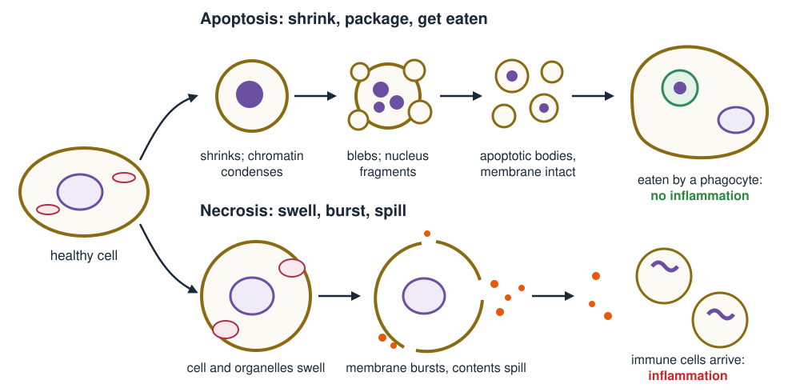{width="74%" fig-align="center"}

- Caspases carry out apoptosis. So a **caspase inhibitor** should save cells that are told to die. Often it does not: given **TNF + a caspase inhibitor**, many cells die *faster*, and they **swell and burst** instead of shrinking.
- **Is this an accident, or a second programme? And why would a cell want a messy death?**

::: notes
Look at the two rows of the figure. In apoptosis, the top row, the cell shrinks, the chromatin condenses, the cell forms blebs and breaks into membrane-wrapped apoptotic bodies, which a phagocyte eats. The membrane stays intact, so nothing leaks out. In necrosis, the bottom row, the cell and its organelles swell, the plasma membrane bursts and the contents spill into the tissue. Immune cells arrive: inflammation. Now the puzzle. If caspases carry out apoptosis, then blocking them should save a cell. In the 1990s researchers treated cells with the signal protein TNF together with a broad caspase inhibitor, expecting the cells to survive. Many cell types died anyway, and faster, with the swollen look of necrosis. So necrosis is not always an accident; there must be a second, caspase-independent programme. Today we will see that there are several, each with its own proteins, markers and inhibitors, and that a messy death can be useful to the body.
:::

## *Recap:* apoptosis in one slide {.smaller}

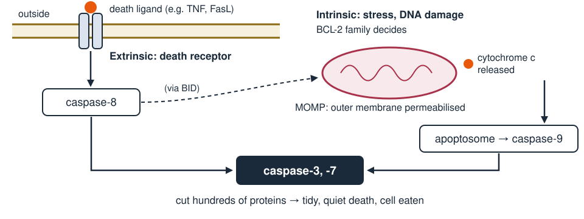{width="78%" fig-align="center"}

- Two entry routes, one executioner: **caspase-3 and -7** cut hundreds of proteins.
- The membrane stays intact; phosphatidylserine on the outside says **"eat me"**. No inflammation.
- **Caspase-8** is important today: it is also the **brake on necroptosis**.

::: notes
A short recap of the apoptosis lecture, because today's programmes branch from the same points. In the extrinsic route, a death ligand such as TNF or Fas ligand binds a death receptor on the cell surface, and the receptor activates caspase-8. In the intrinsic route, stress or DNA damage tips the balance in the BCL-2 family, the outer membrane of the mitochondria is permeabilised, which we call MOMP, cytochrome c escapes into the cytosol and builds the apoptosome, which activates caspase-9. Caspase-8 can also cut a protein called BID, which links the two routes. Both routes converge on the executioner caspases 3 and 7. These cut hundreds of proteins and dismantle the cell in an orderly way. The plasma membrane stays intact, and the lipid phosphatidylserine flips to the outer leaflet as an eat-me signal. Keep caspase-8 in mind: it has a second job, which we meet in two slides. It cuts and switches off the proteins of necroptosis.
:::

## Accidental or regulated necrosis? {.smaller}

:::: {.columns}
::: {.column width="45%"}
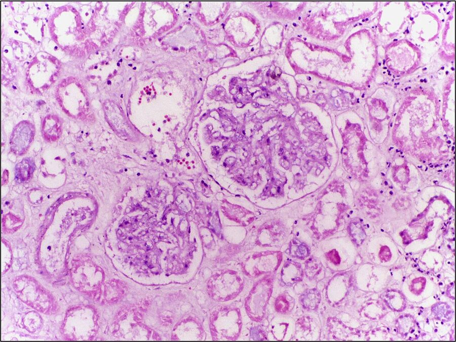{width="100%"}

*Kidney infarct (H&E). The tubules and glomeruli keep their outlines, but most nuclei are gone: the cells died by necrosis when the blood supply stopped.*
:::
::: {.column width="55%"}
- **Accidental necrosis:** the damage is too strong for any programme: heat, freezing, a detergent, crushing, total loss of ATP. **No protein decides.** No inhibitor or knockout can stop it.
- **Regulated necrosis:** the cell **uses its own proteins** to break its membrane. So a **drug or a gene knockout can stop it**. That is the test.
- Three regulated forms in this lecture: **necroptosis, pyroptosis, ferroptosis**. All end with a **broken plasma membrane**.
- In real tissue, such as an infarct, accidental and regulated death happen **side by side**.
:::
::::

::: notes
Necrosis is an old word from pathology. Pathologists use it for dead tissue, like this kidney infarct, where an artery was blocked. The cells keep their outlines but lose their nuclei. For a long time all necrosis was thought to be accidental: the cell is simply destroyed by heat, freezing, a detergent, a crush, or a total lack of ATP. In accidental necrosis no protein makes a decision, and so no drug and no gene knockout can prevent it. The definition of regulated necrosis follows from this. If the cell uses its own proteins to break its membrane, then removing one of those proteins, by a drug or by a knockout, must stop the death. That is the key experimental test, and it is the logic of the cell methods lecture: you show that a protein is necessary by removing it. In this lecture we look at the three best understood forms: necroptosis, pyroptosis and ferroptosis. In a real infarct, as you will see at the end, accidental and regulated death happen side by side.
:::

## Necroptosis: the backup when caspase-8 is blocked {.smaller}

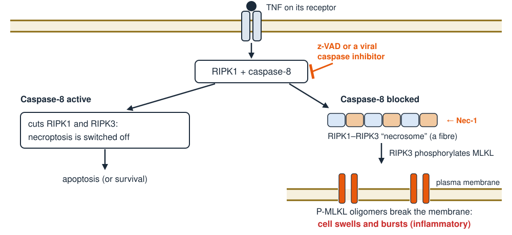{width="72%" fig-align="center"}

- When **caspase-8 works**, it cuts **RIPK1** and **RIPK3** (two kinases): no necroptosis.
- When caspase-8 is **blocked** (z-VAD, or a **viral caspase inhibitor**), RIPK1 and RIPK3 bind each other and form a fibre. RIPK3 phosphorylates **MLKL**, which moves to the plasma membrane and **breaks it**.

::: notes
Here is the mechanism of necroptosis. TNF binds its receptor, and a complex forms that contains the kinase RIPK1 and caspase-8. Usually TNF does not kill at all: it switches on survival genes through NF-kappa-B. If the cell does start to die, caspase-8 decides how. Active caspase-8 cuts RIPK1 and RIPK3 and so keeps necroptosis switched off; the cell dies by apoptosis, or survives. If caspase-8 is blocked, by the drug z-VAD or by a caspase inhibitor made by a virus, RIPK1 and RIPK3 are no longer cut. They bind each other through a short motif and stack into a fibre, a bit like an amyloid, called the necrosome. Inside it RIPK3 becomes active and phosphorylates the protein MLKL. Phosphorylated MLKL forms small oligomers that move to the plasma membrane and break it. The cell swells and bursts. So necroptosis is a backup: if a virus blocks apoptosis, the cell can still die. The drug necrostatin-1 blocks the kinase activity of RIPK1.
:::

## How do we know? Inhibitors and knockouts {.smaller}

:::: {.columns}
::: {.column width="58%"}
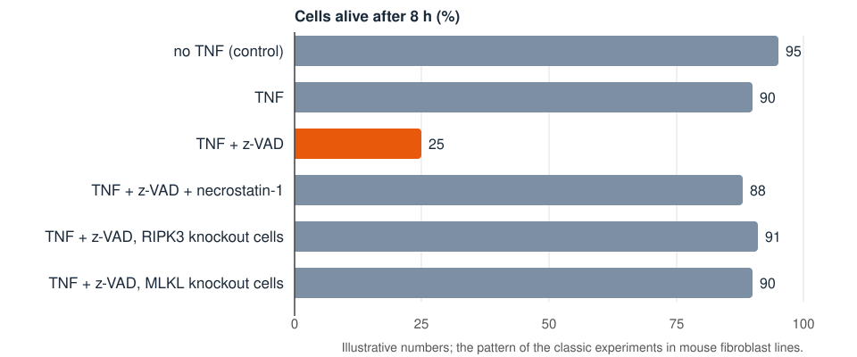{width="100%"}
:::
::: {.column width="42%"}
- **Inhibitor:** **necrostatin-1** was found in 2005 in a screen of thousands of small molecules for ones that block TNF + z-VAD death. Later shown to block the **RIPK1 kinase**.
- **Knockout:** cells or mice without **RIPK3** or **MLKL** do not die by necroptosis: these proteins are **necessary**.
- **Marker:** an antibody against **phospho-MLKL** shows that the pathway is **active** in a cell or tissue.
- A good argument uses **all three**, plus a control without the stimulus.
:::
::::

::: notes
How was necroptosis proved to be a programme and not an accident? With the tools from the cell methods lecture. First, chemistry: in 2005 Junying Yuan's lab screened thousands of small molecules for ones that keep cells alive after TNF plus z-VAD. They found necrostatin-1, and later showed that it inhibits the kinase activity of RIPK1. A specific inhibitor that saves the cells is strong evidence for a programme. Second, genetics: cells and mice that lack RIPK3 or MLKL do not die by necroptosis. That shows these proteins are necessary. In the figure, notice that TNF alone kills few cells, TNF plus z-VAD kills most of them, and adding necrostatin-1 or removing RIPK3 or MLKL rescues them. The numbers are illustrative, but the pattern is the classic one. Third, a marker: phosphorylated MLKL can be detected with an antibody, by western blot or in tissue sections. A marker shows that the pathway is active, but not that it causes the death. For that you need the inhibitor or knockout. Inhibitors are never perfectly specific, so the knockout is the stronger evidence.
:::

## Pyroptosis: the inflammasome and caspase-1 {.smaller}

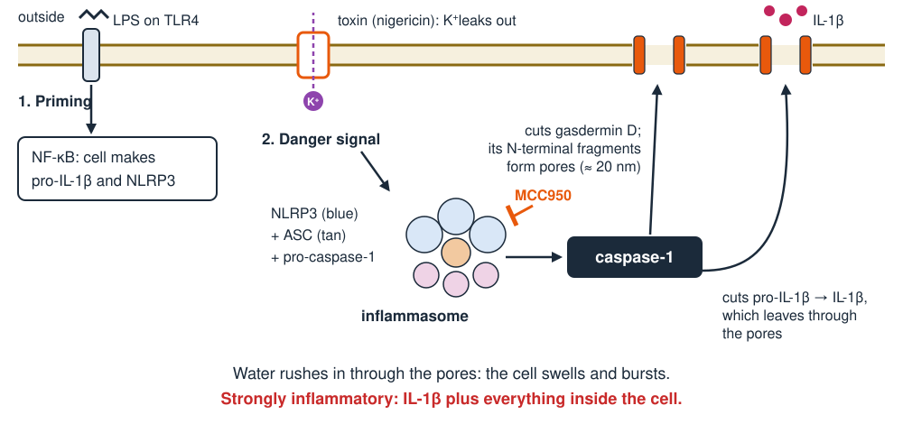{width="74%" fig-align="center"}

- Mainly in **immune cells** such as macrophages. Needs **two signals**: priming (makes pro-IL-1β and NLRP3) and a **danger signal** (toxin, K⁺ loss, crystals).
- **NLRP3 + ASC + pro-caspase-1** assemble into the **inflammasome**, which activates **caspase-1**: an **inflammatory caspase**.

::: notes
Pyroptosis means fiery death, because it is so inflammatory. It happens mainly in immune cells such as macrophages, and it needs two signals. Signal one is priming: for example, LPS from the bacterial cell wall binds the receptor TLR4, and through NF-kappa-B the cell makes the inactive precursor pro-interleukin-1-beta and the sensor protein NLRP3. Signal two is danger. Many different things activate NLRP3: bacterial toxins that make holes, such as nigericin, crystals such as uric acid in gout, or damaged lysosomes. A common step seems to be loss of potassium from the cell; this links to the ion channel lecture. Activated NLRP3 recruits the adaptor ASC, which recruits pro-caspase-1. This large complex is the inflammasome. In it, caspase-1 activates itself. Caspase-1 is an inflammatory caspase: it does not drive apoptosis, it cuts two targets, which we see next. The drug MCC950 blocks NLRP3, and is a standard research tool.
:::

## Gasdermin D: a pore that kills and lets IL-1β out {.smaller}

:::: {.columns}
::: {.column width="40%"}
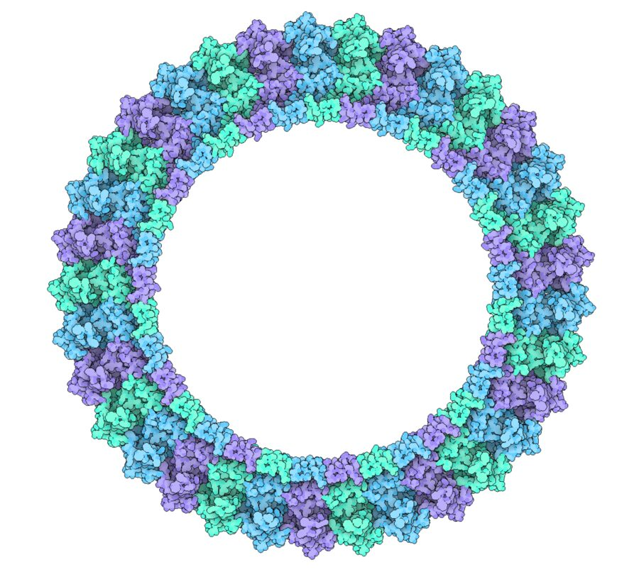{width="100%"}

*Gasdermin D pore seen from above (cryo-EM, PDB 6VFE): about 33 subunits in a ring, inner diameter about 20 nm.*
:::
::: {.column width="60%"}
- Caspase-1 cuts **gasdermin D**. The cut releases the **N-terminal half** from its own inhibitory C-terminal half.
- The N-terminal half binds the **inner leaflet** (it prefers acidic lipids such as PIP₂) and assembles into large **pores**.
- **IL-1β** (made active by caspase-1) leaves **through the pores**. Water rushes in, the cell **swells and bursts**.
- Discovered in **2015**: gasdermin D is the long-sought executioner of pyroptosis.
:::
::::

::: notes
The executioner of pyroptosis was found in 2015 by two groups at the same time: it is gasdermin D. In the resting cell the protein folds back on itself: its C-terminal half covers and inhibits its N-terminal half. Caspase-1 cuts the linker between the halves. The free N-terminal half binds lipids of the inner leaflet of the plasma membrane, especially acidic lipids such as PIP2, and many copies assemble into a ring. The image shows the pore structure solved by cryo-electron microscopy: about thirty-three subunits and an inner opening of about twenty nanometres. Compare that with an ion channel from the ion channel lecture, which is less than one nanometre wide. Through such a pore, small proteins can leave the cell. Caspase-1 also cuts pro-IL-1-beta into active interleukin-1-beta, a powerful inflammatory signal, and it leaves through the gasdermin pores. Water and ions flow in, the cell swells, and a membrane protein called NINJ1 helps the final rupture. Other gasdermins, cut by other caspases, can do the same in other cells.
:::

## Ferroptosis: iron and lipid peroxidation {.smaller}

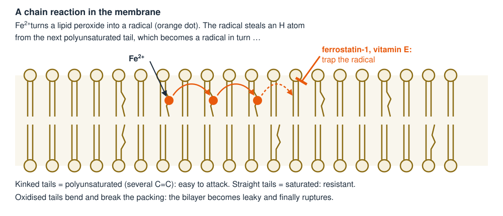{width="78%" fig-align="center"}

- **Polyunsaturated** fatty acid tails (several C=C double bonds) have weak C–H bonds next to the double bonds: radicals attack them easily.
- **Iron** (Fe²⁺) turns lipid peroxides into new radicals: a **chain reaction** through the membrane. Named **ferroptosis** in 2012 (Latin *ferrum*, iron).

::: notes
Ferroptosis is completely different: no caspases, no kinases, no pore-forming protein. The membrane is destroyed by chemistry. Recall from the membrane structure lecture that phospholipid tails can be saturated, straight, or unsaturated, with kinks at the double bonds. Tails with several double bonds, called polyunsaturated, such as arachidonic acid, have carbon–hydrogen bonds next to the double bonds that are weak. A radical can remove that hydrogen atom, and the tail becomes a lipid radical. It reacts with oxygen and becomes a peroxyl radical, which takes a hydrogen from the next polyunsaturated tail. So one radical starts a chain reaction that spreads sideways through the bilayer. Free iron, Fe2+, makes things worse, because it splits lipid peroxides into new radicals. Oxidised tails change shape and disturb the packing of the bilayer; the membrane becomes leaky and finally ruptures. The name ferroptosis, from the Latin for iron, was given in 2012. Ferrostatin-1, and vitamin E, trap the radicals and stop the chain.
:::

## The guard: GPX4 and glutathione {.smaller}

:::: {.columns}
::: {.column width="72%"}
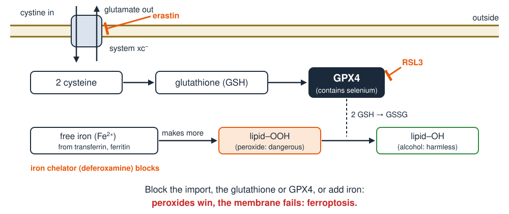{width="100%"}
:::
::: {.column width="28%"}
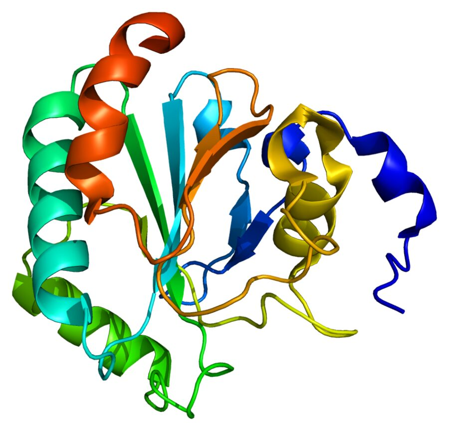{width="100%"}

*GPX4 (PDB 2GS3), a small selenium enzyme.*
:::
::::

- **GPX4** reduces lipid peroxides (L–OOH) to harmless alcohols (L–OH), using **glutathione**. Glutathione needs **cysteine**, imported as cystine by **system xc⁻**.
- Ferroptosis = the **guard fails**: block GPX4 (**RSL3**), starve it of cystine (**erastin**), or add iron.

::: notes
Every cell makes some lipid peroxides all the time, from normal metabolism. Why don't all cells die by ferroptosis? Because of a guard: the enzyme glutathione peroxidase 4, GPX4. It is the only enzyme that can reduce peroxides while they are still inside membrane phospholipids, turning a dangerous lipid hydroperoxide into a harmless lipid alcohol. GPX4 contains selenium in its active site, as selenocysteine. It uses two molecules of reduced glutathione, GSH, for each peroxide. Glutathione is a small tripeptide, and its supply is limited by cysteine. Many cells get cysteine by importing its oxidised dimer, cystine, through the antiporter system xc-minus, which exchanges it for glutamate. So there are several ways to cause ferroptosis: block GPX4 directly with RSL3; block cystine import with erastin, so that glutathione runs out; or raise free iron. An iron chelator such as deferoxamine protects, as does ferrostatin-1. Cells also have backup guards, such as the enzyme FSP1 with coenzyme Q10, but GPX4 is the main one.
:::

## Autophagy and cell death: mostly a survival process {.smaller}

:::: {.columns}
::: {.column width="40%"}
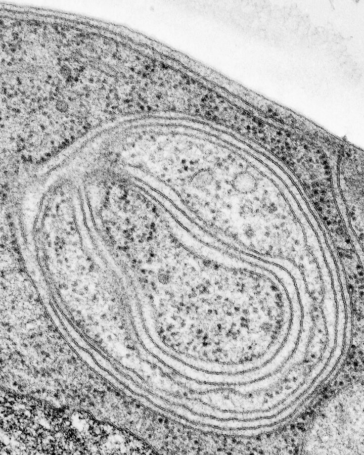{height="430px" fig-align="center"}

*Autophagosome (EM): a double membrane wrapping a piece of ER.*
:::
::: {.column width="60%"}
- *From the endocytosis and lysosome lecture:* autophagy wraps cytoplasm in a **double membrane** and delivers it to **lysosomes**.
- Dying cells are often **full of autophagosomes**. But in most cases autophagy is **trying to save** the cell: block it (ATG gene knockout) and the cell dies **sooner**, not later.
- So "autophagic cell death" mostly means death **with** autophagy, not **by** autophagy. True cases are rare (e.g. fly salivary glands in development).
- Autophagy can **feed** another death: digesting **ferritin** releases iron and favours **ferroptosis**.
:::
::::

::: notes
You met autophagy in the lecture on endocytosis and lysosomes: the cell wraps a piece of its own cytoplasm, here a piece of ER, in a double membrane, the autophagosome, and sends it to the lysosome for digestion. In starvation, autophagy recycles building blocks; it also removes damaged mitochondria before they release cytochrome c or activate the inflammasome. Dying cells are often packed with autophagosomes, and this led to the idea of autophagic cell death. Here we must be careful, and use the logic of necessary and sufficient from the cell methods lecture. If autophagy killed these cells, then knocking out an essential autophagy gene should save them. In most experiments the opposite happens: without autophagy the cells die sooner. So autophagy was a failed rescue attempt: death with autophagy, not by autophagy. There are a few true cases, for example when the salivary glands of the fruit fly are removed during metamorphosis. Autophagy can also help another death: when it digests the iron-storage protein ferritin, free iron is released, which favours ferroptosis.
:::

## Death as a signal: DAMPs and inflammation {.smaller}

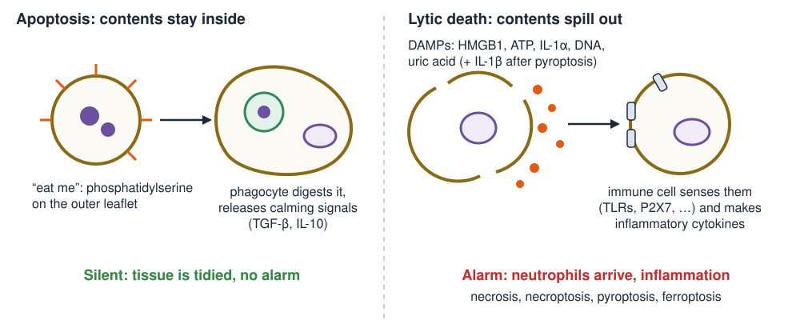{width="78%" fig-align="center"}

- Molecules that should **never be outside a cell** act as alarms: **DAMPs** (damage-associated molecular patterns), e.g. HMGB1, ATP, IL-1α, DNA, uric acid.
- Immune cells sense them with the **same kinds of receptors** they use for microbes (e.g. Toll-like receptors). **Apoptosis hides** them; **lytic death releases** them.

::: notes
Why does the mode of death matter? Because the dying cell sends a message. A healthy cell contains many molecules that are normally never found outside cells: the nuclear protein HMGB1, large amounts of ATP, DNA, the cytokine IL-1 alpha, uric acid. If they appear in the tissue fluid, something has gone badly wrong. These molecules are called DAMPs, damage-associated molecular patterns. Immune cells sense them with receptors of the same families they use to sense bacteria and viruses, for example Toll-like receptors, or the ATP-gated channel P2X7. They then make inflammatory cytokines and call neutrophils. In apoptosis, the contents stay inside membranes, the cell shows only the eat-me signal phosphatidylserine, and the phagocyte that eats it releases calming signals such as TGF-beta and IL-10. So apoptosis is silent. Necroptosis, pyroptosis, ferroptosis and accidental necrosis all break the membrane and release DAMPs, and pyroptosis adds IL-1-beta. These deaths are loud. You meet these receptors again in the immunology course.
:::

## Why the mode of death matters to the body {.smaller}

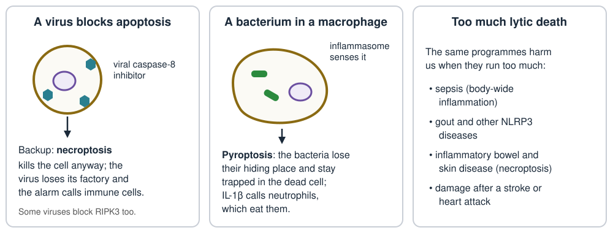{width="82%" fig-align="center"}

- Several programmes = **defence in depth** against pathogens, which evolve ways to block each one.
- The price: when lytic death runs **too much** or in the **wrong place**, the inflammation itself causes disease.

::: notes
Why would evolution keep several ways to die? Think of the cell as being at war with pathogens. Many viruses need the infected cell to stay alive while they multiply, so they make proteins that block apoptosis, for example caspase-8 inhibitors from poxviruses. Necroptosis is the answer: blocking caspase-8 releases RIPK3, and the infected cell dies anyway, loudly, so immune cells are alerted. Some viruses in turn have evolved RIPK3 blockers: an arms race. Bacteria that hide inside macrophages are detected by inflammasomes, and pyroptosis destroys their hiding place. The bacteria stay trapped in the remains of the dead cell, and IL-1-beta calls neutrophils, which eat them. The price is the right-hand panel. When these programmes run too much, or in the wrong place, the inflammation causes disease: sepsis, gout and other NLRP3-driven diseases, some inflammatory bowel and skin diseases with too much necroptosis, and the damage after a stroke or a heart attack. Disease mechanisms like these return in Sjukdomslära.
:::

## How do we know? Telling the death types apart {.smaller}

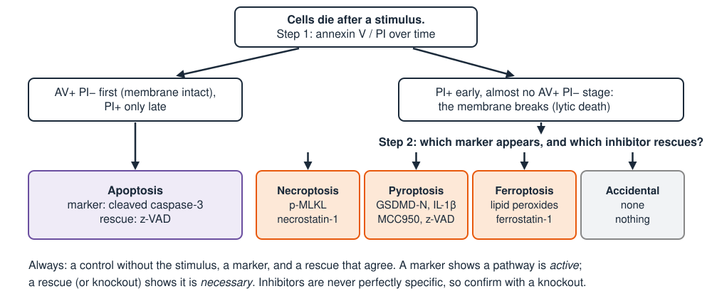{width="72%" fig-align="center"}

- **Annexin V / PI** by flow cytometry asks: was the membrane intact while phosphatidylserine came out? Then **one marker and one rescue** decide. **Try it:** [which death is it?](questions.qmd#explore)

::: notes
In the lab you often see cells dying and have to decide how. This flow chart is the logic. Step one: annexin V and propidium iodide, PI, measured by flow cytometry over time, as in the cell methods lecture. Annexin V binds phosphatidylserine, PI enters only cells with a broken membrane. An apoptotic cell is first annexin V positive and PI negative: the eat-me signal is out but the membrane is still intact. In lytic death the membrane breaks early, so cells go straight to double positive. Be careful: annexin V also stains a cell with a broken membrane, because it then reaches the inner leaflet. Step two: which marker appears, and which inhibitor rescues? Cleaved caspase-3 and rescue by z-VAD point to apoptosis; phospho-MLKL and necrostatin-1 to necroptosis; cleaved gasdermin D, IL-1-beta release and MCC950 to pyroptosis; lipid peroxides and ferrostatin-1 to ferroptosis. If nothing rescues and no marker appears, it was probably accidental. Practise this in the demo.
:::

## All death types compared {.smaller}

::: {style="font-size:1.12em"}

| | **Apoptosis** | **Necroptosis** | **Pyroptosis** | **Ferroptosis** | **Accidental necrosis** |
|---|---|---|---|---|---|
| **Typical trigger** | DNA damage, stress; death receptors | TNF (or virus) when caspase-8 is blocked | Microbes, toxins, crystals, in immune cells | Loss of GPX4 or cystine; excess iron | Heat, freezing, detergent, crush, no ATP |
| **Morphology** | Shrinks, blebs, nucleus fragments, apoptotic bodies | Swells, membrane ruptures | Swells with "balloons", bursts | Rounds up, ruptures; small dense mitochondria | Swells, bursts |
| **Key molecules** | BCL-2 family, caspase-8/-9 → caspase-3/-7 | RIPK1, RIPK3, MLKL | Inflammasome (NLRP3, ASC), caspase-1, gasdermin D | Iron, polyunsaturated lipids, GPX4, glutathione | None (no programme) |
| **Plasma membrane** | Intact until eaten | Broken by MLKL | Pores of gasdermin D, then rupture | Broken by lipid peroxidation | Broken directly |
| **Inflammation** | No (calming) | Yes (DAMPs) | Strong (IL-1β, DAMPs) | Yes (DAMPs) | Yes (DAMPs) |
| **Marker** | Annexin V⁺ PI⁻; cleaved caspase-3 | Phospho-MLKL | Cleaved gasdermin D; IL-1β release | Lipid peroxides (C11-BODIPY) | Early PI⁺, no specific marker |
| **Inhibitor (tool)** | z-VAD (all caspases) | Necrostatin-1 (RIPK1) | MCC950 (NLRP3); caspase-1 inhibitors | Ferrostatin-1; iron chelators | None |

:::

::: notes
This table is the core of ELO 8 for this lecture and the apoptosis lecture together. Read it by columns first: for each death, know a typical trigger, what the cell looks like, the key molecules, what happens to the plasma membrane, whether it is inflammatory, a marker you can measure and an inhibitor you can use as a tool. Then read it by rows: the inflammation row is the big divide. Apoptosis is the only programme that keeps the membrane intact and is silent; all the others are lytic and inflammatory, but for different reasons and with different strength: pyroptosis is the loudest because it adds IL-1-beta. The marker and inhibitor rows are the experimental logic you just saw. Two warnings. First, z-VAD blocks all caspases, including caspase-1, so it also blocks pyroptosis: a rescue by z-VAD does not prove apoptosis. Second, in real tissues several deaths often happen at once, and one can switch to another, as when blocking caspase-8 turns apoptosis into necroptosis. An exam question may give you one row and ask for the death type.
:::

## Why it matters: stroke and heart attack {.smaller}

:::: {.columns}
::: {.column width="30%"}
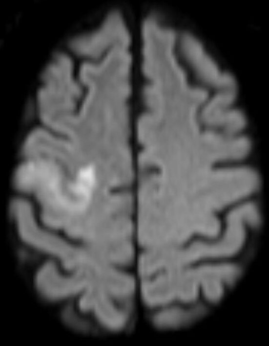{height="270px" fig-align="center"}

*Stroke, MRI (diffusion): the bright area is dying brain tissue.*
:::
::: {.column width="32%"}
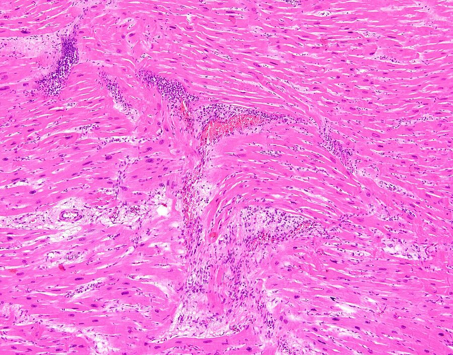{height="270px" fig-align="center"}

*Heart infarct (H&E): dead muscle with an influx of neutrophils (dark dots).*
:::
::: {.column width="38%"}
- **Core** of the infarct: no blood, no ATP, the Na⁺/K⁺ pump stops, cells swell: mostly **accidental necrosis** within minutes.
- **Border zone** and **reperfusion** (when blood returns): **regulated** death over hours to days: apoptosis, necroptosis, ferroptosis, and inflammation.
:::
::::

- In **mice**, necrostatin-1 and ferroptosis inhibitors make infarcts **smaller**. In **patients**, no such drug is approved; the treatment is to **reopen the vessel fast** (clot-dissolving drugs, removing the clot, stents). Many protective drugs that worked in animals **failed** in patients.

::: notes
A stroke or a heart attack starts when an artery is blocked. In the core of the infarct, cells get no oxygen and no glucose, ATP runs out within minutes, the sodium-potassium pump from the transport lecture stops, sodium and water flow in and the cells swell and burst. That is mostly accidental necrosis, and no drug can save those cells. But around the core is a border zone, called the penumbra in the brain, where cells are injured but not yet dead. And when the vessel is opened again, the returning oxygen causes a burst of radicals and calcium overload, which we call reperfusion injury. Here regulated death plays a big part, over hours to days: apoptosis, necroptosis, ferroptosis, and the inflammation that follows, which you can see in the heart section as an influx of neutrophils. In mice, necrostatin-1, already in the 2005 paper, and ferroptosis inhibitors reduce the size of infarcts. In patients, no cell-death inhibitor is approved. Treatment is still to reopen the vessel as fast as possible. Many protective drugs that worked in animals have failed in clinical trials: a lesson you will meet again in the course on clinical trials and drug development.
:::

## Why it matters: new drugs, at an early stage {.smaller}

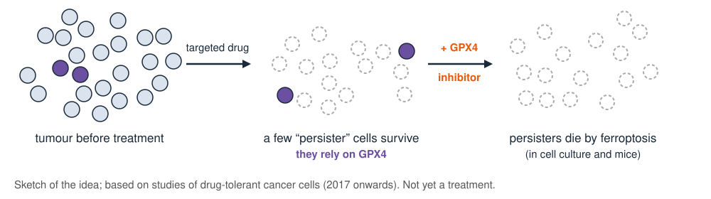{width="70%" fig-align="center"}

- **Ferroptosis against therapy-resistant cancer** (*research stage*): cancer cells that survive targeted drugs, and some aggressive cell states, depend on **GPX4**. In cells and mice, blocking GPX4 kills them. Caveats: current GPX4 inhibitors are **poor drugs** (unstable in the body), and **normal cells** (kidney, neurons) also need GPX4.
- **RIPK1 inhibitors** (*clinical trials*): several have reached **phase 1–2** trials for inflammatory diseases (psoriasis, rheumatoid arthritis, ulcerative colitis) and ALS. So far **no clear benefit**, and **none is approved**.

::: notes
Two drug stories, both at an early stage; say so honestly when you talk about them. First, ferroptosis and cancer. A recurring problem with targeted cancer drugs is that a few cells survive, the so-called drug-tolerant persister cells, and the tumour later grows back from them. Studies from 2017 onwards found that such persister cells, and some aggressive, therapy-resistant cell states, are unusually dependent on GPX4. In cell culture and in mice, a GPX4 inhibitor kills them by ferroptosis. This is a research result, not a treatment. The GPX4 inhibitors used today, such as RSL3, break down quickly in the body, and GPX4 is needed by normal cells too, such as kidney cells and neurons, so toxicity is a real risk. Second, RIPK1 inhibitors. Because necroptosis and RIPK1 signalling drive inflammation in mice, several companies developed RIPK1 kinase inhibitors. They reached phase 1 and phase 2 trials in psoriasis, rheumatoid arthritis, ulcerative colitis and the nerve disease ALS. So far none has shown a clear benefit, for example a phase 2 trial in ALS did not meet its main goal in 2024, and none is approved. Trial phases are explained in the course Kliniska prövningar och läkemedelsutveckling.
:::

## Summary {.smaller}

1. **Accidental necrosis** has no programme; **regulated necrosis** uses the cell's own proteins, so a **drug or a knockout can stop it**. All lytic deaths break the plasma membrane.
2. **Necroptosis:** when **caspase-8** is blocked, **RIPK1–RIPK3** activate **MLKL**, which breaks the membrane: a backup against viruses. Marker phospho-MLKL; tool necrostatin-1.
3. **Pyroptosis:** the **inflammasome** activates **caspase-1**, which cuts **gasdermin D** (pores) and **pro-IL-1β**. **Ferroptosis:** **iron**-driven **lipid peroxidation** wins when **GPX4** or **glutathione** fails.
4. **Autophagy** is mostly a **survival** process. **Apoptosis is silent**; lytic deaths release **DAMPs** and cause **inflammation**, which defends against pathogens but harms in stroke, heart attack and inflammatory disease.
5. Decide the death type with **annexin V/PI, one marker and one rescue**, and know the **comparison table**.

*Read more (optional): Alberts et al., Molecular Biology of the Cell, 7th ed., ch. 18.*

[Image credits](../credits.qmd#regulated-necrosis){style="font-size:0.7em"}

::: notes
Five take-home points. First, the definition: regulated necrosis is carried out by the cell's own proteins, and the test is that a drug or a knockout prevents it; accidental necrosis cannot be prevented that way. Second, necroptosis: caspase-8 normally keeps RIPK1 and RIPK3 in check; when it is blocked, for example by a virus, they activate MLKL, which breaks the membrane. Third, pyroptosis and ferroptosis: in pyroptosis the inflammasome activates caspase-1, which cuts gasdermin D into pore-forming pieces and activates IL-1-beta; in ferroptosis, the membrane is destroyed by a chain reaction of lipid peroxidation that iron accelerates, when the guard GPX4 with its glutathione fails. Fourth, autophagy mostly protects the cell; and the mode of death is a message to the body: silent for apoptosis, loud for the lytic deaths. Fifth, you can tell them apart with a membrane readout, a marker and a rescue, and you should know the table. Next, we look at cancer, where cells escape death altogether.
:::
