## About this lecture {.smaller}

The cells of your body constantly send and receive signals. A signal is useless unless a cell has a **receptor** for it, and the receptor decides what happens next. This lecture gives the rules that every signalling pathway follows; the next lectures fill in the machinery.

After this lecture you can:

- describe the **signal types**: endocrine, paracrine, autocrine, contact-dependent and synaptic;
- name the **receptor classes**: ion-channel-coupled, G-protein-coupled, enzyme-coupled and intracellular (nuclear) receptors;
- use **K~d~**, **dose–response curves**, **EC₅₀** and **IC₅₀**, and tell an **agonist**, a **partial agonist** and an **antagonist** apart;
- explain **amplification**, **integration**, **feedback** and **adaptation**, and how **molecular switches** (phosphorylation, GTPases) work;
- explain why some responses take **seconds** and others **hours**.

::: notes
This lecture opens the block on cell signalling. We start with principles, the rules that hold for every pathway, and the following lectures look at the machinery in detail: G-protein-coupled receptors and second messengers, then enzyme-coupled receptors and kinase cascades, then the signals that shape tissues and decide cell fates. Today we use your chemistry a lot. Binding of a signal to a receptor is a chemical equilibrium, so the dissociation constant, K d, tells us how much signal is needed. From binding we go to the dose–response curve, which is the most important graph in pharmacology. You will learn the words a drug developer uses every day: agonist, antagonist, partial agonist, EC 50 and IC 50. Then we look at what the cell does with a signal after binding: it amplifies it, combines it with other signals, uses feedback, and adapts when the signal stays on. At the end we look at drugs that act on receptors, among them opioids, naloxone and beta-blockers. This covers ELO 3.
:::

## The question: one hormone, many answers {.smaller}

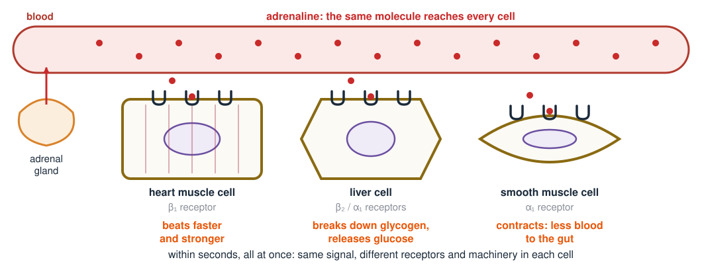{width="76%" fig-align="center"}

- A fright: your adrenal glands release **adrenaline** into the blood. Within **seconds** the heart beats faster, the liver releases glucose and blood vessels in the gut contract.
- Even in a fright, blood adrenaline reaches only a few **nanomolar**: about one molecule per 10 billion water molecules. **How does a cell detect so little? Why does the same molecule do different things in different cells? And how can a drug block it?**

::: notes
Imagine a sudden fright, for example a car that almost hits you. Within seconds your heart races, you feel your pulse, and your muscles are ready to run. The signal is adrenaline, a small molecule made in the adrenal glands and released into the blood. Every cell in the body is bathed in the same blood, so every cell sees the same adrenaline. Yet the answers are completely different. Heart muscle cells beat faster and stronger. Liver cells break down glycogen and release glucose into the blood, fuel for the muscles. Smooth muscle cells around the blood vessels of the gut contract, so blood goes to the muscles instead of to digestion. And the concentration is tiny: below one nanomolar at rest and a few nanomolar in a fright. Three puzzles guide today's lecture. First, how can a receptor detect a nanomolar signal? The answer is high-affinity binding plus amplification. Second, why does the same signal do different things? Because cells have different receptors and different machinery behind them. Third, how can a drug change the answer? This is the basis of half of pharmacology, and we finish with beta-blockers and opioids.
:::

## Five ways to send a signal {.smaller}

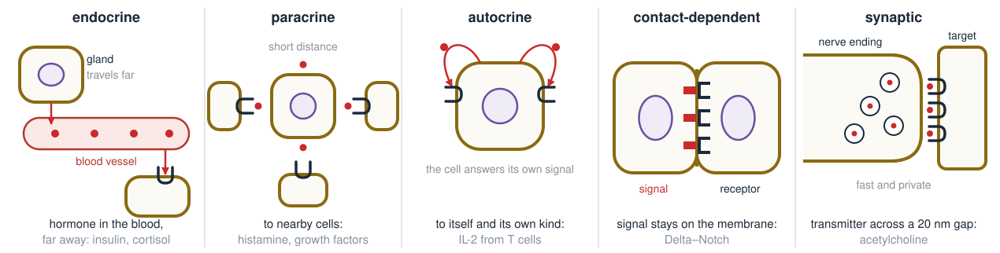{width="100%" fig-align="center"}

- **Endocrine:** a **hormone** travels in the blood to cells all over the body (insulin, cortisol). Slow to spread, long reach.
- **Paracrine:** a local mediator acts on **nearby** cells and is quickly destroyed or taken up (histamine, many growth factors).
- **Autocrine:** a cell responds to its **own** signal; a group of similar cells can reinforce each other (IL-2 from activated T cells).
- **Contact-dependent:** the signal stays **on the membrane** of the sending cell; only touching cells respond (Delta on one cell, Notch on the next).
- **Synaptic:** a nerve cell releases a **neurotransmitter** across a narrow gap to one target cell (acetylcholine): fast and private.

::: notes
Cells signal over very different distances. In endocrine signalling, a gland releases a hormone into the blood, which carries it to almost every cell. Insulin from the pancreas and cortisol from the adrenal cortex are examples. Because the hormone is diluted in about five litres of blood, its concentration is low, so the receptors must bind it very tightly. In paracrine signalling the signal acts locally, on cells a few cell diameters away. Histamine released from mast cells in an allergic reaction is an example; the signal does not get far because it is broken down, taken up or bound to the matrix. Autocrine signalling is a special case: the cell has receptors for its own signal. Activated T cells make the growth factor interleukin 2 and respond to it themselves, which amplifies the immune response. In contact-dependent signalling the signal molecule stays anchored in the membrane; Delta and Notch, which you meet in the lecture on signals that decide cell fates, are the classic pair. Synaptic signalling is the extreme of local signalling: a nerve ending releases a neurotransmitter into a gap of about 20 nanometres, and only the cell on the other side responds, within milliseconds.
:::

## Where is the receptor? On the surface or inside {.smaller}

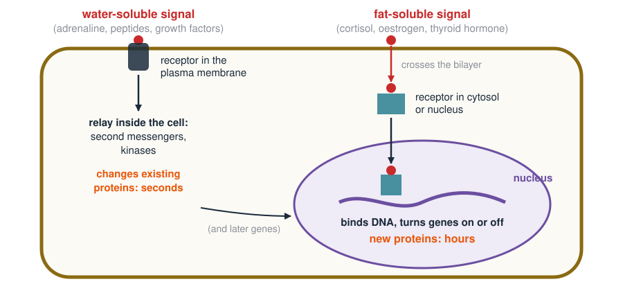{width="66%" fig-align="center"}

- **Water-soluble** signals (most hormones, peptides, growth factors, neurotransmitters) cannot cross the lipid bilayer. Their receptors sit in the **plasma membrane** and pass the message inside.
- **Small fat-soluble** signals (steroid hormones such as cortisol and oestrogen, thyroid hormone, vitamin D) diffuse through the membrane and bind **intracellular receptors**, which act as **transcription factors**.

::: notes
The first question about any signal is where its receptor is, and the answer follows from chemistry you know from the membrane lecture. The lipid bilayer stops charged and polar molecules. Adrenaline, insulin and growth factors are water-soluble, so they cannot enter the cell. Their receptors are transmembrane proteins: the signal binds outside, the receptor changes shape, and the change is passed to proteins inside the cell. Because these relay proteins already exist, the response can start within seconds. Steroid hormones are different. Cortisol, oestrogen and testosterone are made from cholesterol, are small and hydrophobic, and diffuse straight through the membrane. Thyroid hormone and vitamin D act in the same way. Their receptors are inside the cell, in the cytosol or the nucleus. When the hormone binds, the receptor binds DNA and changes which genes are transcribed. New messenger RNA and new proteins must be made, so these responses take hours. A side note: a few gases, such as nitric oxide, also cross membranes and act directly on an enzyme inside the cell.
:::

## Three classes of cell-surface receptor {.smaller}

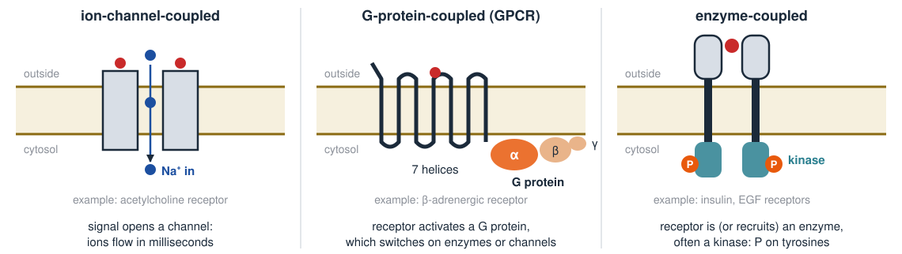{width="90%" fig-align="center"}

- **Ion-channel-coupled:** the receptor *is* a channel; binding opens it. You met the acetylcholine receptor in the lecture on ion channels. Fastest: milliseconds.
- **G-protein-coupled receptors (GPCRs):** seven helices cross the membrane; the active receptor switches on a **G protein**, which switches on enzymes or channels. Largest family: about **800 genes** in humans.
- **Enzyme-coupled:** a single-pass receptor that is itself an enzyme (often a **tyrosine kinase**) or recruits one. Binding brings two receptors together (insulin, growth factors).

::: notes
Cell-surface receptors come in three classes, and each gets its own detail later. Ion-channel-coupled receptors, also called ligand-gated channels, are the simplest: the receptor is a channel, and the signal opens it. You met the nicotinic acetylcholine receptor in the lecture on ion channels: two acetylcholine molecules bind and sodium flows in. This is the fastest kind of signalling, used at synapses. G-protein-coupled receptors are the largest family of membrane proteins in our genome, about 800 genes, of which about half are smell receptors. All have the same fold, a chain that crosses the membrane seven times. When a signal binds, the receptor changes shape and activates a G protein on the inside, which then changes the activity of enzymes or channels. The next lecture is about them. Enzyme-coupled receptors cross the membrane once. Most are kinases themselves, or bind a kinase. When the signal binds, two receptors come together and phosphorylate each other on tyrosines, which starts a cascade; that is the lecture on kinase cascades. Receptors of all three classes are major drug targets.
:::

## Intracellular receptors: a hormone becomes a transcription factor {.smaller}

:::: {.columns}
::: {.column width="48%"}
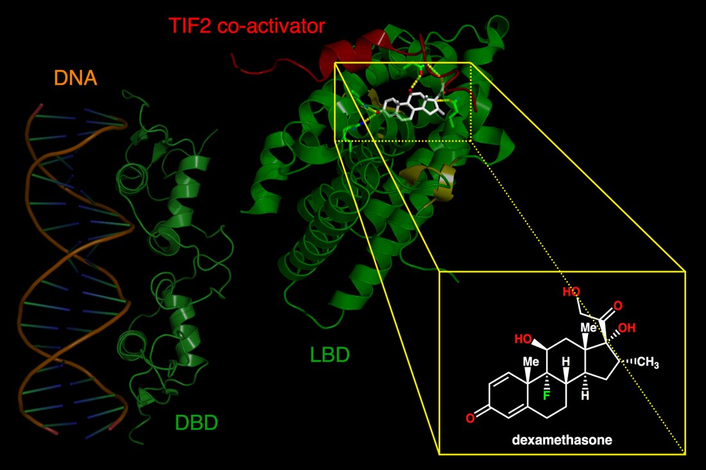{width="100%" fig-align="center"}

*Glucocorticoid receptor (green) on DNA: DNA-binding domain (DBD) and ligand-binding domain (LBD) with the drug dexamethasone in its pocket and a co-activator (red). Crystal structures.*
:::
::: {.column width="52%"}
- **Nuclear receptors**: about 48 in humans; receptors for **steroids** (cortisol, oestrogen, testosterone), thyroid hormone, vitamin D and retinoic acid.
- Without hormone, some wait in the cytosol (the **glucocorticoid receptor**, held by chaperones), others sit on DNA in the nucleus.
- The hormone binds a pocket in the **ligand-binding domain**; the receptor changes shape, binds **DNA response elements** and recruits **co-activators**: target genes switch on (or off).
- Response in **hours**, lasting long after the hormone is gone. Drugs: **prednisolone** (anti-inflammatory), **tamoxifen** (breast cancer).
:::
::::

::: notes
Intracellular receptors form one protein family, the nuclear receptors, with about 48 members in humans. Each has a DNA-binding domain and a ligand-binding domain. The ligand-binding domain has a deep pocket that fits a small hydrophobic hormone. The glucocorticoid receptor, which binds cortisol, waits in the cytosol, held in an inactive form by chaperone proteins. When cortisol binds, the receptor releases the chaperones, moves into the nucleus and binds short DNA sequences called response elements near its target genes. There it recruits co-activator proteins that open chromatin and help RNA polymerase start transcription. Other nuclear receptors are already bound to DNA and switch from repressor to activator when the hormone arrives. Note the logic: the receptor is a transcription factor whose activity is controlled by a small molecule, which links to what you know about gene regulation. Because new RNA and proteins must be made, the response takes hours, and it lasts for hours or days. Many drugs act here: synthetic glucocorticoids such as prednisolone dampen inflammation, and tamoxifen blocks the oestrogen receptor in breast cancer, which returns in the lecture on signals that decide cell fates.
:::

## *Recap:* binding is an equilibrium; K~d~ measures affinity {.smaller}

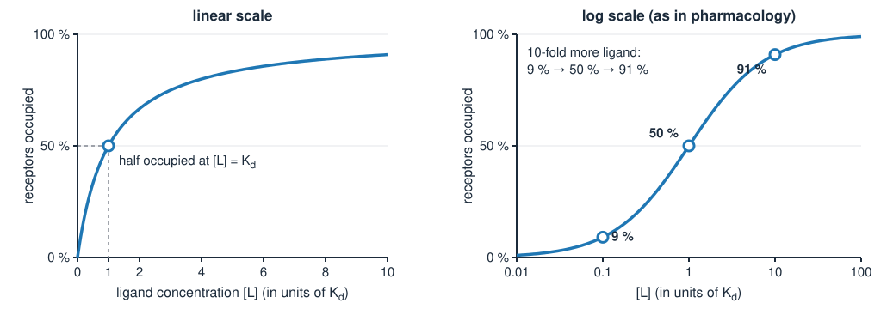{width="80%" fig-align="center"}

$$\text{R} + \text{L} \rightleftharpoons \text{RL} \qquad K_d = \frac{[\text{R}][\text{L}]}{[\text{RL}]} \qquad \text{fraction occupied} = \frac{[\text{L}]}{[\text{L}] + K_d}$$

- **K~d~** is the concentration that fills **half** the receptors. Low K~d~ = **high affinity**. Hormone receptors: K~d~ about **0.1–10 nM**.
- On a log axis the curve is an S: from 10 % to 90 % occupied takes an **81-fold** rise in concentration.

::: notes
This is a recap from chemistry. A ligand L and a receptor R form a complex RL, and the reaction reaches an equilibrium. The dissociation constant K d is the equilibrium constant written for the complex falling apart, so it has units of concentration. A small K d means the complex rarely falls apart: high affinity. If you rearrange the equation, the fraction of receptors occupied is L over L plus K d. When the free ligand concentration equals K d, exactly half the receptors are occupied. That is the definition to remember. On a linear axis the curve is a hyperbola that rises steeply and then flattens. Pharmacologists almost always plot the concentration on a log axis, because concentrations span many orders of magnitude. On a log axis the same curve becomes an S shape, symmetric around K d. At one tenth of K d about 9 percent of the receptors are occupied, at K d 50 percent, at ten times K d 91 percent. Receptors for hormones typically have a K d in the nanomolar range, which matches the low hormone concentrations in blood. This is the first half of the answer to the question of how a cell detects so little signal.
:::

## How do we know? Counting receptors with a radioactive drug {.smaller}

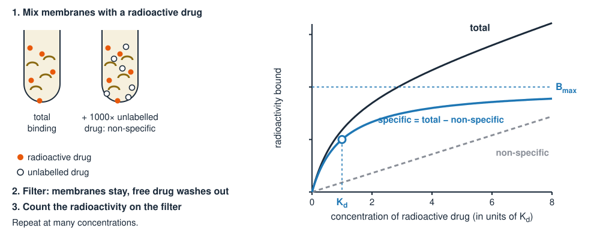{width="78%" fig-align="center"}

- **1970s:** Robert **Lefkowitz** used radioactively labelled drugs to find the **β-adrenergic receptor**, then thought by many to be just an idea. Specific binding was saturable, tight and matched the drugs' effects.
- **Specific binding** = total − non-specific. Its curve gives **B~max~** (how many receptors) and **K~d~** (how tightly they bind).
- Nobel Prize in Chemistry **2012** (Lefkowitz and Kobilka, for GPCRs).

::: notes
How do we know that receptors exist and how tightly they bind? Until the 1970s, a receptor was an abstract idea: something on the cell that a drug must act on. Robert Lefkowitz and others made it concrete with radioligand binding. You mix cell membranes with a radioactively labelled drug at a known concentration, let binding reach equilibrium, then pour the mixture through a filter. The membranes stay on the filter with whatever is bound to them, and the free drug is washed away. Counting the radioactivity tells you how much is bound. Some binding is non-specific: the drug sticks to lipids and other proteins. To measure it, you run a second tube with a thousand-fold excess of unlabelled drug, which fills all real receptors, so the remaining radioactivity is non-specific. Subtract it, and the specific binding curve saturates: there is a fixed number of receptors, B max, and the half-saturating concentration is K d. Binding that is saturable, high-affinity and matches the potency of drugs in tissue is the signature of a real receptor. Lefkowitz used this approach to find and then purify the beta-adrenergic receptor, and he shared the 2012 Nobel Prize in Chemistry with Brian Kobilka.
:::

## From binding to response: the dose–response curve {.smaller}

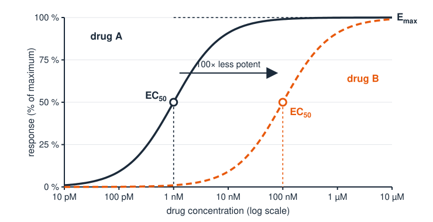{width="62%" fig-align="center"}

- Measure a **response** (heart rate, cAMP, contraction) at many concentrations; plot it against **log concentration**.
- **E~max~**: the largest response the drug can give. **EC₅₀**: the concentration that gives **half** of E~max~.
- **Potency** = how little drug you need (a low EC₅₀). Drug A is **100× more potent** than drug B, but both reach the same maximum.

::: notes
Binding is not yet a response. A pharmacologist measures what the cell or tissue does: how fast an isolated heart beats, how much cAMP a cell makes, how strongly a muscle strip contracts. You measure this at many drug concentrations and plot the response against the log of the concentration. The result is again an S-shaped curve, the dose–response curve, the most important graph in pharmacology. Two numbers describe it. E max is the plateau, the largest response that drug can give in that system. EC 50, the effective concentration 50 percent, is the concentration that gives half of E max. The EC 50 measures potency: a drug with a low EC 50 works at low concentration. In the figure, drug A has an EC 50 of 1 nanomolar and drug B of 100 nanomolar. Drug A is a hundred times more potent, but both give the same maximal effect. Potency is not the same as being a better drug; a less potent drug can be given at a higher dose. What matters clinically is whether the drug reaches a useful effect at a dose without too many side effects.
:::

## Agonists, partial agonists and antagonists {.smaller}

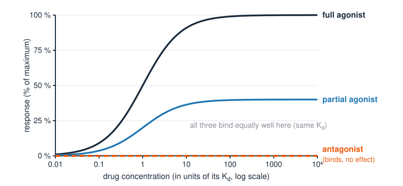{width="60%" fig-align="center"}

- Binding (**affinity**) and switching the receptor on (**efficacy**) are two different properties.
- **Full agonist:** binds and switches on fully (adrenaline, morphine). **Partial agonist:** binds but switches on only part-way, even at 100 % occupancy (buprenorphine). **Antagonist:** binds, switches nothing on, and **blocks** the site (naloxone, beta-blockers). **Try it:** [Demo: dose–response](questions.qmd#explore).

::: notes
A drug can do two separate things. It can bind the receptor, which is its affinity, measured by K d. And once bound, it can switch the receptor on more or less well, which is its efficacy. A full agonist binds and switches the receptor fully on; the natural hormone is usually a full agonist. A partial agonist binds but switches the receptor on only part of the way: even when every receptor is occupied, the response stays below the maximum. Buprenorphine, used against pain and in the treatment of opioid addiction, is a partial agonist at the opioid receptor. An antagonist binds but has no efficacy at all. On its own it does nothing visible, flat on the graph. Its effect appears only when an agonist is present: it occupies the binding site and keeps the agonist out. The three drugs in the figure have the same affinity, so their curves are centred at the same concentration; only efficacy differs. A useful picture: affinity is how well a key fits the lock, efficacy is how far it turns the lock. There are also inverse agonists, which switch off receptors that are slightly active without any signal. Try the demo: you can compare morphine, buprenorphine and naloxone.
:::

## Antagonists: shift or flatten; IC₅₀ {.smaller}

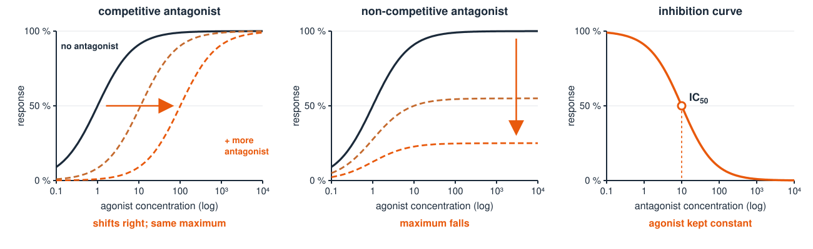{width="100%" fig-align="center"}

- **Competitive antagonist** (same site, reversible): more agonist can out-compete it. The curve **shifts right**; E~max~ is unchanged.
- **Non-competitive antagonist** (another site, or irreversible): more agonist cannot help. **E~max~ falls**.
- **IC₅₀**: the antagonist concentration that removes **half** of the response, at a stated agonist concentration. More agonist → higher IC₅₀.

::: notes
Antagonists come in two main kinds, and the dose–response curve tells them apart. A competitive antagonist binds the same site as the agonist, reversibly. Agonist and antagonist compete for the receptors, and the law of mass action decides who wins. If you add more agonist, you can always overcome the antagonist; you just need more. So the curve moves to the right, parallel, and reaches the same maximum. The shift depends on how much antagonist there is relative to its own K d: at ten times its K d the agonist curve shifts about eleven-fold. A non-competitive antagonist binds somewhere else and stops the receptor from working, or it binds the same site irreversibly, with a covalent bond. Then extra agonist cannot help, because those receptors are lost. The maximum falls. The third panel shows how an antagonist is usually tested in drug development: keep the agonist at a fixed concentration and add more and more antagonist. The concentration that halves the response is the IC 50, the inhibitory concentration 50 percent. Note that the IC 50 of a competitive antagonist is not a constant of the drug: with more agonist present, you need more antagonist.
:::

## Amplification: a few receptors, a large response {.smaller}

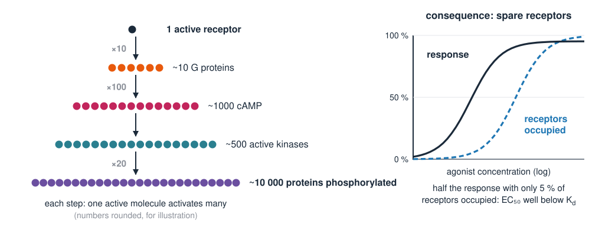{width="78%" fig-align="center"}

- Each active molecule activates **many** of the next: an **enzyme cascade**. One adrenaline–receptor pair can lead to thousands of phosphorylated proteins.
- Consequence: a full response may need only a few % of the receptors occupied. The rest are **spare receptors**, and **EC₅₀ is lower than K~d~**.

::: notes
The second half of the answer to the question of how a cell detects so little signal is amplification. One active receptor does not activate one G protein; it activates many, one after the other, while the hormone stays bound. Each activated G protein switches on an enzyme, adenylyl cyclase, which makes many molecules of the small messenger cAMP. cAMP activates protein kinase A, and each kinase molecule phosphorylates many target proteins. The numbers in the figure are rounded and only illustrate the principle; each step multiplies. You will see this cascade in detail in the next lecture. Amplification has a consequence you can see on a dose–response curve. If a small fraction of occupied receptors is enough for a full response, the response curve lies to the left of the binding curve. In the figure, half of the maximal response needs only about 5 percent of the receptors. The other receptors are called spare receptors, or the receptor reserve. So the EC 50 is often much lower than the K d. EC 50 equals K d only in the simplest case, when the response is directly proportional to occupancy. Remember this when you compare binding and functional data.
:::

## Molecular switches: phosphorylation and GTPases {.smaller}

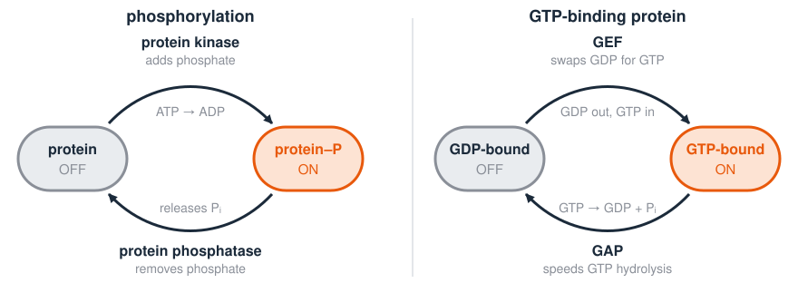{width="72%" fig-align="center"}

- **Phosphorylation:** a **kinase** adds a phosphate from ATP to serine, threonine or tyrosine; a **phosphatase** removes it. About 500 kinases in the human genome.
- **GTP-binding proteins** are ON with GTP and turn themselves OFF by hydrolysing it. A **GEF** switches them on; a **GAP** speeds up switching off. Examples: G proteins, Ras.
- Every switch needs an **off** route. A switch that cannot turn off causes disease (Ras mutations in cancer, cholera toxin).

::: notes
Inside the cell, signals are carried by proteins that act as switches. There are two main kinds. The first is phosphorylation. A protein kinase transfers a phosphate group from ATP onto a serine, threonine or tyrosine side chain of a target protein. The large negative charge changes the protein's shape or creates a docking site for other proteins, so the protein is switched on, or sometimes off. A protein phosphatase removes the phosphate again. The human genome has about 500 kinases, which shows how central this switch is. The second kind are GTP-binding proteins. With GTP bound they are on; with GDP bound they are off. They switch themselves off, because they slowly hydrolyse their GTP to GDP. Two kinds of helper proteins control the timing: a guanine nucleotide exchange factor, GEF, lets GDP out and GTP in, which switches the protein on. A GTPase-activating protein, GAP, speeds up hydrolysis, which switches it off. Activated receptors often act as GEFs. The heterotrimeric G proteins and the small protein Ras are both GTPases. The off route is as important as the on route: Ras that cannot hydrolyse GTP drives many cancers, and cholera toxin locks a G protein in the on state.
:::

## Integration and feedback: cells compute {.smaller}

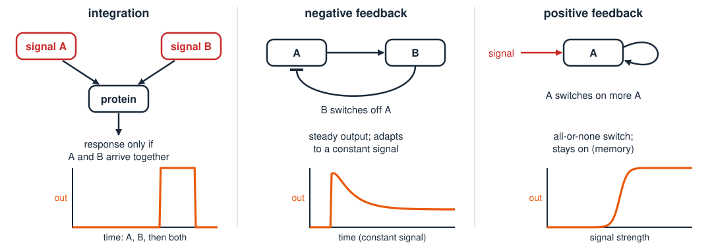{width="86%" fig-align="center"}

- **Integration:** a cell receives many signals at once. Proteins that need two inputs act like an **AND gate**; the answer depends on the **combination** of signals.
- **Negative feedback:** the output switches off its own cause. Keeps responses **short or stable**, and lets the cell **adapt**.
- **Positive feedback:** the output reinforces itself. Makes **all-or-none** decisions that stay on (dividing, differentiating).

::: notes
A cell does not receive one signal at a time. It sits in a bath of hormones, local mediators and contact signals, and it has to combine them. Integration happens where pathways meet. Some proteins are switched on only when two signals arrive together, for example when a protein needs two phosphorylations by two different kinases, or a kinase needs both a lipid messenger and calcium. Such a protein works like an AND gate in a computer. Feedback loops shape the response in time. In negative feedback, a product of the pathway inhibits an earlier step. The result is a response that rises and then settles to a lower, stable level, even if the signal stays on; this is one way cells adapt. You will see negative feedback in the kinase cascade lecture, where it explains why some cancer drugs lose effect. In positive feedback, a product activates its own production. Then a small push beyond a threshold flips the system completely on, and it stays on even when the signal falls. Cells use positive feedback for decisions that must be all or none, such as entering cell division, which you meet in the cell-cycle lectures.
:::

## Adaptation: when the signal stays on {.smaller}

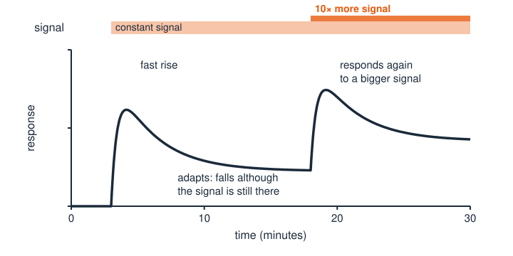{width="54%" fig-align="center"}

- Under a constant signal, the response **fades**: the cell becomes **less sensitive** (desensitisation). A stronger signal gives a new response.
- Ways to adapt: the active receptor is **phosphorylated** and blocked by **arrestin** (seconds to minutes); receptors are **taken into the cell** (minutes to hours) and degraded; downstream proteins adapt.
- Seen in the clinic as **tolerance**: opioids need higher doses over time; frequent β₂-agonist inhaler use works less well.

::: notes
If a signal stays on, most cells do not keep responding at the same level. The response rises quickly and then falls, although the signal is still there. The cell has become less sensitive, which is called adaptation or desensitisation. If the signal then becomes stronger, the cell responds again. This lets cells detect changes in a signal over a wide range of concentrations, as your eyes adapt from sunlight to a dark room. There are several mechanisms. Fast: a special kinase phosphorylates the active receptor, and a protein called arrestin binds the phosphorylated receptor and blocks the G protein from coupling; you meet this in the next lecture. Slower: receptors are pulled into the cell by endocytosis, which you met in the endocytosis lecture, and some are degraded in lysosomes, so fewer receptors remain. Changes further downstream also contribute. In medicine, adaptation appears as tolerance. Patients who take opioids for a long time need higher doses for the same pain relief, and asthma patients who use a beta-2 agonist inhaler very often find that it works less well. In the demo, you can remove receptors and see what happens to the dose–response curve.
:::

## Fast and slow responses {.smaller}

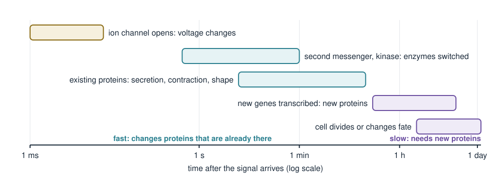{width="80%" fig-align="center"}

- **Fast** (milliseconds to minutes): the signal changes **proteins that are already there**: opens channels, switches enzymes, starts secretion or contraction.
- **Slow** (hours to days): the signal changes **gene expression**; new proteins must be made. This is how cells change what they are.
- Many signals do both: adrenaline acts in seconds via enzymes, and later changes genes via the same pathway.

::: notes
The speed of a response tells you a lot about its mechanism. The fastest responses are electrical: a ligand-gated channel opens within a millisecond, and the membrane voltage changes immediately. Next come responses that work through second messengers and protein phosphorylation. They take seconds to minutes, because a few enzymatic steps are needed, but nothing new has to be made. Secretion of stored hormones, muscle contraction and changes in cell shape belong here. The slowest responses involve gene expression. The signal must reach the nucleus, the gene must be transcribed, the RNA processed, exported and translated, and the protein must fold and reach its place. That takes from about half an hour to many hours. Decisions about cell division, differentiation and cell death take hours to days. The difference is the reason why adrenaline acts within seconds and cortisol within hours. Many pathways have both a fast and a slow arm. Protein kinase A, activated by adrenaline, quickly phosphorylates metabolic enzymes, and it also phosphorylates a transcription factor that changes gene expression over the following hours.
:::

## Why it matters: receptors are the main drug targets {.smaller}

:::: {.columns}
::: {.column width="42%"}
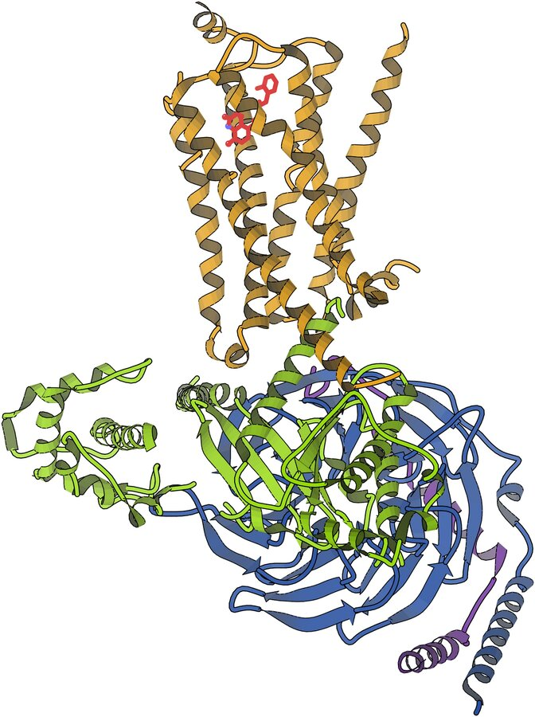{height="400px" fig-align="center"}

*β₂-adrenergic receptor (gold) with its G protein (green, blue, purple). Crystal structure, PDB 3SN6 (Kobilka lab, 2011).*
:::
::: {.column width="58%"}
- About **a third of all approved drugs** act on GPCRs: beta-blockers, opioids, antihistamines, antipsychotics, GLP-1 drugs for diabetes.
- The drug developer's vocabulary:
  - **affinity** (K~d~, K~i~): how tightly it binds;
  - **efficacy**: how strongly it switches the receptor on (agonist, partial agonist, antagonist);
  - **potency** (EC₅₀, IC₅₀): how much drug is needed;
  - **selectivity**: which receptors it hits, and which it misses.
- You meet these words again in *Kliniska prövningar och läkemedelsutveckling*.
:::
::::

::: notes
Why should a future biomedical scientist care about all this? Because receptors are where most drugs act. About a third of all approved drugs act on G-protein-coupled receptors alone, and many more act on ion channels, enzyme-coupled receptors and nuclear receptors. The list includes beta-blockers for the heart, opioids for pain, antihistamines for allergy, many drugs for psychiatric disease, and the new GLP-1 receptor agonists such as semaglutide for diabetes and obesity. When a company develops a drug, it measures exactly the quantities you met today. Affinity is measured in binding assays, often as K i, the K d of an unlabelled drug determined by competition with a radioactive one. Efficacy and potency come from dose–response curves in cells. Selectivity compares the drug's affinity for its target with its affinity for related receptors, because binding the wrong receptor causes side effects. The structure shows why GPCR drugs are possible at all: modern structures show the pocket where the drug binds, so new molecules can be designed to fit. You meet this vocabulary again in the course on clinical trials and drug development, Kliniska prövningar och läkemedelsutveckling.
:::

## Why it matters: opioids, naloxone and beta-blockers {.smaller}

:::: {.columns}
::: {.column width="58%"}
- **Morphine, fentanyl:** full agonists at the **μ-opioid receptor** (a GPCR). They relieve pain, but in overdose they **stop breathing**.
- **Buprenorphine:** a **partial agonist** with very high affinity. Its effect on breathing reaches a **ceiling**, so it is safer; used to treat opioid addiction. It also **displaces** full agonists.
- **Naloxone:** a **competitive antagonist**. A nasal spray or injection pushes the opioid off the receptors and restarts breathing within minutes. It wears off faster than many opioids, so the patient must be watched.
- **Beta-blockers** (metoprolol): competitive antagonists at the **β₁-adrenergic receptor** of the heart. They shift the curve for adrenaline to the right: lower heart rate and blood pressure.
:::
::: {.column width="42%"}
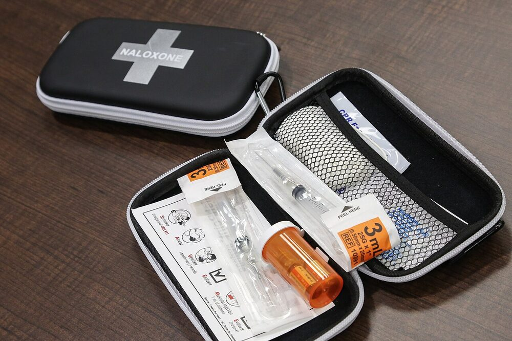{width="100%" fig-align="center"}

*A naloxone kit handed out to the public (New Brunswick, Canada): naloxone, syringes and instructions.*
:::
::::

::: notes
Here the vocabulary saves lives. Morphine and fentanyl are full agonists at the mu-opioid receptor, a GPCR on nerve cells in the pain pathways and in the brainstem centres that control breathing. They relieve pain, but too much shuts down breathing, which is how people die of an overdose. Buprenorphine is a partial agonist with very high affinity. Because its maximal effect is lower, the depression of breathing reaches a ceiling, and buprenorphine is used as a safer substitute in the treatment of opioid addiction. Its high affinity has another consequence: it pushes full agonists off the receptor, and in someone who is dependent on heroin it can cause sudden withdrawal. Naloxone is a competitive antagonist. Given as a nasal spray or an injection, it displaces the opioid and restores breathing within minutes. Because it is competitive, a large opioid dose may need a large naloxone dose, and because naloxone is cleared within about an hour, the opioid can take over again, so the patient must be observed. Beta-blockers such as metoprolol are competitive antagonists at the beta-1 receptor in the heart. They shift the dose–response curve for adrenaline and noradrenaline to the right, so the heart rate and blood pressure fall. In the demo you can try all of these.
:::

## Summary {.smaller}

1. Cells signal over **long distances** (endocrine), **short distances** (paracrine, autocrine, synaptic) or by **contact**. Water-soluble signals use **cell-surface receptors** (ion-channel-coupled, GPCR, enzyme-coupled); small fat-soluble signals use **intracellular receptors** that regulate genes.
2. Binding is an equilibrium: **K~d~** is the concentration that fills half the receptors. A **dose–response curve** gives **E~max~** (efficacy) and **EC₅₀** (potency); **IC₅₀** measures an inhibitor.
3. **Agonists** switch receptors on, **partial agonists** only part-way, **antagonists** block. Competitive antagonists **shift** the curve; non-competitive ones **lower** the maximum.
4. Signals are **amplified** by cascades of **molecular switches** (kinases and phosphatases, GTPases with GEFs and GAPs), **integrated**, shaped by **feedback**, and **adapt** when they stay on.
5. Changing existing proteins is **fast** (seconds); changing gene expression is **slow** (hours). Receptors are the targets of a large part of all drugs.

*Read more (optional): Alberts et al., Molecular Biology of the Cell, 7th ed., ch. 15.*

[Image credits](../credits.qmd#signalling-principles){style="font-size:0.7em"}

::: notes
Five take-home points. First, cells signal over different distances, and the chemistry of the signal decides where its receptor is: water-soluble signals bind receptors in the plasma membrane, of three classes; small fat-soluble signals cross the membrane and bind nuclear receptors that act on genes. Second, binding is an equilibrium described by K d, and the dose–response curve, plotted on a log axis, gives you E max and EC 50; for an inhibitor you measure the IC 50. Third, affinity and efficacy are different: a full agonist switches the receptor fully on, a partial agonist part-way, and an antagonist not at all; competitive antagonists shift the curve to the right, non-competitive antagonists lower its maximum. Fourth, the cell amplifies, combines and shapes signals with molecular switches and feedback loops, and it adapts to a signal that stays on. Fifth, changing existing proteins takes seconds, while changing genes takes hours. In the next lecture we open the box of the G-protein-coupled receptor and follow the signal from the receptor to second messengers.
:::
